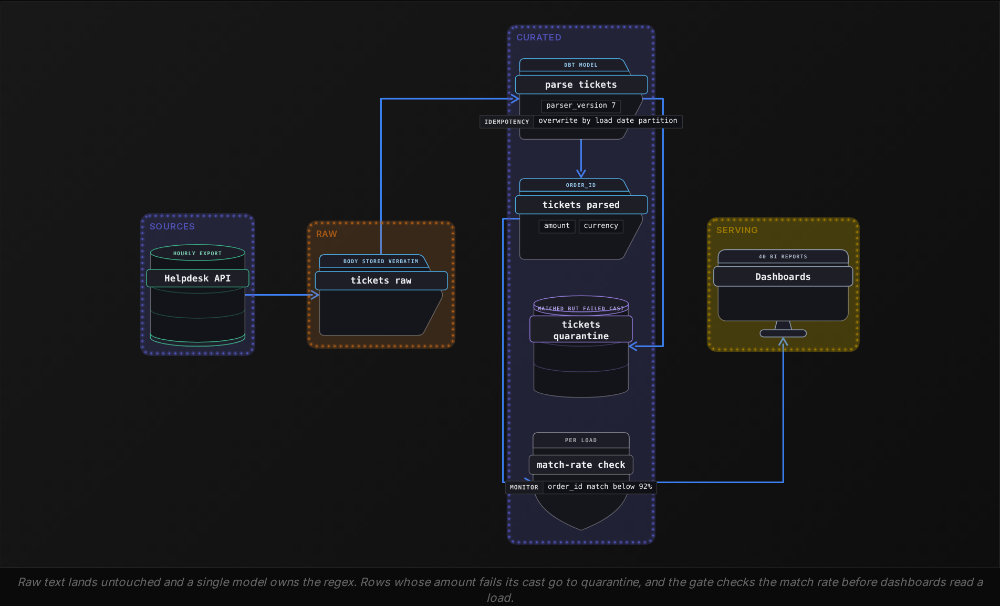

# String Manipulation: Advanced

Forty minutes into a data platform round, the interviewer shares her screen.
"This is support_tickets. It holds 400 million rows, and the body column is free text averaging 1.2 KB. Analysts pull order IDs out of it with regex in about 40 dashboards. Agents want a search box over it. And our Stockholm office says the customer list sorts wrong. Where do you start?"
She waits. Nobody has said which of those jobs belongs in SQL at all. The reflex is to write a sharper regex for the first one, and that quietly accepts that the warehouse should do all 3.
She is scoring placement: which string work stays in a query, which moves into the pipeline, which needs a different kind of index, and which is decided by a collation setting nobody chose on purpose.


<br>

### What you will be able to do

Extract several fields from inconsistent free text with capture groups, and rewrite backreference patterns for engines that reject them

Weigh reader count and format stability against run frequency and failure handling to decide whether a parse belongs in a query or in the pipeline

Diagnose a slow, expensive regex query on a large text column and cut both the bytes scanned and the work per row

Explain what a full-text index stores, when it should replace LIKE, and which questions it cannot answer

Predict how a change of collation moves equality and sort order from one engine to another, and what that does to grouping and joins


<br>

---

## Regex Groups and Backreferences

The question rarely says "regex". It arrives as 5 sample rows and a request: "Give me order ID and amount as columns, with the currency next to the amount." The interviewer takes for granted that you can write a pattern that fits the sample. The score comes from 3 places: whether the pattern survives the spellings customers actually type, whether you know which group the function hands back, and what the query does with rows that hold no order at all.


<br>

### Groups are numbered by opening parenthesis

A capture group is a parenthesised piece of the pattern whose matched text the engine keeps. Groups are numbered by the position of their opening parenthesis, left to right, so in (?i)\bord(?:er)?\s\*(?:no\.?|#)?\s\*([a-z])-?(\d{5}) group 1 is the letter and group 2 is the 5 digits. The (?:...) form groups without capturing: it lets ? or | apply to a chunk without renumbering every group after it. That matters the day a teammate wraps a new prefix in plain parentheses and 2 dashboard columns quietly swap values.

```sql
-- Trino. Every spelling of an order mention becomes 'A-10442'.
WITH m AS (
  SELECT
    ticket_id,
    REGEXP_EXTRACT(
      body,
      '(?i)\bord(?:er)?\s*(?:no\.?|#)?\s*([a-z])-?(\d{5})',
      1
    ) AS order_letter,
    REGEXP_EXTRACT(
      body,
      '(?i)\bord(?:er)?\s*(?:no\.?|#)?\s*([a-z])-?(\d{5})',
      2
    ) AS order_digits,
    REGEXP_EXTRACT(body, '(?i)\b(EUR|USD|GBP)\s*(\d+\.\d{2})\b', 1) AS currency_raw,
    REGEXP_EXTRACT(body, '(?i)\b(EUR|USD|GBP)\s*(\d+\.\d{2})\b', 2) AS amount_raw
  FROM support_tickets
)

SELECT
  ticket_id,
  UPPER(order_letter) || '-' || order_digits AS order_id,
  CAST(amount_raw AS DECIMAL(10, 2)) AS amount,
  UPPER(currency_raw) AS currency
FROM m
```

| body | order_id | amount | currency |
| --- | --- | --- | --- |
| Order #A-10442 charged twice, EUR 49.90 each | A-10442 | 49.90 | EUR |
| ord no. a10442 refund pls | A-10442 | NULL | NULL |
| order B-20017: usd 120.00 never arrived | B-20017 | 120.00 | USD |
| Update my record no. a10442 address | NULL | NULL | NULL |
| Cancel my subscription | NULL | NULL | NULL |

Row 4 is why the pattern opens with `\b`: account record numbers share the letter-and-5-digits shape, and without the word boundary "record no. a10442" would read as an order. Rows 2 and 5 set up the first follow-up: "what share of tickets come back NULL, and how do you know those NULLs are real?" `regexp_extract` returns NULL when nothing matches, so the NULL rate measures the pattern, and the next section turns it into a pipeline check.

The second follow-up is a ticket that mentions 2 orders. `regexp_extract` returns only the first match. `regexp_extract_all` in Trino and Spark returns an array of every match; `UNNEST` turns that array into a row per mention, and so does `explode`. Postgres `regexp_matches` with the `g` flag is already set-returning: it yields one row per match, each holding a text array of that match's groups, so wrapping it in `UNNEST` would put the letter and the digits on separate rows. Either way the grain moves from a row per ticket to a row per order mention. Say the grain change before writing the query, because every count downstream now counts mentions, and a ticket naming 2 orders is counted twice.


<br>

### Backreferences match what a group already matched

A backreference such as `\1` matches the exact text that group 1 captured earlier in the same match. Its main use on data is a delimiter that has to close the way it opened. Web-form tickets carry a payment reference as `ref='PX-77'` or `ref="PX-77"`, depending on which client wrote them. `ref=(['"])(.*?)\1` accepts either style and rejects the mismatched `ref='PX-77"`, with the reference in group 2.

Notice the `?` in `(.*?)`. A greedy `.*` takes as much as it can and then gives back, so on `ref='PX-77' note='call back'` it stops at the last quote on the line and returns `PX-77' note='call back`. The lazy form stops at the first closing quote. A negated class such as `[^']*` does the same with less work, and the BigQuery version below uses it.

2 more uses come up. `\b(\w+)\s+\1\b` finds doubled words such as "the the", a cheap check for a broken email template. In a replacement string, group numbers reorder text without splitting it: in Trino, `regexp_replace(phone, '^(\d{3})(\d{3})(\d{4})$', '($1) $2-$3')` turns 4155550132 into (415) 555-0132.


<br>

### The dialect question that tests experience

| Engine | Read group n | Backreference in pattern | Group in replacement |
| --- | --- | --- | --- |
| Trino | `regexp_extract(s, p, n)` | Yes (default Joni library) | `$1` |
| Spark SQL | `regexp_extract(s, p, n)` | Yes (Java regex) | `$1` |
| Postgres | `(regexp_match(s, p))[n]` | Yes | `\1` |
| Snowflake | `REGEXP_SUBSTR(s, p, 1, 1, 'e', n)` | No | `\\1` |
| BigQuery | `REGEXP_EXTRACT(s, p)`, at most 1 group | No (RE2) | `\\1` |

The 2 "No" rows have a reason worth saying out loud. BigQuery runs RE2, which guarantees matching time linear in the length of the input. A pattern with backreferences cannot be matched under that guarantee in general, so RE2 drops the feature. Lookahead and lookbehind are missing for the same reason. Snowflake rejects backreferences inside a pattern too, while accepting them in a `REGEXP_REPLACE` replacement. The rewrite is an alternation in which each branch spells out its own closing delimiter.

```sql
-- BigQuery: no \1 in the pattern, and REGEXP_EXTRACT allows 1 group
SELECT
  ticket_id,
  COALESCE(
    REGEXP_EXTRACT(body, r"ref='([^']*)'"),
    REGEXP_EXTRACT(body, r'ref="([^"]*)"')
  ) AS payment_ref
FROM support.tickets;
```

> **TIP**
>
> Saying "BigQuery is RE2, so I'd write 2 extracts and coalesce them, because backreferences and lookaround won't compile there" tells the interviewer you have hit this in production. Reciting what a backreference is tells them you have read the docs.


<br>

---

## When to Parse in SQL vs Upstream

This question comes as a symptom: "The order ID regex is pasted into about 40 dashboards, and we found 3 different versions of it. Is that a problem?" One weak answer is "always parse upstream", which builds a pipeline for a field a single analyst needed once. The other is "SQL handles it fine", which ignores that 40 copies are 40 definitions. The answer that scores is a rule with named inputs, applied out loud to this table.


<br>

### The 4 inputs to the decision

> What decides where a parse lives
>
> - Readers: a single notebook can own its regex; 40 dashboards and a model feature need a shared definition.
> - Format stability: a source whose layout changes weekly is cheaper to parse at query time until it settles.
> - Run frequency: a pattern in a dashboard pays regex CPU per row on every refresh; parsing at load pays it once per row.
> - Failure handling: if unmatched rows have to land in quarantine with a count someone alerts on, that is pipeline work.

| ✓ Parse in the query | ✗ Parse once in the pipeline |
| --- | --- |
| • No pipeline change: a new field exists the moment someone writes the pattern<br><br>• Right for exploration and for formats still settling<br><br>• Every run pays regex CPU and scans the full text column<br><br>• Each copy drifts on its own, and nobody sees how many rows fail | • One definition in the pipeline repo, so every change to it gets a version and a review<br><br>• Typed columns that join like any other and can serve as partition or cluster keys<br><br>• Rows that fail a cast land in quarantine with a count to alert on<br><br>• A pattern change means re-parsing history |

For the ticket table every input points the same way. There are 40 readers, and the 3 forked copies show they already disagree about the definition. The order mention format has not changed since the helpdesk template was fixed last year. Dashboards refresh every 15 minutes, and the business will want to know when parsing breaks. The design most teams land on is a staging model that parses once per load and writes typed columns beside the raw body, stamping each row with the `parser_version` that produced it.



The quarantine table catches rows where a field matched but would not cast. The staging pattern accepts a comma decimal so German tickets match, and it converts with `TRY_CAST(replace(amount_raw, ',', '.') AS DECIMAL(10, 2))`. A value like `1.299,00` still comes back NULL. That row lands in quarantine with its raw text instead of failing the load, and someone widens the pattern on purpose.


<br>

### Keep the raw column

Storing the raw body next to the parsed columns is what makes an upstream parse reversible. When the pattern improves, version 8 re-runs over `tickets_raw` for any date range, and `parser_version` tells you which rows each dashboard number came from. Without the raw column, fixing the regex means asking the source to resend 3 years of tickets, which most helpdesk exports cannot do.

```sql
-- Match rate per load and parser version: the number the gate alerts on
SELECT
  load_date,
  parser_version,
  COUNT(*) AS tickets,
  COUNT(order_id) AS with_order_id,
  ROUND(100.0 * COUNT(order_id) / COUNT(*), 1) AS order_match_pct
FROM tickets_parsed
GROUP BY load_date, parser_version
ORDER BY load_date, parser_version
```

The follow-up that tests whether you have run this: "Match rate fell from 94% to 71% overnight. What happened?" The likeliest cause sits in the source. A new form template writes `Order ID: A10442`, and the version 7 pattern has no slot for the "ID:" between the word and the code. With the regex scattered across dashboards, that drop surfaces weeks later as an odd dip in revenue per ticket. With the gate, someone is paged on the morning of the first bad load, and the fix is version 8 plus a re-run over the affected days.


<br>

### The furthest upstream option

The strongest version of this answer asks why the order ID is in free text at all. Most helpdesk forms collect it in a structured field, and the export flattens it into the body. Getting the integration to send `order_id` as its own field deletes the regex, which beats any parser on cost and on correctness. The judgement is timing: if the source team cannot ship that for 2 quarters, the staging model runs meanwhile, and the plan names the day it is retired.

The same inputs can flip the verdict. A product manager asking once how many March tickets mention a competitor has 1 reader and no refresh schedule, and nobody needs an alert when a row fails to match. A query over `tickets_raw` is the right answer, and proposing a pipeline for it reads as over-building. Say that the rule produced both answers.

> **TIP**
>
> Name the 4 inputs before giving a verdict. A rule applied to this table outscores a correct verdict with no rule behind it, because the next question is always a variant where the verdict flips.


<br>

---

## Regex Cost on Large Text Columns

This one arrives with a query and a complaint: "It runs for 11 minutes and scans about half a terabyte. Make it fast." Candidates lose points by proposing a fix before saying what the query pays for. Name the 3 costs that multiply: bytes read times rows evaluated times work per row. Then fix them in order of size.

```sql
-- Trino. Counts card-decline tickets across all history.
SELECT
  COUNT(*) AS declined_card_tickets
FROM support_tickets
WHERE REGEXP_LIKE(body, '.*(card|payment).*declined.*')
```


<br>

### Bytes, rows and work per row

Bytes come first because they are usually the largest term. `body` is the widest column in the table, and a columnar engine reads the whole column chunk for every row group it cannot skip. Min/max statistics on text cannot rule out a row group for an infix pattern, so nothing is skipped: 400 million tickets at 1.2 KB is 480 GB of logical bytes, 3 years of history, read on every run. Trino bills nothing per byte, so price it as if the same table sat in BigQuery on-demand, where you pay per logical byte scanned: at $6.25 per TiB, that is $2.73 each time it executes. On a Trino cluster the same bytes are paid in I/O and worker time instead of on an invoice.

- **$262** — a day at one refresh every 15 minutes
- **3 GB** — scanned with a 7-day partition filter

Rows and work per row come next. Every row with a non-null body runs the pattern, and a well-formed pattern costs time roughly in proportion to the text it reads. This one wraps itself in `.*` at both ends, which `regexp_like` never needs because it already searches anywhere in the string. It also puts another `.*` between the 2 words, which lets a backtracking engine try every way of splitting the body around them.


<br>

### Patterns that backtrack

Spark's Java regex, Trino's default Joni library and most Perl-style engines backtrack: a failed branch sends them back to try another way of dividing the input among the quantifiers. Nested quantifiers turn that into an exponential search. `(\w+\s?)+$` against a 2 KB body ending in "!" has so many ways to divide its words that a single row can hold an executor core for hours after every other task has finished. RE2 cannot blow up this way, which is the same guarantee that costs BigQuery its backreferences.


<br>

### The fixes, in the order to say them

```sql
-- Same question, priced for production
SELECT
  COUNT(*) AS declined_card_tickets
FROM support_tickets
WHERE created_date >= DATE '2024-03-08' -- 1. prune partitions
  AND STRPOS(LOWER(body), 'declined') > 0 -- 2. cheap literal prefilter
  AND REGEXP_LIKE(body, '(?i)\b(card|payment)\b[^.]{0,80}\bdeclined\b') /* 3. bounded pattern */
```

- Prune bytes: a partition or clustering filter on created_date shrinks the scan before any regex runs.
- Prefilter: strpos on a literal the pattern requires rejects most rows before the regex sees them.
- Bound the pattern: [^.]{0,80} keeps the search inside one sentence and states the real requirement.
- Read the narrow column: if tickets_parsed already holds the field, query it and leave body unread.
- Index it where you can: Postgres pg_trgm GIN indexes accelerate LIKE '%x%' and regex predicates.

State one caveat before the interviewer raises it: SQL does not guarantee the order in which `AND` evaluates its operands, so the prefilter saves work only if the engine runs it before the regex. Check the plan instead of trusting the written order.

The interviewer may ask how you would prove the rewrite worked. 3 numbers prove it. The first is bytes scanned, which the partition filter should cut by the ratio of days kept to days stored. The second is CPU time in the filter operator, which Trino's `EXPLAIN ANALYZE` reports per operator. The third is rows entering the regex against rows leaving it, which shows whether the prefilter is doing its job.

Then comes "why not add an index?". A B-tree orders whole values, so it can serve a prefix pattern and nothing with a leading wildcard. Parquet has Bloom filters, and so do Iceberg and Delta, but they answer exact equality only, and min/max statistics do no better for text. Postgres has a real answer in `pg_trgm`, which indexes 3-character slices and rechecks candidates against the pattern. Most warehouses have no equivalent for arbitrary regex, so the durable fix there is a column computed at load.

Before any of this, ask who reads the number. If it feeds a weekly review, a daily job that writes `is_card_decline` once per ticket and a dashboard over that flag cost cents, and the 15-minute refresh over raw text was never a requirement. Questioning the refresh rate is often worth more than every optimisation above.


<br>

---

## Full-Text Search Instead of LIKE

The question: "Support agents want a search box over ticket bodies. Someone proposed `WHERE lower(body) LIKE '%term%'`. Good enough?" What gets scored is whether you can say what a full-text index stores that `LIKE` lacks, and whether you list, unprompted, what that index still cannot answer. Here is the `LIKE` version handling an agent who types "card".

https://github.com/user-attachments/assets/4dbc09eb-6e04-4541-b72c-a479796e58cf

4 rows match, and 2 of them concern a cardigan and an address. `LIKE` tests characters, so any body containing c-a-r-d qualifies, and with a leading `%` no B-tree can help, so every search reads every body. Row 5 describes a card problem without the word "card", and no method in this section finds it.


<br>

### What a full-text index stores

An inverted index runs every document through an analyzer: split into tokens at word boundaries, lowercase, drop stopwords, reduce each word to a stem. It stores each resulting term with the list of document IDs that contain it, and usually word positions too. A query runs through the same analyzer and is answered by fetching each term's posting list and intersecting them, so its cost tracks how many documents match rather than how large the table is. "cardigan" and "discard" are their own terms, so both false positives disappear, and "cards" stems to "card", so row 3 stays.

```sql
-- Postgres 12+
ALTER TABLE support_tickets
  ADD COLUMN body_tsv tsvector
  GENERATED ALWAYS AS (to_tsvector('english', body)) STORED;

CREATE INDEX idx_tickets_body_tsv
  ON support_tickets USING GIN (body_tsv);

SELECT ticket_id, ts_rank(body_tsv, q) AS relevance
FROM support_tickets,
     websearch_to_tsquery('english', 'card declined') AS q
WHERE body_tsv @@ q
ORDER BY relevance DESC
LIMIT 20;
```

The analyzer is part of the contract. Index-time and query-time analysis must match: a tsquery built with the `simple` config against a tsvector built with `english` misses every stemmed word without an error, and changing the stemmer means rebuilding the index. It's the same failure as an ML feature tokenized one way in training and another way in serving.


<br>

### Choosing where the index lives

| Question | Postgres tsvector + GIN | Warehouse search index | Elasticsearch / OpenSearch |
| --- | --- | --- | --- |
| Fits | Tens of millions of rows already in Postgres | Analyst lookups across billions of text or log rows | User-facing search with ranking and typo tolerance |
| Analysis | Stemming per language config | Token match; BigQuery SEARCH does no stemming | Per-field analyzers: stemming, synonyms, fuzzy matching |
| Ranking | `ts_rank`, `ts_rank_cd` | None: BigQuery SEARCH returns true or false | BM25 by default |
| What it costs | An index on a table you already run | Index storage and background maintenance | A second system, a sync pipeline, reconciliation |

For the 400 million tickets behind a user-facing box, the answer is Elasticsearch or OpenSearch, which rank results and tolerate typos while responding in under 100 ms. The price is a second system. Rows flow out of the source of truth through change data capture, commonly Debezium into Kafka into an indexer, and a daily job reconciles counts and IDs between the 2 stores, because deletes drift first.

`LIKE` stays the right tool in 2 places: a prefix match on a code column, which a suitable B-tree serves, and a one-off scan of a day's tickets, where building an index costs more than reading the rows.


<br>

### What a full-text index cannot answer

> Requests to route elsewhere
>
> - Substrings inside a token: "card" inside "discard", or the middle of an identifier, needs an n-gram or trigram index, because the full-text index holds whole terms.
> - Shapes: "any 5-digit number after a hash" is a regex over raw text or a lookup on an extracted column.
> - Meaning without the word: row 5 never says "card". Synonyms must be configured, and intent needs a semantic index.
> - Exact counts: Elasticsearch stops counting total hits at 10,000 by default, and a CDC-fed index lags its source.
> - Mixed languages: an `english` config leaves German plurals such as Rückerstattungen unreduced.

The follow-up that catches people: "An agent searches A-10442 and gets thousands of results." Elasticsearch's standard analyzer splits on the hyphen into `a` and `10442`, and a match query ORs the terms, so every ticket containing the word "a" is a hit, with the right one somewhere near the top. Identifiers belong in a keyword field indexed verbatim, which means extracting them at ingestion with the capture groups from the first section.


<br>

---

## How Collation Compares Strings

It usually arrives as a migration story: "We moved the loyalty warehouse from SQL Server to Snowflake. Row counts match, but the orders-to-customers join on email lost 3% of its matches, and nothing errored." Or it arrives as the Stockholm office's complaint about name order. Both are collation questions. The interviewer wants to hear that equality and sort order are settings attached to a column or a query, or to the whole database, and that their defaults differ from engine to engine.


<br>

### Equality is a setting

A collation is the rule set an engine uses to compare 2 strings. Binary collations compare code points or bytes. Linguistic collations come from ICU, which implements the Unicode Collation Algorithm, and they compare in levels: base letter first, then accents, then case. A case-insensitive collation stops before the case level, and an accent-insensitive one stops after the base letter. One setting governs `=`, `ORDER BY`, `GROUP BY` and `DISTINCT` at once. It also decides which join keys match and what a unique constraint treats as a duplicate.

| Comparison | Binary (Snowflake, BigQuery defaults; Postgres "C") | SQL Server default (CI_AS) | MySQL 8 default (0900_ai_ci) |
| --- | --- | --- | --- |
| 'Müller' = 'müller' | false | true | true |
| 'Müller' = 'Muller' | false | false | true |
| 'abc' = 'abc ' | false | true | false |

The migration case is the middle column. SQL Server's default install collation, `SQL_Latin1_General_CP1_CI_AS`, ignores case. It also pads trailing spaces before comparing, so `Ana@Shop.com`  matched `ana@shop.com` for years. Snowflake compares binary by default, and the same join drops that pair without a warning. The fix comes down to 2 options, and the interviewer scores whether you name the cost of each.

```sql
-- Snowflake. Option 1: canonical key built at load, compared binary
SELECT o.order_id, c.customer_id
FROM orders o
JOIN customers c
  ON o.email_key = c.email_key;

-- Option 2: per-query collation reproducing SQL Server's behaviour
SELECT o.order_id, c.customer_id
FROM orders o
JOIN customers c
  ON COLLATE(o.email, 'en-ci-rtrim') = COLLATE(c.email, 'en-ci-rtrim');
```

| ✓ Declare a collation | ✗ Build a canonical key |
| --- | --- |
| • Restores the old matches without rewriting any stored data<br><br>• The rule lives in DDL or in each query, invisible to anyone reading the join keys<br><br>• Collated comparisons run slower than binary, and some functions reject collated input<br><br>• GROUP BY shows one spelling for each case-insensitive group, and which one is not defined | • lower(trim(normalize(email, NFC))) computed once at ingestion into email_key<br><br>• Joins and dedup run binary on a column whose rule sits in versioned pipeline code<br><br>• The original spelling survives for display<br><br>• Every new source must apply the same function, which a shared macro enforces |

The answer that scores picks the canonical key for joins and deduplication and keeps collation for presentation. A join rule hidden in column settings is the one the next migration breaks again.


<br>

### Sort order is a language decision

| Position | Binary (code point) | English (ICU) | Swedish (ICU) |
| --- | --- | --- | --- |
| 1 | Banana | apple | apple |
| 2 | Zebra | Banana | Banana |
| 3 | apple | Émile | Émile |
| 4 | zoe | Öberg | Zebra |
| 5 | Émile | Zebra | zoe |
| 6 | Öberg | zoe | Öberg |

Binary order puts every uppercase letter before every lowercase one, because 'Z' is code point 90 and 'a' is 97, and it puts accented letters after 'z'. English collation interleaves case and treats Ö as a kind of O. Swedish places Ö after Z, as the Swedish alphabet does. In Postgres the per-query fix is `ORDER BY customer_name COLLATE "sv-SE-x-icu"`, and in Snowflake it is `ORDER BY COLLATE(customer_name, 'sv')`. The question to ask back is whose alphabet the report's readers use.

Turkish changes case mapping itself: the uppercase of 'i' is 'İ' and the lowercase of 'I' is 'ı'. Under a Turkish locale `lower('FILE')` returns 'fıle', which no longer equals 'file', so a case-insensitive match written with English rules in mind misses Turkish records that contain an I.


<br>

### Unicode under the collation

'é' can be stored as 1 code point, U+00E9, or as 2: 'e' followed by the combining accent U+0301. They render identically, and a binary comparison calls them different strings with lengths 1 and 2. Unicode calls them canonically equivalent. A Postgres nondeterministic ICU collation, available from version 12, compares them as equal. A deterministic collation breaks the tie on bytes and calls them different. Filenames from macOS and text pasted from some editors arrive decomposed, which is why the canonical key above applies NFC before anything compares it.

A linguistic collation also changes what an index can do. A Postgres B-tree on a column using `en_US.UTF-8` cannot serve `LIKE 'Mü%'`. Prefix search needs an index built with `text_pattern_ops` or `COLLATE "C"`, because only byte order guarantees that every string starting with 'Mü' sits in a single contiguous range.


| ✓ Do | ✗ Don't |
| --- | --- |
| • Extract a field once at load when many queries read it, and keep the raw text beside it<br><br>• Track match rate per parser version and alert when it drops<br><br>• Bound quantifiers and prefilter on a literal the pattern requires<br><br>• Index identifiers as exact keywords and prose as full text<br><br>• Join on a canonical key built in the pipeline; use collation for display order | • Don't paste one regex into many dashboards, where each copy drifts unseen<br><br>• Don't send backreferences in a pattern to BigQuery or Snowflake<br><br>• Don't promise exact counts from a search index fed by CDC<br><br>• Don't assume = behaves the same after moving engines<br><br>• Don't upgrade the OS under Postgres without checking collation versions |


<br>

---

## Putting It All Together

A European online retailer consolidates support from 3 helpdesk tools into one Snowflake table of 400 million tickets. Analysts want order-level metrics, agents want a search box, and the Nordic teams want customer lists in their own alphabetical order.

- Capture groups pull out the order ID and the amount. The payment reference needs 2 coalesced extracts, because Snowflake rejects backreferences in a pattern.
- Extraction runs in one staging model over the raw body, stamped with a parser version, with a match-rate gate per helpdesk tool so a template change pages someone the same morning.
- Recurring classification questions read flags computed at load instead of rerunning regex over the body column on every dashboard refresh.
- The agent search box runs on OpenSearch with order IDs in keyword fields, fed by change data capture and reconciled daily against the warehouse.
- Customers are matched across the 3 tools on an NFC, lowercased, trimmed email key, because one tool came from SQL Server's case-insensitive default, while display sorting applies a Swedish collation per query.


<br>

---

## Key Takeaways

- Groups number by opening parenthesis; ( ? : . . . ) groups without renumbering, and unnesting every match changes the grain.
- When many readers depend on a parse and its format is stable, it belongs in one versioned pipeline step over raw text, more so if its failures are worth an alert.
- Regex cost is bytes read times rows evaluated times work per row: prune partitions, prefilter on literals, bound quantifiers.
- A full-text index answers whole-term lookups fast. Substrings and shapes are beyond it, and so are meaning and exact counts.
- Collation decides equality and sort order, and through them grouping and joins; defaults differ by engine, so join keys are canonicalised in the pipeline.
