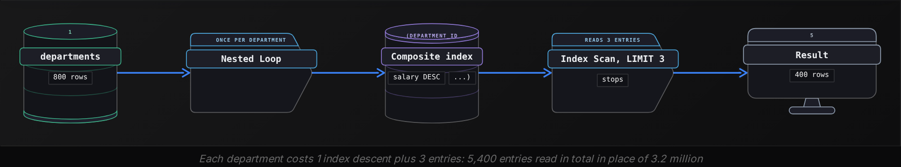
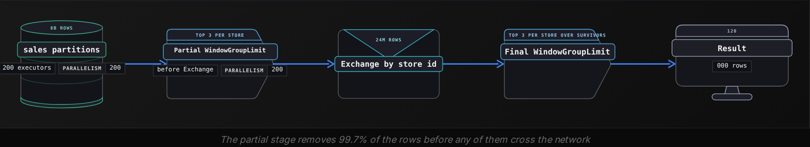

# Top N Per Group: Advanced

You are 20 minutes into the data modeling round at a payroll analytics company, and the top 3 per department query has been on the board since minute 4: ROW_NUMBER, salary descending, hire_date and employee_id as tiebreakers. The interviewer nods and keeps going.
"Good. The client's reporting database is MySQL 5.7. And the dashboard can't wait on that query, so it reads from a table. And next year we run this across all 400 clients in Spark."
That is 3 sentences and 3 systems, and the SQL was never the question. Nothing has been said about what happens to the stored table when an employee leaves. The tempting move is to keep polishing the query on the board.
What she is testing is whether you can own the system that runs the query, 1 layer at a time.


<br>

### What you will be able to do

Name the outranks count behind any per-group top N and write it as a correlated subquery or a self-join with a total tiebreaker

Explain which changes a stored top N can absorb and which force a group to be rebuilt from source, and design the refresh

Specify the composite index and the per-group LIMIT form that reads 3 entries per group, and say when neither helps

Argue why a local top N per worker is safe before a global merge, and name the rank keys it is wrong for

Decide when an approximate top K by frequency is acceptable and say which items its sketch can get wrong


<br>

---

## "Do It Without Window Functions"

The follow-up lands 2 minutes after `ROW_NUMBER` is on the board: "This report runs on MySQL 5.7, no window functions. Same result." It also arrives as Hive 1.x, an old SQLite build or a BI tool that rejects `OVER`, and it tests 1 thing: whether you can say what the window function computed for you. The candidate who reaches for `MAX(salary)` with `GROUP BY department_id` returns 1 row per department.

Every per-group top N computes 1 number per row: how many rows in the same group outrank it. The row stays when that number is below N. `PARTITION BY` was "same group", `ORDER BY` was "outranks", and `rn <= N` compared the count against N. Say that first. It frames everything after as a translation, and a translation is graded on the 1 detail that changes meaning: ties.


<br>

### The count, written as a correlated subquery

```sql
-- Top 3 highest-paid employees per department, no window functions
SELECT
  e1.department_id,
  e1.employee_id,
  e1.salary,
  e1.hire_date
FROM employees AS e1
WHERE (
  SELECT
    COUNT(*)
  FROM employees AS e2
  WHERE e2.department_id = e1.department_id
    AND (
      e2.salary > e1.salary
      OR (
        e2.salary = e1.salary
        AND e2.hire_date < e1.hire_date
      )
      OR (
        e2.salary = e1.salary
        AND e2.hire_date = e1.hire_date
        AND e2.employee_id < e1.employee_id
      )
    )
) < 3
```

Narrate it as a contract: "For each row, count the same-department employees who strictly outrank it; fewer than 3 means top 3. The OR chain is the ORDER BY: higher salary wins, then the earlier hire_date, then the lower employee_id." The rung order is business policy, exactly as the column order in the `ORDER BY` was.

https://github.com/user-attachments/assets/9fb2b9e2-0f49-4834-a5fb-252df61fd28a

The animation runs that predicate over department 10 alone, so the chain is the whole query. Employee 101 earns 210000 and nobody outranks them. The next 3 employees, 102 through 104, tie at 185000, so the hire_date rung decides: 103 (hired 2018) is outranked by 101 only, 104 (2019) by 101 and 103, and 102 (2020) by all 3. A count of 3 removes 102, and watching those comparisons land is the narration for the room.


<br>

### The last rung has to be a unique column

The fork the interviewer watches for: drop the tie rungs and count only `e2.salary > e1.salary`. The 3 employees at 185000 each get a count of 1 and all of them pass, so a top 3 returns 4 rows. That is `RANK <= 3`. The chain turns it into exactly N only when its last rung is unique within the group: end on hire_date and 2 people hired the same day still tie. Say "the unique column closes the tie" unprompted; it is the sentence of someone who has debugged a bonus pool with 4 names in it.


<br>

### The same count as a self-join

```sql
-- Top 3 per department via self-join, RANK semantics
SELECT
  e1.department_id,
  e1.employee_id,
  e1.salary
FROM employees AS e1
LEFT JOIN employees AS e2
  ON e2.department_id = e1.department_id
    AND e2.salary > e1.salary
GROUP BY e1.department_id, e1.employee_id, e1.salary
HAVING COUNT(e2.employee_id) < 3
```

Some planners handle a join and a `GROUP BY` better than a subquery tied to the outer row, so carry the second form too. The join pairs each e1 row with every e2 row that outranks it, `GROUP BY` folds the pairs back to 1 row per employee, and `HAVING` is the count comparison. Two details are scored: `LEFT JOIN`, because the top earner has nothing above them and an `INNER JOIN` drops them, and `COUNT(e2.employee_id)`, because `COUNT(*)` counts the NULL-padded row and gives the top earner a count of 1.

https://github.com/user-attachments/assets/13941ae0-12d7-47ce-86b8-9afec6bbc810

This run asks for a top 2 on the salary rung alone. Employee 101 joins to nothing; 102 and 103 at 185000 are each outranked by 101 only, count 1, so a top 2 returns 3 rows. The form changed and the leak did not, because both forms evaluate the same outranks predicate.

https://github.com/user-attachments/assets/b6903219-9972-4734-adc7-3693cac85416

Add the hire_date rung to the join condition and the tie turns one-sided: 103, hired in 2018, outranks 102, hired in 2020, and nothing outranks 103. One carries a beaten_by value and the other NULL, which is what lets `HAVING` keep exactly 1. The depth signal is converting both ways: reading a window query as this comparison, and reading the comparison back as its `ORDER BY`.

| ✓ Correlated COUNT subquery | ✗ Self-join plus GROUP BY |
| --- | --- |
| • Reads as the contract: count who outranks me, keep the row below N<br><br>• Postgres and MySQL 5.7 run it once per outer row: rows times group size<br><br>• SQL Server and Oracle may unnest it into a join plus aggregate; the plan says whether they did | • The same count as LEFT JOIN plus HAVING COUNT(e2.employee_id) < N<br><br>• MySQL 5.7 has no hash join: a nested loop that wants an index on (department_id, salary)<br><br>• Hash-join engines join on department_id and apply the inequality as a residual filter<br><br>• Join output grows with group size and with ties, which the plan shows as join rows |

> **TIP**
>
> A 12,000-employee department means 144 million comparisons when the subquery runs per outer row. Name the quadratic cost before the interviewer does, and put the query in a refresh job that writes a stored table, never on the request path.


<br>

---

## Keeping a Stored Top N Current

The next probe assumes the query is settled. "The dashboard reads top 3 per department from a table you maintain, top_earners. HR deletes a terminated employee. What happens to your table?" The answer that costs the round is "delete the matching row." Department 10 then shows 2 names, because the 4th-highest earner should move up and a top 3 table discarded everything below the cutoff when it was written.

State the asymmetry as a rule: a stored top N absorbs any change that adds a competitor, and any change that removes one forces that group to be rebuilt from source. An insert needs 1 comparison against the floor, the group's current Nth row. Deleting a stored row needs the group's N+1th row, which the store never held. Updates split the same way: a raise outside the store is an insert, a pay cut inside it is a delete, and a transfer is a delete in one group and an insert in the other.

| Change in employees | What the store needs | Action |
| --- | --- | --- |
| Insert into a group holding fewer than N rows | Nothing | Insert the row |
| Insert into a full group, below the floor | The floor | Nothing |
| Insert into a full group, above the floor | The floor | Insert the row, evict the Nth |
| Delete of a row outside the store | Nothing | Nothing |
| Delete of, or pay cut for, a stored row | Who ranked 1 to N | Rebuild the group from source |
| Transfer between departments | The new group's floor | Insert into the new group; rebuild the old one if it held the row |


<br>

### 3 ways to keep the stored table current

Option 1 rebuilds everything on a cadence. A nightly job runs the window query over the 3.2 million employee rows, writes the 5,400 survivors (3 per department across 1,800 departments) and swaps the table in; Postgres `REFRESH MATERIALIZED VIEW CONCURRENTLY` does this with readers unblocked. It reads nearly 600 rows per row kept and runs up to 24 hours stale. Name both numbers, then say that a 40-second nightly rebuild is the right design for most reports, because the interviewer is waiting to hear it.

Option 2 rebuilds only the groups that changed. CDC from employees yields the touched department_ids, both sides of a transfer. In a typical hour that is around 40 of 1,800, so the refresh reads around 2% of the source and rewrites about 120 rows. The rebuild runs the same window query per group from source, so it is idempotent, and it doesn't care whether a delete arrived before its insert, the ordering that corrupts applied deltas.

```sql
-- Group-scoped refresh: rebuild only departments touched since the last run
DELETE FROM top_earners
WHERE department_id IN (SELECT department_id FROM changed_departments);

INSERT INTO top_earners (department_id, employee_id, salary, hire_date)
SELECT department_id, employee_id, salary, hire_date
FROM (
  SELECT e.*,
         ROW_NUMBER() OVER (
           PARTITION BY department_id
           ORDER BY salary DESC, hire_date ASC, employee_id ASC
         ) AS rn
  FROM employees e
  WHERE e.department_id IN (SELECT department_id FROM changed_departments)
) ranked
WHERE rn <= 3;
```

Option 3 stores a margin: keep the top 10 per department and serve `WHERE rn <= 3`. A deleted stored row promotes the 4th from rows already held, and the group needs a source rebuild only when its margin falls below 3. The cost is a table 3.3 times larger and a filter on every read; it pays when deletes are frequent and the source is expensive, such as a top N over a 2 billion row event table.


<br>

### Warehouse materialized views will not maintain it

Asked why the warehouse should not maintain it, give facts: Snowflake materialized views reject window functions, BigQuery's incremental materialized views reject analytic functions, and a Postgres materialized view has no incremental refresh at all, so every refresh is the full rebuild. Then the check, since these rules change by version: "I would confirm the engine maintains a ranking view incrementally, and if it cannot, I own the refresh."

The closing follow-up is "how do you know the stored table is right?" Recompute the top 3 for 50 random departments from employees, `EXCEPT` it against the store in both directions, and alert on any row. Drift runs both ways: a missed delete or pay cut leaves a stale row in the store, and a missed insert leaves a row missing, as does a raise or inbound transfer you never saw. Report which side of the `EXCEPT` the rows came from, because that names the kind of CDC event you lost.

- **N+1** — the row a stored top N never holds


<br>

---

## Indexing for a Per-Group Top N

The infrastructure probe arrives as a number. "Production Postgres, 3.2 million employee rows, and the HR portal's org page shows every department's top 3 in under 50 milliseconds. What index?" "An index on salary" finds the company's top 3; "an index on department_id" finds a department and then sorts it. The query needs each group's rows already in rank order and a way to stop after N, and an index supplies the order only when its key starts with the group column and continues with the `ORDER BY`.

The index is (department_id, salary DESC, hire_date ASC, employee_id ASC). The leading column locates the group's entries as 1 contiguous range. The following columns are the `ORDER BY`, so within that range the entries are already in rank order and no sort runs. The tail is the tiebreaker, which makes the index order total: 2 employees with the same salary and hire date sit in a fixed position in the index, the same position the query promised. Say the 3 parts in that sequence, because an index that puts salary first serves a different query.


<br>

### ROW_NUMBER cannot stop early

The part most candidates miss is that the window query gets no stop from the index. In Postgres `rn <= 3` sits above the WindowAgg; version 15 adds a run condition that stops computing row numbers past 3, but the operator still reads every remaining row of the partition to reach the next department. The plan is an ordered scan of all 3.2 million entries with 3,194,600 thrown away. Oracle's pushed rank and Spark 3.5's group limit cut rows earlier, and none of them jumps to the next group inside the index. The index saved the sort, not the read. The form that stops is a per-group `LIMIT`: `LATERAL` in Postgres, `CROSS APPLY` in SQL Server.

```sql
-- Per-group LIMIT: the planner runs the inner query once per department
SELECT
  d.department_id,
  t.employee_id,
  t.salary
FROM departments AS d
CROSS JOIN (
  SELECT
    e.employee_id,
    e.salary
  FROM employees AS e
  WHERE e.department_id = d.department_id
  ORDER BY e.salary DESC, e.hire_date, e.employee_id
  LIMIT 3
) AS t
```



That is 1 descent and 3 entries per department, a few milliseconds for the whole page. For a single department the stop needs no `LATERAL`: `WHERE department_id = ? ORDER BY salary DESC, hire_date, employee_id LIMIT 3` reads 3 entries on its own, and `LATERAL` is that query run once per group. Say "the index gives order, the per-group LIMIT gives the stop," and expect the next question: can the index skip the table?

It can when every returned column is in the index: `INCLUDE (employee_name)` in Postgres 11 or later keeps the scan off the heap, where a department's 3 rows sit on 3 different pages. The trade is a wider entry on every insert, which shows up in HR's 40,000-row upload on the first of the month.


<br>

### When the index does not pay

- A predicate outside the key: top 3 active employees needs is_active before salary, or a partial index WHERE is_active
- N close to the group size: a team of 5 with N = 3 reads 60% of the group, and the stop saves little
- Many tiny groups: 1.5 million groups of 2 rows cost 1.5 million index descents; 1 sort can be cheaper
- A rank key from another table: ordering by a joined bonus amount gives the employees index no order to read
- A columnar warehouse, which has no B-tree at all

That last item is where the round goes at a Snowflake or BigQuery shop. On a warehouse the work moves to layout: cluster by department_id so pruning reads a handful of micro-partitions, and accept a window over every row of those partitions. The sentence to say: "On a warehouse I would promise clustering by department and a window over the pruned scan; if 50 milliseconds is the requirement, the answer is the stored table served from a row store."


<br>

---

## Local Top N Before a Global Merge

The distributed probe trades the HR table for volume. "Same pattern: the 3 biggest sales per store by revenue, but sales is 8 billion rows in Spark across 200 executors. Walk me through the shuffle." The expected wrong answer describes the window faithfully: hash every row by store_id, shuffle all 8 billion, sort, number, filter. It is correct, it is what older engines do unprompted, and the interviewer is waiting for the sentence that cuts the shuffle by a few hundred times.

Each executor can compute the top 3 per store on the rows it already holds, and only those travel. The argument fits in the room: a row outside its executor's top 3 for store S has 3 rows of S on that executor ahead of it, those 3 are ahead of it globally, so it can't be in the global top 3. Say it in that direction, because "local winners might be global winners" proves nothing. The shuffle then carries at most 200 executors times 40,000 stores times 3 rows, 24 million in place of 8 billion.

```sql
== Physical Plan ==
Filter (rn <= 3)
+- Window [row_number() AS rn], [store_id], [revenue DESC, sale_id ASC]
   +- WindowGroupLimit [store_id], [revenue DESC, sale_id ASC], row_number(), 3, Final
      +- Sort [store_id ASC, revenue DESC, sale_id ASC]
         +- Exchange hashpartitioning(store_id, 200)
            +- WindowGroupLimit [store_id], [revenue DESC, sale_id ASC], row_number(), 3, Partial
               +- Sort [store_id ASC, revenue DESC, sale_id ASC]
                  +- FileScan parquet sales
```



Spark 3.5 added this as the WindowGroupLimit rule: a filter like `rn <= 3` directly over `ROW_NUMBER` gets a Partial node before the Exchange and a Final one after, and the same holds for `RANK` and `DENSE_RANK`. On earlier versions, or when the filter hides behind a UDF or a view, the plan shows a bare Exchange of all 8 billion rows, and SQL can't fix it: a window partitioned by `spark_partition_id()` still shuffles every row, because a window needs its partition keys co-located. The hand-written local stage lives below SQL, as a per-partition heap of 3 per store in `mapPartitions`, or an aggregate whose buffer holds the top 3. Ask which version runs, and look for the Partial node below the Exchange.


<br>

### Rank values that break the local cut

The local cut fails when you rank by an aggregate. Ask for the top 3 products per store by total revenue: a product's revenue is split across executors, and one that is 5th on every executor can be 1st once its partials add up. A local cut needs a rank value that no other executor's rows can still change. So aggregate first, which Spark does in 2 phases of its own, then cut locally, then merge.

| Question | Local top N sound? | Why |
| --- | --- | --- |
| Top 3 sales per store by revenue | Yes | Each sale's revenue is complete where it sits |
| Top 3 products per store by SUM(revenue) | Only after the aggregate | Partial sums across executors add up |
| Top 3 by RANK, ties kept | Yes | A global rank of 3 or better means at most 2 strictly ahead anywhere |
| Top 3 distinct levels by DENSE_RANK | Yes | A global top level is a local top level on any executor |
| Top 10 percent per store | No | The cutoff depends on the store's full row count |

Two more sentences earn credit. Skew: the single-pass window sends all 400 million rows of the largest store to 1 executor, the task that runs 40 minutes while 199 finish; after the local cut that store sends at most 600 rows, so the local stage is also the skew fix. Determinism: both stages need a total tiebreaker. If 2 sales tie at 9,400 and the `ORDER BY` stops at revenue, which one an executor keeps depends on read order, and 2 runs over identical data return different rows.


<br>

---

## Approximate Top-K by Frequency

The last turn swaps salaries for frequencies. "Top 10 search queries per country per hour. 3 billion queries a day, 200 million distinct strings. Does it have to be exact?" Exact is 2 steps you own: `COUNT(*)` per query within each country and hour, then `ROW_NUMBER` over the counts. The cost is the first step, 1 counter per distinct (country, hour, query), tens of millions per executor in a busy hour, all of them shuffled. Ask whether the consumer needs the 10th count right.

Warehouses ship the approximate form: `APPROX_TOP_K(query, 10, 1000)` in Snowflake, `approx_most_frequent(10, query, 1000)` in Trino. The third argument is the number of counters the sketch keeps, and the error bound comes straight from it. BigQuery's `APPROX_TOP_COUNT(query, 10)` takes no capacity and does not document one, so no bound can be stated for it.

```sql
-- Exact: 1 counter per distinct (country, hour, query), then a window
WITH counts AS (
  SELECT country, hour, query, COUNT(*) AS n
  FROM searches
  GROUP BY country, hour, query
)
SELECT country, hour, query, n
FROM (
  SELECT *,
         ROW_NUMBER() OVER (PARTITION BY country, hour ORDER BY n DESC, query) AS rn
  FROM counts
) r
WHERE rn <= 10;

-- Approximate (Snowflake): 1 sketch of 1000 counters per (country, hour)
SELECT country, hour, APPROX_TOP_K(query, 10, 1000) AS top_queries
FROM searches
GROUP BY country, hour;
```


<br>

### Space-Saving with 1000 counters

The algorithm underneath, wherever one is documented, is Space-Saving, and narrating it earns the credit. The sketch keeps m counters, and each holds an item and its count plus an error term. A tracked item's count goes up by 1. An untracked item takes a free counter at count 1. When none is free, the smallest counter is evicted, the newcomer inherits it at count min + 1, and min is recorded as its error. Nothing is undercounted, because an evicted item's count carries forward.

| Guarantee | With m = 1000 over 10 million events in 1 bucket |
| --- | --- |
| Any item with true count above n / m is tracked | Every query seen more than 10,000 times is in the sketch |
| No count is under its true value | A reported 48,000 means at least 48,000 |
| Overcount is at most the min counter at insertion | Reported 48,000 with error 10,000 means 38,000 to 48,000 |
| A merge charges an item missing from 1 sketch that sketch's min, then keeps the top m | 200 executor sketches merge into 1, overcount still at most n / m |

The merge row is the one to narrate, because a naive sum breaks the sketch: an item tracked on executor A and evicted on executor B loses B's occurrences and is undercounted. The mergeable rule charges it B's minimum counter as both count and error, since B could have seen it at most that many times. It then sums shared items and keeps the largest m, so overcount stays within (n1 + n2) / m. Each executor builds 1 sketch per (country, hour), and the shuffle carries 1000-entry sketches in place of a counter per string.


<br>

### The items a sketch gets wrong

Be specific, because "it is approximate" is the answer the interviewer has heard 40 times. It gets the cutoff wrong: when the 10th and 11th queries are within the error of each other, the sketch can swap them. Below the boundary, a late arrival can carry an inherited count, so a query seen 300 times can sit at 10,300 with error 10,000, and the error field says to distrust it. Steady low-frequency items churn in and out and carry the largest errors. Heavy hitters far above n / m are always reported, and their order is right whenever their gap exceeds the error.

The consumer test fits 1 sentence: approximate when the reader acts on heavy hitters and tolerates swaps at the boundary, exact when anyone's pay or penalty rides on the 10th position, or an auditor will check it. If exact is too expensive, narrow the bucket; a group small enough to count exactly costs less than explaining a sketch to a regulator.

| ✓ Approximate is good enough | ✗ Run the exact query |
| --- | --- |
| • Trending and most-viewed panels refreshed every few minutes<br><br>• Autocomplete and recommendation seeds, where the 11th item is a near miss<br><br>• Spike alerts, where the heavy hitter is the signal | • Any output that triggers a payment or a penalty, prizes included<br><br>• Compliance and audit reports, where a count must reproduce<br><br>• Buckets with a few thousand distinct items, where exact is cheap |

| ✓ Do | ✗ Don't |
| --- | --- |
| • Name the computation first: the count of rows in the group that strictly outrank this one<br><br>• End every ranking with a unique column, whichever of the 3 forms you write<br><br>• Rebuild a stored group from source on any delete or downgrade; apply inserts against the floor<br><br>• Lead the index with the group column, follow with the ORDER BY, and stop with a per-group LIMIT<br><br>• Aggregate before a local top N cut whenever you rank by a SUM or COUNT | • Use INNER JOIN in the self-join form; the group's first row has nothing above it<br><br>• Assume the warehouse maintains a ranking view incrementally without reading its refresh rules<br><br>• Expect rn <= N to stop an index scan; the window reads every row of the partition<br><br>• Report an approximate top K where the 10th position pays out or gets audited<br><br>• Drop the error field from a sketch result; it tells the consumer which counts to trust |


<br>

---

## Putting It All Together

A payroll analytics vendor serves 400 employer clients. Each client's HR portal shows the top 3 earners per department from that client's own database, several of which are still MySQL 5.7 and one of which is a 3.2 million row Postgres with a 50 ms budget. A nightly Spark job on the vendor's side ranks products from the benefits marketplace per employer across 8 billion click rows, and the marketplace search team wants the top 10 queries per country per hour on a trending panel.

- The MySQL 5.7 clients get the correlated count with the full salary, hire_date, employee_id chain, run as a refresh job that writes a top_earners table rather than on the request path
- The Postgres client gets a LATERAL per-department LIMIT 3 over the (department_id, salary DESC, hire_date, employee_id) index, which reads 5,400 entries for 1,800 departments
- Each client's top_earners table is maintained by group-scoped rebuild from CDC-touched departments, with a 50-department reconciliation query running hourly
- The marketplace ranking aggregates clicks per (employer, product) first, then cuts to a local top 3 per executor before the shuffle, which also removes the hot-employer task
- The trending panel takes APPROX_TOP_K with 1000 counters per (country, hour), and the partner payout team gets the exact grouped count because 10th place pays


<br>

---

## Key Takeaways

- Every per-group top N counts how many rows in the group strictly outrank each row; the ORDER BY is that predicate and the unique column is what makes it exactly N
- A stored top N absorbs inserts by comparing each one against the group floor. Deleting or downgrading a stored row forces a rebuild of that group from source
- An index on (group, ORDER BY, tiebreaker) gives order, and only a per-group LIMIT through LATERAL or CROSS APPLY gives the stop: 3 entries per group
- A worker's local top N is safe before the global merge because a row outside it has N rows ahead of it everywhere; the ranked value must be final and the tiebreak total
- An approximate top K keeps every item above n / m and never undercounts; it misplaces items near the cutoff and must stay away from anything that pays out
