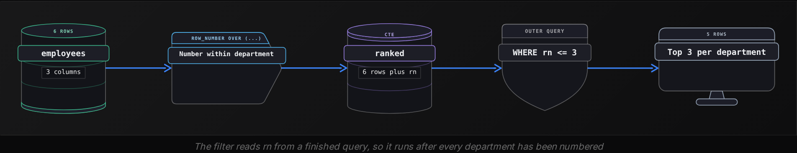

# Top N Per Group: Beginner

You are 10 minutes into a SQL screen at a fintech, sharing a scratchpad with the hiring manager. She pastes a table: employees, with employee_id, department_id and salary, 6 rows showing.
"Give me the 3 highest-paid people in each department."
She stops talking. The sentence has a number and a ranking word, and most hands are already typing `ORDER BY salary DESC LIMIT 3` before the word 'each' has done its work. Nobody has said what should happen when a department has 2 people, and the 3 rows that come back will all carry the same department_id, which she will notice before you do.
What she is testing is whether 'in each department' registers as a ranking that restarts for every department, and whether you can say that plan out loud before a line of SQL exists.


<br>

### What you will be able to do

Spot a top N per group question in any domain: a ranking word with a number, plus a grouping word that splits the ranking

Explain why ORDER BY with LIMIT returns 3 rows from 1 group and why 1 query per group doesn't scale

Write ROW_NUMBER() OVER (PARTITION BY ... ORDER BY ...) and predict the number every row receives

Place the rn <= N filter in an outer query and explain the clause order that forces it there

State a 4-sentence plan for the query before typing, and trace it on 2 groups before saying done


<br>

---

## "Find the Top 3" Means Ranking

'Show me the 3 best-selling products in every category.' 'Pull the 2 most recent orders for each customer.' 'Who are the 3 top earners per department?' Each sentence pairs a number with a ranking word, then adds a grouping word, and the grouping word decides the query. A ranking word on its own asks for 1 sort of the table and N rows off the top. A ranking word next to 'per', 'each', 'every' or 'within' asks for a ranking inside every group and up to N rows from each, and the result holds as many groups as the table does.


<br>

### A grouping word and a ranking word in 1 sentence

The tell is a grouping word and a ranking word in the same sentence, usually with a number between them. 'Per department' names the group, 'highest' names the direction of the sort, 'salary' names the column being sorted and '3' names the cutoff. Those 4 pieces are the whole specification, and reading them out in that order (group, sort column, direction, N) is the first move the interviewer is listening for. Say the group column's name aloud: 'per department' means `department_id`, 'for each customer' means `customer_id`. Naming it before any SQL exists shows the sentence was parsed rather than matched to the nearest query remembered from a tutorial.

| Question | Group column | Sort column and direction | N |
| --- | --- | --- | --- |
| 3 top earners per department | department_id | salary DESC | 3 |
| 2 most recent orders for each customer | customer_id | order_date DESC | 2 |
| Best-selling item in every category | category_id | units_sold DESC | 1 |
| Cheapest listing per seller | seller_id | price ASC | 1 |
| Within each class, the 3 highest scores | class_id | score DESC | 3 |

Read down the table and the pattern shows itself: every row fills the same 4 slots, and the only variation is which column fills each one. The question's nouns give the group and the sort column, its adjective gives the direction, and its number gives N. A question that fills all 4 slots is this pattern whatever the domain, and a question that fills only the last 3 is a plain sort with a cutoff.


<br>

### The disguises it wears

- 'The latest record for each customer': timestamp sort column, descending, N is 1
- 'For every store, the top performer': 'top' carries both the direction and N, and N is 1
- 'Within each region, the 5 largest accounts': 'within' is the grouping word, account size the sort column
- 'One row per order_id, the most recently loaded one': duplicates after a reload, the same query with N at 1
- 'The 3 cheapest flights on each route': the sort runs ascending, the direction most answers forget to say

N at 1 is the version that shows up most at work. A table loaded twice holds 2 copies of every order, and 'keep the most recently loaded copy of each order' reads as top 1 per `order_id` ordered by load time descending. Interviewers accept the per-group ranking as the standard deduplication answer, so recognizing N at 1 as the same question covers 2 common screens with 1 pattern. The ranking column changes from a salary to a timestamp and the number changes from 3 to 1, and the query underneath keeps its shape.


<br>

### What a global top N looks like next to it

| ✓ One ranking, N rows in total | ✗ One ranking per group, N rows from each |
| --- | --- |
| • 'Top 10 customers by lifetime spend'<br><br>• 'The 5 longest-running queries yesterday'<br><br>• 'The highest salary in the company'<br><br>• Answered by ORDER BY and LIMIT, and the result holds at most N rows | • 'Top 10 customers by spend in each country'<br><br>• 'The 5 longest-running queries per user'<br><br>• 'The highest salary in each department'<br><br>• Answered by a numbering that restarts in every group, and the result holds up to N rows for each distinct group value |

The right-hand column is a different query from the left, and a reader of the result can tell them apart by counting groups. 'Top 10 customers in each country' with 40 countries in the table returns up to 400 rows: 10 for each country that has at least 10 customers, and every customer for a country with fewer. The left-hand column returns 10 rows whatever the table holds. When the number of rows in the answer depends on how many groups the table has, the question is a per-group ranking.

> What the first minute is scored on
>
> - Reading: did 'per department' land as 1 ranking per group rather than a sort of the whole table
> - Naming: before any keystroke, did the candidate name the group column and N, and say which way the sort column runs
> - Reach: whether the first tool reached for was a numbering that restarts per group; LIMIT misses, and so does a loop of 1 query per department
> - Checking: was there a question about what the result should hold when a group has fewer than N rows

> **TIP**
>
> Say 1 sentence before touching the keyboard: 'This is top N per group. The group is department_id, the ranking is salary descending, and I keep the 3 highest in each.' That sentence holds every decision the query will make, and it lands on the scorecard before the code exists.


<br>

---

## Why ORDER BY ... LIMIT Fails

Here are the 6 rows on the screen, the table the rest of the lesson uses. Department 10 holds employees 101 to 104, paid from 180,000 down to 120,000 in steps of 20,000, in id order. Department 20 holds 201 at 90,000 and 202 at 85,000. The question is the 3 highest salaries in each department, and the correct result holds 5 rows: 3 from department 10, and both rows from department 20.

| department_id | employee_id | salary |
| --- | --- | --- |
| 10 | 101 | 180000 |
| 20 | 201 | 90000 |
| 10 | 102 | 160000 |
| 10 | 103 | 140000 |
| 20 | 202 | 85000 |
| 10 | 104 | 120000 |


<br>

### The query most hands type first

```sql
SELECT
  department_id,
  employee_id,
  salary
FROM employees
ORDER BY salary DESC
LIMIT 3
```

What was asked: up to 3 per department

What LIMIT 3 returns

Department 10 holds the 4 largest salaries on the table, so the sort fills all 3 slots from department 10 and department 20 never appears. The query runs without an error and returns 3 well-formed rows, which is what makes it dangerous: a dashboard built on it shows 3 engineers under a heading reading 'top earners by department', and the mistake surfaces weeks later when the Sales manager asks where her team went. `LIMIT` is 1 counter over the whole result, and SQL has no clause meaning 'take 3 from each group'.

Reading the result back is the check that catches it in the room: 3 rows, and 1 value of `department_id` repeated down the column. A per-group result shows every department the table has, so a result where the group column holds a single repeated value is the signature of a global sort. Say it when you see it: 'every row here is department 10, so this ranked the table rather than each department.'


<br>

### Why ORDER BY and LIMIT answer a different question

`ORDER BY` arranges the rows into 1 sequence and `LIMIT` cuts that sequence at a fixed position. Both clauses see the table as a single list, and neither knows that `department_id` divides the list into groups. The question asked for 2 lists, 1 per department, each cut at 3. Sorting by department first, `ORDER BY department_id, salary DESC`, puts the groups next to each other, and `LIMIT 3` still cuts once, so the result is the 3 highest earners of whichever department sorts first. The question needs a cutoff applied once per group, and the sorting clauses have no notion of a group.


<br>

### The patch that turns 1 query into 1 per department

The next move, once the missing department is noticed, is a filter: `WHERE department_id = 20` with `LIMIT 3`, then the same for department 10, then `UNION ALL` to glue the 2 results. On 2 departments it produces the right 5 rows. On a real table it needs 1 query per department, the list of departments has to be known when the SQL is written, and a department created next month is missing from the report until someone edits the query. Interviewers hear this patch and ask 'and if there are 400 departments?', which is the question the approach cannot answer.

```sql
(SELECT
  department_id,
  employee_id,
  salary
FROM employees
WHERE department_id = 10
ORDER BY salary DESC
LIMIT 3)

UNION ALL

(SELECT
  department_id,
  employee_id,
  salary
FROM employees
WHERE department_id = 20
ORDER BY salary DESC
LIMIT 3)
```

The patch shows the shape of the right answer. Each branch is a sort and a cutoff inside 1 department. The fix does that for every department in 1 pass without listing them: a counter that runs 1, 2, 3 down each department's rows and resets whenever a new department begins. That counter is a window function, and the next section builds it. The sentence worth saying in the room at this point is: 'LIMIT counts rows for the whole result, so I need a count that restarts per department.'

> Where the LIMIT answer loses points
>
> - Returning 3 rows and reading them back without noticing that every row carries the same department_id
> - Adding department_id ahead of salary DESC in the sort but keeping LIMIT 3, which still cuts the list once
> - Patching with 1 query per department, which breaks as soon as a department is added
> - Hearing 'where is department 20?' and raising LIMIT to 5, which returns 104, department 10's 4th earner, and drops 202 on this very table


<br>

---

## PARTITION BY Plus ROW_NUMBER

A window function computes a value for every row from the rows around it, without collapsing them the way `GROUP BY` does. The table stays 6 rows and gains a column. `ROW_NUMBER` is the window function that hands each row a position, and the `OVER` clause after it says 2 things: which rows share a numbering, and in what order they are numbered. Those 2 things are the group and the sort from the question, written as SQL.

> The 4 parts of the clause
>
> - `ROW_NUMBER()`: numbers the rows upward from 1 with no repeats and no gaps, so every row in a numbering gets a distinct position
> - `PARTITION BY department_id`: splits the rows into 1 numbering per department, so the count starts over at 1 when the department changes
> - `ORDER BY salary DESC`: decides what position 1 means inside each department; DESC puts the largest salary first
> - `AS rn`: names the new column so a later query can refer to it


<br>

### Watching the counter restart

https://github.com/user-attachments/assets/8b2541b9-5586-4e18-a76a-572566a17422

The engine gathers the rows of department 10, sorts them by salary descending and numbers them: 101 at 180,000 gets 1, 102 at 160,000 gets 2, 103 at 140,000 gets 3 and 104 at 120,000 gets 4. The partition changes to department 20 and the counter starts over: 201 at 90,000 gets 1 and 202 at 85,000 gets 2. No row has been dropped at this stage, so the output holds all 6 rows plus `rn`, and the value of `rn` on each row is its position inside its own department, which is the per-group cutoff the question needs, written down as data a filter can read.


<br>

### The bug that wears a window function

```sql
SELECT
  department_id,
  employee_id,
  salary,
  ROW_NUMBER() OVER (ORDER BY salary DESC) AS rn
FROM employees
```

With PARTITION BY department_id

Without it

Leave out `PARTITION BY` and the numbering runs down the whole table: 201 gets 5 and 202 gets 6. A filter at 3 then returns 3 rows, all from department 10, which is the `LIMIT` answer from the previous section wearing a window function. Interviewers trace this by hand with 1 question, 'what number does 201 get?', and the answer 5 is the moment the bug shows. The defence is to say the clause before typing it: 'PARTITION BY department_id is what gives each department its own ranking.'


<br>

### The direction is half the answer

`ORDER BY salary DESC` inside the `OVER` clause is where 'highest' is encoded. Drop `DESC` and the numbering runs upward: 104 at 120,000 gets 1 in department 10, and the filter in the next section returns the 3 lowest earners starting from 104, so the 4th earner replaces the top earner 101. Department 20 looks right only because both of its rows survive either way, which is why the bug slips past a quick read. 'Most recent' means a timestamp descending, 'cheapest' means a price ascending, 'best-selling' means a unit count descending. Say the direction when you say the column: 'ordered by salary descending' is the whole phrase, and an interviewer who hears only 'ordered by salary' waits to see which way it goes.


<br>

### Same clause, different question

'The 2 most recent orders per customer' changes 3 tokens and nothing else: the cutoff moves to 2 after `PARTITION BY customer_id` and `ORDER BY order_date DESC` go in. 'Cheapest listing per seller' is `PARTITION BY seller_id ORDER BY price ASC` with a cutoff of 1. The clause has 3 slots for the question to fill. The group is one; the sort column and its direction are the other 2. Once those 3 have been said aloud, writing the clause is transcription, and the interviewer can check the transcription against the sentence you gave.

*A follow-up around 2 people earning the same salary is common once this query runs. ROW_NUMBER gives tied rows 2 different positions, and the order among them is not guaranteed: it can change from run to run, even on the same engine. The answer that scores is to say so and ask whether the report wants exactly 3 rows or everyone who ties into the top 3. The 3 ranking functions and their tie rules have a lesson of their own.*

> **TIP**
>
> State the partition column and the order column in 1 breath before the OVER clause is typed: 'partitioned by department, ordered by salary descending'. When either is missing from that sentence the query will be wrong, and saying it is the cheapest check there is.


<br>

---

## Filtering rn <= N

The most common live error on this question lands 20 seconds after the pattern is recognized. `rn` is defined in the SELECT list, `WHERE rn <= 3` is added to the same query, and the run fails with 'column rn does not exist'. The reason is the order in which the engine evaluates clauses, and an interviewer who sees the error asks for that reason, so explaining it correctly turns the fumble into a point.

```sql
SELECT
  department_id,
  employee_id,
  salary,
  ROW_NUMBER() OVER (
    PARTITION BY department_id
    ORDER BY salary DESC
  ) AS rn
FROM employees
WHERE rn <= 3
```


<br>

### The order the engine actually runs

- FROM and JOIN: the rows come into existence, carrying the base columns of the table
- WHERE: rows are dropped, with only base columns visible, because nothing has been computed yet
- GROUP BY and HAVING: rows fold into groups and the groups are filtered
- SELECT, including window functions: ROW_NUMBER runs over the surviving rows, and rn is born here
- ORDER BY and LIMIT: the finished rows are arranged and cut

`WHERE` runs in step 2 and `rn` appears in step 4, so at the moment `WHERE` is evaluated the column has no value and no name. This is also why the numbering has to finish before the cutoff can be applied: `ROW_NUMBER` needs to see every row of a department to know which one is third, and a filter that ran before it would change the rows being numbered. The cutoff has to sit in a query that starts after the numbering query has finished, which means a second SELECT that reads the first.




<br>

### The shape that works

```sql
WITH ranked AS (
  SELECT
    department_id,
    employee_id,
    salary,
    ROW_NUMBER() OVER (
      PARTITION BY department_id
      ORDER BY salary DESC
    ) AS rn
  FROM employees
)

SELECT
  department_id,
  employee_id,
  salary
FROM ranked
WHERE rn <= 3
```

The CTE named `ranked` is the whole table with `rn` attached, 6 rows. The outer query's `FROM` reads `ranked`, so by the time its `WHERE` runs, `rn` is a base column of the thing being read and the comparison is allowed. The filter keeps rows numbered 3 or lower: department 10 loses 104 at position 4, department 20 keeps both of its rows at positions 1 and 2, and the result has 5 rows. Add 10 people to department 20 and the query returns 3 of them; shrink department 10 to 2 people and it returns those 2. The query never asks how large a group is.

| department_id | employee_id | salary |
| --- | --- | --- |
| 10 | 101 | 180000 |
| 10 | 102 | 160000 |
| 10 | 103 | 140000 |
| 20 | 201 | 90000 |
| 20 | 202 | 85000 |

A subquery in the `FROM` clause does the same job with the same rows: the numbering SELECT goes inside parentheses as `FROM (...) AS ranked`, and `WHERE rn <= 3` follows it. The CTE reads better in the room because the numbering step has a name you can point at, and interviewers follow a named step more readily than a nested one. Snowflake offers `QUALIFY rn <= 3`, as do BigQuery and DuckDB: a clause that runs after the window functions and saves the second SELECT. It's worth naming as a dialect shortcut, with the CTE as the version that runs everywhere.


<br>

### Reading the cutoff

`rn <= 3` and `rn < 4` keep the same rows. `rn < 3` keeps 2 per department, the off-by-one that returns the right number of groups and the wrong number of rows. `rn = 1` keeps the top row of each department and is the deduplication query. `rn > 3` keeps everything past the top 3, the rows a 'who is outside the top 3' question wants. The comparison is the last decision in the query and the one most often typed without being read back.

> Trace it on 2 groups before declaring done
>
> - Pick the group with more than N rows and confirm that row N+1 is dropped: 104 at position 4 leaves
> - Pick the group with fewer than N rows and confirm that every row survives: 201 and 202 both stay
> - Point at the first row of the second group and say that its number is 1
> - Read the comparison aloud, 'rn less than or equal to 3', and confirm the 3 matches the question's N

> **TIP**
>
> If the error appears in the room, say the reason in 1 sentence: 'WHERE runs before the SELECT list, so rn doesn't exist yet; I'll move the numbering into a CTE and filter on it outside.' Then fix it. The sentence is worth more than never having made the error.


<br>

---

## Talking Through the Ranking Plan

The SQL for this question is 14 lines, and most candidates can type it. What separates an answer that scores from one that gets a polite nod is the 60 seconds before the typing: a plan said aloud, in the order the engine will run it, with the 4 pieces of the question named. Interviewers on this question are grading whether the pattern was recognized and whether the plan was stated, and the code afterward confirms the plan rather than discovering it.


<br>

### The plan, in 4 sentences

> Say these in this order
>
> - Name the pattern: 'This is top N per group.'
> - Name the group: 'The group is department_id, so the ranking restarts for every department.'
> - Name the ranking: 'Inside each department I order by salary descending, so the highest earner is numbered 1.'
> - Name the cutoff and where it lives: 'I number the rows in a CTE and keep rn of 3 or lower in an outer query, because WHERE can't see a column the same SELECT creates.'

Those 4 sentences take 30 seconds and carry every decision the query makes. The order matters: group before ranking, ranking before cutoff, because that's the order the engine applies them, and a plan told in that order sounds like someone who has watched the query run. A plan told backward, starting from 'I'll keep rows where rn is at most 3', makes the interviewer wait to find out what rn is, and the wait reads as uncertainty.


<br>

### A clarifying question or 2 before the plan

The question as asked usually leaves 2 things open, and asking about them scores on its own. First: 'If a department has fewer than 3 people, do you want all of them?' The answer is almost always yes, and asking shows you know the result has a variable row count. Second: 'If 2 people earn the same salary, do you want exactly 3 rows or everyone who ties?' Raising the tie before being asked is the signal, and the tie rule can be settled later. One quicker question is worth adding: 'do you want every column, or only salary with its id and department?' It takes 5 seconds and avoids a rewrite.

| ✓ The opening that loses the minute | ✗ The opening that scores it |
| --- | --- |
| • Types ORDER BY salary DESC LIMIT 3 and reads back 3 rows from 1 department<br><br>• Hears 'where is department 20?' and patches with 1 query per department<br><br>• Never says the word partition<br><br>• Writes WHERE rn <= 3 under the SELECT that defines rn, and goes quiet when it fails<br><br>• Waits to be asked about groups with fewer than 3 rows | • Says 'top N per group' and names the group column before any code<br><br>• Says 'ordered by salary descending' as 1 phrase<br><br>• Puts ROW_NUMBER inside a CTE and says why the filter sits outside<br><br>• Traces 2 departments by hand, 1 with 4 rows and 1 with 2, before saying done<br><br>• Asks about the small group and the tie before being asked |


<br>

### Follow-ups and the sentence that answers each

| Follow-up | The answer that scores |
| --- | --- |
| Why not ORDER BY and LIMIT? | LIMIT counts rows for the whole result; the question needs a count that restarts per department. |
| What does PARTITION BY do here? | It restarts the numbering at 1 every time department_id changes, so each department is ranked on its own. |
| Why is the filter in a separate query? | WHERE runs before the SELECT list, so rn does not exist until the numbering query has finished. |
| What if a department has 2 people? | Both come back; rn <= 3 keeps every row in a group smaller than 3. |
| Could you use a subquery instead of a CTE? | Yes, the same SELECT in the FROM clause; the CTE gives the step a name. |
| What if I want the lowest 3 instead? | Change DESC to ASC in the OVER clause; nothing else moves. |


<br>

### Narrating the query as it runs

After the code is typed, walk the 6 rows out loud the way the animation did: 'Department 10 sorts to 180, 160, 140, 120, numbered 1 to 4. Department 20 restarts: 90 gets 1, 85 gets 2. The filter keeps 1 through 3, so 104 drops while both of department 20 stay. That's 5 rows.' This trace takes 20 seconds and does 2 things: it catches a missing DESC or a missing PARTITION BY before the interviewer does, and it shows the result was predicted rather than discovered by running it. Interviewers note candidates who say the row count before pressing run.

If a step is forgotten mid-answer, say the plan again from the top rather than searching the screen for the gap. 'Group, then ranking, then cutoff' is short enough to repeat under pressure, and each word points at the clause that carries it: PARTITION BY, ORDER BY inside OVER, WHERE on rn. Guessing at syntax in silence costs more than saying 'the filter has to move to an outer query, give me a second to restructure', because the second sentence shows the plan survived the slip.


<br>

### Habits worth keeping

| ✓ Do | ✗ Don't |
| --- | --- |
| • Write ASC explicitly for cheapest and earliest; highest and latest get DESC, as does any 'most'<br><br>• Treat 'latest row per key' deduplication as the same query with rn = 1<br><br>• Check the number in the cutoff against the N the question asked for<br><br>• Name QUALIFY as a dialect shortcut, and write the CTE that runs on every engine<br><br>• Restate group, ranking, cutoff from the top when a step slips | • Type rn < 3 for a top 3, which keeps 2 rows per group<br><br>• Drop DESC on a 'highest' question: 104 replaces 101, and department 20 hides the bug<br><br>• Read a result back without counting how many distinct group values it holds<br><br>• Guess at syntax in silence after a slip; say the plan still holds and restructure<br><br>• Use QUALIFY without confirming the engine in the room supports it |


<br>

---

## Putting It All Together

An online marketplace sends a Monday email listing the 3 best-selling products in each of its 40 categories. The merchandising lead hands you product_weekly_sales, 1 row per product with product_id, category_id, product_name and units_sold for last week, and asks for the query by lunch. Some new categories have only 1 or 2 products in them.

- 'In each of its 40 categories' is the grouping word, 'best-selling' is the ranking word and 3 is N, so the result holds up to 120 rows and the group column is category_id.
- ORDER BY units_sold DESC LIMIT 3 would return 3 products from the category with the highest volume, and the other 39 categories would be missing from the email.
- ROW_NUMBER() OVER (PARTITION BY category_id ORDER BY units_sold DESC) AS rn numbers products inside each category, with units_sold descending because 'best-selling' means largest first.
- The numbering sits in a CTE and WHERE rn <= 3 reads it from the outer query, because rn doesn't exist when the inner WHERE would run.
- The categories with 1 or 2 products return all of their rows, which is the small-group check to trace by hand, and the question to confirm with the lead before the email goes out.


<br>

---

## Key Takeaways

- A grouping word ('per', 'each', 'every', 'within') next to a ranking word and a number asks for a ranking that restarts in every group.
- ORDER BY with LIMIT is 1 counter over the whole result, so it returns N rows from whichever group holds the largest values.
- ROW_NUMBER() OVER (PARTITION BY group ORDER BY measure DESC) numbers rows 1, 2, 3 inside each group and starts over when the group changes.
- WHERE runs before the SELECT list, so the rn filter lives in an outer query or a CTE that reads the numbered rows.
- Before typing, say the group and N aloud, along with the sort column and the way it runs; then trace 1 large group and 1 small group before declaring done.
