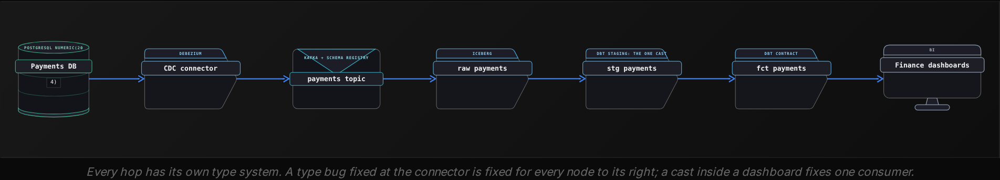

# Type Casting: Advanced

Forty minutes into a design round at a payments company, the interviewer turns her laptop around.
"Our nightly reconciliation joins payments to ledger_entries, about 2.4 billion rows a side. It finished in 12 minutes for 2 years. Since the ledger team migrated their service last Tuesday, it takes 3 hours 10 minutes, and finance says a few thousand entries no longer match. Nobody touched the SQL. Talk me through it."
The fact she leaves out decides everything: the migration rewrote payment_ref from BIGINT to VARCHAR(32). Most candidates reach for a bigger warehouse or a rewritten join without asking what type each side of the ON clause now holds.
What she is testing is whether you treat a column's type as a contract: what it costs in joins, what it does to plans and totals, how it changes safely, and who fixes it when it breaks.


<br>

### What you will be able to do

Explain how a column's declared type changes storage size and hash join cost. Say what it does to min/max pruning, and where width matters and where it does not.

Spot an implicit cast on an indexed column in a plan. Decide whether to fix the column's type or work around it with a rewritten predicate or an expression index, knowing which rewrite changes the result.

Predict where SUM and COUNT overflow over billions of rows in a given engine, and where decimal arithmetic overflows or loses precision.

Tell a catalog-only type change from one that rewrites the table or changes what values mean, then lay out an expand-and-contract migration for the breaking ones.

Decide whether a type bug is fixed at the source or patched with a query-side cast, and defend the choice by its blast radius.


<br>

---

## Storage Types and Query Speed

Nobody asks about storage implications directly. The question arrives as a join that slowed down after a migration, as "we store every id as a string, is that a problem?", or inside a schema design prompt where the interviewer watches what you pick for the key columns. The strong answer names the short list of places where a type's width costs real time, and says where it costs nothing.


<br>

### What a value costs in bytes

| Value | Declared type | Bytes per value | Behaviour at scale |
| --- | --- | --- | --- |
| payment_id | BIGINT | 8 | Fixed width; compares in one instruction |
| payment_ref from the new ledger | VARCHAR(32) | Length plus a 1 to 4 byte header | Variable width; compared byte by byte |
| Request id | Native UUID | 16 | Fixed width |
| Request id as text | CHAR(36) | 36 plus header | More than twice the native key |
| amount, up to 18 digits | DECIMAL(18,4) | 8 | 64-bit integer arithmetic inside |
| amount, 38 digits | DECIMAL(38,4) | 16 | 128-bit arithmetic in most engines |
| created_at | TIMESTAMP | 8 | Sorts and prunes by time |
| created_at as ISO text | VARCHAR | 19 to 32 | Sorts by characters |

On disk, columnar formats close some of these gaps. Parquet and ORC dictionary-encode a low-cardinality string, so a status column with 6 distinct values costs a few bits a row whatever its declared type. Dictionary encoding gives up on high-cardinality columns, and a join key is high-cardinality by construction: billions of distinct payment ids never fit a dictionary, so a text key is stored and read at close to its full width.

Decimal width follows the same logic. Parquet stores a DECIMAL with precision up to 18 as a plain INT64, and Spark keeps such a value in a single 64-bit long during arithmetic. Declare DECIMAL(38,4) "to be safe" and every value takes 16 bytes and 128-bit arithmetic, on every row of every scan, for headroom the amount column will never use.


<br>

### Where width is paid: the hash join

The cost shows up in memory, during the join. A hash join builds a table from one side's keys, then hashes every probe row and compares on each hit. An 8-byte integer hashes and compares in a couple of instructions. A VARCHAR key needs its length read, all its bytes hashed and a byte-wise compare on every collision; under a case-insensitive collation, the default in SQL Server and MySQL, the compare also folds case. The build side's hash table grows with key width, and a build side that no longer fits in memory spills to disk in partitions. Spilling is usually where a join measured in minutes becomes one measured in hours.

A mismatched key costs more than a wide one. Join payments.payment_id BIGINT to ledger_entries.payment_ref VARCHAR(32) and the engine has to convert one side on every row before it can hash anything. That conversion can also disable the runtime filters and dynamic partition pruning that let the probe side skip files, because the filter was built over one type and the scan reads another.


<br>

### Text breaks the pruning statistics

Warehouses and lake formats keep a minimum and maximum per file or micro-partition and skip any file whose range cannot match the filter. For a text column those bounds are lexicographic: '100' sorts before '99', and '2024-3-5' sorts after '2024-12-01'. A filter that casts the text back to a number returns the right rows, but the stored bounds cannot serve it, so the scan opens files a typed column would have skipped. Filtering the text directly keeps the pruning and returns the wrong rows. The same ordering problem undermines clustering and sort keys, which exist to make those bounds tight.

| ✓ Worth arguing about | ✗ Not worth a meeting |
| --- | --- |
| • Join keys on fact tables of hundreds of millions of rows or more<br><br>• Partition keys, and the sort or clustering keys that decide what gets pruned<br><br>• GROUP BY keys in heavy aggregations, held in hash tables like join keys<br><br>• Money and counters, where the type sets the overflow ceiling | • Descriptive columns on a 2,000-row dimension<br><br>• Low-cardinality strings that dictionary-encode to a few bits<br><br>• SMALLINT against INT on columns that only ever appear in the SELECT list<br><br>• Free text that is only ever displayed |

That split is what gets scored. Recommending SMALLINT for every small number reads as over-engineering, and so does a lecture on byte alignment for a lookup table. Saying that payment_id should be BIGINT on both sides of the join, and that the dimension's label column can be whatever is convenient, shows where the bytes are actually spent.

> **TIP**
>
> Asked for a number, offer what you would measure: build-side memory and spilled bytes from the plan, and probe rows per second for each key type. A universal speedup figure sounds rehearsed; naming the 3 measurements sounds like someone who has profiled a join.

Applied to the reconciliation job, the type change did 3 separate things: it widened the keys in the hash table, added a per-row conversion on one side, and blunted pruning on the ledger's text column. A complete diagnosis names all 3, then says which one the plan shows dominating.


<br>

---

## Implicit Casts That Defeat an Index

A B-tree index keeps the column's values sorted under the column's own type and collation, so it can serve a predicate on the bare column and nothing else. Wrap the column in a function and the order of the index stops matching the order of the expression, so the engine scans. An implicit cast is a function the engine inserted on your behalf, and that's why the bug reaches production: the SQL text looks sargable, and the plan says otherwise.


<br>

### Which side gets converted

Every engine resolves a mixed-type comparison by converting one side, and the side it picks decides whether the index survives. Precedence rules differ by engine, and naming the rule for the engine on the whiteboard is what the interviewer is listening for.

| Engine | Text column = number | Number column = text |
| --- | --- | --- |
| SQL Server | Column converted to INT, which outranks VARCHAR: index scan, and any non-numeric row raises a conversion error | Literal converted to INT: the seek survives |
| MySQL | Both sides compared as DOUBLE: the text column's index is unusable | Literal converted: index used |
| PostgreSQL | Rejected with operator does not exist: character varying = integer | Untyped literal resolved as integer: index used |

PostgreSQL's own trap runs the other way. WHERE payment_id = 880412.0 compares a BIGINT column with a NUMERIC literal. No index operator pairs those 2 types, so the planner casts the column to NUMERIC and the B-tree on payment_id goes unused. The explicit version, created_at::date = '2024-03-15' against an index on a timestamp, fails the same way, and the rewrite is a half-open range: created_at >= '2024-03-15' AND created_at < '2024-03-16'.


<br>

### The driver nobody suspects

The most common production case never appears in the SQL. Microsoft's JDBC driver sends Java strings as NVARCHAR by default (sendStringParametersAsUnicode=true). NVARCHAR outranks VARCHAR, so a lookup on a VARCHAR column converts the column on every row. Under a SQL collation the seek becomes a scan; under a Windows collation the optimizer can still seek over a computed range, with a worse row estimate. The fix is a single connection-string flag, and the only way to find it is to read the plan.


<br>

### Reading it in the plan

```sql
-- SQL Server: actual plan for a ledger lookup
|--Index Scan(OBJECT:([ledger_entries].[ix_payment_ref]),
     WHERE:(CONVERT_IMPLICIT(int,[payment_ref],0)=(880412)))
Warning: Type conversion in expression (CONVERT_IMPLICIT(int,[payment_ref],0))
  may affect "SeekPlan" in query plan choice

-- PostgreSQL: EXPLAIN
Seq Scan on payments  (cost=0.00..48210335.00 rows=12000000 width=64)
  Filter: ((payment_id)::numeric = 880412.0)

-- MySQL 8: SHOW WARNINGS after EXPLAIN
Cannot use ref access on index 'ix_payment_ref' due to type or
collation conversion on field 'payment_ref'
```


<br>

### The rewrite that changes the answer

The reflexive fix is to match the literal to the column: payment_ref = '880412' in place of = 880412. The seek comes back, and so does a different result set, because the numeric comparison matched every spelling of the number and the text comparison matches exactly one. Watch both comparisons evaluate over 6 ledger rows.

https://github.com/user-attachments/assets/b4940f6b-fb3a-4e8d-9ce3-6d921acbfcc3

Rows 2 and 5 carry leading zeros from an old export. The numeric comparison counts 4 rows as payment 880412; the text comparison finds 2. In the reconciliation job, that is 2 ledger entries reported as unmatched with no error anywhere. The sentence the interviewer wants to hear: "Before I move the cast, I count the rows where the 2 comparisons disagree." If that count is 0, the rewrite costs nothing. If it is higher, the data needs normalizing before any predicate changes.

MySQL's DOUBLE path has a second edge. A double holds every integer exactly only up to a limit, and past it the conversion rounds, so payment_ref = 18014398509481985 matches a row holding '18014398509481984'. On 17-digit ids, comparing text to a number is a correctness bug as well as a scan.

- **2^53** — where DOUBLE stops holding every integer


<br>

### 4 fixes and what each costs

| Fix | Restores the seek | What it costs |
| --- | --- | --- |
| Match the literal or parameter to the column's type | Yes | Changes results when spellings differ; count disagreements first |
| Expression index on CAST(payment_ref AS BIGINT) | Only for queries written with that exact cast | Build fails on the first uncastable row; every insert pays for it |
| Persisted computed column with an index (SQL Server) | Yes, if queries use the column | Schema change on a hot table; same uncastable-row problem |
| Change the column's type | Yes, for every reader | A live migration with readers to coordinate |

The expression index is the tempting middle answer, so name its failure mode before the interviewer does. The first row holding 'N/A' makes CREATE INDEX fail, and once the index exists, every later insert of such a row fails too, which moves a reporting problem into the ledger service's write path. Changing the type itself is a migration with rules of its own.


<br>

---

## Overflow and Precision Loss

The question rarely says overflow. It arrives as "the revenue total differs between 2 runs of the same query", "finance says the daily sum is 3 cents off", or "a job that has run for a year failed last night with an arithmetic error". Each is a type question, and the first move is to ask what type the aggregate returns in this engine, because the result type is where the ceiling sits.


<br>

### The result type sets the ceiling

| Engine | SUM over INT | SUM over BIGINT | When the result overflows |
| --- | --- | --- | --- |
| PostgreSQL | BIGINT | NUMERIC | Practically never for sums |
| SQL Server | INT | BIGINT | Error 8115, arithmetic overflow |
| Snowflake | NUMBER(38,0) | NUMBER(38,0) | Error past 38 digits |
| BigQuery | INT64 | INT64 | Query fails with an overflow error |
| MySQL | DECIMAL | DECIMAL | Exact; no practical ceiling |
| Spark 3.x, ANSI off | BIGINT | BIGINT | Wraps to a negative number, job succeeds |

SQL Server is where billions of rows bite first: SUM over an INT column returns INT, and COUNT(\*) returns INT as well, so a plain count over a large fact table fails with an overflow error. COUNT_BIG returns BIGINT and is the function to name. Spark is the dangerous one, because its failure is silent. With ANSI mode off, the default through Spark 3.x, a BIGINT sum that passes its limit wraps around and the dashboard shows negative revenue. Spark 4.0 turns ANSI mode on by default, which converts that wrap into an error.

- **2,147,483,647** — rows before an INT COUNT(\*) fails


<br>

### Overflow happens before the SUM

The aggregate's type is half the story. In SUM(quantity \* unit_price_minor) the multiplication runs per row, in the operands' type. The product of 2 INT columns is an INT, so a single line of 30,000 units at 90,000 minor units, a product of 2.7 billion, overflows before the sum ever sees it. Casting the SUM's result changes nothing; the widening has to reach an operand.

```sql
-- Overflows per row: INT * INT
SELECT SUM(quantity * unit_price_minor) AS gross_minor
FROM order_lines;

-- Too late: the product overflowed before the cast
SELECT CAST(SUM(quantity * unit_price_minor) AS BIGINT) AS gross_minor
FROM order_lines;

-- Widen an operand, and count with COUNT_BIG
SELECT SUM(CAST(quantity AS BIGINT) * unit_price_minor) AS gross_minor,
       COUNT_BIG(*) AS line_count
FROM order_lines;
```


<br>

### Floats give 2 answers to 1 question

Floating-point addition is not associative: (a + b) + c can differ from a + (b + c) in the last bits. A distributed engine adds partial aggregates in whatever order its tasks finish, so a DOUBLE total over 2.4 billion amounts can change in its trailing digits between 2 runs on identical data. That's the "differs between runs" question, and the cause sits in the column's type: DOUBLE can't represent 0.10 exactly, and its rounding depends on the order of the additions.

Exact money takes 1 of 2 forms: integer minor units, where BIGINT cents reach about 92 quadrillion dollars, or DECIMAL with an explicit scale. Either way the currency lives in its own column, so nothing sums yen into dollars, and either way the total is identical under any summation order.


<br>

### Decimal arithmetic quietly drops scale

DECIMAL stays exact until an expression's result type outgrows 38 digits. Multiplying DECIMAL(p1,s1) by DECIMAL(p2,s2) yields precision p1 + p2 + 1 and scale s1 + s2. Past 38 digits, SQL Server cuts the scale, keeping at least 6 places, and Spark does the same when spark.sql.decimalOperations.allowPrecisionLoss is on, which it is by default. Convert DECIMAL(38,10) amounts with DECIMAL(38,10) rates and every product lands at scale 6, rounded row by row before the sum adds the rounding up. In Spark with ANSI mode off, a decimal product that overflows becomes NULL, which SUM then skips, and a SUM that overflows its own precision returns NULL. Neither raises an error.

The follow-up that tests this: "So would you declare everything DECIMAL(38) to be safe?" The strong answer declines, with the reason. Storage cost aside, a wide declaration pushes every product past 38 digits sooner, which triggers exactly the scale reduction above. Size precision to the domain, DECIMAL(20,4) for amounts and a scale that matches the rate source for FX, and widen deliberately where a product needs it.

> **TIP**
>
> Before proposing any fix, ask out loud: what does this engine return for this aggregate over this type, and where does the per-row arithmetic run? Those 2 answers locate every overflow and precision bug in this family.


<br>

---

## Changing a Column's Type in Place

The prompt is usually a requirement with a deadline attached: "order_id is about to pass the INT limit, widen it to BIGINT, the table takes writes around the clock", or "product needs 4 decimal places on amount". The interviewer is listening for a classification before a plan. Some type changes are a catalog edit that finishes in milliseconds, some rewrite every row under a lock, and some change what the existing values mean.


<br>

### 3 kinds of change

| Change | PostgreSQL | Iceberg | Snowflake |
| --- | --- | --- | --- |
| Lengthen VARCHAR | Catalog only | Not applicable: strings are unbounded | Catalog only |
| Raise DECIMAL precision, same scale | Catalog only | Catalog only | Catalog only |
| INT to BIGINT | Full rewrite under ACCESS EXCLUSIVE lock | Catalog only; old files read as BIGINT | No-op: integers are all NUMBER(38,0) |
| FLOAT to DOUBLE | Full rewrite | Catalog only | No-op: FLOAT is already 64-bit |
| Change DECIMAL scale | Full rewrite | Rejected | Not supported in place |
| Text to number, or any narrowing | Rewrite that fails on the first bad value | Rejected | Not supported in place |

PostgreSQL rewrites the table and rebuilds every index for INT to BIGINT while holding an ACCESS EXCLUSIVE lock, so on a 3-billion-row orders table nothing can read or write the table for the hours the ALTER runs. Iceberg, and Delta Lake with its type widening feature enabled, record the promotion in table metadata and widen old values at read time, which is why a lake table absorbs the same change in 1 commit. Raising a DECIMAL's precision without touching its scale is catalog-only in all 3 engines.


<br>

### Safe for the table, unsafe for its readers

A catalog-only change can still break consumers, and this is the half of the answer most people skip. The table accepted the new type; every system that reads it holds its own copy of the old one.

- A pandas or Arrow job with a pinned int32 schema errors or wraps once a value passes the 32-bit ceiling.
- An ORM entity mapped to a 32-bit Integer throws on the first row past the old limit.
- A downstream CREATE TABLE AS that froze DECIMAL(10,2) rounds 4-place amounts back to 2.
- An Avro consumer on the old schema cannot decode records written as long.
- A BI extract with cached column types shows the column as text or drops it.

The precise vocabulary comes from schema registries. INT to LONG is a **BACKWARD**-compatible Avro promotion: a reader on the new schema decodes old records. **FORWARD** compatibility fails: a reader still on the old schema cannot decode the new ones. That fixes the order of operations: upgrade every reader first, then let the producer write the wider type. Column-level lineage from dbt's manifest or OpenLineage supplies the list of readers, and the warehouse's query history catches the ones lineage misses.


<br>

### Changes that alter meaning

Some changes run cleanly and corrupt data. In PostgreSQL, `ALTER COLUMN created_at TYPE timestamptz` interprets every existing value in the session's TimeZone setting, so a migration run from a laptop set to America/Los_Angeles shifts 2 years of UTC events by 7 or 8 hours. Converting text to integer erases leading zeros from codes that were never numbers, the same padded refs that split the reconciliation. Lowering a DECIMAL's scale rounds every stored value. For each, the question to ask is what an existing value means after the change, and who signed off on that meaning.

The requirement is worth pressure-testing before any plan. An INT key at 1.6 billion, growing by 1 million rows a day, has around 18 months of headroom: a migration to schedule next quarter rather than run tonight. Saying so, with the arithmetic, is often the strongest moment in the answer.


<br>

### Expand and contract for the breaking ones

Any change that rewrites the table or narrows the type goes through a parallel column, as does any change in meaning. That keeps every step reversible until the last one.

| Step | What runs | Rollback |
| --- | --- | --- |
| 1. Expand | Add order_id_v2 BIGINT, nullable: a catalog-only change | Drop the column |
| 2. Dual-write | A trigger or the application writes both columns | Stop writing v2 |
| 3. Backfill | Copy in batches of about 50,000 rows by key range, throttled on replica lag | Stop the job |
| 4. Verify | Rows where order_id_v2 IS DISTINCT FROM order_id must number 0 | Fix and re-run |
| 5. Switch readers | Views, ORMs and downstream jobs move to v2, one at a time | Point back at the old column |
| 6. Contract | Stop writing the old column, drop it after the deprecation window | None: the one-way step |

The backfill is batched and throttled because a single UPDATE over 3 billion rows is 1 transaction that bloats the table and holds back vacuum, and replicas stall behind it. The primary key swap is where plans most often bring back the outage. A primary key requires NOT NULL, and setting it on the nullable order_id_v2 scans all 3 billion rows under an ACCESS EXCLUSIVE lock. Instead, add `CHECK (order_id_v2 IS NOT NULL) NOT VALID`, then run `VALIDATE CONSTRAINT`, which scans under a lock that lets reads and writes continue. On PostgreSQL 12 and later, SET NOT NULL then trusts that check and skips the scan. Build the unique index with CREATE INDEX CONCURRENTLY. Then, in one short transaction, drop the old primary key and the foreign keys that reference it, and promote the index with ADD CONSTRAINT ... PRIMARY KEY USING INDEX. Recreate those foreign keys against order_id_v2 as NOT VALID, and validate them afterwards outside the lock.


<br>

---

## Upstream Fix vs Query-Side Cast

The interview version: "An analyst found that amount lands in the warehouse as a string, so they added CAST(amount AS DECIMAL(20,4)) to their dashboard query. Ship it, or fix it upstream?" Either answer can be right. What gets graded is whether the choice follows from the situation, and whether the candidate notices that a cast inside one dashboard fixes the type for exactly one reader.


<br>

### Where the bug was born



A common birthplace is the connector. Debezium's decimal.handling.mode decides how a PostgreSQL NUMERIC travels: precise sends an exact decimal and string sends text. double sends a binary float, which reintroduces every rounding problem the source column was declared to avoid. A string amount in a warehouse is very often a connector setting chosen once, years ago, to make a deserializer error go away. Fixing it there corrects every node downstream at once.


<br>

### The decision, situation by situation

| Situation | Choice | Why |
| --- | --- | --- |
| 1 reader, 1 analysis, every value casts cleanly | Query-side cast | The blast radius is one query; a source change costs more than it saves |
| Many readers, each writing its own cast | Move the cast into one staging model now, fix upstream next | 4 readers write 4 casts: a TRY_CAST, a CAST, a cast to FLOAT and a forgotten one |
| The cast sits on a join key or hot filter | Upstream | Every query pays a per-row conversion and loses index seeks and pruning |
| Bad values exist and TRY_CAST hides them | Upstream, with bad rows quarantined | A NULL from TRY_CAST is data loss nobody sees |
| A vendor feed you do not control | Staging cast with a reject count | There is no upstream to fix; your staging model is the contract |
| An incident in progress | Query-side cast tonight, upstream ticket with a date | Restore the number first, then remove the cause |

The second row is where most strong answers land: 1 cast, in 1 place, owned by 1 team. A staging model that converts the type once, with every downstream model reading from it, gives the speed of a query-side patch without the drift of many, and leaves a single line to delete when the source is corrected.

```sql
-- stg_payments: the only place amount is converted
SELECT payment_id,
       TRY_CAST(amount_raw AS DECIMAL(20, 4)) AS amount,
       currency,
       amount_raw,
       ingested_at
FROM raw_payments;

-- Daily reject check: alerts when unconvertible amounts appear
SELECT CAST(ingested_at AS DATE) AS ingest_date,
       COUNT(*) AS rejected_rows
FROM raw_payments
WHERE amount_raw IS NOT NULL
  AND TRY_CAST(amount_raw AS DECIMAL(20, 4)) IS NULL
GROUP BY CAST(ingested_at AS DATE);
```

The upstream fix then lands as an enforced contract. A dbt model contract declares each output column's data_type and fails the build when the model produces anything else; a schema registry rejects an incompatible producer schema at write time. Either one turns the next type drift into a failed deploy instead of a wrong dashboard.

```sql
models:
  - name: fct_payments
    config:
      contract:
        enforced: true
    columns:
      - name: payment_id
        data_type: bigint
      - name: amount
        data_type: numeric(20,4)
      - name: currency
        data_type: char(3)
```


<br>

### Overreach in both directions

This question has a failure mode on each side. Demanding a source-system change and a registry policy for a one-off analysis of a vendor CSV reads as someone who cannot ship. Accepting the dashboard cast when the same column feeds the reconciliation join reads as someone who has never inherited 40 models carrying 40 slightly different casts. The interviewer is waiting for the sentence that names the readers: "Who else reads this column, and what does each of them do with it today?"

Ask that question about the reconciliation job and the answer is clear. The payment_ref column feeds a join over 2.4 billion rows every night, the per-row conversion is paid by every consumer, and the padded refs prove the text carries spellings the BIGINT never had. The fix belongs in the ledger team's schema, with a single staging cast and its reject count holding the line until that change ships.

| ✓ Do | ✗ Don't |
| --- | --- |
| • Ask what type each side of a join or filter holds before tuning compute<br><br>• Count rows where 2 predicates disagree before moving a cast<br><br>• Widen an operand inside SUM, and use COUNT_BIG on large SQL Server tables<br><br>• Upgrade every reader before a producer writes a wider type<br><br>• Keep each query-side cast in 1 staging model with a reject count | • Land join keys as text because the source sent text, and the same goes for dates and money<br><br>• Sum money in FLOAT or DOUBLE and expect 2 runs to agree<br><br>• Run INT to BIGINT as one ALTER on a large PostgreSQL table taking writes<br><br>• Let TRY_CAST turn bad values into NULLs nobody counts<br><br>• Demand a source fix for a one-off analysis over a feed you do not own |


<br>

---

## Putting It All Together

A payments company's nightly reconciliation of payments against ledger_entries, 2.4 billion rows a side, slows from 12 minutes to 3 hours 10 minutes after the ledger team's service migration rewrites payment_ref from BIGINT to VARCHAR(32). The migration also updated a shared join macro to compare CAST(payment_id AS VARCHAR(32)) = payment_ref, so the job's own SQL file never changed, and finance reports a few thousand ledger entries that no longer match any payment.

- The text key widens the join's hash table, adds a per-row conversion and blunts min/max pruning on the ledger side, which together explain the slowdown.
- The macro's text comparison causes the missing matches: an engine's numeric rule would still match '0880412' to 880412, but a text compare matches one spelling, and counting the rows where the 2 comparisons disagree lists the dropped entries.
- Finance compares matched-amount totals and row counts between reruns, so amounts sum as DECIMAL and counts use COUNT_BIG: at 2.4 billion rows an INT count fails and a DOUBLE sum drifts from run to run.
- Returning payment_ref to BIGINT changes meaning for padded refs, so it runs as expand and contract. The Avro and ORM readers get upgraded before the producer switches.
- Many readers and a hot join key put the fix in the ledger schema, with a single staging cast and a reject count covering the gap until it ships.


<br>

---

## Key Takeaways

- Type width costs you wherever a key is hashed, and again wherever it is sorted or pruned on. Argue it for join and group keys and for clustering keys; let a small dimension's labels be.
- An implicit cast on a column defeats its index, the engine's precedence rule picks the side, and moving the cast can change which rows match.
- Overflow comes from the aggregate's result type and per-row arithmetic; DOUBLE sums drift between runs, and wide DECIMAL math drops scale without raising an error.
- Tell catalog-only type changes from ones that rewrite the table or change meaning. Upgrade readers before writers, and run everything that is not catalog-only as expand and contract.
- Fix upstream when many readers or a hot key pay for the cast; patch in 1 staging model with a reject count when the source is out of reach.
