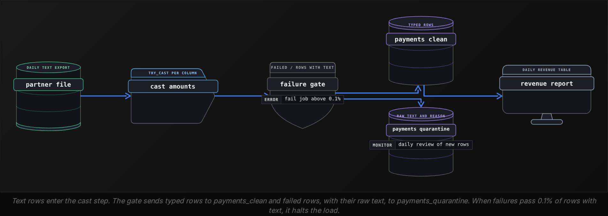

# Type Casting: Intermediate

Odile is 40 minutes into a data engineering loop at Stripe when the interviewer pastes in a file from a marketplace partner. Every column arrived as text: amounts written '1,200.50' and '$15.00', dates like '03/05/2024', and a refund flag that reads 'Y', 'yes', '1' or nothing at all. The task sounds small: load it into a daily revenue table. Odile starts with `CAST(amount AS DECIMAL(10,2))`, and the interviewer stops her: "A single row in this file has a comma in it. What happens to tonight's load?" The follow-ups come quickly. Which rows did your query drop, and how would you know? Is that date March 5 or May 3? Why does your total sit a cent away from the partner's statement? Each one is a casting decision with a cost the interviewer wants stated in rows and cents.


<br>

### What you will be able to do

Choose between CAST and TRY_CAST for a column, and count the rows a safe cast turned into NULL

Parse text dates with an explicit format per source, and detect a source whose day and month are swapped

Predict how decimal type and the rounding point change a money total, and split an amount without losing a cent

Map messy flag text to a boolean that can also be NULL, and state where the unknown rows land in a rate or a filter

Probe an engine's cast behavior before a query moves, and write casts whose results do not depend on it


<br>

---

## TRY_CAST and Safe Conversion

A plain `CAST(amount_text AS DECIMAL(10,2))` requires every row in the table to parse. When a partner sends `'1,200.50'` with a thousands separator, the engine stops the entire query and reports the value it could not read. On a nightly load of 40 million payment rows, that single value means no revenue table the next morning, and every dashboard built on it waits for whoever is on call.

`TRY_CAST` takes the same value and the same target type and keeps the query running. A value that parses comes back converted; a value that does not comes back NULL. The load finishes, and the failure moves from a loud error at run time to a silent gap in the output. Play the query below over 8 raw payments and watch which ones come out NULL.

https://github.com/user-attachments/assets/ad75da74-272a-4b08-a170-c94876140f3d


<br>

### Missing values and failed values look alike

After the cast, 5 of the 8 rows hold NULL in `amount`, for 2 different reasons. Payment 5 arrived with no value at all, so its NULL is the truth. The other 4 NULLs, on payments 3, 4, 6 and 8, hide amounts someone meant to charge: those rows arrived with text the cast couldn't read. `SUM(amount)` skips both kinds alike and returns 72.00, while the partner's file adds up to at least 1,287.50.

| payment_id | amount_text | why the cast fails | what the sender meant |
| --- | --- | --- | --- |
| 3 | '1,200.50' | thousands separator | 1200.50 |
| 4 | '' | empty string, no digits | probably missing |
| 6 | 'abc' | no number in the text | unknown |
| 8 | '$15.00' | currency symbol | 15.00 |

Two of the 4 failures carry an amount you could recover by stripping the comma and the `$`. Every rule like that is a bet on one partner's format. A partner who writes `'1.200,50'`, with the separators swapped, defeats it: removing the comma leaves `'1.20050'`, a number 1,000 times smaller than the payment. Cleaning rules belong in a reviewed list per source, while the counting below belongs on every column you cast.


<br>

### Count what the safe cast discarded

A gap stays visible only when something measures it. Three counts over the same column separate the cases: all rows, rows that arrived with text, and rows whose text parsed. The difference between the last 2 counts is the number of values `TRY_CAST` turned into NULL.

```sql
SELECT
  COUNT(*) AS total_rows,
  COUNT(amount_text) AS rows_with_text,
  COUNT(TRY_CAST(amount_text AS DECIMAL(10, 2))) AS rows_parsed,
  COUNT(amount_text) - COUNT(TRY_CAST(amount_text AS DECIMAL(10, 2))) AS rows_failed
FROM raw_payments
```

Over the 8 sample payments the first 2 counts are 8 and 7, and the last 2 are 3 and 4: 1 row was missing at the source and 4 were unreadable. The last number is the one to act on. A common design loads the parsed rows and writes the failed rows with their raw text to a quarantine table. It also stops the job on purpose when failures pass a rate agreed with the data's owner, such as 0.1% of the rows that arrived with text. Under the limit the report ships, and someone reviews quarantine afterward. Over it, the partner has probably changed its export, and a report built from the survivors would understate revenue.



- **40,001** — failed rows that halt 40M rows with text


<br>

### Where each cast belongs

`TRY_CAST` belongs at the boundary where outside text enters your system, applied once per column, with its failures counted. Past that boundary, in tables whose columns your own pipeline already typed, use a plain `CAST`. A failure there means a bug in your own code, and stopping the query finds it before a dashboard publishes a wrong number.

| ✓ CAST | ✗ TRY_CAST |
| --- | --- |
| • Stops the query on the first value it cannot read<br><br>• The error message names the bad value<br><br>• Fits columns your own pipeline already typed<br><br>• Cost: a single bad row blocks every downstream table | • Returns NULL for an unreadable value and keeps going<br><br>• Says nothing unless you count the NULLs it made<br><br>• Fits text from partners and forms, and from logs<br><br>• Cost: totals shrink quietly when nobody checks |

> **TIP**
>
> Writing `COALESCE(TRY_CAST(amount_text AS DECIMAL(10,2)), 0)` turns every unreadable amount into a real-looking zero. On the 8 sample payments, the average drops from 24.00 over the 3 parsed values to 9.00 over all 8, and a NULL-based failure count reads 0.

An interview answer needs both halves: `TRY_CAST` at the boundary and the count that keeps it honest. `CAST` alone loses a night of reports to a single comma. `TRY_CAST` alone ships a total that is wrong by an amount nobody measured, which is the harder failure to explain to a finance team.

> How the question is disguised
>
> - Here is a partner file where every column is text. Build the daily revenue table from it.
> - The nightly load failed on 1 row. Make it resilient without losing data.
> - Our revenue total is lower than the partner's statement. Find out why.


<br>

---

## String-to-Date and Date-to-String

`CAST(text AS DATE)` reads a single layout: the ISO form `'2024-03-05'`, year first. Given `'03/05/2024'`, a plain `CAST` errors and `TRY_CAST` returns NULL, because nothing in the text says which number is the month. A format string supplies that missing fact. `date_parse(text, format)` reads the text against a pattern of codes and returns a timestamp at midnight, and wrapping it in `CAST(... AS DATE)` keeps the date.

| code | reads or writes | from 2024-03-15 14:30:45 |
| --- | --- | --- |
| %Y | 4-digit year | 2024 |
| %m | 2-digit month number | 03 |
| %d | 2-digit day of month | 15 |
| %H | hour, 00 to 23 | 14 |
| %i | minutes | 30 |
| %s | seconds | 45 |
| %M | month name | March |

The `%i` and `%M` rows cause most pattern bugs. `%M` looks like minutes and writes the month name, so `date_format(ts, '%H:%M')` returns `'14:March'` where `'14:30'` was intended. A pattern written from memory runs without an error and fills the column with the wrong field.


<br>

### One string, 2 valid dates

A partner merges events from a US app, which writes the month first, and a European app, which writes the day first. Both send `'03/05/2024'`. That string is a valid date under either pattern, so a single format applied to the whole column produces no error and no NULL, only a wrong date for one of the sources. The fix is a format chosen per source, which the query below applies with a `CASE` on `source_app`.

https://github.com/user-attachments/assets/f2a74675-9701-461c-a893-1f90c9459248

Rows 1 and 2 hold identical text and land 59 days apart: March 5 and May 3. Rows 3 and 4 hold different text and land on the same December 31. Row 5 shows the only kind of value that exposes a swapped pattern: `'13/01/2024'` puts 13 in the month position of the US pattern, so `date_parse` would fail on it there. Under a swapped pattern, every date whose day is 13 or later fails, and every earlier day parses into a wrong date unless its day and month are equal.

- **132 of 365** — days a swapped format misreads silently

`date_parse` has no `TRY_` form of its own. Wrapping it in `try(...)` turns a parse failure into NULL, and that NULL needs the same counting as any other safe cast. Applying a single pattern to every source and counting parses per source turns the failures into a detector:

```sql
SELECT
  source_app,
  COUNT(*) AS rows_total,
  COUNT(TRY(DATE_PARSE(event_date_text, '%m/%d/%Y'))) AS rows_parsed
FROM app_events
GROUP BY source_app
ORDER BY source_app
```

On the 5 sample events this returns 1 parsed of 3 for `eu_app` and 2 of 2 for `us_app`. The 2 European rows with a day above 12 refuse the month-first pattern, and the third, `'03/05/2024'`, parses into the wrong month. A source whose parse rate sits well below its neighbors' is a source with a different layout.

> **TIP**
>
> A parse count exposes a swap only once days 13 to 31 appear, so the first week of a month can look clean. For a new source, confirm the layout against a record whose date you already know, such as a test order you placed yourself, before trusting the first load.


<br>

### Dates back to text

`date_format(date, format)` runs the other direction and returns text. That text compares and sorts as characters, left to right, with no memory that it once held a date. A report column built with `'%m/%d/%Y'` and then sorted compares the month before anything else, so January of next year sorts ahead of November of this year.

https://github.com/user-attachments/assets/f6c00b71-ff60-4606-8958-73e94af5734c

Sorted by `us_text`, the 2024 orders come before the 2023 orders, because `'01'` sorts ahead of `'11'` before the year is ever compared. The `iso_text` column sorts the same way the dates do: its largest unit comes first and every part is zero-padded to a fixed width. That gives the working rule. Keep values as `DATE` through every step of the query and apply display formats only in the final `SELECT`. Whenever a date must live in text, use `'%Y-%m-%d'` (or `'%Y-%m'` for month keys).

| ✓ Do | ✗ Don't |
| --- | --- |
| • Parse each source with its own explicit format string<br><br>• Keep dates as DATE until the final SELECT<br><br>• Use '%Y-%m-%d' for any date stored or joined as text<br><br>• Count NULLs from each source's parse after every load | • Expect CAST to read '03/05/2024'<br><br>• Sort or range-filter report text like '03/05/2024'<br><br>• Write %M when you mean minutes<br><br>• Join a DATE column to text in another layout |

> What a complete answer names
>
> - The layout each source uses, and the evidence that confirmed it
> - What happens to rows the pattern can't read, and how many there were
> - The point where a date becomes text again, and why that point is the last step


<br>

---

## Decimal Precision and Rounding

A `DOUBLE` stores a number as a binary fraction, and most decimal cents have no exact binary form. The value written `0.1` is held as the nearest binary fraction, which sits slightly above it. That error surfaces as soon as values are added together.

```sql
SELECT
  CAST(0.1 AS DOUBLE) + CAST(0.2 AS DOUBLE) AS double_sum,
  CAST(0.1 AS DECIMAL(10, 2)) + CAST(0.2 AS DECIMAL(10, 2)) AS decimal_sum
```

This returns `0.30000000000000004` for `double_sum` and `0.30` for `decimal_sum`, and the comparison `double_sum = 0.3` is false. Over a month of payments the stray digits add up in an order that depends on how the engine split the work, so the same `SUM` over the same rows can differ in its last digits between runs, and a reconciliation that matches to the cent fails without any data having changed.

`DECIMAL(p, s)` stores digits exactly: `p` digits in total, `s` of them after the point. Adding and subtracting decimals is exact. Multiplying widens the scale, so a `DECIMAL(10,2)` price times the rate `0.05` carries 4 digits after the point until something rounds it. The precision sets the largest value the type can hold:

| type | largest value | suits |
| --- | --- | --- |
| DECIMAL(5,2) | 999.99 | a single basket, never a daily total |
| DECIMAL(10,2) | 99,999,999.99 | totals below 100 million |
| DECIMAL(18,2) | 9,999,999,999,999,999.99 | platform-wide totals |

A value past the precision is an overflow, and under `TRY_CAST` an overflow becomes NULL like any other failure. `TRY_CAST('12345.67' AS DECIMAL(5,2))` needs 7 digits and gets 5, so it returns NULL. Of all the rows to lose from a revenue total, the largest payments do the most damage, and an undersized decimal loses exactly those. Size the type from the largest total you will ever sum into it, then leave headroom.


<br>

### The rounding point changes the total

A 5% tax on an order can be computed per line and summed, or computed once on the order total. Both are correct arithmetic. They differ whenever line taxes land on half a cent, and the query below runs both methods on 2 orders.

https://github.com/user-attachments/assets/61728bd6-b21a-4118-ac42-1f0fc2b7fd2f

Order 1001 has 3 lines whose taxes are 0.015, 0.075 and 0.135, each exactly half a cent above a whole cent. Rounding each line gives 0.02, 0.08 and 0.14, which sum to 0.24. The order total of 4.50 carries a tax of 0.225, which rounds to 0.23. Order 1002 has no halves, and both methods give 0.15.

Neither number is wrong in the abstract. The right one matches the document a customer or a tax authority sees: if the invoice prints a tax per line, the stored total must be the sum of the printed lines. Otherwise the ledger and the invoice disagree by a cent on some orders. A strong answer names the rounding point and rounds only once, at the same grain as that document.

> **TIP**
>
> This engine's `ROUND` on a decimal sends an exact half away from zero, so 0.015 becomes 0.02, and it has no half-even mode. Half-even, which some financial rules require, sends a half to the even neighbor: 0.015 to 0.02 and 0.025 to 0.02. Here it takes a hand-written `CASE` that checks whether `x * 100` ends in exactly .5 and picks the even cent, tested on 0.015 and 0.025.


<br>

### Splits that lose a cent

Splitting $10.00 among 3 sellers in `DECIMAL(10,2)` gives each a share of 3.33, and the shares no longer add back to the amount collected. Repeat that on every split payment and the payout ledger drifts from the money in the bank, a cent at a time.

- **$9.99** — 3 decimal shares of a $10.00 split

The fix moves the money to integers. Stripe's API takes amounts as integers in the currency's smallest unit, so $10.00 is sent as `1000`, while a zero-decimal currency such as the Japanese yen is sent as written. In cents, integer division gives every share its floor, the `%` remainder says how many cents are left over, and the first shares absorb them 1 cent each.

```sql
WITH payout AS (
  SELECT
    1000 AS total_cents,
    3 AS shares
)

SELECT
  s.share_no,
  total_cents / shares + CASE
    WHEN s.share_no <= total_cents % shares THEN 1
    ELSE 0
  END AS share_cents
FROM payout
CROSS JOIN UNNEST(SEQUENCE(1, shares)) AS s(share_no)
ORDER BY s.share_no
```

| share_no | share_cents | in dollars |
| --- | --- | --- |
| 1 | 334 | 3.34 |
| 2 | 333 | 3.33 |
| 3 | 333 | 3.33 |

| ✓ DECIMAL(18,2) amounts | ✗ BIGINT minor units |
| --- | --- |
| • Exact for adding and subtracting<br><br>• Reads as dollars in any query<br><br>• Division rounds each result, so splits can lose a cent<br><br>• A currency with 0 or 3 minor digits needs its own scale | • Exact for adding and subtracting<br><br>• Integer division and % make the remainder explicit<br><br>• Display needs the currency's exponent, such as / 100<br><br>• Joins to decimal columns need a cast at the boundary |


<br>

---

## Boolean and NULL Cast Edge Cases

A flag that arrives as text comes in whatever spellings its senders chose: `'TRUE'`, `'Y'`, `'yes'`, `'1'`, `'false'` and `'N'`. Some rows hold an empty string and some hold NULL. A direct `CAST` to `BOOLEAN` accepts a short fixed list of spellings, that list differs between engines, and anything off it either errors or turns NULL. Mapping the spellings yourself makes the rule visible and identical wherever the query runs.

https://github.com/user-attachments/assets/797fcd45-c9d5-4d2e-be3c-3e82618b62ea

The `CASE` has no `ELSE`, so any spelling that matches neither list becomes NULL: the empty string in row 7 and the missing value in row 8 both land there. That outcome is correct, because those users never answered. Adding `'on'` or `'opted_in'` later is a one-line change that anyone reviewing the query can see.

```sql
SELECT
  opted_in_text,
  COUNT(*) AS users
FROM signups
GROUP BY opted_in_text
ORDER BY users DESC
```

> **TIP**
>
> Run the profile above before writing the lists. On a real feed the long tail turns up spellings nobody predicted, such as `'Yes '` with a trailing space or `'Y'` beside `'y'`, which is why the mapping applies `TRIM` and `LOWER` before comparing.


<br>

### Numbers to booleans and back

In this engine, casting a number to `BOOLEAN` returns false for 0 and true for every other value, including 2 and -1. That rule is safe for a 0-or-1 column and wrong for a status code: if 2 means pending, the cast reports it as true. Going the other way, `CAST(TRUE AS INTEGER)` is 1, so summing a cast flag counts its true rows and averaging it gives a rate.

| expression | result |
| --- | --- |
| CAST(0 AS BOOLEAN) | false |
| CAST(1 AS BOOLEAN) | true |
| CAST(2 AS BOOLEAN) | true |
| CAST(-1 AS BOOLEAN) | true |
| CAST(TRUE AS INTEGER) | 1 |
| CAST(NULL AS BOOLEAN) | NULL |

Flags leaving your system face the same choice in reverse. `CAST(opted_in AS VARCHAR)` writes `'true'` and `'false'` and leaves NULL as NULL, so a partner expecting `'Y'` and `'N'` gets neither. Map the output with a `CASE` the way you mapped the input, and decide what a NULL becomes in the file.


<br>

### NULL passes through every cast

`CAST(NULL AS INTEGER)` is a NULL integer, and the same holds for every target type: a cast changes the type of a NULL and never invents a value. The text `'NULL'`, written out by an export tool, is a different thing. It's a 4-character string, so a cast to a number fails on it, and a safe cast's NULL makes it look identical to a real failure in your failure count. Normalize it first with `NULLIF(LOWER(TRIM(flag_text)), 'null')`, so exported NULLs count as missing and only unreadable text counts as failed.


<br>

### Where the unknown rows go in a rate

A flag with 3 possible outcomes makes every rate depend on which rows sit in the denominator. `AVG` skips NULLs, so averaging the cast flag divides by the users who answered. Dividing the count of true rows by `COUNT(*)` divides by every user. Run over `signup_flags`, the mapped output of the query above, the 2 rates differ by more than 16 percentage points:

```sql
SELECT
  AVG(CAST(opted_in AS INTEGER)) AS rate_of_answered,
  CAST(COUNT_IF(opted_in) AS DOUBLE) / COUNT(*) AS rate_of_all,
  COUNT(*) - COUNT(opted_in) AS unknown_users
FROM signup_flags
```

- **66.7%** — opt-in rate among users who answered
- **50.0%** — opt-in rate among all 8 signups

Either rate can be the right one, and a dashboard that shows one under the other's name misleads its readers. Filters split the same way: `WHERE opted_in` returns 4 rows and `WHERE NOT opted_in` returns 2. The 2 unknown users appear in neither. When the rule is to email only users who said yes, the first filter is correct as written. When a report needs every user who isn't a confirmed yes, write `COALESCE(opted_in, FALSE) = FALSE`, so the choice sits in the query where a reviewer can see it.

> State where unknowns land
>
> - In a rate: say whether the denominator is the users who answered or all users
> - In a filter: use COALESCE or IS NOT DISTINCT FROM so unknown rows go where you chose
> - In a report: show the unknown count as its own number next to the rate


<br>

---

## Dialect Differences in Casting Rules

Every engine spells `CAST` the same way, and the SQL standard defines it, but the standard leaves some outcomes to each implementation, such as whether a fraction is rounded or truncated on its way to an integer. Engines settled those outcomes differently, and some relaxed rules the standard keeps strict, such as rejecting text that holds no number. The same query text can then produce different rows on 2 engines with no error to say which rows changed. The middle column below is the engine every query in this lesson runs on.

| cast | this engine | other engines |
| --- | --- | --- |
| CAST('abc' AS INTEGER) | error | some return 0 with a warning |
| CAST(3.7 AS INTEGER) | 4, rounded | some truncate to 3 |
| CAST('' AS INTEGER) | error, '' is a string | some store '' as NULL, so the cast returns NULL |
| CAST(3000000000 AS INTEGER) | error, out of range | some clamp to the largest integer with a warning |
| 2 = '2' | error, no implicit cast | some convert a side and compare |

These differences sort into 2 kinds with very different costs. An error announces a difference in the first test run only when the strict engine is the new one and the test data holds the awkward value, and then the fix lands before any number ships. A move from strict to lenient reverses that. Rows the old engine rejected now load as 0 or as a clamped integer; `'abc'` is one such value and 3000000000 is another. The test run passes, and only the probe table or a side-by-side comparison of sums finds them. When both engines return a value, neither query fails, so the gap surfaces weeks later as a total that has stopped matching.

| ✓ Loud: one engine raises an error | ✗ Silent: both engines return a value |
| --- | --- |
| • 'abc' cast to INTEGER<br><br>• 3000000000 cast to INTEGER<br><br>• 2 compared with '2'<br><br>• Found by: a test run, only when the new engine is the strict one<br><br>• Strict to lenient: silent, found by the probe or by comparing sums | • 3.7 rounded to 4 or truncated to 3<br><br>• '' counted as a value or skipped as NULL by COUNT<br><br>• An exact half rounded up or to the even neighbor<br><br>• Found by: comparing row counts and sums per key |


<br>

### Format patterns change meaning too

Date patterns differ even inside a single engine. `date_format` uses the `%` codes, while `format_datetime` uses letter patterns in which `MM` is the month and `mm` is minutes. A pattern copied from another system's documentation runs cleanly and puts the wrong field in the string:

```sql
SELECT
  FORMAT_DATETIME(TIMESTAMP '2024-03-15 14:30:45', 'yyyy-MM-dd') AS month_pattern,
  FORMAT_DATETIME(TIMESTAMP '2024-03-15 14:30:45', 'yyyy-mm-dd') AS minute_pattern
```

The first column returns `'2024-03-15'` and the second returns `'2024-30-15'`, a string shaped like a date with month 30. Used as a partition key, it scatters each day's rows across up to 60 partitions, one for each minute. Rows from March 15 and April 15 that share a minute land in the same partition.


<br>

### Probe the engine before trusting a cast

When a query moves to a new engine, or a new source arrives, a probe answers the edge-case questions in a minute: a small table of awkward inputs, cast the raw way and the normalized way. The normalized expression trims, turns the empty string into NULL, parses as a decimal and rounds explicitly before the integer cast, so the engine has only one choice left, how `ROUND` treats an exact half.

https://github.com/user-attachments/assets/edf99010-98ea-4933-b01d-d2d0d1457f89

Read `raw_cast` as a report on this engine. `'3.7'` comes back NULL here because the text isn't an integer, where a lenient engine returns 3, and the `' 42'` row shows whether this engine tolerates a leading space. The `normalized_cast` column gives 42, 42, NULL, 4 and NULL. None of those values depend on leniency. One choice remains, the half rule: some engines round 2.5 to 3 and some send floating-point halves to the even neighbor, 2, so an exact half deserves a probe row of its own.

| ✓ Do | ✗ Don't |
| --- | --- |
| • TRIM text and turn '' into NULL with NULLIF before casting<br><br>• Call ROUND (or FLOOR, or TRUNCATE) explicitly before casting to an integer<br><br>• Test every format pattern on a timestamp you know<br><br>• Run an edge-case probe on the target engine before a migration | • Rely on an engine to treat '' as NULL<br><br>• Let the cast decide how a fraction becomes an integer<br><br>• Copy a date pattern between systems untested<br><br>• Call a migration done because every query ran without error |

That last point is where the interview question usually lands: 300 queries are moving to a new engine, so what can change? A strong answer splits loud from silent differences. The loud ones can fail in a test run; the silent ones need old and new running side by side on the same day of data, with row counts and sums compared per key. A cent of difference on a single key points straight at a rounding or truncation rule.

> **TIP**
>
> Keep the probe table and its expected outputs next to the queries that depend on it. Rerun it after every engine upgrade: a changed row in the probe costs a minute to read, while the same change found in a quarterly report costs a reconciliation.

> How the question shows up
>
> - We moved this report to a new platform and revenue is off by a few dollars. Why?
> - This cast errors here but ran fine in the old warehouse. What changed?
> - Write this transformation so it returns the same rows on any engine.


<br>

---

## Putting It All Together

A marketplace pays its sellers every Monday from a weekly settlement file that each partner bank exports as text: an amount column with thousands separators, a settlement date in the bank's local layout, and a refunded flag spelled 3 different ways. The payout job nets refunds, splits shared orders between co-sellers, and must match the money that actually moved, to the cent, after the whole job was migrated to a new query engine last quarter.

- TRY_CAST with a failure count and a 0.1% gate keeps a single bad bank row from blocking every payout, while the quarantine table makes sure skipped rows get reviewed.
- A format chosen per bank decides whether a settlement on '03/05/2024' lands in the payout week of March 4 or the week of April 29.
- Integer cents with a remainder rule split co-seller orders so the shares add back to exactly what the buyer paid.
- The refunded flag keeps NULL for unknown values, and an unknown refund holds the payout instead of counting as no refund.
- A probe table run on the new engine shows which rounding and empty-string rules changed before a seller notices a missing cent.


<br>

---

## Key Takeaways

- TRY_CAST belongs where outside text enters, and its NULLs are safe only when counted against the rows that arrived with text.
- A text date becomes a date only once a format string says which number is the month, so pick the format per source and watch for days above 12.
- Keep dates typed until the final SELECT, and store any date that must live in text as '%Y-%m-%d'.
- Money belongs in DECIMAL or integer minor units, never in DOUBLE. Round it once, at the grain of the document the customer sees.
- A flag mapped from text has 3 outcomes. Any rate or filter over it has to say where the unknown rows land.
- Engines share CAST's name and differ at its edges, so trim, null out empty strings and round explicitly until the cast has nothing left to decide.
