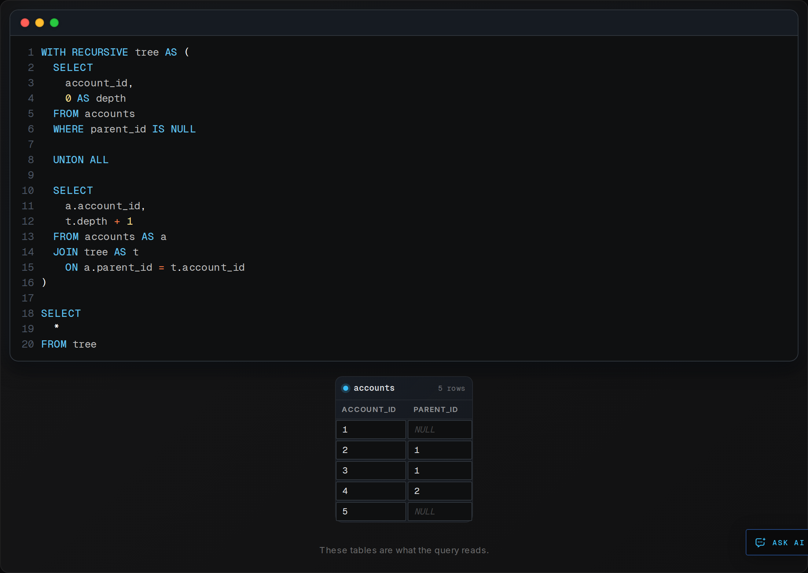
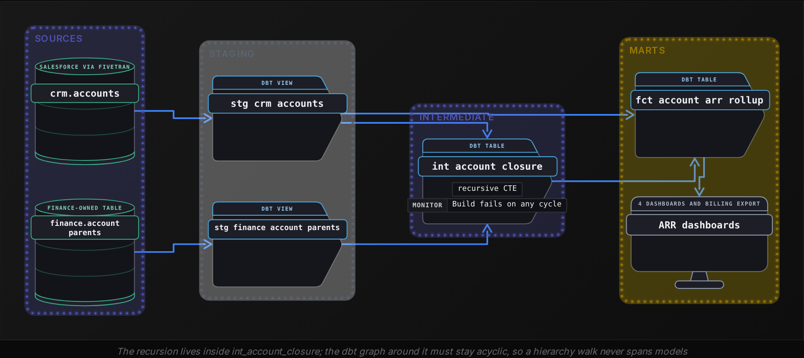

# CTEs (Common Table Expressions): Advanced

Thirty-five minutes into a SQL round at a B2B software company, the interviewer pastes 3 column names into the shared doc: account_id, parent_id, arr.
"Finance wants each account's ARR including everything it owns, at any depth. We have about 2 million accounts. Go."
You see recursion and start typing the anchor. She has not said who fills in parent_id. Sales reps do, in a CRM that will let them point a holding company at its own subsidiary. She has not mentioned the joint venture that 2 subsidiaries co-own. On her 5-row sample your query is correct. On the real table it either never finishes or reports more ARR for the holding company than the ledger shows.
What she is scoring is whether you name what stops the recursion, what it counts twice, how the planner will run it, and which dbt model it belongs in.


<br>

### What you will be able to do

Write a recursive CTE for a hierarchy or a series and narrate each pass through to the empty one

Catch cycles with a visited path and a depth bound, then reconcile the rows a root-seeded walk misses

Roll up each node's descendants and decide whether a shared descendant counts once or once per path, and whether those paths carry weights

Decide when MATERIALIZED or NOT MATERIALIZED improves a Postgres plan, and when each backfires

Map a CTE chain onto dbt models and defend which steps become models of their own


<br>

---

## Recursive Hierarchies and Series

The prompt rarely contains the word recursive. It arrives as "every account under Acme Holdings", "each employee's full management chain", "all categories beneath Footwear", or "monthly ARR with the empty months filled in". The tell is a table that refers to itself, through a parent_id holding other rows' ids, or a series that no table stores. In both cases the depth is unknown when the query is written, so no fixed number of self-joins answers it.


<br>

### Anchor, recursive member, empty pass

A recursive CTE has 2 members joined by UNION ALL. The **anchor** runs once and produces the seed rows. The **recursive member** references the CTE's own name, and on each pass it sees only the rows the previous pass added (the working table), never everything produced so far. The engine appends what each pass returns and stops on the first pass that returns zero rows. No counter or row limit ends it unless the query writes one.

The running example is a CRM account table. Acme Holdings (account 1) owns Acme US (2) and Acme EU (3), Acme US owns Acme US West (4), and Globex (5) stands alone; arr_k is ARR in thousands of dollars.

Open by stating the output grain before writing a line: a row per account reached, carrying its depth below the root that seeded it. That sentence shows you know what the anchor must select and what each pass adds, and it settles whether Globex, a root with no children, belongs in the answer. It does, at depth 0. The query below seeds every account whose parent_id is NULL and walks down, carrying depth on every row; a report grouped by root adds root_id to the anchor the same way.



The anchor, pass 0, returns accounts 1 and 5 at depth 0. Pass 1 joins those 2 rows to accounts on parent_id and finds 2 and 3 under Acme Holdings; Globex has no children and adds nothing. Pass 2 reads only accounts 2 and 3, finds 4 under Acme US, and appends it at depth 2. Starting from account 4 alone, pass 3 finds no child and comes back empty, and the result is 5 rows. That is the narration the interviewer wants: what the seed is, what each pass reads, and why the last pass is empty.


<br>

### The follow-up on scale

Asked how this behaves on 2 million accounts, answer in passes. Passes equal the deepest account's depth plus 2, one for the anchor and one for the final empty pass, and the count does not depend on rows: our 5 accounts took 4 passes, and a hierarchy whose deepest account sits at depth 8 takes 10 however wide it is. Each pass joins the current frontier to accounts on parent_id, so an index on parent_id in Postgres, or a hash join in a warehouse, sets the cost of each pass. Wide and shallow means a few large passes; a long chain means many small ones.

> What gets read line by line
>
> - Carried columns: depth exists because the anchor selects it, so anything the walk needs later, such as root_id for a per-root report, goes in the anchor's projection.
> - Types: the anchor fixes each column's type. In Postgres a varchar(10) seed later concatenated into a longer path fails with a type error, so cast in the anchor.
> - Direction: walking down joins `a.parent_id = t.account_id`; walking up an account's ancestor chain joins `a.account_id = t.parent_id`.
> - Restrictions: Postgres rejects aggregates in the recursive member, and SQL Server also rejects DISTINCT and GROUP BY there, so totals come after the walk.


<br>

### Series: rows no table stores

The same mechanism can also generate rows from nothing. "Monthly ARR for 2024 with zeros included" defeats a plain GROUP BY over invoices, which cannot emit a month that has no invoices, so the empty months drop out of the chart. The fix is a spine of months with the invoice totals left-joined onto it.

```sql
WITH RECURSIVE months AS (
  SELECT
    CAST('2024-01-01' AS DATE) AS month_start

  UNION ALL

  SELECT
    CAST(month_start + INTERVAL '1 month' AS DATE)
  FROM months
  WHERE month_start < DATE '2024-12-01'
),
billed AS (
  SELECT
    CAST(DATE_TRUNC('month', invoiced_at) AS DATE) AS month_start,
    SUM(amount) AS billed
  FROM invoices
  WHERE account_id = 4
  GROUP BY CAST(DATE_TRUNC('month', invoiced_at) AS DATE)
)

SELECT
  m.month_start,
  COALESCE(b.billed, 0) AS billed
FROM months AS m
LEFT JOIN billed AS b
  ON b.month_start = m.month_start
ORDER BY m.month_start
```

The bound sits in the recursive member's WHERE and is tested against the previous row. The pass that reads November passes `month_start < DATE '2024-12-01'` and emits December. December fails the test on the next pass, which returns nothing and leaves 12 rows. Say the boundary out loud, because an off-by-one here adds or drops the last month with no error.

> **TIP**
>
> In production, use the engine's generator: `generate_series` in Postgres and DuckDB, `GENERATE_DATE_ARRAY` with `UNNEST` in BigQuery, or a shared calendar table. Interviewers want the recursive version because it shows the stopping rule. Write it, then name the generator you would ship.


<br>

---

## Cycle Detection and Depth Bounds

A recursive CTE stops on an empty pass, and a cycle guarantees one never comes. Hierarchies kept by people grow cycles: a sales-ops merge sets Acme Holdings' parent_id to 4, so ownership runs from 1 down to 2, from 2 to 4, and from 4 back up to 1. The interviewer brings it in as a story ("it ran for 20 minutes and we killed it", "it worked until last Tuesday") or as the bare question: "what if the data has a loop?"


<br>

### The same cycle fails 2 ways

| ✓ Seeded at account 2 | ✗ Seeded at roots (parent_id IS NULL) |
| --- | --- |
| • Pass 1 finds 4, pass 2 finds 1, pass 3 finds 2 and 3 again<br><br>• With UNION ALL each lap appends new rows, so no pass is ever empty<br><br>• Runs until it hits a recursion limit or a statement timeout, or fills temp disk<br><br>• Loud: somebody notices a hung job | • Account 1 no longer has a NULL parent, so nothing seeds it<br><br>• Globex is the only root; the walk returns 1 row and ends<br><br>• Accounts 1 to 4 vanish and total ARR drops from 1,200 to 300<br><br>• Silent: the query succeeds and the dashboard is wrong |

The right-hand failure is the one that costs the round. A depth cap cures the hang and still ships 300 where the ledger says 1,200, because no row ever seeded the 4 Acme accounts. A complete answer names both failures and gives a check for each.


<br>

### Why UNION is a weak guard

Postgres and the SQL standard allow UNION in place of UNION ALL in a recursive CTE, and each pass then discards rows identical to any row already produced. On a bare walk of account_id that ends the loop, because the second lap reproduces the first lap's rows exactly. Add depth or a path, which every useful hierarchy query carries, and no row ever repeats: the second lap arrives at depths 3 to 5, and UNION lets every row through. Raise this before the interviewer does, since "switch to UNION" is the answer they are waiting to poke.


<br>

### A visited path catches the loop

```sql
WITH RECURSIVE walk AS (
  SELECT
    account_id,
    0 AS depth,
    ARRAY[account_id] AS path,
    FALSE AS is_cycle
  FROM accounts
  WHERE account_id = 2

  UNION ALL

  SELECT
    a.account_id,
    w.depth + 1,
    w.path || a.account_id,
    a.account_id = ANY (w.path)
  FROM accounts AS a
  JOIN walk AS w
    ON a.parent_id = w.account_id
  WHERE NOT w.is_cycle
    AND w.depth < 30
)

SELECT
  path,
  depth,
  is_cycle
FROM walk
WHERE is_cycle
```

| path | depth | is_cycle |
| --- | --- | --- |
| {2,4,1,2} | 3 | true |

Each row carries the ids it has passed through. The row that re-enters a visited account is still emitted, flagged, so the loop gets reported, and `WHERE NOT w.is_cycle` stops the walk from extending it. Seeded at account 2, the walk visits 4 and then 1, and from 1 it emits a flagged 2 alongside 3, for 5 rows; the final filter keeps the row that spells the loop. Postgres 14 and later write the same check as `CYCLE account_id SET is_cycle USING path`. Engines without arrays can use a string path with every id wrapped in delimiters, so testing `',1,'` against `',2,4,11,'` cannot match 1 inside 11.

Check per path, never against a global visited set. In the ownership graph of the next section, account 6 has 2 owners, and reaching it by 2 different paths is legitimate; only a repeat inside a single path is a loop. The same check catches the most common cycle in imported data, an account whose parent_id is its own id, at depth 1.


<br>

### Depth caps are a backstop

- **100** — SQL Server default MAXRECURSION
- **1,000** — MySQL cte_max_recursion_depth default
- **None** — Postgres default recursion limit

A cap stops a runaway walk, but on its own it cannot tell a cycle from a tree that is legitimately deep. Set it from data: measure the deepest real chain, put the cap well above it (30 against a hierarchy that tops out at 8), and alert on any row that reaches it. SQL Server writes the cap as `OPTION (MAXRECURSION n)` and raises an error when a query exceeds it, which is the behaviour a pipeline wants. MySQL's session variable also stops long series generators that contain no cycle at all. Postgres runs until `statement_timeout` fires or temp space runs out unless the query includes its own depth predicate.


<br>

### Reconcile what the walk missed

The silent failure needs a check outside the recursion. Anti-join the table against the root walk, the tree CTE from the previous section: every account left over sits inside a cycle or under a parent_id pointing at a deleted account.

```sql
SELECT
  a.account_id,
  a.parent_id
FROM accounts AS a
LEFT JOIN tree AS t
  ON t.account_id = a.account_id
WHERE t.account_id IS NULL
```

In a pipeline this query becomes a data test that fails when it returns rows, which converts a wrong dashboard into a failed run that someone has to look at.

> **TIP**
>
> Expect "should the query repair the cycle?" No. The query reports it and the test fails, so someone has to correct the parent in the CRM. A query that drops an edge to break the loop turns bad data into a plausible wrong number, which is worse than a failed run.


<br>

---

## Summing a Node's Descendants

Rollups arrive as "each account's ARR including its subsidiaries", "headcount under every manager including indirect reports", or "how many bolts go into a bike". The answer has 2 steps: build every (ancestor, descendant) pair with recursion, then aggregate over the pairs. The recursive member cannot aggregate, and a per-node total needs each node matched to everything beneath it, which the pairs supply.


<br>

### The shared subsidiary

The CRM's single parent_id cannot record 2 owners, so finance keeps an ownership table, account_parents(parent_id, child_id), with a row for every ownership edge: Acme US and Acme EU under Acme Holdings, Acme US West under Acme US, and Acme Shared Services, account 6, under both Acme US and Acme EU. Those 2 rows for account 6 are the one place it differs from the CRM tree.

| account_id | name | owned by | arr_k |
| --- | --- | --- | --- |
| 1 | Acme Holdings | none | 100 |
| 2 | Acme US | 1 | 400 |
| 3 | Acme EU | 1 | 250 |
| 4 | Acme US West | 2 | 150 |
| 5 | Globex | none | 300 |
| 6 | Acme Shared Services | 2 and 3 | 80 |

```sql
WITH RECURSIVE closure AS (
  SELECT
    account_id AS ancestor_id,
    account_id AS descendant_id
  FROM accounts

  UNION ALL

  SELECT
    c.ancestor_id,
    e.child_id
  FROM closure AS c
  JOIN account_parents AS e
    ON e.parent_id = c.descendant_id
),
pairs AS (
  SELECT DISTINCT
    ancestor_id,
    descendant_id
  FROM closure
)

SELECT
  p.ancestor_id,
  SUM(a.arr_k) AS rollup_arr_k
FROM pairs AS p
JOIN accounts AS a
  ON a.account_id = p.descendant_id
GROUP BY p.ancestor_id
```

The anchor pairs each account with itself, so every total includes the account's own ARR. Each pass extends every pair 1 edge down, and the walk ends when the newest descendants have no children. Only then does the outer query join ARR and group by ancestor_id.


<br>

### The diamond under Acme Holdings

| ancestor | descendant | path | arr_k |
| --- | --- | --- | --- |
| 1 | 1 | 1 | 100 |
| 1 | 2 | 1, 2 | 400 |
| 1 | 3 | 1, 3 | 250 |
| 1 | 4 | 1, 2, 4 | 150 |
| 1 | 6 | 1, 2, 6 | 80 |
| 1 | 6 | 1, 3, 6 | 80 |

Account 6 appears twice because 2 paths reach it. Summing these 6 rows gives Acme Holdings 1,060, while the accounts it owns total 980. Every ancestor above a diamond inherits the extra 80 and nothing errors. The `SELECT DISTINCT` in the pairs CTE is the line that prevents it, and it is the line interviewers look for.

| account | summing every row | summing distinct pairs |
| --- | --- | --- |
| 1 Acme Holdings | 1,060 | 980 |
| 2 Acme US | 630 | 630 |
| 3 Acme EU | 330 | 330 |
| 5 Globex | 300 | 300 |

The deduped totals carry a consequence to raise before finance finds it: Acme Holdings' 980 is less than its own 100 plus its children's 630 and 330. A shared descendant counts in full under each owner and once under their common ancestor, so totals stop adding up across levels.


<br>

### Identity or quantity

Whether to dedupe depends on what the shared node is, and asking the interviewer which case applies is the move being scored.

| ✓ Count each descendant once | ✗ Count every path |
| --- | --- |
| • The shared node is a single real thing: an account, an employee, a category<br><br>• Dedupe (ancestor, descendant) pairs before summing<br><br>• A dotted-line report counts once in the VP's headcount<br><br>• Parent totals can fall below the sum of child totals | • The shared node is consumed on each path: a part, an ingredient<br><br>• Multiply quantities along each path and keep every row<br><br>• A bolt used 4 times in each of 2 subassemblies is 8 bolts<br><br>• Parent totals equal the sum of what each child contributes |


<br>

### Weighted ownership

Weighted ownership sits between the 2. If account_parents carries ownership_pct and Acme US and Acme EU each own 50% of account 6, multiply the percentages along each path and keep every path. Account 6 then contributes 40 through each owner. Acme US totals 590 and Acme EU 290, so Acme Holdings reaches 980, which now equals 100 plus 590 plus 290. Weighting and deduping agree at the top and disagree in the middle, so the choice is a finance definition, and the interviewer wants to hear you ask which one the report means.

```sql
SELECT
  c.ancestor_id,
  e.child_id AS descendant_id,
  c.weight * e.ownership_pct AS weight
FROM closure AS c
JOIN account_parents AS e
  ON e.parent_id = c.descendant_id
```


<br>

### How big the closure gets

- **500,500** — closure rows for a 1,000-account chain

A closure holds a row per ancestor-descendant path. With about 2 million accounts each averaging 4 ancestors counting itself, that is roughly 8 million rows, small for any warehouse. Width is cheap and depth is not: a single long chain grows with the square of its length. Persist the closure as a table once 2 reports read it, and rebuild it when the hierarchy changes rather than on every dashboard load.


<br>

### Keeping the closure current

"The hierarchy changes 50 times a day; do you rebuild the closure each time?" Inserting an edge from parent P to child C adds every ancestor of P paired with every descendant of C, a join of 2 lookups against the existing closure. Deleting an edge is harder, and the diamond is why: a pair that ran through the removed edge may still be reachable another way, so a delete has to recheck reachability or rebuild the affected subtree. Naming that asymmetry answers the follow-up.


<br>

---

## MATERIALIZED Hints

The hint question arrives as a regression, "this report took 2 seconds on Postgres 11 and 40 after the upgrade", or as a reading test: "this CTE is referenced 3 times, so how often is it computed?" Both answers start from the default rule, stated before any hint is mentioned.

> Postgres defaults since version 12
>
> - Referenced once, not recursive, no volatile functions: inlined into the outer query like a subquery
> - Referenced 2 or more times: computed once into a temporary result that each reference scans
> - Recursive, or containing a volatile function: always computed once, and NOT MATERIALIZED is ignored
> - Versions before 12: every CTE computed once, a fence the planner could not optimize through
> - `AS MATERIALIZED` and `AS NOT MATERIALIZED` override the first 2 rules; SQLite 3.35 and later accept the same keywords


<br>

### Forbid it when each reference filters

Finance's account page shows each month's billing beside the prior month's, for a single account. The monthly aggregate is written once and read twice, over 48 million invoice rows in production:

```sql
WITH monthly AS NOT MATERIALIZED (
  SELECT account_id,
         DATE_TRUNC('month', invoiced_at) AS month_start,
         SUM(amount) AS billed
  FROM invoices
  GROUP BY account_id, DATE_TRUNC('month', invoiced_at)
)
SELECT cur.month_start,
       cur.billed,
       prev.billed AS prior_billed
FROM monthly cur
JOIN monthly prev
  ON prev.account_id = cur.account_id
 AND prev.month_start = cur.month_start - INTERVAL '1 month'
WHERE cur.account_id = 4;
```

```sql
Hash Join
  CTE monthly
    ->  HashAggregate
          Group Key: invoices.account_id, date_trunc('month', invoices.invoiced_at)
          ->  Seq Scan on invoices
  ->  CTE Scan on monthly prev
  ->  Hash
        ->  CTE Scan on monthly cur
              Filter: (account_id = 4)
```

```sql
Hash Join
  ->  GroupAggregate
        ->  Index Scan using invoices_account_id_idx on invoices
              Index Cond: (account_id = 4)
  ->  Hash
        ->  GroupAggregate
              ->  Index Scan using invoices_account_id_idx on invoices invoices_1
                    Index Cond: (account_id = 4)
```

The default plan aggregates all 48 million invoice rows into account-months, then scans the result twice to keep about a dozen. A materialized result has no indexes and no column statistics, so the filter on account 4 never reaches the index on invoices. With the hint, each reference is planned as its own subquery, the planner pushes `account_id = 4` into the first and derives it for the second from the join on account_id, and each side reads that account's few dozen invoices by index. The trade only pays while each reference is selective.


<br>

### Force it to restore a fence

The upgrade regression usually runs the other direction. A report written for Postgres 11 put a 4-table account filter in a CTE read once, and its plan was tuned around the CTE being planned alone and computed first. On 12 and later the CTE is inlined, its tables join the outer query's join search, and a misestimated filter (the planner treats segment and region as independent, so it expects 300 enterprise EMEA accounts where 60,000 exist) leads it to a nested loop sized for 300. Adding `AS MATERIALIZED` brings back the version 11 plan in a single line.

Present the fix as a sequence. Run `EXPLAIN (ANALYZE, BUFFERS)` on both versions and find the node where estimated and actual rows diverge. Ship the hint with a comment naming the reason, then fix the cause: `CREATE STATISTICS accounts_seg_region (mcv) ON segment, region FROM accounts`, followed by `ANALYZE`. An MCV list stores how often each segment and region pair actually occurs, which is the joint frequency this estimate needs; `dependencies` statistics model one column determining another, like zip determining city, and only partly correct it. Once the estimate lands near 60,000, the hint can come out.


<br>

### Where each hint backfires

- MATERIALIZED on a CTE the outer query filters narrowly: the whole CTE is built first and index access is lost
- NOT MATERIALIZED on a CTE read 3 times with no selective filter: the aggregation runs 3 times
- Any hint after the data shifts: a plan forced at 2 million accounts stays forced at 20 million
- A hint with no comment: the next engineer cannot tell a deliberate fence from a leftover


<br>

### The same decision without the keyword

Snowflake accepts neither keyword, and BigQuery and Spark SQL reject them too. BigQuery documents that a non-recursive CTE referenced in several places is executed once per reference, so an expensive shared step belongs in a temporary table or a persisted model. Snowflake decides reuse itself, and you can see the decision in the query profile as WithClause and WithReference operators. Spark reuses work through a cached temp view. The follow-up "what if this ran on Snowflake?" checks that you name the engine's mechanism and then the portable one: write the step to a table, which is where dbt comes in.

> **TIP**
>
> Open with the plan, never the hint: "I'd run EXPLAIN ANALYZE on both versions and find the node where estimated and actual rows diverge." Then the scoped, commented hint, then the statistics fix that lets you delete it.


<br>

---

## CTEs as the dbt Model Pattern

A dbt model is a single SELECT, and the style dbt Labs publishes for writing it is a CTE chain: import CTEs that pull each upstream model through `ref()` or `source()`, logical CTEs that each change a single thing, and a `final` CTE the last line selects from. The interview version is a design prompt: "the ARR rollup now feeds 4 dashboards and a billing export. How does it live in your dbt project?"

```sql
{{ config(materialized='table') }}

with closure as (
    select * from {{ ref('int_account_closure') }}
),

accounts as (
    select * from {{ ref('stg_crm__accounts') }}
),

pairs as (
    select distinct ancestor_id, descendant_id
    from closure
),

rolled_up as (
    select
        pairs.ancestor_id as account_id,
        sum(accounts.arr_k) as rollup_arr_k,
        count(*) as accounts_in_rollup
    from pairs
    inner join accounts
        on accounts.account_id = pairs.descendant_id
    group by pairs.ancestor_id
),

final as (
    select account_id, rollup_arr_k, accounts_in_rollup
    from rolled_up
)

select * from final
```

Read it top to bottom as a contract. The 2 import CTEs list every upstream dependency, which is how dbt draws the DAG; pairs and rolled_up each change a single thing; final is the model's output schema. Inspecting an intermediate step means editing the model to select from it, and that friction is the first sign a step wants a model of its own.




<br>

### When a CTE becomes its own model

| Signal | Keep it a CTE | Promote it to a model |
| --- | --- | --- |
| Readers | Only this model reads it | A second model needs the same rows |
| Grain | Same grain as the model | A new grain worth its own uniqueness test |
| Cost | Cheap next to the rest of the model | Expensive and read often, so build it once |
| Cadence | Changes when the model changes | Its own schedule or incremental loading |
| Debugging | Rarely inspected | Queried whenever a downstream number is doubted |

int_account_closure meets 4 of the 5 signals: a second reader in the weighted-ownership mart, a new (ancestor, descendant, path) grain worth its own tests, recursion expensive enough to build once, and inspection whenever a rollup is doubted. Cadence is the one it misses: it rebuilds on the same run as the rollup, and it cannot load incrementally, because a deleted ownership edge can invalidate pairs anywhere beneath it, while incremental loading suits append-only invoices. It keeps a row per path with its ownership weight, so the identity rollup dedupes the pairs in its own CTE while the weighted mart sums path weights from the same model. The pairs CTE stays inside the fact model, because only that reader needs its grain.

The follow-up then runs the other way: "won't that leave you with 900 models?" Every model adds an object to name and document, plus grants and a schedule, and every view in a chain is another layer the warehouse expands at query time. Line count is a weak signal. A 300-line model reads well as a chain when it has one reader and one grain on one cadence, and splitting it buys ceremony and nothing else.


<br>

### Ephemeral compiles back to a CTE

dbt's ephemeral materialization builds nothing in the warehouse: dbt pastes the model's SQL into every model that refs it, as a CTE named with a `__dbt__cte__` prefix. That buys a named node in the DAG and a single definition of the logic. The costs are what the follow-up probes: no object to query when a number looks wrong, the logic recomputed inside every model that refs it, and no model contracts. It suits light reshaping shared by 2 models, and never a step as expensive as the closure.


<br>

### Where the earlier checks land

- Cycle detection: a singular test on int_account_closure returns flagged paths and fails the build
- Reconciliation: a test returns accounts the root walk never reached
- Depth cap: a warn-severity test on max depth reports a deepening hierarchy before it hits the cap
- Planner hints: materialized='table' on the step several models read, portable to every warehouse
- Date spine: a shared calendar model, or the dbt_utils.date_spine macro, instead of a CTE per report


<br>

### Name every column the final CTE emits

Column-level lineage in dbt Explorer and in SQLGlot-based tools comes from parsing the compiled SQL, and a column the SQL never names cannot be traced. Import CTEs may select \*, since the upstream model fixes those columns; the final CTE should list every output column under an alias that says what it holds. The excerpt below is the final step of a segment mart, with its import CTEs folded into the table names: it joins the same accounts to their invoices and names every column it emits.

https://github.com/user-attachments/assets/daf58bff-3a1a-4010-9fbf-8c4acf5025b7

Account 2 has 2 invoices, one for 250 and one for 150, so the join turns 3 accounts into 4 rows. Enterprise finishes at 2 paying accounts and 650 invoiced, because `COUNT(DISTINCT)` counts account 2 once while `SUM` keeps both invoices; SMB is Globex alone at 300. A lineage parser maps invoiced to invoices.amount and paying_accounts to invoices.account_id with nothing to infer.

| ✓ Do | ✗ Don't |
| --- | --- |
| • Carry depth and a visited path in any recursion over human-entered parents<br><br>• Ask whether a shared descendant is a single thing or a quantity before summing<br><br>• Read EXPLAIN ANALYZE before adding a hint, and comment every hint you keep<br><br>• Promote a CTE to a model when a second model reads it or its grain needs tests | • Don't rely on UNION to end a loop once rows carry depth or a path<br><br>• Don't seed from NULL parents without reconciling the rows the walk missed<br><br>• Don't sum closure rows before deciding how a diamond should count<br><br>• Don't split a model on line count; split on reuse, grain, cost or cadence |


<br>

---

## Putting It All Together

A payments company's finance team reconciles merchant revenue across a parent-merchant hierarchy: marketplaces own sub-merchants, some sub-merchants are shared by 2 marketplaces, and support agents set parent_merchant_id by hand in an internal tool. The rollup feeds a Postgres-backed finance dashboard and a monthly invoice export built in dbt, and last quarter's total came in 4% above the ledger.

- The rollup starts as a recursive closure over the merchant edges, seeded with every merchant paired with itself, and the sums come after the walk.
- Agent-entered parents need the per-path visited check, plus a reconciliation test listing merchants that no root walk reached.
- The 4% overstatement is the diamond: shared sub-merchants counted once per path, and finance has to say whether they count once or split by revenue share.
- The dashboard's per-merchant drilldown reads the rollup twice, so NOT MATERIALIZED lets the merchant filter reach the index, or the closure is persisted.
- In dbt the closure becomes int_merchant_closure, built as a table carrying its cycle and reconciliation tests, and both the dashboard mart and the invoice export ref it.


<br>

---

## Key Takeaways

- A recursive CTE ends on its first empty pass, so over human-entered parents it needs a visited path and a depth cap to report a cycle.
- A walk seeded at NULL parents silently drops accounts caught in a cycle; reconcile reached rows against the table and fail on leftovers.
- Dedupe ancestor-descendant pairs when the shared node is a single thing; when it is consumed per path, keep every path and multiply the quantities or weights along it.
- Read the plan before hinting: NOT MATERIALIZED lets filters reach indexes, MATERIALIZED restores a fence, and both freeze a choice the data can outgrow.
- In dbt, promote a CTE to a model when it is reused or has a testable grain, or when its cost or cadence justifies it, and keep recursion inside a single model with its checks as tests.
