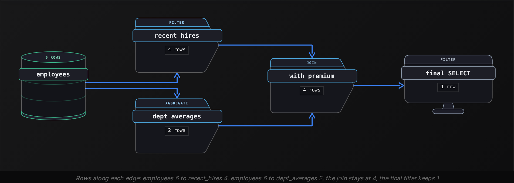

# CTEs (Common Table Expressions): Beginner

You are 20 minutes into a SQL screen at a logistics company. The interviewer shares an `employees` table with 4 columns: `name`, `department_id`, `salary`, `hire_date`. Six rows are on the screen and a few thousand are in production.
"For each department, show me everyone hired in the last year and how far their salary sits from the department average."
He stops talking. Nobody has said which average he means, the average over the whole department or the average over the people who joined this year, and on the sample the 2 readings differ by 2,000 dollars for the same person. The first move most candidates make is to type `SELECT` and bury the average in a subquery inside the `WHERE`, which commits the entire query to one reading before that reading has been agreed.
What he is listening for is whether you break the request into named steps before writing the first one, because a named step is a place where that ambiguity gets stated and settled.


<br>

### What you will be able to do

Recognize the signals that a question has outgrown a single SELECT and calls for a CTE chain

Name each CTE after the rows it holds so a reviewer reads the query as a sequence of plain nouns

Reference one CTE from 2 places instead of copying its logic, and say why that protects the result

Chain CTEs so a later step reads an earlier one, and predict the row count at every step

Walk an interviewer through a CTE chain one named step at a time, ending each step with its count


<br>

---

## When to Reach for a CTE

The request from the room hides 3 steps: keep the employees hired since 2023-03-15, compute 1 average per department, and join the 2 results to derive a difference. Written as a single `SELECT`, 2 of those steps have nowhere to live except a subquery inside the `FROM` or the `WHERE`, and the reader recovers their order by finding the innermost parenthesis and working outward. A CTE gives each step a name and a position on the page, so the query reads top to bottom in the order the work happens.


<br>

### Signals that the query has outgrown one block

- The request contains a word like "then", "per", "for each" or "compared with", each of which marks a step boundary
- The same rows are needed in 2 places, such as a list of names and a count over those names
- A nested SELECT has passed 3 lines, so the reader holds the outer query in their head while parsing the inner one
- You want to run a middle step alone and check its row count before the next step exists
- Another engineer will review, debug or edit the query after you have moved on

Every example in this lesson runs on 1 table, `employees`, with 6 rows. That is enough rows to show the row count change at every step and few enough to hold in your head while you narrate, which is the size of sample an interviewer tends to paste into the editor.

| name | department_id | salary | hire_date |
| --- | --- | --- | --- |
| Priya | 10 | 142000 | 2023-06-12 |
| Marcus | 10 | 128000 | 2023-09-01 |
| Lena | 10 | 135000 | 2024-01-08 |
| Grace | 10 | 143000 | 2019-04-15 |
| Hana | 20 | 104000 | 2024-02-05 |
| Omar | 20 | 108000 | 2021-11-02 |

Today in every example is 2024-03-15, so "hired in the last year" becomes `hire_date >= '2023-03-15'`. Grace and Omar fall outside that window and the other 4 fall inside, which gives the first row count worth stating aloud: 6 rows in, 4 rows out. A candidate who says that number before running anything has shown the interviewer they can predict a result set, and predicting result sets is the skill the whole round grades.


<br>

### The shape, written once

```sql
WITH recent_hires AS (
  SELECT
    name,
    department_id,
    salary,
    hire_date
  FROM employees
  WHERE hire_date >= '2023-03-15'
),
dept_averages AS (
  SELECT
    department_id,
    AVG(salary) AS dept_avg_salary
  FROM employees
  GROUP BY department_id
)

SELECT
  rh.name,
  rh.department_id,
  rh.salary - da.dept_avg_salary AS premium_vs_dept_avg
FROM recent_hires AS rh
JOIN dept_averages AS da USING (department_id)
ORDER BY rh.department_id, rh.salary DESC
```

`WITH` opens the block. `recent_hires` is the name, `AS` introduces the body, and the parentheses hold an ordinary `SELECT`. A comma separates it from `dept_averages`, and after the second closing parenthesis the final `SELECT` begins with no comma in front of it. Inside that final query each name stands wherever a table name could stand: in `FROM`, in `JOIN`, carrying an alias. The name exists for the length of this 1 statement and is gone at the semicolon.

https://github.com/user-attachments/assets/794780dd-f1bc-4911-b67a-af45f308a332

The animation plays the first step alone so the mechanism is visible. The `WHERE` comparison runs on all 6 rows and returns false for Grace and Omar. The 4 survivors carry the name `recent_hires` into the final `SELECT`, which reads them as it would read any table. Watch the order: the filter completes before the outer query touches a row, and that is the order a longer chain keeps as it grows.


<br>

### What the reviewer sees

A production query is read by the analyst who asked for it, by the engineer paged when it fails overnight, by the team that inherits the report and by the reviewer who audits it a year later. Each of them scans the CTE names first and opens a body only when a name raises a question. The interviewer stands in for all 4 of those readers, and a query whose steps are named gets a 15-second read where a nested one gets a reconstruction.

| ✓ One SELECT with nested subqueries | ✗ Named steps in a WITH block |
| --- | --- |
| • The average lives inside the WHERE, so the reader meets it after the rows it applies to<br><br>• Each intermediate result is invisible until the whole query runs<br><br>• Reviewing means executing the query in your head, innermost parenthesis first<br><br>• The second place that needs the filtered rows gets a copy of the filter | • Each step has a name that says what its rows are, read in the order the work happens<br><br>• Any step can be run alone, and its count checked, before the next is written<br><br>• Reviewing means reading 3 names and opening the one that looks wrong<br><br>• The second place that needs the rows reads the same name |


> **TIP**
>
> Say the step count before you type: "This is 3 steps. I filter to recent hires first, then average per department, and the last step joins the 2 and subtracts." That sentence tells the interviewer the decomposition is deliberate, and it hands you the 3 CTE names before you need them.


<br>

---

## Naming Each Step of Your Query

The smallest CTE query has 1 named step and 1 final `SELECT`, and it's the shape to practise until the keywords arrive without thought, because every longer chain is this shape with more commas. This one answers a smaller question from the same round: how many people did each department hire in the last year.

```sql
WITH recent_hires AS (
  SELECT
    name,
    department_id,
    hire_date
  FROM employees
  WHERE hire_date >= '2023-03-15'
)

SELECT
  department_id,
  COUNT(*) AS new_hire_count
FROM recent_hires
GROUP BY department_id
ORDER BY new_hire_count DESC
```

https://github.com/user-attachments/assets/ae76b5e4-ec47-4403-970c-a63ae594c11b

The run has 2 movements. The CTE filters 6 rows down to 4, and the final `SELECT` folds those 4 into 2 groups. Department 10 holds 3 of the recent hires and department 20 holds only Hana, so the counts come out 3 and 1. Grace and Omar never reach the `GROUP BY`, which is why neither pulls a department's count up. A reader who sees `COUNT(*)` over `recent_hires` knows without opening the CTE that only recent hires are being counted, and that knowledge came from the name.

| department_id | new_hire_count |
| --- | --- |
| 10 | 3 |
| 20 | 1 |


<br>

### Name the rows, not the operation

A CTE's name is the only part of it a reader sees before deciding whether to open the parentheses, so the name has to say what each row is. `recent_hires` passes: each row is a recent hire. `filtered` fails, because filtered says what happened to the rows and leaves what remains unsaid. The test to apply in the room is to put the words "each row is a" in front of the name and hear whether the sentence finishes.

| ✓ Names that describe the step taken | ✗ Names that describe the rows held |
| --- | --- |
| • filtered, joined, computed: an operation with no noun<br><br>• t1, x, temp, data: a placeholder the author never replaced<br><br>• step1, step2: an order with no content<br><br>• tmp_emp_filt: an abbreviation the next reader has to decode<br><br>• subquery: the syntactic role, which the reader can already see | • recent_hires: each row is an employee hired in the window<br><br>• dept_averages: each row is a department with its average salary<br><br>• new_hire_counts: each row is a department with a count<br><br>• top_paid_per_dept: each row is one department's highest earner<br><br>• with_premium: each row is a recent hire with 1 column added |

Aggregates deserve the same care, with the grain in the name. `dept_averages` tells the reader there is 1 row per department before they find the `GROUP BY`, and `new_hire_counts` tells them the number in each row is a count. A plural noun for a set of rows, and the grain in the name of an aggregate, are the 2 habits that make a chain readable from its names alone.

Output columns follow the same rule. `COUNT(*) AS new_hire_count` gives the result a header a stakeholder can read; `COUNT(*)` on its own gives them a column called `count` or `_col1` depending on the engine, and the first question back is what it counts. Every computed column in this lesson carries an alias for that reason, and the interviewer notices when one goes missing.


<br>

### The syntax error that stops the room

```sql
-- Wrong: a second WITH is a parse error on every engine
WITH recent_hires AS (SELECT * FROM employees WHERE hire_date >= '2023-03-15'),
WITH dept_averages AS (SELECT department_id, AVG(salary) FROM employees GROUP BY 1)
SELECT ...;

-- Right: one WITH, a comma between the bodies, none before the final SELECT
WITH recent_hires AS (SELECT * FROM employees WHERE hire_date >= '2023-03-15'),
     dept_averages AS (SELECT department_id, AVG(salary) FROM employees GROUP BY 1)
SELECT ...;
```

One `WITH` opens the block for every CTE in the statement, a comma separates each named body from the next, and no comma comes before the final `SELECT`. The semicolon arrives once, at the end. Candidates who type a second `WITH` get a parse error, and the 20 seconds spent finding it are 20 seconds of silence the interviewer counts. Say the rule as you type the first comma: "one WITH, commas between, final SELECT after the last paren."


<br>

### Where the name is valid

The name is in scope from its closing parenthesis to the end of the statement. The final `SELECT` can use it, and so can any CTE declared below it in the same `WITH` block. A CTE declared above it cannot, and nothing past the semicolon can, so a CTE from 1 statement is invisible to the next. That boundary is why a step you want to keep across several statements becomes a view or a temp table, and why within 1 statement the CTE is the right container.

> **TIP**
>
> Write the CTE, then run `SELECT COUNT(*) FROM recent_hires` as a stand-in final query before writing the real one. In the room, say the count you expect first: 4. A step whose count matches your prediction is a step you no longer have to think about.


<br>

---

## Referencing a CTE More Than Once

A second request lands in the same round: "show each new hire next to how many people joined their department in the same window." The filtered rows are needed twice, once as a list of names and once folded into a count per department, and how you obtain them the second time is what this part of the question grades.


<br>

### The copy that looks fine

```sql
SELECT
  e.name,
  e.department_id,
  c.new_hire_count
FROM (
  SELECT
    name,
    department_id
  FROM employees
  WHERE hire_date >= '2023-03-15'
) AS e
JOIN (
  SELECT
    department_id,
    COUNT(*) AS new_hire_count
  FROM employees
  WHERE hire_date >= '2023-03-15'
  GROUP BY department_id
) AS c
  ON e.department_id = c.department_id
```

The query returns the right 4 rows today. The date `2023-03-15` appears twice, and nothing in the text ties the 2 copies together: they agree because the author typed the same value, which is a weaker guarantee than it sounds. Both copies also rescan `employees`, and a reviewer has to read both in full before knowing they match, because the aliases `e` and `c` say nothing about what either holds.


<br>

### The CTE, read from 2 places

```sql
WITH recent_hires AS (
  SELECT
    name,
    department_id,
    hire_date
  FROM employees
  WHERE hire_date >= '2023-03-15'
),
dept_new_hire_counts AS (
  SELECT
    department_id,
    COUNT(*) AS new_hire_count
  FROM recent_hires
  GROUP BY department_id
)

SELECT
  rh.name,
  rh.department_id,
  c.new_hire_count
FROM recent_hires AS rh
JOIN dept_new_hire_counts AS c USING (department_id)
ORDER BY rh.department_id, rh.name
```

| name | department_id | new_hire_count |
| --- | --- | --- |
| Lena | 10 | 3 |
| Marcus | 10 | 3 |
| Priya | 10 | 3 |
| Hana | 20 | 1 |

`recent_hires` is defined once and read twice: `dept_new_hire_counts` reads it to fold 4 rows into 2 counts, and the final `SELECT` reads it again to list the 4 names, joining the count back on `department_id`. The 3 department 10 rows each show a count of 3, and Hana shows 1. The join can't fan out, because the count side holds 1 row per department, a fact the name `dept_new_hire_counts` announced before the reader reached its `GROUP BY`. The result has 4 rows, the same 4 that went in.


<br>

### What drift looks like

The same week, a stakeholder asks for a 6-month window. The engineer on duty edits the count subquery to `hire_date >= '2023-09-15'` and misses the list subquery 4 lines above it, because the 2 copies sit in different clauses with different aliases. The count for department 10 drops to 1, since only Lena was hired after that date, while the list still carries the 2 department 10 hires from before the cutoff. The output now says department 10 hired 1 person, in the same result set that lists 3 names from that department. No error fires and no row goes missing, so nobody notices until a manager does.

Both reads at 12 months

Count copy edited to 6 months

With the CTE there is 1 date to edit, and both reads change together because they read 1 definition. That is the entire safety argument, and it's the sentence to say when the interviewer asks why a CTE and not a subquery: "these rows are read in 2 places, so I define them in 1." The sentence names a correctness reason, and a correctness reason scores above "it is cleaner", which the interviewer has heard from every candidate before you.


<br>

### When one read is enough

A filter that is read once, and that nobody will edit or test on its own, can sit in a subquery without harm, and saying so shows the interviewer you are choosing rather than reaching. The cost of naming it anyway is 2 lines and the gain is a step you can run alone, so in a timed round the CTE tends to win even for a single read. The moment a second reader appears, as it does the instant the request says "next to" or "compared with", the choice stops being taste.

> Follow-ups on the double reference
>
> - "Why not write the subquery twice?" Because 2 copies of a filter can be edited apart, and the join then compares rows from 2 different windows without raising an error.
> - "Does the database compute recent_hires twice?" Some engines inline each reference and some compute it once; either way both reads share 1 definition.
> - "What if the second read needs more columns?" Select every column both readers need inside the CTE and let each reader's own SELECT list narrow it.
> - "Could this be a temp table?" It could, and a temp table survives across statements; inside 1 statement the CTE keeps the definition on the same screen as its readers.


<br>

---

## Chaining Two CTEs Together

The first request from the room, everyone hired in the last year and how far their salary sits from the department average, needs a step that reads 2 earlier steps. Then the interviewer follows up: "now only the ones paid above their department average." That follow-up is a final filter reading that step. This is a chain: each CTE below the first may read any CTE above it, and the final `SELECT` reads the last one, so the query unfolds the way the work was described to you. The version below gives the derived column a named step and a row count of its own, so the original request is answered before the filter is written.

```sql
WITH recent_hires AS (
  SELECT
    name,
    department_id,
    salary
  FROM employees
  WHERE hire_date >= '2023-03-15'
),
dept_averages AS (
  SELECT
    department_id,
    AVG(salary) AS dept_avg_salary
  FROM employees
  GROUP BY department_id
),
with_premium AS (
  SELECT
    rh.name,
    rh.department_id,
    rh.salary - da.dept_avg_salary AS premium_vs_dept_avg
  FROM recent_hires AS rh
  JOIN dept_averages AS da USING (department_id)
)

SELECT
  name,
  department_id,
  premium_vs_dept_avg
FROM with_premium
WHERE premium_vs_dept_avg > 0
ORDER BY department_id
```



Row counts along the chain are the thing to say aloud. `employees` holds 6 rows. `recent_hires` keeps 4 of them. `dept_averages` folds all 6 into 2 department rows. It reads `employees` rather than `recent_hires`, which settles the open question from the intro: the average covers the whole department, so Grace and Omar count toward it. `with_premium` joins 4 rows to 2 and stays at 4, because each recent hire matches exactly 1 department row. The final `WHERE` keeps the rows above 0.

https://github.com/user-attachments/assets/c33430c6-272f-4e10-a113-92be5f402fb3

The animation plays the `with_premium` step over the 2 named steps that feed it. Department 10's average is 137,000 and department 20's is 106,000. The department 10 hire at 142,000 comes out 5,000 above the average, Lena at 135,000 lands 2,000 below, the hire at 128,000 lands 9,000 below, and Hana at 104,000 lands 2,000 below hers. Those 4 rows answer the original request. The final `SELECT` answers the follow-up by keeping the 1 row where the premium is positive: the 142,000 hire in department 10, 5,000 above.

| name | department_id | premium_vs_dept_avg |
| --- | --- | --- |
| Priya | 10 | 5000 |
| Lena | 10 | -2000 |
| Marcus | 10 | -9000 |
| Hana | 20 | -2000 |


<br>

### Dependencies flow downward

`with_premium` can read `recent_hires` and `dept_averages` because both are declared above it. Move `with_premium` to the top of the block and the engine reports an unknown relation, since at that line neither name exists yet. The rule is the same one the reader uses: a step may depend only on what has already been stated. When you catch yourself wanting to reference a CTE declared lower down, the dependency is pointing the wrong way, and the fix is to reorder the steps so each one's inputs sit above it.

| ✓ A chain that fights the reader | ✗ A chain that reads top to bottom |
| --- | --- |
| • A single CTE called result filters the rows, then joins and ranks them in the same body<br><br>• The final SELECT carries half the arithmetic inline<br><br>• A step references a name declared 2 steps below it<br><br>• No step can be run on its own without rewriting the query | • Each CTE does 1 kind of work, and its name says what rows come out<br><br>• The final SELECT filters and orders, with the arithmetic already named<br><br>• Every name is declared above every line that reads it<br><br>• Replace the final SELECT with SELECT \* FROM with_premium and 4 rows appear |


<br>

### How long a chain should be

An interview query lands at 2 to 4 CTEs. Each should do 1 kind of work and never 2 at once, so a filter does not also aggregate and a join doesn't also rank. The check is the name: `with_premium` says 1 column was added, and that's all the step does. A step you would have to call `recent_hires_with_premium_and_rank_filtered` is 3 steps wearing 1 name, and splitting it costs 6 lines while buying 3 row counts you can verify. Past 5 or 6 steps the query is a candidate for a view, which the room won't ask you to write.

> **TIP**
>
> Before writing the final `WHERE`, make `with_premium` the final query's `FROM` and run it: 4 rows, 1 of them positive. A chain built 1 verified step at a time reads as production habit, and the interviewer watches the row counts land where you said they would.


<br>

---

## Reading Your CTE Out Loud

The last 2 minutes of the question are the walkthrough, and they are scored apart from the query. A correct query narrated as keywords loses to a correct query narrated as steps, because the interviewer is checking whether you could explain this to the analyst who asked for it. You walk through it 1 named step at a time, and each step gets 4 beats.

- Name the step, as written: "recent_hires"
- Say what 1 row is: "each row is an employee hired since 2023-03-15"
- Say what it reads from: "it reads employees"
- Say the row count: "6 in, 4 out"

```sql
Three named steps and a final filter.

recent_hires: each row is an employee hired since 2023-03-15.
Reads employees. 6 rows in, 4 out.

dept_averages: each row is a department with its average salary
over everyone in it, not only the new hires. Reads employees. 2 rows.

with_premium: each row is a recent hire with their salary minus their
department's average. Reads the 2 steps above and joins on department_id.
4 rows, because each hire matches 1 department.

The final SELECT keeps the rows where the premium is above 0.
1 row: Priya, 5,000 above.
```

That script runs about 40 seconds and never says the word `SELECT`. Each paragraph opens with the name, so the interviewer matches it to the screen without searching, and each closes with a count they can check against the output. The most useful sentence in it is the aside on `dept_averages`: saying the average covers everyone shows you saw the ambiguity in the request and made a choice, which is the judgement the round was built to test.


<br>

### Where walkthroughs lose points

- Reading keywords: "select name comma department id from recent hires" adds nothing the screen does not show
- Starting at the bottom: the final SELECT is the last step, and reading it first leaves 3 names unexplained
- Skipping the counts: a step without a row count is a step you have not checked
- Narrating operations: "then I filter" says what you did; "recent_hires has the 4 recent hires" says what exists
- Apologising for length: 4 named steps read faster than 1 nested block, and saying so beats saying sorry


<br>

### When you spot a mistake mid-sentence

Named steps give you somewhere to stand when a count comes out wrong. If `with_premium` shows 8 rows instead of 4, every recent hire matched 2 department rows. Once `recent_hires` has checked out at 4, the place to look is `dept_averages`: grouped by `department_id` alone it holds 1 row per department, but grouped by `department_id` and a second column that varies inside a department, such as an office column, it can hold each department twice. Say that reasoning aloud rather than scrolling in silence: "8 rows means each hire matched twice, so I am checking what dept_averages is grouped by." An interviewer who hears a candidate locate a fault by step name has learned more than a clean run would have told them.


<br>

### The follow-ups and their answers

| Follow-up | The answer that scores |
| --- | --- |
| "Why is dept_averages over all employees?" | "The request said department average, so the baseline is the whole department. If they meant new hires only, dept_averages reads recent_hires instead and department 10 drops to 135,000." |
| "Why a CTE rather than a subquery?" | "with_premium reads 2 earlier steps, and recent_hires can be read from a second place without copying its filter." |
| "What if a department has no recent hires?" | "It has a dept_averages row and no recent_hires row, so the inner join drops it and the output lists only departments with a hire." |
| "How would you check this?" | "Run each CTE as the final query and read the count: 4, then 2, then 4, then 1." |

| ✓ Do | ✗ Don't |
| --- | --- |
| • Say the step count before typing: "this is 3 steps"<br><br>• Name every CTE as a plural noun for its rows, with the grain in an aggregate's name<br><br>• State the row count at each step as you narrate it<br><br>• Define a set of rows once and read it from every place that needs it<br><br>• Order the CTEs so each one's inputs are declared above it | • Type a second WITH; one WITH, commas between the bodies<br><br>• Give a step a name like t1 or step2, or a bare verb like filtered<br><br>• Copy a filter into 2 subqueries that have to agree<br><br>• Read the final SELECT aloud as keywords<br><br>• Put a join and a rank into the same CTE that filters |


<br>

---

## Putting It All Together

A payroll analytics team at a 4,000-person retailer publishes a monthly report of new hires whose starting salary sits above their department's average, used by HR to spot pay compression. The query runs on an employees table of 4,000 rows against a departments table of 38, and a different analyst owns it each year.

- The request has 3 steps, and the first analyst gave each its own name: recent_hires filters to the month's hires and dept_averages averages per department, while the join and the subtraction live in with_premium . The second analyst read the report's logic from those names.
- dept_averages reads employees rather than recent_hires , and the name records that the baseline is the whole department; when HR asked whether new hires were compared to each other, the answer was 1 line away.
- When the window changed from 30 to 45 days, 1 date in recent_hires moved, and the count step that also reads recent_hires followed without a second edit.
- An on-call engineer chasing an inflated row count ran SELECT COUNT ( \* ) FROM dept_averages , saw 39 rows for 38 departments, and found the step grouped by department_id , department_name after a rename left one department with 2 names; reopening the step whose count was off took 10 minutes.
- The walkthrough the analyst gives HR each quarter is the 4-beat script: the step name, what 1 row is, what it reads from, how many rows came out.


<br>

---

## Key Takeaways

- A question with "per", "then" or "compared with" in it has steps, and a CTE gives each step a name and a position in the order the work happens.
- Name a CTE for the rows it holds, a plural noun with the grain for aggregates, so a reviewer reads the chain from its names before opening a body.
- Rows needed in 2 places are defined once and read twice; a copied filter can be edited in 1 place and silently disagree with the other.
- A later CTE reads only CTEs declared above it, and the row count at each step (6, 4, 2, 4, 1) is the check that each step did what its name says.
- Narrate a chain by step name, what 1 row is, what it reads from and how many rows come out, and never by reading the keywords aloud.
