# Batch vs Streaming: Advanced - Exercises

Lesson: [pa_batch_vs_streaming_advanced.md](../pa_batch_vs_streaming_advanced.md)

### Exercise 1 of 11

**● TASK**

The canvas holds a Lambda architecture missing its third layer: an immutable Kafka log feeds a nightly Hadoop batch view in Snowflake and a Flink speed view in Redis, and the dashboard reads both separately. Add a serving-layer store (HBase, Cassandra or DynamoDB) that merges the batch view, up to the last batch run, with the speed view, for everything since. The dashboard reads only from that store; leave the batch and speed layers unchanged.

**Starting canvas** (already placed for you):

- Kafka master event log (immutable) (source, Kafka)
- Hadoop nightly batch view (transform, Hadoop)
- Flink speed view (approximate) (transform, Flink)
- Snowflake batch_view_canonical (storage, Snowflake)
- Redis speed_view_delta (storage, Redis)
- Analytics dashboard (consumer, Metabase)

<details>
<summary><strong>Solution</strong></summary>

#### The serving layer is the piece that makes Lambda one system

Lambda architecture has 3 layers, and the section just walked you through all three. The **batch layer** (`Hadoop` recomputing over the immutable `Kafka` log into `batch_view_canonical`) is accurate but hours stale. The speed layer (`Flink` producing an approximate `speed_view_delta` in `Redis`) is fresh but only covers what happened since the last batch run. The third layer, the one you had to add, is the serving layer: a single store the dashboard queries that stitches those two views into one answer. Without it you don't have Lambda, you have two half-answers wired to the same screen.

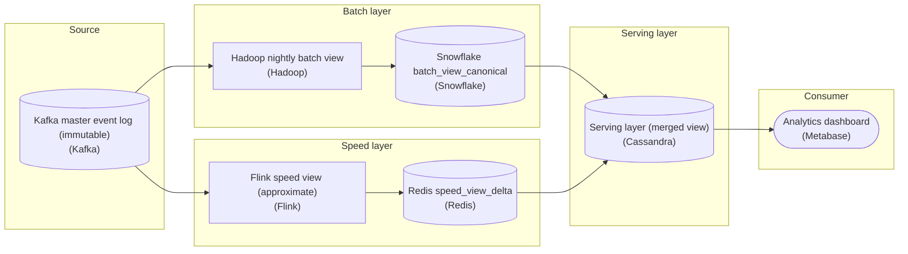

*The completed Lambda pipeline: one serving-layer store takes both views, and the dashboard reads only from it.*

| Trick: The merge rule is a time boundary, not a blend |
| --- |
| The serving layer doesn't average the two views. It reads `batch_view_canonical` for everything up to the last batch run, and `speed_view_delta` for everything since. That single watermark is why the speed layer is allowed to be approximate: every batch run re-derives those recent events exactly from the `Kafka` log and overwrites the estimate, so the approximation only ever lives for one batch window. The serving layer is where that hand-off happens on every query. |

| Pitfall: Merging in the consumer just moves the drift |
| --- |
| The broken starting state is the tell: the dashboard queried `Snowflake` and `Redis` separately and got inconsistent numbers. It's tempting to "fix" that in the dashboard, fetch both and merge in the query, but that pushes the merge logic into every consumer, and the next consumer reinvents it (differently). The whole point of the serving layer is that the merge is done once, in one place, and the dashboard reads a single clean view. The correct delta was one new storage node with two inbound edges, not a change to how the dashboard reads. |

| ✕ Batch view alone | ✓ Speed view alone |
| --- | --- |
| `batch_view_canonical` is recomputed from scratch over the full immutable log, so it is exact and self-correcting, but it is as stale as the nightly `Hadoop` run. Ask it about the last hour and it has nothing. | `speed_view_delta` is fresh to the second, but it is incremental and approximate, and it only holds events since the last batch run. Ask it about last month and it has nothing. Neither view is a complete answer alone, which is exactly why the serving layer takes both. |

| Real world: A key-value store serves, a warehouse recomputes |
| --- |
| The serving layer is chosen for low-latency reads by key, not for recompute, so a wide-column or key-value store (`HBase`, `Cassandra`, `DynamoDB`) fits, while a warehouse like `Snowflake`, great for the batch view, is the wrong tool to sit in front of a live dashboard. It also stays separate from the `Redis` speed view: that store holds a working delta, not the merged answer every consumer should read. |

**Follow-up questions**

1. What happens the moment a nightly `Hadoop` run finishes and publishes a new `batch_view_canonical`?\
   *Tests whether you see that the batch watermark advances and the now-superseded portion of `speed_view_delta` can be expired.*
2. If a new consumer needs the same merged numbers, where does its merge logic live?\
   *Reinforces that the serving layer merges once so no consumer reimplements the batch and speed hand-off.*

</details>


<br>

### Exercise 2 of 11

**● TASK**

One Flink job turns the Kafka orders log into a live view, but the log keeps only days, so a bug fix needing a month of replay cannot run. Back the log with tiered object storage holding 12 to 24 months of events. Add a parallel warehouse view the corrected stream job replays the log into while the live view keeps serving, then cut the dashboard over once it validates. Keep it Kappa: no batch layer, replay runs through the same streaming code.

**Starting canvas** (already placed for you):

- Kafka orders event log (in-cluster retention, days) (source, Kafka)
- Flink streaming pipeline v1 (transform, Flink)
- Snowflake mart_orders_v1 (storage, Snowflake)
- Orders dashboard (consumer, Looker)

<details>
<summary><strong>Solution</strong></summary>

#### Kappa: replay is the whole point

Kappa keeps one code path and treats batch as nothing more than a **replay** of the event log through the same streaming job. The reason your v1 system could not fix a month-old bug is that the log was the weak link: Kafka's in-cluster retention held only a few days, so there was no history to replay. The 2 edits you made both serve that single idea: make the log durable enough to replay, and make room to replay into a fresh view without touching the live one.

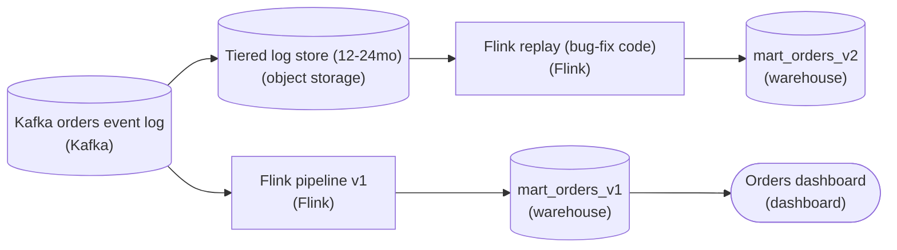

*Live v1 keeps serving while the fixed job replays the tiered log into `mart_orders_v2`; the dashboard cuts over only after v2 catches up to live and validates.*

Edit one, tiered storage, is what buys the replay. Offloading old log segments to object storage lets the log affordably hold a year or 2 of events instead of days, so a bug fix or schema migration can replay the full window. Edit two, the parallel `mart_orders_v2`, is what makes replay safe: the corrected job backfills a second view while `mart_orders_v1` keeps feeding the dashboard uninterrupted. Cutover is a read switch, not a rebuild.

| Pitfall: A batch layer is not the fix |
| --- |
| The instinct is to bolt on a Spark batch job to reprocess history. That is Lambda, and it forces you to maintain the transform logic twice and reconcile 2 answers. Kappa refuses the second code path: the same Flink job that runs live is the one you replay. The prompt bars the batch layer for exactly this reason. |

| Real world: v2 is a temporary lane, not a fork |
| --- |
| In production the parallel view is short-lived. You spin up `mart_orders_v2`, replay, diff it against `mart_orders_v1` at the live tip, flip the dashboard, then retire v1. Standing up a permanent second pipeline is how a clean Kappa cutover quietly becomes 2 systems to babysit. |

**Follow-up questions**

1. How do you know `mart_orders_v2` has actually caught up to live before cutting the dashboard over?\
   *Tests understanding that replay must reach the live offset and be validated, not just finish.*
2. What breaks about replay if the orders events are not keyed and partitioned to preserve per-order ordering?\
   *Connects tiered-log replay to stream-processing correctness under reordering.*

</details>


<br>

### Exercise 3 of 11

**● TASK**

Replace the Spark batch and Flink streaming transforms that each compute the same order aggregation with one Apache Beam transform, so a logic change lands in both dashboards at once. It feeds the daily warehouse view on a batch rhythm (under 24h) and the live warehouse view on a streaming rhythm (under 1 minute), chosen by configuration alone, with Spark and Flink gone from the production path.

**Starting canvas** (already placed for you):

- Kafka orders log (source, Kafka)
- Plain Spark nightly batch (transform, Spark)
- Flink streaming live aggregation (transform, Flink)
- Snowflake daily_orders_v1 (storage, Snowflake)
- Snowflake live_orders_v1 (storage, Snowflake)
- Daily executive dashboard (consumer, Looker)
- Live ops dashboard (consumer, Looker)

<details>
<summary><strong>Solution</strong></summary>

#### One transform, two clocks

Apache Beam's **unified batch-and-streaming model** lets one aggregation serve both dashboards. Beam treats its input as a `PCollection`. A bounded one is a finite slice of the Kafka log; an unbounded one is the live tail. The transform in the middle never checks which kind it has. The daily view and the live view stop being two codebases that drift apart and become two deployments of the same `order_totals`. The rhythm is a single flag: `PipelineOptions(streaming=...)` chooses a run-to-completion job or a long-lived one, and the source binding follows that choice.

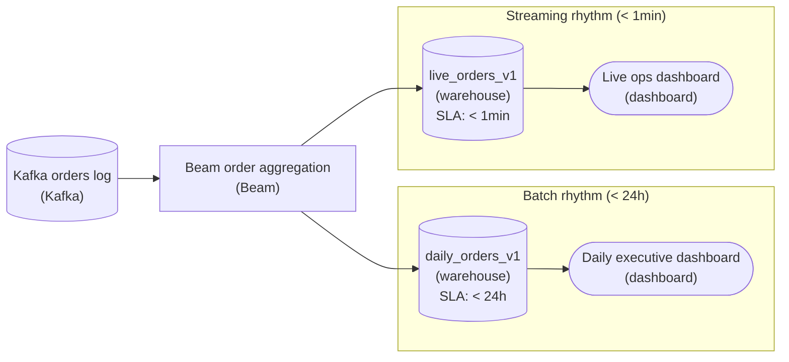

*One Beam transform, deployed twice: the `daily_orders_v1` warehouse view refreshes within 24h and the `live_orders_v1` warehouse view refreshes within a minute. Spark and Flink are out of the production path.*

**`order_totals`, defined once**

```python
# ONE transform definition, shared by both deployments
def order_totals(orders):
    return (
        orders
        | "Window" >> beam.WindowInto(FixedWindows(60))
        | "SumPerRegion" >> beam.CombinePerKey(sum)
    )

# The rhythm is chosen by configuration, not by a second codebase
options = PipelineOptions(streaming=cfg.streaming)   # True -> live, False -> daily
source = read_unbounded(cfg) if cfg.streaming else read_bounded(cfg)
sink = write_warehouse(cfg.table)                    # live_orders_v1 or daily_orders_v1

with beam.Pipeline(options=options) as p:
    order_totals(p | source) | sink
```

*`FixedWindows(60)` and `CombinePerKey(sum)` are identical in both rhythms, so a window total means the same thing in both tables.*

| ✕ Batch rhythm (daily) | ✓ Streaming rhythm (live) |
| --- | --- |
| A bounded `PCollection` over a fixed range of offsets. Each window fires once, on complete data. Each run fully recomputes the day into `daily_orders_v1`. | An unbounded `PCollection` with `streaming=True`. The same windows fire incrementally as the watermark advances and land in `live_orders_v1` within a minute. Allowed lateness lets a late order reopen its window. |

| Pitfall: Appending re-fired windows double-counts |
| --- |
| Both rhythms rewrite the same window keys. The batch job does this on every rerun, and the stream does it whenever a late order reopens a window. With an append sink, each rewrite adds the total a second time. Instead, upsert on the window and the region, the same key `CombinePerKey` grouped on. A re-fired window then replaces its row, so reruns and late data are both safe. |

| Real world: Freshness becomes a config toggle, not a fork |
| --- |
| One team owns `order_totals`. Choosing between a cheap, exact daily table and a fresh, provisional live table becomes a deployment decision. Teams adopt Beam to remove exactly this kind of drift: two codebases computing one metric in two subtly different ways, with nobody able to say which dashboard is right. |

**Follow-up questions**

1. A late order arrives after the nightly run has written `daily_orders_v1`. Which tier is the source of truth?\
   *The batch view is the eventually-correct record; the live view is fast but provisional.*
2. Should both deployments use the same allowed-lateness bound?\
   *The late-data policy belongs to each rhythm's configuration, not to the shared `order_totals`.*
3. One slow Kafka partition holds back the live job's watermark. What stalls?\
   *Links per-partition progress to when streaming windows can fire.*

</details>


<br>

### Exercise 4 of 11

**● TASK**

Kafka events land in an S3 raw zone within 15 minutes and roll up into a Snowflake curated layer, refreshed daily, behind the executive dashboard. Rewire the live operations dashboard, which must reflect activity within minutes, and the ML inference service, whose features may be at most 2 hours old, onto feeds fast enough for them. Then label every node with the freshness tier it can honestly deliver; no node may promise fresher data than what feeds it.

**Starting canvas** (already placed for you):

- Kafka events log (source, Kafka)
- S3 raw events (storage, S3)
- Snowflake curated daily aggregate (storage, Snowflake)
- Snowflake live 5-min mart (storage, Snowflake)
- ML features serving (storage, Feast)
- Daily executive dashboard (consumer, Looker)
- Live ops dashboard (consumer, Looker)
- ML inference (consumer, API)

<details>
<summary><strong>Solution</strong></summary>

#### The freshness contract

Per-node freshness tiering rests on one rule: a dataset can be **no fresher than the input feeding it**, so freshness only holds or decays as you move downstream. The starter broke that rule twice. `Snowflake live 5-min mart` advertised '< 1min' while nothing fast fed it. `ML features serving` hung off the once-a-day curated rollup, even though inference needs features under 2 hours old.

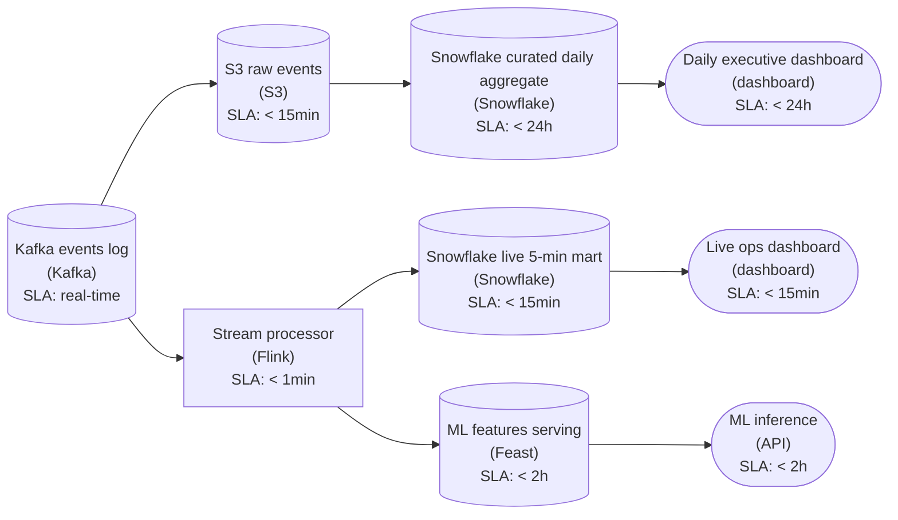

*One `Kafka` source, 2 clocks: a daily batch path through the raw zone, and a `Flink` streaming path for the 2 fast consumers. Every tier holds or relaxes going downstream.*

The fix gives each consumer the clock it needs. The batch path keeps its cadence: `Kafka events log` lands in `S3 raw events` at '< 15min', which rolls up into `Snowflake curated daily aggregate` at '< 24h' for the executive dashboard. A `Flink` stream processor reads the same topic at '< 1min' and feeds both fast consumers. The live mart sits at '< 15min', which is what a five-minute mart honestly delivers. `ML features serving` sits at '< 2h', inside the inference window. Follow any edge and the label never gets fresher downstream.

| Key insight: Same source, 2 clocks |
| --- |
| This is the Lambda shape again: one `Kafka` topic fans out into a batch layer tuned for complete, cheap daily rollups and a streaming layer tuned for latency. You do not speed up the daily rollup to serve the live mart. You give the fast consumers a parallel streaming path and let each layer keep the tier it can afford. |

| Pitfall: A label is a promise its feed must keep |
| --- |
| The starter's '< 1min' on the live mart was aspirational, not achievable, because nothing sub-minute fed it. Label a node with what its slowest input can actually deliver, not with what its consumer wishes for. When a downstream tier is tighter than the feed, the answer is a new feed, not a braver label. |

**Follow-up questions**

1. If the feature window tightened from 2 hours to 5 minutes, what tier could `ML features serving` honestly carry, and does its feed already support it?\
   *Routing a consumer by the freshness it needs, then checking the label against the feed.*
2. The executive dashboard now wants hourly instead of daily numbers. What changes upstream before you can relabel `Snowflake curated daily aggregate`?\
   *The label follows the pipeline's real cadence, not the other way round.*

</details>


<br>

### Exercise 5 of 11

**● TASK**

Migrate the Lambda engagement pipeline on the canvas to Kappa, keeping every Lambda node in place: both paths run until the dashboard cuts over. Back the Kafka event log with tiered storage in S3 so it can replay the longest backfill window. Add one exactly-once Flink pipeline that reads the log and writes a single Iceberg materialized view feeding the dashboard, the one path that will replace both Spark jobs.

**Starting canvas** (already placed for you):

- Kafka content_events (source, Kafka)
- S3 master event log (storage, S3)
- Spark nightly batch view builder (transform, Spark)
- Spark Streaming speed view (transform, Spark)
- Cassandra batch_view (storage, Cassandra)
- Cassandra speed_view (storage, Cassandra)
- Lambda serving merge (consumer, Looker)
- Content engagement dashboard (consumer, Looker)

<details>
<summary><strong>Solution</strong></summary>

#### What Kappa actually removes

Kappa architecture is Lambda with the batch layer deleted. Lambda kept 2 code paths because the log was not a reliable source of truth: the nightly `Spark` batch job rebuilt the accurate daily view from the full event log, and a separate `Spark Streaming` speed view filled the gap with an approximation until batch caught up. The serving layer then merged the 2 on read, and that merge is where your 0.4 percent drift lives. Kappa says: if the log is durable and long enough, one streaming pipeline reading it end-to-end is both the live view AND the reprocessing tool. A backfill or a bug fix is not a second job, it is the same `Flink` pipeline replaying `content_events` from an earlier offset.

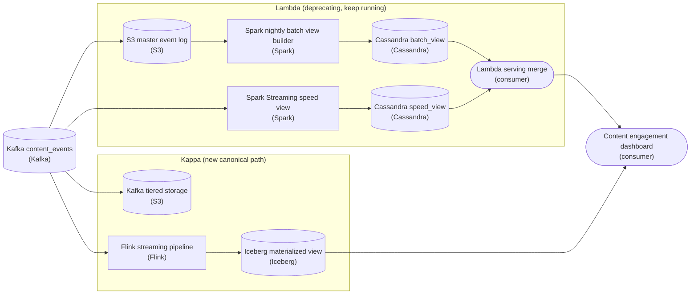

*Both paths share the one `content_events` source and feed the same dashboard. The Kappa path runs alongside Lambda until consumers cut over.*

1. **Make the log long enough to be the source of truth**

   The whole reason Lambda needed a batch layer was that the streaming log could not hold enough history to replay a full rebuild. Backing `Kafka content_events` with tiered storage in `S3` moves cold segments off broker disk at object-store prices, so the log can retain the longest backfill window you will ever need. That single change is what lets one pipeline do both the live and the reprocessing work. Without it, you are still Lambda.

2. **Collapse the 2 Spark jobs into one Flink pipeline**

   A single `Flink` streaming pipeline reads `content_events` and computes the engagement view end-to-end. The thing that makes this replace the accurate batch job, not just the approximate speed view, is exactly-once semantics: `Flink`'s checkpoint-plus-transactional-sink guarantees each event lands in the output exactly one time even across failures and replays. That is why you no longer need a nightly Spark pass to correct the stream: one pipeline is authoritative.

3. **Serve one canonical view instead of merging two**

   `Flink` writes an `Iceberg` materialized view on object storage as the single view, and the dashboard reads it directly. This deletes the read-time merge of `Cassandra batch_view` and `Cassandra speed_view` that produced the drift. `Iceberg`'s snapshot isolation means a replay can rewrite partitions while the dashboard keeps reading a consistent snapshot, so a backfill never shows a half-updated view.

| Pitfall: Lambda stays up until consumers cut over |
| --- |
| The tempting move is to rip out `Spark`, `Cassandra`, and the Lambda serving merge the moment the `Flink` path is drawn. The migration order is explicit that both stay running until consumers cut over: you validate Kappa by comparing its `Iceberg` output against the live Lambda view before the old path is retired. Cut the old path early and a single `Flink` bug is a full outage with nothing to fall back to. |

| Real world: The enabling shift is the storage bill |
| --- |
| Kappa was proposed in 2014 but stayed impractical because retaining months of log on broker-attached disk was ruinously expensive. What changed is not the diagram: Kafka tiered storage and cheap object tiers made long retention affordable, and engines like `Flink` gave you exactly-once so the stream could be authoritative. When you justify this migration, lead with the constraint that shifted, not with 'one codebase is nicer'. The second on-call rotation and the drift are symptoms; the retention economics are the cause. |

**Follow-up questions**

1. A late-arriving `content_events` record shows up three days after its event time. How does the `Flink` plus `Iceberg` path fold it in without a nightly batch correction?\
   *Event-time windows and Iceberg partition rewrites as the replacement for Lambda's batch reconciliation.*
2. You need to backfill after fixing a bug in the engagement logic. What exactly do you replay, and how does the dashboard keep showing correct numbers during the replay?\
   *Reprocessing from an earlier offset plus Iceberg snapshot isolation.*
3. What signal tells you it is finally safe to delete the `Cassandra` views and the Lambda serving merge?\
   *The cut-over criterion: consumers reading the Iceberg view and a validated drift of zero, not a calendar date.*

</details>


<br>

### Exercise 6 of 11

**● TASK**

Replace a market-intelligence platform's Lambda architecture with a Kappa core: one unified streaming engine reads an immutable, long-retention Kafka log into a lakehouse materialized view on object storage, serving a sub-second price-alert feed and a trader dashboard fresh within minutes. A separate batch path, a shared bronze raw zone in object storage feeding a warehouse mart, serves a daily research mart and a monthly regulatory archive. Set each stage's freshness so a streaming tier and a batch tier both show, and wire each surface to its path.

**Starting canvas** (already placed for you):

- Market data Kafka (source, Kafka)
- News feed Kafka (source, Kafka)
- Reference Postgres (source, PostgreSQL)
- Filings file drop (source, object storage)
- Real-time price alert feed (sub-second) (consumer, API)
- Trader dashboard (within minutes) (consumer, Grafana)
- Research mart (daily) (consumer, Jupyter)
- Regulatory archive (monthly, < 24h freshness) (consumer, API)

<details>
<summary><strong>Solution</strong></summary>

#### One log, one codebase

At the center of this redesign is a **Kappa architecture**: one streaming engine reads a single immutable, long-retention `Kafka` log, and every real-time surface is a projection of that log. It is the deliberate opposite of the Lambda setup you replaced, where a batch layer and a speed layer recomputed the same numbers in two codebases that drifted. One log and one processing path removes that reconciliation work, and the per-stage freshness chips show which stages actually need to run continuously.

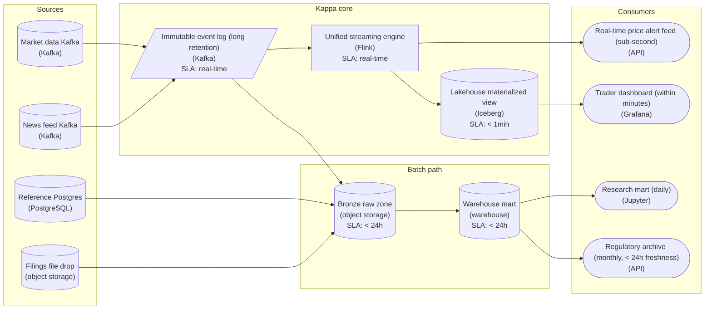

*The Kappa core runs real-time from one immutable `Kafka` log into an `Iceberg` view. The batch path lands the log, `Reference Postgres` and the filings drop in a bronze zone once a day before the `Warehouse mart`.*

| ✕ Kappa core (sub-second, minutes) | ✓ Batch path (daily, monthly) |
| --- | --- |
| One `Flink` job reads the immutable `Kafka` log, pushes price alerts directly, and keeps a lakehouse materialized view warm for the trader dashboard. The log's long retention makes a code fix a replay, not a backfill. | Bounded runs land a daily copy of the log, `Reference Postgres` and the `Filings file drop` in a bronze raw zone, then build the `Warehouse mart`. These runs are cheap, partitioned by day, and rerun end to end when logic changes. A monthly archive has no reason to pay for a stream. |

| Pitfall: Freshness is a budget, not a bragging right |
| --- |
| The tempting mistake is routing everything through the stream because it is the interesting part. Putting the monthly `Regulatory archive` on the streaming engine buys a 24/7 job, watermark tuning, and pager coverage for a consumer that reads once a month. Match the path to the clock, or you just move the on-call pain onto one over-provisioned stream. |

| Key insight: Long retention is the reprocessing story |
| --- |
| Kappa works only because the `Kafka` log is immutable and retained long enough to replay. Find a bug in the streaming logic and you rewind the offset and re-emit through the same code, instead of running the separate batch correction Lambda forced on you. That is how the second codebase disappears; idempotent writes into the view keep a replay safe to run twice. |

**Follow-up questions**

1. A `News feed Kafka` event arrives 10 minutes late. How does the streaming engine fold it into an already-published window?\
   *Watermarks and allowed lateness versus silently dropping it.*
2. The `Filings file drop` redelivers the same file. What keeps the `Warehouse mart` correct?\
   *Idempotent file ingestion and dedup keys on the batch side.*

</details>


<br>

### Exercise 7 of 11

**● TASK**

Ad impressions land on an append-only event log at 2 billion events a day. Build a Lambda architecture: an immutable master data set fed from the log, a batch layer that recomputes exact spend totals from full history every night, and a speed layer reading the same log that keeps spend fresh within a minute. A serving layer merges both views for the advertiser dashboard.

<details>
<summary><strong>Solution</strong></summary>

#### 2 views, one answer

Lambda architecture runs 2 computations over the same events and lets the serving layer add them up. The batch layer is slow but exact: every night it rereads the whole master data set and rebuilds spend from scratch. The speed layer is fast but provisional: it only covers the hours since the last batch run finished. At 2 billion impressions a day, that split is the point: advertisers see pacing within a minute, and finance bills from numbers nobody had to patch.

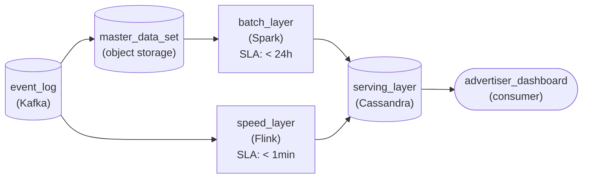

*The log feeds both layers; `serving_layer` merges the nightly batch view with the live speed view.*

1. **Make the log the only source of truth**

   Both layers read from the event log, never from each other. The log lands unchanged in `master_data_set`, which is append-only, so the batch layer can always recompute from complete history. If a billing rule changes, you rerun the batch layer; nothing is patched in place.

2. **Shrink the speed view to the gap**

   The speed view only holds spend since the last completed batch run. When tonight's batch view lands, those hours drop out of the speed view, and the serving layer returns `batch_view + speed_view` for the hours each one owns. Any drift the stream introduced lives at most a day.

| Pitfall: The speed view is never an input |
| --- |
| A tempting shortcut writes the speed layer's output into the master data set, or starts the batch layer from yesterday's totals. Either way the approximate numbers become permanent and the nightly recompute can no longer correct them. The batch layer reads raw events only. |

| Real world: The same logic lives in 2 codebases |
| --- |
| Spend is computed once in the Spark job and again in the Flink job. Every rule change ships to both, and the 2 must agree on what counts as an impression. That duplication is the price Lambda charges for having freshness and correctness at once. |

**Follow-up questions**

1. A publisher's impressions from the last 30 days turn out to be fraud. Which layer removes them, and what does the dashboard show until it does?\
   *Whether corrections flow through a recompute over the immutable master data set rather than edits to stored views.*
2. What happens to the dashboard if tonight's batch run fails?\
   *How the serving layer keeps answering when the speed view has to cover more than one day.*

</details>


<br>

### Exercise 8 of 11

**● TASK**

Driver trip events land on a Kafka log that keeps every event since launch, about 40 million a day. Build a Kappa architecture: one Flink streaming job serves drivers live earnings within seconds, with no batch layer. When the fee formula changes, the same job's code replays the full log into a new earnings view that sits beside the live one until drivers are cut over.

<details>
<summary><strong>Solution</strong></summary>

#### One codebase, 2 running copies, one log

Kappa architecture keeps a single streaming implementation and treats the event log as the truth. Repricing history is not a batch job: it is the same Flink code started from the first offset of the log. Because the Kafka log holds every trip since launch, replaying it reproduces every earnings row under the new formula, with no second codebase to keep in sync.

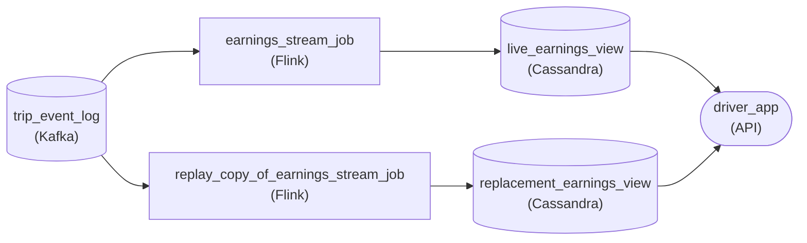

*`trip_event_log` feeds the live `earnings_stream_job` and `replay_copy_of_earnings_stream_job`, a second run of the same code from the first offset; each writes its own view until `driver_app` cuts over.*

1. **Replay from the log, not from the view**

   `replay_copy_of_earnings_stream_job` is the live job's code with the new formula, started at the beginning of `trip_event_log` exactly as the live job once was. Reading from `live_earnings_view` instead would bake the old formula into the new numbers.

2. **Write beside, then cut over**

   The replay lands in `replacement_earnings_view` while drivers keep reading the live one. Once it catches up to the live offsets and the totals check out, the app switches reads and the old view and its job are retired. That is the parallel materialized view.

| Pitfall: A repricing batch job brings Lambda back |
| --- |
| Adding a Spark job that recomputes history means the fee formula now lives in 2 places. The day they disagree, drivers see one number live and another after the nightly overwrite: the exact drift Kappa exists to remove. |

| Performance: Replay speed sets the cutover date |
| --- |
| Live traffic averages about 460 events a second, but one year of log is roughly 14.6 billion events. The replay copy needs far more parallelism than the live job to catch up in hours rather than weeks, and write throughput on the new view is usually the bottleneck. |

**Follow-up questions**

1. What changes if the log only kept 30 days of trip events?\
   *Whether the event log can still be the source of truth, and what full retention or archiving it needs for a replay to reach every past trip.*
2. How would you decide the replacement view is ready for cutover?\
   *Catching up to the live job's position in the log and validating the rebuilt numbers before readers switch.*

</details>


<br>

### Exercise 9 of 11

**● TASK**

Smart-meter readings arrive on a Kafka topic at 50,000 events per second, and one Spark job computes per-meter usage. A grid-outage dashboard needs that usage within one minute. The billing report reads a daily usage table built from a full day of readings in object storage, and it must not pay for compute running around the clock. Design the pipeline so the same Spark logic runs in the mode each consumer needs.

<details>
<summary><strong>Solution</strong></summary>

A unified engine lets you write the per-meter usage logic once and choose the runtime per output. Spark runs the same DataFrame query as a streaming job or a batch job by changing the trigger, but the two runs still bill and fail differently: streaming mode keeps executors up all day, batch mode pays only for the run window. The decision here is not which engine. It is which mode each consumer has earned.

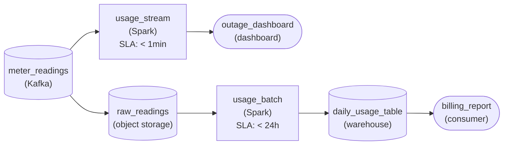

*One Spark usage job, two runtime modes: `usage_stream` feeds the outage dashboard within a minute, `usage_batch` builds `daily_usage_table` once a day from `raw_readings`.*

1. **Give the outage feed the streaming run**

   Operators need usage within a minute, so `usage_stream` runs continuously off the Kafka topic at `< 1min` freshness and writes straight to `outage_dashboard`. That always-on compute is the price of the latency, and only this consumer should pay it.

2. **Give billing the batch run**

   Billing is read once a day, so the same Spark logic runs in batch mode as `usage_batch`, once a day over the full day landed in `raw_readings`, writing `daily_usage_table`. The cluster starts, finishes and shuts down: you pay for the run, not for 24 hours.

| Pitfall: Same code does not mean same mode |
| --- |
| Because the API is identical, it is tempting to point the streaming run at the billing table too. It works, and it bills round-the-clock compute for a number someone reads once each morning. Unified code is a reason to choose the mode per consumer, not a reason to stop choosing. |

| Key insight: A failed day reruns, a failed stream resumes |
| --- |
| When `usage_batch` fails, you rerun that day's partition from object storage and overwrite it. When `usage_stream` fails, it restarts from its checkpoint and Kafka offsets. One body of logic still leaves you two recovery playbooks to operate. |

**Follow-up questions**

1. What changes if the outage view can tolerate 15 minutes instead of one?\
   *Whether a micro-batch trigger can replace the always-on run and what that saves.*
2. A corrected reading arrives 3 days late. How does each run absorb it?\
   *Partition rerun in batch mode versus late data in the streaming run.*

</details>


<br>

### Exercise 10 of 11

**● TASK**

Inventory changes from a pharmacy chain's store database arrive through CDC, about 30 million a day, and three readers need them on different clocks: store managers see stock-outs within a minute, a regional replenishment dashboard refreshes hourly, and a compliance report rebuilds once a day. Land every change raw in object storage. Design the pipeline with a freshness tier on each processing stage, none faster than the reader it feeds needs.

<details>
<summary><strong>Solution</strong></summary>

#### Tier the stage, not the pipeline

Per-node freshness tiering gives every processing stage its own clock, set by the reader it feeds, instead of stamping one tier across the whole pipeline. Here one CDC change stream serves three readers: a stock-out view that needs sub-minute data, a dashboard that refreshes hourly, and a compliance report rebuilt daily. Only one path through the design should pay for streaming.

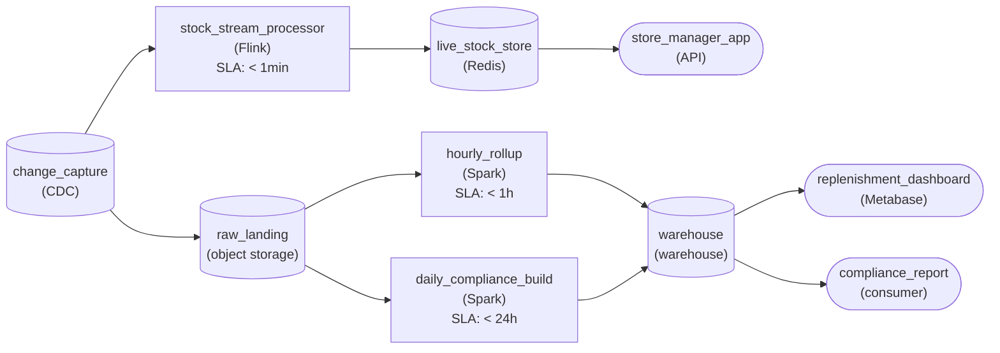

*One CDC stream, three clocks: a sub-minute live path, an hourly rollup and a daily compliance build reading the same raw landing.*

1. **Start from each reader's clock**

   Write down what each reader needs before drawing a stage: under a minute for store managers, an hour for planners, a day for compliance. Each number becomes the `slaFreshness` on the stage that builds that reader's view, and nothing feeding a batch reader needs to run faster than the batch itself.

2. **Fork once and let the landing decouple the clocks**

   The change stream splits a single time: one branch goes to a Flink job at '< 1min' that keeps live stock counts, the other lands every change raw in object storage. The hourly rollup and the daily build each read that landing on their own schedule, so a slow batch run never touches the live path.

| Pitfall: One tier for everything is wrong somewhere |
| --- |
| Running the dashboard and compliance builds as streaming jobs because the stock-out view needs sub-minute data keeps compute busy around the clock to produce numbers nobody reads faster than hourly. Stamping the whole pipeline daily fails the other way: store managers learn about a stock-out the next morning. |

| Key insight: Mixed tiers off one landing are not a contradiction |
| --- |
| The raw landing is written continuously while the warehouse it feeds refreshes hourly and daily. Different readers get different freshness from different layers of the same pipeline, and each layer is only as fast as its own readers demand. |

**Follow-up questions**

1. A loss-prevention team wants raw changes queryable within 15 minutes. Which node's tier changes, and which stay put?\
   *Raising one layer's tier without dragging the curated rollups along.*
2. Planners now ask for the dashboard every 5 minutes. Does the rollup cross into the streaming band, and what does that cost?\
   *Where a tighter reader clock crosses the batch-to-streaming line.*

</details>


<br>

### Exercise 11 of 11

**● TASK**

A competitive online game writes 300 million match events a day to one event log that keeps 90 days of history. Choose between Lambda, Kappa and a unified engine, then design the pipeline: a live leaderboard store must reflect each match within seconds, and season standings land in a warehouse once a day. When the scoring rule changes, all 90 days are recomputed and the standings rewritten, and the three-person team can run only one codebase.

<details>
<summary><strong>Solution</strong></summary>

#### Kappa wins when one small team owns the rescore

This workload lands on Kappa architecture with a unified engine, because the 2 things that once justified Lambda are already covered. Lambda paid for a batch layer to get exact results and cheap recomputation. Flink gives exact results straight from the stream, and a log that keeps 90 days already holds the history to recompute from. What remains of Lambda is only its cost: the scoring rule written twice, 2 clusters, and 2 places for a rescore to disagree, which a three-person team cannot carry.

1. **Count the codebases first**

   A Lambda design puts the scoring rule in a batch layer and again in a speed layer, then merges them at serving. Every scoring change ships twice, and a bug in one copy shows up as the leaderboard and the standings disagreeing. With one codebase allowed, Lambda is out before cost even enters.

2. **Make the log the source of truth**

   Because the log keeps 90 days, a rescore is a replay: start a second run of `scoring_job` from the earliest offset with the new rule, let it catch up, then switch readers over. The partition-overwrite `backfillStrategy` on the warehouse replaces each day's standings, so a rerun rewrites old scores instead of appending beside them.

3. **Tier each store to its reader**

   The job runs continuously, but its sinks do not share one clock. `live_leaderboard_store` is 'real-time' because players watch it; `season_standings_warehouse` is '< 24h' because the esports team reads it each morning. One streaming path, 2 freshness tiers.

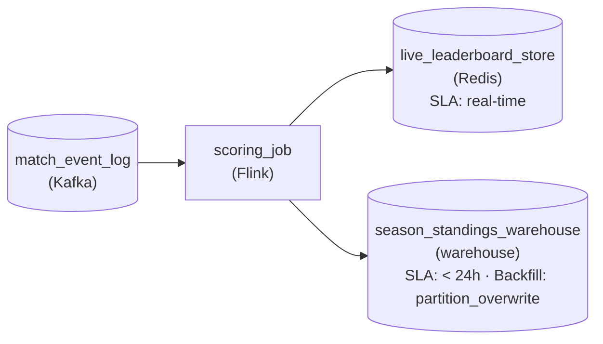

*One Flink job reads the 90-day log and writes both stores, each on its own freshness tier.*

| Performance: Recompute cost is a short burst, not a standing cluster |
| --- |
| 300 million events a day averages about 3,500 per second, near 10,000 at peak, which a modest Flink job handles. A full rescore replays roughly 27 billion events; finishing inside a day means about 320,000 per second, so the replay run is scaled out for those hours and released afterwards. Lambda would keep a batch cluster paid for all season to do the same work. |

| Pitfall: A separate backfill job is Lambda again |
| --- |
| The tempting shortcut is a Spark job that reads the archived log and recomputes standings while Flink handles the live path. It works on day one and drifts by the second scoring change, because the rule now lives in 2 places. Recompute with the same job, replayed from the log. |

**Follow-up questions**

1. Banned players' matches must disappear from both stores within an hour of the ban. What changes?\
   *Tests whether a retroactive correction reuses the single streaming path and its replay instead of adding a second one.*
2. Log retention is cut from 90 days to 7 to save storage. Does Kappa still hold?\
   *Tests seeing that replay depends on the log holding full history, and that the log would need archiving to object storage to keep it.*

</details>
