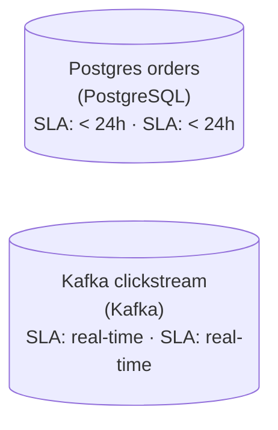
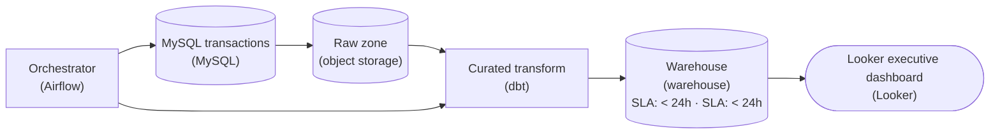
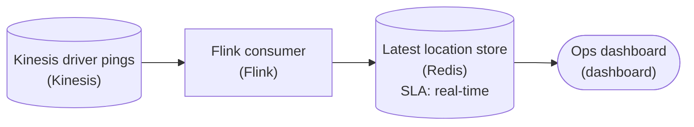
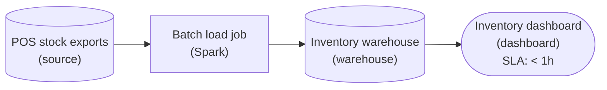
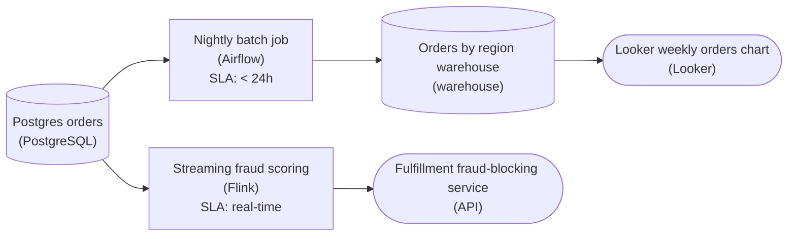
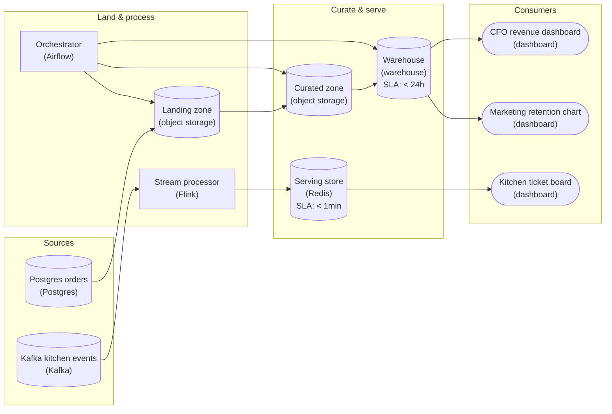
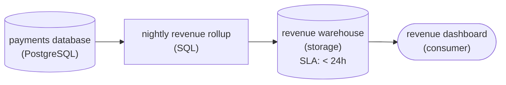
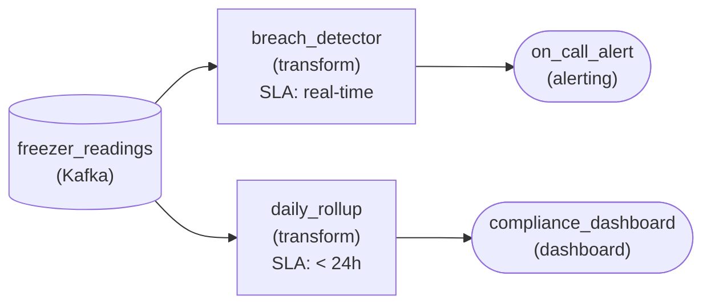
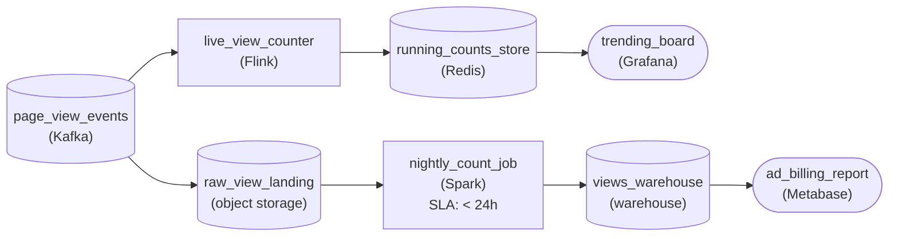

# Batch vs Streaming: Beginner - Exercises

Lesson: [pa_batch_vs_streaming_beginner.md](../pa_batch_vs_streaming_beginner.md)

### Exercise 1 of 9

**● TASK**

Set each source's slaFreshness to its rhythm. The Postgres orders database accumulates rows until a job processes the chunk, so it gets a daily-tier batch label such as < 24h. The Kafka clickstream topic delivers each event as it arrives, so it gets real-time or < 1min. The two sources must end up with distinct labels.

**Starting canvas** (already placed for you):

- Postgres orders (source, Postgres)
- Kafka clickstream (source, Kafka)

<strong>Solution</strong>

#### Two rhythms, two labels

Every source moves on one of two rhythms, and **batch versus streaming** is the name for that split. A batch source lets rows pile up and hands them over in scheduled chunks. A streaming source emits each record the moment it happens. The `slaFreshness` label records that rhythm. It is the freshness contract the rest of the diagram reads: how stale the data can get before anyone downstream should worry.

The orders rows wait for a job to process the chunk, so that source sits on the daily tier, '< 24h'. Clickstream events flow through as they arrive, so that source sits on the streaming tier, 'real-time' or '< 1min'. The canvas has two cadences, so it needs two labels.

*The rhythm lives in `slaFreshness`, not in the tool name: '< 24h' on the batch orders source, 'real-time' on the streaming clickstream.*

| Pitfall: One shared label hides a rhythm |
| --- |
| Giving both sources '< 24h', or both 'real-time', looks tidy, but then the diagram lies. It either says clicks refresh once a day or says orders are live to the second. A second common slip is writing the cadence into the tech label ('Postgres, batch'). Freshness is read from `slaFreshness`, so set it there. |

| Real world: The label picks the downstream architecture |
| --- |
| When a new source arrives, the first question is its rhythm. A batch input feeds a scheduled job and a warehouse table. A streaming input feeds a consumer group and a low-latency store. Label it wrong and you either pay for a stream processor on data that lands once a day, or you promise a dashboard freshness the batch job can never deliver. |

**Follow-up questions**

1. If the orders job ran hourly instead of daily, what changes on the `Postgres orders` label, and does the source become streaming?\
   *A faster schedule is still batch. The tier tightens to '< 1h', but the data still arrives in chunks.*
2. Which `slaFreshness` fits the clickstream if the app buffers events offline and flushes them in bursts?\
   *The label follows the delivery rhythm, not the transport. A bursty Kafka feed behaves more like micro-batch.*

 

### Exercise 2 of 9

**● TASK**

Between the MySQL transactions source and the Looker dashboard, add a raw-zone storage node where the nightly extract lands as partitioned files, a dbt transform that writes daily_balances, and a warehouse that holds it. Add an orchestrator that runs the job once a day at 2am so leadership reads it by 8am. Tag the warehouse table with a daily slaFreshness (< 24h); nothing here streams or runs continuously.

**Starting canvas** (already placed for you):

- MySQL transactions (source, MySQL)
- Looker executive dashboard (consumer, Looker)

<strong>Solution</strong>

A nightly batch pipeline is one run, once a day, over bounded data. It lands the extract untouched, curates it into a table, and serves that table to a morning reader under a named freshness promise. You were given both ends of the run. The middle you drew is the same 4 moves every batch job makes: **land raw, curate, serve, all woken by one clock**.

*Data flows in one line from source to dashboard. `Airflow` wakes the extract and the transform at 2am Pacific, and `daily_balances` in the warehouse carries a '< 24h' freshness SLA.*

1. **Land the extract raw**

   The first stop after `MySQL` is object storage, not the warehouse. The extract lands as a date-partitioned file (`dt=2026-09-16/`) with no cleaning applied. This is the raw tier of the medallion pattern. Because you keep an untouched copy, a bad transform costs a re-run instead of a re-extract from the operational database.

2. **Curate into `daily_balances`**

   `dbt` reads the raw files and writes `daily_balances` into the warehouse. The business logic lives here, and it reads from raw, not from the source, so you can replay any landed day whenever you need to. The warehouse holds the table because it is built for the analytical reads `Looker` sends. `MySQL` is built for the bank's transactional writes.

3. **Wake it with one clock and name the promise**

   Nothing runs on its own. `Airflow` starts the DAG at 2am and enforces the order: the extract finishes before the transform starts. The '< 24h' `slaFreshness` tag on the warehouse table states the contract to the 8am room. That makes a failed run something you can detect and alert on before anyone reads stale numbers.

| Pitfall: A stream here burns compute for one read |
| --- |
| The usual mistake is adding a Kafka topic or an always-on consumer. The books close at midnight and get read at 8am, so the data is bounded and the cadence is daily. If any node on your canvas implies a stream or a real-time SLA, it does not belong in a nightly batch. |

**Follow-up questions**

1. The 2am run fails. How does the '< 24h' `slaFreshness` tag turn that into a page before 8am?\
   *The SLA as an enforceable contract, not documentation.*
2. Leadership wants hourly refreshes. Which nodes stay, and what changes?\
   *Where batch cadence ends and micro-batch begins.*

 

### Exercise 3 of 9

**● TASK**

Driver phones publish GPS pings to the Kinesis stream on the canvas every 3 seconds, and a live ops dashboard polls each driver's latest location every second. Trace one ping from that source to the map: add a streaming consumer that processes pings as they arrive (plain Spark or dbt is batch and does not count), a serving store holding the latest location per driver, and the dashboard. Mark the store's freshness as real-time.

**Starting canvas** (already placed for you):

- Kinesis driver pings (source, Kinesis)

<strong>Solution</strong>

#### Reading one ping end to end

Stream processing turns the pipeline into a long-running service: a driver's GPS ping, not a clock, is what moves data forward. Follow one ping through the shape you built. The `Kinesis` source was handed to you. A **Flink consumer** reads the ping the moment it lands, updates its state for that driver, and writes the new position to a serving store keyed by driver. The dashboard's once-a-second poll then finds it there. The store carries a 'real-time' `slaFreshness`, so the diagram itself says nothing here waits for a schedule.

*One ping's path: `Kinesis` -> Flink consumer -> latest location store (real-time) -> dashboard poll, with no schedule anywhere.*

| Pitfall: A batch engine leaves each ping waiting for the next run |
| --- |
| The tempting wrong answer is plain `Spark` or `dbt` in the consumer slot, since they process the same records. But they wake on a schedule, read a chunk, and sleep, so a ping can sit unread for a whole interval and the 'live' map lags minutes behind. That slot needs an engine that reads as events arrive: `Flink`, `Spark Structured Streaming`, `Kafka Streams`, or `Beam`. |

| Key insight: Partition by `driver_id` so a driver's pings stay ordered |
| --- |
| Kinesis shards and the consumer's keyed state both key on `driver_id`. Every ping for one driver then flows through the same partition in order, so a fresh location is never overwritten with a stale one, and the work spreads across shards as the fleet grows. The serving store is keyed the same way: one row per driver, upserted on each ping. |

The store keeps no history. The dashboard asks one thing, 'where is each driver now', so the consumer collapses the stream to the latest position per `driver_id` and writes that single row. A point lookup by key answers in milliseconds. That lets a once-per-second dashboard sit on a firehose of pings without either side waiting on the other.

**Follow-up questions**

1. What breaks if a driver's phone buffers offline and then flushes 5 out-of-order pings at once?\
   *Event time versus arrival order: keep the newest timestamp per `driver_id` rather than the last ping read.*
2. The product team wants a driver's last 10 minutes of trail on the map. What changes in the shape?\
   *A latest-only store versus a windowed store that keeps recent history, still without falling back to batch.*

 

### Exercise 4 of 9

**● TASK**

A product manager asks for a real-time inventory dashboard and, when pressed for a number, says store managers need stock counts no more than an hour old. POS systems drop stock exports every 15 minutes, and the dashboard reads a warehouse table. Choose batch or streaming for the stage that moves the exports into the warehouse, picking the simplest one that meets the target, and tag the dashboard with its slaFreshness tier.

**Starting canvas** (already placed for you):

- POS stock exports (source)
- Inventory warehouse (storage, warehouse)
- Inventory dashboard (consumer, dashboard)

<strong>Solution</strong>

#### An hour-old target is a batch problem

Picking batch or streaming starts by turning 'real-time' into a number. Here the number is an hour: stock counts up to 60 minutes old are good enough for a store manager. That is the '< 1h' tier, and **the simplest architecture for that tier is a scheduled batch job**. The POS exports already land every 15 minutes, so a job that loads them into the warehouse every 15 to 30 minutes keeps the dashboard well inside the hour.

*A scheduled `Spark` batch job sits between the 15-minute exports and the warehouse, and the dashboard's `slaFreshness` is '< 1h'. No queue, no stream processor.*

| Pitfall: The word real-time does not pick the tier |
| --- |
| The tempting move is a streaming job between the exports and the warehouse, because the request said real-time. A stream reading 15-minute files is still only as fresh as the files, and it runs compute around the clock to beat a one-hour target the batch job already meets. Tagging the dashboard 'real-time' or '< 1min' makes the same mistake in the label. |

| ✕ Streaming for this target | ✓ Batch for this target |
| --- | --- |
| A job that never stops, plus a continuous event feed from the stores to make it worth running. It buys sub-minute freshness nobody asked for, at a higher running cost. | A scheduled job on the exports that already exist. It meets '< 1h' with the fewest moving parts, and its compute runs only when new files arrive. |

| Real world: Ask how old the data may be before drawing anything |
| --- |
| Most real-time requests turn out to mean within the hour or by the start of the workday. One question, how old can the data be before it changes a decision, usually moves the design from a stream to a schedule. |

**Follow-up questions**

1. Store managers now need stock counts under a minute old. What has to change besides the processing stage?\
   *A sub-minute tier needs streaming end to end, so the 15-minute file exports must become a continuous event feed.*
2. If the target loosens to 'ready by the start of each workday', which tier and cadence fit?\
   *'< 24h' and one daily batch run: an even simpler schedule.*

 

### Exercise 5 of 9

**● TASK**

A meal-kit subscription company serves two consumers off one Postgres orders database, and both already sit on the canvas. The Looker chart is read at the Monday standup, shows last week's orders by region, and is fine with day-old numbers; the fulfillment fraud check has to flag a suspicious order within seconds, before the box reaches packing. Build each consumer a path off that one database that meets its own freshness need.

**Starting canvas** (already placed for you):

- Postgres orders (source, PostgreSQL)
- Looker weekly orders chart (consumer, Looker)
- Fulfillment fraud-blocking service (consumer, API)

<strong>Solution</strong>

#### One source, two clocks

Choosing between **batch and streaming** is a question about the reader, not the data: what freshness does each consumer need, and what is it worth paying to get it? Both consumers here read the same `orders` rows, so it is tempting to build one path and fan it out. But the Looker chart is read once, at the Monday standup, and is happy with day-old numbers, while the fraud check has seconds to flag an order before the box reaches packing. Two latency budgets mean two paths off the one database, each sized to its own clock.

*One Postgres source feeds two paths sized to two freshness budgets: a nightly batch rollup into a warehouse for the chart, an always-on streaming job for the fraud check.*

1. **Give the chart a scheduled batch rollup**

   The Monday chart needs orders grouped by region, and day-old is fine, so a job on a schedule is the whole answer. A nightly run reads yesterday's `orders`, writes a small rollup by region into a warehouse, and Looker reads that. Mark the job '< 24h'. You trade away freshness nobody needs for a plan that is cheap and simple: it touches Postgres once a day, off-hours, instead of on every dashboard load.

2. **Give the fraud check an always-on stream**

   Seconds-to-flag rules out any schedule, even an hourly one, because the box would be packed before the next run. So the fraud path is a streaming job that never stops: it picks up each new order as it arrives, scores it, and calls the fraud service. Mark it 'real-time'. Work happens per order, not per tick of a clock, and you pay for that with a process that runs all day.

| Pitfall: Polling the database faster is not streaming |
| --- |
| Under a tight budget the reflex is to shorten the batch interval: every hour, then every minute, then every 10 seconds. That hammers Postgres with repeated scans, and every order still waits up to one full interval to be seen. A streaming job reverses the direction: each order flows to it as it happens, so a suspicious order is scored because it arrived, not because you asked again. |

| ✕ Batch path (the chart) | ✓ Streaming path (the fraud check) |
| --- | --- |
| Triggered by a schedule. It reads a bounded chunk (yesterday's `orders`), computes an aggregate once, and writes it to the warehouse. Latency is hours, and that is fine: it is cheap to run, simple to reason about, and trivial to rerun if a night fails. | Triggered by each new order. Orders are scored one at a time, in flight, by an always-on job. Latency is seconds. It is more to operate and costs more to keep running, but it is the only shape that meets a per-order deadline. |

**Follow-up questions**

1. The fraud team now wants an hourly count of blocked orders on the same Looker dashboard. Does that number come off the batch path or the stream?\
   *Tests whether you route by the consumer's freshness need rather than by which pipeline the data first arrived on.*
2. A backfill corrects a week of miscategorized regions in Postgres. How does each path pick up the fix?\
   *Batch reruns a window and recomputes; the stream only saw orders as they arrived, so a correction may need a replay or a separate reload.*

 

### Exercise 6 of 9

**● TASK**

Wire the 5 endpoints on the canvas so each consumer runs at the rhythm its freshness need demands. Land the Postgres orders data once in a shared object-storage raw zone, curate it, and serve the CFO revenue and marketing retention charts from a warehouse an orchestrator refreshes at least daily. Send the Kafka kitchen events through a stream processor into a low-latency serving store, never through the warehouse, so the store-ops ticket board stays under a minute fresh. Extract each source only once, and make both tiers (under a minute and daily) visible on the canvas.

**Starting canvas** (already placed for you):

- Postgres orders (source, Postgres)
- Kafka kitchen events (source, Kafka)
- CFO revenue dashboard (consumer, Looker)
- Store-ops kitchen ticket dashboard (consumer, Looker)
- Marketing retention chart (consumer, Looker)

<strong>Solution</strong>

#### Match the pipeline to the reader's clock

This challenge is a **batch-versus-streaming** split: the same store's raw data feeds three dashboards, but the rhythm each pipeline runs at is dictated by the reader, not the source. The CFO revenue chart and the marketing retention chart are opened once a day, so a warehouse that refreshes daily is exactly right; the store-ops kitchen board watches the line in real time, so nothing slower than a stream will do. You had two sources (`Postgres orders`, `Kafka kitchen events`) and 5 endpoints already placed. The job was to draw the two spines between them and pick the right component at each hop.

*Two spines from shared sources: a daily batch spine (land once in object storage, curate, load the warehouse) feeding both reporting charts, and a sub-minute stream spine feeding the line board.*

1. **Land orders once, then curate before the warehouse**

   The orders data lands from `Postgres orders` into a shared object-storage `Landing zone` as raw files first, then gets cleaned and typed into a `Curated zone`, and only then loads into the `Warehouse`. Landing raw before you transform is the ELT shape: the lake keeps the untouched copy so you can reprocess a bad day without re-pulling from Postgres, and both the CFO and marketing charts read the same curated tables instead of each re-deriving from raw. One landing, two readers.

2. **Put the batch hops under an orchestrator**

   The three batch hops (`Landing zone`, `Curated zone`, `Warehouse`) run as a scheduled DAG under the `Orchestrator`. That is what makes 'refreshes no slower than once a day' a real guarantee rather than a hope: the orchestrator runs land then curate then load in dependency order, so the warehouse never loads a half-written curated file, and a failed hop stops the ones downstream of it.

3. **Keep the kitchen on its own stream spine**

   `Kafka kitchen events` flow into a `Stream processor` that writes to a low-latency `Serving store`, and the `Kitchen ticket board` reads from there. This spine never touches the lake or the warehouse, because every batch hop would add minutes the line cannot afford. The serving store exists so the dashboard reads a pre-computed current state in milliseconds instead of scanning a growing event log on every refresh.

| Pitfall: Don't stream what a day-old number answers |
| --- |
| The common miss is wiring the `Kitchen ticket board` off the warehouse (too slow, the line sees minutes-old tickets) or, worse, running the reporting charts off the stream to 'keep it simple'. A single stream spine feeding everything means you rebuild historical revenue and retention aggregates in a stateful stream job, pay for it 24/7, and still can't cheaply recompute a corrected prior day. Latency is a requirement to be matched, not maximized. |

| Key insight: Freshness is bounded by the slowest hop |
| --- |
| A consumer is only as fresh as the slowest hop feeding it. The `Kitchen ticket board` stays under a minute only because every hop behind it (`Kafka` to `Stream processor` to `Serving store`) is sub-minute, so a single daily hop anywhere in that chain would blow the budget. The reporting charts inherit the daily cadence of the `Warehouse` load, which is fine. Trace the slowest edge on each path and that is the freshness you actually promised. |

**Follow-up questions**

1. A kitchen event for store 42 arrives 90 seconds late because the tablet was offline. How does the stream spine handle it without corrupting the current ticket count?\
   *Late-arriving data: watermarks and event-time windows in the stream processor versus naive processing-time counting.*
2. Yesterday's orders had a duplicate-charge bug fixed this morning. How do you correct the CFO revenue chart, and why is the raw landing zone what makes that cheap?\
   *Reprocessing from the immutable raw lake copy versus re-pulling from Postgres; why ELT keeps corrections local to the batch spine.*

 

### Exercise 7 of 9

**● TASK**

A finance executive asks for real-time revenue. Pressed for a concrete target, she wants yesterday's revenue on her dashboard when she opens it at 8am, and payments land in a PostgreSQL database whose day closes at midnight. Translate her request into a freshness tier, then build the simplest pipeline from that database to her dashboard that meets it, with the freshness set on the stage that serves her.

<strong>Solution</strong>

#### Real-time is a word; 8am is a target

Translating real-time into a freshness tier mostly means listening for the deadline. She said real-time, then she said 8am, and only the second phrase is a requirement. Yesterday's revenue becomes final at midnight and nobody looks until morning, so one run anywhere in that eight-hour gap meets her target. That is the daily tier, the cheapest of the five.

*One nightly rollup over the closed day lands in a warehouse set to '< 24h', and the revenue dashboard reads from it.*

1. **Replace the word with a time**

   'Real-time' carried no units; 'yesterday's numbers by 8am' does. Write the target down as a deadline plus the data it covers: closed days, ready at the start of the workday. Every faster tier now has to justify itself against that sentence, and none can, because nothing is read between midnight and 8am.

2. **Set the daily tier where she reads**

   Use the simplest architecture for the tier: one nightly rollup over the closed day, landing in a warehouse. Put '< 24h' on the warehouse the dashboard reads from, not on an upstream stage. The freshness that counts is the one on the stage feeding her screen.

| Pitfall: A stream here pays for updates nobody sees |
| --- |
| Streaming payments into the dashboard keeps compute running all night to refresh a number she reads once at 8am. That costs a tier or 2 more than the daily run and shows her exactly the same figure. Picking a tier the reader never uses is overengineering, however modern it looks. |

| Real world: Most real-time requests turn out to be a deadline |
| --- |
| A product manager who asks for a real-time signup dashboard often means within the hour, and an hourly run covers that. Ask for the target in units of time before you draw anything. The answer is usually far looser than the word suggested. |

**Follow-up questions**

1. Which tier fits if she starts checking revenue at 2pm to see the morning's sales?\
   *Tests whether a read in the middle of the day moves the target from daily into a faster tier.*
2. What changes if a day's payments can keep settling until 3am?\
   *Tests that a later close moves when the nightly run can start but not which tier is needed.*

 

### Exercise 8 of 9

**● TASK**

A cold-chain warehouse publishes a temperature reading from each of its 400 freezers to Kafka once a second. Choose batch or streaming for each of 2 consumers: the on-call alert must fire within seconds of any freezer rising above -18C, and the compliance dashboard an auditor opens once each morning needs only each freezer's daily high and low. Wire Kafka to both consumers through the processing each one needs.

<strong>Solution</strong>

#### One source, 2 clocks

Choosing batch or streaming is a decision you make per consumer, not per source. One Kafka topic carries 400 readings a second, about 35 million a day, yet its 2 readers live on different clocks: on-call has to know within seconds, while the auditor reads closed days once each morning. So the same source forks into 2 paths, each running at the rhythm its reader needs.

*One Kafka topic forks: a 'real-time' path to the alert and a '< 24h' path to the dashboard.*

1. **Ask what each consumer does with the number**

   On-call acts on a breach the moment it happens, and a freezer that stays warm for an hour has already spoiled its stock: that is a 'real-time' need, so `breach_detector` runs continuously and pushes straight to `on_call_alert`. The auditor signs off on yesterday, and a closed day never changes: that is a daily need.

2. **Match the cost to the value**

   `daily_rollup` wakes once a night at '< 24h', computes each freezer's high and low for the closed day, and stops. Running it as a stream would keep compute up all day to refresh numbers nobody opens until morning.

| Pitfall: One clock for both readers fails one of them |
| --- |
| Streaming everything pays round-the-clock compute for a dashboard read once a day. Batching everything sends the breach alert hours after the stock thawed. The fork is the answer, not a compromise. |

| Performance: The batch side is tiny work |
| --- |
| 35 million readings collapse to 400 rows a day, one high and one low per freezer: a few minutes of nightly compute. The streaming side only compares each reading against -18C, so its cost is the always-on process itself, which the alert justifies. |

**Follow-up questions**

1. Facilities wants a wall screen of current temperatures, never more than a minute old. Which path feeds it?\
   *Reusing the streaming path for a second fresh consumer instead of speeding up the batch.*
2. If Kafka keeps readings for only 12 hours, what does `daily_rollup` need before it can see a full day?\
   *Landing raw readings in storage so a nightly batch has a complete day to read.*

 

### Exercise 9 of 9

**● TASK**

A news site publishes every article page view to a Kafka topic, about 30 million events a day, and needs one number computed 2 ways: views per article. The newsroom's trending board must show counts no more than a minute old, so build a streaming path that keeps a running count per article in a store the board reads. The ad billing report needs yesterday's final count per article by 6am, so land the raw events in a store where they pile up and have a nightly batch job count the whole day in one pass into a warehouse the report reads.

<strong>Solution</strong>

#### Same count, 2 rhythms

Views per article is one simple count, and this design computes it twice on purpose. Batch processing waits for a bounded chunk, yesterday's events piled up in the landing store, and counts it once. Stream processing keeps a long-running job alive that bumps a running total the moment each event arrives. By morning both paths agree on yesterday's numbers; what differs is **when the answer exists**, the shape of the compute, and what it costs to keep running.

*`page_view_events` fans out to a continuous path for the trending board and a nightly path for billing.*

| ✕ Streaming path | ✓ Batch path |
| --- | --- |
| `live_view_counter` runs all day, holds a running total per article and writes each change to `running_counts_store`. Timing: seconds. Compute shape: a small always-on service sized for the peak rate. Cost: paid for every hour it runs, including 4am when almost nobody is reading. | `nightly_count_job` wakes once, reads the whole day from `raw_view_landing`, counts it in one pass and writes to `views_warehouse`. Timing: hours, done before 6am. Compute shape: one large burst, then nothing. Cost: paid only for the minutes it runs, and a failed run is simply rerun over the same files. |

| Pitfall: One rhythm cannot serve both readers |
| --- |
| The tempting shortcut is a single path. Point billing at `running_counts_store` and invoices come from a total that never settles and has no saved day to rerun. Keep only the nightly job and the trending board is up to a day stale. Each reader gets the rhythm its freshness need demands, both fed by the same topic. |

| Performance: The cost difference is shape, not size |
| --- |
| 30 million events a day averages about 350 a second, so a modest streaming job keeps up even at breaking-news peaks, and the nightly job reads one day of raw files in a short run. Neither path is expensive at this volume: you are choosing between an always-on service and a once-a-day burst. |

**Follow-up questions**

1. Marketing wants views per article for every hour of the last day. Which rhythm, and fed from where?\
   *Placing a freshness need that sits between the 2 existing paths.*
2. The board's total at midnight differs slightly from the billing number. Which one is the record?\
   *Why the settled batch count over a bounded day is the number money is based on.*

