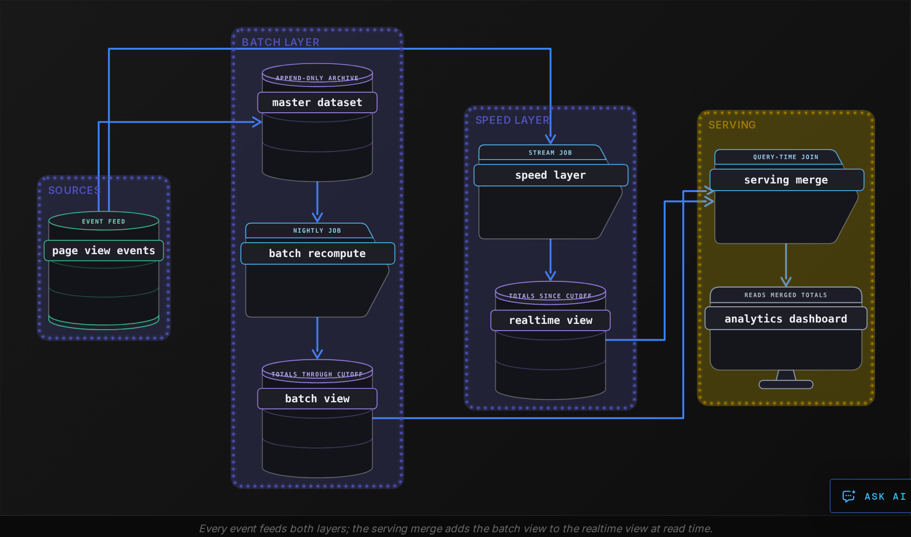
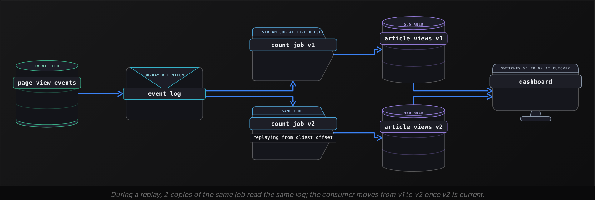
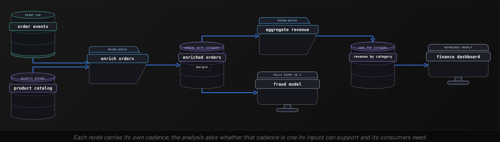
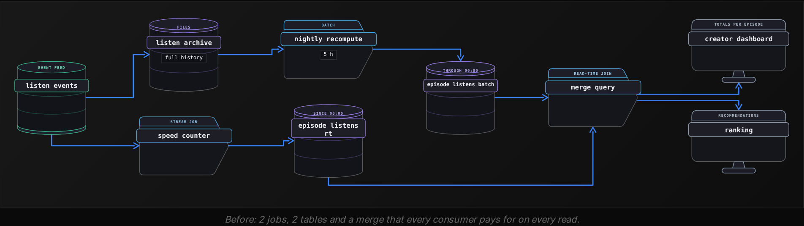
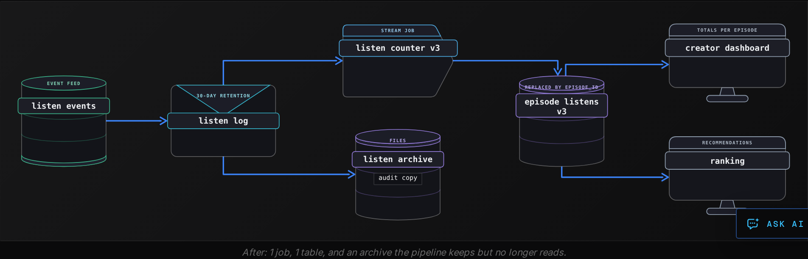

Advanced·Pipeline Architecture · 35 min · 11 challenges

# Batch vs Streaming: Advanced

Suppose LinkedIn's profile-view counter were built from 2 jobs: a nightly batch over every view ever logged and a stream job counting today's. On Tuesday they disagree by 340 views for one member, because last week's bot filter change landed in the batch code only. This lesson is about how a pipeline ends up with 2 answers, and how it gets back to 1.


<br>

---

## Lambda Architecture

### Three layers that answer one question

Lambda architecture computes every answer twice and merges the 2 results. The batch layer keeps an append-only master dataset of every event ever received and periodically recomputes a batch view from scratch over all of it. The speed layer processes events as they arrive and keeps a realtime view covering only the events the last batch run has not yet absorbed. The serving layer merges the 2 views at query time: a recomputed answer plus a thin slice of recent data.




<br>

### A worked merge

Take a news site counting views per article. The batch job runs at 01:00 and recomputes every article's total from the master dataset up to midnight. The speed layer counts views per article since the last cutoff; once a batch view covering up to midnight lands, it drops its counts from before midnight and keeps the rest. At 15:00 the serving layer adds the 2, and article a-1101, published at 09:00, has no batch row yet.

| article_id | batch view (through 00:00) | realtime view (since 00:00) | served total |
| --- | --- | --- | --- |
| a-1042 | 1,208,311 | 4,517 | 1,212,828 |
| a-1077 | 88,402 | 12,960 | 101,362 |
| a-1101 | no row | 2,344 | 2,344 |

```sql
SELECT
  COALESCE(b.article_id, s.article_id) AS article_id,
  COALESCE(b.views, 0) + COALESCE(s.views, 0) AS served_views
FROM batch_view AS b
FULL OUTER JOIN realtime_view AS s
  ON s.article_id = b.article_id
```

Lambda's correctness comes from the batch side of the merge. A speed-layer mistake, such as a view double-counted after a crash, survives only until the next batch run, because the batch view is recomputed from the master dataset without reading the speed layer's output. Whatever the realtime view gets wrong, the next recompute replaces, so the team can throw that view away at any time.


<br>

### The constraints of 2012

Nathan Marz, whose stream engine Twitter open-sourced in 2011, laid out the design in a blog post that year and named it Lambda in his later book. It answered the limits of that era's engines: a crash could redeliver a message into a running count that then stayed wrong for good, stream state lived in process memory and vanished on restart, and no batch engine could recompute years of events fast enough to serve recent data, so recency needed a second path.

| ✓ Constraint in 2012 | ✗ Same constraint today |
| --- | --- |
| • A crash could replay a message into a count that had already absorbed it<br><br>• Stream state lived in worker memory and vanished on restart<br><br>• A full recompute took longer than the freshness consumers accepted<br><br>• The event feed kept hours of data, so history lived only in the archive | • Engines checkpoint state and read position together, so a restart resumes without double counting<br><br>• State is persisted to local disk and checkpointed, holding billions of keys<br><br>• Recompute is a replay of the log through the same job, at many times the live rate<br><br>• Logs retain weeks or months, so the log itself can be the history |

> The cost of a second codebase
>
> - Every metric definition exists twice, and both forms must change on the same day
> - A fix in one layer only leaves served totals right in one slice and wrong in the other
> - Two runtimes mean 2 sets of failure modes, on-call skills and capacity plans

Lambda bought correctness a single stream job could not deliver, and paid with 2 implementations of every rule. Once a stream job could survive a crash without corrupting its counts and the log could hold months of history, replaying the stream job itself could do the batch layer's recompute. That design is next.

**A product manager wants views from known crawler IP ranges excluded from article totals starting today. Under the Lambda design above, what is the smallest change that makes served totals correct from tomorrow on?**

- **A.** Add the filter to the speed layer only; tonight's batch recompute picks it up, since the master dataset holds every raw event.
- **B.** Add the filter to the batch recompute only, since the nightly batch view replaces whatever the speed layer got wrong.
- **C.** Add the filter to both the batch recompute and the speed layer, and accept mixed totals today until the 01:00 run rebuilds the batch view.
- **D.** Add the filter to the serving merge query, so both views are corrected at read time without touching either layer.

<details>
<summary>Solution</summary>

**C.** Add the filter to both the batch recompute and the speed layer, and accept mixed totals today until the 01:00 run rebuilds the batch view.

Both implementations hold the rule, so both must change; the mixed window closes when the batch view is recomputed with the new code.

**Why the others are wrong**

- **A.** The batch recompute reads the master dataset through its own code, so it keeps counting crawlers until that code changes too.
- **B.** The error recurs daily: every served total includes crawler views counted since 00:00 by the unfixed speed layer.
- **D.** The views hold counts per article, with no IP column; the merge can't subtract rows it never sees.

</details>


<br>

---

## Kappa: Stream Only, Batch Replay

### One job, one log, one codebase

Kappa architecture removes the batch layer and keeps the log. Every event is written to an append-only log that retains messages for a configured window, and a single stream job reads it and maintains the output table. To change logic or undo a bug, the team starts a second copy of the job at the oldest retained position, lets it rebuild a fresh output table from history, and points consumers there once it catches up. Recomputation becomes replay: the program that handles live data handles history too.

*Jay Kreps named the pattern in 2014, while at LinkedIn, in the article Questioning the Lambda Architecture, written as a response to the 2-codebase cost.*




<br>

### A replay with numbers

The news site receives 2,000 views per second on average, and its log retains 30 days, 5.18 billion events. The crawler filter ships as job v2, reading from the oldest retained offset. A replaying job never waits for events, so it runs as fast as the engine and output table allow. At 100,000 events per second it gains on the log head at a net 98,000, because new views keep arriving, and catches up after roughly 52,900 seconds, 14.7 hours. Meanwhile v1 serves the dashboard with the old rule.

| clock | job v1 | job v2 | dashboard reads |
| --- | --- | --- | --- |
| Mon 09:00 | live, old rule | started at oldest offset, 30 days behind | article_views_v1 |
| Mon 17:00 | live, old rule | 8 hours in, about 17 days replayed | article_views_v1 |
| Mon 23:41 | live, old rule | caught up, now live | article_views_v1 |
| Mon 23:45 | live, old rule | live | article_views_v2 (switched) |
| Tue 09:00 | stopped, table dropped | live, the only copy | article_views_v2 |

Lambda needed 2 edits, 2 deploys, a nightly run and a check that the views agree; Kappa needs 1 edit, 1 deploy and a table swap. The replay was also the test: v2's output over 30 days of real history sat beside v1's before any consumer switched, and diffing the 2 tables shows which articles moved and by how much.


<br>

### Retention sets the replay horizon

The master dataset lived in a file archive that cost little and kept everything. The log is built for many sequential readers at once, replicates each message to several brokers so a disk loss drops nothing, and holds those bytes on the disks of brokers serving live traffic. A site writing 1TB of events a day with 3 replicas pays for 3TB of broker disk per retained day. Retention is a budget, and the replay horizon is exactly that budget: a bug found 45 days after it shipped can't be undone by replaying a 30-day log.

- **21TB** — replicated log, 7-day retention
- **270TB** — replicated log, 90-day retention

The plain Kappa answer keeps retention long and pays the broker bill, which works while volume is modest. Another option keeps a short hot window in the log, copies older events to cheap files, and teaches the job's reader to read the archive first and switch to the log at the archive's last offset: 1 transform, 2 input readers, and a handoff seam where each event must appear once. A team can also accept a bounded horizon and patch older history by hand. Each choice states how far back the team expects to recompute.

**A Kappa pipeline retains 14 days of events. On day 60 the team finds that a deploy on day 15 has been dropping events from one app version. Which statement about recovery is correct?**

- **A.** Replaying the log rebuilds days 46 through 60 correctly; days 15 through 45 stay wrong unless an archive outside the log still holds those events.
- **B.** Replaying the log from its oldest offset rebuilds all 45 affected days, because the stream job reads history and live data with exactly the same code.
- **C.** Replaying is unnecessary, because the fixed job corrects the stored counts as new events arrive and the window rolls forward.
- **D.** Replaying the log rebuilds all 45 days, as long as the replay job is started before the current 14-day window rolls past day 60.

<details>
<summary>Solution</summary>

**A.** Replaying the log rebuilds days 46 through 60 correctly; days 15 through 45 stay wrong unless an archive outside the log still holds those events.

The replay horizon is the retention window, 14 days, so only events written since day 46 still exist in the log.

**Why the others are wrong**

- **B.** The code is the same, but the oldest offset in a 14-day log is day 46; earlier events were deleted.
- **C.** A fix applies to events the job sees from the offset it starts at; counts already written for days 15 through 59 stay as they are.
- **D.** Retention is measured from each message's write time; day 15's events were deleted on day 29 regardless of when a replay starts.

</details>


<br>

---

## Unified Engines: Where Lines Blur

### One transform, bounded or unbounded input

A unified engine treats a batch as a stream that happens to end. The transform is written once as a graph of operators, filters, projections, grouped aggregations and joins, and the engine decides at launch whether to feed that graph a bounded input, such as a month of files, or an unbounded one, such as a live log. Only the launch parameters change between the 2 runs.

```sql
views = source("page_views")

per_article = (
    views
    .filter(lambda e: not e["is_crawler"])
    .group_by("article_id")
    .count()
)

run(per_article, mode="batch", input="archive/2026-10")
run(per_article, mode="stream", input="log/page_views")
```

A declarative query works the same way: the grouped count below fully describes the result in both modes, and the engine builds the same operator graph from it.

```sql
SELECT
  article_id,
  COUNT(*) AS views
FROM page_views
WHERE is_crawler = FALSE
GROUP BY article_id
```

The engine unifies the language and operators: a developer learns 1 API, and an aggregation means the same thing over finished or ongoing input. It unifies testing, because the stream job can run over a bounded sample file and be checked against a hand-computed answer. It also unifies sources and sinks, since a connector for a bounded file and one for a log present the same interface to the operator graph.


<br>

### Execution still differs

Execution is where the 2 modes part. In batch mode the query above reads every row, emits exactly 1 row per article, and exits. In stream mode it emits a row for a-1042 when the first view arrives, then a replacement row every time that count changes, for as long as the job lives. A consumer that appends each emitted row ends up with thousands of rows for 1 article, so it must replace by key. The query is identical, but batch mode writes a table once and stream mode writes a changelog that never ends.

| aspect | batch run | streaming run |
| --- | --- | --- |
| input | bounded, fully known before the job starts | unbounded, arriving while the job runs |
| operator lifetime | stage by stage, each finishing before the next | every operator alive at once, pipelined |
| state | sort and shuffle files for 1 job, discarded at exit | local stores, checkpointed, kept across restarts |
| state size bound | the input size | the distinct key count, growing until keys expire |
| failure recovery | rerun the failed stage from its materialized input | restore the last checkpoint, reread the log from that offset |
| output | the complete result, written once | a changelog of inserts and replacements, written continuously |
| resources | a burst, released at exit | a reservation held around the clock |
| ends when | the input is consumed | someone stops it |

The state rows bite hardest. A batch grouped count over 30 days of views holds a count per article while it runs, then frees it. The streaming version holds that count for the job's whole life, often months, so an article published in January still occupies state in October whether anyone views it or not. A join between 2 streams must hold one or both sides in state until a match can arrive, where a batch join sees both sides complete in one pass. Stateful transforms are where the same code stops meaning the same cost.

For architecture, the unified engine shrinks Lambda's cost without settling the design question. With 1 codebase, a batch recompute beside a stream job is a second launch of the same program. Recompute versus replay becomes a storage question, whether history is replayed from the log or re-read from an archive, and section 4's migration puts numbers on it.

**A team writes a running count of views per article, with no window, tests it over a 2-hour sample file, and deploys it in stream mode. Which runtime difference is most likely to surprise them in production?**

- **A.** The grouped count emits a different final number per article in stream mode than in batch mode for the same input, because streaming aggregations are approximate.
- **B.** The stream run cannot be recovered after a crash, while the batch run can be rerun from its input files, so every crash loses the counts accumulated so far.
- **C.** The stream job emits exactly 1 row per article once its input is fully read, so the sink can append the rows safely without replacing by key.
- **D.** State grows with the number of distinct articles seen and does not shrink unless keys are expired, while the batch test held state only for the sample's articles and freed it at exit.

<details>
<summary>Solution</summary>

**D.** State grows with the number of distinct articles seen and does not shrink unless keys are expired, while the batch test held state only for the sample's articles and freed it at exit.

The sample bounded the state by its input; in production the bound is the distinct key count over the job's whole life.

**Why the others are wrong**

- **A.** The semantics are unified; given the same complete input, both modes arrive at the same final count.
- **B.** Stream recovery restores the last checkpoint and rereads the log from that offset; the counts survive.
- **C.** A live log is never fully read; each change to an article's count emits a replacement row, so appending leaves many rows per article.

</details>


<br>

---

## Per-Node Freshness Tier Analysis

### Four tiers, one rule

A freshness tier is the delay a node promises between an event happening and that event showing in its output. Four tiers cover most pipelines: seconds, minutes, hours and daily. Writing the tier beside every node exposes a rule an unannotated diagram hides: a node is only as fresh as its slowest input, however often it runs.

| tier | typical cadence | usually built as |
| --- | --- | --- |
| seconds | under 1 minute | stream job over a log |
| minutes | 1 to 15 minutes | micro-batch |
| hours | hourly to every 6 hours | scheduled job |
| daily | once a day or slower | nightly job or snapshot export |


<br>

### Annotating a real graph

An online store runs the pipeline below. Order events arrive on a log. A product catalog is exported from the operations database every night at 02:00. A micro-batch every 5 minutes joins recent orders to the catalog to attach each order's category and margin, writing enriched_orders. A second micro-batch every 5 minutes sums enriched_orders into revenue_by_category. Two consumers read the results: a finance dashboard that refreshes hourly, and a fraud model that polls enriched_orders every 30 seconds to score each new order against its category's typical basket.



| node | own cadence | slowest input | effective freshness | consumer expects | finding |
| --- | --- | --- | --- | --- | --- |
| order_events | seconds | none | seconds |  | fine |
| product_catalog | daily | operations database, daily export | daily |  | fine |
| enriched_orders | 5 min | product_catalog, daily | order columns 5 min; category and margin up to 24 h | fraud_model, 30 s | unmet: polled 10 times per run, margin a day stale |
| revenue_by_category | 5 min | enriched_orders, 5 min | amounts 5 min; category daily | finance_dashboard, hourly | hidden cost: 12 runs per refresh |

The 2 mismatches point in opposite directions. The fraud model reads a 5-minute table every 30 seconds and believes it scores fresh orders; it scores orders up to 5 minutes old, and when the catalog reprices a product at 10:00 the margin it sees stays wrong until the next 02:00 export. That is an unmet expectation, and no alarm fired because the table did update every 5 minutes. The revenue table is rebuilt every 5 minutes for a dashboard that reads it hourly: hidden cost, as the aggregate job starts, reads, writes and releases workers around the clock for a consumer that looks once an hour.

- **288** — aggregate runs per day
- **264** — runs no dashboard refresh reads


<br>

### The 5-step analysis

- Write each node's own cadence beside it, including sources and snapshot exports
- Propagate downward: a node's effective freshness is the slowest of its inputs, per column where inputs differ
- Write each consumer's expected freshness beside it, taken from how the data is used, never from how often it polls
- Flag as hidden cost runs outpacing all their inputs or the fastest consumer's need, like 288 revenue runs for 24 reads
- Flag every consumer whose expectation is faster than its source's effective freshness as unmet

Fixes move a tier boundary rather than nudge a cadence. If the fraud model needs only the order columns at 30 seconds, it should read order_events through a stream job and skip the enrichment. If it needs margin at 30 seconds, the catalog must publish each price change as an event the enrichment consumes, moving product_catalog to the seconds tier: the expensive fix. For finance, revenue_by_category moves to hourly or becomes a query the dashboard runs on refresh, while the 5-minute enrichment stays if the fraud path still wants it.

> **TIP**
>
> Write per-column freshness on the storage nodes, not only on the transforms. A table whose rows land every 5 minutes and whose margin column is a day old carries 2 tiers, and consumers read columns.

**A pipeline streams clickstream events (seconds) into a sessions table rebuilt by a micro-batch every 10 minutes, which joins a user_segments table refreshed weekly. A marketing tool reads sessions every 15 minutes to pick a banner by segment. Which finding is correct?**

- **A.** The micro-batch should run every 5 minutes so the marketing tool reads fresher sessions on each 15-minute poll and the banner reflects the latest clicks.
- **B.** The marketing tool's 15-minute read is served, but segment is weekly-fresh, so a user who changed segment on Monday gets the old banner all week; the fix is on user_segments.
- **C.** The sessions micro-batch is hidden cost, because clickstream arrives in seconds and the batch only runs every 10 minutes, wasting the source's freshness.
- **D.** The weekly user_segments refresh is hidden cost, because the micro-batch reads it 1,008 times a week for a table that only changes once.

<details>
<summary>Solution</summary>

**B.** The marketing tool's 15-minute read is served, but segment is weekly-fresh, so a user who changed segment on Monday gets the old banner all week; the fix is on user_segments.

Propagating the slowest input gives the segment column a weekly tier; the consumer's expectation is unmet on that column alone.

**Why the others are wrong**

- **A.** Sessions are already fresher than the 15-minute poll; the stale column is segment, and a faster micro-batch leaves it weekly.
- **C.** Running slower than an input is a freshness choice, and 10 minutes sits close to a 15-minute reader's need; the column that fails is segment.
- **D.** Reading a small table is cheap; the cost finding concerns a writer's cadence, and user_segments is written once a week.

</details>


<br>

---

## Lambda to Kappa Worked Example

### The workload

A podcast platform serves listens per episode to creators and its recommendation ranking, from 3,000 listen events per second. Under Lambda, a nightly recompute of episode_listens_batch starts at 02:00 over a file archive of every listen and lands roughly 07:00; a speed layer keeps episode_listens_rt since midnight; consumers read both through a merge query. The codebases drifted twice in a year, and the layer holding the stricter rule set which way totals moved at 07:00. A crawler rule added to batch only made totals drop at the landing, then climb too fast all day. A completed-listen rule raised from 30 to 60 seconds played, in the speed layer only, made totals jump at the landing, then grow too slowly.






<br>

### One definition of a completed listen

The code diff, by intent

- **Deleted** *nightly_recompute and merge_query*\
  The batch implementation and read-time merge go; both consumers read episode_listens_v3.
- **Promoted** *speed_counter becomes listen_counter*\
  The stream job holds the only definition of a completed listen.
- **Added** *a version in the output name*\
  The job writes episode_listens_vN; each replay is a new N and never overwrites the table being read.
- **Added** *a sink that replaces by episode_id*\
  Each count change emits a replacement row, and the sink overwrites by key.
- **Added** *a diff query*\
  Run before every cutover, it lists episodes whose counts differ between old and new tables.

```sql
SELECT
  COALESCE(o.episode_id, n.episode_id) AS episode_id,
  o.listens AS old_listens,
  n.listens AS new_listens
FROM episode_listens_v2 AS o
FULL OUTER JOIN episode_listens_v3 AS n
  ON n.episode_id = o.episode_id
WHERE o.listens IS NULL
  OR n.listens IS NULL
  OR o.listens <> n.listens
ORDER BY ABS(COALESCE(o.listens, 0) - COALESCE(n.listens, 0)) DESC
LIMIT 100
```


<br>

### The log becomes the master dataset

The archive stops being the master dataset and becomes an audit copy; the log takes that role for 30 days. At 3,000 events per second and about 400 bytes each, 30 days with 3 replicas fills about 9.3TB of broker disk, which the team weighs against the 5-hour nightly job's compute and accepts. A replay runs at 120,000 events per second, and while it runs the output exists twice, so the serving store needs room for 2 copies of episode_listens, about 40GB each. A correction older than 30 days reads the archive through the same transform, across section 1's handoff seam.

- **104GB** — log written per day
- **18.5 h** — 30-day replay including catch-up

**The team wants to correct 60 days of history after a tagging bug, but the log retains 30 days. Which plan keeps the single-codebase property?**

- **A.** Give the stream job's reader an archive mode that reads days 31 to 60 from files, hands off to the log at the archive's last offset, and run the same transform as v4.
- **B.** Write a batch job over the archive for days 31 to 60, let the stream job handle the last 30, and merge the 2 tables at read time for consumers.
- **C.** Raise retention to 60 days now, wait 30 days for the log to fill, then replay from the oldest offset with the fixed v4 job.
- **D.** Replay the 30 days available with v4 and scale the older counts by the correction ratio observed on the replayed window.

<details>
<summary>Solution</summary>

**A.** Give the stream job's reader an archive mode that reads days 31 to 60 from files, hands off to the log at the archive's last offset, and run the same transform as v4.

One transform, 2 input readers: the handoff seam is the only new code, and the rule still lives in 1 place.

**Why the others are wrong**

- **B.** That rebuilds Lambda: a second implementation of the rule and a merge that every reader pays for.
- **C.** Raising retention keeps future events longer; the events from days 31 to 60 were already deleted.
- **D.** The older counts would come from arithmetic on a guess, with no code that reads the actual events.

</details>


<br>

### New checks replace the nightly overwrite

| step | when | what happens | what proves it worked |
| --- | --- | --- | --- |
| 1 | Mon 06:00 | Start listen_counter_v3 at the oldest retained offset, writing episode_listens_v3 | Job is reading; v3 row count rising |
| 2 | Tue 00:30 | v3 reaches the live offset and keeps pace | Gap between log head and v3 under 5 seconds |
| 3 | Tue 00:30 to Thu 02:00 | v3 and the Lambda pair both serve; the diff query runs hourly | Diff lists only episodes with listens in the last 24 hours, differing under 0.1% |
| 4 | Thu 09:00 | Dashboard and ranking switch to episode_listens_v3 | No read of the batch or rt tables for 24 hours |
| 5 | Fri 09:00 | Stop nightly_recompute and speed_counter; drop their tables | Archive still written; retention alert set at 25 days |

Before step 5 the team writes down what gets harder. With no nightly overwrite, nothing erases drift in the stream job's counts, so a once-free correctness check must be built: an hourly query comparing sampled episodes against raw event counts in the log. A bad deploy now reaches every consumer at once, so every change ships as a new vN replay beside the running version. Retention is now a correctness boundary too: an alert fires when the oldest event a planned correction needs reaches 25 days old, 5 days before the log deletes it, leaving time to replay or read the archive.

**Two weeks after cutover, a creator reports an episode's total fell 3% overnight. Under the new design, which cause is possible, and which old-design cause is ruled out?**

- **A.** Possible: the nightly recompute applied a rule the stream job lacks. Ruled out: a replay cutover, since replays only add listens.
- **B.** Possible: retention expired and deleted 30-day-old events, lowering stored counts. Ruled out: nothing from the old design.
- **C.** Possible: a new replay cut over with a stricter completed-listen rule. Ruled out: a nightly batch overwriting the speed layer's count.
- **D.** Possible: the speed layer reset at 02:00 before the batch view landed. Ruled out: a replay, since v3 writes the table being read.

<details>
<summary>Solution</summary>

**C.** Possible: a new replay cut over with a stricter completed-listen rule. Ruled out: a nightly batch overwriting the speed layer's count.

A count moves only when the job emits a replacement, and cutting over to a new vN is the designed way for history to change.

**Why the others are wrong**

- **A.** No nightly recompute exists after step 5, and a replay with a stricter rule lowers counts.
- **B.** Expiring log messages removes input bytes; counts already written to episode_listens_v3 do not change.
- **D.** The speed layer was stopped at step 5, and a replay writes to a new vN table, never the one being read.

</details>


<br>

---

## Putting It All Together

A food delivery company shows every restaurant its orders and revenue for the day on a partner dashboard, and feeds the same counts into a courier dispatch model that reacts to demand spikes. The numbers come from a nightly batch over the order archive plus a stream job for today, merged at read time, and the 2 disagreed last month when a refund rule changed in one job only. The team is deciding whether to collapse the design into a single replayable stream job, and how fresh each piece of it actually needs to be.

- The refund disagreement is section 0's second-codebase cost in the open: 1 rule, 2 implementations, drift that the nightly overwrite hides until someone looks at 15:00.
- Collapsing to 1 stream job with a versioned output and a log replay is section 1's Kappa move, and the first design decision is retention: how far back the company expects to correct restaurant totals.
- The unified engine from section 2 lets the team keep the stream job as the only code and still test it over a bounded day of files, while budgeting state for every restaurant ever seen.
- Section 3's tier analysis separates the 2 consumers: the dispatch model needs seconds on order counts, while the partner dashboard refreshes hourly and the restaurant attributes it joins change daily, so the micro-batch feeding it is hidden cost.
- Section 4's cutover procedure, replay beside the live table, diff before any consumer switches, then delete the batch layer, is the plan the team writes before touching production.


<br>

---

## Key Takeaways

- Lambda keeps a batch layer, a speed layer and a serving merge because early stream engines could corrupt counts on a crash and logs held only hours; the batch recompute from the master dataset was the correction.
- The cost of Lambda is every rule implemented twice, and the 2 implementations drift; the engine constraints that justified that cost have shifted.
- Kappa keeps 1 stream job and a retained log; recompute is a replay of the same job into a new versioned table, and the replay horizon is exactly the retention budget.
- A unified engine shares code, semantics and testing between batch and stream, while state lifetime, recovery, output shape and resource use still differ at runtime.
- A node is only as fresh as its slowest input; annotating every node and consumer with a tier exposes hidden cost and unmet expectations per column.
- A Lambda-to-Kappa migration deletes the batch job and merge, versions the output, runs old and new side by side with a diff, and replaces the nightly overwrite with a correctness check of its own.

Exercises for this lesson: [_exercises/pa_batch_vs_streaming_advanced.md](_exercises/pa_batch_vs_streaming_advanced.md)
