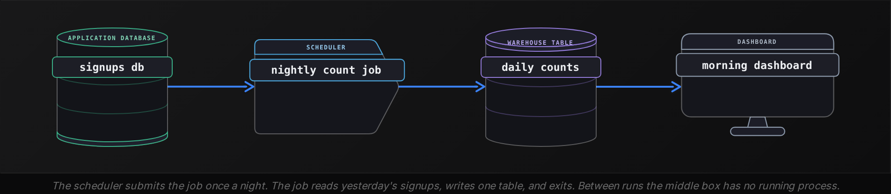
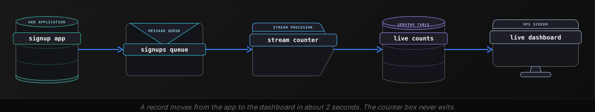

# Batch vs Streaming: Beginner

It is 11:58 pm on New Year's Eve and riders across Manhattan open the Uber app at once. Surge pricing has to reflect that demand within seconds or drivers never head toward Times Square. The same night, every driver's weekly pay summary waits to be produced once, after the week closes. Same trips, same company, 2 rhythms, and this lesson is about telling them apart.


<br>

---

## Two Ways Data Can Move

The last lesson gave every pipeline 4 roles: a source, a transform, storage, and a consumer. Rhythm is a different question: when does the transform run, and how much data does it handle each time? Every pipeline answers in one of 2 ways, and the answer sets the cost, the freshness of the output, and the kind of failure you will be paged for.


<br>

### Batch: collect a pile, then process it

A batch pipeline lets records accumulate and processes them together on a schedule. Signups land in an application database all day, and nothing counts them. At 02:00 the next morning a job wakes up, reads every signup from the previous day, counts them by country, writes the counts to a table, and exits. The job has a start, an end, and a window of data it owns: the 24 hours before it ran. Between runs the transform is a definition waiting for its next trigger, with no process running anywhere.


<br>

### Streaming: process each record as it arrives

A streaming pipeline keeps the transform running at all times and hands it records one at a time, within seconds of each record being created. The same signups flow into a queue. A consumer process reads the queue continuously, adds 1 to the count for that signup's country, and writes the new count to a serving table. The unit of work is a single record, so the output changes 6 times on a day with 6 signups, and the consumer is still running at midnight waiting for the seventh.


Watch the clock in the animation. At 07:40 the second signup, from Germany, lands in the queue. Within 2 seconds `live_counts` shows DE at 1, while `daily_counts` holds nothing, because its job will not run for another 18 hours. At 02:00 on April 25 the nightly job fires, reads all 6 signups, and 8 minutes later writes US 3, DE 2, IN 1 in a single overwrite. Both tables now hold identical numbers. They arrived on 2 different rhythms, and for most of the day only one of them was right.


<br>

### What changes, in one table

| Dimension | Batch | Streaming |
| --- | --- | --- |
| Trigger | A time on a schedule | A record arriving |
| Unit of work | A window of records, such as one day | 1 record |
| Compute lifetime | Starts at the trigger, exits when finished | Started once, runs for months |
| Output write | The whole result, replaced each run | 1 row updated per record |
| Freshness | As old as the time since the last run | Seconds |
| Cost | Minutes of compute per run | Every hour of every day |

> What stays the same
>
> - The source: the same signups table feeds both pipelines.
> - The transform logic: count by country, in both cases.
> - The storage and the consumer: a table of counts, read by a dashboard.
> - What differs is when the transform runs, how much it handles per run, and how long it stays alive.


<br>

### Freshness and lifetime

Two words from that table carry the rest of this lesson. Freshness is the delay between a record being created and its effect showing in the output. For `s4`, the signup from India at 15:30, that delay is 2 seconds in `live_counts` and 10 hours and 38 minutes in `daily_counts`. Compute lifetime is how long the transform exists as a running process. The batch job lives for 8 minutes a day. The stream consumer lives for all 1,440 minutes of it, including the roughly 1,434 in which no signup arrives. Freshness is what the consumer feels. Lifetime is what the bill feels.

> **TIP**
>
> Ask one question of any pipeline you meet: what starts the transform? If the answer is a time, it is batch. If the answer is a record showing up, it is streaming. Everything else in this lesson follows from that answer.

**Which of these 4 pipelines is batch?**

- **A.** A fraud check that scores each card swipe within 200 milliseconds of the swipe reaching the bank.
- **B.** A counter that raises a city's active-driver total each time a driver taps the go-online button.
- **C.** A job that reads every order placed yesterday at 03:00 each morning and writes a totals table.
- **D.** A process that reads a queue of clicks continuously and appends each one to a log table.

<details>
<summary>Solution</summary>

**C.** A job that reads every order placed yesterday at 03:00 each morning and writes a totals table.

A clock starts it, it owns a 1 day window, and it exits when done. Batch.

**Why the others are wrong**

- **A.** The swipe is the trigger and the unit of work is 1 record. That is streaming.
- **B.** Each tap triggers 1 update. The transform runs continuously, waiting for taps. Streaming.
- **D.** Reading a queue continuously and writing per record is the streaming rhythm, even with no counting involved.

</details>


<br>

---

## Batch: Picture, Rhythm, Example

A batch pipeline has 3 moving parts beyond the data itself: a scheduler that knows when to fire, a job that does the work, and the storage the job reads from and writes to. The scheduler is the only part awake all the time, and its whole task is to watch a clock. The job is where compute starts, runs, and shuts down, and that lifecycle is what this section traces, minute by minute.




<br>

### One run, minute by minute

| Clock | What happens | Compute state |
| --- | --- | --- |
| 02:00:00 | The scheduler reaches the trigger time and submits the job | Starting: a machine is requested |
| 02:01:00 | The job's process is up and connects to the signups database | Running |
| 02:01:30 | It reads every signup dated April 24 | Running: reading |
| 02:06:00 | It counts the rows per country in memory | Running: computing |
| 02:07:30 | It overwrites `daily_counts` with the new rows | Running: writing |
| 02:08:00 | The job reports success and its process exits | Shut down |
| 02:08 until 02:00 next day | Nothing runs. The scheduler watches the clock | Off |

Three points on that timeline matter more than the rest. Compute starts at 02:00, when the scheduler submits the job and a machine is allocated. Compute runs from 02:01 to 02:08, and this is the only period in which data is touched. Compute shuts down at 02:08, and from then until the next trigger the pipeline costs nothing and does nothing. A batch pipeline is defined as much by the 23 hours and 52 minutes it is off as by the 8 minutes it is on.

- **0.6%** — of each day the job is running
- **99.4%** — of each day the job is off


<br>

### The window is the boundary

```sql
SELECT
  country,
  COUNT(*) AS signups
FROM signups
WHERE signup_date = DATE '2026-04-24'
GROUP BY country
```

The `WHERE` clause draws the window. The run at 02:00 on April 25 owns signups dated April 24 and nothing else. A signup at 23:59 on April 24 is counted 2 hours and 9 minutes after it happened. A signup at 00:01 on April 25 belongs to the next window and waits until 02:08 on April 26, which is 26 hours and 7 minutes. Two records created 2 minutes apart show up in the output 24 hours apart, and that gap is the price of a daily window.

> **TIP**
>
> A batch job that finishes at 02:08 and is read at 09:00 delivers data at least 9 hours old, because its newest record, from 23:59, is 9 hours old by then. Freshness is measured at the read, so a faster job changes nothing until someone reads earlier.


<br>

### Every run replaces its result

The animation wrote `daily_counts` in overwrite mode, and that is the usual batch choice. Each run produces the complete answer for its window and replaces whatever the previous run wrote for it. If the job fails at 02:05 and someone restarts it at 02:20, the second attempt reads the same April 24 rows, computes the same counts, and leaves the table exactly as a successful first attempt would have. A batch run is a unit you can repeat, because its window closed when the day ended.

- Starts: the scheduler fires at the trigger time and a machine is allocated to the job.
- Runs: the job reads its window, computes, and writes, all inside one process.
- Shuts down: the process exits, and compute cost drops to zero until the next trigger.
- Repeats: the next run owns the next window and replaces its own output.

**A user signs up at 02:03 on April 25, while the nightly job is already running. When does that signup first appear in daily_counts?**

- **A.** At 02:08 on April 25, because the running job picks up every row present at the moment it writes.
- **B.** At 02:08 on April 26, because the row is dated April 25 and belongs to the next run's window.
- **C.** Within 2 seconds, because the table is updated as soon as each record arrives in the source.
- **D.** Never, because rows created while a run is in progress fall between windows and are skipped.

<details>
<summary>Solution</summary>

**B.** At 02:08 on April 26, because the row is dated April 25 and belongs to the next run's window.

The April 25 window is processed by the run at 02:00 on April 26, which finishes at 02:08. The signup waits 24 hours and 5 minutes.

**Why the others are wrong**

- **A.** The job's WHERE clause selects rows dated April 24. A row dated April 25 is outside its window no matter when it is read.
- **C.** That describes live_counts and the stream. daily_counts changes only when the nightly job writes it.
- **D.** Windows are defined by the row's date, so every row belongs to exactly one window. Nothing falls between them.

</details>


<br>

---

## Streaming: Picture, Rhythm, Example

A streaming pipeline also has 3 parts beyond the data: a queue that holds records in arrival order, a consumer process that reads them, and a sink that receives the results. The consumer plays the roles of both the scheduler and the job from the batch picture. It is started once and expected to stay up for months. There is no trigger time to look up, because the arrival of a record is the trigger.




<br>

### One event, source to sink

Follow signup `s2`, a user in Germany who presses the signup button at 07:40:00 on April 24.

| Clock | Where s2 is | What happens |
| --- | --- | --- |
| 07:40:00.000 | Signup app | The app saves the user and publishes `{id: s2, country: DE}` to the queue |
| 07:40:00.040 | Queue | The queue appends the record after `s1` and offers it to consumers |
| 07:40:00.120 | Stream counter | The consumer, blocked waiting for input, receives `s2` |
| 07:40:00.125 | Stream counter | It reads the current DE count from the sink, 0, and computes 1 |
| 07:40:02.000 | `live_counts` | It writes the row DE, 1 and tells the queue that `s2` is done |
| 07:40:02.300 | Live dashboard | The next screen refresh reads DE, 1 |

Two seconds after someone in Germany pressed a button, a screen in the office shows the new count, and nothing was scheduled to make that happen. The consumer was waiting at 07:39, it processed `s2` at 07:40, and it returned to waiting at 07:40:02 for `s3`, which arrives at 11:05. For 3 hours and 25 minutes the process is alive, allocated, billed, and doing nothing except waiting.

```sql
for event in queue.subscribe("signups"):
    country = event["country"]
    current = live_counts.get(country, default=0)
    live_counts.upsert(country, current + 1)
    queue.mark_done(event["id"])
```

That `for` loop is the entire transform. `queue.subscribe` blocks until a record is available, so the loop body runs once per signup and never on a timer. `live_counts.get` fetches the current count for one country. `upsert` inserts that country's row or replaces it, 1 row rather than the whole table. `mark_done` tells the queue the consumer has finished `s2`, so a consumer that crashes and restarts resumes at `s3` instead of rereading the day from `s1`.


<br>

### The queue is the shock absorber

The queue sits between the app and the consumer so that neither waits for the other. The app publishes a record in 40 milliseconds and goes back to serving the user. If the consumer is taken down for an upgrade at 15:00, signup `s4` at 15:30 lands in the queue and sits there. When the consumer returns at 15:45 it reads `s4` and carries on. The queue turned a 45 minute outage into a 15 minute delay for 1 record, and the app never noticed. Without the queue, the app would have had to wait for the counter or drop the record.

| ✓ Batch job down | ✗ Consumer down |
| --- | --- |
| • The next read is hours away, so nobody sees it<br><br>• A rerun reads the same closed window<br><br>• Same output, finished later | • New records wait in the queue<br><br>• Readers see a frozen, stale table<br><br>• Restart resumes at the first unfinished record |

**Signups feed both pipelines from the animation. At 15:00 on April 24 the stream consumer is stopped for an upgrade and restarted at 15:45. The nightly job runs as usual at 02:00 on April 25. At 02:10 on April 25, what does each table show for IN?**

- **A.** live_counts has no IN row and daily_counts shows IN 1, because the stream missed s4 while it was down.
- **B.** Both show IN 1: the queue held s4 until the consumer returned at 15:45, and the batch read it at 02:00.
- **C.** live_counts shows IN 1 and daily_counts has no IN row, because s4 arrived while the consumer was down.
- **D.** Both show IN 2, because the restarted consumer reprocessed s4 and the batch counted the duplicate.

<details>
<summary>Solution</summary>

**B.** Both show IN 1: the queue held s4 until the consumer returned at 15:45, and the batch read it at 02:00.

The stream wrote IN 1 at about 15:45. The batch read all 6 April 24 rows at 02:00 and wrote IN 1 at 02:08. Both are correct.

**Why the others are wrong**

- **A.** The queue kept s4 from 15:30 until the consumer returned at 15:45. The stream was late by 15 minutes and missed nothing.
- **C.** The batch reads the source table, where s4 has been since 15:30. The consumer outage has no effect on the nightly job.
- **D.** The consumer marks each record done after writing, so it resumes at the first unfinished record. s4 is processed once, and the batch reads the source, where s4 exists once.

</details>

*On a day with 6 signups, the consumer works for about 12 seconds and waits for the other 23 hours, 59 minutes and 48 seconds. The rhythm is streaming regardless of volume.*

> **TIP**
>
> When a streaming pipeline misbehaves, look at the queue first. A growing backlog means the consumer is slow or down. An empty queue beside a stale table means no events happened or the producer stopped: check the source for new records first.

**At 11:05 signup s3, from the US, lands in the queue. At 11:05:05 on April 24, what do the 2 tables show for US?**

- **A.** live_counts shows US 2 and daily_counts shows US 1, because the batch wrote the overnight count at 02:08.
- **B.** live_counts shows US 1 and daily_counts shows US 1, because both tables update within seconds of a record.
- **C.** live_counts shows US 1 and daily_counts is empty, because the stream has not caught up with s3 yet.
- **D.** live_counts shows US 2 and daily_counts has no rows, because its first run happens at 02:00 on April 25.

<details>
<summary>Solution</summary>

**D.** live_counts shows US 2 and daily_counts has no rows, because its first run happens at 02:00 on April 25.

s1 at 00:12 and s3 at 11:05 are both US, so the stream shows 2. The batch has not had a window to process yet.

**Why the others are wrong**

- **A.** The first batch run in the animation fires at 02:00 on April 25. At 11:05 on April 24 it has not run, so daily_counts is empty.
- **B.** Only the stream updates within seconds, and s1 and s3 are both US, so the live count is already 2.
- **C.** The consumer takes 2 seconds per record and has been idle since 07:40. At 11:05:05 s3 is already counted.

</details>


<br>

---

## What Real-Time Actually Means

'Real-time' is a request, and requests arrive without numbers attached. When a product manager asks for signups in real time, the engineer's job is to turn those words into a freshness tier: the maximum age the number may have at the moment someone reads it. Four tiers cover almost every request, and each tier points to a different architecture and a different bill.

| Tier | Maximum age when read | Example request | What delivers it |
| --- | --- | --- | --- |
| Sub-second | Under 1 second | Block a card swipe that looks stolen before the terminal says approved | A stream consumer holding the data it needs in memory |
| Seconds | Between 1 and 60 seconds | A wall screen showing orders placed in the last minute | A streaming pipeline writing to a serving table |
| Minutes | Between 1 and 60 minutes | An on-call engineer checking whether signups dropped after a release | A batch job scheduled every 5 to 15 minutes |
| Hours or more | Between 1 hour and 1 day | The Monday morning review of last week's signups by country | A nightly or hourly batch job |

Each tier is about 60 times stricter than the one below it, and the architecture changes with it. Hours and minutes are both served by the batch picture from 2 sections ago, with a shorter window and a more frequent trigger as the tier tightens. Seconds and sub-second need the streaming picture, because a job scheduled every 5 seconds would spend more time starting up than working, and would in effect be an always-on process with extra overhead. The line between batch and streaming sits at roughly 1 minute of allowed age.


<br>

### Three questions that produce a number

- How old can the number be when you read it, and what goes wrong if it is older?
- How often do you read it: once a morning, once an hour, or on a wall screen all day?
- What decision follows from it, and how soon after the data must that decision happen?

The second question usually exposes the tier. A number read once each Monday at 10:00 gains nothing from being 5 seconds old. It gains everything from being correct by 10:00. A number on a wall screen that someone glances at every few minutes benefits from being under a minute old. A number that gates a payment helps only if it arrives before the payment completes. The reading rhythm sets the ceiling on how fresh the data needs to be, and building fresher than that ceiling buys nothing.


<br>

### One request, three translations

Suppose 3 people in the same week each ask for 'real-time signups'. Each conversation ends somewhere different.

| Who asks | What they do with it | Tier | Architecture |
| --- | --- | --- | --- |
| Head of marketing | Reviews signups by country at the Monday 10:00 meeting | Hours | Nightly batch, finished by 03:00 |
| On-call engineer | Wants to see a drop within 5 minutes of a release so a bad release can be rolled back | Minutes | Batch every 5 minutes over the last 5 minutes of signups |
| Growth team | Closes a promotion the moment the 1,000th signup lands, so nobody is promised a gift that is gone | Seconds | Stream consumer keeping a running count |

Three identical requests, 3 different pipelines, and a cost range of more than 100 to 1. The marketing report costs 8 minutes of compute a day. The release monitor costs a short job 288 times a day. The promotion counter costs a process that is up for all 86,400 seconds, and it is the only one of the 3 that needs to be. Writing the tier down before building anything keeps the first 2 requesters from paying for the third one's architecture.

> Write freshness as a number
>
> - Replace 'real time' with 'no older than N seconds when read' and get the requester to agree to N.
> - Tie N to a decision: what is done differently if the number is 10 minutes old instead of 10 seconds?
> - Record N beside the pipeline. Whoever maintains it next year needs to know which tier it serves.

> **TIP**
>
> When someone cannot name a number, ask how they would notice if the data were an hour stale. If the answer is that they would not notice, the tier is hours and the pipeline is a nightly batch.

**The finance team says daily revenue totals must be real-time. In conversation you learn they review the totals at 09:00 each morning and again at 17:00. Which tier and architecture fit?**

- **A.** Hours tier: a batch job on a schedule that completes before 09:00 and runs again before 17:00.
- **B.** Seconds tier: a stream consumer that updates a running revenue total as each order lands.
- **C.** Minutes tier: a batch job every 5 minutes, so the 09:00 number is never more than 5 minutes old.
- **D.** Sub-second tier: an in-memory total that the finance dashboard reads directly on each page load.

<details>
<summary>Solution</summary>

**A.** Hours tier: a batch job on a schedule that completes before 09:00 and runs again before 17:00.

Two reads a day, at fixed times, is the hours tier. Two batch runs timed to finish before each read deliver exactly what is needed.

**Why the others are wrong**

- **B.** A total that is 2 seconds old at 09:00 is no more useful to a 09:00 reader than one that is 2 hours old. The always-on cost buys nothing.
- **C.** This runs 288 times a day to serve 2 reads. The tier is set by the reader's rhythm, which is twice daily.
- **D.** Sub-second is for decisions that must happen before an action completes, such as blocking a payment. A morning review is hours away from that.

</details>


<br>

---

## Picking Batch or Streaming

The choice comes down to 2 inputs: the consumer's freshness tier, which the previous section taught you to extract, and how much the owner is willing to pay and to operate. Batch wins by default. Streaming wins when the tier demands it and the budget accepts it. This section puts numbers on both inputs so the decision stops being a matter of taste.


<br>

### Step 1: the tier narrows the field

| Consumer's tier | Choice | Why |
| --- | --- | --- |
| Hours or more | Batch, nightly or hourly | One short run per window delivers the number before anyone reads it |
| Minutes | Batch on a short schedule | A job every 5 to 15 minutes meets the tier at a fraction of always-on cost |
| Seconds | Streaming | Only a consumer that is already running can react within seconds of each record |
| Sub-second | Streaming, with its data in memory | Even a write to a serving table may take too long at this tier |

Step 1 settles the decision for most consumers, because most consumers read reports, and reports sit in the hours tier. The contested cases cluster around the 1 minute boundary, where either shape can meet the tier and the second input decides.


<br>

### Step 2: the cost you accept

Put a price on both shapes with one rate. Suppose the smallest machine that can run the signups counter costs $0.30 per hour. The nightly batch runs for 8 minutes, which is $0.04 per day. The stream consumer runs for 24 hours, which is $7.20 per day, roughly 180 times as much for the same 6 counted rows. The ratio shrinks as volume grows, because the batch run gets longer while the stream's hours stay fixed at 24, but at low volume streaming pays for 23 hours and 52 minutes of waiting.

- **$2,628** — stream consumer, per year
- **$14.60** — nightly batch, per year

Money is only part of the cost. A stream consumer is a process that can crash at 03:00 on a Sunday, and someone has to notice and restart it, because every minute it is down the live table drifts further from the truth. A batch job that fails at 02:05 can be restarted at 09:00 by whoever arrives first, and the output is still ready hours before the Monday meeting. Cost tolerance means both the bill and the willingness to run something that never stops.

| ✓ Do | ✗ Don't |
| --- | --- |
| • Write the consumer's freshness tier down before choosing a shape<br><br>• Default to batch, and make streaming earn its place with a seconds tier<br><br>• Price both shapes with the same hourly rate so the comparison is fair<br><br>• Feed a batch and a stream from one source when 2 consumers need 2 tiers | • Build streaming because the request contained the words real time<br><br>• Schedule a batch every 30 seconds to avoid admitting the case is streaming<br><br>• Judge cost by the bill alone and forget who restarts a crashed consumer at 03:00<br><br>• Let the loudest requester set the tier for every consumer of a table |


<br>

### Four cases, decided

| Use case | Who reads it, and when | Tier | Choice |
| --- | --- | --- | --- |
| Nightly sales report by region | Regional managers, at 08:00 | Hours | Batch at 02:00 over the previous day |
| Card swipe fraud score | The payment terminal, before it prints a receipt | Sub-second | Streaming, scoring each swipe as it arrives |
| Dashboard of failed logins | An on-call engineer, glancing every 10 minutes | Minutes | Batch every 10 minutes over the last 10 minutes |
| Monthly invoice generation | The billing system, on the 1st of each month | Hours or more | Batch on the 1st over the previous month |

Look at how the second column decides the third. Regional managers reading at 08:00 cannot act on anything fresher than a nightly run gives them. A payment terminal waiting for approval cannot act on anything slower than a stream delivers. The reader's rhythm sets the tier, and the tier sets the shape. The dashboard is the one case where budget matters, because a 10 minute batch and a stream both meet the tier, and the batch costs a fraction of the stream.

**A support team wants to see a customer's total order count when that customer calls. Calls arrive all day. The team says an order placed 2 hours ago is fine to miss. Which choice fits?**

- **A.** Streaming, because calls arrive all day and the agent needs the total within seconds of each call.
- **B.** Batch every 10 minutes, because order totals change often and a daily job would lag by a day.
- **C.** Batch every hour, because the team accepts a 2 hour age and an hourly run keeps the total under that limit.
- **D.** Streaming, because totals are per customer and a batch job cannot write one row per customer.

<details>
<summary>Solution</summary>

**C.** Batch every hour, because the team accepts a 2 hour age and an hourly run keeps the total under that limit.

A run each hour finishing within minutes keeps every total under 2 hours old, inside the stated tier, with compute for a few minutes an hour.

**Why the others are wrong**

- **A.** Calls arriving all day describes how often the number is read, and the agent reads a number that may be 2 hours old. The tier is hours.
- **B.** Hourly runs already meet the 2 hour limit, and this runs 6 times as often for no gain.
- **D.** A batch job writes any number of rows, one per customer included. The row shape has nothing to do with the rhythm.

</details>


<br>

---

## Putting It All Together

A ride-hailing company such as Uber moves the same trip events down 2 paths. Surge pricing has to reflect each neighborhood's ride requests from the last 30 seconds, a seconds tier that only an always-on consumer counting requests as they arrive can serve. Each driver's weekly pay summary is produced once, after the week closes, which a single batch run over 7 days of completed trips serves comfortably. Both read the same trips. One consumer is a pricing engine reacting in seconds, the other is a driver opening a statement on Tuesday morning.

- The pricing engine needs requests from the last 30 seconds, which is the seconds tier, and section 4 sends every seconds tier to streaming (sections 2, 3 and 4).
- Drivers read their pay once a week, so the tier is hours or more and a single batch run over the week's trips is enough (sections 1 and 4).
- The same trip events feed both, as the signups fed both tables in the animation. The source does not pick the rhythm, the consumer does (section 0).
- If the batch pay job fails at 02:05 on Monday, a rerun at 09:00 still beats Tuesday's statement. If the pricing consumer dies, prices go stale within seconds. That gap is the operating cost section 4 priced.


<br>

---

## Key Takeaways

- Batch waits for a window of records to accumulate, processes them in one run, writes the whole result, and exits. Compute lives for minutes a day.
- Streaming keeps a consumer running at all times and processes each record within seconds of its arrival. Compute lives for every minute of the day.
- Freshness is the delay between a record being created and its effect showing in the output. Measure it at the moment someone reads.
- 'Real-time' becomes a number by asking how often the consumer reads and what breaks when the data is older. Four tiers: hours, minutes, seconds, sub-second.
- Hours and minutes are batch with shorter windows. Seconds and below are streaming. Default to batch, and make streaming earn its always-on cost.

Exercises for this lesson: [_exercises/pa_batch_vs_streaming_beginner.md](_exercises/pa_batch_vs_streaming_beginner.md)
