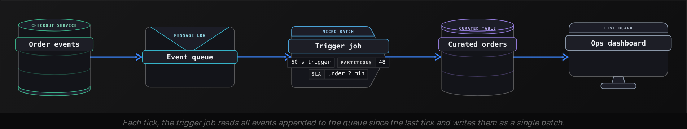
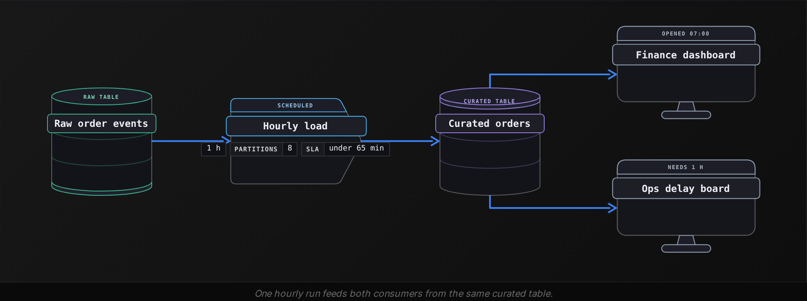

# Batch vs Streaming: Intermediate

It is 23:10 on a rainy Friday in Chicago and a stadium concert has let out. Uber's rider app shows a surge multiplier that recomputes from driver supply and rider demand as the crowd pours onto the street. A pipeline that summarized demand every hour would still show a calm evening. Latency, throughput, and what each one costs decide whether the multiplier moves before the crowd disperses.


<br>

---

## Latency vs Throughput Tradeoff

Latency is the time between an event happening and its result reaching the consumer. Throughput is how much data the pipeline processes per unit of time, measured in rows per second or gigabytes per hour. A pipeline can have high throughput and terrible latency: a nightly job that chews through 180GB in 50 minutes moves data fast, yet an order placed at 00:05 waits almost 24 hours before a dashboard shows it.

Keep latency and throughput apart by asking what each one answers. Latency answers *how old is the newest row the consumer can see*. Throughput answers *how many rows per second can this pipeline absorb before falling behind*. Neither number tells you the other.

| Pipeline | Input rate | Throughput | Latency (p95) |
| --- | --- | --- | --- |
| Nightly orders load | 4M rows/day | 80,000 rows/s during the run | up to 24 h |
| Hourly inventory sync | 4M rows/day | 6,000 rows/s during the run | up to 65 min |
| Click stream | 4M rows/day | 50 rows/s, all day | 3 s |

All 3 pipelines carry the same 4M rows a day. The nightly load has the highest throughput, because it processes all 4M in under a minute of wall clock, and the worst latency. The click stream has the lowest throughput by a factor of 1,600 and the best latency.

Latency and throughput get confused because shortening a schedule lowers latency, and people read that as the pipeline getting faster. The processing rate did not change. Running the nightly load every hour makes each run handle 1/24 of the rows in roughly 1/24 of the time, so throughput during the run is unchanged while worst-case latency drops from 24 hours to 1.

> **TIP**
>
> Report latency as a percentile, never an average. If 9 rows in 10 land within 2 seconds and 1 in 10 takes 90 seconds, the mean is about 11 seconds and looks healthy, while the p95 shows the 90 second wait.


<br>

### Which one is holding you back

A pipeline is latency-constrained when it keeps up with the input but the consumer still gets results later than it needs them. The fix is a shorter schedule or a different movement pattern, since the machines sit idle most of the day. A pipeline is throughput-constrained when input arrives faster than the pipeline processes it, so the backlog grows. The fix is more parallel workers or less work per row. A shorter schedule leaves rows arriving per hour and rows processed per hour unchanged, so it does not help, and each extra run adds its own startup and commit overhead.

> Diagnosing which metric constrains you
>
> - Backlog (rows waiting, or queue depth) grows run after run: throughput. The pipeline cannot keep pace.
> - Backlog drains to 0 after each run but the consumer still complains: latency. The schedule is the limit.
> - Run time grows in proportion to input size: throughput. More rows, more minutes.
> - Run time stays flat while the consumer's freshness need shrinks: latency. The requirement changed.

*The same pipeline can switch categories: an hourly job that processes 10GB today is latency-constrained; when the input triples it becomes throughput-constrained with no code change.*

You can measure both from the curated table itself if every row carries 2 timestamps: when the event happened and when the pipeline wrote it. The gap between them, taken at the 95th percentile, is latency as the consumer experiences it. Rows written per hour of run time is throughput.

```sql
SELECT
  DATE_TRUNC('hour', loaded_ts) AS load_hour,
  COUNT(*) AS rows_loaded,
  APPROX_PERCENTILE(DATE_DIFF('second', event_ts, loaded_ts), 0.95) AS p95_latency_s
FROM curated.orders
WHERE loaded_ts >= LOCALTIMESTAMP - INTERVAL '1' DAY
GROUP BY 1
ORDER BY 1
```

Read the result as a pair of signals. If `rows_loaded` spikes in a single hour and `p95_latency_s` sits near 86,000 in that same hour, you are looking at a nightly batch and the consumer is seeing day-old rows. If `rows_loaded` is smooth across all 24 hours and `p95_latency_s` is climbing hour over hour, rows are arriving faster than they are written and the backlog is growing.

**A pipeline reads a queue every hour and writes to a curated table. Each run takes 48 minutes, up from 30 minutes 3 months ago, and the queue depth at the start of each run has been rising for weeks. The consumer wants rows within 2 hours. Which metric constrains this pipeline, and what change helps?**

- **A.** Latency; switch to a 15 minute schedule so rows arrive sooner.
- **B.** Throughput; add parallel workers or cut work per row so each run finishes well inside the interval.
- **C.** Latency; the consumer's 2 hour need is already met, so no change is required.
- **D.** Throughput; lengthen the schedule to every 2 hours so each run has more time.

<details>
<summary>Solution</summary>

**B.** Throughput; add parallel workers or cut work per row so each run finishes well inside the interval.

Run time growing with input and a rising backlog are both throughput signals. Processing more rows per minute is the only change that shrinks the backlog.

**Why the others are wrong**

- **A.** The rising backlog marks throughput. A shorter schedule leaves rows processed per hour unchanged and adds per-run overhead, so the backlog keeps growing.
- **C.** It is met today. A growing backlog means each run starts further behind, and latency will pass 2 hours within weeks.
- **D.** Throughput is the right diagnosis, but a longer interval carries the same rows per hour at the same processing rate. Latency doubles and the backlog still grows.

</details>


<br>

---

## Micro-Batch: The Middle Ground

Micro-batch is batch run on a short, fixed timer against a queue. Every trigger interval, say 60 seconds, the job wakes, reads everything that arrived on the queue since the previous trigger, transforms it, writes one output, records how far it read, and sleeps until the next tick.



| ✓ Kept from batch | ✗ Taken from streaming |
| --- | --- |
| • Discrete runs, each with a start, an end and one output<br><br>• Fixed per-run overhead shared across many rows<br><br>• A run can be repeated by rereading the same queue range | • A queue as the source rather than a daily file or table snapshot<br><br>• A job that never exits and never waits for a scheduler<br><br>• Freshness measured in seconds or minutes rather than hours |


<br>

### The interval sets the latency

Worst-case latency for a row is the full interval plus the processing time of the batch it lands in. A row that arrives 1 second after a tick waits 59 seconds for the next one, then waits for that batch to finish. Processing time grows with the batch, so the table below assumes 6 seconds of fixed overhead per run plus 200 rows a second, on 4M rows a day. At a 60 second trigger each batch takes around 20 seconds, so latency ranges from 20 to 80 seconds.

| Trigger interval | Processing per run | Worst-case latency | Runs per day | Rows per run |
| --- | --- | --- | --- | --- |
| 1 h | 14 min | 74 min | 24 | 166,667 |
| 5 min | 75 s | 6 min 15 s | 288 | 13,889 |
| 1 min | 20 s | 80 s | 1,440 | 2,778 |
| 10 s | 8 s | 18 s | 8,640 | 463 |

Shrinking the interval hits a floor: near 6 seconds, the fixed overhead alone fills each slot and runs fire back to back. Processing rate is the other limit. This job processes 200 rows a second against an average input of 46. If the busiest minute brings 250 rows a second, each batch takes longer than the time it covers, every tick starts later than the last, and the backlog grows until the peak passes. Size processing for the busiest minute of the day, not the average one.

```sql
import time

TRIGGER_SECONDS = 60
offset = load_committed_offset()

while True:
    tick = time.monotonic()
    events, new_offset = read_queue(after=offset)
    if events:
        rows = transform(events)
        write_batch(rows)
        offset = new_offset
        commit_offset(offset)
    elapsed = time.monotonic() - tick
    time.sleep(max(0, TRIGGER_SECONDS - elapsed))
```

The offset is committed only after the batch is written, so a crash between the 2 writes replays the same events on restart rather than skipping them. The sleep is computed from the elapsed time, so a 20 second batch is followed by a 40 second sleep and the ticks land on the minute. An empty read still advances the clock: a quiet queue produces no output but costs a wake-up.


<br>

### Fixed write overhead, shared across a batch

Every write to the curated layer carries fixed overhead that is the same for 1 row or 1M: opening a connection, creating a file, committing a transaction, updating a listing. Pure streaming pays that overhead once per event or once per tiny buffer. Micro-batch pays it once per interval and spreads it across every row in the batch. At 1 minute and 2,778 rows per run, the fixed cost per row is 2,778 times smaller than paying it per event. That amortization is why micro-batch holds most of streaming's freshness at a fraction of its cost, as long as the consumer tolerates a minute.

> **TIP**
>
> Start the interval at half the consumer's freshness requirement. A dashboard that needs 2 minute old data gets a 60 second trigger; the other 60 seconds absorb processing time and a slow tick.

**A micro-batch job on a 30 second trigger processes a typical batch in 12 seconds, but between 18:00 and 19:00 the input quadruples and each batch takes 45 seconds. The consumer needs rows within 2 minutes. What happens during that hour, and what is the smallest fix?**

- **A.** Latency rises to 75 seconds and holds there; the 2 minute need is met and no change is needed.
- **B.** The backlog grows all hour; lengthen the interval to 60 seconds so each run has more time.
- **C.** The backlog grows all hour and latency climbs past 2 minutes; add parallel workers so the peak batch finishes in under 30 seconds.
- **D.** Nothing changes, because micro-batch reads everything since the last tick regardless of size.

<details>
<summary>Solution</summary>

**C.** The backlog grows all hour and latency climbs past 2 minutes; add parallel workers so the peak batch finishes in under 30 seconds.

Processing of 45 seconds in a 30 second slot is a throughput shortfall of 15 seconds per tick. Only a higher processing rate at peak keeps the interval honest.

**Why the others are wrong**

- **A.** Latency would hold at 75 seconds only if 45 seconds fit inside the 30 second interval. It does not, so each tick starts 15 seconds later than the last and latency keeps climbing.
- **B.** The diagnosis is right, the fix is not. A 60 second batch holds twice the rows and takes about 90 seconds, still over the interval.
- **D.** Reading everything is true, but finishing 45 seconds of work in a 30 second slot means the next tick starts late and the gap compounds.

</details>


<br>

---

## Why Streaming Costs More

A batch job rents machines for the minutes it runs. A streaming job rents them for every minute of the day, including the hours when almost nothing arrives. That difference drives most of the cost gap.

| Line item | Nightly batch | Streaming | Ratio |
| --- | --- | --- | --- |
| Compute, 4M rows/day | 4 machines x 1 h = 4 machine-hours | 3 machines x 24 h = 72 machine-hours | 18x |
| Peak sizing | Sized for the whole day's rows in 1 h | Sized for the busiest second, idle the rest | n/a |
| Writes to curated layer | 1 commit per day | 1 commit per second = 86,400 | 86,400x |
| Always-on queue | None, reads yesterday's table | Queue cluster running 24 h | new line item |
| People | Failures found next morning | Pager at 03:00 for a stalled job | on-call rota |

The compute line surprises people in the other direction: streaming uses fewer machines at any moment than the batch job at its peak, because the work spreads across the day instead of piling into 1 hour. It still costs 18 times the machine-hours because those 3 machines never stop. Reserved pricing can shave the ratio, but the shape stays: streaming pays for idle time, and batch pays only while it runs.


<br>

### 3 places the premium hides

Idle capacity, commit overhead and on-call

- **Idle compute** *the 24 hour tax*\
  Machines sized for the busiest second run through the quietest hour. A pipeline whose input is 10x higher at noon than at 04:00 wastes most of its capacity most of the night.
- **Per-write overhead** *fixed cost multiplied by frequency*\
  Each commit to the curated layer costs roughly the same whether it carries 1 row or 1M. Committing every second pays that cost 86,400 times a day, and readers then pay again to open thousands of tiny outputs.
- **Operations** *a system that is always running can always be down*\
  A nightly job that fails at 02:00 is rerun at 09:00 by whoever arrives first. A stream that stalls at 02:00 is 7 hours behind by 09:00, so someone carries a pager.

- **8,760 h** — hours a stream runs per year
- **365 h** — hours a 1 h nightly job runs per year


<br>

### Pricing the delay

The premium is justified when a decision made from fresh data is worth more than the premium. Put a price on the delay. A fraud check that declines a stolen card at checkout saves the full order value; the same check run tomorrow morning saves nothing, because the goods shipped. A weekly revenue report that is 1 hour stale costs nothing, because nobody reads it until Monday.

| Consumer | Cost of 1 hour of staleness | Freshness that removes it | Pattern that earns its premium |
| --- | --- | --- | --- |
| Card fraud decision | Order value per fraudulent order | Seconds | Streaming |
| Warehouse stock on product page | Refund per oversold unit | Minutes | Micro-batch |
| Marketing spend dashboard | A mistimed budget shift, once a day at most | Hours | Hourly batch |
| Monthly finance close | Nothing | Days | Nightly batch |

Work the arithmetic for the stock example. The store oversells roughly 2 units per hour of staleness, and each oversell costs $15 in refunds and support time. Hourly batch leaves 1 hour of staleness: 48 oversells a day, $720 a day in cost. A 1 minute micro-batch leaves 1 minute of staleness: under 1 oversell a day, around $12. If moving from hourly batch to micro-batch adds $200 a day in compute, it pays back more than 3 times over. Per-event streaming at $2,000 a day would save the last fraction of an oversell and lose money.

| ✓ Latency is worth the premium when | ✗ Latency is wasted spend when |
| --- | --- |
| • The consumer is a machine, or a person acting within minutes<br><br>• Each minute of staleness has a cost you can write down<br><br>• Input arrives steadily, so machines are rarely idle | • The consumer reads on a schedule: a daily report, a weekly review<br><br>• Staleness costs nothing until a threshold measured in hours<br><br>• Input arrives in daily dumps, so the stream waits on an upstream batch anyway |

**A team proposes replacing a nightly batch that feeds a weekly executive revenue deck with a streaming pipeline. The batch costs $40 a day; the stream estimate is $600 a day. The deck is opened on Monday mornings only. Which judgement is right?**

- **A.** Accept: fresher data is always more accurate, and $600 a day is small for an executive audience.
- **B.** Reject: streaming cannot produce a weekly aggregate, so the deck would break.
- **C.** Accept: streaming removes the nightly failure risk, so the $560 premium is insurance.
- **D.** Reject: the consumer reads weekly, so the freshness gain has no value and the premium is $560 a day of pure cost.

<details>
<summary>Solution</summary>

**D.** Reject: the consumer reads weekly, so the freshness gain has no value and the premium is $560 a day of pure cost.

The cost of staleness for a Monday deck is 0 for any latency under 6 days. Paying 15 times more to cut latency from 1 day to 1 second saves nothing.

**Why the others are wrong**

- **A.** Freshness changes the age of the data, not its accuracy. The deck's Monday numbers are identical under either design.
- **B.** A stream can hold a running weekly total. The architecture works; it buys nothing for this consumer.
- **C.** A stalled stream fails too, and now someone must notice it at night. A nightly job that fails has 6 days of slack before Monday.

</details>


<br>

---

## Stateful vs Stateless Transforms

A stateless transform produces its output for a record from that record alone: each row goes in, its row comes out, and the transform remembers nothing. A stateful transform's output depends on records it has already seen, so it needs memory of the past to produce the present. One question sorts any transform: does its output need earlier records?

| Transform | Needs earlier records? | Class |
| --- | --- | --- |
| Parse event JSON into columns | No | Stateless |
| Filter out internal test users | No | Stateless |
| Look up country from a static IP table | No | Stateless |
| Count orders per city per 5 minute window | Yes, every order in the window | Stateful |
| Drop an event whose id was seen in the last hour | Yes, every id for 1 hour | Stateful |
| Match each refund to its original payment | Yes, every unmatched payment | Stateful |
| Running lifetime spend per customer | Yes, all history | Stateful |

Input events, 10:00 to 10:05

| event_id | city | amount | event_ts |
| --- | --- | --- | --- |
| e1 | Austin | 40 | 10:01:12 |
| e2 | Austin | 25 | 10:03:40 |
| e3 | Denver | 60 | 10:04:05 |

Stateful output: count per city per window

| window_start | city | orders | total |
| --- | --- | --- | --- |
| 10:00 | Austin | 2 | 65 |
| 10:00 | Denver | 1 | 60 |

The right table cannot be produced one row at a time. When e1 arrives, the pipeline knows Austin has 1 order so far; it must hold that partial count somewhere until 10:05, when the window closes and the row is final. In a batch job this is a `GROUP BY`, and the state lives in the memory of a run that ends in minutes. In a stream the job never ends, so state lives in a store that must survive for as long as the window is open, for every open key at once.

```sql
SELECT
  city,
  COUNT(*) AS orders,
  SUM(amount) AS total
FROM raw.order_events
WHERE event_ts >= TIMESTAMP '2026-10-27 10:00:00'
  AND event_ts < TIMESTAMP '2026-10-27 10:05:00'
GROUP BY city
```


<br>

### State costs memory and time

State costs memory in proportion to the number of open keys times the size of each key's partial result, and it costs time to protect that memory. If the stream tracks 5 minute windows for 10,000 cities, the state is small. If it drops duplicate event ids seen in the last 24 hours at 2,000 events a second, the state holds 172.8M ids, several gigabytes, and every incoming event checks against it. The stateless transform next to it holds nothing and scales by adding machines; the stateful one scales by splitting keys across machines, and each key must land on the same machine every time.

> **TIP**
>
> When a stream job's cost jumps, look for a new stateful step. A stateless parse added to a stream adds machines in proportion to rows; a new 24 hour deduplication adds a state store, a checkpoint stream and a recovery story.


<br>

### Recovering state after a crash

A stateless job that dies restarts, reads the last position it recorded on the queue, and continues; it lost nothing because it held nothing. A stateful job that dies loses every partial count in memory. Without protection, the 10:00 to 10:05 Austin window restarts at 0 part way through, and the final row is wrong with no error to show for it. The protection is a checkpoint: every few seconds the job writes its state and its queue position together to durable storage, so a restart loads the snapshot and replays only the events after the saved position.

> Restart after a crash at 10:03:00
>
> - Stateless: resume from queue position 48,210, reprocess nothing, 2 seconds to catch up.
> - Stateful, no checkpoint: all partial counts gone; the 10:00 window undercounts and nobody is told.
> - Stateful, checkpoint every 5 s: load state and position 38,210 saved at 10:02:55, replay 10,000 events, 5 seconds to catch up, counts correct.

Checkpointing is itself a cost: the state is written over and over, and the write must be frequent enough that replay after a crash is short, but not so frequent that writing state crowds out processing events. A job with 8GB of state checkpointing every 10 seconds moves 69TB a day to storage for protection alone.

**Classify this rule and say what it needs: flag any payment card used in 3 different cities within 10 minutes.**

- **A.** Stateless: each payment carries its own city, so the transform compares the city on the row to the previous row.
- **B.** Stateful: the job keeps the cities seen per card for the last 10 minutes and checkpoints that store so a restart does not forget a card's recent cities.
- **C.** Stateful: the job keeps every payment ever seen so any card's full history is available.
- **D.** Stateless: the check can be done by a lookup against a static table of known cities.

<details>
<summary>Solution</summary>

**B.** Stateful: the job keeps the cities seen per card for the last 10 minutes and checkpoints that store so a restart does not forget a card's recent cities.

The output for a payment depends on earlier payments on the same card. The state is bounded to 10 minutes per card, and without a checkpoint a crash would reset every card to 0 cities.

**Why the others are wrong**

- **A.** Remembering the previous row is already memory of an earlier record, and the rule spans many rows over 10 minutes, so no single-row transform can express it.
- **C.** Stateful is correct, but only 10 minutes of cities per card are needed. Keeping all history grows the state forever for no gain.
- **D.** A static table lists which cities exist, but not which cities this card visited in the last 10 minutes.

</details>


<br>

---

## When Batch Outgrows Itself

Batch pipelines outgrow themselves in 2 ways, and the fix depends on which. The data grows until the run no longer finishes inside its schedule, a throughput problem. Or the consumer's freshness need shrinks until the schedule itself is too slow, a latency problem. Both show up as the same complaint, the dashboard is behind, and both tempt a team to rebuild as streaming. Name the problem first, then climb the smallest number of rungs that meets the consumer's tier.

| Consumer freshness tier | Smallest pattern that meets it | Cost relative to nightly batch |
| --- | --- | --- |
| Yesterday's numbers (24 h) | Nightly batch | 1x |
| This hour's numbers (1 h) | Hourly batch over new rows only | 1x to 2x |
| Within a few minutes | Micro-batch, 1 to 5 min trigger | 3x to 10x |
| Within seconds | Streaming, stateless where possible | 15x and up |


<br>

### A worked diagnosis

A nightly job rebuilds a 2 year `curated.orders` table from the full raw history every night at 01:00. 2 years ago it took 90 minutes. It now takes 5 hours 40 minutes and must finish before 07:00, when the finance team opens its dashboard. Meanwhile the operations team has asked for the same table within 1 hour so it can react to regional delivery delays. Run time growing in step with history is the throughput signal; the 1 hour request is the latency signal. The job has both problems, and the same rung fixes both.

Most of the job's work is reprocessing 730 days of orders to add 1 day's worth. Switch it to process only rows that arrived since the previous run, and a nightly run reads 1 day of rows instead of 730. Once runs are small, the schedule can tighten to hourly without touching streaming. Each hourly run handles around 170,000 rows in about 3 minutes, so worst-case latency falls from 30 hours to around 63 minutes, which the operations team accepts as its hourly tier.

```sql
INSERT INTO curated.orders
SELECT
  order_id,
  customer_id,
  city,
  amount,
  event_ts,
  ingested_ts
FROM raw.order_events
WHERE ingested_ts > (
  SELECT
    coalesce(max(ingested_ts), TIMESTAMP '1970-01-01 00:00:00')
  FROM curated.orders
)
```




<br>

### Moving one path to micro-batch or streaming

Stop climbing when the tier is met. If the operations team later needs delays within 2 minutes, the next step is a micro-batch job on the order queue with a 60 second trigger, and only the path feeding the delay board moves. Finance keeps its hourly load: a fresher table gains it nothing and would cost 3 to 10 times more. If a fraud consumer later needs sub-second decisions, that single stateless check becomes a streaming job, while the stateful aggregates stay in micro-batch where state and recovery cost less.

| ✓ Do | ✗ Don't |
| --- | --- |
| • Name the constraint first: a growing backlog is throughput, a waiting consumer with idle machines is latency<br><br>• Process only new rows before shortening the schedule<br><br>• Move one consumer's path up a rung, never the whole table | • Shorten a schedule on a throughput-bound job; extra runs add overhead, not speed<br><br>• Rebuild as streaming because the dashboard is behind<br><br>• Put a stateful aggregate into a stream before pricing its state and checkpoints |

**A daily batch loads 20M click rows in 50 minutes for a marketing dashboard viewed at 09:00. Product wants a live board of clicks per page over the last 5 minutes, refreshed within 1 minute. Marketing's need is unchanged. Which design is the smallest that meets both?**

- **A.** Replace the nightly batch with a streaming job that writes every click within 1 second, and point both dashboards at it.
- **B.** Run the existing nightly batch every 5 minutes so the product board is fresh enough.
- **C.** Keep the nightly batch for marketing; add a micro-batch job on the click queue with a 30 second trigger computing the 5 minute per-page counts, and check its processing time stays under 30 seconds.
- **D.** Keep the nightly batch and add a second nightly batch that computes per-page counts, since 2 batches are cheaper than a stream.

<details>
<summary>Solution</summary>

**C.** Keep the nightly batch for marketing; add a micro-batch job on the click queue with a 30 second trigger computing the 5 minute per-page counts, and check its processing time stays under 30 seconds.

Each consumer gets its own rung. Worst-case latency is the 30 second interval plus processing, so the check on processing keeps it under 1 minute. The count's state is bounded to 5 minutes per page.

**Why the others are wrong**

- **A.** Marketing gains nothing from seconds, everyone pays the always-on premium, and the 5 minute count becomes a stateful stream with checkpoint cost.
- **B.** The batch rebuilds all 20M rows in 50 minutes. On a 5 minute schedule it falls behind on the first run.
- **D.** Keeping the first batch is right. A nightly count is up to 24 hours stale against a 1 minute need, so the product tier is missed.

</details>


<br>

---

## Putting It All Together

A grocery delivery company runs a nightly batch that rebuilds its orders table from 2 years of history for the finance dashboard. The run has crept to 6 hours. Dispatch now wants courier delays per zone within 1 minute, and the payments team wants a card check that blocks stolen cards before the order is accepted.

- The 6 hour run growing with history is a throughput constraint; the finance consumer is satisfied, so no schedule change is needed. Processing only the previous day's rows cuts the run to minutes at the same cost.
- Dispatch's 1 minute need is a latency constraint on a stateful count per zone. A micro-batch job on the order queue with a 30 second trigger meets it while bounding the state to the open windows.
- The card check is stateless per payment and worth the full order value per second saved, so it alone justifies the always-on premium of a true stream.
- Each of the 3 consumers sits on its own rung, so the company pays streaming cost only for the path where seconds have a price and leaves the other 2 where they are cheapest.


<br>

---

## Key Takeaways

- Latency is how old the newest visible row is; throughput is how many rows per second the pipeline absorbs. Measure both, and diagnose by watching whether the backlog grows.
- Micro-batch runs batch on a short fixed trigger against a queue. Worst-case latency is the interval plus processing time, and processing must stay under the interval or the backlog grows.
- Streaming costs more because machines run 24 hours, every write pays fixed overhead, and a stalled job needs someone awake. Justify it only when staleness has a price you can write down.
- A stateless transform needs only the current record and restarts for free. A stateful one holds partial results per key, must checkpoint them, and recovers by loading a snapshot and replaying.
- When batch falls behind, name the constraint, process only new rows, tighten the schedule, and move a single consumer's path up one rung at a time.

Exercises for this lesson: [_exercises/pa_batch_vs_streaming_intermediate.md](_exercises/pa_batch_vs_streaming_intermediate.md)
