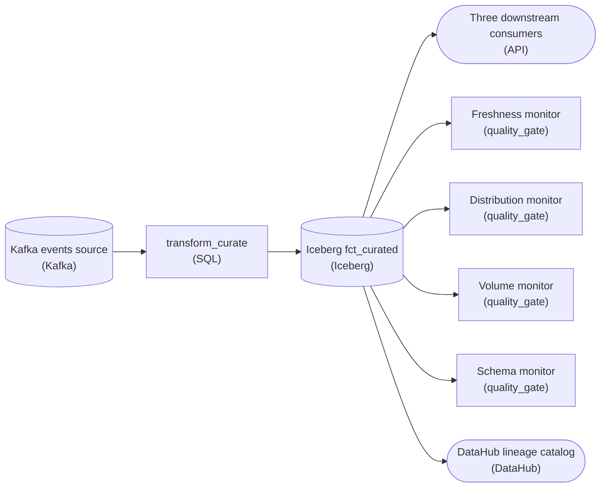
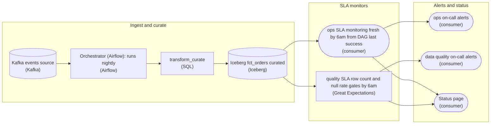
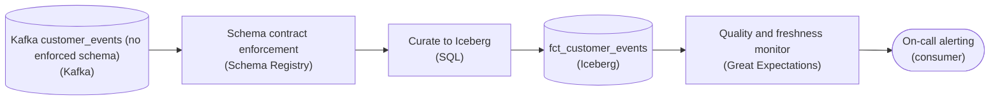
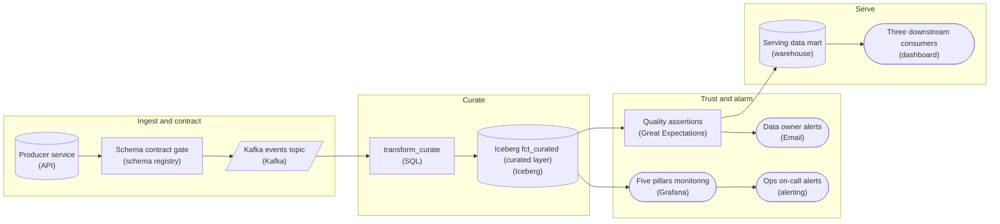
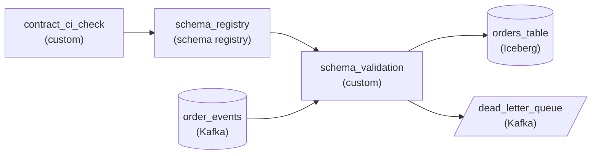
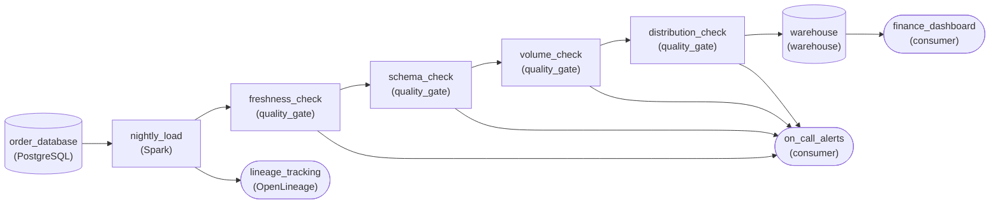
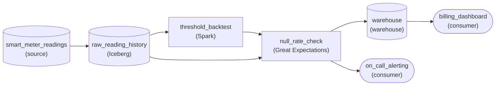
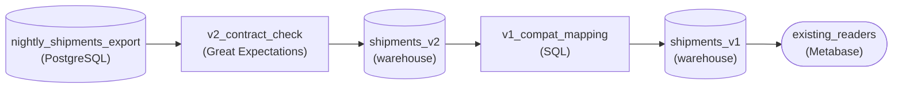
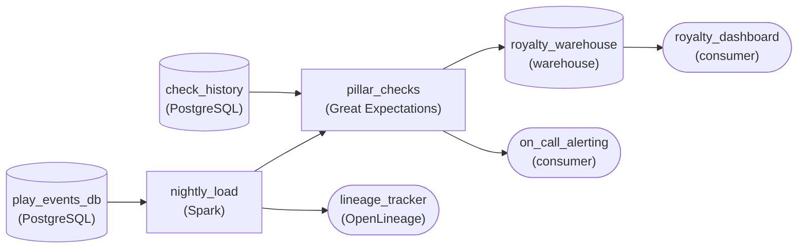

# Data Quality: Advanced - Exercises

Lesson: [pa_data_quality_advanced.md](../pa_data_quality_advanced.md)

### Exercise 1 of 11

**● TASK**

Turn the customer_events data contract into enforcement on the pipeline. Before the curate step, validate every event against the contract's schema, its evolution policy (additive changes pass, breaking ones are rejected) and its quality SLA, so violations never reach fct_customer_events. Have an orchestrator run that validation on every pipeline run, and feed the landed table into a monitoring dashboard that pages on-call when a breach slips through.

**Starting canvas** (already placed for you):

- Producer service (schema lives in tribal knowledge) (source, API)
- Kafka customer_events topic (queue, Kafka)
- transform_curate (transform, SQL)
- Iceberg fct_customer_events (storage, Iceberg)
- Three downstream consumers (consumer, API)

<details>
<summary><strong>Solution</strong></summary>

#### A contract the pipeline enforces on every run

A data contract becomes real only when the pipeline refuses to break it. Its **evolution policy** decides what happens when the producer changes the schema: an added nullable field is additive and passes, while a dropped or retyped column is breaking and is rejected. Put that check in one validation gate in front of `transform_curate`, together with the schema match and the quality SLA. The `customer_events` wiki page then becomes a rule the pipeline applies every time it runs.

```mermaid
flowchart LR
    n0[("Producer service<br/>(API)")]
    n1[/"Kafka `customer_events`<br/>(Kafka)"/]
    n2["Contract validation<br/>(custom)"]
    n3["`transform_curate`<br/>(SQL)"]
    n4[("Iceberg `fct_customer_events`<br/>(Iceberg)")]
    n5(["Three downstream consumers<br/>(API)"])
    n6["Orchestrator<br/>(Airflow)"]
    n7(["Monitoring dashboard<br/>(Grafana)"])
    n8(["On-call alerts<br/>(consumer)"])
    n0 --> n1
    n1 --> n2
    n2 --> n3
    n3 --> n4
    n4 --> n5
    n6 --> n2
    n4 --> n7
    n7 --> n8
```

*Contract validation sits between `customer_events` and `transform_curate`. The orchestrator runs it on every run, and a monitoring dashboard on the landed table pages on-call.*

1. **Validate before `transform_curate`, not after**

   Each event is checked three ways while it is still in flight. Does it match the declared schema? Is any drift an allowed evolution rather than a breaking one? Does the batch clear the quality SLA? Only events that pass all three reach curate, so `fct_customer_events` never holds a violation.

2. **Let the orchestrator own every run**

   Make validation a task in the Airflow DAG, upstream of curate. A failed check fails the run instead of letting bad data through. The guarantee then holds without anyone having to remember to look.

3. **Watch the landed table and page on-call**

   Validation stops what it can see at the door. A monitoring dashboard on `fct_customer_events` catches a breach that slips past it and hands that breach to on-call. Without it, the first sign of the breach is a consumer's wrong number.

| Key insight: Additive passes, breaking is rejected |
| --- |
| Schema evolution does not mean that no change is allowed. A new nullable column keeps every reader working, so the policy lets it through. A removed or retyped column breaks readers, so the policy blocks it. A rename is a removal plus an addition, so it counts as breaking unless both names ship side by side for a deprecation window. |

| Pitfall: Validating after curate is too late |
| --- |
| The tempting shortcut is to load everything into `fct_customer_events` and check the curated table afterward. By then the bad batch has already reached the consumers, so you detect corruption instead of preventing it. Enforce the contract upstream of curate, so a breach is stopped before it lands. |

</details>


<br>

### Exercise 2 of 11

**● TASK**

Instrument the curated Iceberg table for all five pillars of data observability. Attach one quality check monitor each for freshness, distribution, volume and schema, and add a DataHub catalog node that records which upstream column produced each output column, the lineage pillar most programs skip. Keep the curated table on a schema-evolvable format so the contract can change under CI without breaking its three consumers.

**Starting canvas** (already placed for you):

- Kafka events source (source, Kafka)
- transform_curate (transform, SQL)
- Iceberg fct_curated (storage, Iceberg)
- Three downstream consumers (consumer, API)

<details>
<summary><strong>Solution</strong></summary>

The five pillars of data observability (freshness, distribution, volume, schema and lineage) give you a diagnostic order to walk when a consumer reports a wrong number. They are not a checklist. Each pillar rules out one class of cause: the data is late, a column's shape has drifted, row counts spiked or vanished, the contract changed, or a bad value came in from some upstream source. The monitors you placed give every pillar a reading, so you walk that order with instruments instead of guesses.

#### Where each pillar lives



*Four quality checks instrument freshness, distribution, volume and schema on `fct_curated`; the DataHub catalog covers lineage.*

The four monitors attach to `fct_curated`, not to `transform_curate`, and that is deliberate. Freshness, distribution, volume and schema are properties of the data at rest, which is what the three consumers actually read. A monitor on the transform only tells you the job ran. A monitor on the table tells you what the job produced, and that is the number the consumer is complaining about.

| Pitfall: Lineage is the pillar most programs leave half-covered |
| --- |
| Four table monitors are cheap. Column-level lineage is not, which is why most programs cover the first four pillars well and lineage poorly. Yet lineage is the pillar that tells you where a problem started. Without a catalog that maps which upstream column fed each output column, the other four pillars tell you a value is wrong and then leave you grepping SQL for its source. The DataHub node turns a detected anomaly into a root cause instead of a hunt. |

| Key insight: The schema pillar is only as good as the format under it |
| --- |
| A schema monitor that fires on breaking changes is worthless if the table cannot evolve safely. Keeping `fct_curated` on Iceberg lets the contract add, rename or reorder columns under CI without rewriting data files or breaking the three consumers mid-read. On a format that cannot evolve, every contract change means a full rewrite, so teams route around the schema check instead of through it. |

**Follow-up questions**

1. Which pillar catches a producer that silently starts sending `amount` in cents instead of dollars, and why does the schema monitor miss it?\
   *The type is unchanged, so only the distribution pillar sees the shift.*
2. How would you scope the freshness monitor so it only fires when a consumer's actual read window is affected?\
   *Ties a raw staleness threshold to how the data product is actually read.*

</details>


<br>

### Exercise 3 of 11

**● TASK**

The status page shows one uptime number, so consumers cannot tell 'late but correct' from 'on time but wrong'. Split it into an operational SLA (fresh by 6am) and a quality SLA (correct row counts and null rates by 6am) by forking two monitors off the curated table, each named for its target and its input: the orchestrator's last success time, or the row count and null rate gates. Route each monitor to its own on-call alert, and feed both to the status page.

**Starting canvas** (already placed for you):

- Kafka events source (source, Kafka)
- Orchestrator (Airflow): runs nightly (transform, Airflow)
- transform_curate (transform, SQL)
- Iceberg fct_orders curated (storage, Iceberg)
- Status page (consumer)

<details>
<summary><strong>Solution</strong></summary>

#### One table, two promises

Splitting an operational SLA from a quality SLA means treating 'fresh by 6am' and 'correct row counts and null rates by 6am' as **two independent promises** about the same table, each with its own measurement and its own owner. The orchestrator measures the first: did the nightly run of `transform_curate` succeed before 6am? The data measures the second: a run that finishes at 5:30 can still publish a table that lost 30 percent of its rows. Either promise can fail while the other holds, so one signal cannot report both.

| Pitfall: A single uptime number is only the operational SLA |
| --- |
| The starter status page reports one number, and it is really just the operational SLA under another name. When it stays green, consumers read 'the data is good', but green only ever meant 'the run finished on time'. A 30 percent row count drop goes straight through, because nothing on that path ever looked at row counts or null rates. |



*Two monitors fork off the curated table, one for the operational SLA and one for the quality SLA. Each alerts its own on-call, and both feed the status page.*

1. **Name the operational monitor for its deadline and metric**

   Fork the first monitor off the curated table and name it for what it promises and what it reads: fresh by 6am, measured by the orchestrator's last success time for the nightly `transform_curate` run. It never looks inside the table. When it fires, the meaning is unambiguous: the data is late, and the people who restart runs and chase infrastructure own the fix.

2. **Name the quality monitor for its deadline and gates**

   Fork the second monitor off the same table and name it for the quality target and the gates behind it: a row count check against the expected range and a null rate check on the critical columns. It can be red while the operational monitor is green, which is exactly the 'on time but wrong' case the single number hid. Its owners chase dropped partitions and upstream drift, not late runs.

| Key insight: One shared alert merges the SLAs again |
| --- |
| If both monitors page the same channel, the split collapses at the last step: whoever answers still has to dig to learn whether the data is late or wrong. Giving each monitor its own on-call alert puts the broken promise and its owner in the alert itself. Feeding both states to the status page lets consumers read 'late but correct' and 'on time but wrong' directly. |

**Follow-up questions**

1. If `transform_curate` crashes and never writes the curated table, which monitor fires: the quality one, the operational one, or both?\
   *A missing table is an operational miss: the last success time never advances, and the quality gates have nothing to evaluate. The two monitors are ordered, not symmetric.*
2. How would you add a third promise, 'schema unchanged by 6am', without folding it back into the quality monitor?\
   *Checks that one monitor and one alert per promise generalizes beyond two SLAs.*

</details>


<br>

### Exercise 4 of 11

**● TASK**

The distributional check on fct_orders pages on-call 20 times a week, and only 3 pages are real. Add a batch transform that backtests the check's threshold against the 90 days of order history in the S3 lake and feeds the tuned threshold into the live check, which reads the Snowflake mart and pages PagerDuty. Name the transform with its backtest window, its target of 2 to 10 fires per 90 days, and the known-anomaly list it excludes.

**Starting canvas** (already placed for you):

- Order-history lake (90 days of fct_orders as Iceberg tables on S3) (storage, S3)
- Distributional check (z >= 3 threshold; currently fires 20x/week) (quality_gate, Great Expectations)
- Snowflake fct_orders (live mart) (storage, Snowflake)
- PagerDuty quality alerts (consumer, PagerDuty)

<details>
<summary><strong>Solution</strong></summary>

#### Tuning a check against its own history

A check that pages 20 times a week and is right 3 times isn't broken on its logic, it's mistuned on its threshold. What you built is **backtesting**: take a candidate threshold, replay it over the 90 days already in the lake, count how often it would have paged, and keep only the value whose count lands where a human can triage, here 2 to 10 fires per 90 days. `z >= 3` is a knob, not a law.

```mermaid
flowchart LR
    n0[("Order-history lake (90d `fct_orders`, Iceberg/S3)<br/>(S3)")]
    n1["`backtest_fct_orders_90d_target_2to10_fires_excl_known_anomalies`<br/>(Spark)"]
    n2["Live check (reads tuned threshold)<br/>(Great Expectations)"]
    n3[("Live `fct_orders` mart<br/>(Snowflake)")]
    n4(["PagerDuty on-call<br/>(PagerDuty)"])
    n0 --> n1
    n1 --> n2
    n3 --> n2
    n2 --> n4
```

*The backtest reads S3 history, skips known anomalies and emits a tuned threshold; the live check reads the Snowflake mart and pages only when that threshold fires.*

The transform reads the lake, not the mart. A 90-day backtest wants a stable copy of the past, and Iceberg gives exactly that: a snapshot you replay identically every run, partitioned by date so the job scans only the 90 days it needs. The live check keeps reading Snowflake `fct_orders`; the tuned threshold is the one artifact that crosses from history into the live plane.

| Pitfall: Silencing beats a bad threshold; both lose to a tuned one |
| --- |
| The tempting wrong moves: delete the check, so the 3 real pages a quarter vanish too, or eyeball a higher `z` until this week looks quiet. Eyeballing overfits to the last few days: a threshold that silences this week can fire 15 times next quarter or stay silent through a real incident. Backtesting over a fixed 90-day window turns a hunch into a number you can defend. |

| Key insight: The name is the contract; the anomaly list keeps it stable |
| --- |
| The name carries the window (`90d`), the target rate (`2to10_fires`) and the known-anomaly list (`excl_known_anomalies`), because those 3 are the tuning contract and belong in the DAG. The list matters most: an incident you already investigated is a real fire in history, so counting it drags the threshold up and re-pages something nobody needs to see again. Excluding it also keeps the result stable: the same 90 days yield the same threshold every time. |

**Follow-up questions**

1. Order volume triples next quarter and the tuned threshold drifts back to firing 15 times per 90 days. What keeps the check in range?\
   *Tests whether tuning is one-time or a scheduled re-backtest.*
2. Where do you store the known-anomaly list so a human logging a new incident and the nightly backtest read the same source?\
   *Tests whether the list is a durable shared artifact, not a baked-in constant.*

</details>


<br>

### Exercise 5 of 11

**● TASK**

A four-year-old Kafka topic of customer events feeds a leadership dashboard, a churn model, and a billing service, but it has no enforced schema, so producers add and rename fields unannounced. Put a contract on it: enforce the agreed schema where events are produced, and monitor the curated table for freshness, volume, distribution, and schema drift. Wire that monitor to an on-call alert that fires only on genuine violations.

**Starting canvas** (already placed for you):

- Kafka customer_events topic (4 years old; no formal schema) (source, Kafka)
- transform_curate (no contract enforcement today) (transform, SQL)
- Iceberg fct_customer_events (storage, Iceberg)
- Leadership dashboard (consumer, Looker)
- Churn model (consumer, Jupyter)
- Billing aggregator (consumer, API)

<details>
<summary><strong>Solution</strong></summary>

#### Treating the stream as a product

The fix here has a name: a **data contract**. Instead of letting `customer_events` be whatever producers happen to emit, you publish an agreed schema and enforce it where the events are produced. A breaking change is then rejected at the source rather than surfacing as a wrong number weeks later. A schema registry holds the registered schema and its compatibility rule, and refuses any message that violates them.



*The contract is enforced at the schema registry stage. The monitor watches the curated `fct_customer_events` table and is the only thing wired to the on-call alert.*

Enforcement belongs where events are born, not where they are read. If each consumer validates on its own, the dashboard, churn model and billing service drift apart into three half-contracts instead of one. Pushing the check to the producer edge means every reader inherits one guarantee, and a producer who renames a field learns about it at deploy time, before anyone on call does.

| Pitfall: An alert on everything is an alert on nothing |
| --- |
| A monitor that fires on every blip trains the team to swipe it away, so the one real drift lands in a muted channel. Send only genuine violations to the on-call alert: a breaking schema change, or a freshness breach. Let soft anomalies sit in a report that pages nobody. |

| Key insight: The monitor asks 4 questions of the table |
| --- |
| It checks 4 things. Freshness: did new rows land on time? Volume: is the count in its expected band? Distribution: did the mix of a key column such as `event_type` suddenly shift? Schema drift: did a column appear, vanish or change type? The schema is enforced at the source, but the curation SQL and the table's own schema evolution can still drift, so checking `fct_customer_events` is defense in depth. |

| Real world: Compatibility mode keeps the contract livable |
| --- |
| A contract that froze the schema forever would just get bypassed. Registries run a compatibility rule, usually `BACKWARD`, so producers can still add optional fields safely and only truly breaking changes get rejected. That lets every consumer team ship against one promise. |

**Follow-up questions**

1. A producer needs to rename `customer_id` to `account_id`. How do you ship that without breaking the churn model mid-flight?\
   *Think additive: write both fields for a while, migrate readers, then retire the old one, rather than a hard rename the registry would reject.*

</details>


<br>

### Exercise 6 of 11

**● TASK**

Design one representative data-contract pipeline that the other 7 legacy pipelines can copy. Enforce the producer's schema at the ingestion boundary so a breaking change never reaches the curated table, and on that curated layer watch all five observability pillars and run quality assertions before anyone downstream trusts it. Route operational-health alarms and data-quality alarms to two separate responders, and have downstream consumers read from the serving mart rather than the raw layer.

**Starting canvas** (already placed for you):

- Producer service (source, API)
- Kafka events topic (queue, Kafka)
- transform_curate (transform, SQL)
- Iceberg fct_curated (curated layer) (storage, Iceberg)
- Snowflake serving mart (storage, Snowflake)
- Three downstream consumers (consumer, Looker)

<details>
<summary><strong>Solution</strong></summary>

#### Writing the contract down

A data contract is a versioned agreement about the shape of what a producer emits, checked by a machine at the moment data crosses into the platform. These 8 pipelines ran on an unwritten one, so a renamed field broke dashboards with no owner. The fix is to enforce the agreement at the ingestion boundary, so a breaking change fails at the door instead of quietly corrupting `fct_curated`.



*The contract is enforced before Kafka; two alarms reach two responders; dashboards read the serving mart, never the raw layer.*

| Pitfall: Filtering is not enforcing |
| --- |
| The common first draft validates inside `transform_curate`, often as a `WHERE` that drops malformed rows. The bad data has already entered, the producer never learns it broke the agreement, and every dropped row is a number that stops reconciling. The registry check sits upstream of the topic and rejects. Keep `transform_curate` idempotent on the event id so a Kafka replay re-curates rather than double-counts. |

| ✕ Operational health | ✓ Data quality |
| --- | --- |
| The five pillars monitor watches freshness, volume, distribution, schema and lineage on `fct_curated` and pages ops on-call when the plumbing breaks: a late table, a cratered row count. A platform engineer fixes it. | Great Expectations asserts on curated columns and emails the data owner when data is fresh but wrong: a null spike, a fanned-out join. It also gates the serving mart, so consumers only see rows that passed. |

| Real world: Document first, enforce second |
| --- |
| With unknown consumers you cannot enforce on day one. Observe the current schema, volumes and readers, publish that reality as contract version 1 so it breaks nobody, then flip the registry to enforce. Copy the pattern to the other 7 only once this pipeline is stable. |

**Follow-up questions**

1. The producer adds an optional field. Does the `Schema contract gate` accept it under backward compatibility?\
   *Additive optional fields evolve safely; renames and type changes are breaking.*
2. A metric looks wrong but every `Quality assertions` check passed. Which plane failed?\
   *Separates a green check from a check nobody wrote.*

</details>


<br>

### Exercise 7 of 11

**● TASK**

An orders service publishes events to Kafka, and its team adds, drops or retypes fields most sprints. Build the data contract: each producer schema change passes a compatibility check in CI before it is registered in a schema registry, and incoming events are validated against the registered schema. Failing events go to a dead letter queue, and the lakehouse orders table must take on added columns without a rebuild.

<details>
<summary><strong>Solution</strong></summary>

#### Check the contract twice: at change time and at arrival

Schema evolution stays safe only when the contract is enforced in two places. The CI compatibility check is the change-time half: a pull request that removes or retypes a field consumers read fails the build, so the incompatible schema never reaches the registry. Ingest validation is the arrival half: every event from the topic is checked against the version the registry holds, so even a deploy that skipped CI cannot slip a bad shape into the table.

1. **Put the registry behind CI**

   Only the CI step writes to `schema_registry`. That turns the registry into a record of approved contracts rather than whatever was last deployed. Adding an optional field passes; dropping `order_total` or turning it from a number into a string fails before merge.

2. **Validate on the way in, and keep what fails**

   `schema_validation` reads the registered version and splits the stream: conforming events go to `orders_table`, nonconforming ones go to `dead_letter_queue` with the failure reason attached, so the producer team can fix and replay them.

3. **Let the table absorb additive change**

   Iceberg tracks columns by ID, so a new field becomes a new nullable column on the next write and older rows read it as empty. No rebuild, no rewrite of history.



*CI gates what `schema_registry` holds; `schema_validation` gates what `orders_table` holds; failures land in `dead_letter_queue`.*

| Pitfall: Dropping bad events is a silent failure |
| --- |
| Filtering out events that fail validation looks tidy, but it is exactly the silent data loss a contract exists to prevent: the table looks healthy while orders are missing. Route them to a dead letter queue so the loss is visible and recoverable. |

**Follow-up questions**

1. The producer wants to rename `order_total` to `gross_amount`. How does the contract let that ship without breaking finance?\
   *Treating a rename as an add, a dual-write window, then a separate checked removal.*
2. A consumer needs `order_total` changed from integer cents to a decimal amount. What path does that change take?\
   *Handling a breaking type change through a new field and a versioned migration instead of an in-place retype.*

</details>


<br>

### Exercise 8 of 11

**● TASK**

About 2 million orders a night load from the order database into a warehouse that feeds a finance dashboard, and last week revenue fell 30% while every job reported success. Redesign the nightly batch so freshness, volume, schema and distribution each get their own check before the dashboard reads the data. A failed check must page the on-call engineer, and lineage must be captured so a bad number traces back to its source table.

<details>
<summary><strong>Solution</strong></summary>

#### Each pillar answers a different question

The five pillars earn their keep as a diagnostic map: freshness asks whether the data arrived on time, volume whether the right amount arrived, schema whether it arrived in the right shape, distribution whether the values look plausible, and lineage where it came from. A 30% revenue drop with every job green is exactly the case the map is for. An instrumented pipeline tells you jobs ran; an observable one tells you which pillar broke, and that narrows the cause before anyone opens a query.



*4 pillar checks gate the warehouse load, any failure pages on-call, and the load reports lineage.*

1. **Give each pillar its own check**

   4 separate gates, not one. When `volume_check` fails while `distribution_check` would have passed, you already know rows went missing rather than values drifting, so you look at the extract instead of the pricing logic. One combined check that only says 'failed' throws that diagnosis away.

2. **Put the checks in the path and lineage beside it**

   The checks sit between `nightly_load` and the `warehouse`, so bad data stops before finance reads it, and every check has a path to `on_call_alerts`. Lineage cannot be checked row by row: the load reports it to `lineage_tracking`, so a wrong dashboard number traces back to its source table.

| Pitfall: A green job is not healthy data |
| --- |
| Job success says the code ran, not that the data is right. A load that reads half a partition, or a column whose unit quietly changed from dollars to cents, finishes cleanly. Only volume and distribution checks catch those, which is how last week's drop slipped through. |

| Key insight: Lineage can be unknown while everything else is green |
| --- |
| Volume can be wrong without distribution being wrong, and schema can shift without freshness slipping. Lineage is independent of all four: every check can pass and you still cannot say which table a dashboard number depends on. |

**Follow-up questions**

1. The order database now feeds 3 more marts. Do the checks move, and who do you warn when one fails?\
   *Whether checks belong with the source or with each reader, and how lineage names the affected readers.*
2. Distribution fires but volume and schema pass. Where do you look first?\
   *Walking the pillars as a diagnosis rather than a checklist.*

</details>


<br>

### Exercise 9 of 11

**● TASK**

About 40 million smart-meter readings load nightly into a warehouse behind a billing dashboard, and a fixed null-rate check pages on-call fifteen times a month, nearly all false. Keep 180 days of raw readings and backtest the proposed threshold against them, counting the pages it would have fired, before the check goes live. The tuned check must block a bad load from the warehouse and page on-call when it fires.

<details>
<summary><strong>Solution</strong></summary>

#### A threshold earns its place in history first

Threshold tuning treats a quality check as an alarm with a budget. A null-rate line picked by feel fired fifteen times a month over 40 million nightly readings, and on-call learned to swipe it away. Replaying the proposed threshold over the 180 days you already keep turns the guess into a count: how many pages it would have sent, and on which nights. Ship it only when that count fits what on-call reads carefully and the nights that would have paged are the nights the bills were wrong.



*Raw readings land in a 180-day history; the backtest sets the threshold `null_rate_check` enforces before loads reach `warehouse`.*

1. **Keep the history the replay reads**

   The backtest is only as good as the history beneath it. `raw_reading_history` holds 180 days so the replay sees a full season, including the winter weeks when meters drop offline and the null rate climbs honestly. 30 days would tune the threshold to one quiet month.

2. **Count the pages before they exist**

   `threshold_backtest` runs the proposed assertion over each past night and counts how often it would have failed. Too many and the line moves out; a known bad night it misses and the line moves in. Its output is the threshold `null_rate_check` enforces, which is why the edge runs from the backtest into the check.

3. **Keep the check on the live path**

   `null_rate_check` sits ahead of `warehouse`, so a bad night never lands where the billing dashboard reads, and its failures go to `on_call_alerting`. Tuning lowered the page count; it did not remove the protection.

| Pitfall: Muting a noisy check is not tuning it |
| --- |
| When a check cries wolf, the tempting fix is to silence it or widen the line until it goes quiet. Both remove the noise and the protection together. The backtest keeps the check and moves the line to where history says the real failures sit. |

**Follow-up questions**

1. A firmware rollout shifts the normal null rate for a third of the meters. What reruns, and when?\
   *Whether the backtest is a recurring job rather than a one-time tuning.*
2. Sunday loads are always sparser than weekdays. How would the replay account for that?\
   *Seasonality in thresholds tuned against history.*

</details>


<br>

### Exercise 10 of 11

**● TASK**

A six-year-old nightly shipments export lands in a warehouse table read by two scheduled reports and unknown analyst queries. The producer is switching the export to a v2 shape that retypes weight from text to a number and renames 3 columns. Check each load against the v2 contract before it lands in a v2 table, then map it back into a v1 table in the old shape so existing readers keep working through the deprecation window.

<details>
<summary><strong>Solution</strong></summary>

#### Let the producer evolve, keep the readers' shape fixed

Schema evolution on a legacy feed means the producer's shape can change while the readers' shape cannot. The two reports and the analyst queries nobody can list already encode a contract: the old column names and the text weight. When the export switches to the retyped, renamed shape, the pipeline absorbs the change. It checks the new shape against the v2 contract, lands it as v2, and derives the old shape from it as v1. That is the semver move: a major version shipped beside the old one instead of replacing it.

1. **Enforce the v2 contract at the door**

   The check sits between the export and `shipments_v2`. A load that drifts from v2, such as a missing column or weight arriving as text again, is held back. Readers keep yesterday's data instead of getting a half-loaded table or silently dropped rows.

2. **Land the new shape as v2**

   `shipments_v2` stores the numeric weight and the new column names exactly as the producer ships them, so readers who want the new shape can start querying it today.

3. **Derive v1 from v2**

   `v1_compat_mapping` casts weight back to text in the format readers parse today, such as '12 kg', and restores the 3 old names into `shipments_v1`. Take that shape from query logs and report definitions, not from the wiki.



*Each nightly load is checked against v2, lands in `shipments_v2`, and is mapped back into `shipments_v1` for existing readers.*

| Pitfall: Letting new names flow into the old table breaks readers you never met |
| --- |
| Sending the export's new names and numeric weight straight into the table readers already query is the one-shot migration. The reports get fixed because someone owns them. The analyst queries fail, or silently return nulls, and the next contract the team proposes is met with suspicion. |

| Key insight: v1 retires on evidence, not on a date alone |
| --- |
| The old version is a supported release, kept alive by its mapping until its query log goes quiet. The deprecation window is a promise to readers, not a deadline imposed on them. |

**Follow-up questions**

1. The producer wants to add a nullable `carrier_code` column next month. Does that need a v3?\
   *Separates an additive, backward-compatible change (a minor version) from a breaking one.*
2. What changes if one report can never migrate off v1?\
   *Keeping a compatibility version alive past the window, and what it costs to maintain.*

</details>


<br>

### Exercise 11 of 11

**● TASK**

A nightly batch loads about 30 million song plays from the playback database into a warehouse behind a royalty dashboard, and a rights holder just reported its royalty total fell 12 percent while every job ran on time. Design the pipeline so a wrong number like that is caught before the dashboard reads it: check each load's freshness, volume, schema and value distribution, and record lineage so a bad figure traces back to its source. Have the check read its paging threshold from a store of the last 90 days of check results, so it pages the on-call engineer only on real breaks.

<details>
<summary><strong>Solution</strong></summary>

#### From a complaint to a check people trust

This capstone runs 3 of the lesson's ideas as one loop. The five pillars turn a vague complaint into a located fault, the quality SLA explains how a pipeline that met its schedule still shipped a wrong total, and threshold tuning keeps the new check from becoming the next ignored page.

1. **Walk the pillars to locate the break**

   Freshness and schema were green: the job ran on time and nothing errored. Volume is where the 30 million nightly plays came in short, and distribution confirms it, with one app version's share falling to zero. Lineage names the source the missing rows came from. The check worth adding is the one that would have caught it: volume and distribution on every load.

2. **Hold the quality SLA, not just the schedule**

   The ops SLA, loaded by 4am, was met. The quality SLA, correct totals by 7am, is only held by a check between the load and the warehouse. A failing load stays out of `royalty_warehouse`, so the dashboard shows yesterday's total instead of a wrong one.

3. **Set the threshold from history**

   Weekday swings run about 8 percent, so a fixed 5 percent band pages most weeks. Replay candidate bands over the 90 nights in `check_history`, comparing each night to the same weekday, and count pages against known real breaks. Keep the band that flags the 12 percent drop and almost nothing else.



*`nightly_load` emits lineage to `lineage_tracker`, and `pillar_checks` reads its thresholds from `check_history`, blocks bad loads from `royalty_warehouse` and pages `on_call_alerting`.*

| Pitfall: An untuned check becomes the next ignored page |
| --- |
| After an incident the tempting fix is a tight threshold that surely would have caught it. Backtested, it usually fires several times a week, and within a month on-call acknowledges it unread. Tuning against `check_history` is what makes the new check trusted, not just present. |

**Follow-up questions**

1. How would you catch the next drop if it hit only one rights holder, too small to move total volume?\
   *Segmenting the distribution check so a local break is not averaged away.*
2. What changes if rights holders need totals within an hour of each play instead of nightly?\
   *Moving volume and distribution checks onto shorter windows and redefining what history means.*

</details>
