# Data Quality: Beginner - Exercises

Lesson: [pa_data_quality_beginner.md](../pa_data_quality_beginner.md)

### Exercise 1 of 11

**● TASK**

An orders pipeline reads Kafka events, transforms them, and loads a Snowflake mart finance reads; a partition silently dropped 6 hours of events yet every run exited green. Add a quality check at each layer boundary: one on the Kafka events before the transform consumes them, so a shortfall is caught where it enters, and one on the transform's output before it lands in the mart, so wrong numbers fail the load even when the run succeeds.

**Starting canvas** (already placed for you):

- Kafka order_events source (one partition silently dropped events for 6 hours Tuesday) (source, Kafka)
- transform_orders (ran green; read what was present) (transform, SQL)
- Snowflake daily_orders mart (revenue 12% low on Tuesday; nobody noticed until Friday) (storage, Snowflake)
- Revenue dashboard (consumer, Looker)

<details>
<summary><strong>Solution</strong></summary>

#### Green and wrong: an exit code is not a correctness signal

A run that exits green has proved **operational success**: the code executed and the writes committed. It has not proved semantic success, that the data actually describes the world. `transform_orders` read whatever rows were present, did honest arithmetic on them, and returned `0`. Nothing asserted completeness, so a six-hour hole in one Kafka partition sailed straight through to the mart. The 2 checks you placed give the pipeline the signal it was missing: a way to say 'the data is wrong' even when every job succeeded.

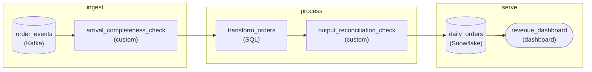

*One check where the events enter and one before the mart. Data moves on only after its check passes, so a short number never reaches finance.*

| Pitfall: A check placed too far downstream |
| --- |
| The tempting fix is a single sanity check on the mart, or an alert when `daily_orders` revenue drops. That is effectively what already happened: finance was the check, and it fired on Friday. A check pays off most at the **point where the defect enters**. The arrival check sees a partition that stopped advancing while its siblings moved. The mart, 3 stages later, sees only a smaller total with nothing to compare it against. |

1. **Check the events arriving from the source, before the transform runs**

   Between `order_events` and `transform_orders`, assert that this batch is complete. Every partition advanced, not just the topic total. The arriving `COUNT(*)` sits near a normal day's volume. The newest event timestamp is fresh. The dropped partition trips the per-partition rule even when the aggregate count looks plausible.

2. **Verify the transform's output before it lands in the mart**

   Between `transform_orders` and `daily_orders`, reconcile the result against what went in. The output order count matches the input order count, summed revenue falls within normal bounds, and no required column is `NULL`. On failure the run does not publish. It stops, and the mart keeps yesterday's good numbers instead of being overwritten with a wrong one that finance would trust.

| ✕ Exit code as truth (what broke) | ✓ Asserted expectations (what you built) |
| --- | --- |
| Trust `return 0`. The transform reads whatever survived the drop, computes a smaller revenue, and writes it. Every stage is green. The error surfaces days later as a business anomaly, after the bad number has already been quoted in reports. | Data passes on only after its expectations hold. A missing partition fails the arrival check, and a shrunken total fails the output check. The failure is loud, immediate, and located at the stage that introduced it, so the fix is a replay, not an investigation. |

| Real world: A correctness check is its own stage, not a comment |
| --- |
| Teams wire these checks as explicit stages: dbt tests and `dbt source freshness`, Great Expectations or Soda suites, Airflow sensors that block the downstream task. The shared idea is that a job must prove its input arrived whole and its output reconciles before it may publish. 'The DAG went green' is an operational fact. 'The data is complete' is a separate assertion you have to write. |

**Follow-up questions**

1. When the arrival check fails on the dropped partition, what should the pipeline do beyond stopping the load: hold the whole day, or set the partial batch aside for reprocessing?\
   *Separates detecting a bad batch from recovering it. Stopping on a gap is only safe when the source can be replayed.*
2. How would you set the expected volume so a genuinely slow sales day passes but a 12 percent shortfall fails?\
   *Compares fixed bounds with a band built from recent days, and weighs the cost of a check that cries wolf.*

</details>


<br>

### Exercise 2 of 11

**● TASK**

A green run loaded a malformed batch into the Snowflake revenue mart, and the dashboard showed wrong numbers for 2 days. Add the four cheap checks between the transform and the mart, one node each: row count against a 7-day baseline, null rate on required columns, primary-key uniqueness, and freshness of the newest record against run time. Wire at least one check into the mart so a failure stops bad data there, and name each node with its threshold or baseline window.

**Starting canvas** (already placed for you):

- Kafka order_events source (source, Kafka)
- transform_orders (no quality gates yet) (transform, SQL)
- Snowflake daily_orders mart (storage, Snowflake)
- Revenue dashboard (consumer, Looker)

<details>
<summary><strong>Solution</strong></summary>

#### Green is not correct: check the mart's own data

The four cheap checks are **data-quality assertions** on the transform's output: row count, null rate, uniqueness and freshness, each a few seconds of basic SQL. A green run only says the code did not throw. Last quarter's bad batch reached `daily_orders` because nothing after `transform_orders` asked whether the rows made sense, so each check now sits on the path into the mart.

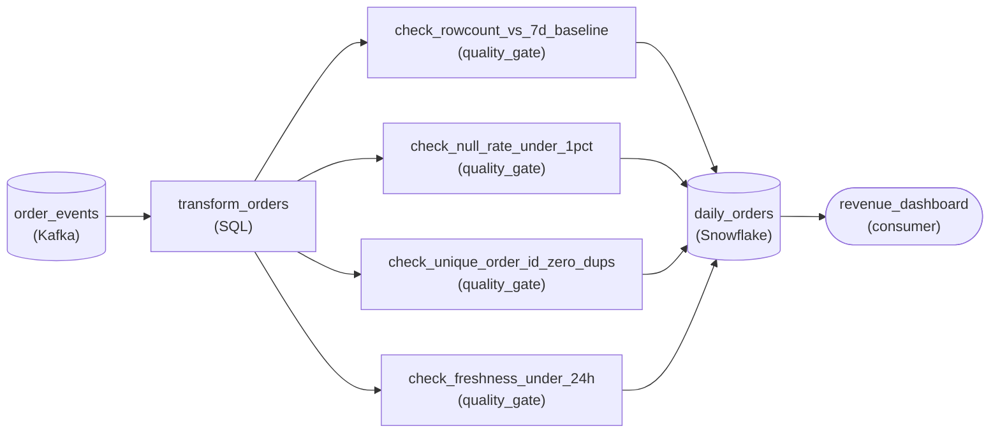

*The four checks sit between `transform_orders` and `daily_orders`, so the mart only loads a batch that passed each one and the dashboard reads only checked rows.*

Each check catches a different silent failure. `check_rowcount_vs_7d_baseline` fails when today's count lands outside a band (say 25 percent) around the trailing seven-day average: a half-loaded batch that is green but short. `check_null_rate_under_1pct` watches required columns, so an upstream change that nulls `amount` cannot quietly zero revenue. `check_unique_order_id_zero_dups` keeps the primary key unique, which also catches a batch published twice. `check_freshness_under_24h` compares `max(event_ts)` to run time, so a stalled feed shows up as stale rather than as a plausibly small day.

| Pitfall: One generic check node hides which failure fired |
| --- |
| The tempting shortcut is a single `validate_orders` node. It looks like quality coverage, but when it fails it only says something is wrong. Four nodes, each named with its threshold or baseline window, tell whoever reads the failure which assertion broke and what the limit was. |

| Real world: A finance partner can read a row-count failure |
| --- |
| These four are the checks a non-technical stakeholder understands. 'Row count was 40 percent below the seven-day average' turns into a corrective action without a phone call; a statistical drift score would not. |

**Follow-up questions**

1. If yesterday was a real holiday, `check_rowcount_vs_7d_baseline` fails on a correct low-volume batch. How would you keep the check useful without widening the band until it catches nothing?\
   *A static seven-day baseline versus a seasonal one.*
2. What breaks in `check_freshness_under_24h` when events arrive hours after their event time, and how would you tell a stale feed from expected late data?\
   *Event time versus processing time.*

</details>


<br>

### Exercise 3 of 11

**● TASK**

Quality checks placed only at the end let bad data run through every transform before anything trips, so on-call has to trace each failure back across layers. On this three-layer pipeline, add a quality gate at each layer boundary: source to raw, raw to curated, and curated to serving. Put each gate in front of the layer it guards so nothing lands unchecked, and name it for what it asserts at that boundary.

**Starting canvas** (already placed for you):

- Kafka order_events source (source, Kafka)
- Iceberg raw_orders (raw layer) (storage, Iceberg)
- transform_curate (raw -> curated) (transform, SQL)
- Iceberg curated_orders (curated layer) (storage, Iceberg)
- transform_serve (curated -> serving) (transform, SQL)
- daily_orders mart (serving layer) (storage, warehouse)
- Revenue dashboard (consumer, dashboard)

<details>
<summary><strong>Solution</strong></summary>

#### A gate at every boundary

Placing a quality check at each layer boundary is the medallion pattern's safety net: every hop between layers passes through a gate that asserts what must be true at that point. A gate that fails stops bad rows before the next layer reads them, so a failure's blast radius is one layer, not the whole pipeline.

```mermaid
flowchart LR
    n0[("order_events<br/>(Kafka)")]
    n1["check_required_fields<br/>(quality_gate)"]
    n2[("raw_orders<br/>(Iceberg)")]
    n3["transform_curate<br/>(SQL)"]
    n4["check_keys_and_codes<br/>(quality_gate)"]
    n5[("curated_orders<br/>(Iceberg)")]
    n6["transform_serve<br/>(SQL)"]
    n7["check_totals_reconcile<br/>(quality_gate)"]
    n8[("daily_orders<br/>(warehouse)")]
    n9(["Revenue dashboard<br/>(dashboard)"])
    n0 --> n1
    n1 --> n2
    n2 --> n3
    n3 --> n4
    n4 --> n5
    n5 --> n6
    n6 --> n7
    n7 --> n8
    n8 --> n9
```

*Three gates, one in front of each layer, keep each failure scoped to the layer that produced it.*

| Pitfall: A late failure hides its origin |
| --- |
| With one check only at the serving mart, a null `order_id` from the source still flows through `transform_curate` and `transform_serve` before anything trips. You see the symptom in `daily_orders` and have to trace it back across both transforms. A gate right after the source catches it where it entered. |

Name each gate for what it asserts at that boundary. `check_required_fields` sits in front of `raw_orders`: required fields present and `order_id` non-null. `check_keys_and_codes` sits in front of `curated_orders`: `order_id` unique and currency codes valid. `check_totals_reconcile` sits in front of `daily_orders`: daily totals tie out and no revenue is negative.

| Real world: Gates pay for themselves in triage time |
| --- |
| The real win is diagnostic cost. When the raw-to-curated gate trips, on-call knows the defect lives in `transform_curate` or its input, not somewhere across three layers. The check's name in the alert becomes the first line of the runbook. |

**Follow-up questions**

1. Where would a fourth gate go if `curated_orders` fanned out to 2 serving marts?\
   *Tests whether the rule is one gate per hop, not a fixed count of three.*

</details>


<br>

### Exercise 4 of 11

**● TASK**

Five quality checks sit between the transform and the daily_orders mart, each named on the canvas. Add block or warn to every check's name: block when publishing the bad data is worse than not running, warn when running is better but still imperfect. A duplicate key, the null rate, a row count under half of baseline and the schema mismatch would corrupt joins or mislead the dashboard; a row count at 80 to 90 percent of baseline is plausible variation.

**Starting canvas** (already placed for you):

- Kafka order_events source (source, Kafka)
- transform_orders (transform, SQL)
- Check 1: PK uniqueness (no authority set) (quality_gate, Great Expectations)
- Check 2: required-col null > 5% (no authority set) (quality_gate, Great Expectations)
- Check 3: row count < 50% baseline (no authority set) (quality_gate, Great Expectations)
- Check 4: row count 80-90% baseline (no authority set) (quality_gate, Great Expectations)
- Check 5: schema mismatch on consumer-parsed column (no authority set) (quality_gate, Great Expectations)
- Snowflake daily_orders mart (storage, Snowflake)
- Revenue dashboard (consumer, Looker)

<details>
<summary><strong>Solution</strong></summary>

#### Giving each check an authority

Every quality check carries an **authority**: a blocking check halts the run when it fails, a warning check logs the failure and still lets the data reach `daily_orders`. The rule the section gave you is a cost comparison, not a severity ranking. Block when a bad load is worse than no load at all; warn when a slightly-off dashboard today beats a stale one.

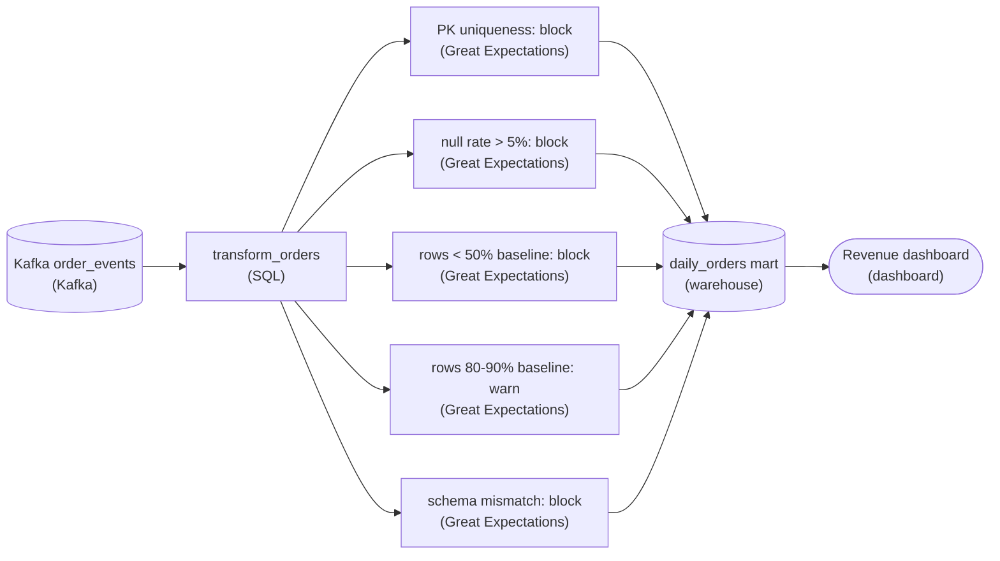

*Every check guards the `daily_orders` mart; 4 halt the run on failure, only the 80-90% row count warns and lets data through.*

| Key insight: The 4 blockers all corrupt or mislead |
| --- |
| A duplicate primary key breaks the joins the mart is built on. A null rate above 5% in a required column silently drops rows from every aggregate. A row count under half of baseline means a load so incomplete the revenue number is simply wrong. A schema mismatch on a column the dashboard parses either errors the tile or renders garbage. In all four, publishing is worse than showing yesterday's data, so they block. |

| Pitfall: A plausible wobble is not a failure |
| --- |
| The tempting mistake is to block the **80-90% of baseline** row count too, on the logic that fewer rows is always suspect. But a slow ingest day, a holiday, or normal seasonality lands right in that band. Halting the mart for a tolerable variation makes the dashboard stale for no real defect, and a gate that cries wolf trains the team to ignore every alert, including the 4 that matter. |

**Follow-up questions**

1. The 80-90% warning fires every day for a week straight. What should change?\
   *Whether a persistent warning is read as a signal to re-baseline or promote the check to blocking, not as noise to mute.*

</details>


<br>

### Exercise 5 of 11

**● TASK**

Turn the starter pipeline into a DAG with a first quality gate on mart.daily_orders, which is built once a day at 2am. Add an orchestrator that runs the transform, then a SQL assertion check, named for its rule, that passes only when today's row count is 50 to 200 percent of the same-weekday average over the trailing 8 weeks. A pass lets the revenue dashboard read the table; a fail halts the DAG and pages on-call.

**Starting canvas** (already placed for you):

- Kafka order_events source (source, Kafka)
- transform_daily_orders (runs at 2am; currently no orchestrator, no gate) (transform, SQL)
- mart.daily_orders (storage, warehouse)
- Revenue dashboard (consumer)

<details>
<summary><strong>Solution</strong></summary>

A quality gate is a blocking step between a table and everything that reads it. The orchestrator runs your row-count assertion right after `transform_daily_orders` writes `mart.daily_orders`. A pass lets the dashboard read, and a fail halts the DAG and pages on-call. 2 ideas snap together here: orchestration, so the steps run in order at 2am, and a data-quality assertion, so one of those steps is a pass/fail check on the data itself.

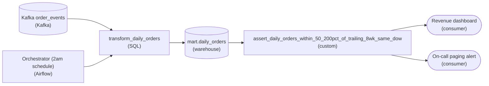

*The gate sits between `mart.daily_orders` and its readers: a pass advances to the dashboard, a fail halts the DAG and branches to on-call paging.*

1. **Wrap the transform in an orchestrator**

   The starter fired `transform_daily_orders` 'at 2am' with no orchestrator. That is a bare cron, and cron cannot express 'run the next step only if this one passed'. Under an orchestrator the run becomes a DAG where every downstream edge depends on the upstream step's exit status, which is exactly what a gate needs.

2. **Put the assertion in the check's name**

   Name the check `assert_daily_orders_within_50_200pct_of_trailing_8wk_same_dow` so it states the band and the baseline window without anyone opening the SQL. Whoever is paged at 3am then knows which guardrail tripped: today's count against the same-weekday average over the trailing 56 days.

**The assertion query**

```sql
WITH daily_counts AS (
  SELECT order_date, COUNT(*) AS row_count
  FROM mart.daily_orders
  WHERE order_date >= CURRENT_DATE - INTERVAL '56 days'
  GROUP BY order_date
),
baseline AS (
  SELECT AVG(row_count) AS expected
  FROM daily_counts
  WHERE order_date < CURRENT_DATE
    AND EXTRACT(DOW FROM order_date) = EXTRACT(DOW FROM CURRENT_DATE)
),
today AS (
  SELECT COALESCE(MAX(row_count), 0) AS actual
  FROM daily_counts
  WHERE order_date = CURRENT_DATE
)
SELECT today.actual, baseline.expected
FROM today
CROSS JOIN baseline
WHERE today.actual < 0.5 * baseline.expected
   OR today.actual > 2.0 * baseline.expected;
```

*Returns a row only when today's count breaches the band; an empty result means pass, and any row fails the task.*

| Pitfall: A check that only logs is not a gate |
| --- |
| The common miss is a check that computes the number, writes it to a metrics table, and reports success anyway. That is monitoring, not a gate: the bad load still sits in `mart.daily_orders` and the dashboard renders it. A gate returns a failure the orchestrator acts on, so the DAG halts before the dashboard edge fires. |

| Real world: Compare Tuesdays to Tuesdays |
| --- |
| A flat 'within 200% of yesterday' threshold pages you every Monday, because Monday's volume never resembles Sunday's. Filtering the baseline to the same weekday over 8 weeks with `EXTRACT(DOW ...)` is what makes it trustworthy, so ordinary weekly seasonality never reads as an anomaly. |

**Follow-up questions**

1. If `mart.daily_orders` is empty because the upstream Kafka feed was down, should the gate fail or never run?\
   *A data-quality breach and an upstream-dependency failure need different fixes and different pages.*
2. How would you let the gate warn instead of halt on a soft breach, say 40 to 50 percent of baseline?\
   *Adding severities and a branch that pages without stopping the DAG.*

</details>


<br>

### Exercise 6 of 11

**● TASK**

A daily orders pipeline at a Series B startup treats a green orchestrator run as proof the data is good, and it runs no quality checks anywhere between the Kafka source and the Snowflake mart that the revenue dashboard reads. Add the first quality suite at that layer boundary as four separate cheap checks (row count, null rate, uniqueness, freshness), tagging each check's name as either block or warn, following the rule that a check blocks when running on bad data is worse than not running at all. Keep the dashboard reading from the existing Snowflake mart.

**Starting canvas** (already placed for you):

- Kafka order_events source (source, Kafka)
- transform_daily_orders (no checks) (transform, SQL)
- Snowflake daily_orders mart (storage, Snowflake)
- Revenue dashboard (consumer, Looker)

<details>
<summary><strong>Solution</strong></summary>

#### A quality gate at the layer boundary

A **data quality gate** is a small suite of assertions that runs where data crosses from one layer to the next, so bad data stops at the boundary instead of surfacing on a dashboard. A green orchestrator run only proves the code executed without throwing. It says nothing about whether `order_events` actually delivered today's orders, whether `order_id` is unique, or whether the numbers are current. The gate is what turns 'the job ran' into 'the data is trustworthy', and the first one belongs on the `transform_daily_orders` to `daily_orders` boundary the dashboard reads from.

| Pitfall: A green run is not a passing check |
| --- |
| The most common mistake here is treating the orchestrator's status as a quality signal. If `transform_daily_orders` runs `INSERT ... SELECT` over an empty Kafka window, it succeeds cleanly and loads zero rows. The run is green, the mart is empty, and the revenue dashboard confidently shows $0. Orchestration checks that work happened; a quality gate checks that the work was correct. They are different jobs and you need both. |

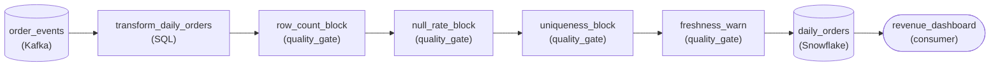

*Four checks sit on the transform-to-mart boundary. A block check fails the run, so the mart keeps yesterday's numbers. The warn check lets the load through and raises a notification.*

The four cheap checks cover the usual ways this table goes wrong. Row count asks whether any orders loaded. Null rate asks whether `order_id` and `amount` are populated. Uniqueness asks whether `order_id` is a real key. Freshness asks whether the newest row is from today. Each one is a single aggregate over `daily_orders`, so the whole suite is a handful of `COUNT(*)` and `MAX(...)` scans. Writing the checks is the easy part. The judgment is deciding what each one does when it fails.

| ✕ Block | ✓ Warn |
| --- | --- |
| Row count, null rate on `order_id` and `amount`, and uniqueness on `order_id` all block. When these fail, the data is confidently wrong. Zero rows reads as a dead business, nulls drop out of `SUM(amount)`, and duplicate keys double-count revenue. Publishing that is worse than publishing nothing, so the check fails the run and the mart keeps yesterday's good numbers. | Freshness warns. Late-arriving Kafka data makes the table a few hours stale, but the rows already there are still correct. Blocking would blank the dashboard over data that is old but right. So the load goes through and the team gets a notification instead. |

| Trick: Block when bad data misleads, warn when it is only late |
| --- |
| Block when acting on the bad data is worse than not acting at all. Warn when the data is degraded but still more useful than an empty result. Correctness failures (wrong totals, missing keys, empty loads) block because they mislead. Timeliness failures warn because a stale but accurate number still informs a decision. Tag each check by that test, not by how alarming it sounds. |

| Real world: Severity is what decides publish or hold |
| --- |
| Tools like dbt tests, Great Expectations and Soda work this way. Every assertion carries a severity, and the orchestrator reads that severity at the boundary to decide whether to publish or hold. Teams that tag everything as block get paged for data that is an hour stale and start disabling checks. Teams that tag everything as warn ship broken revenue numbers. |

**Follow-up questions**

1. The freshness warn fires 3 days straight. When should a repeated warn escalate to a block?\
   *Severity is a policy, not a fixed label: sustained staleness eventually crosses into wrong.*
2. How would you keep a blocked run from leaving a half-loaded `daily_orders`?\
   *Points toward staging-then-swap or transactional loads, so a blocked check leaves the last good table in place.*
3. Where would you add the second gate once this one is trusted?\
   *Extends the boundary idea: a check between Kafka and the transform catches bad input before the mart is built.*

</details>


<br>

### Exercise 7 of 11

**● TASK**

A nightly batch job copies yesterday's ride trips, about 400,000 rows a day, from the trips database into a warehouse table that an operations dashboard reads. Add the four cheap quality checks against that loaded table: row count against the seven-day average, null rate on trip ID and fare, freshness of the newest trip, and fares within a sane range. Any failed check must alert the on-call analyst.

<details>
<summary><strong>Solution</strong></summary>

#### Check the rows the job wrote

The four cheap quality checks all ask questions about the loaded table, never about the job that loaded it. Row count compares tonight's trips with the seven-day average, so a load that lands half of a normal 400,000 trips stands out. Null rate catches trips missing an ID or a fare. Freshness asks whether the newest trip is from yesterday. A range check flags fares that are negative or absurdly large. Each is one short SQL query that runs in seconds.

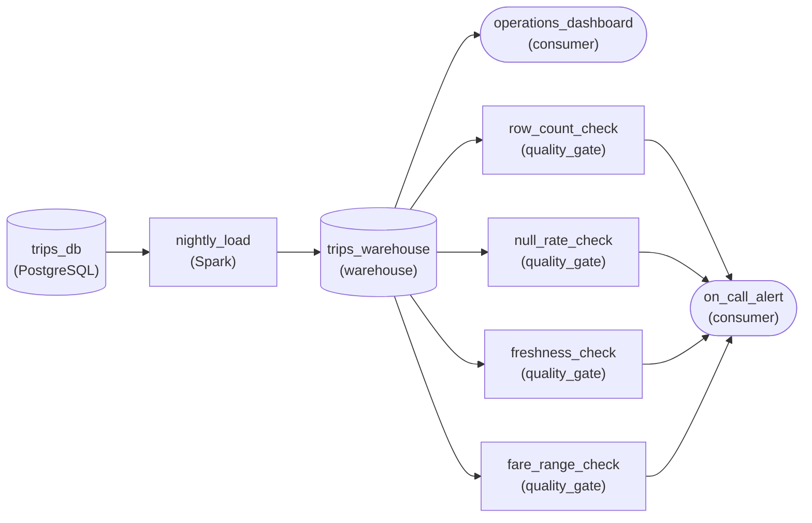

*The nightly load writes the warehouse table; four checks read it and send any failure to the on-call alert.*

| Pitfall: A green job is not a checked table |
| --- |
| The most common miss is treating the load job's success as the check. Spark can finish cleanly after reading an empty extract or a fare column full of nulls. Wire the checks to the warehouse table so they see exactly the rows the dashboard will see. |

| Key insight: Each failure names its own fix |
| --- |
| 'Row count outside its band' sends the analyst to the source extract; 'fares out of range' sends them to the upstream pricing feed. Four plain checks produce four plain messages, which is why the alert turns into a corrective action without a phone call. |

**Follow-up questions**

1. Weekend trip counts drop by a third. Does a seven-day average still give a fair baseline?\
   *Tests how a rolling baseline absorbs a weekly pattern in the row count check.*
2. A new `tip_amount` column starts arriving. Which of the four checks would you extend to cover it?\
   *Tests mapping a new column onto the null rate and range checks.*

</details>


<br>

### Exercise 8 of 11

**● TASK**

A nightly batch pipeline lands fitness-tracker sync files in a raw layer, a Spark job cleans them into a cleaned layer, and a dbt model builds the daily activity table a dashboard reads. Its only quality check sits between that table and the dashboard, so a bad file surfaces after every transform has run on it. Keep that check and add one at each earlier layer boundary, so a failure is caught in the layer where it starts.

<details>
<summary><strong>Solution</strong></summary>

#### A gate at every boundary, not only the last one

Boundary gating gives every hand-off between layers its own quality check, so a bad batch is caught in the layer that produced it. With one gate in front of the dashboard, a truncated sync file passes through the Spark cleaning job and the dbt model before anything notices, and whoever is on call has to work backwards through both transforms to learn whether the file, the cleaning logic or the model broke. Gates at the raw-to-cleaned and cleaned-to-serving boundaries turn that hunt into a lookup: the gate that fired names the layer.

```mermaid
flowchart LR
    n0[("device_sync_files<br/>(source)")]
    n1[("raw_landing<br/>(object storage)")]
    n2["raw_check<br/>(Great Expectations)"]
    n3["clean_job<br/>(Spark)"]
    n4[("cleaned_store<br/>(Delta Lake)")]
    n5["cleaned_check<br/>(dbt tests)"]
    n6["daily_activity_model<br/>(dbt)"]
    n7[("daily_activity_table<br/>(warehouse)")]
    n8["dashboard_check<br/>(dbt tests)"]
    n9(["activity_dashboard<br/>(dashboard)"])
    n0 --> n1
    n1 --> n2
    n2 --> n3
    n3 --> n4
    n4 --> n5
    n5 --> n6
    n6 --> n7
    n7 --> n8
    n8 --> n9
```

*3 gates, one per boundary: `raw_check` before the Spark job, `cleaned_check` before the dbt model, `dashboard_check` before the dashboard.*

1. **Gate the raw files before cleaning**

   The first check goes between the raw landing store and the Spark job. It asserts what the source promised: a device ID and timestamp on every record, a row count in the expected range. A failure here means the file was bad on arrival, and no transform has touched it yet.

2. **Gate the cleaned layer before the model**

   The second check sits between the cleaned store and the dbt model. It catches what the cleaning job itself broke, like a release that silently drops rows with a null heart rate. Without it, that bug surfaces as a dip on the dashboard and looks exactly like a source problem.

3. **Keep the serving gate**

   The original check in front of the dashboard stays. It now only has to guard what the daily model added, such as totals out of range or a missing day, because everything upstream was already checked at its own boundary.

| Pitfall: A gate on a side branch guards nothing |
| --- |
| A quality check that hangs off the raw store but is not on the path into the Spark job looks like coverage on the canvas, yet the data flows around it. Each gate belongs inline: the store it reads feeds the gate, and the gate feeds the transform that consumes that store. |

**Follow-up questions**

1. A weekly personal-bests email starts reading the cleaned layer directly. Which gate already protects it, and does it need a new one?\
   *Whether a boundary gate protects every reader downstream of it, not just the next transform.*
2. Using the 4 cheap checks from earlier in the lesson, which would you assert at each of the 3 boundaries?\
   *Matching each check to the layer where that kind of failure originates.*

</details>


<br>

### Exercise 9 of 11

**● TASK**

A nightly job loads about 200,000 hotel bookings from the bookings database into a published table that the revenue dashboard reads. Give it two quality checks with different authorities: a duplicate booking ID check that blocks, so a failure stops the table from being published, and a row count check that only warns when the load lands at 80 to 90 percent of the recent baseline, emailing the data team while the load still publishes.

<details>
<summary><strong>Solution</strong></summary>

#### Where a check sits is its authority

Warn vs block is decided **per check**, and on a canvas it shows up as placement. A blocking check sits on the data path: the published table only receives rows that passed it, so duplicate booking IDs stop the load before revenue joins double-count. A warning check branches off the path to a notification, so a load at 85 percent of baseline still publishes and the data team reads about it in the morning.

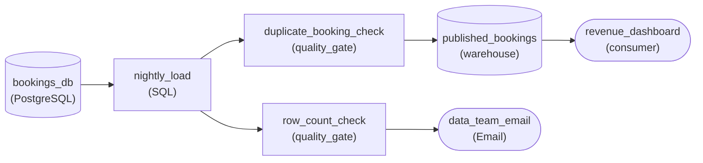

*The duplicate check guards the path into the published table; the row count check branches off to email.*

| Pitfall: One gate for both checks gets one authority wrong |
| --- |
| Chaining the row count check inline after the duplicate check means a quiet Sunday halts the dashboard. Wiring both checks only to email means duplicates publish anyway, and an alarm that never stops anything soon gets ignored. |

| Key insight: Ask whether running is worse than not running |
| --- |
| Duplicates: yesterday's table beats a double-counted one, so block. A load at 85 percent: today's mostly complete table beats yesterday's, so warn. The same question puts a schema mismatch on a column the dashboard parses on the blocking side. |

| Real world: Ship the check with its long-term authority |
| --- |
| A check launched as a temporary warning tends to stay a warning forever, because nothing forces the promotion conversation. Decide block or warn when you write the check. |

**Follow-up questions**

1. Finance adds a rule that booking amount may be at most 5 percent null. Where does that check go?\
   *Applying the decision rule to a required column the dashboard sums.*
2. What should change if the row count falls below half of the recent baseline?\
   *The same metric can need a blocking threshold and a warning threshold.*

</details>


<br>

### Exercise 10 of 11

**● TASK**

An orchestrator runs a nightly batch job that summarizes the point-of-sale database into a store-level daily sales table, one row per open store (about 1,200 rows), which the regional sales dashboard reads each morning. Add a row-count quality gate that the orchestrator runs after the transform and that halts the run before the table is published when the count falls outside 1,150 to 1,250.

<details>
<summary><strong>Solution</strong></summary>

#### A gate the orchestrator runs before anyone reads

A **row-count gate** is the smallest quality gate that pays for itself: one SQL assertion, a `COUNT(*)` on the fresh summary compared against a band. Here the band falls out of the grain. The table holds one row per open store, so about 1,200 rows is the expectation and 1,150 to 1,250 is the tolerance. What makes it a gate rather than a report is where it sits: the orchestrator runs it as its own task after the transform, and publishing happens only downstream of a pass.

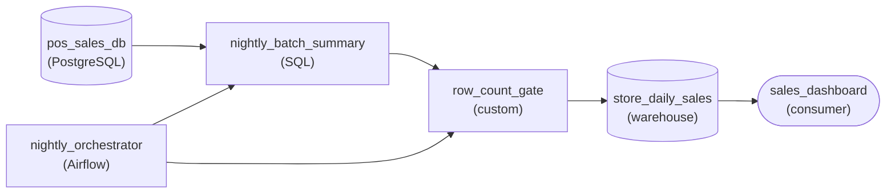

*The gate sits on the data path between `nightly_batch_summary` and `store_daily_sales`; the orchestrator triggers both tasks in order.*

1. **Run the assertion as its own task**

   The check is a separate task the orchestrator starts once the summary task succeeds. Keeping it separate means a failure points straight at the data, not at the SQL that built it, and the same wiring takes the next gate with different SQL.

2. **Make publishing depend on a pass**

   `store_daily_sales` is fed only by `row_count_gate`. When the count lands at 900 or 2,400, the task fails, the orchestrator stops the run, and the dashboard keeps yesterday's good table.

| Pitfall: A check beside the table is only a report |
| --- |
| Hanging the count check off `store_daily_sales` as a side branch looks similar on a canvas, but the dashboard already reads the bad rows before the check finishes. A blocking gate has to sit between the transform and the published table. |

| Real world: The second gate costs a fraction of the first |
| --- |
| Once this gate runs nightly, a null check or a freshness check is the same task with different SQL: the orchestration wiring and the halt behavior already exist. |

**Follow-up questions**

1. The chain opens 80 stores next quarter. How should the band change so a correct run is not halted?\
   *Whether the band follows the grain (open stores) instead of staying a fixed number.*
2. Which other cheap check would you add to this same task next, and would it block or warn?\
   *Reusing the gate pattern and choosing the right authority for the new check.*

</details>


<br>

### Exercise 11 of 11

**● TASK**

Last Tuesday the billing dashboard showed zero usage for one region: that region's meter file had landed with every reading null, and nothing stopped it on the way. Each night about 2 million smart-meter readings are pulled from the meter API into a raw landing area, cleaned, and built into a daily usage table in the warehouse that the dashboard reads. Put a quality gate at each layer boundary so a failure stops in the layer where it started. Null or missing readings must block the run; a regional usage total outside its usual range only warns the on-call engineer by email.

<details>
<summary><strong>Solution</strong></summary>

#### Catch it in the layer where it started

Boundary gates with the right authority turn a vague 'the dashboard looks wrong' into a precise 'the meter API sent nothing for one region'. The null file was already bad the moment it landed, so the check that catches it belongs right after the raw landing area, where it fails before cleaning and the table build ever run on empty input. A single check at the end would have seen only a zero total, 2 layers away from the cause, after every stage in between had done its work on bad data.

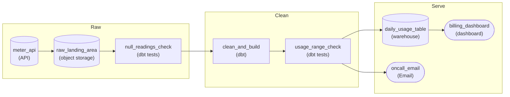

*The raw boundary blocks on null readings; the build boundary warns by email on an odd regional total and still publishes.*

1. **Trace the failure back to its layer**

   Ask where the data first went wrong. Every reading was null the moment it landed, so the raw boundary owns this failure, and `null_readings_check` sits there in the data path. The regional total is different: it only exists after the build, so `usage_range_check` sits at the next boundary, just before `daily_usage_table`.

2. **Decide what each check is allowed to do**

   A null file is a block: publishing it means bills computed from nothing, while stopping costs only a late morning. An unusual regional total is a warn: heat waves and holidays move usage for real, so halting on every swing would stop billing over normal weather. The warn check lets data through to the table and sends a message to `oncall_email`.

| Key insight: Block when running is worse than stopping |
| --- |
| For each check, ask which outcome is worse: running on this data, or not running at all. A missing region makes running worse, so it blocks. An odd but plausible total makes stopping worse, so it warns and lets a person decide. |

| Pitfall: A warning with nowhere to go is silence |
| --- |
| A range check marked as a warning but wired to nothing changes nothing: the data publishes and nobody hears about it. The warn gate earns its place only through the edge to a destination someone actually reads, here the on-call engineer's email. |

**Follow-up questions**

1. Finance also wants to know if the meter API has not delivered by 3am. Where does that freshness check go, and should it block or warn?\
   *Placing one of the 4 cheap checks at the raw boundary and choosing its authority.*
2. What if a region's file lands with half its usual row count instead of zero rows?\
   *Splitting a row-count range into a hard block threshold and a softer warn band.*

</details>
