# Data Quality: Intermediate - Exercises

Lesson: [pa_data_quality_intermediate.md](../pa_data_quality_intermediate.md)

### Exercise 1 of 11

**● TASK**

A producer renamed customer_id to user_id, dropped a required column and started sending strings for numbers; the pipeline absorbed all three silently. Add a schema validation check between the Kafka source and the curated table that stops the pipeline on drift. Name it for what it asserts: column existence, types, nullability and ranges. Use a tool the team can adopt incrementally, such as Great Expectations or dbt tests.

**Starting canvas** (already placed for you):

- Kafka events source (producer renamed customer_id, dropped a required col, sent strings) (source, Kafka)
- transform_curate (silently absorbed all three drift events) (transform, SQL)
- Iceberg fct_orders curated table (storage, Iceberg)
- Orders dashboard (consumer, Metabase)

<details>
<summary><strong>Solution</strong></summary>

#### Schema validation is a contract at the boundary

The pattern you just placed is **schema validation**: a gate that, before any row is allowed into the curated table, asserts four things about every event. The declared column exists, its type matches, its nullability is respected, and its values fall in the declared range. It turns the producer's schema from an assumption your transform quietly trusts into a contract your pipeline checks. The whole reason the three drifts here went unnoticed is that `transform_curate` had no such contract, so it happily read whatever shape arrived.

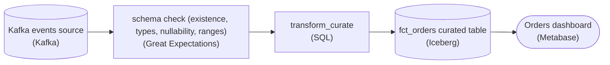

*The check sits inline between the source and `transform_curate`: every event passes through it, and a failed assertion stops the run before drift reaches `fct_orders`.*

| Pitfall: Silent absorption is the failure mode, not a hard crash |
| --- |
| Each of the three drifts is individually survivable, which is exactly why nobody noticed. The rename from `customer_id` to `user_id` made downstream joins match nothing (or match `NULL` to `NULL`), so order counts quietly fell. The dropped required column became `NULL`-filled, so aggregates that filtered on it silently lost rows. And a number arriving as the string '42' either coerced, truncated, or sorted as text, corrupting sums. None of these throw. A pipeline without a boundary contract treats 'wrong shape' as 'new normal'. |

1. **Assert the column exists, and you catch the rename**

   An existence assertion on `customer_id` fails the instant the producer renames it to `user_id`, because the expected name is simply gone. This is the check that would have fired on day one of the incident. Renames are the most common breaking change and the cheapest to catch, since you only need the declared column list, not the data.

2. **Assert the type, and you catch strings-for-numbers**

   A type assertion rejects the row where a numeric field arrives as '42'. Without it, the coercion happens deep inside `transform_curate` where it looks like a math bug, not a contract breach. Checking type at the boundary localizes the blame to the producer, where it belongs.

3. **Assert nullability and range, and you catch the dropped column and the garbage values**

   A not-null assertion on the required column fails when the producer drops it and every row surfaces as `NULL`. A range assertion (say, order amounts must be non-negative and below a sane ceiling) catches values that pass the type check but are still nonsense. Together, existence, type, nullability, and range are the four faces of one schema contract.

| Real world: Adopt it incrementally, at the boundary you don't control |
| --- |
| In production you put this check exactly where a schema you don't own crosses into tables you do, which is the source-to-curated edge. Great Expectations, dbt tests, and Soda all express these same four assertions and can be added one table at a time, so you don't need a big-bang rollout. Failing the run loudly matters as much as the check itself: a stopped pipeline beats a green dashboard built on corrupted rows. |

**Follow-up questions**

1. Should a failed validation halt the whole run, or divert only the bad rows and let the clean ones through?\
   *Tests fail-fast vs. quarantine trade-offs, and whether partial loads are acceptable for this table.*
2. The producer renames `customer_id` to `user_id` on purpose next quarter. How do you evolve the contract without a false alarm?\
   *Separates a breaking change from a coordinated, versioned schema evolution.*
3. Who owns the range thresholds, and how do you keep them from going stale as the business grows?\
   *Tests whether value-range assertions are treated as living contract rather than a one-time guess.*

</details>


<br>

### Exercise 2 of 11

**● TASK**

One run's order_amount_usd mean fell from its usual 84 dollars (stddev near 32) to 71, yet every row passed the null, range, uniqueness and schema checks. Add a distributional check that gates each run before it lands in the orders table, comparing a summary statistic against a rolling historical baseline. Name the check for its statistic, baseline window and firing threshold.

**Starting canvas** (already placed for you):

- Kafka order_events source (source, Kafka)
- transform_orders (transform, SQL)
- Iceberg fct_orders (storage, Iceberg)
- Revenue dashboard (consumer, Grafana)

<details>
<summary><strong>Solution</strong></summary>

#### Catching valid-but-wrong data

A **distributional check** watches the shape of a whole run rather than any single row. On the bad run every row-level guard passes: `order_amount_usd` is never null, never duplicated, the schema is intact, and 71 dollars is a perfectly plausible order. The drift only appears when you summarize the run (mean, stddev, quantiles, category mix), compare those numbers to a rolling historical baseline, and fire when the gap crosses a threshold.

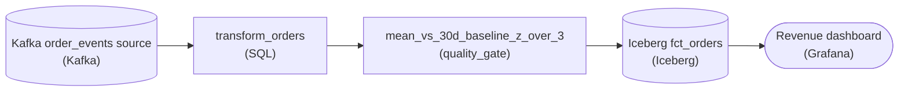

*The check gates each run between `transform_orders` and `Iceberg fct_orders`, so a shifted run never reaches the revenue dashboard.*

| Pitfall: A range check can't see a shifted mean |
| --- |
| The tempting fix is a tighter bound, such as rejecting rows outside 20 to 200 dollars. Every value on the bad run still falls inside any sane range, so the check stays green while the mean drifts. Row-level predicates test each value against a fixed rule and have no memory of what a run usually looks like. |

The check computes this run's mean, then takes the mean and stddev of the trailing 30 days of run means as its baseline. The distance is a z-score: `(run_mean - baseline_mean) / baseline_stddev`. The 32-dollar stddev describes single orders. Daily means spread far less, so a drop from 84 to 71 lands well past `|z| > 3` and trips. The name `mean_vs_30d_baseline_z_over_3` carries the whole contract (the **statistic**, the baseline window and the threshold), so anyone reading the DAG knows what it watches and when it fires.

| Real world: One check per statistic, not one mega-check |
| --- |
| Production pipelines keep these as separate stages: one for the mean, one for a quantile, one for category mix. Split checks mean an alert names its own cause, and you can tune each threshold independently. A coupon bug shifts the mean; a new locale shifts the category mix. |

**Follow-up questions**

1. A promo day legitimately drops the mean. How do you keep the check from crying wolf every campaign?\
   *Separating seasonality from anomaly, for example a same-weekday baseline or excluding known campaign days.*
2. What statistic would catch a bug that hits one small segment and leaves the overall mean near 84?\
   *Pushes toward per-segment means or quantile checks over a single global mean.*

</details>


<br>

### Exercise 3 of 11

**● TASK**

Add a referential-integrity check node that reads both Snowflake fct_orders and dim_customer and isolates the orders whose customer_id has no match in the dimension, since Snowflake does not enforce that foreign key. Wire an error_path edge from the check to a separate quarantine store outside the warehouse, such as an S3 bucket, so the flagged rows land there and never reach the Looker sales dashboard.

**Starting canvas** (already placed for you):

- Kafka order_events source ()
- PostgreSQL customers source ()
- transform_fct_orders ()
- transform_dim_customer ()
- Snowflake fct_orders (some rows reference customer_ids missing from dim_customer) ()
- Snowflake dim_customer ()
- Sales dashboard (joins fct to dim; sees inconsistent answers) ()

<details>
<summary><strong>Solution</strong></summary>

#### A foreign key the warehouse won't enforce

Snowflake accepts a foreign key declaration but never enforces it, so **referential integrity** becomes a check you run yourself. The quality gate you placed between `fct_orders` and `dim_customer` asks one question of every fact row: does its `customer_id` exist in the dimension right now? Matched rows continue to the dashboard. Orphans leave on an error path to a quarantine store outside the warehouse. Every row takes exactly one of those 2 routes.

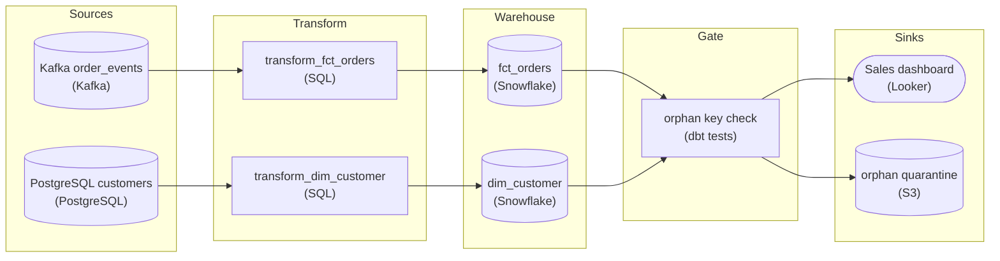

*The gate reads `fct_orders` and `dim_customer`, passes matched orders to Looker, and sends orphans on an error path to S3.*

| Pitfall: An inner join hides orphans instead of catching them |
| --- |
| Letting the dashboard `INNER JOIN` `fct_orders` to `dim_customer` looks like a fix, but it only makes the problem invisible. The join silently drops every orphaned order, sales understate by exactly those rows, and nothing records that it happened. The check exists to make orphans **visible and countable**. |

**What the gate evaluates**

```sql
/* valid rows: keep flowing to the dashboard */
SELECT f.*
FROM fct_orders f
JOIN dim_customer d
  ON f.customer_id = d.customer_id;

/* orphaned rows: the error path to quarantine */
SELECT f.*, CURRENT_TIMESTAMP AS quarantined_at
FROM fct_orders f
LEFT JOIN dim_customer d
  ON f.customer_id = d.customer_id
WHERE d.customer_id IS NULL;
```

*`LEFT JOIN` plus `WHERE d.customer_id IS NULL` is an anti-join: it returns exactly the fact rows that have no dimension match.*

| Real world: Quarantine is a holding pen, not a graveyard |
| --- |
| Many orphans are early, not wrong. CDC can land an order before its `dim_customer` row, and a rebuild can leave a temporary gap. Re-run the check on quarantined rows each cycle, and the rows whose dimension has since arrived go back onto the good path. Keeping the pen in S3 rather than in a Snowflake table means no consumer can read a half-baked row by accident. |

**Follow-up questions**

1. How would you drain `orphan quarantine` once the missing `dim_customer` rows land?\
   *Treats late-arriving data as replayable.*
2. If an order is quarantined and then replayed, how do you make sure it ends up in exactly one place?\
   *Idempotency on the error path.*
3. What orphan rate should raise an alert instead of just parking rows?\
   *A rising count points to a broken dimension load.*

</details>


<br>

### Exercise 4 of 11

**● TASK**

The row-count check in this pipeline uses one hard-coded threshold: it passes on test fixtures, which load the same small batch every day, and fires on production's live traffic with its quiet weekends and holidays. Replace it with a single row-count check, still gating loads into the orders warehouse, whose name states that the assertion is shared by dev and prod while its threshold comes from config keyed on the environment.

**Starting canvas** (already placed for you):

- Kafka order events (source, Kafka)
- transform orders (transform, SQL)
- row-count check (single hard-coded threshold; passes in test, fires in prod) (quality_gate, Great Expectations)
- daily orders warehouse (storage, warehouse)
- revenue dashboard (consumer, Metabase)

<details>
<summary><strong>Solution</strong></summary>

#### One assertion, an environment-keyed threshold

Environment-aware thresholds split a data-quality check into 2 parts that change at different rates. The assertion is written once and is identical in `dev` and `prod`. The bound it compares against is loaded from config keyed on the environment. The starter's check fused the two, baking one row-count floor into the check itself, so test and production effectively ran different rules. That is why it stayed green on fixtures and went red every morning in production.

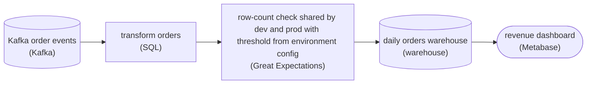

*Same position in the flow, same assertion. Only the threshold the check reads changes per environment.*

| Pitfall: A floor tuned in test fires on quiet days in prod |
| --- |
| Test fixtures load the same rows every run, so a hard-coded floor like `row_count >= 1000` is always satisfied there. Production carries live traffic with calendar effects (a quiet Sunday, a holiday) that legitimately dip below a floor tuned to a busy weekday. The check fired on **volume variance**, not on data quality. Nothing was broken; the number was simply wrong for the environment it ran in. |

**The shared assertion with an environment-keyed threshold**

```python
# config, not code, is what differs per environment
THRESHOLDS = {
    "dev":  {"min_rows": 10},      # fixtures load a fixed small batch
    "prod": {"min_rows": 40_000},  # calibrated to observed weekday-low traffic
}

# the assertion is identical everywhere; only the bound is sourced
min_rows = THRESHOLDS[env]["min_rows"]
expect_row_count_to_be_between(min_value=min_rows)
```

*The rule is written once; `env` selects the bound.*

| Key insight: A threshold copied from live output never fires |
| --- |
| Do not quiet a noisy check by tuning its threshold to whatever the producer is currently emitting, for example by comparing against yesterday's count. That version passes in production every day, which feels like success, but it means the check can never detect drift. Choose the bound from a stable expectation for the environment, not from the live output you are supposed to be validating. |

**Follow-up questions**

1. If weekends legitimately fall below the weekday floor, what does a single `min_rows` miss?\
   *Leads toward day-of-week thresholds that are still sourced from config, not hard-coded exceptions in the assertion.*
2. You add a `staging` environment that mirrors prod traffic. What has to change in the pipeline?\
   *Checks that the fix scales: adding an environment should mean only a new `THRESHOLDS` key, never a new branch in the check.*
3. How would you catch an over-supply, where `row_count` is far above expected, and not just a shortfall?\
   *Extends the shared assertion to a two-sided `min`/`max` bound, with both values keyed on the environment.*

</details>


<br>

### Exercise 5 of 11

**● TASK**

Extend the starter into a quality suite for fct_customer_events, a Snowflake table of two million events a day. Add one quality gate per pillar, each reading the table and naming its threshold: freshness (MAX(event_timestamp) within 2 hours), volume (versus a day-of-week baseline), distribution (event_type mix within 5 points) and schema (columns, types, nullability). Record column lineage in a catalog, and page on-call from every gate.

**Starting canvas** (already placed for you):

- Kafka customer_events source (~2M/day, four event_types) (source, Kafka)
- transform_fct_customer_events (transform, SQL)
- Snowflake fct_customer_events curated table (storage, Snowflake)
- Dashboard consumer (consumer, Metabase)
- Churn model consumer (consumer, Jupyter)
- Billing report consumer (consumer, API)

<details>
<summary><strong>Solution</strong></summary>

A data quality suite splits one trusted table into named, independent pillars (freshness, volume, distribution, schema), each with its own assertion and threshold. That decomposition is what you wired around `fct_customer_events`. A single 'is the table OK?' check only tells you something is wrong; four separate gates tell you **which** thing is wrong, and each pages on its own.

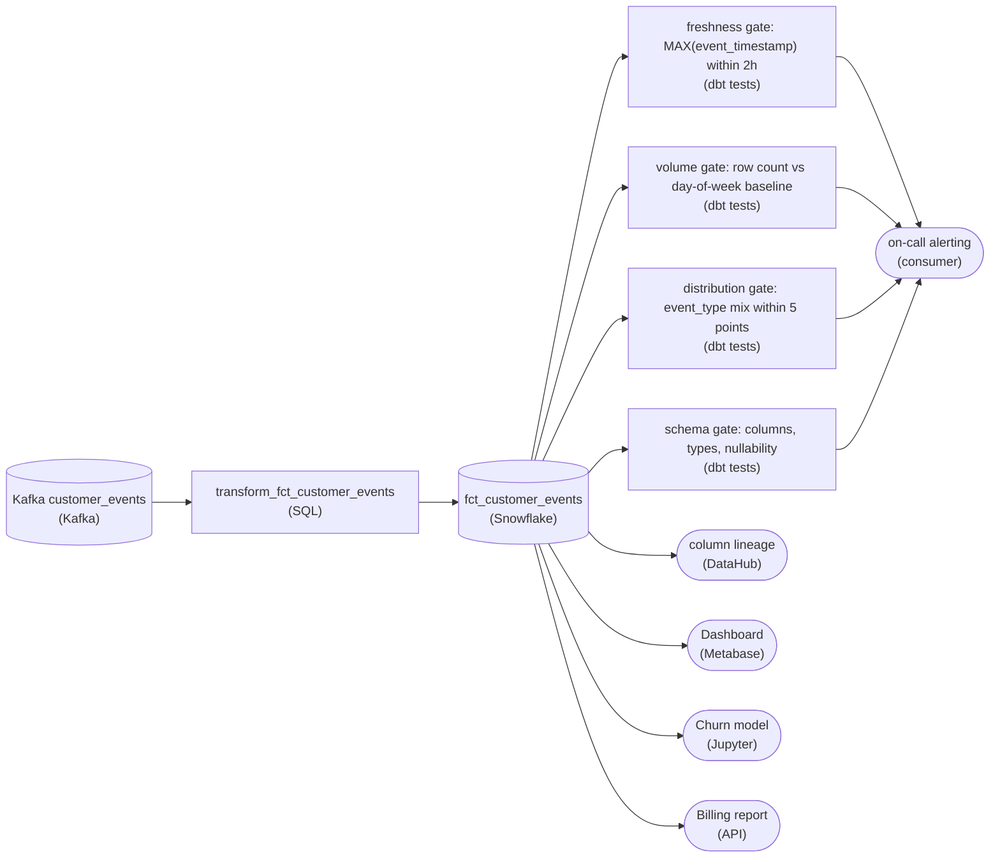

*The curated `fct_customer_events` table fans into four independent quality checks; each pages on-call through the alerting consumer when it fails, and `DataHub` records column-level lineage.*

| Key insight: One failure mode per gate |
| --- |
| Freshness catches a stalled load, volume a partial load, distribution a shift in the event mix, schema an upstream rename. Bundle them into one assertion and you lose the diagnosis: a red light with no label. Four `quality_gate` nodes mean the page that wakes on-call already names the pillar that broke. |

Every gate reads from `fct_customer_events`, the landed curated table, not the Kafka stream or the transform. You validate what actually got written after `transform_fct_customer_events` runs. Assert on the stream instead and the check stays green while the load silently drops half its rows.

| Pitfall: Yesterday is the wrong baseline |
| --- |
| The volume gate compares today's count to a day-of-week baseline, not to yesterday. SaaS traffic sags on weekends, so a Saturday checked against Friday pages every week for a healthy load, and on-call learns to ignore it. Anchor to the same weekday's recent history and the gate stays quiet until something is genuinely off. |

**Follow-up questions**

1. The freshness gate uses `MAX(event_timestamp)` within 2 hours. What breaks if one of the four event types can legitimately arrive hours late?\
   *Late data: a table-wide freshness bound hides a per-`event_type` staleness problem.*
2. How would the schema gate accept an additive new column without paging, while still blocking a type change or a dropped column?\
   *Schema evolution: separating backward-compatible changes from breaking ones.*

</details>


<br>

### Exercise 6 of 11

**● TASK**

Build a data quality program over the existing medallion flow with gates at three layers: validate the producer's schema where raw lands, check value distributions on the curated Iceberg tables, and confirm every fct_orders key resolves to a dim_customer row before the serving mart is built. Route block-class failures to an on-call paging destination and warn-class failures to a non-paging notification channel. The Looker dashboard keeps reading from the Snowflake daily_orders mart.

**Starting canvas** (already placed for you):

- Kafka order_events source (source, Kafka)
- PostgreSQL customers source (source, PostgreSQL)
- transform_curate (transform, SQL)
- transform_dim_customer (transform, SQL)
- Iceberg fct_orders curated (storage, Iceberg)
- Iceberg dim_customer (storage, Iceberg)
- transform_serve (transform, SQL)
- Snowflake daily_orders mart (storage, Snowflake)
- Revenue dashboard (consumer, Looker)

<details>
<summary><strong>Solution</strong></summary>

#### Quality gates as first-class nodes

The thing you just built is a **data quality program**: a set of checks wired into the DAG as gates at each medallion boundary, not a spreadsheet someone reviews after the numbers already look wrong. The medallion shape hands you three natural places to check, and each one wants a different kind of check. Where raw lands you validate the producer's contract; on the curated Iceberg tables you watch the value distribution; and before the serving mart you confirm referential integrity across the 2 curated tables. That is why 'ad-hoc or absent' was the real defect here: the checks existed nowhere the pipeline could act on them.

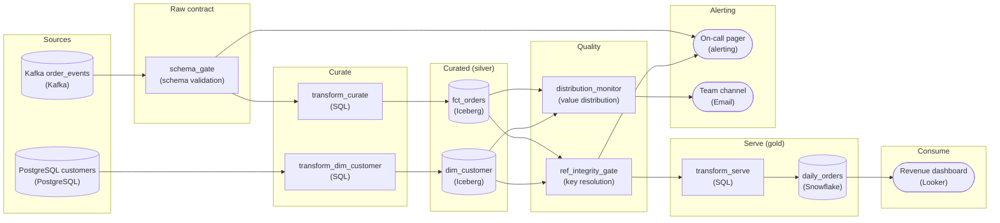

*Three gates on the medallion flow: a blocking schema check at raw landing, a warning distribution monitor on the curated Iceberg tables, and a blocking key-resolution gate that `transform_serve` depends on. Block-class failures page on-call; warn-class failures go to an email channel.*

1. **Validate the producer's schema where raw lands**

   Put `schema_gate` on the edge out of the `order_events` Kafka source, before `transform_curate` ever reads it. This is where the drifting producer shows up first: a renamed field, a widened type, a dropped column. Because the same producer slips every quarter, catching it at the contract boundary means the bad shape never reaches curated. This is 'block' class, so its failure edge goes to the on-call pager: everything downstream of a broken contract is suspect.

2. **Watch the value distribution on the curated tables**

   Point `distribution_monitor` at `fct_orders` and `dim_customer` after they are written. Schema can be perfectly valid while the values quietly rot: revenue amounts trending toward zero, a spike in nulls, row counts halving overnight. That is the 'quiet drift' the title names. A shifted distribution is a signal to investigate, not proof the data is wrong, so it is 'warn' class and posts to the non-paging channel.

3. **Gate the serving mart on referential integrity**

   Before `transform_serve` builds `daily_orders`, run `ref_integrity_gate`: every `customer_id` in `fct_orders` must resolve to a row in `dim_customer`. Orphan keys are exactly how revenue silently understates, since an order whose customer never joined drops out of the customer-keyed rollup. The load-bearing move is that this check is a **dependency edge into** `transform_serve`, not a monitor sitting beside it. The mart does not build until the check passes. Block class, page on-call.

| ✕ Block class to the pager | ✓ Warn class to the channel |
| --- | --- |
| Schema drift and orphan keys halt the DAG and page on-call. These are correctness failures: the mart would be wrong, so publishing it is worse than not publishing at all. `schema_gate` and `ref_integrity_gate` route here. | A shifted distribution posts to the non-paging channel and lets the run continue. It might be a real regression or a legitimate business swing, so a human decides. Paging on every wobble is how you train on-call to ignore the pager. `distribution_monitor` routes here. |

| Pitfall: A monitor beside the mart is not a gate |
| --- |
| The common miss is wiring the key check to read `fct_orders` and fire an alert while `transform_serve` runs anyway on its own schedule. By the time anyone reads the alert, `daily_orders` is already published with understated revenue and Looker is showing it. A gate has to sit ON the dependency path: `transform_serve` takes `ref_integrity_gate` as an upstream, so a failure blocks the build instead of merely describing it after the fact. |

**Follow-up questions**

1. Where does the expected range for the `fct_orders` revenue distribution come from?\
   *tests fixed thresholds vs a rolling statistical baseline*
2. The schema gate blocks the whole feed on one bad field. How would you quarantine only the offending records and let the rest flow?\
   *dead-letter / quarantine pattern instead of all-or-nothing*
3. If `dim_customer` is late, `ref_integrity_gate` blocks and `daily_orders` never refreshes. Should the mart serve yesterday's partition instead?\
   *freshness vs correctness tradeoff at the serving layer*

</details>


<br>

### Exercise 7 of 11

**● TASK**

A logistics partner drops about 40,000 shipment rows per hour as files into a landing area, and a delivery dashboard reads from the warehouse. Add a schema check between the landing area and the warehouse that asserts the partner's declared shape: every required column present, weight numeric and between 0 and 30,000 kg, ship time never null. Send rows that fail to a dead-letter store instead of the warehouse.

<details>
<summary><strong>Solution</strong></summary>

#### The schema check is the partner's contract, enforced

Schema validation turns the partner's promise into something the pipeline enforces on every row. Each landed file is checked against the declared shape: required columns exist, weight is numeric and inside 0 to 30,000 kg, and ship time is never null. At about 40,000 rows an hour, even a one percent break rate is 400 bad rows an hour that would otherwise reach the delivery dashboard.

1. **Put the check where nothing can skip it**

   The schema check sits on the only path from the landing area into the warehouse. If it hangs off to the side, or runs after the load, the dashboard has already read the bad rows by the time anyone looks. A row that fails is a row the pipeline should not have produced, so it never gets the chance.

2. **Decide per row, not per file**

   One malformed weight should not hold back 39,999 good shipments. The check splits each file: conforming rows continue to the warehouse, failing rows go to the dead-letter store along with the assertion they broke.

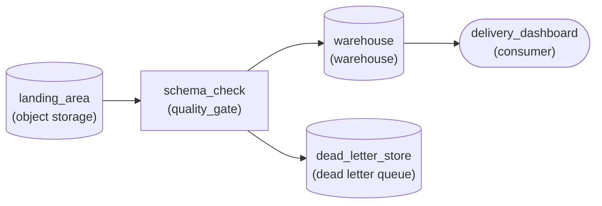

*Files land, pass through the schema check, and split: conforming rows to the warehouse, failing rows to the dead-letter store.*

| Pitfall: Silently dropping bad rows hides the break |
| --- |
| Filtering failures out and moving on keeps the dashboard clean for a week. Then the partner changes a field, a third of the rows vanish, and there is no trace of why. The dead-letter store is the evidence you bring to the producer: these rows, this assertion, this file. |

| Key insight: Writing the check exposes every ambiguity |
| --- |
| Pinning a range on weight forces the question of kilograms or pounds. Asserting ship time is never null forces UTC versus local time, and whether a blank means missing. Settle those with the partner at integration time, before the dashboard depends on the answer. |

**Follow-up questions**

1. The partner adds an optional column next month. Should the check reject those files?\
   *Separates columns the contract requires from additions it allows.*
2. Half of one hour's file fails the check. What should happen besides the dead-letter write?\
   *Acting on failures: when a row-level split should escalate to an alert or a stopped load.*

</details>


<br>

### Exercise 8 of 11

**● TASK**

A ride-hailing platform loads about 3 million completed trips each night into a published trips table that a pricing dashboard reads. Add a distributional check on `fare_per_km` that compares the run's mean and 95th percentile against a trailing 28-day baseline of past runs. When either statistic moves more than 3 standard deviations from that baseline, hold the run out of the published table and alert the on-call engineer.

<details>
<summary><strong>Solution</strong></summary>

#### Judge the run against its own history

A distributional check catches the failure no row-level test sees: every trip row is valid, yet the population has moved. Here the check computes the mean and 95th percentile of `fare_per_km` for tonight's 3 million trips, compares each to a trailing 28-day baseline, and fires when either sits more than 3 standard deviations away. Firing does 2 things at once: the run stays out of the published table, and a person hears about it.

1. **Store the baseline, not a constant**

   The check needs last month's statistics to compare against, so it reads them from a baseline store of past runs. A hard-coded fare floor goes stale the first time prices change; a trailing window moves with the business.

2. **Put the check on the only road in**

   The published table is fed solely by the check's pass branch. If the nightly load also wrote straight to that table, the check would only observe a bad run the dashboard was already reading.

3. **Route the failure to a person**

   A shift can be a real surge weekend or an upstream filter regression, and only a human can tell which. The fail branch goes to an on-call alert, and the held run waits for that decision instead of being silently dropped.

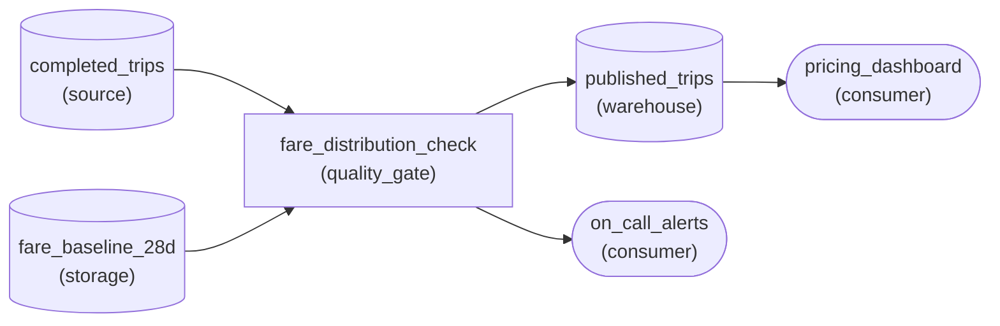

*Tonight's trips reach `published_trips` only through `fare_distribution_check`, which reads the 28-day baseline and alerts on-call when it fires.*

| Pitfall: A mean-only check misses a shifted tail |
| --- |
| If a producer bug drops long trips, the average of `fare_per_km` can barely move while the 95th percentile collapses. Tracking a tail statistic beside the mean is what catches shifts that change the shape rather than the center. |

| Real world: The same shape fits any numeric column |
| --- |
| Swap `fare_per_km` for a sensor's temperature reading or an ad's cost per click and the design is unchanged: summary statistics per run, a trailing baseline, a threshold in standard deviations, and a fail path that holds the run and alerts. |

**Follow-up questions**

1. What happens to the baseline after a real, permanent price change?\
   *Whether the window absorbs a new normal once someone confirms the shift was genuine.*
2. How would the check change if one city's fares run far higher than the rest?\
   *Segmenting the baseline by a dimension instead of comparing against one global distribution.*

</details>


<br>

### Exercise 9 of 11

**● TASK**

Each night about 5 million viewing sessions load into a warehouse fact table, and every session's title_id must exist in the warehouse's title dimension. Design the pipeline with a referential integrity check that compares the sessions against that dimension before the content dashboard reads them. Route orphan sessions to a dead-letter queue rather than dropping them.

<details>
<summary><strong>Solution</strong></summary>

#### The pipeline now owns the foreign key

A referential integrity check is the pipeline doing the job a foreign key constraint did in the operational database: before a session is published, look up its `title_id` in the title dimension and decide what happens when nothing is there. The warehouse will not refuse the row for you, so without this stage an unknown title slips into the fact table and becomes a different wrong number in every query that touches it.

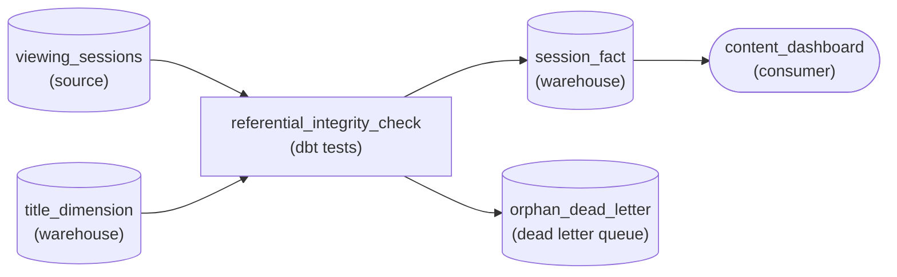

*Sessions and `title_dimension` both feed the check; matched rows reach `session_fact` and the dashboard, orphans land in `orphan_dead_letter`.*

1. **Give the check both sides of the key**

   A check that only sees the sessions can confirm `title_id` is not null, which is a schema check. To catch an orphan it needs the set of keys that exist, so the title dimension is an input edge into the check, not just a table sitting somewhere downstream.

2. **Split the output instead of filtering it**

   The check has 2 exits. Sessions whose `title_id` matches go on to `session_fact`; sessions whose key is missing go to `orphan_dead_letter` with the night's load date. Every input row ends up in exactly one place, so the 2 counts always add back up to the load.

| Pitfall: An inner join is a silent filter |
| --- |
| The tempting shortcut is to join sessions to the dimension with an `INNER JOIN` while loading the fact. It looks like a check, but every orphan simply disappears and watch totals quietly understate. A `LEFT JOIN` keeps the rows but fills the title columns with `NULL`, so a filter like `genre = 'drama'` drops them in one report and counts them as unknown in another. |

| Real world: Most orphans are a late dimension, not bad data |
| --- |
| In practice most orphan keys are titles the catalog has not delivered yet. That is why the dead letter queue keeps the rows instead of deleting them: once the title arrives in the dimension, the parked sessions pass the same check and join the fact table. |

**Follow-up questions**

1. How would you raise an alert when orphans exceed 1% of a night's load?\
   *Turning the dead letter volume into a monitored signal instead of a pile nobody looks at.*
2. What changes if each session also carries a `listener_id` that must exist in a listener dimension?\
   *Whether the check generalises to several foreign keys on one fact table.*

</details>


<br>

### Exercise 10 of 11

**● TASK**

A video service lands about 4 million playback events a day, hourly, into a raw table, and publishes them to a warehouse table read by a recommendations model and a royalties report. Build a quality suite before the published table that checks the schema, freshness within two hours, hourly volume and the event-type mix, and blocks a failing load. Page on-call when a check fails, and record lineage so the page names the affected readers.

<details>
<summary><strong>Solution</strong></summary>

#### 5 pillars, all standing in front of the published table

A quality suite turns the 5 pillars into gates that every hourly load must clear before anyone reads it. 4 of them are checks. Schema confirms the columns are the ones readers expect. Freshness confirms `MAX(event_timestamp)` is within two hours of `CURRENT_TIMESTAMP`. Volume confirms the hour holds roughly the 170,000 rows that 4 million a day implies. Distribution confirms the `event_type` shares look like last week. The fifth pillar, lineage, is not a check at all: it is the record of who reads the table, so a page can say who is hurt.

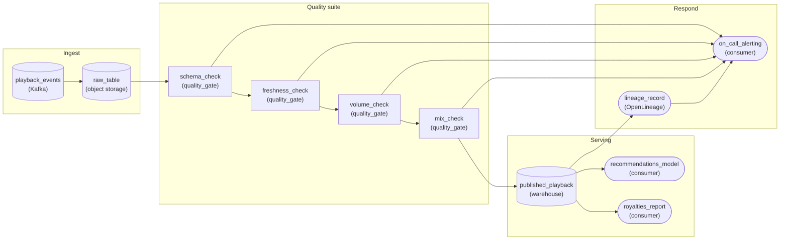

*Each hourly load clears `schema_check`, `freshness_check`, `volume_check` and `mix_check` before reaching `published_playback`; any failure pages `on_call_alerting`, which reads the readers from `lineage_record`.*

1. **Run the schema check first**

   If a column was renamed or retyped, every later check reads garbage: a missing `event_type` makes the mix check meaningless. Schema runs first, and a failure there stops the chain before the statistical checks waste a run.

2. **Chain the checks in front of `published_playback`**

   Each check feeds the next, and only the last one feeds the published table. A failed hour goes nowhere downstream: it stays in `raw_table`, and readers keep the last good hour, which is what a report that pays out money needs.

3. **Wire failures and lineage into one page**

   Every check has a line to `on_call_alerting`, and the lineage record of who reads `published_playback` feeds the same page. The message becomes 'mix check failed, affects recommendations and royalties' instead of a bare check name nobody can triage at 3 a.m.

| Pitfall: A check after the publish only reports the damage |
| --- |
| The common wrong shape hangs the checks off the published table, reading it after the load lands. By the time the volume check fires, the royalties report has already read the half-empty hour. Checks protect readers only when they sit on the path into the table. |

| Performance: An hour of events is cheap to check |
| --- |
| 4 million events a day is about 46 per second and roughly 170,000 rows per hourly load. Each check is one aggregate over that hour: a row count, a `MAX(event_timestamp)`, a `GROUP BY event_type`. That is big enough for the shares to be statistically stable and small enough that 4 checks add seconds, not minutes. |

**Follow-up questions**

1. A new event type launches next month. How does the mix check avoid paging on day one?\
   *Updating a distribution baseline on purpose instead of loosening the check.*
2. Volume drops by 40 percent every night between 2 and 5 a.m. What should the volume check compare an hour against?\
   *Choosing a time-of-day baseline over one flat threshold.*

</details>


<br>

### Exercise 11 of 11

**● TASK**

A utility loads about 8 million smart-meter readings each night from an operational PostgreSQL database into a warehouse table that a demand-forecasting dashboard reads. Validate each load's schema, then run a distributional check that compares its kwh_used mean against a stored historical baseline. A load that fails either check goes to quarantine instead of the warehouse, and the on-call engineer is alerted. The same checks also run in a test environment that loads a 1% sample, so drift thresholds must come from per-environment threshold config, not hard-coded values.

<details>
<summary><strong>Solution</strong></summary>

#### One check, a baseline, and 2 thresholds

Drift detection asks a different question than schema validation: not whether each row is well formed, but whether tonight's population still looks like the nights before it. A reading of 1.9 kWh is perfectly valid. Eight million of them, when the stored baseline says the mean sits near 1.2, points to a firmware change or an upstream filter that dropped the low users. The schema check runs first so the distributional check only ever compares clean numbers.

1. **Put the schema check first**

   If `kwh_used` arrives as text or half null, the mean is meaningless and the drift check fires for the wrong reason. Gate structure first, then measure the distribution of what passed.

2. **Compare against a stored baseline**

   The drift check reads the historical mean and spread from `baseline_stats` and measures how far tonight's `kwh_used` mean sits from it. Keeping the baseline in its own store lets you recompute it from accepted nights without touching the check.

3. **Read thresholds per environment**

   The test load is a 1% sample of about 80,000 readings, so its mean wanders far more night to night than the 8 million in prod. The check logic is identical in both places; only the allowed deviation, read from `threshold_config` for the current environment, differs.

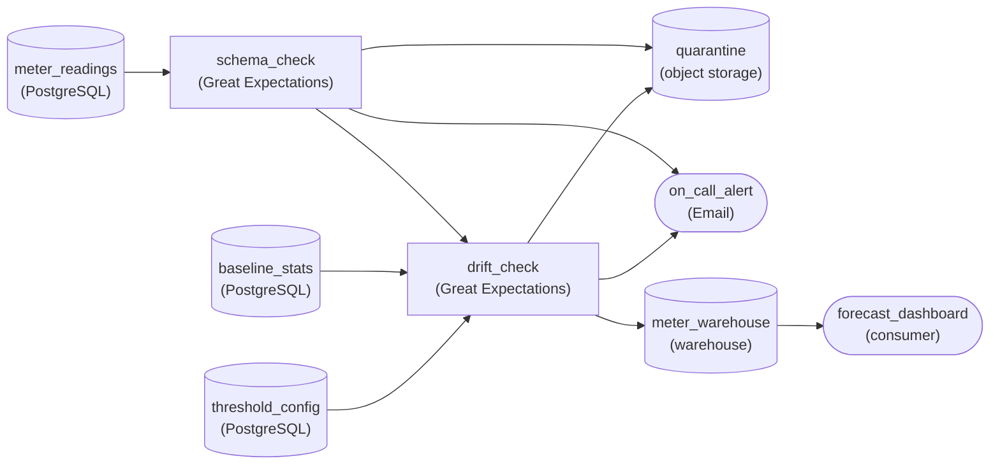

*`schema_check` then `drift_check`, which reads `baseline_stats` and `threshold_config`; failures go to `quarantine` and page `on_call_alert`, passes land in `meter_warehouse`.*

| Pitfall: A hard-coded threshold breaks in one environment |
| --- |
| Tune the band on prod and the noisy 1% test sample trips it every night; tune it on test and real prod drift sails through. Teams then silence the noisy check and the suite stops protecting anything. Keep one check and give it a threshold per environment. |

| Key insight: Quarantine keeps the evidence |
| --- |
| Routing a failed load to `quarantine` instead of dropping it lets the on-call engineer see exactly which night shifted and replay it once the producer is fixed. Meanwhile the dashboard keeps showing the last good night rather than a bad forecast. |

**Follow-up questions**

1. Usage rises every winter. How do you stop the drift check from flagging every cold snap?\
   *Refreshing `baseline_stats` from a trailing window of accepted nights instead of widening the threshold.*
2. The team wants the same drift check on `peak_kw` too. What changes in the design?\
   *Whether baseline and threshold config generalise per column rather than adding a new check stack.*

</details>
