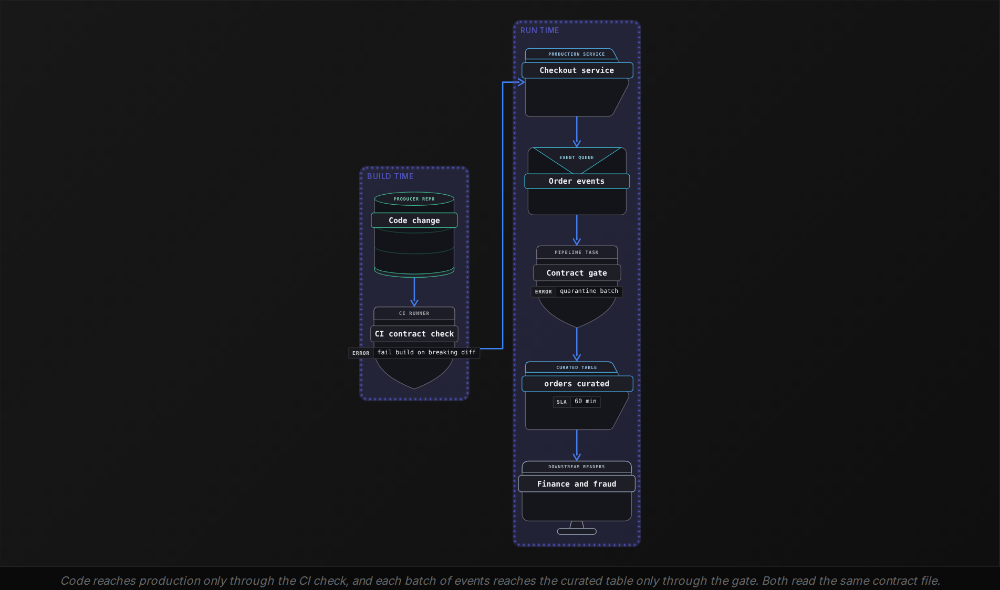
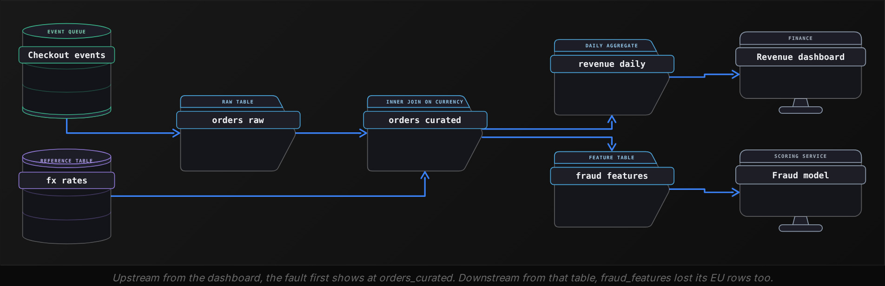
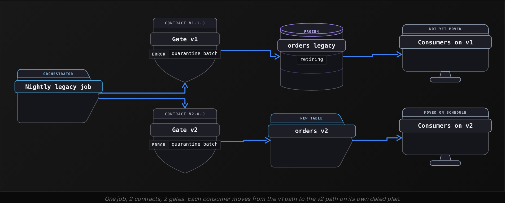

Advanced·Pipeline Architecture · 38 min · 11 challenges

# Data Quality: Advanced

PayPal published an open-source template for data contracts, and a Friday release on a checkout team shows what one is for. A checkout engineer renames `amount_cents` to `amount` and switches it to dollars. With a contract check in the build, the merge fails within minutes and gets fixed before lunch. Without one, Monday's revenue dashboard shows zero for every market, and finance spends the morning finding out why.


<br>

---

## Data Contracts and CI Enforcement

A data contract is a versioned file, owned by the team that produces a dataset, stating what every consumer may rely on. It has 3 parts. The schema lists each field with its type and whether it may be null. The guarantees state rules the values obey and delivery promises, such as how soon an event lands after the order completes. The evolution policy says which changes the producer may ship freely, which count as breaking, and how much notice consumers get first. The file sits in the producer's repository beside the code that emits the data, so a change to either is reviewed together.


<br>

### A contract for one event

```sql
contract: checkout.order_completed
version: 1.2.0
owner: checkout-platform
schema:
  - name: order_id
    type: string
    required: true
    unique: true
  - name: customer_id
    type: string
    required: true
  - name: amount_cents
    type: bigint
    required: true
    min: 1
  - name: currency
    type: string
    required: true
    allowed: [USD, EUR, GBP]
  - name: completed_at
    type: timestamp
    required: true
  - name: coupon_code
    type: string
    required: false
guarantees:
  freshness_minutes: 60
  daily_rows_min: 400000
  amount_cents_meaning: total charged after discounts, before tax, in minor currency units
evolution:
  additive: [add optional field]
  breaking: [remove field, rename field, change type, make field required, change allowed values]
  breaking_requires: new major version and 30 days notice
```

The version follows a major.minor.patch rule. An additive change, such as a new optional `refund_reason` field, raises it to 1.3.0 and asks nothing of consumers. A breaking change raises it to 2.0.0 and starts the 30-day notice. This team counts any edit to `allowed` as breaking, added values included, because a consumer that looks up exchange rates by currency fails on a code it has never seen. The `amount_cents_meaning` line matters as much as the types: a producer who starts including tax keeps every type valid and still moves every revenue figure downstream.


<br>

### Enforcing it at 2 points

Continuous integration, or CI, is the set of automated checks that run on every proposed code change before it may merge. The contract check in the producer's CI builds a sample event from the changed code, usually inside a unit test, and diffs its fields against the contract file. If a pull request renames `amount_cents` to `amount`, the diff shows a required field missing and an undeclared field added. The check classifies that as breaking and fails the build unless the same pull request raises the contract to 2.0.0, which puts the rename in front of reviewers and starts the clock for consumers.



**A checkout engineer adds JPY to the allowed currencies and raises the contract from 1.2.0 to 1.3.0 in the same pull request. What does the CI contract check do under this contract's evolution policy?**

- **A.** Passes the build, because adding a value only widens what consumers receive, which the policy treats as additive.
- **B.** Fails the build, because any change to allowed values is breaking and needs 2.0.0 plus 30 days notice.
- **C.** Passes the build, and the pipeline gate later quarantines every batch containing a JPY order.
- **D.** Fails the build, because every edit to a contract file needs a new major version, whatever it changes.

<details>
<summary>Solution</summary>

**B.** Fails the build, because any change to allowed values is breaking and needs 2.0.0 plus 30 days notice.

The policy names this change as breaking, so a minor bump to 1.3.0 does not satisfy the check.

**Why the others are wrong**

- **A.** This policy lists every change to allowed values as breaking, added values included.
- **C.** CI runs first, and the bump is the wrong kind for a breaking change, so the merge never happens.
- **D.** An additive change such as a new optional field passes with a minor bump.

</details>

CI sees code, so it misses every problem the code did not cause. Suppose a payment partner starts routing orders through checkout with `currency` set to `JPY` by configuration. No code changed, so CI has nothing to check. The gate runs on each batch of real rows against the guarantees, so it catches the unknown currency, a day that lands 180,000 rows, or a replay that repeats `order_id` values. A failing gate quarantines the batch, and consumers keep reading the last good partition: the block authority from the beginner lesson, now driven by the contract.

```sql
SELECT
  COUNT(*) AS row_count,
  COUNT_IF(order_id IS NULL) AS null_order_id,
  COUNT(*) - COUNT(DISTINCT order_id) AS duplicate_order_id,
  COUNT_IF(amount_cents < 1) AS bad_amount,
  COUNT_IF(currency NOT IN ('USD', 'EUR', 'GBP')) AS bad_currency
FROM staging.order_completed
WHERE batch_date = DATE '2026-10-23'
```

**A refunds integration starts writing refunds into the order event stream as negative amount_cents values. Checkout's code has not changed. Which enforcement point stops these rows from reaching orders_curated?**

- **A.** The CI contract check, because negative values violate the min: 1 rule declared in the contract file.
- **B.** Neither point, because amount_cents is still a bigint and the schema in the contract is unchanged.
- **C.** Both points together: CI flags the broken rule, then the gate quarantines the batch it describes.
- **D.** The pipeline gate, because its bad_amount count rises above 0 and it quarantines the batch.

<details>
<summary>Solution</summary>

**D.** The pipeline gate, because its bad_amount count rises above 0 and it quarantines the batch.

The gate checks guarantees on every batch of rows, so a value rule catches a change no code review saw.

**Why the others are wrong**

- **A.** CI runs when code changes, and checkout's code did not change, so CI never compares anything.
- **B.** The schema is unchanged, but the contract also declares a minimum, and the gate checks it on real rows.
- **C.** No code or contract changed, so CI has nothing to flag. The gate acts alone.

</details>


<br>

---

## Five Pillars of Observability

A contract states what should be true about one dataset. Observability measures what is true across every table, including the many that have no contract yet. Data observability sorts those measurements into 5 pillars, each answering one question about a table. The same 5 serve 2 jobs: an order of questions during an incident, and a grid for deciding what a quality program covers.

| Pillar | Question | Measured as | Typical fault |
| --- | --- | --- | --- |
| Freshness | When did new data last land? | minutes since the newest `loaded_at` | a stalled upstream job |
| Volume | Did the expected amount arrive? | rows per partition against recent history | a dropped file, a doubled load |
| Schema | Did the shape change? | column names and types against yesterday | a removed or retyped column |
| Distribution | Are the values plausible? | null rate, distinct count, percentiles | a unit change, a flood of defaults |
| Lineage | What feeds this table, and what reads it? | upstream and downstream datasets as a graph | where a fault began and who it reaches |

Lineage is the dependency graph between datasets: for any table, the tables its rows come from and everything built on it downstream, dashboards and models included. The first 4 pillars say that something is wrong with a table. Lineage says where to look upstream for the cause and whom to warn downstream.


<br>

### The pillars as an incident order

Ask the pillars in order of cost. Freshness and volume come from load metadata in seconds, and together they split every incident in 2: data that did not arrive, and data that arrived wrong. Schema is a comparison of column lists. Distribution needs a scan of values, so it comes last. Lineage runs through all of it: test the symptom table first, then step upstream one table at a time until the failing pillar reads normal; the fault began in the next step downstream.

On Oct 22 the revenue dashboard shows 0 revenue for the EU market. Walking upstream, the pillars report this:

| Table | Freshness | Volume | Schema | Distribution |
| --- | --- | --- | --- | --- |
| `revenue_daily` | on time | normal | unchanged | EU revenue is 0 |
| `orders_curated` | on time | 31% below its 28-day median | unchanged | no EU rows |
| `orders_raw` | on time | 412,000 rows, normal | unchanged | new `currency` value `eur` in 31% of rows |

Freshness is green everywhere, so the data arrived. Volume is normal in `orders_raw` and 31% low one step later, which places the loss in the step that builds `orders_curated`. That step inner joins orders to exchange rates on `currency`, and the distribution of `orders_raw` shows why rows vanish: a checkout release began sending lowercase `eur`, which matches no rate. Walking lineage downstream from `orders_curated` then finds a second victim, `fraud_features`, which no dashboard showed. A contract gate with a fixed currency list would have stopped this batch before `orders_curated`.




<br>

### The pillars as a coverage map

To design a program, lay tables against pillars and mark each cell with whether an automated check covers it. Rank rows by how many people and systems read the table, then close gaps in the top rows first. Here is this pipeline as it stood before the incident:

| Table | Freshness | Volume | Schema | Distribution | Lineage |
| --- | --- | --- | --- | --- | --- |
| `orders_raw` | yes | yes | yes | gap | yes |
| `orders_curated` | yes | gap | yes | gap | yes |
| `revenue_daily` | yes | gap | gap | gap | yes |
| `fraud_features` | gap | gap | yes | gap | yes |

The incident passed through 2 gaps: no distribution check on `orders_raw` and no volume check on `orders_curated`. Either one would have fired hours before finance noticed. `revenue_daily` has 3 gaps of its own, so a fault that started there would surface only on the dashboard.

**The sessions_daily dashboard shows average session length doubled overnight. sessions_daily is fresh, its row count matches history and its schema is unchanged. What comes next?**

- **A.** Check distribution on session_seconds in sessions_daily, then walk lineage upstream to the first table where the values doubled.
- **B.** Check freshness on every upstream table, because a stale input is the usual reason an average shifts overnight.
- **C.** Check volume on sessions_daily against 28 days, because a doubled average usually means half the rows went missing.
- **D.** Walk lineage downstream to list affected dashboards, then close the incident once their owners are notified.

<details>
<summary>Solution</summary>

**A.** Check distribution on session_seconds in sessions_daily, then walk lineage upstream to the first table where the values doubled.

The first 3 pillars all pass, which rules out a missing or reshaped load and leaves the values. Lineage finds where the change began.

**Why the others are wrong**

- **B.** Stale inputs show as old data or low volume, and the symptom table is already fresh with a normal count.
- **C.** Volume was already normal. Missing rows can shift an average, but the count rules that out here.
- **D.** Warning consumers is part of the response, but it leaves the cause unfound and the values still wrong.

</details>


<br>

---

## Quality SLAs vs Ops SLAs

The orchestration lessons treated an SLA as a promise that a run finishes on time. That is an operational SLA, a commitment about how the pipeline executes. A quality SLA is a commitment about the data a run publishes, and the 2 fail independently. During the EU currency incident every task succeeded and every table landed before 06:00, so the operational SLA held all day while consumers read wrong numbers. Treat them as 2 promises with separate measurements and separate owners, because fixing one does nothing for the other.

| ✓ Operational SLA | ✗ Quality SLA |
| --- | --- |
| • Promises the partition is published by 06:00 UTC<br><br>• Measured from run records: start, end, status<br><br>• Broken by stuck tasks, slow inputs, cluster outages<br><br>• Improved by retries, concurrency, earlier upstream schedules | • Promises the published partition is correct<br><br>• Measured from check results and the corrections log<br><br>• Broken by wrong values, missing rows, broken joins<br><br>• Improved by contracts, producer-side checks, tuned thresholds |


<br>

### Writing each as a measurable commitment

A commitment names an indicator and sets a target for it over a window. The operational indicator is direct: was the partition of `orders_curated` published by 06:00 UTC the next day? For quality, passing checks is a weak indicator, because a check says nothing about defects it never tests for. A stronger one comes from the corrections log, a record written whenever anyone restates a published partition. The quality indicator becomes: was the published partition never corrected? A partition the gate holds back costs nothing on quality, since no consumer read it.

| Field | Operational SLA | Quality SLA |
| --- | --- | --- |
| Indicator | published by 06:00 UTC the next day | published and never corrected |
| Target | 89 of 90 days | 88 of 90 partitions |
| Window | rolling 90 days | rolling 90 days |
| Source | `ops.runs` | `ops.corrections` |
| Fixed by | platform on-call | producer and table owner |

```sql
WITH corrected AS (
  SELECT DISTINCT
    partition_date
  FROM ops.corrections
  WHERE table_name = 'orders_curated'
)

SELECT
  COUNT(*) AS days,
  COUNT_IF(
    r.published_at <= CAST(r.partition_date AS TIMESTAMP) + INTERVAL '30' HOUR
  ) AS on_time_days,
  COUNT_IF(c.partition_date IS NULL) AS never_corrected
FROM ops.runs AS r
LEFT JOIN corrected AS c
  ON c.partition_date = r.partition_date
WHERE r.table_name = 'orders_curated'
  AND r.status = 'published'
  AND r.partition_date >= CURRENT_DATE - INTERVAL '90' DAY
```

**On Oct 14 the gate blocks the orders_curated partition at 05:50 for duplicate order_id values. The owner fixes it and the partition publishes at 07:10. It is never corrected afterward. How does Oct 14 count?**

- **A.** Late for the operational SLA and corrected for the quality SLA, because the gate found a defect in it.
- **B.** Late for the operational SLA and good for the quality SLA, because consumers never read the bad version.
- **C.** On time for the operational SLA, because the first run finished before 06:00, and good for quality.
- **D.** Excluded from both SLAs, because a day with a blocking failure is an incident and leaves the window.

<details>
<summary>Solution</summary>

**B.** Late for the operational SLA and good for the quality SLA, because consumers never read the bad version.

Publication came after 06:00, and the published partition needed no correction, so the hold cost time and protected quality.

**Why the others are wrong**

- **A.** A correction restates published data. The bad version never published, so nothing was corrected.
- **C.** The indicator is publication by 06:00, and a run that ends blocked publishes nothing.
- **D.** Dropping incident days would hide the exact days both SLAs exist to count.

</details>

- **90 of 90** — days published by 06:00 UTC
- **84 of 90** — partitions never corrected

The pipeline met its operational target with a day to spare and missed its quality target by 4 partitions. A blended health score would have averaged the 2 into a comfortable number and hidden the miss.

> Where the 6 corrections came from
>
> - One missing refund: a refund service outage dropped events, and no volume check covered refunds
> - One EU join loss: lowercase `eur` matched no `fx_rates` row, and no distribution check covered `currency`
> - 2 duplicate orders: an upstream replay repeated rows, and the `order_id` uniqueness check was warn-only
> - 2 wrong conversions: `fx_rates` loaded a stale day, and no freshness check covered it

Every one of the 6 traces to a missing check or a check without blocking authority, and none shrinks with faster runs. Doubling retries lifts the operational number and leaves all 6 in place; a retry that reruns a bad batch sooner only publishes it sooner. The 2 SLAs also pull against each other. A blocking uniqueness check would have prevented 2 corrections, and every block holds a partition past 06:00 while someone fixes it. Write that tradeoff into the SLA on purpose: a held partition counts as late for operations and as protected for quality.

**Over a quarter, payments_daily meets its operational SLA on 89 of 90 days and its quality SLA on 81 of 90. The team proposes doubling retries and adding a second cluster. What will that change?**

- **A.** Both numbers, because retries rerun failed work and a rerun repairs the bad partitions too.
- **B.** Mostly the quality number, because more capacity lets the checks scan more rows each night.
- **C.** At most the operational number, from 89 toward 90, while the quality number stays at 81.
- **D.** Neither number, because both SLAs are already inside their targets for the quarter.

<details>
<summary>Solution</summary>

**C.** At most the operational number, from 89 toward 90, while the quality number stays at 81.

Retries and capacity address execution. The 9 corrected partitions came from data defects that faster runs republish.

**Why the others are wrong**

- **A.** A rerun of a defective input reproduces the defect. Corrections need checks or contracts.
- **B.** Coverage depends on which checks exist, and extra compute leaves the gaps where they are.
- **D.** No targets are stated here, and 81 of 90 would miss a target such as 88 of 90.

</details>


<br>

---

## Tuning Thresholds vs History

A threshold decides how often someone gets pulled into an investigation. Set it too tight and people stop reading alerts; set it too loose and finance finds the incident first. The target is an alarm rate that fits the time the team has. Here, 3 engineers can each work about 5 quality alerts a week. Spread across 40 checks, that allows each check about 5 alerts per 90 days, and every threshold below is judged against that budget.


<br>

### Backtest against 90 days of history

A backtest replays a candidate threshold over stored history and counts how often it would have fired. The distributional checks you already run produce one value per metric per day; store them in `quality.metric_history` and the backtest becomes a query. This one scores each day's row count for `orders_curated` against the mean and standard deviation of the 8 previous same weekdays, since a Sunday should be compared with other Sundays. It tries 4 values of `k`, the number of standard deviations that triggers an alert, over the last 90 days.

```sql
WITH scored AS (
  SELECT
    metric_date,
    metric_value,
    AVG(metric_value) OVER (
      PARTITION BY DAY_OF_WEEK(metric_date)
      ORDER BY metric_date
      ROWS BETWEEN 8 PRECEDING AND 1 PRECEDING
    ) AS baseline_mean,
    STDDEV(metric_value) OVER (
      PARTITION BY DAY_OF_WEEK(metric_date)
      ORDER BY metric_date
      ROWS BETWEEN 8 PRECEDING AND 1 PRECEDING
    ) AS baseline_sd
  FROM quality.metric_history
  WHERE table_name = 'orders_curated'
    AND metric_name = 'row_count'
    AND metric_date >= DATE '2026-05-31'
)

SELECT
  t.k,
  COUNT_IF(
    ABS(s.metric_value - s.baseline_mean) > t.k * s.baseline_sd
  ) AS alerts
FROM scored AS s
CROSS JOIN UNNEST(ARRAY[2.0, 2.5, 3.0, 4.0]) AS t(k)
WHERE s.metric_date >= DATE '2026-07-26'
GROUP BY t.k
ORDER BY t.k
```

The corrections log from the SLA work labels the answers. In this window, 4 of its entries changed the row count, so those 4 days are the incidents a row-count threshold should catch.

Before annotations

| k | Alerts | Incidents caught |
| --- | --- | --- |
| 2.0 | 23 | 4 of 4 |
| 2.5 | 11 | 4 of 4 |
| 3.0 | 6 | 3 of 4 |
| 4.0 | 2 | 1 of 4 |

After annotations

| k | Alerts | Incidents caught |
| --- | --- | --- |
| 2.0 | 12 | 4 of 4 |
| 2.5 | 5 | 4 of 4 |
| 3.0 | 3 | 3 of 4 |
| 4.0 | 1 | 1 of 4 |

Before annotations, only `k = 4.0` fits the budget, and it misses 3 of the 4 incidents. Most extra alerts at lower settings fired on events the team already understood, and those events also stretched the baseline for the 8 weeks after them, which made later real drops look smaller.


<br>

### Annotate the anomalies you already know

An annotation is a row recording a deviation the team has already explained. It names the table and the reason, with a start and end date. Planned events get one before they happen, and unplanned ones get one after review. In both the backtest and production, annotated days stay out of the baseline and raise no alert.

| Table | Start | End | Reason |
| --- | --- | --- | --- |
| `orders_curated` | 2026-08-12 | 2026-08-12 | email campaign to all customers, volume 1.6x |
| `orders_curated` | 2026-09-18 | 2026-09-19 | sale over 2 days, volume 2.4x |
| `orders_curated` | 2026-10-05 | 2026-10-05 | app outage, real orders down 40% |

```sql
SELECT
  h.table_name,
  h.metric_name,
  h.metric_date,
  h.metric_value
FROM quality.metric_history AS h
LEFT JOIN quality.annotations AS a
  ON a.table_name = h.table_name
    AND h.metric_date BETWEEN a.start_date AND a.end_date
WHERE h.table_name = 'orders_curated'
  AND h.metric_name = 'row_count'
  AND a.table_name IS NULL
```

After annotation, `k = 2.5` catches all 4 incidents with 5 alerts, inside the budget. Give blocking checks a looser `k` than warning checks. A false warning costs an hour of reading. A false block holds a partition past 06:00 and spends the single spare day in the operational target.

| ✓ Do | ✗ Don't |
| --- | --- |
| • Backtest every new threshold against 90 days before it goes live<br><br>• Compare each day with the same weekday in earlier weeks<br><br>• Give every annotation an end date and a named owner | • Copy one k across all 40 checks<br><br>• Annotate a day only because it raised an alert<br><br>• Let annotated days feed the baseline |

**After an alert nobody could explain, a colleague annotates orders_curated from 2026-10-20 with no end date. What follows?**

- **A.** The baseline improves, because one unexplained day stops stretching it for the next 8 weeks.
- **B.** Production alerting is unaffected, because annotations apply only to backtests run against history.
- **C.** The threshold widens on its own, because the annotation marks a new normal level for row count.
- **D.** Every day from Oct 20 on leaves the baseline and raises no alert, so the check is silenced.

<details>
<summary>Solution</summary>

**D.** Every day from Oct 20 on leaves the baseline and raises no alert, so the check is silenced.

An open-ended annotation is a disabled check, and it labels an unexplained day as explained.

**Why the others are wrong**

- **A.** Only one day looked odd, and this annotation covers every day after it as well.
- **B.** Annotated days leave the baseline and raise no alert in production too; that is their purpose.
- **C.** Annotations remove days from the input; they never change k or declare a new level.

</details>


<br>

---

## Contracts on a Legacy Pipeline

On a new dataset the contract comes first and the data is built to match. A legacy table reverses that order. `orders_legacy` has 23 columns and has loaded nightly for 6 years. It has no written owner, and nobody has listed its readers. A clean contract enforced on day one would block tonight's load. The rollout runs in 4 steps, and each produces something the next one needs.


<br>

### Step 1: Write down what the table is today

Contract v1.0.0 describes the table as it behaves, quirks included, so it passes on its first night and gives every later step a baseline. Profile 90 days to find the facts.

```sql
SELECT
  COUNT(*) AS row_count,
  COUNT_IF(region IS NULL) * 100.0 / COUNT(*) AS region_null_pct,
  MIN(amount) AS min_amount,
  MAX(amount) AS max_amount,
  ARRAY_AGG(DISTINCT status) AS status_values
FROM legacy.orders_legacy
WHERE order_date BETWEEN DATE '2026-06-28'
AND DATE '2026-09-25'
```

| Profile finding | Entry in contract v1.0.0 |
| --- | --- |
| `region` null in 4.1% of rows | `region` optional, null rate at most 5% |
| `status` has 7 values, with both `CANCELLED` and `canceled` | all 7 values allowed, as written |
| `amount` is a `double` in dollars, minimum -310.00 | negatives allowed; meaning: refunds are stored as negative orders |
| `amount` maximum 48,200.00 | `amount` at most 50,000.00 |


<br>

### Step 2: Inventory every consumer

A breaking change cannot be planned without knowing whom it breaks. Query history lists who read the table and which columns they touched. A 90-day search found 13 readers; the 14th, an annual audit export that reads once a year, appeared only when the search covered 13 months. Of the 14, 9 are scheduled jobs and 3 are dashboards; the other 2 are analysts' notebooks. Of those, 5 filter on lowercase `canceled` only, so normalizing `status` in place would drop cancellations from their counts without any error. Record an owner and a contact for each consumer; step 4 needs them.


<br>

### Step 3: Observe before enforcing

Run every v1 rule in warn mode for 28 days and record each violation. A rule gets blocking authority once it has run clean or every violation has an explanation. The window from Sep 26 to Oct 23 produced this:

| Rule | Violations in 28 days | Decision |
| --- | --- | --- |
| `region` null rate at most 5% | 0 | block |
| `amount` at most 50,000.00 | one, a confirmed 62,000.00 bulk order on Oct 3 | raise the bound in v1.1.0, then block |
| at least 300,000 rows a day | one, on Oct 5 | block, with Oct 5 covered by an `orders_legacy` outage annotation |
| `order_id` unique | 3 | stay warn until the upstream retry replaces its partition instead of appending, then block after a clean window |


<br>

### Step 4: Migrate behind a new major version

The cleanups go into contract v2.0.0 on a new table, `orders_v2`, under the same evolution policy as checkout's contract. There `amount_cents` becomes a `bigint` and `status` is normalized to 6 values. `region` is now required and filled from the delivery address. The legacy job writes both tables from the same input, each behind its own gate. Version 1 is frozen and receives fixes only. Each consumer from the inventory gets a dated move to v2, and `orders_legacy` is retired once every inventoried consumer has moved and the 30-day notice has passed.

**Contract v2.0.0 maps both CANCELLED and canceled to CANCELLED. Of the 14 consumers, 5 filter on lowercase canceled. What keeps their cancellation counts right through the migration?**

- **A.** Normalize the values in orders_legacy tonight, since the change is already documented in v2.0.0.
- **B.** Add a rule on the v2 gate that blocks any row with lowercase canceled, so the 5 consumers see a failure.
- **C.** Leave orders_legacy as it is, and have each of the 5 change its filter to CANCELLED during its dated move to orders_v2.
- **D.** Keep both spellings in v2 so no consumer has to change anything, and retire v1 when the notice ends.

<details>
<summary>Solution</summary>

**C.** Leave orders_legacy as it is, and have each of the 5 change its filter to CANCELLED during its dated move to orders_v2.

V1 stays frozen, and the inventory names exactly who must change a filter before switching.

**Why the others are wrong**

- **A.** Changing v1 in place breaks the 5 consumers at once, which is why v1 is frozen.
- **B.** Lowercase values never reach v2, so the rule never fires, and the 5 filters still miss cancellations after the move.
- **D.** That carries the quirk into v2 and undoes the cleanup the migration exists for.

</details>



**At week 6 of the move, 8 of the 14 consumers read orders_v2. A producer pull request renames region to market and raises the contract from 2.0.0 to 2.1.0. The volume check on orders_v2 has fired 6 times in those 6 weeks, against a budget of about 5 per 90 days. Which plan follows this lesson?**

- **A.** Let CI fail the rename and ship market as an added optional field in 2.1.0; backtest the volume check with annotations and retune k to the budget.
- **B.** Approve the rename, since 2.1.0 is a new version; then raise the volume check to k = 4.0 so its alerts drop under the budget.
- **C.** Let CI fail the rename; then add retries and concurrency to the volume check's task so its 6 alerts resolve faster.
- **D.** Approve the rename after the 6 remaining consumers move to v2, and return the volume check to warn mode for 28 days.

<details>
<summary>Solution</summary>

**A.** Let CI fail the rename and ship market as an added optional field in 2.1.0; backtest the volume check with annotations and retune k to the budget.

A rename needs 3.0.0 and notice to the 8 v2 readers, while an added field is additive. The alert overrun is a tuning problem, fixed against history.

**Why the others are wrong**

- **B.** A minor bump cannot carry a rename, and jumping to k = 4.0 without a backtest risks missing real incidents.
- **C.** The CI half is right. Retries change how fast the task runs and leave the alert rate where it is.
- **D.** The 8 consumers already on v2 read region today, and another observation window leaves a known noisy threshold untuned.

</details>


<br>

---

## Putting It All Together

A grocery delivery company builds driver_payouts nightly from delivery events and pays drivers from it every Monday. The table is 4 years old, has 11 consumers and no contract. Last quarter 3 payouts were restated after the tips service started sending dollars where it had sent cents, while the job met its 05:00 deadline every night and the on-call engineer muted a volume alert that fired on every holiday.

- The legacy rollout starts with v1 written from a 90-day profile, which records in the contract's meaning line that tips are in cents.
- A unit change keeps the type, so CI lets it through. A distribution rule on tips in the pipeline gate catches it in the first batch, and the meaning line shows the change was breaking.
- A coverage grid across the 5 pillars shows where the restatements got through: tips had schema checks and no distribution check.
- The 3 restatements count against the quality SLA, separate from the operational SLA the job met every night, and faster scheduling would have prevented none of them.
- Holiday annotations with end dates, plus a backtested k , bring the muted volume alert back inside what the on-call engineer can investigate.
- Version 2 stores tips in a single unit under a new major version, and each of the 11 consumers from the inventory gets a dated move.


<br>

---

## Key Takeaways

- A data contract has 3 parts: the schema and its guarantees, plus an evolution policy. All 3 live in the producer's repository and are versioned with the code.
- CI enforces the contract against code changes, and the pipeline gate enforces it against real rows. Each catches failures the other cannot see.
- The 5 pillars run from freshness and volume to schema and distribution, ending with lineage. They give a fixed order of questions in an incident and a grid of gaps when planning coverage.
- An operational SLA counts on-time publication, and a quality SLA counts published partitions that never needed correction. Faster runs improve only the first.
- Backtest thresholds against 90 days, comparing like weekdays, and annotate known events with end dates until alerts fit the team's capacity.
- On a legacy table, document today's behavior as v1, list every consumer, observe in warn mode, then move readers to a new major version.

Exercises for this lesson: [_exercises/pa_data_quality_advanced.md](_exercises/pa_data_quality_advanced.md)
