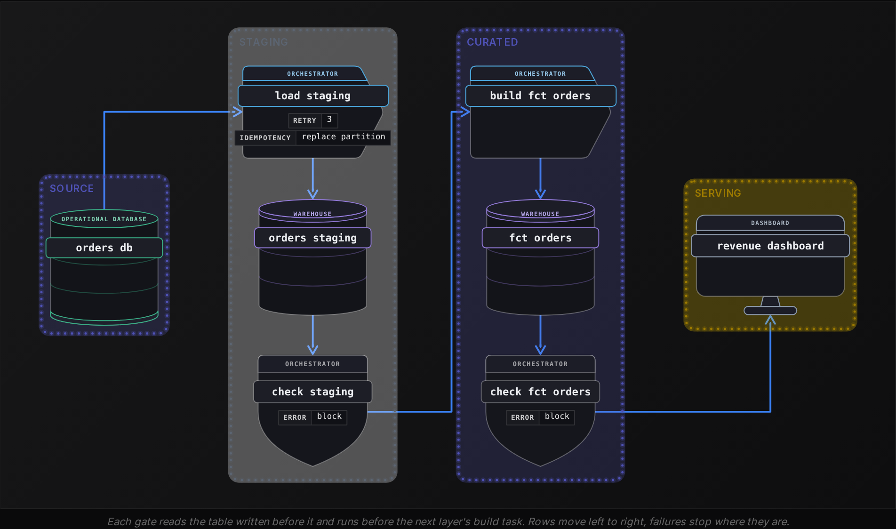
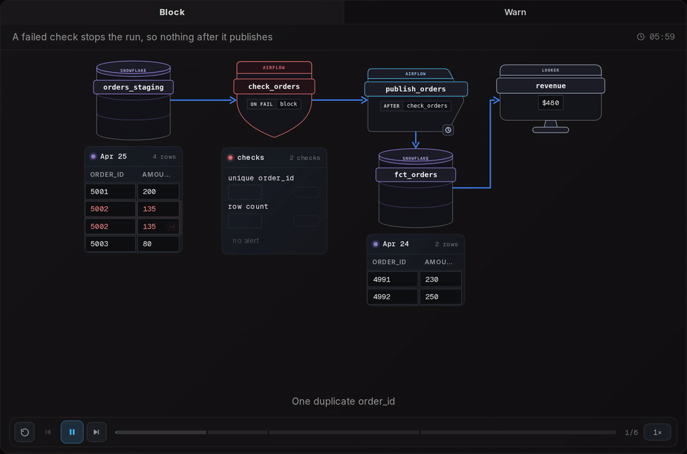
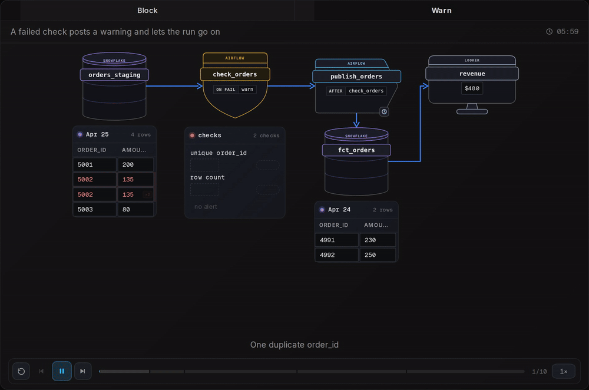
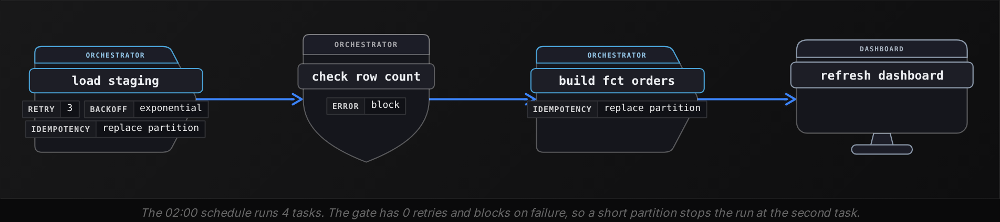

# Data Quality: Beginner

Picture Airbnb's nightly bookings pipeline finishing at 04:00 with every task green. By 09:00 a product manager is celebrating a 40% jump in Paris reservations. The jump came from a retried load that wrote each booking twice. Nothing failed, nothing paged anyone, and the chart was wrong. This lesson is about the check that would have stopped that run at 04:01, before the chart ever drew.


<br>

---

## Pipeline Ran vs Data Is Good

### Two Kinds of Success

An orchestrator calls a run successful when each task exits with code 0 inside its time limit. Call that operational success: the machinery did what it was told. Semantic success is a different claim: the rows now sitting in the table say true things about the business. A pipeline can have the first without the second, and the orchestrator has no way to tell the difference.

Take a nightly orders pipeline. At 02:00 it copies the previous day's orders out of the operational database, reshapes them, and writes the `fct_orders` partition for that date. On 25 April the upstream team added a filter to their export view and left it pointing at a test account. The export returned 3 orders instead of the usual 48,000. Here is the run as the orchestrator recorded it.

| Task | Status | Duration | Rows out |
| --- | --- | --- | --- |
| extract_orders | success | 4s | 3 |
| transform_orders | success | 2s | 3 |
| load_fct_orders | success | 3s | 3 |

*The rows-out column is there because the tasks printed it. An orchestrator stores exit codes and durations on its own, and records rows written only when a task reports them.*

Three green tasks, 9 seconds, and a `fct_orders` partition holding 3 rows where 48,000 belong. At 08:00 the revenue dashboard refreshed and showed $415 of revenue for a day that earned roughly $3.1 million. Nobody was alerted, because from the orchestrator's point of view the night had gone exactly to plan.


<br>

### Naming the Failure Mode

This is a silent failure: a run that completes without error and leaves wrong data behind. The word silent carries the weight. A task that crashes announces itself, turns red, and waits for a human. A silent failure announces nothing. It is found by whoever reads the dashboard first, hours later, and is then traced backwards through 3 layers to a filter someone changed in a different team.

| ✓ What the orchestrator sees | ✗ What the business sees |
| --- | --- |
| • Exit code 0 on every task<br><br>• Durations inside the usual range<br><br>• Dependencies satisfied in order<br><br>• A run marked success at 02:09 | • Revenue down 99.9% overnight<br><br>• 3 orders on a weekday<br><br>• A dashboard that contradicts the finance system<br><br>• A morning of analyst time spent on a drop that never happened |

The cost of a silent failure grows with every hour it stays silent. The 3-row partition was written at 02:09. The dashboard refreshed at 08:00. An analyst noticed at 09:30 and spent until 11:00 ruling out a real fall in sales before asking the data team. By then 2 downstream tables had rebuilt from the bad partition and needed rebuilding again. A check at 02:10 would have cost 1 red task and 1 message.


<br>

### Why the Tools You Already Have Cannot Catch It

The last 2 lessons gave you retries and idempotent writes, and neither one helps here. A retry reruns the extract, which faithfully returns the same 3 rows, because the source itself is what changed. Idempotent replace does what it promised: the partition holds exactly what the run produced, which is 3 rows, and a rerun replaces 3 rows with 3 rows. Both mechanisms protect the pipeline against its own crashes. Neither one reads the data.

The gap between the 2 kinds of success is where a **quality check** lives: a task whose only job is to look at the rows a previous task wrote, compare them with what rows should look like, and fail loudly when they do not match. Failing is the point. A failed check turns the silent failure into a loud one, and a loud failure is one the orchestrator already knows how to handle: red task, skipped downstream, a human reading an error message.

> Three ways a green run lies
>
> - Too few rows: a source filter, a truncated export, or a load that stopped early
> - Too many rows: a retry that appended, or a join that matched each row twice
> - Old rows: the run read the previous day's data again because the new day's never arrived

> **TIP**
>
> When a dashboard number looks wrong, ask the run 2 questions in order: did every task succeed, and how many rows did each task write? A green run that wrote 3 rows has told you where to look.

**A nightly job loads the previous day's payments into fct_payments. Which of these is a silent failure in the sense this section defines?**

- **A.** The load task crashes at 02:04 because the warehouse rejected a connection, and the run turns red.
- **B.** The transform task runs 40 minutes longer than usual and finishes after the dashboard already refreshed.
- **C.** Every task succeeds, but the extract returned 0 rows because the source table was renamed, so the partition is empty.
- **D.** The load task retries twice after a network timeout and succeeds on the third attempt with the correct rows.

<details>
<summary>Solution</summary>

**C.** Every task succeeds, but the extract returned 0 rows because the source table was renamed, so the partition is empty.

Every task exited 0 and the data is wrong. The orchestrator reports success while the dashboard reports no revenue, and nothing points at the rename.

**Why the others are wrong**

- **A.** This is a loud failure. The orchestrator saw the non-zero exit, marked the task red, and a retry with backoff is the right response.
- **B.** Slowness is visible: the orchestrator records the duration, and the dashboard shows the previous day's data with its own date. Nothing false was written.
- **D.** A retry that eventually succeeds is the retry mechanism working. With an idempotent write the data is correct, and the run is loud about its own history in the task log.

</details>


<br>

---

## Four Cheap Quality Checks

### What Cheap Means Here

A cheap check is one aggregate query against the table a task wrote, run as the next task in the DAG. It needs no sample data, no second system, and no knowledge of the business beyond a single expected number. On a 48,000-row partition each one finishes in under 2 seconds. Four of them cover most of the silent failures from the last section, and they are the same 4 on nearly every table you will ever own.

Here is a slice of the table they run against. `fct_orders` holds one row per order, partitioned by `order_dt`, with a `loaded_at` stamp written by the load task.

| order_dt | order_id | customer_id | amount | loaded_at |
| --- | --- | --- | --- | --- |
| 2026-04-25 | 5001 | 88102 | 200.00 | 2026-04-26 02:08:41 |
| 2026-04-25 | 5002 | 88340 | 135.00 | 2026-04-26 02:08:41 |
| 2026-04-25 | 5002 | 88340 | 135.00 | 2026-04-26 02:08:41 |
| 2026-04-25 | 5003 | NULL | 80.00 | 2026-04-26 02:08:41 |


<br>

### Check 1: Row Count

Row count asks whether the partition holds about as many rows as it should. The expectation can be a fixed floor (never fewer than 25,000 orders on any day) or a comparison with the previous partition (never fewer than half of the day before). Start with the fixed floor. It catches the 3-row partition from the last section, and it needs no second query.

```sql
SELECT
  COUNT(*) AS row_count
FROM fct_orders
WHERE order_dt = DATE '2026-04-25'
```

A healthy weekday returns something near 48,000. A Sunday returns nearer 31,000. The floor sits below both and far above anything a broken export produces.


<br>

### Check 2: Null Rate

Null rate asks what share of rows are missing a value in a column that should have one. `COUNT(column)` skips nulls and `COUNT(*)` does not, so the difference between them is the null count, and dividing by the total gives the rate.

```sql
SELECT
  COUNT(*) - COUNT(customer_id) AS null_customers,
  CAST(COUNT(*) - COUNT(customer_id) AS DOUBLE) / COUNT(*) AS null_rate
FROM fct_orders
WHERE order_dt = DATE '2026-04-25'
```

On a typical day 240 of 48,000 orders arrive with no `customer_id`, guest checkouts, and that 0.5% is normal. A rate of 40% means the join that attaches customers stopped matching. The threshold goes above the normal rate with room to spare: 2% catches a broken join and ignores a busy guest-checkout day.


<br>

### Check 3: Uniqueness

Uniqueness asks whether the business key appears once per row. It is the check that would have caught the doubled rows from the retry lesson. `COUNT(DISTINCT order_id)` counts each key once, so any gap between it and `COUNT(*)` is the number of surplus rows.

```sql
SELECT
  COUNT(*) - COUNT(DISTINCT order_id) AS duplicate_rows
FROM fct_orders
WHERE order_dt = DATE '2026-04-25'
```

Against the sample slice above this returns 1: order 5002 appears twice. The threshold for uniqueness on a key is 0. One duplicate in a fact table that sums `amount` is one order counted twice in revenue.


<br>

### Check 4: Freshness

Freshness asks whether the newest data is as new as it should be. The run starts at 02:00 for the previous day, so by 03:00 the maximum `loaded_at` should be under 2 hours old and the maximum `order_dt` should be the day before. The first 3 checks run inside that run, so on a night the run never triggers, they never run either. Freshness runs on its own 03:00 schedule, depends on no load task, and reads the whole table. `localtimestamp` is the moment the query runs.

```sql
SELECT
  MAX(order_dt) AS newest_partition,
  DATE_DIFF('hour', MAX(loaded_at), LOCALTIMESTAMP) AS hours_since_load
FROM fct_orders
```

Run at 03:00 on 26 April, a healthy table returns `2026-04-25` and `0`. A return of `2026-04-24` and `24` means last night's run never wrote, whatever the orchestrator says about it.


<br>

### All Four at Once

The 4 checks read the same partition, so they fit in one query. Running them together costs one scan instead of 4, and the result row is a one-line health report for the partition.

```sql
SELECT
  COUNT(*) AS row_count,
  COUNT(*) - COUNT(customer_id) AS null_customers,
  COUNT(*) - COUNT(DISTINCT order_id) AS duplicate_rows,
  DATE_DIFF('hour', MAX(loaded_at), LOCALTIMESTAMP) AS hours_since_load
FROM fct_orders
WHERE order_dt = DATE '2026-04-25'
```

| Check | Question it answers | Healthy value | Catches |
| --- | --- | --- | --- |
| Row count | How many rows landed? | 25,000 or more | Truncated exports, empty partitions |
| Null rate | How many required values are missing? | Under 2% null | Broken joins, dropped columns |
| Uniqueness | Does each key appear once? | 0 duplicates | Appending retries, fan-out joins |
| Freshness | How old is the newest row? | Under 2 hours | Skipped runs, stuck loads |

**The combined query ran at 03:00 on 26 April against the 2026-04-25 partition and returned row_count 47,910, null_customers 19,380, duplicate_rows 0, hours_since_load 1. Which check fails?**

- **A.** Row count fails: 47,910 is below the 48,000 that a typical weekday produces.
- **B.** Null rate fails: 19,380 of 47,910 is about 40% null, far above the 2% threshold.
- **C.** Freshness fails: 1 hour since load means the run finished later than its schedule.
- **D.** Uniqueness fails: 0 duplicate rows means COUNT(DISTINCT order_id) was never computed.

<details>
<summary>Solution</summary>

**B.** Null rate fails: 19,380 of 47,910 is about 40% null, far above the 2% threshold.

Two of every 5 orders have no customer, against a normal 0.5%. Something upstream of customer_id stopped matching, while count, uniqueness and freshness all look fine.

**Why the others are wrong**

- **A.** Typical is the center of normal, and the floor is 25,000. A count 90 rows under typical is an ordinary weekday.
- **C.** The run starts at 02:00 and the check ran at 03:00, so 1 hour is on time. Freshness fails at 24 hours, when a night was skipped.
- **D.** Zero is the healthy value for uniqueness. It means every order_id appeared once, and the query computed both counts to arrive at it.

</details>


<br>

---

## Quality Checks at Boundaries

### How Far a Bad Row Travels

A pipeline you can read left to right has layers: a staging table that holds a raw copy of the source, a curated table built from it, and a dashboard that reads the curated table. Each arrow between layers is a boundary. A bad row that crosses a boundary unchecked becomes the next layer's input, and every layer after it inherits the problem and adds its own work on top.

The orders pipeline has 2 boundaries. Here it is with a quality gate placed at each one, drawn as its own task between the write that fills a layer and the read that consumes it.




<br>

### What Each Gate Asks

The 2 gates ask different questions because the 2 boundaries break in different ways. The staging gate stands between the source and everything you own. It asks whether the copy is complete, current and unrepeated: row count against a floor, freshness of the newest row, and uniqueness on `order_id`, since the source holds each order once and any duplicate in staging came from the load. If it fails, the fault is in the source or in the load, and nothing downstream has been touched.

The curated gate stands between your transformation and your consumers. `build_fct_orders` joins staging orders to a customers table and sums line items, and joins are where rows multiply or lose their values. So this gate asks whether the build preserved the data: null rate on `customer_id`, uniqueness on `order_id` a second time, and row count compared with staging, since one order in should mean one order out.

| Boundary | Checks | A failure means | First place to look |
| --- | --- | --- | --- |
| Source to staging | Row count floor, freshness, uniqueness | The copy is short, old or doubled | The source export, the load task |
| Staging to curated | Null rate, uniqueness, count vs staging | The build changed the data | The join in build_fct_orders |


<br>

### The Same Bug, Two Placements

Suppose the load task appended instead of replacing, as in the retry lesson, and `orders_staging` now holds 96,000 rows for 25 April, each order twice. Follow the bug under 2 designs.

| ✓ One gate, at the end of the run | ✗ A gate at each boundary |
| --- | --- |
| • 02:05 staging holds 96,000 rows, nothing checks it<br><br>• 02:20 build_fct_orders writes 96,000 rows into fct_orders<br><br>• 02:22 the dashboard refreshes and shows revenue doubled<br><br>• 02:25 the single gate fails on duplicates, after the dashboard already moved<br><br>• Fix means rerunning load, build, refresh, and a summary table built from fct_orders | • 02:05 staging holds 96,000 rows<br><br>• 02:06 check_staging finds 48,000 duplicate order_id values and fails<br><br>• build_fct_orders never starts<br><br>• fct_orders and the dashboard still show 24 April with its date<br><br>• Fix means rerunning one load task |

The bug is identical. The difference is scope: in the first design it reached 3 tables and a dashboard, and in the second it reached 1 table. A gate at a boundary makes the layer behind it the last layer the bug can touch, which is also the layer whose owner knows how to fix it.


<br>

### What a Gate Costs

Each gate is one aggregate query and one task slot, about 2 seconds against a 10-minute run. Over a quarter of 90 nights that is 3 minutes of compute. Skipping it is paid on the one bad night: an analyst's morning from 09:30 to 11:00 and a rebuild of 2 downstream tables.

| ✓ Do | ✗ Don't |
| --- | --- |
| • Put a gate right after each write, before the next read<br><br>• Check at staging what the source could break: count, freshness, key<br><br>• Check at curated what the build could break: nulls and fan-out<br><br>• Compare curated row count with staging to catch join fan-out | • Rely on one gate at the end to cover every layer<br><br>• Skip the staging gate because staging is only a copy<br><br>• Let a build task read a table no gate has passed<br><br>• Treat gate run time as waste: 2 seconds against a 10-minute run |

**The orders pipeline gains a third layer: a daily_revenue summary built from fct_orders by grouping on order_dt. Where does a new gate belong, and what should it check first?**

- **A.** No new gate is needed, because fct_orders already passed its gate and a summary cannot introduce errors.
- **B.** A second gate on orders_staging, since every error in the summary must have started in the raw copy.
- **C.** A gate after daily_revenue checking uniqueness on order_id, the same check the curated gate runs.
- **D.** A gate after daily_revenue is written, checking that its summed amount equals the sum in fct_orders for the same date.

<details>
<summary>Solution</summary>

**D.** A gate after daily_revenue is written, checking that its summed amount equals the sum in fct_orders for the same date.

The new boundary is between fct_orders and the summary, and the question that boundary raises is whether the aggregation preserved the total. Comparing the 2 sums answers it directly.

**Why the others are wrong**

- **A.** A GROUP BY is a transformation, and transformations can go wrong: a filter in the summary query or a bad date cast changes the result. Every new layer gets its own gate.
- **B.** Staging already has a gate, and the summary's build step can introduce its own errors after staging was verified. The gate goes where the new boundary is.
- **C.** The summary has no order_id column, it groups by date. The right check for a boundary comes from what that layer's build could break, which here is the total.

</details>


<br>

---

## Warn vs Block Authorities

### What Happens After a Check Fails

A check that fails has to do something, and there are 2 choices. It can block: the task turns red, nothing downstream runs, and the curated table keeps whatever it held before. Or it can warn: the task posts a message to a channel the team reads, marks itself passed, and the run continues to publish. The choice is the check's authority, and it is set per check.

The animation below runs the same gate both ways. `orders_staging` holds 4 rows for 25 April, and order 5002 appears twice. `check_orders` runs at 06:00 with 2 checks: `order_id` must be unique, and the row count must be at least 3. `publish_orders` overwrites `fct_orders`, and the revenue dashboard sums `amount`. Switch between Block and Warn and watch the dashboard.

**Block**



**Warn**



Under Block, the uniqueness check fails at 06:01, `publish_orders` never runs, and the dashboard keeps showing $480 from the 24 April partition, with its date. The number is a day old and correct. Under Warn, a message goes to the channel, `publish_orders` overwrites `fct_orders` with all 4 rows, and the dashboard shows $550. The true figure for 25 April is $415. The duplicate added $135 to revenue, and the only trace of it is a message in a channel at 06:01.


<br>

### The Rule for Choosing

Compare 2 costs. The cost of running with the bad data: who reads the table, what they decide from it, and how long the wrong number stands before anyone sees it. The cost of not running: consumers see the previous day's data for a few hours while someone fixes the load. Block when the first cost is higher. Warn when the second is.

For a duplicated `order_id` in a revenue table, running means finance sees an inflated total, so block. For a `customer_id` null rate of 3% against a 2% threshold, the per-customer breakdown drops about 1,440 of 48,000 orders instead of the usual 240, while the total stays right. Blocking would hide a correct total from everyone to protect a breakdown few people read that day. Warn, and fix it in the morning.

| Check on fct_orders | Cost of running with it | Authority |
| --- | --- | --- |
| Row count under 25,000 floor | Revenue shows a 90% drop that never happened | Block |
| Duplicate order_id | Revenue double counts every repeated order | Block |
| customer_id null rate over 2% | Customer breakdown loses a few rows, total correct | Warn |
| Newest row over 2 hours old | Dashboard shows the previous day with its date | Warn |

Freshness sits at warn for a reason worth stating. If the data is stale, the damage is already visible in the date on the dashboard, and blocking the publish cannot make the rows newer. The useful response is a person looking at why the run was late, which a warning asks for. Blocking would only delay the fix.


<br>

### A Warning Only Works If Someone Reads It

A warn check that posts to a channel nobody watches is a silent failure with extra steps. Before setting any check to warn, name the person or rotation who reads the channel and what they do when a warning appears. If no one can be named, the check is block or it is nothing.

New checks usually start at warn even when they will end at block. A fresh threshold has no history behind it, and a floor set too high blocks a healthy run on the first busy Sunday. Run the check at warn for 2 weeks, read every message it posts, adjust the threshold until the messages are all real problems, then promote it to block.

> **TIP**
>
> Write the authority next to the check in the DAG as a parameter the next engineer can read, such as `on_fail: block`. A check whose authority lives only in someone's memory gets copied with the wrong one.

| ✓ Block when | ✗ Warn when |
| --- | --- |
| • Consumers make money decisions from the table<br><br>• The rows would be wrong, and a delay would cost less<br><br>• A wrong number would stand for hours unnoticed<br><br>• The threshold has 2 weeks of clean history | • Stale data is already visible as stale<br><br>• The failure degrades a detail, the totals hold<br><br>• The check is new and its threshold unproven<br><br>• A named person reads the channel today |

**A new check on fct_orders asserts that no amount is negative. On its first run it finds 12 negative rows out of 48,000, all refunds the business records as negative orders. What should its authority have been, and why?**

- **A.** Warn, because the check is new, and the first message would have revealed that refunds are legitimate before anything was blocked.
- **B.** Block, because negative amounts in a revenue table are always wrong and must never reach the dashboard.
- **C.** Warn, because negative amounts never affect the revenue total and so can never matter to a consumer.
- **D.** Block, because 12 of 48,000 is below any reasonable threshold and the check would have passed anyway.

<details>
<summary>Solution</summary>

**A.** Warn, because the check is new, and the first message would have revealed that refunds are legitimate before anything was blocked.

A new check has no history. Running it at warn for its first weeks surfaces this kind of surprise as a message instead of a halted run, and the rule gets rewritten to allow refunds.

**Why the others are wrong**

- **B.** The 12 rows are correct business data. A block here would have hidden a correct day of revenue to protect against a rule the check's author misunderstood.
- **C.** Negative amounts reduce the total, which is why refunds are stored that way. The reason to warn is the check's newness. The rows themselves are correct.
- **D.** The check as written has no threshold: any negative row fails it. Twelve rows would have blocked the run and held back a correct partition.

</details>


<br>

---

## First Quality Gate: Row Count

### The Assertion Pattern

A quality gate is a query plus a rule about its result. The cleanest shape is a query that returns rows only when something is wrong. If the result is empty, the gate passes. If any row comes back, the gate fails and the row is the evidence. The row count check from the second section ran against `fct_orders`. The first gate belongs at the staging boundary, so point it at `orders_staging` and add a `HAVING` clause that keeps the result only when the count is under the floor.

```sql
SELECT
  COUNT(*) AS row_count
FROM orders_staging
WHERE order_dt = DATE '2026-04-25'
HAVING COUNT(*) < 25000
```

On a healthy night this returns nothing. On the night of the 3-row partition it returns one row, `row_count` 3, which is both the verdict and the first line of the incident report.


<br>

### The Task Around the Query

The gate runs as a task, and a task fails by raising. The function below runs the assertion for one date and one floor, and raises with the offending count if any row comes back. The orchestrator sees the raise as a non-zero exit, marks the task red, and skips everything downstream of it.

```sql
def check_row_count(conn, run_date, floor):
    sql = f"""
        SELECT
          COUNT(*) AS row_count
        FROM orders_staging
        WHERE order_dt = DATE '{run_date}'
        HAVING COUNT(*) < {floor}
    """
    violations = conn.execute(sql).fetchall()
    if violations:
        raise ValueError(
            f"orders_staging {run_date}: {violations[0][0]} rows, floor is {floor}"
        )
```

The raise is the whole mechanism. Nothing in this function knows about dashboards or downstream tables. It knows one query, one floor, and how to fail. The DAG supplies the rest.


<br>

### Wiring It Into the DAG

The gate sits between the write it checks and the build it protects. `load_staging` writes the day's rows into `orders_staging`, `check_row_count` reads that partition, and only then does `build_fct_orders` replace the live `fct_orders` partition. The dashboard refresh depends on the build. Four tasks, 3 edges, 1 schedule at 02:00.



The gate has 0 retries. The load task retries 3 times with backoff because its failures are usually transient. A failed assertion is permanent: the same query against the same 3 rows returns the same verdict, so a retry only delays the red task. The cost of 0 is that a connection timeout inside the gate blocks a healthy run too. When that starts happening, retry the query's execution errors and let the assertion's `ValueError` fail at once.


<br>

### Choosing the Floor

The floor is a number below every healthy day and above every broken one. Pull the daily counts for the last 90 days: the busiest weekday was 52,400, the quietest Sunday was 29,800, and a holiday dipped to 27,100. The broken run produced 3. Any number between 27,100 and 3 works, and 25,000 leaves a margin under the worst real day while still catching a half-loaded 15,000.

*Later you can replace the fixed floor with half of the previous partition's count, which tracks growth on its own. Start fixed: a number you can read in the code is a number you can reason about at 03:00.*


<br>

### The Night It Fires

| Time | Task | Result |
| --- | --- | --- |
| 02:00:00 | load_staging | Writes 3 rows to orders_staging for 25 April, exits 0 |
| 02:00:04 | check_row_count | Assertion returns row_count 3, raises, task red |
| 02:00:04 | build_fct_orders | Skipped, upstream failed |
| 02:00:04 | refresh_dashboard | Skipped, upstream failed |
| 08:00 | dashboard | Shows 24 April's figures, labelled 24 April |
| 09:15 | on-call engineer | Reads the error, finds the test-account filter, asks upstream to fix it |
| 10:30 | rerun load_staging | Writes 48,000 rows, gate passes, build and refresh run |

The dashboard was wrong for 0 minutes. It showed a day-old number with a day-old date for 8 hours, which is a known state everyone can read. The engineer started from a red task with the count in its error message instead of from an analyst's question about a 99.9% revenue drop. And the fix was one rerun of one task, because nothing past the gate had moved.

> What you built
>
> - An assertion query that returns rows only on failure
> - A task that raises when any row comes back
> - A gate placed after the write and before the build
> - Block authority with 0 retries
> - A floor chosen from 90 days of real counts

**The gate above is changed to HAVING COUNT(*) < 50000 by someone who read that a typical weekday has 48,000 orders. What happens on the next healthy Tuesday with 48,200 rows?**

- **A.** The gate passes, since 48,200 is a normal count and the gate recognizes normal days from history.
- **B.** The gate passes because the orchestrator retries it until a later load brings the count over 50,000.
- **C.** The gate warns in the channel and lets the build run, because row count checks are warn by default.
- **D.** The gate returns 1 row and raises, so build and refresh are skipped and the dashboard shows Monday's data all day.

<details>
<summary>Solution</summary>

**D.** The gate returns 1 row and raises, so build and refresh are skipped and the dashboard shows Monday's data all day.

The floor sits above every healthy day, so every healthy day is blocked. The data was fine and the consumers lost a day of freshness, which is why the floor comes from the quietest real day, with margin under it.

**Why the others are wrong**

- **A.** The gate knows only its floor. A floor of 50,000 is above a normal day, so a normal day fails it.
- **B.** The gate has 0 retries, and no later load is scheduled for that date. A retry would run the same query against the same rows and fail the same way.
- **C.** This gate raises, which the orchestrator treats as failure, and raising is block. There is no default authority, the code decides it.

</details>


<br>

---

## Putting It All Together

Spotify ships Wrapped every December from a year of play events rolled up per listener. Picture the nightly load into the plays staging table appending on a retry one night in October, so every play from that day lands twice. Without a gate, the duplicates flow into the curated listening table and then the yearly rollup, where that day counts twice: a song a listener binged that October day gains an extra day of minutes and can climb into their top 5. With a gate, the run stops the same night.

- The doubled night is a silent failure: every load task exited 0, and the orchestrator marked the run green while the staging table held each play twice.
- A uniqueness check on the play event key at the staging gate returns a duplicate count in the millions and fails, which is the cheap check built for exactly this bug.
- Because the gate sits at the staging boundary, the curated table and the yearly rollup never read the doubled night, so the fix is one rerun of one load task.
- That gate is block authority: a doubled day of listening is wrong data that would stand unseen until December, which costs far more than one day of delay.
- The whole gate is a HAVING assertion, a task that raises, 0 retries, and a threshold of 0 duplicates, wired between the load and the build.


<br>

---

## Key Takeaways

- Operational success is every task exiting 0. Semantic success is the rows being true. A silent failure is the first without the second.
- Four cheap checks, each one aggregate query, cover most silent failures: row count, null rate, uniqueness on the key, freshness.
- A gate at every layer boundary keeps a bug scoped to the layer where it started, and points at the owner who can fix it.
- Block when running with bad data costs more than being late. Warn when stale is already visible or the threshold is new.
- A gate is an assertion query that returns rows only on failure, a task that raises, 0 retries, and a floor read from real history.

Exercises for this lesson: [_exercises/pa_data_quality_beginner.md](_exercises/pa_data_quality_beginner.md)
