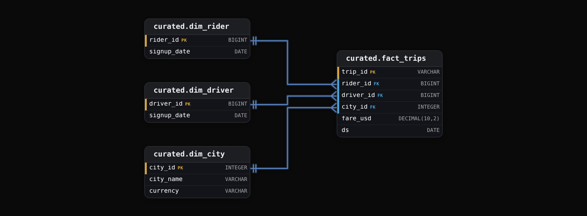
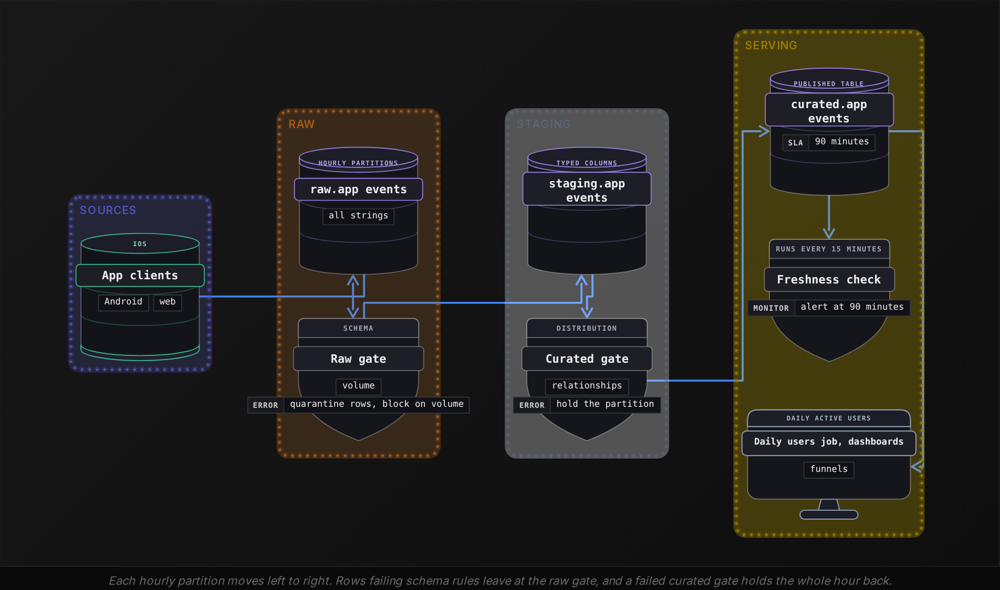

Intermediate·Pipeline Architecture · 32 min · 11 challenges

# Data Quality: Intermediate

Suppose that on a Tuesday morning at Uber the nightly trips load finished on time, its row count sat inside the normal band, and no schema check blocked it. A finance dashboard still shows the average fare jumping from $14.20 to $15.89 overnight, and no rider paid more. One city's feed had started sending fares in cents. This lesson builds the checks that would have held that load.


<br>

---

## Schema Validation Basics

Schema validation asks a single question of every row: does this record have the shape the downstream tables were built for? Shape has 4 parts. Required fields must be present as keys. Types must parse, so a `fare_usd` of "14.2O", typed with a letter O, fails. Nullability says which present fields may hold NULL. Ranges and allowed sets bound the values: a fare can't be negative, and `status` must be one of 3 known words.


<br>

### Four rule types on a trips feed

| Field | Required | Type | Nullable | Range or set |
| --- | --- | --- | --- | --- |
| trip_id | yes | VARCHAR | no | unique per load |
| rider_id | yes | BIGINT | no | greater than 0 |
| driver_id | yes | BIGINT | no | greater than 0 |
| city_id | yes | INTEGER | no | greater than 0 |
| fare_usd | yes | DECIMAL(10,2) | no | 0 to 2000 |
| distance_km | yes | DOUBLE | no | 0 to 500 |
| status | yes | VARCHAR | no | completed, cancelled, refunded |
| promo_code | no | VARCHAR | yes | 3 to 12 characters |

Required and nullable are separate rules. `promo_code` is optional: missing or NULL, both mean no promo. `fare_usd` is required and not nullable, and its 2 failures point at different bugs. A missing key means the producer dropped the field from its payload; `"fare_usd": null` means it sent the field with no value, as after a failed price lookup. Reporting them separately tells the producer where to look.


<br>

### Six records, checked

| Record | What arrived | Rule it breaks | Result |
| --- | --- | --- | --- |
| 1 | every field valid, fare 14.20 | none | pass |
| 2 | no `fare_usd` key | required | fail |
| 3 | `distance_km` = "12,4" | type | fail |
| 4 | `rider_id` = null | nullability | fail |
| 5 | `fare_usd` = -6.50 | range | fail |
| 6 | `status` = "COMPLETED" | allowed set | fail |

Record 6 starts arguments, since "COMPLETED" means the same as "completed". Lowercase `status` in the transform and validate what comes out, so a harmless casing change never becomes an alert. Record 3 is a real failure: "12,4" uses a comma as the decimal mark.


<br>

### Rules as config, adopted gradually

Switching on 40 rules in a single deploy fails: the first run flags thousands of old quirks nobody has triaged, and every rule gets muted within a week. A declarative check file lets the suite grow 1 rule at a time. Each entry ties a rule type to a field and sets that rule's authority. A runner reads the file and generates the SQL.

```sql
table: staging.trips
checks:
  - field: trip_id
    rule: required
    authority: block
  - field: fare_usd
    rule: type
    expect: decimal
    authority: block
  - field: fare_usd
    rule: range
    min: 0
    max: 2000
    authority: warn
    added: 2026-10-05
  - field: status
    rule: allowed_set
    values: [completed, cancelled, refunded]
    authority: warn
    added: 2026-10-12
```

Required fields and types go in first, at block. A missing required key loads silently as NULL and skews every aggregate on that column, while a value that fails its type can't load into a typed column. Nullability and range rules start at warn while someone reads each violation, which is either a producer bug or a wrong rule. After 2 quiet weeks a rule is promoted to block, and the `added` date on each entry puts that schedule in review.

**A new rule bounds distance_km from 0 to 500 at warn. It reports around 1,900 rows a day, all cancelled trips with distance_km = -1. What next?**

- **A.** Promote it to block, since 1,900 bad rows a day is a real defect.
- **B.** Keep it at warn and ask the producer whether -1 marks cancelled trips on purpose.
- **C.** Delete it, since a rule that fires every day teaches people to ignore it.
- **D.** Widen the range to start at -1 and promote it to block that day.

<details>
<summary>Solution</summary>

**B.** Keep it at warn and ask the producer whether -1 marks cancelled trips on purpose.

Right. Warn exists to sort real bugs from wrong rules, and the producer knows which this is.

**Why the others are wrong**

- **A.** Nobody knows yet whether -1 is a bug, so blocking could stop loads over a deliberate value.
- **C.** That discards a working check over a pattern the producer could explain in a sentence.
- **D.** That bakes an unexplained value into the rule and skips the 2 quiet weeks a rule needs before it blocks.

</details>


<br>

### What a rule compiles to

Each entry becomes a count of violating rows, and the rule passes at zero. Type rules run on the raw landing table, where every field is still a string, using `try_cast`, which returns NULL for an unparseable value instead of failing the query. Range and allowed-set rules run on staging, in a single pass over the day's partition:

```sql
SELECT
  COUNT(*) AS rows_checked,
  COUNT_IF(
    fare_usd < 0
    OR fare_usd > 2000
  ) AS fare_range_violations,
  COUNT_IF(
    status NOT IN ('completed', 'cancelled', 'refunded')
  ) AS status_set_violations
FROM staging.trips
WHERE ds = DATE '2026-10-20'
```

A NULL `status` makes `NOT IN` return NULL, and `count_if` counts only TRUE, so the set rule skips it on purpose. The nullability rule owns NULLs, and each defect is reported once, under the rule that names its cause.

**A record arrives with status = null and fare_usd = 1450.00 on a 3.1 km trip. Every other field is valid. Which rule reports it?**

- **A.** The allowed-set rule, because NULL is not among the 3 permitted words.
- **B.** The range rule, because 1450 dollars for a 3.1 km trip is far from normal.
- **C.** The nullability rule, because status is not nullable and the set test skips NULLs.
- **D.** Both the nullability and allowed-set rules, so the record is counted twice.

<details>
<summary>Solution</summary>

**C.** The nullability rule, because status is not nullable and the set test skips NULLs.

Right. The NULL fails nullability and the set rule ignores it, so the defect is counted once.

**Why the others are wrong**

- **A.** NOT IN on a NULL returns NULL, which count_if skips, so the set rule stays silent.
- **B.** Under the 2000 maximum, 1450 passes. A fare wrong for its distance needs a cross-field row rule, such as a bound on fare per km.
- **D.** The count_if behaviour prevents that; only the nullability rule reports this record.

</details>


<br>

---

## Distributional Checks

Schema rules judge each row by itself, and some failures leave every row valid while the batch as a whole is wrong. A city's feed switches to cents. A release starts labelling cash payments as card. Distributional checks compute a few summary numbers over the whole batch and compare them with the same numbers from past batches, which form the baseline.


<br>

### Four summaries and what each notices

| Summary | Moves when | Barely moves when |
| --- | --- | --- |
| Mean | a few rows turn extreme, or every value shifts | values trade places and the total holds |
| Standard deviation | the spread widens, as when cents mix with dollars | every value shifts by the same amount |
| p50 and p95 | the typical value or the top 5% moves | fewer than 1% of rows turn extreme |
| Category mix | a category's share grows or shrinks | the row count changes and every share holds |


<br>

### Picking the baseline

Fares on a Tuesday differ from fares on a Saturday, so comparing each day with yesterday flags every weekly swing. Compare each day with the same weekday across the previous 4 weeks instead. That gives 4 baseline values per summary, and from them a baseline mean and a baseline standard deviation of the summary itself. Keep the 2 standard deviations apart: the spread of fares inside a day is a summary you track, and the spread of a summary across baseline days tells you how much daily wobble is normal.


<br>

### Worked example: the cents bug

| Day | Mean fare (USD) | Median fare (USD) |
| --- | --- | --- |
| Tue 2026-09-22 | 14.10 | 11.70 |
| Tue 2026-09-29 | 14.35 | 11.85 |
| Tue 2026-10-06 | 13.95 | 11.75 |
| Tue 2026-10-13 | 14.40 | 11.90 |
| Baseline mean | 14.20 | 11.80 |
| Today, Tue 2026-10-20 | 15.89 | 11.80 |

The baseline standard deviation of the daily mean is 0.21, and today's mean sits 1.69 above the baseline mean, 8 baseline standard deviations out. That distance is a z-score, and 3 is a common starting threshold. The median held at 11.80. About 0.12% of today's 4,000,000 trips came from a city sending fares in cents, so a fare of 14.20 arrived as 1420. Too few rows changed to shift the median, and their size was enough to drag the mean up. Most cent values still sat under 2000, so the range rule passed them.

- **4,800** — trips that arrived in cents
- **+11.9%** — rise in today's mean fare

One query computes every fare summary for today and the 4 baseline Tuesdays. `approx_percentile` returns a quantile within a small error, far cheaper than an exact sort over millions of rows. In production, each day's results go into a metrics table, so the next check reads 4 stored rows instead of rescanning 4 partitions.

```sql
SELECT
  ds,
  AVG(fare_usd) AS mean_fare,
  STDDEV(fare_usd) AS stddev_fare,
  APPROX_PERCENTILE(fare_usd, 0.5) AS p50_fare,
  APPROX_PERCENTILE(fare_usd, 0.95) AS p95_fare
FROM staging.trips
WHERE ds IN (
  DATE '2026-09-22',
  DATE '2026-09-29',
  DATE '2026-10-06',
  DATE '2026-10-13',
  DATE '2026-10-20'
)
GROUP BY ds
ORDER BY ds
```

**From 2026-10-27, every fare_usd includes an 8% tax, a factor of 1.08. Which summaries shift?**

- **A.** Only the mean, since quantiles and spread ignore a change to every row.
- **B.** Only the payment mix, since a tax changes how riders choose to pay.
- **C.** None, since every row scales by the same factor and the shape holds.
- **D.** Mean, standard deviation, p50 and p95 all rise 8%, and the payment mix holds.

<details>
<summary>Solution</summary>

**D.** Mean, standard deviation, p50 and p95 all rise 8%, and the payment mix holds.

Right. Scaling every value moves every numeric summary; category shares don't depend on fares.

**Why the others are wrong**

- **A.** A uniform 8% raise moves every quantile and the spread by 8% too.
- **B.** The tax changes each fare's value and relabels no payment type.
- **C.** Z-scores compare levels, and a mean of 15.34 sits roughly 5 baseline deviations above 14.20.

</details>


<br>

### Category mix: compare shares

A categorical column has no mean. For each category, take the absolute difference between today's share and its baseline share. Sum those differences and halve the total. The result, total variation distance, is the fraction of rows that would have to switch category to turn one mix into the other.

| payment_type | Baseline share | Today | Absolute difference |
| --- | --- | --- | --- |
| card | 72% | 81% | 9 points |
| cash | 18% | 9% | 9 points |
| wallet | 10% | 10% | 0 points |
| Total variation distance |  |  | 9 points (18 halved) |

Against a 5-point threshold, this day fails. Its trip count was normal, so the row count gate stayed green: cash trips still happened, and a new app release recorded them as card.

> **TIP**
>
> Put a floor under each baseline standard deviation, such as 1% of the baseline mean. Four baseline days can produce a tiny standard deviation by luck, and ordinary wobble then scores above 3.

**A check compares each day's mean distance_km with the day before. It fires every Saturday and Monday, and on no other day. What fixes it?**

- **A.** Compare each day with the same weekday over the previous 4 weeks.
- **B.** Keep the day-before comparison and raise the z-score threshold to 6.
- **C.** Switch from mean to median so the weekly pattern drops out.
- **D.** Pool the last 28 days into one baseline for a steadier deviation.

<details>
<summary>Solution</summary>

**A.** Compare each day with the same weekday over the previous 4 weeks.

Right. Saturdays get judged against Saturdays, so the weekly pattern stops looking like a shift.

**Why the others are wrong**

- **B.** A looser threshold hides the weekly swing and every smaller real shift.
- **C.** The weekly pattern moves the whole distribution, so the median swings too.
- **D.** Pooling weekdays with weekends inflates the deviation, so weekday shifts get lost in it.

</details>


<br>

---

## Referential Integrity in DW

In a warehouse, fact rows point at dimension rows through keys. On a trip row, `rider_id` should match a row in its dimension table, and so should `driver_id` and `city_id`. A fact key with no matching dimension row is an orphan. Orphans pass every schema rule, since `driver_id` 90412 is a valid positive BIGINT, and they surface only when someone joins.




<br>

### Why orphans vanish quietly

Most dashboards join facts to dimensions with an inner join, which keeps only rows that match on both sides. Orphan trips drop out of every revenue chart with no error, the fare total comes in low, and nothing in the query says why.


<br>

### Finding orphans: LEFT JOIN plus a NULL filter

A LEFT JOIN keeps every fact row and fills the dimension's columns with NULL where no match exists, so filtering on the dimension key being NULL leaves exactly the orphans. The extra condition `t.driver_id IS NOT NULL` keeps NULL fact keys out: a trip with no driver already broke the nullability rule, and counting it here would report one defect under 2 names.

```sql
SELECT
  t.trip_id,
  t.driver_id
FROM staging.trips AS t
LEFT JOIN curated.dim_driver AS d
  ON t.driver_id = d.driver_id
WHERE t.ds = DATE '2026-10-20'
  AND t.driver_id IS NOT NULL
  AND d.driver_id IS NULL
```

staging.trips, 2026-10-20

| trip_id | driver_id |
| --- | --- |
| t-101 | 3301 |
| t-102 | 3302 |
| t-103 | 90412 |
| t-104 | NULL |
| t-105 | 3301 |
| t-106 | 90577 |

curated.dim_driver

| driver_id | signup_date |
| --- | --- |
| 3301 | 2025-03-14 |
| 3302 | 2026-01-09 |
| 3315 | 2026-06-30 |

The query returns t-103 and t-106, and t-104 is left to the nullability rule. An inner join on these 6 trips returns 3 and drops t-103, t-104 and t-106 with no error. Report orphans as a rate over rows with a non-NULL key, so a single threshold fits a quiet Sunday and a holiday peak.

**A teammate moves the NULL test into the join, ON t.driver_id = d.driver_id AND d.driver_id IS NULL, and drops it from WHERE. What does the query return?**

- **A.** The same 2 orphans, since the test means the same in either clause.
- **B.** Every trip that day with a non-NULL driver_id, all with NULL driver columns.
- **C.** No rows, since a fact key can never equal a NULL dimension key.
- **D.** Only the trips that match a driver, as an inner join returns.

<details>
<summary>Solution</summary>

**B.** Every trip that day with a non-NULL driver_id, all with NULL driver columns.

Right. The ON condition is never true, so the LEFT JOIN keeps every fact row unmatched.

**Why the others are wrong**

- **A.** In a LEFT JOIN, ON decides what matches and WHERE decides what survives.
- **C.** That holds for an inner join; a LEFT JOIN keeps fact rows with no match.
- **D.** Matching needs the ON condition true, and with d.driver_id IS NULL added it never is.

</details>


<br>

### Four ways to handle an orphan

| Strategy | The orphan row | Dashboards see | Fits when |
| --- | --- | --- | --- |
| Block | the whole load stops until the dimension is fixed | yesterday's data, unchanged | an orphan means a bug, and the dimension is small and fully known |
| Quarantine | moves to a quarantine table while the rest loads | totals missing the orphans | orphans are rare and someone triages the table |
| Placeholder | key set to -1, pointing at an Unknown row; the original id stays in a column like `driver_id_raw` so a repair job can re-point it | complete totals, part under Unknown | totals must be complete and the attribute can wait |
| Defer | held back and re-joined on each later load, up to a limit | the row once its dimension row lands | the dimension row arrives later from a slower source |

One strategy per key on curated.fact_trips

- **city_id: block** *small, fully known dimension*\
  The city dimension holds a few hundred rows and changes when the company launches a city. An unknown city id is a producer bug, and its fares can't be taxed or converted correctly.
- **driver_id: defer for 2 loads, then quarantine** *dimension lands after the facts*\
  Trips load at 02:00 for the previous day, and the driver dimension refreshes from the onboarding system at 06:00. A driver who signed up and drove on the same day is an orphan at 02:00 and matches the next night. Still orphaned after 2 loads means a real defect.
- **rider_id: placeholder** *totals matter more than the label*\
  A rider who deletes an account leaves dim_rider, yet trips taken before the deletion can still arrive and still count toward revenue. Mapping those trips to -1 keeps totals whole and labels the rider Unknown.

> **TIP**
>
> A deferred row is written by a later run than the one that read it. Write it with the same replace-by-key pattern as every other row, keyed on `trip_id`, so rerunning either night can't insert the trip twice.

**A new column, promo_id, points at dim_promo, which syncs every 6 hours, so orphan promo ids appear most mornings and match by afternoon. Finance needs complete fare totals by 07:00. Which strategy fits?**

- **A.** Block the load each morning until the promo dimension catches up.
- **B.** Quarantine the orphan rows and have someone triage them daily.
- **C.** Defer the orphan rows with no time limit, re-joining them each load.
- **D.** Load orphans with the -1 placeholder, then re-point them from the raw id.

<details>
<summary>Solution</summary>

**D.** Load orphans with the -1 placeholder, then re-point them from the raw id.

Right. Totals are complete at 07:00, and a repair job fixes attribution by afternoon.

**Why the others are wrong**

- **A.** That holds every fare past 07:00 for an attribute finance can do without.
- **B.** Quarantined rows leave the totals, so the 07:00 numbers run low.
- **C.** Deferred rows miss 07:00, and with no limit a real defect waits forever.

</details>


<br>

---

## Test vs Prod: Same Checks

A check that runs only in production meets real data for the first time at 02:00, on the night it matters. Running the same suite in a test environment catches a broken rule, or a transform change that breaks a good one, before it ships. Test data differs from prod data in size and completeness, so a suite tuned for one environment can fail, or pass, for the wrong reasons in the other.


<br>

### Which rules travel unchanged

| ✓ Same rule, same threshold | ✗ Same rule, tuned threshold |
| --- | --- |
| • Required fields and types<br><br>• Nullability<br><br>• Ranges and allowed sets<br><br>• Orphan detection, once test data is sampled by key | • Row count bounds<br><br>• Baselines for z-score checks<br><br>• Tight category-mix bands |

The left column judges each row by itself, whatever its neighbours look like. The right column judges the batch, and a batch summary depends on how big the batch is and how it was built.


<br>

### Row counts: a number that can't travel

Prod loads 4,000,000 trips a day; the test environment loads a 1% sample of about 40,000. A gate written as `min_rows: 3500000` fails every test run. Faced with a check that always fails in test, teams turn it off there, and within a month the test copy of the suite has drifted from prod. Keep 1 rule and move only the numbers into a per-environment block:

```sql
table: staging.trips
checks:
  - name: daily_row_count
    rule: row_count
    authority: block
    thresholds:
      prod:
        min_rows: 3500000
        max_rows: 4800000
      test:
        min_rows: 35000
        max_rows: 48000
  - name: payment_mix
    rule: category_distance
    field: payment_type
    authority: warn
    thresholds:
      prod:
        max_points: 5
      test:
        max_points: 5
```

Authority stays identical across environments. If a rule blocks in prod and only warns in test, a change that trips it ships on a green test run and stops the prod load the next night.

**A teammate adds authority_override: {test: warn} to daily_row_count so test runs stop failing. What does that break?**

- **A.** Nothing, since test counts come from a sample and never reach a consumer.
- **B.** Prod starts warning too, since authority is shared across the 2 environments.
- **C.** A change that breaks the count ships on a green test run, then blocks prod.
- **D.** The test row count stops being computed and leaves the metrics table.

<details>
<summary>Solution</summary>

**C.** A change that breaks the count ships on a green test run, then blocks prod.

Right. An always-failing test gate needs a tuned test threshold, with authority left alone.

**Why the others are wrong**

- **A.** The test run is a rehearsal, and its job is to fail where prod would.
- **B.** The override names only test, so prod keeps blocking.
- **D.** Warn still computes and records the count; it only stops failing the run.

</details>


<br>

### Small samples wobble more

Many teams also keep a fixture, a hand-built file of 2,000 rows that loads in seconds. Summaries over fewer rows wobble more by chance. For a category share p measured on n rows, the typical chance wobble is `sqrt(p * (1 - p) / n)`. For the 10% `wallet` share:

| Environment | Rows | Typical wobble of a 10% share |
| --- | --- | --- |
| prod | 4,000,000 | 0.015 points |
| test sample | 40,000 | 0.15 points |
| fixture | 2,000 | 0.67 points |

The 5-point mix threshold is more than 7 times the fixture's wobble, so it holds everywhere, which is why the file above uses 5 in both blocks. A 0.5-point band that suits prod would fire on the fixture by chance on many runs. For z-score checks, build the test baseline from earlier test runs on the same sample. A baseline taken from prod's steadier numbers would score the sample's ordinary wobble as a shift.


<br>

### Sample by key so joins still resolve

Sampling 1% of trips and, separately, 1% of drivers leaves roughly 99% of sampled trips pointing at drivers the test dimension lacks. The orphan check fires on nearly every row, someone raises the test threshold until it stops, and the check is dead in test. Sample by key instead: pick 1% of drivers, copy every trip they drove, then copy the rider and city rows those trips reference. Every test key now resolves, so an orphan in test means what it means in prod.


<br>

### Fixtures prove the checks fire

A check that has never failed might be broken. The fixture plants 1 known bad row per rule: a negative fare, a `status` of "pending", a `driver_id` with no dimension row. The test run expects each rule to report exactly its planted row, so a rule that reports zero has a config bug, found before it reaches prod.

**Which band around the baseline wallet share will likely fire on the 2,000-row fixture when nothing is wrong?**

- **A.** A band of 0.5 points, smaller than a single typical wobble.
- **B.** A band of 2 points, about 3 typical wobbles wide.
- **C.** A band of 5 points, the mix threshold the file uses.
- **D.** A band of 10 points, double the file's mix threshold.

<details>
<summary>Solution</summary>

**A.** A band of 0.5 points, smaller than a single typical wobble.

Right. Chance alone moves the share roughly 0.67 points, so this fires on many clean runs.

**Why the others are wrong**

- **B.** At 3 wobbles wide, chance firing is rare, though a run can still reach it.
- **C.** Five points is over 7 wobbles, so chance almost never reaches it.
- **D.** Fifteen wobbles wide, it stays quiet on clean runs and on many real shifts.

</details>


<br>

---

## Quality Suite for Events

An app's events table records every screen view and tap, and every search too. Say `app_events` holds 1.2 billion rows a day, landing in hourly partitions. Its columns are `event_id`, `user_id`, `event_name`, `event_ts`, `platform` and `app_version`, plus `properties`, which is a JSON string. Its suite covers 5 pillars, each a question about the data, and puts each check at the boundary where it runs cheaply and its action protects the most.

The 5 pillars

- **Freshness**\
  Did the newest data arrive on time?
- **Volume**\
  Did the expected number of rows arrive, each once?
- **Schema**\
  Does each row carry its required fields, with the right types and values in range?
- **Distribution**\
  Do the batch's summaries match their baseline?
- **Relationships**\
  Do the keys resolve to dimension rows?


<br>

### Where each check runs



Schema rules run between raw and staging because they need the raw strings: once a value is cast into a typed column, the text that failed to parse is gone. Distribution and relationship checks run between staging and curated, where values are already typed and the checks can read dimension tables and stored baselines. Freshness runs against the published table, since consumers care about the age of what they can query.


<br>

### The suite, check by check

| Pillar | Check | Threshold | On failure | Boundary |
| --- | --- | --- | --- | --- |
| Freshness | age of newest `event_ts` in curated | 90 minutes | hold the daily active users job | serving |
| Volume | rows per hour vs same hour, same weekday, 4 weeks | z-score of 4 | block the partition | raw to staging |
| Volume | duplicate `event_id` within the hour | 0.1% of rows | warn | raw to staging |
| Schema | required fields present, `event_ts` parses | any failing row | quarantine that row | raw to staging |
| Schema | `platform` in ios, android, web | 0.01% of rows | warn | raw to staging |
| Distribution | `event_name` mix vs baseline | 3 points | warn | staging to curated |
| Distribution | NULL `user_id` share per platform | baseline plus 2 points | block the partition | staging to curated |
| Relationships | `app_version` found in dim_app_version | 0.5% orphan rate | orphans get -1; warn above rate | staging to curated |

The NULL `user_id` check blocks even though logged-out users produce NULL ids legitimately, because its threshold is each platform's own baseline share, say 6% on web and 2% on iOS. A release that drops the id for signed-in web users shows up as web jumping to 15%, and every daily active user count built from that hour would read low. The `event_name` mix only warns: product launches change which events fire, and blocking on each launch would hold the table for changes nobody needs to fix.

**The 14:00 partition has 49.6 million rows and an iOS NULL user_id share of 3.5% against a 2% baseline. Every other check passes. What happens to it?**

- **A.** The curated gate holds it, since the iOS share nearly doubled.
- **B.** It publishes, since 3.5% sits within 2 points of the 2% baseline.
- **C.** The raw gate quarantines the NULL-id rows and publishes the rest.
- **D.** It publishes, since NULL ids come from logged-out users and go unchecked.

<details>
<summary>Solution</summary>

**B.** It publishes, since 3.5% sits within 2 points of the 2% baseline.

Right. The limit is baseline plus 2 points, so iOS blocks only above 4%.

**Why the others are wrong**

- **A.** The rule measures points above baseline, and 1.5 points is inside the margin.
- **C.** Quarantine is for rows failing schema rules, and a NULL user_id is allowed per row.
- **D.** NULL ids are checked as a share per platform, which catches a dropped-id release.

</details>


<br>

### Keeping 1.2 billion rows cheap to check

- Scope every check to the new hourly partition, about 50 million rows.
- Store each hour's summaries in a metrics table, so a baseline reads 4 stored rows per check.
- Use approx_percentile for quantiles: its small error sits well inside a z-score threshold.
- Count duplicates exactly: approx_distinct carries a 2.3% standard error, far above a 0.1% threshold.
- Extract only the JSON keys a rule names with json_extract_scalar, leaving the rest of properties unparsed.

The raw gate's checks for one hour fit in a single pass over its partition. Every column is still a string at this layer, so the timestamp test wraps the parse in `try`, which returns NULL instead of failing:

```sql
SELECT
  COUNT(*) AS row_count,
  COUNT(*) - COUNT(DISTINCT event_id) AS duplicate_ids,
  COUNT_IF(TRY(FROM_ISO8601_TIMESTAMP(event_ts)) IS NULL) AS unparsed_event_ts,
  COUNT_IF(platform NOT IN ('ios', 'android', 'web')) AS unknown_platform_rows
FROM raw.app_events
WHERE ds = '2026-10-20'
  AND hr = '14'
```

**A new rule requires every purchase event's properties to hold a price that parses as a number. Where should it run, and what should a failure do?**

- **A.** Between raw and staging, quarantining each failing row, since it judges a row's raw string.
- **B.** Between staging and curated, as a mean-price check that blocks above a z-score of 3.
- **C.** On the published table every 15 minutes, warning when the newest purchase is old.
- **D.** Between raw and staging, blocking the whole hourly partition whenever a row fails.

<details>
<summary>Solution</summary>

**A.** Between raw and staging, quarantining each failing row, since it judges a row's raw string.

Right. It is a per-row schema rule, so failing rows leave and the rest of the hour publishes.

**Why the others are wrong**

- **B.** A mean can look normal while thousands of rows lack a price, and blocking holds good rows.
- **C.** That is a freshness check; it says nothing about prices.
- **D.** The boundary fits, but one bad row would hold back about 50 million good ones.

</details>


<br>

---

## Putting It All Together

Picture a plays table at Spotify, where each row is one stream and stream counts feed royalty reports. On a Thursday, a new Android build starts reporting ms_played in seconds. Every row passes schema rules, since 182 is a valid positive integer, and hourly volume looks normal. The Android median of ms_played falls from about 180,000 to 180, far past a z-score of 3, so the curated gate holds each affected hour. The build's app_version is missing from the version dimension, so those rows carry the -1 placeholder until the dimension catches up. The team fixes the conversion in the transform, proves it in test against a fixture with a planted seconds-valued row, where the same suite runs with sample-sized thresholds, and republishes the held hours by replacing their partitions.

- Schema rules passed every row because the bug changed units, a batch-level fact that only a distribution check sees.
- Comparing Android with its own same-weekday baseline kept iOS and web variation out of the signal.
- The placeholder kept play totals whole while the version dimension lagged, because attribution could wait and royalty counts could not.
- Holding the hour at the curated gate meant no royalty report ever read seconds as milliseconds.
- Replacing partitions on republish kept the fix idempotent, so a second rerun could not double any stream counts.
- The fixture's planted row proved the fixed transform and the check both behave before the change reached prod.


<br>

---

## Key Takeaways

- Schema rules judge each row for required keys and types that parse, then for nullability and ranges or allowed sets, reporting each defect under its own cause.
- Grow a suite from a check file: required fields and types block first, and newer rules warn for 2 weeks before promotion.
- Distribution checks compare batch summaries with the same weekday in past weeks; the mean catches rare extreme rows while the median holds still.
- Find orphans with a LEFT JOIN and a NULL dimension key, then decide per key whether to block or quarantine; a placeholder or a deferral are the other options.
- Run the same suite in every environment: row rules carry over unchanged, batch thresholds scale with batch size, and authority stays fixed.
- Place each check where it has what it needs. Schema rules need the raw strings and distribution checks need typed data with baselines, while freshness runs on the published table.

Exercises for this lesson: [_exercises/pa_data_quality_intermediate.md](_exercises/pa_data_quality_intermediate.md)
