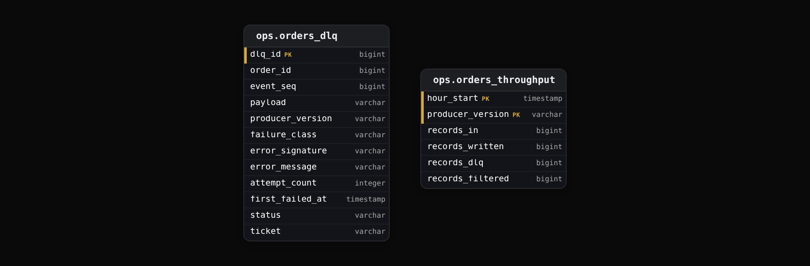
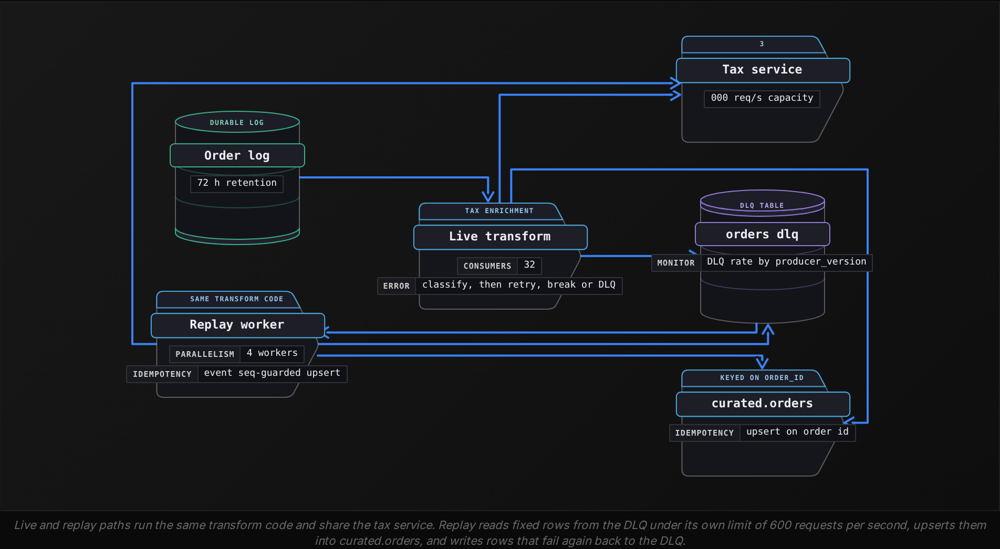

# Failure Handling: Advanced

Uber's engineers have written about sending failed payment events for the Driver Injury Protection program through delayed retry queues and, as a last stop, a dead letter queue. When a premium-calculation service slows to a crawl on a Friday evening, decisions made long before that evening determine whether those queues protect drivers' coverage or bury millions of good payments.


<br>

---

## Failure Classification by Design

Splitting failures into transient and permanent answers a single question: retry or not. A production pipeline has to answer 4 questions for every failure. Should it retry? Should it stop calling the dependency? Where does the failed record go? Does someone get woken up? The answers to all 4 depend on 2 properties of the failure: how long it will last, and how much of the traffic it hits.

Every example in this lesson uses the same pipeline. It reads 2,000 order events per second from a durable log, calls a tax service that can serve 3,000 requests per second, and writes each priced order to curated.orders, keyed on order_id.


<br>

### Duration and scope

Scope is the newer idea. A record-scoped failure hits a single record because of something inside it: a malformed amount, a missing customer ID. A systemic failure hits every record because of something outside them all: an overloaded service, an expired credential, a bug in freshly deployed code. The same error can land on either side. A timeout on 1 call in 10,000 is record-scoped noise, while timeouts on every call are systemic.

| Class | Duration | Scope | Example | Response |
| --- | --- | --- | --- | --- |
| Transient record | Seconds | Single record | A lone 503 or connection reset | Retry in place with backoff and jitter |
| Transient systemic | Minutes to hours | All records | Tax service overloaded, 429 on every call | Open the breaker, leave records in the source log |
| Permanent record | Forever | Single record | `tip_amount` holds the string 'abc' | Write it to the DLQ and keep going |
| Permanent systemic | Until a human acts | All records | Expired credential returning 401; a bug in the transform | Halt the pipeline and page the owner |

The bottom row is where pipelines most often go wrong. Record by record, a permanent systemic failure looks like a permanent record failure: the call returns 401 and the order cannot be priced. A pipeline that checks only the error type sends every order to the DLQ, and an hour later the DLQ holds 7.2 million good orders. All of them need the same fix, a new credential, and none of them needed a decision of its own.


<br>

### The classifier is code, and it reads the failure rate

Classification belongs in a single function that every retry, breaker and DLQ decision calls, so the rules live in one place and can be tested. It takes 2 inputs: the error, and the share of recent records that failed with the same kind of error. For timeouts and overload responses, that share tracks the tax service. For parse errors, it tracks the payloads. That share is what promotes a record-scoped verdict to a systemic one.

```sql
from dataclasses import dataclass

TRANSIENT_STATUS = {429, 502, 503, 504}
AUTH_STATUS = {401, 403}
SYSTEMIC_RATE = 0.5


@dataclass
class Verdict:
    failure_class: str
    action: str


def classify(error, same_kind_failure_rate):
    status = getattr(error, "status", None)
    systemic = same_kind_failure_rate >= SYSTEMIC_RATE

    if isinstance(error, DuplicateKeyError):
        return Verdict("already_applied", "ack")
    if status in AUTH_STATUS:
        return Verdict("permanent_systemic", "halt_and_page")
    if status in TRANSIENT_STATUS or isinstance(error, (TimeoutError, ConnectionError)):
        if systemic:
            return Verdict("transient_systemic", "open_breaker")
        return Verdict("transient_record", "retry_with_backoff")
    if isinstance(error, (ValueError, KeyError)):
        if systemic:
            return Verdict("permanent_systemic", "halt_and_page")
        return Verdict("permanent_record", "send_to_dlq")
    return Verdict("unknown", "retry_then_dlq")
```

A duplicate-key error on an insert-if-absent write keyed on order_id and event_seq together means an earlier attempt already landed this exact event, so the record counts as a success and is acknowledged. A ValueError on half of all records points to a deployed bug or a producer format change, so the per-record verdict is overridden and the pipeline halts. An error the function has never seen gets a short retry and then the DLQ, and the count of unknown verdicts is tracked: when it climbs past a handful per hour, the classifier needs a new rule.


<br>

### One table drives retry, breaker, queue and runbook

With classes defined, every mechanism downstream reads from the same table. That includes the runbook, the page an on-call engineer opens when an alert fires. It gets an entry per class instead of an entry per error message, which keeps it short enough to use at 3 a.m.

| Class | Retry | Breaker | Record goes to | Pages | Runbook first step |
| --- | --- | --- | --- | --- | --- |
| Transient record | Up to 4 attempts, exponential backoff, jitter | Counts toward failure rate | DLQ after attempt 4 | No | None |
| Transient systemic | Paused while breaker is open | Opens at 50% failures over 30 s | Stays in the source log | After 10 min open | Check the dependency's health and recent deploys |
| Permanent record | None | Not counted | DLQ with error signature | No | Group the DLQ by signature |
| Permanent systemic | None | All calls stopped | Stays in the source log | Immediately | Check the last deploy and credential expiry |
| Already applied | None | Not counted | Acknowledged | No | None |

> **TIP**
>
> Write the class table before any retry code. An argument about retry counts or DLQ routing then turns into a question of which row a failure belongs to, and that question has a testable answer.

**A credential rotation at the tax service goes wrong, and from 14:00 every call from the order pipeline returns 401. Today the pipeline sends any record that fails 4 attempts to the DLQ. What should it do instead?**

- **A.** Retry each record 4 times with backoff, then write it to the DLQ for later replay
- **B.** Leave each record in the source log, stop calling the tax service, and page the owner
- **C.** Open the breaker and probe every 30 seconds, sending records to the DLQ while it waits
- **D.** Write each record to the DLQ at once without retrying, because a 401 is permanent

<details>
<summary>Solution</summary>

**B.** Leave each record in the source log, stop calling the tax service, and page the owner

A 401 on every call is permanent and systemic. Orders wait safely in the log until a human supplies a working credential.

**Why the others are wrong**

- **A.** This is the current behavior. Every order fails the same way, so the DLQ fills with good orders waiting on one fix.
- **C.** Stopping calls is right, but DLQ routing creates a mass replay, and probes can never repair a credential.
- **D.** Skipping retries fits a 401, but the failure is systemic, so the DLQ still fills with millions of good orders.

</details>


<br>

---

## The DLQ as a Quality Signal

Consumers notice bad data when a dashboard number looks wrong, often hours after the cause. The DLQ sees the cause within seconds, because every record a producer change breaks lands there the moment it is processed. With the right metrics, the DLQ becomes the earliest warning the pipeline has about the systems that feed it.


<br>

### What a DLQ row has to carry

A metric can slice only by a field the DLQ row stores. A DLQ holding the payload and a raw error message answers how many records failed. It can't say which producer release broke which field, and that is the question that finds a regression.



The error_signature column is the raw message with its values stripped out. cannot cast 'abc' to decimal at tip_amount and cannot cast '12,50' to decimal at tip_amount both become cannot cast <v> to decimal at tip_amount. Grouping by raw message produces a group per bad value; grouping by signature produces a group per bug.


<br>

### Rate by slice, against a baseline

The order pipeline's normal DLQ rate is 0.01%, about 720 rows an hour. At 10:00 the order service starts a canary of release v4.12, a trial rollout on 5% of its hosts. The release sends tip_amount as a string whenever a tip was edited after checkout, which happens on 15% of orders. The next hour looks like this:

| producer_version | records_in | dlq_rows | dlq_rate |
| --- | --- | --- | --- |
| v4.11 | 6,840,000 | 684 | 0.01% |
| v4.12 | 360,000 | 54,000 | 15.00% |
| All versions | 7,200,000 | 54,684 | 0.76% |

Consider which alerts that hour trips. An alert on 100,000 DLQ rows per hour stays silent. A pipeline-wide rate alert at 1% stays silent too, since 0.76% sits under it. Sliced by producer version, v4.12 fails at 15%, a figure no healthy release produces. That alert fires during the canary and the rollout stops at 5% of hosts. At full rollout, the same bug would send 1.08 million orders an hour to the DLQ.

- **1,500x** — v4.12 DLQ rate over the baseline

```sql
WITH dlq AS (
  SELECT
    producer_version,
    COUNT(*) AS dlq_rows
  FROM ops.orders_dlq
  WHERE first_failed_at >= DATE_TRUNC('hour', CURRENT_TIMESTAMP) - INTERVAL '1' HOUR
    AND first_failed_at < DATE_TRUNC('hour', CURRENT_TIMESTAMP)
  GROUP BY producer_version
),
traffic AS (
  SELECT
    producer_version,
    SUM(records_in) AS records_in
  FROM ops.orders_throughput
  WHERE hour_start = DATE_TRUNC('hour', CURRENT_TIMESTAMP) - INTERVAL '1' HOUR
  GROUP BY producer_version
)

SELECT
  t.producer_version,
  t.records_in,
  COALESCE(d.dlq_rows, 0) AS dlq_rows,
  ROUND(
    COALESCE(d.dlq_rows, 0) * 100.0 / NULLIF(t.records_in, 0),
    2
  ) AS dlq_pct
FROM traffic AS t
LEFT JOIN dlq AS d
  ON d.producer_version = t.producer_version
ORDER BY dlq_pct DESC
```


<br>

### The 4 DLQ metrics worth alerting on

- **Rate by slice:** dlq_rows / records_in per producer version and failure class. Catches a regression while a canary still touches a small share of traffic.
- **New signature:** an error_signature absent for the past 14 days. A new bug shows up as a new group even at low volume.
- **Oldest untriaged row:** the age of the oldest row with status = 'new'. A DLQ nobody reads loses data slowly, and this age says how slowly.
- **Conservation:** records_in = records_written + records_dlq + records_filtered. A gap means records vanished without reaching the DLQ.

The conservation check exists because a quiet DLQ proves nothing. If a code change wraps the parse step in a try block that logs the error and moves on, failures stop reaching the DLQ and its rate falls to zero, which looks like an improvement. Conservation exposes it: 7,200,000 records in against 7,180,000 written, 0 in the DLQ and 0 filtered leaves 20,000 orders unaccounted for.

**Right after a pipeline deploy, the order pipeline's DLQ rate drops from 0.01% to 0.00%, while records_in holds steady at 7.2 million per hour. What should an engineer check first?**

- **A.** Nothing: the deploy fixed the last parse bugs, so the DLQ thresholds can be tightened
- **B.** The producer release history, because producers must have cleaned up their payloads
- **C.** Conservation: whether records written plus DLQ plus filtered still adds up to records_in
- **D.** The DLQ table's storage quota, since a full table would stop accepting new rows

<details>
<summary>Solution</summary>

**C.** Conservation: whether records written plus DLQ plus filtered still adds up to records_in

If failures are being swallowed, the sum falls short of records_in, and the shortfall counts the lost orders.

**Why the others are wrong**

- **A.** An exact zero right after a deploy more often means hidden failures; tightening thresholds hides them further.
- **B.** The drop lines up with the pipeline's own deploy, so the pipeline is the first suspect.
- **D.** A full DLQ makes writes fail loudly in the pipeline, which raises errors instead of a clean zero rate.

</details>


<br>

---

## Reprocessing From the DLQ

A DLQ that only collects records loses them more slowly. Recovery needs a path back: find the broken records, write down what is known about them, fix the cause, and send them through the pipeline again without starving live traffic or corrupting the curated table.


<br>

### A lifecycle for every DLQ row

| status | Set by | Meaning |
| --- | --- | --- |
| new | The pipeline | Failed, and nobody has looked yet |
| triaged | On-call engineer | The signature has an owner and a ticket |
| fix_deployed | Owner | The fix is live; rows are safe to replay |
| replayed | Replay worker | Written to curated.orders |
| refailed | Replay worker | Failed again; attempt_count raised |
| discarded | Owner, with a reason | Never to be replayed, such as test traffic |

Annotation works a signature at a time. A single update marks all 54,000 tip_amount rows from the v4.12 canary as triaged with a ticket number. The status column lets replay select only rows whose cause is fixed, and it ends loops: a row that reaches refailed a third time stays put until a human looks.


<br>

### Replay through a separate, throttled path

The quickest-looking replay copies DLQ rows back onto the pipeline's input log. Those old records then queue behind live ones and draw on the same tax capacity live orders need. A dedicated replay worker runs the same transform code under its own rate limit, so replay cannot take capacity from live orders as long as that limit fits the dependency's current headroom.

Set that limit from the dependency's headroom. Live traffic uses 2,000 of the tax service's 3,000 requests per second. Holding 400 back for bursts leaves replay 600 per second. At that rate the 54,000 canary rows replay in 90 seconds, and a backlog of 2.1 million rows takes roughly 58 minutes.




<br>

### Idempotent writes and the stale replay

Replay has to be safe to run twice, because the replay worker can crash halfway like any process. An upsert keyed on order_id covers that: a second run rewrites the same row. Replay also meets a hazard live traffic rarely does, a DLQ row older than what the table already holds. Order 88123 failed at event_seq 4, when its tip was edited. Its seq 5, a cancellation, succeeded an hour later. A plain upsert of seq 4 would un-cancel the order.

The guard is a condition on the write: apply a replayed row only when its event_seq is greater than the stored one. Running the same condition as a read-only dry run shows what replay will do before it touches the table.

```sql
SELECT
  d.order_id,
  d.event_seq AS replay_seq,
  o.event_seq AS current_seq,
  CASE
    WHEN o.order_id IS NULL THEN 'insert'
    WHEN d.event_seq > o.event_seq THEN 'update'
    ELSE 'skip_stale'
  END AS replay_action
FROM ops.orders_dlq AS d
LEFT JOIN curated.orders AS o
  ON o.order_id = d.order_id
WHERE d.status = 'fix_deployed'
  AND d.error_signature = 'cannot cast <v> to decimal at tip_amount'
ORDER BY d.order_id
```

| order_id | replay_seq | current_seq | replay_action |
| --- | --- | --- | --- |
| 88121 | 1 | NULL | insert |
| 88122 | 4 | 2 | update |
| 88123 | 4 | 5 | skip_stale |

A dry run with 2% of rows in skip_stale is normal: those orders moved on while their failed event waited. A dry run with 60% in skip_stale means the selection is wrong, often rows a crashed replay wrote without updating their status. The guard turns that second pass into skips instead of overwrites.

**A replay of 2.1 million DLQ rows is planned for peak hours. The tax service serves 3,000 requests per second, live traffic uses 2,500, and 400 stay in reserve for bursts. About how long will replay take?**

- **A.** About 5.8 hours, at a limit of 100 requests per second
- **B.** About 58 minutes, at a limit of 600 requests per second
- **C.** About 70 minutes, at a limit of 500 requests per second
- **D.** About 14 minutes, at a limit of 2,500 requests per second

<details>
<summary>Solution</summary>

**A.** About 5.8 hours, at a limit of 100 requests per second

Subtracting live traffic and the reserve from 3,000 leaves 100 per second, so 2.1 million rows take 21,000 seconds.

**Why the others are wrong**

- **B.** That limit fits off-peak, when live traffic uses 2,000. At peak it pushes the tax service past capacity.
- **C.** This counts the headroom but spends the burst reserve, so any spike in live orders hits a saturated service.
- **D.** This hands replay the live path's share, which starves live orders or overloads the tax service.

</details>


<br>

---

## Cascading Failure and Backpressure

A cascade starts with a single slow dependency and ends with failures in systems that were never broken. Underneath it is a queue that fills: whenever records arrive faster than a stage can finish them, the difference piles up somewhere, and every somewhere has a size limit.


<br>

### Arrival rate minus service rate

Suppose a slow database query drops the tax service's capacity from 3,000 requests per second to 1,200. Orders still arrive at 2,000 per second. The order pipeline's in-memory buffer has no size limit, and its process has memory for around 500,000 records, so the buffer grows by 800 records every second until that memory runs out.

| Minutes since slowdown | Buffered records | Process memory |
| --- | --- | --- |
| 0 | 0 | Empty |
| 2 | 96,000 | 19% full |
| 5 | 240,000 | 48% full |
| 10 | 480,000 | 96% full |
| 10.4 | 500,000 | Full: the process runs out of memory |

The crash makes the next minute worse. The restarted process re-reads everything since its last committed offset, so it starts with a backlog and calls the slow service harder than before it died.


<br>

### Latency drains pools and retries multiply load

**Little's law** says the number of requests in flight equals arrival rate times latency. At 2,000 requests per second and 50 ms each, the pipeline holds 100 calls open. When latency climbs to 2 seconds, it needs 4,000. A connection pool of 200 runs dry, and records time out while waiting for a connection they never got.

Retries stack on top. If the HTTP client makes 4 attempts and the task wrapping it also makes 4, a single order can produce 16 calls. At 2,000 orders per second, a struggling tax service can face 32,000 requests per second, more than 10 times its healthy capacity. That load keeps it down even after its own fix ships.


<br>

### 3 ways to bound the damage

| Tactic | What it does | What it costs | Use when |
| --- | --- | --- | --- |
| Backpressure | A full buffer stops the consumer pulling; records wait in the durable log | Lag grows; nothing is lost while lag stays within retention | The source is durable and the slowdown ends within retention |
| Load shedding | Low-priority records are deferred or dropped so critical ones keep flowing | Deferred work runs later; dropped work is gone | Some consumers can wait and others cannot |
| Degraded fallback | A cached or estimated answer replaces the slow call, flagged as estimated | Results stay approximate until reprocessed | An approximate answer now beats an exact one later |

Backpressure holds only if every stage between the slow service and the durable source honors it. A stage with an unbounded buffer absorbs the pressure, hides it from the stages before it, and becomes the stage that runs out of memory. The order log keeps 72 hours of events, so through a full tax outage, backpressure loses nothing for the first 72 hours. From hour 72 onward, each further hour of outage expires the oldest hour of unread orders.

Shedding needs a priority on every record, set at design time. Payment events feed the ledger and cannot wait; cart-edit events feed only a marketing attribution table and can wait a day. Under slowdown, the pipeline writes cart edits to a deferred table and spends the tax service's 1,200 requests per second on payment events first.

Classification picks the tactic. Timeouts on every call are transient systemic, so the breaker opens and backpressure keeps records in the log. Routing those timeouts to the DLQ would turn a slowdown into millions of good orders awaiting replay.

| ✓ Do | ✗ Don't |
| --- | --- |
| • Cap every in-memory buffer and stop pulling when it is full<br><br>• Retry at a single layer, inside a retry budget<br><br>• Tag each record with a priority before the pipeline needs to shed<br><br>• Alert when source lag passes half of the log's retention | • Let any stage buffer without a size limit<br><br>• Stack client, task and orchestrator retries on the same call<br><br>• Send records to the DLQ because a dependency was slow<br><br>• Shed records without logging what was dropped |

**The tax service goes fully down. The breaker opens, every buffer is capped, and backpressure holds orders in the log, which keeps 72 hours of events. The outage lasts 80 hours. What happens to the orders?**

- **A.** None are lost, because backpressure keeps every unread order in the durable log
- **B.** All 80 hours of orders are lost, because the open breaker discarded each one
- **C.** The capped buffers overflow and the pipeline crashes, losing what was in memory
- **D.** The first 8 hours of orders expire from the log before the pipeline can read them

<details>
<summary>Solution</summary>

**D.** The first 8 hours of orders expire from the log before the pipeline can read them

From hour 72, each further outage hour expires the oldest hour of unread orders, so the first 8 hours are gone by hour 80.

**Why the others are wrong**

- **A.** Backpressure keeps orders in the log only as long as the log keeps them, which is 72 hours.
- **B.** An open breaker stops calls and leaves records alone; they wait in the log until retention runs out.
- **C.** A full capped buffer stops the consumer pulling, so it never overflows; unread orders stay in the log.

</details>


<br>

---

## Postmortem: Six-Hour Outage

This postmortem follows the order pipeline on a day before any of this lesson's patterns existed. Each decision behind it was ordinary when made; the outage comes from how they lined up. Read each event and name the pattern that would have stopped it before checking the table that follows.


<br>

### The timeline

| Time | Event |
| --- | --- |
| 09:00 | A tax service deploy adds a slow query; 30% of calls now take 1.5 s |
| 09:04 | Calls past the 1 s timeout are retried by the client and the task, 4 attempts each: up to 16 calls per order |
| 09:12 | Load reaches about 32,000 requests per second; every call times out |
| 09:12 | Calls that exhaust retries are labeled permanent; every order goes to the DLQ |
| 09:58 | The unbounded prefetch buffer runs out of memory; 4 restarts by 11:40 rewrite 1.9 million rows to the DLQ a second time |
| 11:30 | Finance's hourly report shows almost no orders since 09:12: the first human signal |
| 12:05 | On-call traces the timeouts to the tax service |
| 13:00 | The tax team rolls back, but the retry storm keeps the service saturated |
| 14:45 | Someone pauses the pipeline by hand and the tax service recovers |
| 15:00 | The pipeline resumes and the outage is declared over, with 31 million rows in the DLQ |
| 15:30 | An engineer copies every DLQ row onto the input log at full speed; the tax service saturates again |
| 15:50 | The copy stops; a script replays at 600 per second for a little over 14 hours |

- **2 h 30 min** — until a finance report, not an alert


<br>

### Each event as a missing pattern

| Time | Missing pattern | Prevention | Section |
| --- | --- | --- | --- |
| 09:04 | Retries at 2 layers | Retries at a single layer, inside a budget | Cascading Failure |
| 09:12 | Mass timeouts handled per record | Failure rate fed to the classifier opens the breaker | Classification |
| 09:12 | DLQ went from 0.01% to 100% unseen | Alert on DLQ rate by failure class | DLQ as Signal |
| 09:58 | Unbounded buffer | Capped buffer pushing back to the log | Cascading Failure |
| 11:30 | Consumers found it first | Paging on DLQ rate and table freshness | DLQ as Signal |
| 13:00 | Nothing gave the service room to recover | Breaker with half-open probes | Cascading Failure |
| 15:30 | Replay shared the live path | Separate replay worker with its own limit | Reprocessing |
| 15:50 | Duplicate DLQ rows, 1.9 million | Upsert on order_id guarded by event_seq | Reprocessing |

The 09:12 misclassification matters most. A classifier reading the failure rate would have seen timeouts on more than half of calls within seconds, opened the breaker and left every order in the log. The DLQ flood, the duplicate rows and both replay mistakes disappear, and the 13:00 rollback ends the outage, because nothing is sending extra load to the service. What remains is a backlog in the log that drains once the tax service recovers.


<br>

### The checklist

- Every failure gets a class from duration and scope, and the classifier reads the recent failure rate
- Retries live at a single layer, with exponential backoff, jitter and a retry budget
- Each dependency call sits behind a circuit breaker with half-open probes
- Every buffer is capped, and a full buffer stops the consumer from pulling
- Records carry a priority, so the pipeline can defer or shed them under slowdown
- DLQ rows store producer version, failure class and error signature
- Alerts cover DLQ rate by slice, new signatures, the oldest untriaged row and conservation
- Replay runs on its own throttled path and writes with an event_seq-guarded upsert
- The runbook has an entry per failure class

> **TIP**
>
> Run the checklist against a design before it ships: name a failure from each class and trace where each record ends up. A record that can end up nowhere, or in 2 places, marks the gap.

**A clickstream pipeline enriches events with a geo-lookup service. During a geo-lookup slowdown, its DLQ grows by 2,000 rows per second, and the team plans to replay them afterward. Which change fixes the cause?**

- **A.** Raise the DLQ storage limit so it can hold a full day of failed events
- **B.** Add a third retry layer so slow calls get more chances before reaching the DLQ
- **C.** Feed the failure rate to the classifier so mass timeouts open the breaker and stay in the log
- **D.** Replay the DLQ continuously at full speed so it never holds more than a few minutes

<details>
<summary>Solution</summary>

**C.** Feed the failure rate to the classifier so mass timeouts open the breaker and stay in the log

Mass timeouts are transient systemic, so records belong in the source log behind an open breaker.

**Why the others are wrong**

- **A.** This makes the flood survivable and leaves it in place; every slowdown still ends in a mass replay.
- **B.** More layers multiply calls on a struggling service and deepen the slowdown.
- **D.** Full-speed replay adds load to the slow service, repeating the 15:30 mistake from the postmortem.

</details>

The checklist also has to hold up when the recovery tooling itself fails. At 09:58 in the postmortem, 4 restarts wrote 1.9 million orders to the DLQ twice, and a replay worker can crash halfway through its selection in the same way. A design passes the replay items only if running the same selection a second time leaves every row of curated.orders unchanged.

**A team replays 6 million DLQ rows with a worker throttled to the tax service's headroom. Halfway through, the worker crashes and restarts with the same selection. What keeps curated.orders correct?**

- **A.** The upsert on order_id guarded by event_seq, which turns already-written rows into skips
- **B.** The throttle, which keeps replay slow enough that duplicate writes cannot occur
- **C.** The DLQ rate alert, which fires if the restarted worker writes a row a second time
- **D.** The circuit breaker, which opens when the same order_id is written a second time

<details>
<summary>Solution</summary>

**A.** The upsert on order_id guarded by event_seq, which turns already-written rows into skips

Rows from the first pass now match the stored seq, so the guard skips them and nothing is written twice.

**Why the others are wrong**

- **B.** The throttle controls load on the tax service; a slowly written duplicate is still a duplicate.
- **C.** That alert watches failures entering the DLQ and never sees rows written to the curated table.
- **D.** A breaker reacts to failing dependency calls, and rewriting an existing row raises no failure.

</details>


<br>

---

## Putting It All Together

Uber has published how payments for its Driver Injury Protection program move through retry queues with growing delays before landing in a dead letter queue. Take that design to the night a premium-calculation service slows down after a deploy, and walk each failure through it.

- Classification: timeouts on most calls mark the slowdown as transient systemic, so the breaker opens and payments wait in the source log instead of draining through the retry queues.
- Signal: a DLQ rate split by producer version shows whether the slowdown or a bad producer release causes the failures, minutes before drivers or finance notice.
- Backpressure: capped buffers hold payments in the log, and the log's retention sets how long the slowdown can last before anything is lost.
- Replay: once the service recovers, a throttled worker drains the DLQ within the service's headroom, and an upsert on payment ID makes a crashed replay safe to rerun.
- Postmortem: if the night still goes wrong, each event maps to a missing checklist item, which turns the incident into specific design changes.


<br>

---

## Key Takeaways

- Classify every failure by duration and scope, and let the classifier read the recent failure rate so mass failures count as systemic.
- A permanent systemic failure belongs in a halted pipeline with a page, and its records stay in the source log.
- Slice the DLQ rate by producer version and failure class so a canary regression fires an alert before full rollout.
- Pair DLQ metrics with a conservation check, because a silent DLQ can hide swallowed failures.
- Replay on a separate path throttled to the dependency's headroom, writing with an upsert guarded by event sequence.
- Cascades are queues filling: cap buffers, push back to the durable log, shed by priority, and retry at a single layer.

Exercises for this lesson: [_exercises/pa_failure_modes_advanced.md](_exercises/pa_failure_modes_advanced.md)
