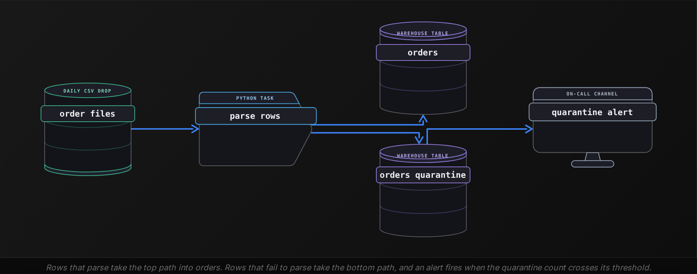

# Failure Handling: Beginner

A Stripe settlement pipeline pulls payout files from dozens of card networks overnight. One network's API goes down for 3 minutes during a deploy. All 400 workers see the error at the same moment. What each worker does in the next 10 seconds decides whether the API comes back or gets knocked over again by Stripe's own retries, and whether anyone notices before the finance team opens the report.


<br>

---

## Transient vs Permanent Failures

A task fails when a call it makes returns an error or never returns at all. The error says what happened; it does not say what to do next. That decision comes down to one question: if the task ran the same step again in 10 seconds, would it succeed? Each of the 3 possible answers calls for a different response.


<br>

### One question, 3 answers

A transient failure is one where the answer is yes. The cause sits outside your code and passes on its own: a network connection dropped halfway through a request, a database refused a new connection because its pool was full, an API returned 503 because the server behind it was restarting. The request itself was fine, so sending it again after a pause gets it through.

A permanent failure is one where the answer is no. The cause is in the request itself or in the code, and waiting changes nothing: the file you asked for does not exist, the API key expired last week, a record carries the string `N/A` where the schema expects an integer, a function raised `KeyError` on a column the source renamed. The second attempt fails for the same reason as the first, and so does the fiftieth.

An ambiguous failure is one where the error does not tell you. A request timed out after 30 seconds: did the server never receive it, or did it process the request and lose the response on the way back? A 500 Internal Server Error says the server hit a bug, which might be a one-off under load or might be triggered by your exact payload every time. The status code alone cannot settle it.

| What the task sees | Typical cause | Category | First response |
| --- | --- | --- | --- |
| Connection reset by peer | A network hop dropped the socket | Transient | Retry after a pause |
| 503 Service Unavailable | The service is restarting or overloaded | Transient | Retry after a pause |
| 429 Too Many Requests | You exceeded the service's rate limit | Transient | Retry after the pause the service asks for |
| 401 Unauthorized | The credential is wrong or expired | Permanent | Stop, alert, rotate the credential |
| 404 Not Found | The resource or endpoint does not exist | Permanent | Stop and alert |
| ValueError parsing a row | The data does not match the expected shape | Permanent | Set the row aside, continue |
| Timeout after 30 s | Slow network, slow server, or a lost response | Ambiguous | Retry only if the step is idempotent |
| 500 Internal Server Error | The server raised an unhandled error | Ambiguous | Retry a few times, then stop |


<br>

### The response follows the category

Transient failures get a retry: wait, then run the same step again, a limited number of times. Permanent failures get the opposite. Retrying them wastes the time budget, delays the alert that someone needs to see, and in the worst case does damage, such as locking an account after too many bad logins. The task should stop at once and surface the error with its full traceback.

Ambiguous failures are where the idempotency lesson pays off. A timed-out call to write a batch of 5,000 rows may have landed every row before the response was lost. If the write replaces the partition rather than appending, running it again is safe, and you can treat the timeout as transient. If the write appends, a retry risks 10,000 rows where 5,000 belong, and the timeout has to be treated as permanent until someone checks what landed. The category of an ambiguous error depends on the step, not on the error.

> Response by category
>
> - Transient: retry a limited number of times, with a pause between attempts
> - Permanent: stop immediately, keep the error, alert a person
> - Ambiguous and the step is idempotent: treat it as transient
> - Ambiguous and the step is not idempotent: treat it as permanent until verified

> **TIP**
>
> Classify by the exception class and the status code, never by searching the message text. Messages change between library versions; a `requests.Timeout` class or a 503 status is stable and can be matched in code.

**A nightly task that loads a partner's daily order file raised a different error on each of 4 nights. Which of these should the task stop on at once, rather than retry?**

- **A.** A 503 from the partner's API while it was mid-deploy, which cleared within a minute
- **B.** A KeyError: 'customer_id' raised after the partner renamed that column to cust_id
- **C.** A connection reset 40 seconds into downloading a 900 MB file from the partner
- **D.** A 30 second timeout on the first call, after which the partner's status page showed a brief outage

<details>
<summary>Solution</summary>

**B.** A KeyError: 'customer_id' raised after the partner renamed that column to cust_id

The column is gone from every future response too, so the second attempt fails the same way as the first. This is permanent: stop, keep the traceback, and alert someone to fix the mapping.

**Why the others are wrong**

- **A.** A 503 means the service could not serve the request right now. The cause is on their side and passes on its own, so this is transient and a paused retry is the right response.
- **C.** A reset socket is a network fault. The download is a read, so repeating it is safe, and this is a textbook transient failure that calls for a paused retry.
- **D.** A timeout is ambiguous on its own, and the status page resolves the ambiguity toward a passing outage. Since the call is a read, retrying it is safe.

</details>


<br>

---

## The Retry: Easy to Misuse

A retry is a loop that runs a failed step again. Writing one takes 5 lines, which is why most retry bugs come from loops written in a hurry. Every retry loop makes 4 decisions, whether the author noticed making them: which errors trigger another attempt, how many attempts are allowed, how long to wait between them, and what happens when the attempts run out.


<br>

### The loop that looks fine

```sql
while True:
    try:
        page = fetch_page(url)
        break
    except Exception:
        pass
```

This loop answers all 4 questions badly. `except Exception` retries every error, including the `KeyError` from a renamed column and the 401 from an expired key, both of which will fail identically forever. There's no pause, so a failing service receives a new request every few milliseconds from this one worker. There is no limit, so the task runs until someone kills it, and the orchestrator shows it as running rather than failed, which means no alert fires. And `pass` discards the exception, so when someone finally looks, there is no record of what went wrong.


<br>

### The bounded version

```sql
import time

import requests

RETRYABLE_STATUS = {500, 502, 503, 504}
MAX_ATTEMPTS = 5
WAIT_SECONDS = 2


def is_transient(err):
    if isinstance(err, (requests.ConnectionError, requests.Timeout)):
        return True
    if isinstance(err, requests.HTTPError):
        return err.response.status_code in RETRYABLE_STATUS
    return False


def fetch_with_retry(url):
    for attempt in range(1, MAX_ATTEMPTS + 1):
        try:
            response = requests.get(url, timeout=10)
            response.raise_for_status()
            return response.json()
        except requests.RequestException as err:
            if not is_transient(err) or attempt == MAX_ATTEMPTS:
                raise
            print(f"attempt {attempt} failed: {err}")
            time.sleep(WAIT_SECONDS)
```

`is_transient` encodes the first section's classification: connection errors, timeouts and the listed 5xx statuses are retried, nothing else. Status 429 is left out on purpose, because it needs the pause the service names in its `Retry-After` header, covered in the last section. `MAX_ATTEMPTS` is the budget: 5 attempts means 1 original call plus 4 retries. A permanent error or a spent budget hits the bare `raise`, which re-throws the original exception, so the task fails with the real traceback. Only a transient error with attempts left reaches `time.sleep`. The step is a read, so retrying a 500 or a timeout is safe. Around an appending write both are ambiguous, and the loop would drop 500 from `RETRYABLE_STATUS` and `requests.Timeout` from `is_transient`.

> **TIP**
>
> Count attempts, not retries, when you set the budget. `MAX_ATTEMPTS = 5` means the step runs at most 5 times. A budget described as '5 retries' means 6 runs, and the off-by-1 argument it starts costs more than the extra attempt.

| Attempt | Starts at | Result | What the loop does |
| --- | --- | --- | --- |
| 1 | 0 s | Timeout after 10 s | Sleep 2 s |
| 2 | 12 s | Timeout after 10 s | Sleep 2 s |
| 3 | 24 s | Timeout after 10 s | Sleep 2 s |
| 4 | 36 s | Timeout after 10 s | Sleep 2 s |
| 5 | 48 s | Timeout after 10 s | Raise; the task fails at 58 s |

The table shows the worst case: every attempt times out. The loop spends 50 seconds inside calls and 8 seconds sleeping, and raises at 58 seconds. If the orchestrator kills the task at 30 seconds, attempt 3 is cut off, the real error is never raised, and the task is marked as a timeout. Each orchestrator retry starts a fresh loop at attempt 1, so with 3 orchestrator retries, 4 runs make 12 calls instead of 5, and none ends with the real traceback. The task timeout has to exceed the loop's worst case, which you compute rather than guess.

| ✓ Do | ✗ Don't |
| --- | --- |
| • Name the exact exception classes and status codes that count as transient<br><br>• Set a fixed attempt budget and re-raise the real error when it is spent<br><br>• Sleep between attempts, even in the smallest loop<br><br>• Log each failed attempt with its number and the error | • Catch Exception and retry whatever lands in it<br><br>• Retry inside while True with no exit<br><br>• Swallow the last error with pass or a silent None<br><br>• Set the task timeout shorter than the loop's worst case |

**This loop wraps a CSV parse. What happens when the file has a malformed row that parse_csv rejects with ValueError?**

```python
def load_rows(path):
    for attempt in range(3):
        try:
            return parse_csv(path)
        except Exception:
            time.sleep(5)
```

- **A.** It parses 3 times, sleeps 15 seconds in total, then returns None and the caller continues as if it loaded nothing
- **B.** It raises ValueError on the first attempt, because a parse error is outside the loop's retryable list
- **C.** It parses 3 times, sleeps 15 seconds in total, then raises the last ValueError up to the caller
- **D.** It loops until the file is fixed, because range(3) restarts each time the exception is caught

<details>
<summary>Solution</summary>

**A.** It parses 3 times, sleeps 15 seconds in total, then returns None and the caller continues as if it loaded nothing

except Exception retries the permanent ValueError, and when the loop ends there is no raise, so the function falls off the end and returns None. Downstream code gets no rows and no error.

**Why the others are wrong**

- **B.** There is no retryable list. except Exception catches the ValueError along with everything else, so the first failure leads to a sleep, not a raise.
- **C.** The attempt count and the sleep are right, but nothing re-raises. After the third failure the loop ends and Python returns None.
- **D.** range(3) yields 3 values once. The loop is bounded; the problem is what happens after the third attempt, not an infinite loop.

</details>


<br>

---

## Naive Retries and Thundering Herd

The bounded loop is correct for 1 worker, and pipelines rarely have 1. Picture 100 workers running it, with the wait set to 1 second and a budget of 8 attempts, pulling settlement pages from a payments API that serves 40 calls per second. At the 30 second mark the API restarts and answers nothing for 200 milliseconds. Every call in flight fails, every worker sleeps the same 1 second, and all 100 retries arrive at the same instant. The API is healthy again, but 100 calls land in a window built for 40. The 60 that get a 503 sleep 1 second and arrive together again.

**Retry after 1 s**

https://github.com/user-attachments/assets/c316528b-4100-4177-ab9a-6388aa192d85

**Exponential backoff**

https://github.com/user-attachments/assets/b6674d50-609b-4388-a476-ed861ae3f24d

**Backoff + jitter**

https://github.com/user-attachments/assets/18a8c855-641c-4f97-8ee1-fe29b92b7059

Run the first variant and watch the arrivals. The original fault lasted 200 milliseconds. The service is then held at full capacity by retries for several seconds, and some workers are on their third or fourth attempt before the backlog clears. Every one of those extra calls was created by the clients' own retry policy. This is the thundering herd: a group of clients that fail together, wait the same amount, and return together.


<br>

### How a herd keeps a service down

The animation shows a blip. The expensive case is a real outage. Suppose the API falls over because its database is slow, and would recover in 2 minutes if left alone. During those 2 minutes every worker retries every second, so the API's first moments of recovery are met by 100 synchronised calls, which push it over again. It never gets a quiet moment to come back up. Meanwhile each worker burns through its 8 attempts in under 10 seconds, raises, and the orchestrator marks the task failed. Someone reruns the DAG, and the rerun launches another 100 workers into a service that is still down.


<br>

### Backoff spaces the waves, jitter spreads each one

Backoff spreads the waves apart in time. Instead of 1 second every time, the wait doubles after each failure: 1, 2, 4, 8 seconds. The service gets more room between waves, and a worker that has failed 7 times is calling once a minute. Jitter spreads the workers within a wave. Instead of sleeping exactly 4 seconds, each worker sleeps a random amount between 0 and 4 seconds. The 100 retries that used to land in the same millisecond now land across a 4 second window, at an average of 25 per second, under the service's capacity of 40.

Switch the animation to the second and third variants and compare how long the service stays pinned. With backoff alone the waves are further apart but each wave still hits as one spike. With jitter the spike dissolves into a trickle and the backlog drains within a few seconds of the fault, with far fewer calls made in total.


**A team adds exponential backoff (1 s, 2 s, 4 s, 8 s) to 500 workers but no jitter. The API they call handles 200 calls per second and goes down for 300 milliseconds. What happens on the first retry wave?**

- **A.** The 500 retries spread across the first second, so about 500 per second arrive and 300 of them fail
- **B.** About 200 retries arrive in the first second and the rest wait, because the API queues what it cannot serve
- **C.** All 500 retries succeed, because the outage was only 300 milliseconds and the API is healthy at 1 second
- **D.** All 500 retries arrive at the same instant 1 second after the failure, 300 get rejected, and those 300 return together 2 seconds later

<details>
<summary>Solution</summary>

**D.** All 500 retries arrive at the same instant 1 second after the failure, 300 get rejected, and those 300 return together 2 seconds later

Backoff changes the gap between waves but not the shape of a wave. Every worker computed the same 1 s wait, so the first wave is 500 simultaneous calls against capacity for 200. The rejected 300 all compute 2 s and come back as one group.

**Why the others are wrong**

- **A.** Without jitter nothing spreads them. They all arrive at the same instant, 1 second after the failure, rather than across the second.
- **B.** The API has no such queue in this scenario; calls above capacity are rejected. And the workers do not coordinate, so nothing holds 300 of them back.
- **C.** The API is healthy but its capacity is 200 per second. Health and capacity are different limits, and 500 simultaneous calls exceed the second one.

</details>


<br>

---

## Computing Exponential Backoff

Exponential backoff is a formula, and you should be able to run it in your head before you trust a library to run it for you. After the n-th consecutive failure, the wait before the next attempt is `wait = min(cap, base * 2 ** (n - 1))`. `base` is the wait after the first failure. The exponent doubles it with each further failure. `cap` is the ceiling the wait can never exceed. With the animation's settings, base is 1 second and cap is 60 seconds.

*Libraries differ on whether the first failure is numbered 0 or 1. Check which before comparing numbers; the shape of the curve is the same either way.*

| Failure number | base \* 2^(n-1) | After the 60 s cap | Cumulative sleep |
| --- | --- | --- | --- |
| 1 | 1 s | 1 s | 1 s |
| 2 | 2 s | 2 s | 3 s |
| 3 | 4 s | 4 s | 7 s |
| 4 | 8 s | 8 s | 15 s |
| 5 | 16 s | 16 s | 31 s |
| 6 | 32 s | 32 s | 63 s |
| 7 | 64 s | 60 s | 123 s |
| 8 | 128 s | 60 s | No sleep: attempt 8 was the last of the budget |

Doubling beats adding a second each time because a linear ramp of 1, 2, 3, 4 seconds grows too slowly to matter: after 10 failures a worker is still calling every 10 seconds, and 100 such workers still send 10 calls per second into a service that may need a minute of quiet. Doubling reaches a full minute between calls by the seventh failure.


<br>

### The cap keeps the wait finite

Without the cap the doubling never stops. By the eleventh failure the computed wait passes a quarter of an hour, and by the twentieth it is measured in days. A worker sleeping that long is indistinguishable from a hung task, and no outage is helped by a client that checks back next week. The cap turns the curve into a ramp with a flat top: doubling while the service most needs room, then a steady polling interval of 60 seconds once the wait is long enough. With the cap in place, the 7 waits in the table add up to about 2 minutes before the eighth and final attempt.

- **17 min** — uncapped wait after failure 11
- **6 days** — uncapped wait after failure 20


<br>

### Jitter: a random point inside the window

Full jitter replaces the computed wait with a random draw between 0 and that wait: `sleep = random.uniform(0, min(cap, base * 2 ** (n - 1)))`. The capped value becomes the top of a window rather than the wait itself. After the third failure a worker no longer sleeps 4 seconds; it sleeps somewhere between 0 and 4 seconds, and the 100 workers in a wave each draw their own number. Here are 3 workers that failed at the same moment, across their first 4 failures.

| Failure | Window (0 to) | Worker A draws | Worker B draws | Worker C draws |
| --- | --- | --- | --- | --- |
| 1 | 1 s | 0.8 s | 0.2 s | 0.5 s |
| 2 | 2 s | 1.7 s | 0.4 s | 1.1 s |
| 3 | 4 s | 0.3 s | 3.6 s | 2.2 s |
| 4 | 8 s | 6.9 s | 1.5 s | 4.8 s |

The average sleep is half the window, so jitter also shortens the typical wait. The cap still matters, because the window stops at 60 seconds and no draw exceeds it. Each worker draws fresh on every attempt, which breaks the synchronisation. Workers A and B failed in the same millisecond, but their later attempts are independent, so they collide only by chance rather than every time.

```sql
import random


def backoff_seconds(failures, base=1.0, cap=60.0):
    raw = base * 2 ** (failures - 1)
    window = min(cap, raw)
    return random.uniform(0, window)
```

This function is the whole policy. Call it with the number of consecutive failures so far, sleep for what it returns, and stop calling it once the attempt budget is spent. The retry loop from the previous section needs 1 change: replace the constant `WAIT_SECONDS` with `backoff_seconds(attempt)`.

**A retry policy uses base 0.5 s, cap 30 s and full jitter. A worker has failed for the 6th consecutive time. Which statement about its next sleep is right?**

- **A.** It sleeps exactly 16 s, because 0.5 multiplied by 2 to the 5th is 16 and that is under the cap
- **B.** It sleeps a random amount between 0 and 16 s, because 0.5 multiplied by 2 to the 5th is 16 and that is under the cap
- **C.** It sleeps a random amount between 0 and 30 s, because 0.5 multiplied by 2 to the 6th is 32 and the cap applies
- **D.** It sleeps a random amount between 0 and 32 s, because 0.5 multiplied by 2 to the 6th is 32 and nothing caps it

<details>
<summary>Solution</summary>

**B.** It sleeps a random amount between 0 and 16 s, because 0.5 multiplied by 2 to the 5th is 16 and that is under the cap

The 6th failure means an exponent of 5: 0.5 * 32 = 16 s. That is below the 30 s cap, so the window is 0 to 16 s and the worker draws a value inside it.

**Why the others are wrong**

- **A.** The arithmetic is right: 0.5 * 32 = 16 s, under the 30 s cap. But with full jitter 16 s is the top of the window, not the sleep itself.
- **C.** The exponent is failures minus 1, so it is 5, not 6. The raw value is 16 s, which the cap does not touch.
- **D.** Both the exponent and the cap are wrong here. The exponent is 5, giving 16 s, and even a 32 s value would be capped to 30 s.

</details>


<br>

---

## When NOT to Retry

A retry is the wrong tool for records that can't be processed, credentials that are rejected, and bugs in the pipeline's own code, which together account for nearly all the cases where retrying hurts. A retry on any of them produces the same error again, only later, with the alert delayed by the full length of the backoff schedule. Each category has its own destination.

| Category | Example | Why a retry cannot help | Route to |
| --- | --- | --- | --- |
| Bad record | A row with `shipped_at = 'yesterday'` in a timestamp column | The row is the same on every attempt | Quarantine storage, then continue |
| Rejected credential | 401 after the partner rotated the API key | The key stays wrong until a person replaces it | Stop, alert, rotate the credential |
| Code bug | `TypeError` because a function received a list instead of a dict | The code is the same on every attempt | Fail the task, alert the owner |
| Missing resource | 404 for an endpoint removed in the partner's v3 API | The endpoint will not come back | Fail the task, alert the owner |
| Rate limit | 429 with a `Retry-After: 120` header | It will help, after the pause the service names | Retry after exactly that pause |


<br>

### Bad records go to quarantine

A nightly file holds 2 million orders, and 12 of them have a text string in the `amount` column. Failing the whole task over 12 rows blocks 1,999,988 good rows from reaching the warehouse, and retrying the task re-reads the same 12 bad rows. Instead, catch the parse error per row, write the bad row to a quarantine table alongside the error message, the source file name and the time, and keep going. Good rows load as usual. The quarantine table is a storage location with a schema, so it can be queried, and the task raises an alert when the quarantine count crosses a threshold, say 100 rows.



```sql
from datetime import datetime


def load_file(path):
    good, bad = [], []
    for raw in read_csv(path):
        try:
            good.append(parse_order(raw))
        except ValueError as err:
            bad.append(
                {"raw": raw, "error": str(err), "file": path, "seen_at": datetime.utcnow()}
            )
    write_orders(good)
    write_quarantine(bad)
    if len(bad) > 100:
        alert(f"{len(bad)} rows quarantined from {path}")
```

The `except` here catches `ValueError` and nothing wider. A `KeyError` from a renamed column is a bug in the mapping rather than a bad row, and it should stop the task so the mapping gets fixed, instead of quarantining 2 million rows one at a time. The `error` field in each quarantine row is what lets someone fix the source or the parser tomorrow.


<br>

### Rejected credentials go to a person

A 401 or 403 means the service understood the request and refused it. The key has expired, been revoked, or lost a permission. Retrying has 2 costs beyond wasted time. Many services count failed authentications and lock the account after a handful, so a loop of 5 attempts with backoff can turn a 2 minute fix into a support ticket. And the backoff schedule delays the alert: with the cap at 60 seconds, a person hears about the problem minutes after the first 401 instead of immediately. The task should fail on the first 401 and raise an alert that names the credential, so the owner can rotate it. Rotation means issuing a new secret at the service, storing it where the task reads secrets, and rerunning the task.


<br>

### Bugs fail fast

A `TypeError`, `KeyError`, `AttributeError` or `ZeroDivisionError` from the pipeline's own code is the same on the hundredth attempt as on the first. The right response is the one Python gives by default: let it propagate, let the task fail, let the orchestrator alert the owner with the traceback. The bounded loop from earlier does this already, because `is_transient` returns `False` for anything outside its list. A loop that catches `Exception` turns a 1 line bug into a task that sleeps for 2 minutes before reporting the same traceback it had at second 0.

**A task that pulls invoices from a partner API starts receiving 403 Forbidden on every call at 02:00. Its retry loop uses backoff with a 60 s cap and 8 attempts. What should the task do differently?**

- **A.** Keep the loop but raise the cap to 300 s so the partner's permission change has time to propagate
- **B.** Retry twice with a short pause in case the 403 was a one-off, then fail the task and alert
- **C.** Fail on the first 403, alert with the credential's name, and have the owner rotate it before rerunning
- **D.** Quarantine the response body and continue to the next invoice page so the rest of the pull completes

<details>
<summary>Solution</summary>

**C.** Fail on the first 403, alert with the credential's name, and have the owner rotate it before rerunning

The credential was refused and will keep being refused. Failing at once gets the alert out immediately, avoids an account lockout, and routes the fix to the person who can issue a new credential.

**Why the others are wrong**

- **A.** Permissions do not propagate on a timer the task can wait out. A 403 is a decision by the service, and a longer cap only delays the alert further.
- **B.** A 403 is a permanent category. The 2 extra attempts are 2 more failed authentications against an account that may lock, and they gain nothing.
- **D.** Quarantine is for records that can't be parsed. A 403 means no page will be served, so continuing produces a 403 on every remaining page.

</details>


<br>

---

## Putting It All Together

A marketplace's nightly settlement DAG has 250 workers, each pulling one seller's payout file from a bank API that serves 100 calls per second. At 01:40 the bank deploys and returns 503 for 20 seconds. At 01:45 a new seller's file arrives with 30 rows whose payout_date reads TBD. At 02:10 the bank rotates the API key without warning and every call returns 401.

- The 503s are transient, and each worker's bounded loop retries them with exponential backoff and full jitter. The first window is only 0 to 1 s, so that wave still lands near 250 calls per second against capacity for 100. Each later window doubles, and by the 0 to 4 s window the remaining retries average about 62 per second, under capacity. The first 6 failures average around 31 s of sleep, which outlasts the 20 second outage well inside the 8 attempt budget.
- The 30 TBD rows are permanent failures at the row level: the parser quarantines them with the error and file name, loads the seller's other rows, and the alert stays quiet because 30 is under the threshold.
- The 401s are permanent at the task level: is_transient returns False , the task fails on the first one instead of sleeping through 8 attempts, and the alert names the credential so the owner rotates it and reruns.
- The rerun is safe because the payout load replaces each seller's partition rather than appending, which is also what made the earlier timeouts safe to classify as transient.


<br>

---

## Key Takeaways

- Every failure is transient, permanent or ambiguous, and the category decides the response before the error ever happens.
- A retry loop names its transient errors, sleeps between attempts, stops at a fixed budget, and re-raises the real error when the budget is spent.
- Many workers retrying on the same fixed schedule form a thundering herd that can keep a recovering service down.
- Exponential backoff spreads waves apart; jitter spreads workers within a wave; the cap keeps the longest wait sane. All 3 are required.
- Bad records go to quarantine, rejected credentials go to a person for rotation, and bugs fail fast with a traceback.

Exercises for this lesson: [_exercises/pa_failure_modes_beginner.md](_exercises/pa_failure_modes_beginner.md)
