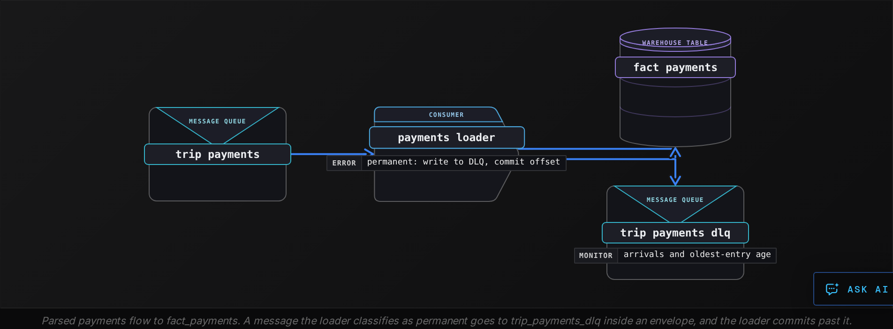
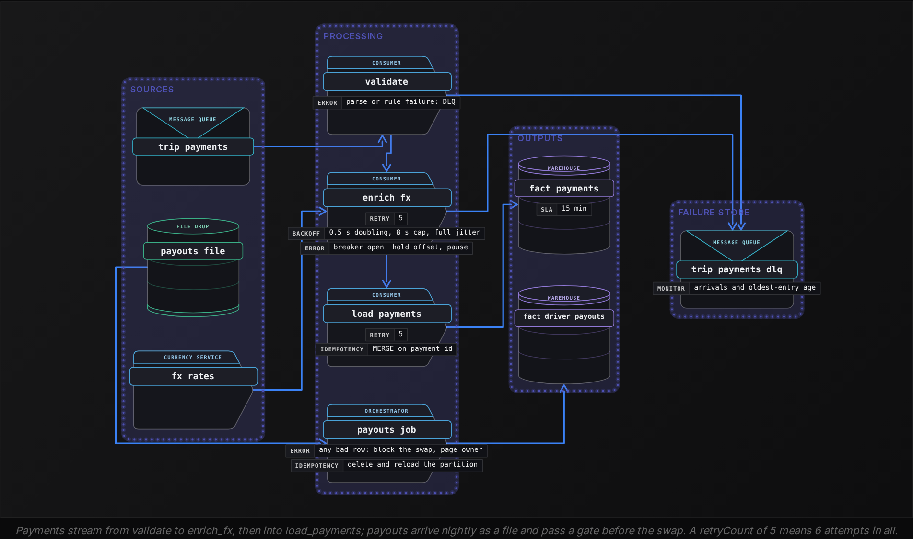

# Failure Handling: Intermediate

Friday, 18:00, at Uber. A fare-adjustment event arrives with its amount written as `12,50`, a German-locale decimal. The payments consumer can't parse it. Because it retries the event forever, every trip receipt behind it stalls. At 18:10 the currency service stops answering and 200 workers retry in lockstep. Whether dinner rides get paid tonight depends on where each failure is sent.


<br>

---

## Dead Letter Queue Basics

### A bad message blocks a whole partition

A consumer reads a queue partition in order and commits its offset only after processing a message. Suppose offset 918223 carries the amount `12,50`, which can never parse. The consumer cannot commit past it, so every later message on that partition waits. This is head-of-line blocking: a single permanent failure halts traffic with nothing wrong with it, and a retry loop with no exit keeps the consumer on that message indefinitely.

A dead letter queue (DLQ) is a second destination for messages the consumer has classified as unprocessable, each stored with the reason it failed. After writing the message to the DLQ, the consumer commits past it and moves on. The bad record is kept for a person to inspect, and the good records behind it load within seconds instead of waiting days for a fix.




<br>

### What goes in, and what stays out

| ✓ Send to the DLQ | ✗ Keep out of the DLQ |
| --- | --- |
| • A payload that fails to parse, such as an amount of 12,50<br><br>• A value that breaks a rule no retry can change, like a negative fare<br><br>• A schema version this consumer has never seen<br><br>• A message that crashed the consumer on 5 deliveries in a row | • A timeout from the warehouse<br><br>• A 503 from the currency service<br><br>• A dropped connection<br><br>• A rate-limit response that says when to come back |

The left column holds failures that belong to the message: replayed unchanged, it fails again. The right column holds failures of the world around it. Routing those to the DLQ during a 20-minute warehouse outage would bury thousands of valid payments among the broken ones, each needing a manual replay. They get retried instead, and a message whose retries run out stays uncommitted in the main queue to be tried again.

The last item on the left needs care. A **poison message** crashes the process, for example by exhausting memory, so no error handler ever runs: the consumer restarts, reads the same offset and crashes again. The fix is to count deliveries somewhere a crash can't erase, with one counter per partition and offset. The consumer increments it before handling a message and, at 5 deliveries, sends the message to the DLQ unprocessed.

**Which failure should the loader send to trip_payments_dlq?**

- **A.** The warehouse answers every write with a 503 for 40 seconds
- **B.** A payment whose fare is -14.00, which the rules forbid
- **C.** The warehouse times out on 3 writes in a row
- **D.** The consumer loses its connection during a network change

<details>
<summary>Solution</summary>

**B.** A payment whose fare is -14.00, which the rules forbid

Permanent: replayed unchanged, it fails again.

**Why the others are wrong**

- **A.** Transient: the same message loads once the warehouse recovers.
- **C.** Transient: the timeouts belong to the warehouse.
- **D.** Transient: reconnecting fixes it with no change to the message.

</details>


<br>

### The envelope

An entry holding only error text is useless a week later. Each DLQ entry wraps the original message in an envelope. Next to the payload it records the source offset and the error, plus the version of the code that rejected it.

```sql
{
  "original_payload": "{\"payment_id\": \"p-7003\", \"amount\": \"12,50\", \"currency\": \"EUR\"}",
  "source": {
    "topic": "trip_payments",
    "partition": 4,
    "offset": 918223
  },
  "error": {
    "class": "permanent",
    "type": "AmountParseError",
    "message": "amount '12,50' is not a decimal"
  },
  "attempts": 1,
  "first_failed_at": "2026-10-23T18:00:04Z",
  "last_failed_at": "2026-10-23T18:00:04Z",
  "consumer_version": "payments-loader 2.14.0",
  "schema_version": 7
}
```

| Field | Why replay needs it |
| --- | --- |
| original_payload | Replay sends these exact bytes back through the loader; a re-serialized copy can hide the bug |
| source topic, partition, offset | Locates the message in the source and shows whether it was ever committed |
| error class and type | Groups 4,000 entries into 3 causes instead of 4,000 stack traces |
| consumer_version | Tells you whether a fix has shipped since, so a replay is worth trying |


<br>

### Retention longer than the source

The envelope carries a copy of the payload because the source won't keep one. If `trip_payments` retains messages for 7 days, the original of offset 918223 is deleted on day 8, and from then on the DLQ holds the only copy of that payment. DLQ retention therefore has to cover the slowest realistic path from failure to replay.

| Step | Slow but realistic |
| --- | --- |
| Entry lands Friday 18:00, alert read Monday morning | 3 days |
| Root cause found, fix reviewed and deployed | 4 days |
| Replay run and row counts checked | 1 day |
| Total from failure to replay | 8 days |

A 7-day DLQ would delete this payment a day before the replay. Set DLQ retention well past the worst case, such as 30 days.

| ✓ Do | ✗ Don't |
| --- | --- |
| • Alert on DLQ arrivals and on the age of the oldest entry<br><br>• Name an owner: the team that owns the consumer<br><br>• Replay through the same loader code, so validation runs again | • Leave the DLQ unwatched: a queue nobody reads is a delete with a delay<br><br>• Edit payloads in place; publish a corrected copy and keep the original |

**DLQ entries hold only an error string and a timestamp. The decimal-comma fix ships 12 days after the first entry; trip_payments keeps messages 7 days. What happens to the first day's failed payments?**

- **A.** They replay from the DLQ through the fixed loader
- **B.** They are re-read from the topic using the failure timestamps
- **C.** They are lost: no payload in the DLQ, and the topic copy expired
- **D.** They load on their own once the fixed loader restarts

<details>
<summary>Solution</summary>

**C.** They are lost: no payload in the DLQ, and the topic copy expired

Without original_payload the DLQ cannot rebuild them, and after 7 days the topic can't either.

**Why the others are wrong**

- **A.** The entries hold no payload, so the fixed loader has no input.
- **B.** The topic deleted them on day 8.
- **D.** The loader committed past those offsets, so it never reads them again.

</details>


<br>

---

## Retry Budgets: Max, Delay, Jitter

### 4 limits around a retry loop

The beginner lesson gave retries a delay formula: wait longer after each failure. A retry budget is the set of limits around that formula, and each limit stops a different quantity from growing without bound. The payments loader's warehouse write uses the budget below, plus a timeout of 2 s on every attempt so a hung call cannot stretch a single attempt into minutes.

| Limit | What it bounds | Loader setting |
| --- | --- | --- |
| Max attempts | Calls one message makes to the warehouse | 6 |
| Base delay and cap | The length of any single wait | 0.5 s, doubling, capped at 8 s |
| Elapsed deadline | Total time a message can hold a worker | 20 s |
| Jitter | How many workers retry at the same instant | Full: a random wait from 0 to the computed delay |


<br>

### Walking the worst case

In the worst case every attempt hangs until its 2 s timeout. With jitter switched off so the arithmetic stays visible, the schedule runs like this.

| Attempt | Starts | Fails | Wait before next |
| --- | --- | --- | --- |
| 1 | 0.0 s | 2.0 s | 0.5 s |
| 2 | 2.5 s | 4.5 s | 1 s |
| 3 | 5.5 s | 7.5 s | 2 s |
| 4 | 9.5 s | 11.5 s | 4 s |
| 5 | 15.5 s | 17.5 s | 8 s |
| 6 | Would start at 25.5 s | Would end at 27.5 s | Refused: past the 20 s deadline |

The loader refuses to start an attempt that couldn't finish inside the deadline. Attempt 6 would run from 25.5 s to 27.5 s, so the loader stops at 17.5 s and hands the failure to the next layer. Max attempts allowed 6; the deadline allowed 5. Having both is deliberate: max attempts limits the load on the warehouse, and the deadline limits how stale the pipeline gets.

```sql
import random
import time


def call_with_budget(operation, max_attempts=6, base=0.5, cap=8.0,
                     deadline=20.0, attempt_timeout=2.0):
    start = time.monotonic()
    for attempt in range(1, max_attempts + 1):
        try:
            return operation(timeout=attempt_timeout)
        except TransientError:
            if attempt == max_attempts:
                raise
            delay = random.uniform(0, min(cap, base * 2 ** (attempt - 1)))
            elapsed = time.monotonic() - start
            if elapsed + delay + attempt_timeout > deadline:
                raise
            time.sleep(delay)
```

Only `TransientError` is caught. A permanent error, such as the `12,50` parse failure, passes straight through on the first attempt, which is how it reached the DLQ with `attempts: 1`.

**A loader's budget is 10 max attempts, a 1 s base delay that doubles, a 4 s cap, a 5 s timeout per attempt, and no elapsed deadline. If every attempt hangs until its timeout, how long can a single message hold a worker?**

- **A.** A total of 31 s, the sum of the 9 waits
- **B.** A total of 50 s, 10 attempts of 5 s each
- **C.** A total of 81 s: 50 s of attempts plus 31 s of waits
- **D.** No limit at all, because nothing sets a deadline

<details>
<summary>Solution</summary>

**C.** A total of 81 s: 50 s of attempts plus 31 s of waits

10 timeouts of 5 s, plus 31 s of waits: 7 waits of 4 s after an initial 1 s and 2 s.

**Why the others are wrong**

- **A.** Each of the 10 attempts also runs 5 s before timing out.
- **B.** This leaves out the 31 s of waits.
- **D.** Max attempts already bounds it; a deadline only tightens the bound.

</details>


<br>

### Jitter sized to what an attempt costs

Full jitter replaces each computed delay with a random wait between 0 and that delay, so 200 workers that failed in the same second spread their retries across a window. The window has to be wide enough that the retries arrive no faster than the downstream can serve them, and that depends on how long each attempt holds a connection.

The minimum window is workers \* seconds_per_attempt / concurrent_slots. Take a downstream that serves 20 requests at once. A currency lookup that holds a connection for 50 ms needs 200 \* 0.05 / 20 = 0.5 s of spread. A bulk load that holds a warehouse slot for 30 s needs 200 \* 30 / 20 = 300 s. The 0.5 s base delay that spreads the lookups well would start all 200 bulk loads within the same half-second, 10 times what the warehouse accepts.

When the warehouse fails for every message at once, each message spends its whole budget and the warehouse gets several times its normal traffic while it's weakest. A per-worker retry ratio closes the gap: each worker drops any retry that would push its retries above 10% of its calls in the last minute, which bounds fleet load because every worker applies it. A dropped retry leaves the message uncommitted for the next pass.

- **6x** — warehouse calls per message, all failing
- **1.1x** — calls per message under the retry ratio

**After a network blip, 120 backfill workers fail at the same moment. Each retry runs a 10 s query against a database that allows 40 concurrent queries. What is the smallest jitter window that keeps around 40 queries running at once?**

- **A.** A window of 30 s, so each slot runs 3 retries in turn
- **B.** A window of 3 s, the worker count divided by the slots
- **C.** A window of 0.25 s, the query time divided by the slots
- **D.** A window of 400 s, the slot count times the query time

<details>
<summary>Solution</summary>

**A.** A window of 30 s, so each slot runs 3 retries in turn

The window is 120 * 10 / 40 = 30 s, so retries finish about as fast as new ones start.

**Why the others are wrong**

- **B.** This drops the 10 s each query holds a slot.
- **C.** This ignores how many workers retry.
- **D.** This multiplies where it should divide, delaying recovery.

</details>


<br>

---

## Circuit Breakers Stop the Hammer

### When retries become the outage

A retry budget bets that the next attempt might work. During a long outage that bet loses every time. At 18:10 the currency service that `enrich_fx` calls to convert EUR fares to USD stops answering for 10 minutes. The enricher uses the same budget as the loader, so each worker spends 5 attempts and 17.5 s on a message, leaves its offset uncommitted, and starts over on the same message. No payment gets through, and the service absorbs a steady flood of calls while it tries to restart.

A circuit breaker sits between a caller and a single dependency, watches the outcomes of recent calls, and stops calling once failures cross a threshold. While it's open, every call fails at once with `CircuitOpen`. That failure takes microseconds and sends nothing over the network, so the struggling service gets quiet in which to recover.

- **57 per s** — calls on the down service, no breaker
- **0** — calls while the breaker is open


<br>

### Closed, open, half-open

| State | What a call does | Next state | When |
| --- | --- | --- | --- |
| Closed | Goes through; its outcome joins a window of the last 20 calls | Open | At least 10 of the last 20 calls failed |
| Open | Fails at once with `CircuitOpen`, no network call | Half-open | The 30 s cooldown has passed |
| Half-open | Lets 3 trial calls through; the rest fail at once | Closed | All 3 trials succeed |
| Half-open | Same trial rule | Open | Any trial fails; the 30 s cooldown restarts |

Each cooldown ends with 3 trial calls, a load any restarting service can take. When the service returns at 18:20, all 3 calls in the next probe succeed and the breaker closes. Traffic resumes within 30 s of the recovery.

#### Why each number is there

- **A window of 20 calls** *Trips on evidence*\
  Without a minimum, 1 failure in the first 2 calls reads as 50%.
- **A 50% failure rate** *Trips on outages*\
  A few slow calls leave it closed; a dead service trips it in seconds.
- **A 30 s cooldown** *Gives recovery room*\
  Long enough for a restart to finish, short enough to notice recovery within a minute.
- **Trials of 3 calls** *Probes gently*\
  A single success could be luck; 3 in a row is evidence, and far short of a stampede.

**A breaker opens at 14:00:00 with a 30 s cooldown and 3 trial calls. At 14:00:31 the first trial succeeds and the second times out. What happens next?**

- **A.** It closes, because a trial succeeded
- **B.** It stays half-open until the third trial returns
- **C.** It stays open until an operator resets it
- **D.** It opens again, with new trials about 30 s later

<details>
<summary>Solution</summary>

**D.** It opens again, with new trials about 30 s later

Any failed trial sends it back to open with a fresh 30 s cooldown.

**Why the others are wrong**

- **A.** Closing needs all 3 trials to succeed.
- **B.** A single failed trial reopens it; it doesn't wait for the third.
- **C.** The cooldown timer starts new trials on its own.

</details>


<br>

### What the pipeline does with CircuitOpen

The code that catches `CircuitOpen` decides what happens next. The error says nothing about the message, so it is classified as transient and the message never goes to the DLQ. The enricher stops polling and leaves its committed offset where it is. After the cooldown, `allow_request` lets it take up to 3 messages from that offset as the half-open trials. Once all 3 succeed, the breaker closes; consumption picks up from that offset, so no payment is lost or skipped. A single failed trial pauses the enricher again.

```sql
def enrich(message, breaker, fx_client):
    if not breaker.allow_request():
        raise CircuitOpen("fx_rates")
    try:
        rate = fx_client.get_rate(message["currency"], timeout=2.0)
    except TransientError:
        breaker.record_failure()
        raise
    breaker.record_success()
    return {**message, "amount_usd": message["amount"] * rate}
```

This function runs inside `call_with_budget`, so every retry attempt counts toward the failure rate. `CircuitOpen` is deliberately a separate error from `TransientError`: the retry loop does not catch it, so an open breaker ends the loop on the spot instead of sleeping through 5 attempts that are certain to fail.

| ✓ Retry budget | ✗ Circuit breaker |
| --- | --- |
| • Scope: a single call and its attempts<br><br>• Expects the next attempt to work<br><br>• Adds load: up to 6 calls per message<br><br>• Fits blips that last seconds | • Scope: every call to a dependency<br><br>• Expects failure until a trial succeeds<br><br>• Removes load: 0 calls while open<br><br>• Fits outages that last minutes |

**A teammate changes the handler so that CircuitOpen sends the message to trip_payments_dlq, since a fast failure is still a failure. What does the next 10-minute currency outage do?**

- **A.** Nothing changes: the breaker keeps calls off the service and the DLQ stays empty
- **B.** It fills the DLQ with valid payments for 10 minutes, each needing a replay
- **C.** It keeps the breaker closed, since dead-lettered calls skip the failure count
- **D.** It pauses the consumer at its offset as before, and only the DLQ alert changes

<details>
<summary>Solution</summary>

**B.** It fills the DLQ with valid payments for 10 minutes, each needing a replay

CircuitOpen says nothing about the payment, so every payment read while the breaker is open lands in the DLQ.

**Why the others are wrong**

- **A.** The breaker still keeps calls off, but each CircuitOpen now dead-letters a valid payment.
- **C.** The breaker opens on the attempts it saw; dead-lettering happens only after it is open.
- **D.** Pausing requires treating CircuitOpen as transient; this change commits past every message instead.

</details>


<br>

---

## Partial Failure in a Batch

### A file of 10,000 rows with 37 bad ones

At 02:00 on Sunday the payouts job loads a file of driver payouts into the `2026-10-24` partition of `fact_driver_payouts`. The file has 10,000 rows, and 37 of them have an `amount_raw` that won't cast to a decimal. A batch has to decide what the partition holds as a whole, and there are 3 answers.

| Strategy | Partition this morning | The failures | Rerun after the fix |
| --- | --- | --- | --- |
| All-or-nothing | Empty; the swap never ran | Run blocked, owner paged | All 10,000 rows |
| Skip-and-quarantine | 9,963 rows | 37 rows in `quarantine_driver_payouts` | The 37 rows |
| Partial commit, 10 chunks of 1,000 | 8,000 rows from 8 chunks | Chunks 3 and 8 marked failed in a run ledger | 2,000 rows in 2 chunks |

#### All-or-nothing: a partial answer is a wrong answer

`fact_driver_payouts` feeds the bank transfer file. A partition with 9,963 rows looks healthy: it has a total, and 37 payouts are missing with nothing on any dashboard to say so. When a consumer acts on a partial output as if it were complete, the batch must land whole or not at all. The job loads into `staging_driver_payouts` first and swaps the partition in only after a check passes.

```sql
SELECT
  COUNT(*) AS total_rows,
  COUNT_IF(TRY_CAST(amount_raw AS DECIMAL(12, 2)) IS NULL) AS bad_rows
FROM staging_driver_payouts
WHERE batch_date = DATE '2026-10-24'
```

The task running this query fails when `bad_rows` is above 0, so the swap task downstream of it never runs and every earlier partition stays as it was. Here the rerun is cheap, a 4-minute load, so discarding 9,963 good rows costs almost nothing.

#### Skip-and-quarantine: a gap you can name

Suppose instead the file fed only a driver-earnings dashboard that the operations team reviews weekly. A gap of 0.37% is acceptable there, as long as it is recorded and later filled. The job writes failing rows to a quarantine table with a reason, then loads the rest. A threshold still guards against a broken file: when more than 1% of rows fail, the file itself is suspect and the run stops.

```sql
INSERT INTO quarantine_driver_payouts
SELECT
  payout_id,
  driver_id,
  amount_raw,
  'amount_raw is not a decimal' AS reason,
  batch_date
FROM staging_driver_payouts
WHERE batch_date = DATE '2026-10-24'
  AND TRY_CAST(amount_raw AS DECIMAL(12, 2)) IS NULL
```

The load into `fact_driver_payouts` uses the opposite filter, `IS NOT NULL`. Both statements are preceded by a delete of the `2026-10-24` rows they wrote earlier, so a rerun replaces its output instead of appending to it. When the 37 rows are corrected, they are merged into the partition on `payout_id`, the business key, so a second fix attempt cannot double them.

#### Partial commit: a run too costly to repeat

Now change a single fact: before loading, every row is scored by a fraud service, and each chunk of 1,000 rows takes 25 minutes, so the run takes over 4 hours. The job commits each chunk in its own transaction and records it in a ledger. A chunk fails as a unit, whether a row inside it is bad or a write times out, and the job carries on with the next chunk.

| chunk_id | rows | status | finished_at |
| --- | --- | --- | --- |
| 1 | 1 to 1,000 | committed | 02:25 |
| 2 | 1,001 to 2,000 | committed | 02:50 |
| 3 | 2,001 to 3,000 | failed | 03:15 |
| 4 to 7 | 3,001 to 7,000 | committed | 04:55 |
| 8 | 7,001 to 8,000 | failed | 05:20 |
| 9 to 10 | 8,001 to 10,000 | committed | 06:10 |

Partial commit needs 2 things the other strategies do not: the ledger, and writes that replace by `chunk_id`, so a chunk that half-wrote before failing can run again without doubling rows. The resumed run reads the ledger and processes only chunks 3 and 8, taking 50 minutes instead of 250. The price is consistency: until both chunks land, the partition holds 8,000 of 10,000 rows, and consumers must either accept that or wait for the ledger to show all 10 chunks committed.

**A chunked job writes each chunk with a plain INSERT, then marks it committed in the ledger. Chunk 6's insert succeeds, then the job crashes before the ledger update. What does the resumed run do?**

- **A.** Runs chunk 6 again and appends its 1,000 rows a second time
- **B.** Skips chunk 6, because its insert already succeeded
- **C.** Rolls chunk 6 back, then runs it once more
- **D.** Stops at chunk 6 with a duplicate-key error

<details>
<summary>Solution</summary>

**A.** Runs chunk 6 again and appends its 1,000 rows a second time

The ledger still shows chunk 6 as pending, and a plain insert appends. Replacing by chunk_id fixes it.

**Why the others are wrong**

- **B.** The resumed run trusts the ledger, which never recorded that success.
- **C.** The insert committed in its own transaction, so nothing is left to roll back.
- **D.** Only a declared unique key raises that, and this table has none.

</details>


<br>

### The decision as a grid

| Consumers of the output | Rerun is cheap | Rerun is expensive |
| --- | --- | --- |
| Act on totals: payments, ledgers, tax filings | All-or-nothing | Partial commit into staging; publish once every chunk commits |
| Tolerate a recorded gap: dashboards, exploration | Skip-and-quarantine | Partial commit with a quarantine for bad rows |

**A nightly job builds daily_revenue_by_city, which finance uses to file city sales-tax remittances. The run takes 6 minutes. Last night 12 of 400,000 rows had a null city. Which strategy fits?**

- **A.** Skip-and-quarantine, since 12 rows is far below any threshold
- **B.** Partial commit, keeping clean chunks and rerunning failed ones
- **C.** Load every row and file the 12 under a city named unknown
- **D.** All-or-nothing, blocking the publish until the 12 rows are fixed

<details>
<summary>Solution</summary>

**D.** All-or-nothing, blocking the publish until the 12 rows are fixed

A filing built from a partial table is wrong without looking wrong, and a 6-minute rerun is cheap.

**Why the others are wrong**

- **A.** Finance acts on the totals, so any missing row makes a filing wrong, whatever the threshold.
- **B.** Partial commit pays off when reruns are expensive; this one takes 6 minutes.
- **C.** The totals add up, but tax for 12 rows goes to no real city.

</details>


<br>

---

## Pipeline Handling All Three

### The third kind: ambiguous

The chunk 6 crash from the ledger question is a third kind of failure, an ambiguous one: the caller cannot tell whether the operation took effect. A warehouse write that times out after 2 s may have committed a millisecond before the connection dropped. Retrying it is safe only when the write is idempotent; otherwise the retry turns uncertainty into a duplicate payment.

| Failure | Example here | Recovery path |
| --- | --- | --- |
| Transient, short | Warehouse returns 503 for 2 s | Retry inside the budget |
| Transient, sustained | Currency service down 18:10 to 18:20 | Breaker opens; consumer holds its offset and resumes |
| Permanent, single message | Amount `12,50` | DLQ with envelope; consumer commits past it |
| Permanent, rows in a batch | 37 payout rows fail the cast | Gate blocks the swap; owner fixes and reruns |
| Ambiguous | Write times out after it committed | Retry, made safe by MERGE on `payment_id` |




<br>

### Rules that make the layers compose

- Classify first: every error maps to transient, permanent or ambiguous before any handler runs.
- The breaker is checked on every attempt inside the retry loop, so each attempt counts toward its failure rate.
- An open breaker stops the retry loop and pauses consumption; it never writes to the DLQ.
- Every write that can be retried is idempotent, because a timeout can hide a success.
- An error nobody has classified gets the retry budget, then goes to the DLQ marked unknown.

```sql
PERMANENT = (AmountParseError, RuleViolation, UnknownSchemaVersion)
TRANSIENT = (ServiceUnavailable, ConnectionReset, RateLimited)
AMBIGUOUS = (WriteTimeout,)


def recovery_path(error):
    if isinstance(error, CircuitOpen):
        return "pause"
    if isinstance(error, PERMANENT):
        return "dead_letter"
    if isinstance(error, AMBIGUOUS):
        return "retry_idempotent"
    if isinstance(error, TRANSIENT):
        return "retry"
    return "retry_then_dead_letter_unknown"
```

**The currency service starts returning 400 unsupported currency XAF for 0.2% of payments, and the classifier has no rule for it. What happens, and what's the fix?**

- **A.** The breaker opens and pauses the pipeline; raise its failure threshold
- **B.** They exhaust the retry budget and reach the DLQ as unknown; add a permanent rule
- **C.** The payments vanish without a trace; add a log line to catch them
- **D.** The payments block their partition for good; add an elapsed deadline

<details>
<summary>Solution</summary>

**B.** They exhaust the retry budget and reach the DLQ as unknown; add a permanent rule

The fallback retries, then dead-letters them as unknown. A permanent rule dead-letters them on attempt 1, sparing the service 5 retries each.

**Why the others are wrong**

- **A.** At 0.2% far fewer than 10 of every 20 calls fail, so the breaker stays closed.
- **C.** The classifier's last line gives unknown errors a path, so none vanish.
- **D.** The budget already has a 20 s deadline, after which the unknown path dead-letters them.

</details>


<br>

### Friday's 10 minutes, layer by layer

| Time | What happens | Layer that acts | Outcome |
| --- | --- | --- | --- |
| 18:00:04 | Offset 918223 carries amount `12,50` | validate | DLQ entry written, offset committed |
| 18:06:41 | Warehouse returns 503 for 2 s | load_payments retry | Succeeds on a later attempt |
| 18:10:02 | Currency service stops answering | enrich_fx breaker | Opens once 10 of its last 20 calls fail |
| 18:10:32 | First half-open trial times out | enrich_fx breaker | Reopens for another 30 s |
| 18:20:32 | All 3 trials succeed | enrich_fx breaker | Closes; consumer resumes from its held offset |
| 18:20:35 | Write for payment p-7120 times out after committing | load_payments retry | MERGE finds the row; no duplicate |

Every row of the Outcome column ends in a named state. Messages that are set aside have an owner; the rest are committed or retried, or wait while the consumer is paused. None ends with a payment dropped or doubled.

**To speed up loading, a teammate replaces the MERGE on payment_id in load_payments with a plain INSERT. Which row of the Friday timeline now corrupts fact_payments?**

- **A.** The 18:00:04 row, because the DLQ path writes the payment twice
- **B.** The 18:06:41 row, because the 503 retry writes the payment twice
- **C.** The 18:20:35 row, because the retried write adds a second copy
- **D.** The 18:20:32 row, because resumed messages are written twice

<details>
<summary>Solution</summary>

**C.** The 18:20:35 row, because the retried write adds a second copy

The first write committed before the timeout, so a plain insert on retry duplicates the payment. Only the ambiguous failure needed the MERGE.

**Why the others are wrong**

- **A.** Validation rejects it before the load step.
- **B.** A 503 means the warehouse rejected the first write, so the retry writes it once.
- **D.** The held offsets were never loaded, so each resumed message loads once.

</details>


<br>

---

## Putting It All Together

Uber's driver payments pipeline on a Friday evening: a fare event with a decimal comma, a 10-minute outage of the currency service, a warehouse write that times out after it committed, and a nightly payouts file with 37 unparseable amounts. By morning each failure sits in a named place, and no driver is paid twice or left unpaid.

- The envelope written at 18:00:04 is what makes the day-8 replay possible after the topic's 7 days run out.
- The retry budget absorbs the warehouse 503s, and its deadline keeps a hung call from holding a worker past 20 s.
- The breaker is consulted on every retry attempt, so at 18:10 it cuts calls to the currency service and holds offsets instead of filling the DLQ.
- MERGE on payment_id turns the 18:20:35 timeout into a harmless retry, the same replace-instead-of-append rule the payouts job follows.
- The payouts gate blocks the swap because the bank file acts on totals; a dashboard-only output would have quarantined the 37 rows.


<br>

---

## Key Takeaways

- A DLQ holds messages that will fail again unchanged, each wrapped in an envelope: the payload with its source offset, plus the error and the code version that raised it.
- DLQ retention must comfortably exceed the slowest path from failure to replay, because after the source's retention expires the DLQ holds the only copy.
- A retry budget caps the number of attempts and the length of each wait, and it keeps retries from synchronizing. Its deadline caps total elapsed time, which protects freshness.
- Size the jitter window as workers times seconds per attempt, divided by the slots the downstream can serve.
- A circuit breaker turns a sustained outage into fast failures; CircuitOpen pauses consumption and never reaches the DLQ.
- Pick all-or-nothing, skip-and-quarantine or partial commit by whether consumers act on totals and what a rerun costs.
- Ambiguous failures are safe to retry only through idempotent writes.

Exercises for this lesson: [_exercises/pa_failure_modes_intermediate.md](_exercises/pa_failure_modes_intermediate.md)
