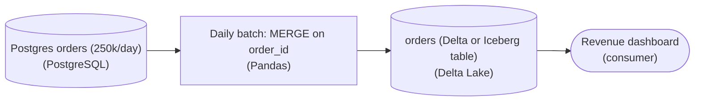
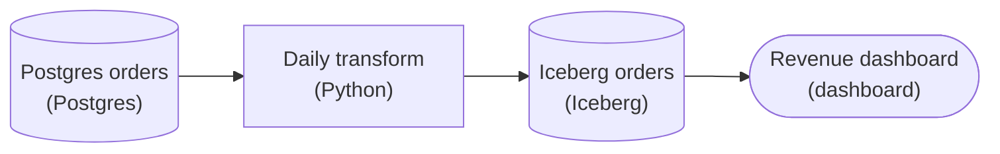
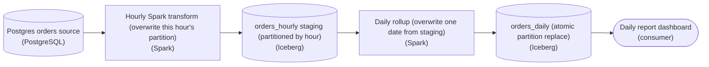
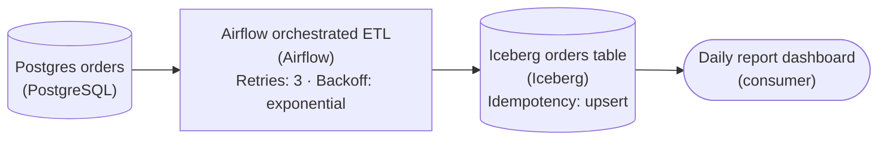
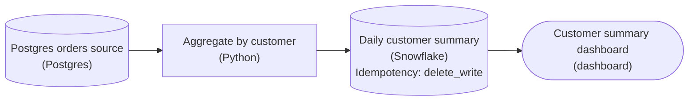
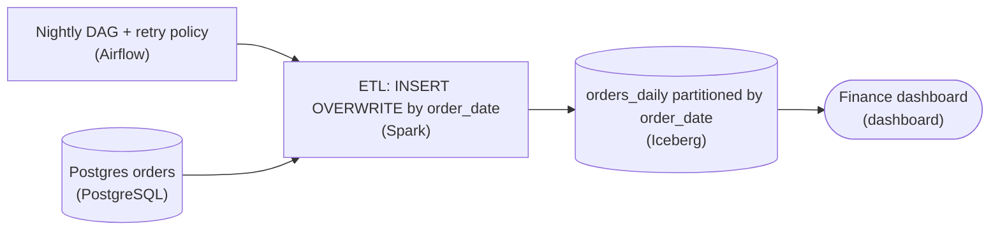
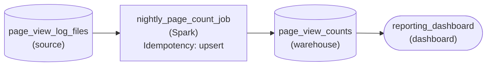
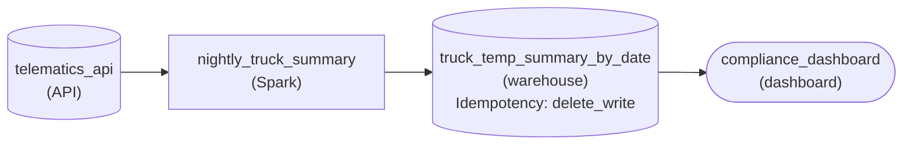
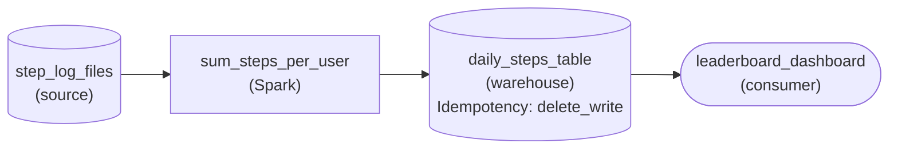
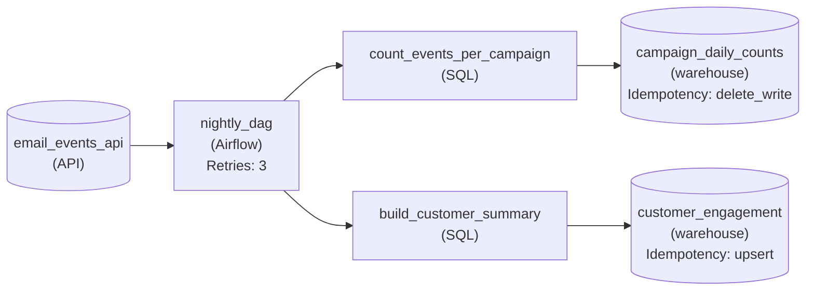

# Idempotent Reruns: Beginner - Exercises

Lesson: [pa_idempotency_beginner.md](../pa_idempotency_beginner.md)

### Exercise 1 of 10

**● TASK**

A daily Python job appends 250,000 Postgres orders into a plain Snowflake table feeding the revenue dashboard, and a crashed run that was retried loaded every order twice. Replace that destination with a lakehouse table format (Delta Lake or Iceberg) that atomically overwrites a day's data, so re-running a day's load lands the same rows no matter how often it repeats.

**Starting canvas** (already placed for you):

- Postgres orders source (250k rows/day) (source, PostgreSQL)
- Daily Python ETL: INSERT INTO orders, append-only (transform, Pandas)
- Plain Snowflake orders (430k rows after Tuesday's retry, 250k expected) (storage, Snowflake)
- Revenue dashboard (41% inflated, undetected) (consumer, Looker)

<details>
<summary><strong>Solution</strong></summary>

#### Idempotency by keyed upsert, not by append

The concept this challenge is built on is **idempotency**: running the same day's load once or 5 times should leave the table in the exact same state. The old job wasn't idempotent because it used `INSERT INTO orders` in append mode, and an append has memory of nothing. Each run blindly adds rows, so a crash-and-retry writes Tuesday's 250,000 orders twice and you get 430,000 rows with no error to warn you. The fix has two halves that work together: land the data on a table format that supports transactional writes (Delta Lake or Iceberg), then load it with a `MERGE` keyed on the natural business key, `order_id`, instead of a blind append.

| Pitfall: Append plus retry silently double-counts |
| --- |
| The trap is that `INSERT INTO orders` succeeds perfectly on the retry. There is no primary-key violation on a plain Snowflake table, no duplicate error, nothing. The pipeline stays green while the dashboard inflates 41 percent, and revenue is exactly the kind of metric nobody double-checks until finance does. A load that can run twice must be written so the second run is a no-op, not so it's fast. |



*Same shape as before, but the destination is a table format and the write is a keyed merge, so a repeated run converges instead of accumulating.*

**The idempotent load**

```sql
MERGE INTO orders AS target
USING daily_batch AS source
  ON target.order_id = source.order_id
WHEN MATCHED THEN UPDATE SET
  amount     = source.amount,
  status     = source.status,
  updated_at = source.updated_at
WHEN NOT MATCHED THEN INSERT
  (order_id, amount, status, updated_at)
  VALUES (source.order_id, source.amount, source.status, source.updated_at);
```

*Run this once or 10 times: rows that already exist get overwritten in place, new rows get inserted, and the row count converges to the true set of orders.*

Why the table format is load-bearing: rewriting a day has to be all-or-nothing, or a crash mid-write leaves you half-applied. Delta Lake and Iceberg wrap each write in a transaction backed by a commit log or manifest, so the `MERGE` either commits as a whole or not at all, and a reader never sees a partial batch. That guarantee is what makes 'just re-run it' a safe operational answer instead of a gamble.

| Real world: This is why re-running is the normal recovery path |
| --- |
| In production, jobs crash constantly: a spot node dies, a network blip kills a connection, someone deploys mid-run. On idempotent, keyed-merge pipelines the on-call fix is simply to re-run the day, because a second run converges. On append pipelines every failure becomes a manual archaeology dig to find and delete the partial rows before retrying. Idempotency is what lets you automate retries at all. |

**Follow-up questions**

1. What if `daily_batch` itself contains 2 rows for the same `order_id`?\
   *MERGE errors on a non-deterministic match; you have to dedupe the source to one row per key first, e.g. keep the latest `updated_at`.*
2. How would you make the load restartable at the partition level rather than reloading a whole day?\
   *Tests whether they reach for partition overwrite / replaceWhere as a coarser form of the same idempotency guarantee.*

</details>


<br>

### Exercise 2 of 10

**● TASK**

Two candidate destinations sit on the canvas. The plain Snowflake table accumulates rows on every run; the Iceberg table sets the partition's state regardless of prior content. Apply the section's two-run test (run the pipeline twice on the same date) and route the dashboard through the destination that passes.

**Starting canvas** (already placed for you):

- Postgres orders (source, Postgres)
- Daily transform (transform, Python)
- Plain Snowflake orders (INSERT INTO append; ACCUMULATE) (storage, Snowflake)
- Iceberg orders (ACID partition overwrite; SET state) (storage, Iceberg)
- Revenue dashboard (currently reads inconsistent numbers from both) (consumer, Looker)

<details>
<summary><strong>Solution</strong></summary>

#### Idempotency: run it twice, get the same answer

The concept this challenge asked you to apply is **idempotency**: a pipeline step is idempotent when running it again for the same date leaves the destination in the same state as running it once. Pipelines re-run all the time (a retry after a timeout, a manual backfill, a scheduler double-fire), so the destination has to treat a re-run as a correction, not as more data. That is the whole reason the section gave you the two-run test: run the pipeline twice on the same date and check whether the numbers move.

| ✕ Plain Snowflake table (append) | ✓ Iceberg table (partition overwrite) |
| --- | --- |
| The transform ends in `INSERT INTO orders ...`, so every run ACCUMULATES rows. Run day '2026-09-17' once and you get that day's orders. Run it again and those same orders land a second time. Revenue for the day now reads double, and a third retry triples it. The row count is a function of how many times the job fired, not of what happened that day. | The transform SETS the partition's state: it ACID-overwrites the whole '2026-09-17' partition with the current computed rows. Run once, run again, run 10 times, and the partition holds exactly one copy of the day's orders every time. The destination is a function of the DATA, not of the number of runs, so it passes the two-run test. |



*The route that passes the two-run test: the dashboard reads the partition-overwrite destination, and the append table is left off the path.*

| Pitfall: "It worked the first time" hides the bug |
| --- |
| The append table looks correct on a single clean run, which is exactly why it is dangerous. The `INSERT INTO` only misbehaves on the SECOND run, and by then the wrong number is already on the dashboard. Do not confirm a destination by running the pipeline once. The two-run test exists because this failure mode is invisible until a re-run happens, and in production a re-run always happens eventually. |

| Key insight: Why the table format is doing the work |
| --- |
| The append side would need a full-vs-incremental strategy plus a dedup or a delete-before-insert to become safe. The Iceberg side gets there for free because the format supports an ACID partition overwrite: it replaces the '2026-09-17' partition atomically, so readers never see a half-written or doubled state. That is the difference between a plain table and a table FORMAT, and it is why picking the destination here is an idempotency decision, not just a storage-engine preference. |

In real work this is the shape of most "the numbers are off by 2x on Tuesdays" incidents: a job retried, an append destination double-counted, and nobody noticed until a total looked wrong. Designing the destination to SET state per partition instead of ADD rows means retries and backfills are safe by construction, which is what lets you re-run history without writing a cleanup script first.

**Follow-up questions**

1. The transform is genuinely incremental and only ever produces NEW order ids that never change. Is the append table safe now?\
   *Tests whether append-only is idempotent ONLY when the key is guaranteed new-and-immutable, since a retry re-emitting the same id still doubles it.*
2. A late correction arrives for an order dated 3 days ago. How does the partition-overwrite destination handle it versus the append one?\
   *Tests that overwriting the old partition applies the correction cleanly, while append leaves both the wrong and the right row.*

</details>


<br>

### Exercise 3 of 10

**● TASK**

Retries on this pipeline double the day's numbers because the hourly job appends its rows into a daily-partitioned table. Rebuild it with partition overwrite: land each hourly run in a staging table, then write the daily table from that staging table. Both tables must use a table format that replaces a partition atomically, so rerunning any step leaves the same state as a clean first run.

**Starting canvas** (already placed for you):

- Postgres orders source (rows arrive hourly) (source, PostgreSQL)
- Hourly Spark transform: INSERT INTO daily partition (cadence/grain mismatch) (transform, Spark)
- Plain Snowflake orders (daily partition; INSERT INTO appends; no atomic OVERWRITE) (storage, Snowflake)
- Daily report dashboard (numbers drift across hourly retries) (consumer, Looker)

<details>
<summary><strong>Solution</strong></summary>

#### Why a retry doubled the day

The property you built toward has a name: **idempotency**, a write that leaves the table in the same state whether it runs once or 5 times. The append job never had it. Each `INSERT INTO` adds this run's rows to whatever the day's partition already holds, so the result depends on how many times the run fired. The rebuild makes every write declare the full contents of the slice it owns and replace that slice, so a rerun overwrites instead of piling up.

| Pitfall: Append makes the row count depend on the retry count |
| --- |
| `INSERT INTO` is additive by definition: the daily partition gains one copy of the hour's rows per run. A retry after a partial failure is the worst case, some rows already landed and the rerun adds them again, so the dashboard reads a day that never happened. A downstream dedup or `MERGE` only papers over a write that should have been a replace. |



*The hourly writer owns `orders_hourly`; `orders_daily` is derived from it, so each write replaces a full partition.*

1. **Stage the hourly output at its own grain**

   Land each Spark run in `orders_hourly`, partitioned by hour, not by day. The run now owns exactly one partition and replaces it outright. Cadence and grain finally match, which is what the original got wrong: an hourly writer reached into a daily partition it shared with 23 other runs.

2. **Rebuild `orders_daily` from staging**

   Make the daily table derived: overwrite `orders_daily` for a date by selecting every staged hour of that date. Because the read is the whole day, the write is complete by construction, rerun it after any hour changes and the day is recomputed from scratch, never added to.

3. **Pick a format that replaces a partition atomically**

   Both tables need a format like `Iceberg` or `Delta` where swapping a partition is one atomic commit. Plain `INSERT INTO` on an unmanaged table has no all-or-nothing replace, so a partial failure leaves half-written rows. Atomic overwrite means a crashed rerun either fully lands or leaves the prior partition untouched.

**Follow-up questions**

1. Beyond the write mode, what must be true of the Spark transform for a rerun to be safe?\
   *Deterministic transforms: non-deterministic logic breaks idempotency even with an atomic overwrite.*
2. How would you overwrite only the hours that changed instead of the whole date?\
   *Dynamic partition overwrite versus a static full-day replace, and the cost trade-off.*

</details>


<br>

### Exercise 4 of 10

**● TASK**

A duplicate-row incident from append-only writes spooked the team into turning retries off entirely, so now every transient blip pages someone at 3 a.m. to rerun the job by hand. The lesson's fix is a two-way contract: a destination whose writes are safe to repeat, plus an orchestrator that owns the schedule and retry policy. Wire up both halves on the canvas so transient failures self-heal.

**Starting canvas** (already placed for you):

- Postgres orders source (source, PostgreSQL)
- Daily Python ETL (retries disabled after duplicate incident; manual 3am page on every blip) (transform, Pandas)
- Plain Snowflake orders (non-idempotent; INSERT INTO append) (storage, Snowflake)
- Daily report dashboard (consumer, Looker)

<details>
<summary><strong>Solution</strong></summary>

#### Why the pager goes quiet

The repair pairs 2 ideas the lesson named: **idempotency** and orchestrated retries. A write is idempotent when running it twice leaves the table exactly as running it once would. A `MERGE` keyed on `order_id` into an Iceberg table has that property; a bare `INSERT INTO` does not. Once repeating a write is safe, the orchestrator can absorb a transient blip on its own instead of paging a human.



*Airflow owns the schedule and retry policy; the Iceberg table's `MERGE` on `order_id` makes each rerun safe. Neither half works alone.*

| Pitfall: Killing retries treated the symptom, not the bug |
| --- |
| The duplicate rows came from re-running an append-only `INSERT INTO`, so the team switched retries off. That fixed nothing; it moved the failure onto a person at 3 a.m. The append was the defect, not the retry. Make the write idempotent and retries become safe to turn back on. |

| Key insight: An idempotent write is what makes a retry free |
| --- |
| `MERGE INTO orders USING staging ON orders.order_id = staging.order_id` updates the row that exists and inserts the one that does not, so a second run converges to the same table. That is the precondition for automated recovery: the orchestrator may safely rerun a step only when rerunning it cannot corrupt the destination. |

The other half is ownership. The orchestrator, not a cron line or a person, holds the schedule and the retry policy: run daily, retry a failed task up to 3 times with exponential backoff, and page only after the retries are exhausted. A dropped connection now self-heals on the next attempt, and the alert that does reach a human is a real failure worth waking up for.

**Follow-up questions**

1. What natural key would you `MERGE` on if a single `order_id` can legitimately appear in more than one nightly batch?\
   *Tests whether the idempotency key is truly unique per target row, or needs a composite like `(order_id, updated_at)`.*
2. How would you keep the retries bounded so a genuinely broken upstream does not retry forever?\
   *Checks understanding of max attempts plus backoff, and when a failure should escalate rather than retry.*

</details>


<br>

### Exercise 5 of 10

**● TASK**

Pipeline A reads the day's orders, groups by customer, and row-by-row INSERTs into a plain Snowflake daily_customer_summary. Each rerun multiplies the rows. The aggregation logic is correct; the bug lives entirely in the write semantics. Convert Pipeline A to Pipeline B by applying the section's named fix at the destination, leaving the aggregation untouched.

**Starting canvas** (already placed for you):

- Postgres orders source (source, Postgres)
- Pipeline A: aggregate by customer_id, then row-by-row INSERT INTO (no transaction) (transform, Python)
- Plain Snowflake daily_customer_summary (3x rows after 3 runs; no atomic OVERWRITE) (storage, Snowflake)
- Customer summary dashboard (numbers multiply with every retry) (consumer, Looker)

<details>
<summary><strong>Solution</strong></summary>

#### The property lives in three changed lines

Idempotency means a second run leaves the destination exactly as the first one did. Put Pipeline A beside Pipeline B and the aggregation is identical: grouping the day's orders by `customer_id` gives the same numbers every time. What differs is the write. A's row-by-row `INSERT INTO` only appends, so three runs stack three copies of each customer and the dashboard sums them all.

| Pitfall: Moving the aggregation never fixes an append |
| --- |
| Rewriting the grouping in Spark or dbt, or making it faster, leaves the bug in place. A bare `INSERT INTO daily_customer_summary` cannot tell a retry from new data, so it appends a second full set of rows wherever it runs. |



*Pipeline B: the same aggregation feeds a destination whose write deletes the run's date and inserts the batch in one transaction.*

**Pipeline B's write**

```sql
BEGIN;

DELETE FROM daily_customer_summary
WHERE order_date = :run_date;

INSERT INTO daily_customer_summary
    (order_date, customer_id, order_count, total_amount)
SELECT order_date, customer_id, order_count, total_amount
FROM todays_summary;

COMMIT;
```

*`BEGIN` and `COMMIT` make the pair atomic, the `DELETE` clears the run's date, and one `INSERT` loads the whole batch; `todays_summary` is the unchanged aggregation's output.*

| ✕ Pipeline A | ✓ Pipeline B |
| --- | --- |
| One `INSERT INTO` per customer, no transaction, nothing removed first. Each run adds its rows on top of the last, and a crash halfway leaves a partial day behind. | `DELETE ... WHERE order_date = :run_date`, then one `INSERT`, both inside `BEGIN` and `COMMIT`. A rerun removes exactly what the last run wrote, so the final state depends on the data, not on the run count. |

| Real world: Every warehouse table should survive a double write |
| --- |
| Schedulers replay, workers crash mid-write and backfills rerun whole date ranges, so a second run is routine. Delete-then-insert per date is the usual pattern for daily summaries; a keyed `MERGE` and an atomic partition overwrite are its siblings. |

**Follow-up questions**

1. A late correction removes a customer's only order for the day. Does the rerun clear their row, and would a keyed `MERGE` do the same?\
   *Replacing the whole date drops rows that vanished from the source; an upsert only touches keys it sees.*
2. If the `DELETE` succeeds and the `INSERT` fails, what does the dashboard show with and without the transaction?\
   *Ties atomicity to idempotency: the transaction keeps a failed run from leaving an empty day.*

</details>


<br>

### Exercise 6 of 10

**● TASK**

Our first nightly pipeline appends each night's orders straight into the orders_daily table, so when last night's run crashed partway through and the scheduler retried it, the day's rows landed twice and revenue jumped 41 percent. The CTO wants retries to be safe by construction: rework the write so reprocessing a date replaces that date's rows instead of adding to them, which needs a destination table format that can overwrite a date partition atomically. Put a real orchestrator in charge of the nightly schedule and its retry policy, and point the finance dashboard at the new idempotent table instead of the old append-only one.

**Starting canvas** (already placed for you):

- Postgres orders source (250k rows/night) (source, PostgreSQL)
- Nightly Python ETL: INSERT INTO append (crashed at row 180,001 last night, retried) (transform, Pandas)
- Plain Snowflake orders_daily (430k rows after retry; revenue inflated 41%) (storage, Snowflake)
- Finance revenue dashboard (CFO sees inflated number) (consumer, Looker)

<details>
<summary><strong>Solution</strong></summary>

#### The property the append was missing

The write you reworked is now **idempotent**: running it twice for the same date leaves the table in exactly the same state as running it once. The old `INSERT INTO orders_daily` gave no such guarantee. Appending is a pure add, so a second run for '2026-09-16' stacks another copy of that day's rows on top of the first. That is why the retry after the crash at row 180,001 pushed revenue up 41 percent: the scheduler did its job, but the write had no memory that the date was already loaded.



*The `order_date` partition is the unit of both reprocessing and overwrite, so a retry rewrites exactly one day.*

| Pitfall: Delete-then-insert is 2 commits, not one |
| --- |
| The tempting first fix is `DELETE FROM orders_daily WHERE order_date = '2026-09-16'` then `INSERT`. It reads as idempotent, but it is 2 separate commits: a crash in between leaves the date empty, and any dashboard query that lands in that gap sees a day of zero revenue. You have only traded double-counting for a visible hole. Atomic partition overwrite closes that window entirely. |

| Trick: Overwrite the same grain you reprocess |
| --- |
| The real fix is a table format that swaps a whole partition in a single commit: `INSERT OVERWRITE` on an Iceberg or Delta table partitioned by `order_date` (Delta spells the scoped form `replaceWhere`). Because the format uses snapshot isolation, a reader sees either the old day or the new day, never a blend and never a doubled count. Scope the overwrite to the exact partition you reload so one bad date never rewrites its neighbors. |

| Real world: Retries become safe by construction, not by luck |
| --- |
| Once the write is idempotent, the orchestrator's retry policy stops being dangerous. Airflow's `retries=3` with an exponential `retry_delay` can replay the failed task freely, because a re-run of '2026-09-16' overwrites rather than appends. Before this change every retry was a fresh way to corrupt the total, which is why the CTO wanted the orchestrator and the idempotent write shipped together, not one without the other. |

**Follow-up questions**

1. How would you reload a week of corrected data at once without a separate manual step per `order_date`?\
   *Tests whether the partition overwrite scales to backfills, not just last night's run.*
2. What happens to a late-arriving order whose `order_date` partition you already overwrote?\
   *Pushes on the full-vs-incremental boundary and how merge semantics handle stragglers.*

</details>


<br>

### Exercise 7 of 10

**● TASK**

A nightly batch job reads the day's page-view log files and adds each page's view count to a running total in a warehouse table, so a rerun doubles the numbers. Make the pipeline idempotent: running it twice for the same day must leave the table exactly as one run does, with the job setting each page's count for that day instead of adding to it. A reporting dashboard reads the table.

<details>
<summary><strong>Solution</strong></summary>

#### Set the count, do not add to it

Idempotency fits in one sentence: running the pipeline twice leaves the same end state as running it once. This job broke that rule because its write added. Adding a page's views to a running total behaves like an HTTP POST: every call changes the result again, so a retry or a manual rerun stacks another night of views on top. **Setting the count behaves like a PUT**: write 'this page had 1,200 views on this date' and a second run writes the identical fact over itself.



*The nightly job upserts one count per page per day into the warehouse, so a rerun rewrites the same values; the dashboard reads them.*

| Pitfall: A running total remembers every run |
| --- |
| Keeping one cumulative number per page and doing `total = total + todays_views` looks tidy, but the table now records how many times the job ran, not what the logs say. Once a rerun has doubled a night, nothing left in the table tells you which views were real. |

| Key insight: Set versus add decides it, not the tool |
| --- |
| A Spark job, a SQL script or a Python loop is idempotent when it writes each page's count for a day as a keyed value, and not idempotent when it appends or increments. On the canvas that choice lives in the write's idempotency setting; the one-count-per-page-per-day key is what makes setting possible. |

**Follow-up questions**

1. Late log files mean the job now reprocesses the previous 2 days every night. What changes?\
   *Whether you see reprocessing as just another rerun that a set-based write already absorbs.*
2. The dashboard also wants an all-time total per page. Where should that number come from?\
   *Deriving a cumulative figure by summing the set daily counts instead of incrementing a stored total.*

</details>


<br>

### Exercise 8 of 10

**● TASK**

A nightly batch job pulls one day of freezer temperature readings for 1,200 refrigerated trucks from the telematics API, summarizes them per truck, and appends the result to a warehouse summary table partitioned by reading date. A compliance dashboard reads that table, and every rerun of a failed night shows that day's trucks twice. Design the pipeline so each run replaces its reading date's partition instead of appending to it.

<details>
<summary><strong>Solution</strong></summary>

#### Set the partition, do not add to it

Partition overwrite changes a write from 'add these rows' into 'this date now holds exactly these rows.' For the freezer summaries, each nightly run computes about 1,200 rows, one per truck, for its reading date and swaps them in as a unit. Whatever the partition held before, from a half-finished run or a clean one, is gone, so running the same night once or 5 times leaves the same 1,200 rows.



*One run, one reading date: the Spark job replaces that date's partition in `truck_temp_summary_by_date`, with `idempotencyStrategy` set to `delete_write`.*

1. **Key the partition on the reading date**

   The partition a run replaces has to be the slice of time its data describes. The April 25 run reads April 25 readings and owns the April 25 partition, whether it runs that night or a week later. That ownership is what makes a replace safe: nothing else ever writes into that slice.

2. **Swap the partition in as a unit**

   On the summary table, set the write to delete the date's rows and write the new set in one operation. The old append contributed rows; this write defines what the date contains. A rerun after a timeout simply defines it again, and the dashboard never sees a truck twice.

| Pitfall: Keying on the run date breaks every rerun |
| --- |
| If the partition key is the day the job ran, rerunning April 25 on April 27 replaces April 27 and leaves the doubled April 25 rows untouched. Replace only works when the slice the run overwrites is the slice its data belongs to. |

| Real world: A backfill becomes a loop of ordinary runs |
| --- |
| Once each run owns one date, reprocessing a month is 30 runs, one per date, in any order. No cleanup script and no manual delete before the reload: the write already does it. |

**Follow-up questions**

1. What changes if the table held a running total of minutes above the safe temperature across all days instead of a per-day summary?\
   *Whether a cumulative value can still be replaced one partition at a time, or has to be recomputed from the per-day rows.*
2. The API was down and a run produced zero rows. Should the replace still run?\
   *Whether an empty result should be allowed to wipe a date that already held good rows.*

</details>


<br>

### Exercise 9 of 10

**● TASK**

A nightly batch job reads one day of fitness-tracker step logs (about 2 million records), sums steps per user, and writes one row per user per day to a warehouse table that a leaderboard dashboard reads. Its write appends, so a retried night lists every user twice. Draw the same pipeline with only the write changed, so running it two or three times for one date leaves exactly one row per user for that date.

<details>
<summary><strong>Solution</strong></summary>

#### Same job, one changed write

Idempotency is easiest to see side by side. The original job and the fixed one share the same source, the same per-user sum and the same table; only the write mode differs. Appending adds a fresh set of rows on every run, so two runs for one date leave two rows per user. Replacing first clears that date's rows and then writes, so one run, two runs or 5 all end in the same table.

| ✕ Append (original) | ✓ Delete then write (fixed) |
| --- | --- |
| Each run inserts one row per user for the date. A retry after a crash inserts them again, and the leaderboard sums the copies: a 9,000-step day shows up as 18,000. | Each run deletes the rows for its date, then inserts one row per user. A retry removes what the first attempt wrote and writes the same rows back, so the table matches a single clean run. |



*The original flow, unchanged except for `daily_steps_table`, which now uses `delete_write` for each run's date.*

| Pitfall: The sum was never the bug |
| --- |
| It is tempting to hunt for the problem in `sum_steps_per_user`, but the per-user sum is correct on every run. Rewriting the aggregation or moving it to another engine leaves the copies in place, because the duplicates come from how the table is written, not from the math. |

| Key insight: Run it twice, then count the rows |
| --- |
| The quickest check on any pipeline: run it twice for the same date and count rows per user. One means the write is rerun-safe; two means it appends. An upsert keyed on user and date passes the same check. |

**Follow-up questions**

1. A bug fix means rerunning the last 30 nights. Does replacing by date still leave one row per user per date?\
   *Whether rerun safety for one date carries over to a multi-day backfill.*
2. What goes wrong if a run cleared the whole table before writing, instead of only its own date?\
   *Scoping the replace to exactly the data the run recomputes.*

</details>


<br>

### Exercise 10 of 10

**● TASK**

A nightly batch job loads one day of email events (about 3 million sends, opens and clicks) from the email provider's API and writes two tables: event counts per campaign per day, and one row per customer holding their latest open and click times. An orchestrator retries any failed task up to 3 times. Design the pipeline so both writes pass the two-run test: running the same day twice must leave each table exactly as one run does, with no doubled counts and no duplicate customers.

<details>
<summary><strong>Solution</strong></summary>

#### Set the result, never add to it

Idempotency is the property this whole design hangs on: running the same night twice must leave both tables exactly as one run does. The orchestrator's 3 retries turn that second run from an edge case into a regular event, so each write has to say 'set the day to this' instead of 'add this to the day'.

1. **Assume every task runs twice**

   A task can fail after its write already landed, and the retry then reruns the whole day. Treat the retry policy as a promise that some nights execute twice, and put each write through the two-run test.

2. **Replace the day's campaign counts**

   The counts table holds one slice per campaign per day. Delete that day's rows and write the fresh counts as one step (`delete_write`), so a second run swaps the slice for an identical one instead of stacking another copy on top.

3. **Upsert the customer row**

   The customer table holds one row per customer with their latest open and click times. An `upsert` keyed on the customer sets those values; a rerun computes the same times and sets them again, so neither the row count nor the values move.



*Airflow runs both jobs and retries a failed task up to 3 times; the counts table replaces the day (`delete_write`) and the customer table sets each row by key (`upsert`).*

| Pitfall: Retries turn every append into a duplicate |
| --- |
| The first draft is usually a plain `INSERT` into both tables. One clean run looks perfect; the first retry doubles every campaign's opens and gives each retried customer a second row. Switching retries off hides the bug and leaves failed nights empty instead. |

**Follow-up questions**

1. What breaks if the customer table kept lifetime open counts and each run added the day's opens to them?\
   *Spotting an add hiding inside a keyed write.*
2. The provider resends last Tuesday's events late and you rerun that day. Which table stays correct, and why might the other drift?\
   *Applying the two-run test to an older day, not just tonight's.*

</details>
