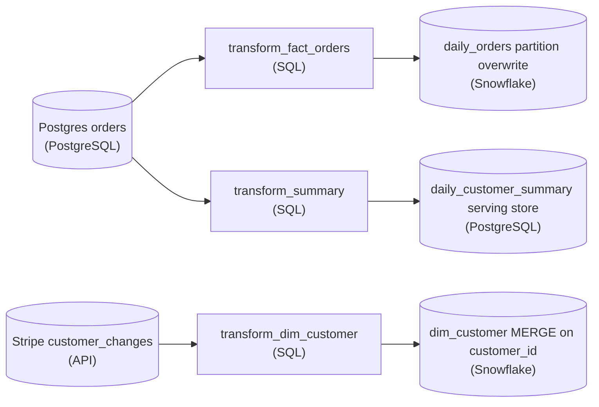
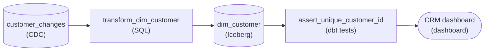
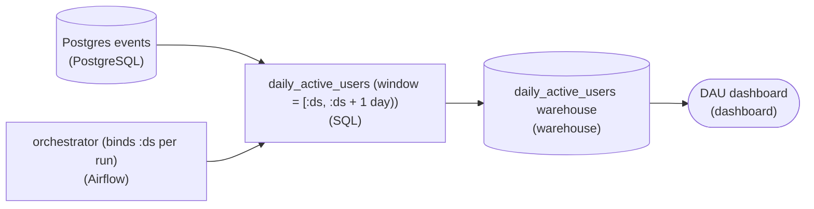
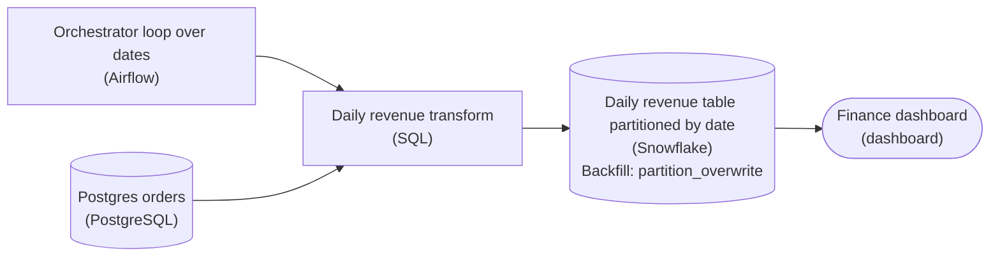
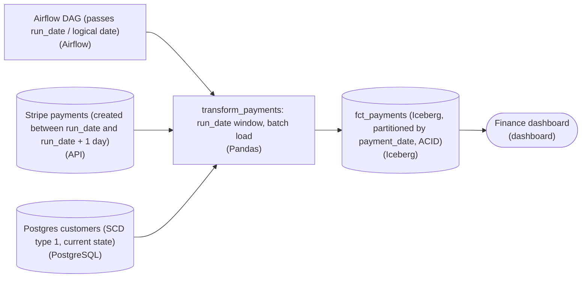
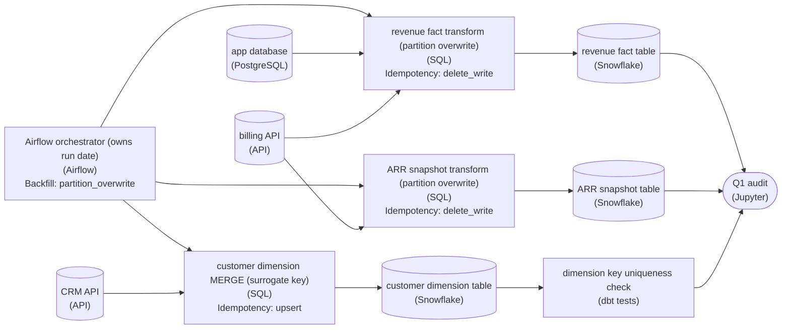
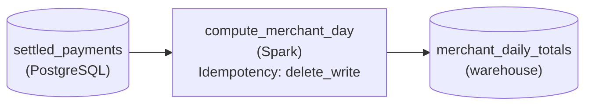
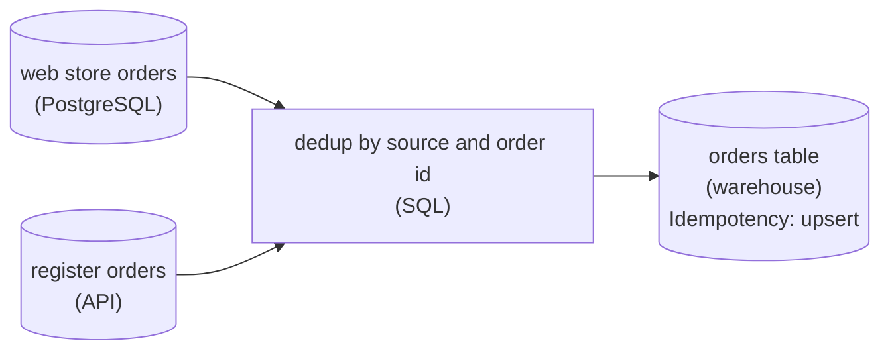
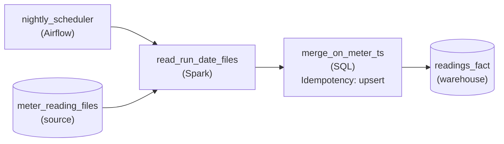
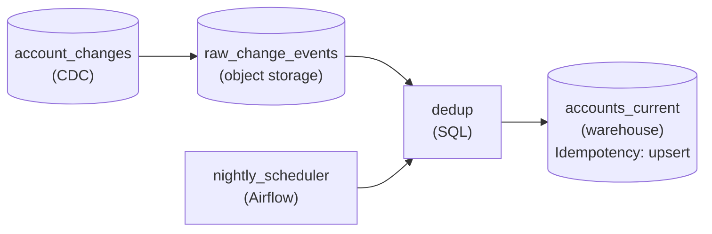

# Idempotent Reruns: Intermediate - Exercises

Lesson: [pa_idempotency_intermediate.md](../pa_idempotency_intermediate.md)

### Exercise 1 of 10

**● TASK**

Three transforms write to three differently-shaped destinations: a time-partitioned daily_orders fact, a current-state dim_customer table, and an operational daily_customer_summary an internal app reads sub-millisecond. All three currently use plain Snowflake INSERT INTO. Apply the section's quick decision rule per destination so each lands on the pattern that fits its access shape.

**Starting canvas** (already placed for you):

- Postgres orders source (source, PostgreSQL)
- Stripe customer_changes source (source, API)
- transform_fact_orders (transform, SQL)
- transform_dim_customer (transform, SQL)
- transform_summary (transform, SQL)
- Plain Snowflake daily_orders (non-idempotent) (storage, Snowflake)
- Plain Snowflake dim_customer (non-idempotent) (storage, Snowflake)
- Plain Snowflake daily_customer_summary (non-idempotent) (storage, Snowflake)

<details>
<summary><strong>Solution</strong></summary>

#### Match the write to the access shape

The fix you just applied is idempotency: a transform you can rerun, after a retry or a backfill, without changing the result. Plain `INSERT INTO` fails that test because a second run appends the same rows again. The section's rule is to read each destination's shape and the run's unit of work first, then pick the write pattern that makes a rerun a no-op.



*One pattern per lane: partition overwrite for the daily fact, keyed `MERGE` for the dimension, transactional DELETE-then-INSERT in a serving store for the app's summary.*

1. **Overwrite the partition for `daily_orders`**

   This fact is time-partitioned, and each run owns exactly one day. Write it with `INSERT OVERWRITE` scoped to that day's partition. The partition is the unit of replacement: rerun the same day and it lands identical, with every other day untouched.

2. **`MERGE` into `dim_customer` on the key**

   A current-state dimension keeps one row per customer, and a run's changes touch customers scattered across the table, so no partition lines up with the unit of work. Match on `customer_id` with `MERGE`: existing customers update in place, new ones insert, and replaying the same changes leaves the same rows.

3. **DELETE-then-INSERT for `daily_customer_summary`**

   The app reads this summary sub-millisecond, so it lives in a serving store rather than the warehouse. Each run owns one day's slice: inside one transaction, delete that day's rows and insert the recomputed ones. Readers never see a half-written day, and a rerun replaces the slice exactly.

| Pitfall: A rerun should not double the rows |
| --- |
| Leave any lane on plain `INSERT INTO` and the first retry or backfill silently doubles its rows. The failure surfaces days later as inflated totals, not as an error. Each pattern above makes the rerun a no-op instead. |

**Follow-up questions**

1. What if `daily_orders` arrives late and spans 2 partitions?\
   *Tests whether you overwrite every affected partition, not just today's.*

</details>


<br>

### Exercise 2 of 10

**● TASK**

A MERGE pipeline keys dim_customer on email. A customer updated their email, the MERGE missed the match, and a duplicate row was inserted; historical lineage broke because the natural key changed. The section frames the fix in two halves: a stable surrogate key and a uniqueness assertion at write time. Apply both halves on the canvas; warehouses do not enforce primary keys for you.

**Starting canvas** (already placed for you):

- customer_changes CDC source (source, CDC)
- transform_dim_customer (MERGE) (transform, SQL)
- Plain Snowflake dim_customer (no ACID, MERGE on email) (storage, Snowflake)
- CRM dashboard (consumer, Looker)

<details>
<summary><strong>Solution</strong></summary>

#### The natural key moved

A dimension needs a key that never changes for a given entity across its entire life. `email` feels like that key, but it is a **natural key**, and natural keys mutate. The moment the customer edited their address, your `MERGE ... ON email` went looking for a row that no longer existed, matched nothing, and inserted a second row for the same person. Every downstream join and the whole history for that customer forked in two. The fix has 2 independent halves: key the table on a stable surrogate instead of the mutable natural key, and assert uniqueness at write time, because the table will not do it for you. Both sit on a destination with ACID transactions, so a MERGE that fails halfway never leaves a half-applied batch behind.

| Pitfall: Keying the MERGE on the column that changes |
| --- |
| `MERGE ... ON target.email = source.email` matches an existing row only while the email is the same in both. When the change event carries a new address, the `WHEN MATCHED` branch never fires, the `WHEN NOT MATCHED` branch does, and you get a duplicate `dim_customer` row that shares nothing with the old one. The MERGE was never wrong about the join it was told to do; it was told to join on a value that moves. |



*The corrected shape: the MERGE keys on the immutable `customer_id`, `dim_customer` is an ACID Iceberg table carrying a minted `customer_sk`, and a uniqueness check sits between the table and the dashboard.*

1. **Key the MERGE on the immutable business id, not the attribute**

   The CDC feed carries a `customer_id` that is stable for the life of the account; the `email` is just one attribute hanging off it. Point the MERGE at `MERGE ... ON target.customer_id = source.customer_id`. Mint a surrogate `customer_sk` exactly once, on the first insert of a given `customer_id`, and never re-derive it from `email`. Now an email change lands in the `WHEN MATCHED` branch and becomes an in-place UPDATE of the `email` column on the existing row, not a new row. The surrogate `customer_sk` that your fact tables already reference stays put, so lineage survives the rename. Running that MERGE against an Iceberg table means each batch commits atomically or not at all.

2. **Assert the key is unique after every write**

   Declaring `PRIMARY KEY (customer_sk)` does not enforce it: neither the old warehouse nor an Iceberg table rejects a duplicate key, so the constraint is documentation, not a guarantee. Add a uniqueness check that runs after the MERGE and gates the publish: `SELECT customer_id FROM dim_customer GROUP BY customer_id HAVING COUNT(*) > 1`. If that query returns even one row, fail the run and hold the load. That gate stops a duplicate from ever reaching the dashboard, even if a future keying bug slips past review, and it is the half people forget because relational databases trained them to assume the engine checks.

| Real world: The stable key is also what makes CDC replay safe |
| --- |
| Keyed on `customer_id`, the `MERGE` is idempotent: replay the same change event, or reprocess a whole day of the feed, and you land on the same row every time. Keyed on `email`, a replayed event that arrives after an address change forks a new row all over again. In production, CDC feeds get replayed constantly, after outages, schema changes, and late-arriving data, so idempotency is not a nice-to-have; the immutable key is what buys it, and the uniqueness assertion is what tells you the day the assumption finally breaks. |

**Follow-up questions**

1. What if the business wants to keep the customer's old email visible as history rather than overwriting it in place?\
   *Pushes from a Type 1 overwrite toward an SCD Type 2 design: the `customer_sk` still keys each version, but `customer_id` plus a validity window becomes the natural key, and the uniqueness assertion changes to 'one current row per `customer_id`'.*
2. The upstream system occasionally reissues a `customer_id` after merging 2 accounts on its side. How does your uniqueness check behave, and what would you add?\
   *Tests whether the learner treats even the upstream id as fallible and reaches for a reconciliation or remap step rather than trusting any single upstream id forever.*

</details>


<br>

### Exercise 3 of 10

**● TASK**

The daily_active_users SQL transform filters with WHERE event_ts >= NOW() - 1 day and runs from a manual cron. Reading the same logical date twice produces different results, and next month's backfill is impossible because NOW() will have advanced. Apply the section's fix: replace the wall clock with a parameter supplied by an orchestrator at bind time.

**Starting canvas** (already placed for you):

- Postgres events source (source, PostgreSQL)
- daily_active_users (WHERE event_ts >= NOW() - 1 day; processing time, not event time) (transform, SQL)
- daily_active_users storage (storage, warehouse)
- DAU dashboard (numbers shift between 11:30 and 2:15 runs) (consumer, dashboard)

<details>
<summary><strong>Solution</strong></summary>

#### Binding the window to a logical date

What fixes this transform is **event-time parameterization**: the day the query processes is a value the orchestrator hands in at bind time, not the clock the moment the query fires. `NOW()` asks "what time is it right now?"; a logical-date parameter asks "which day am I computing?" Those 2 agree only when the job runs exactly on schedule, exactly once, which no pipeline can assume.

| Pitfall: `NOW()` reads run time, not data time |
| --- |
| `WHERE event_ts >= NOW() - 1 day` ties the output to the wall clock at execution. Run the same logical date at 11:30 and again at 2:15 and the window slides 3 hours, so the 2 runs disagree: that is the dashboard flicker. Next month's backfill fails too: `NOW()` has advanced, so re-running for June returns September's rows. The predicate never names the day it actually means. |



*The orchestrator owns the schedule and supplies `:ds`; the transform only consumes it, so run time no longer leaks into the result.*

**Parameterized transform**

```sql
-- :ds is the data interval start the orchestrator binds per run
SELECT
  :ds::date               AS activity_date,
  COUNT(DISTINCT user_id) AS daily_active_users
FROM events
WHERE event_ts >= :ds
  AND event_ts <  :ds + INTERVAL '1 day'
GROUP BY 1;
```

*A half-open window `[:ds, :ds + 1 day)` bound at run time; nothing in the body reads the clock.*

Now the query is a pure function of `:ds`. Re-run it 10 times for '2026-06-01' and every run returns the same rows, so the write can safely overwrite that one day's partition: that is idempotency. A backfill becomes the orchestrator sweeping `:ds` across last month's dates. Each run recomputes its own day from `event_ts`, regardless of when the sweep actually happens.

| Real world: The orchestrator owns time, the query owns logic |
| --- |
| In Airflow this parameter is the `ds` value of the data interval; Dagster calls it the partition key. The scheduler decides which interval a run covers and passes it down, and the SQL just consumes it. That split is what lets one DAG serve both the nightly run and a six-month replay with identical, unedited code. |

**Follow-up questions**

1. A row lands in `events` with an `event_ts` from 3 days ago. Does the parameterized `daily_active_users` pick it up, and when?\
   *Late-arriving data is handled by re-running the partition that owns that `event_ts`, not by a sliding clock window.*
2. How do you make the write step itself idempotent so a re-run for `:ds` never double-counts `activity_date`?\
   *Delete-insert or partition overwrite keyed on `activity_date` rather than a blind append.*

</details>


<br>

### Exercise 4 of 10

**● TASK**

Finance found a rounding bug in daily_revenue covering the last 30 days, and each of those days must be backfilled. The transform reads NOW() and INSERTs into Snowflake, so it can only compute today and a rerun appends. Redesign it so an orchestrator runs the transform for any given date and each run overwrites that date's partition, keeping the finance dashboard fed from the same table.

**Starting canvas** (already placed for you):

- Postgres orders source (source, PostgreSQL)
- transform_daily_revenue (NOW() + INSERT INTO) (transform, SQL)
- Snowflake daily_revenue table (storage, Snowflake)
- Finance dashboard (consumer, Looker)

<details>
<summary><strong>Solution</strong></summary>

#### What makes a pipeline backfillable

A backfill is the same pipeline run again for dates in the past, and it is **only safe when the pipeline is idempotent**. 3 things have to hold at once: a run can be pointed at one specific day, running that day twice leaves the same table as running it once, and the day lands in a slice you can replace without touching its neighbors. The starter breaks all three. It reads `NOW()`, so every run means today. It does a blind `INSERT INTO`, so a rerun appends. And `daily_revenue` has no date slice to swap. Finance's 30-day fix needs all 3 in place before an orchestrator can loop over the dates.



*Airflow passes each `run_date` into the daily revenue transform, which overwrites that date's partition of `daily_revenue`. The nightly run and the 30-day backfill share this one path.*

1. **Parameterize the run date**

   The transform reads `NOW()`, so it can only ever compute today, and a backfill cannot ask it for June 3rd. Replace `NOW()` with a `run_date` the orchestrator supplies (Airflow hands it in as `{{ ds }}`). Now the nightly run and a rerun of a day a month ago are the same code with a different date bound in, which is what makes a backfill possible at all.

2. **Partition by the date you replace**

   A backfill replaces days, so the table needs days as its unit of replacement. Partition `daily_revenue` by `revenue_date` so one day's rows are an isolated slice you can rewrite without touching the other 29. Without that boundary, 'replace June 3rd' has no clean target and you are back to deleting rows by hand.

3. **Overwrite the partition instead of appending**

   `INSERT INTO` appends, so rerunning June 3rd stacks a second, correct day on top of the buggy one and the dashboard sums both. Replace it with a partition overwrite: delete the rows for `:run_date` and insert the recomputed ones inside one transaction. The day is replaced whether this is the first run or the fifth, so retries and overlapping backfills stop being dangerous.

4. **Let the orchestrator drive the loop**

   With the transform parameterized and the write overwriting its partition, the orchestrator is a simple loop: iterate the 30 dates and call the transform once per date, rerunning any that fail. Each date is independent and each write replaces rather than appends, so order stops mattering: backward, forward or in parallel all end at the same table.

**`transform_daily_revenue` for one `run_date`**

```sql
/* run_date is injected by the orchestrator (Airflow {{ ds }}), never NOW() */
BEGIN;

/* replace exactly this date's partition */
DELETE FROM daily_revenue
WHERE revenue_date = :run_date;

INSERT INTO daily_revenue (revenue_date, gross_revenue)
SELECT
    o.order_date            AS revenue_date,
    ROUND(SUM(o.amount), 2) AS gross_revenue   /* the corrected rounding */
FROM orders o
WHERE o.order_date = :run_date
GROUP BY o.order_date;

COMMIT;
```

*A partition overwrite scoped to one date, in one transaction: rerunning any day replaces it and never doubles it.*

| Pitfall: Re-running silently doubles the day |
| --- |
| The starter fails a backfill twice over. `NOW()` pins every run to today, so you cannot target a past date at all. And a bare `INSERT INTO` appends, so the second run of a date leaves both the buggy rows and the fixed rows in `daily_revenue`, summed together on the finance dashboard. It looks like the backfill worked because rows appeared, but the number is now the buggy total plus the correct one. Both problems have to go before the loop is safe to run even once. |

**Follow-up questions**

1. The orchestrator retries a date whose run died halfway through the write. What guarantees the dashboard never sees a half-replaced partition?\
   *Tests why the `DELETE` and `INSERT` live in one transaction, not 2 statements.*
2. How would you backfill only the orders that actually changed, instead of fully replacing all 30 partitions?\
   *Extends full partition replacement toward incremental, change-scoped backfills.*
3. If `orders.order_date` can be `NULL`, where does the parameterized transform quietly drop rows?\
   *Checks that the learner sees the `:run_date` predicate silently excludes undated orders.*

</details>


<br>

### Exercise 5 of 10

**● TASK**

Make this daily payments ETL idempotent: it pulls Stripe charges with a NOW() minus one day window and appends into a Snowflake table with no payment_date. Put an orchestrator in charge so each run pulls Stripe for an explicit run_date, not wall-clock time. Land the data in an ACID lakehouse table partitioned by payment_date that the finance dashboard reads. Each run replaces only its own day, so a re-run and an old-day backfill both land correct numbers.

**Starting canvas** (already placed for you):

- Stripe API payments source (list_payments uses created_after = NOW() - 1 day) (source, API)
- Postgres customers source (SCD type 1; current state is correct) (source, PostgreSQL)
- transform_payments_etl: NOW() window + row-by-row INSERT INTO (3 bugs in 24 lines) (transform, Pandas)
- Plain Snowflake fct_payments (no payment_date partition; no ACID; INSERT-only) (storage, Snowflake)
- Finance dashboard (consumer, Looker)

<details>
<summary><strong>Solution</strong></summary>

#### Idempotency: the same run, the same answer

The property you were asked to build has a name: **idempotency**. A pipeline is idempotent when running the same logical unit of work twice leaves the table in the same state as running it once. Here the logical unit is one day of payments, keyed by `payment_date`. The starter breaks idempotency in the most common way there is: it lets the machine's clock decide what data a run covers (`created_after = NOW() - 1 day`) and it only ever appends. So the run isn't a function of a date you control, it's a function of when you happen to press go. Re-run it and you append a second copy; run it for last month and `NOW()` still pulls this month. The fix is to make the day an explicit input and make the write replace that day's slice instead of adding to it.



*The orchestrator owns the clock: it hands each task a `run_date`, the pull is bounded by that date, and the write overwrites exactly one `payment_date` partition.*

| Pitfall: Three bugs that all trace back to one missing idea |
| --- |
| The starter's `transform_payments_etl` fails three ways, and they're the same failure wearing different hats. `created_after = NOW() - 1 day` means the window is undated, so a backfill for an old day silently pulls today. The row-by-row `INSERT INTO` means the table only grows, so a second run of the same day doubles the numbers. And the plain Snowflake table has no `payment_date` column and no way to atomically replace a slice, so there's nothing to overwrite even if you wanted to. Each bug on its own looks minor; together they mean the table's contents depend on run history, which is the exact opposite of idempotent. |

1. **Give the clock to the orchestrator, not the task**

   Let the DAG pass a `run_date` (Airflow's logical or execution date) into the task, and derive the pull window from it: pull Stripe payments where the charge falls in `[run_date, run_date + 1 day)`. Now the task is a pure function of its argument. Running it today for `run_date = '2026-08-01'` and running it next month for that same date pull the identical set of charges, because `NOW()` never enters the logic. This is also what makes a backfill trivial: a backfill is just the same task called with older `run_date` values.

2. **Land in an ACID table partitioned by `payment_date`, and overwrite the day**

   Swap the plain append-only table for a lakehouse table format (`Iceberg` or `Delta`) partitioned by `payment_date`, and stamp every row with the run's `payment_date`. The write is no longer 'append'; it's 'replace this one partition'. Because the format is ACID, that replacement is a single atomic commit: finance never sees a half-deleted day. Replacing only the `payment_date = run_date` partition is what closes the loop, a re-run wipes and rewrites just that day, and a backfill touches only the old day it targets, leaving every other partition untouched.

**The idempotent write (Iceberg)**

```sql
/* run_date is supplied by the orchestrator, e.g. '2026-08-01' */
INSERT OVERWRITE fct_payments
PARTITION (payment_date = DATE '2026-08-01')
SELECT
    p.payment_id,
    p.customer_id,
    p.amount,
    c.customer_segment,
    DATE(p.created_at) AS payment_date
FROM stg_stripe_payments p          /* already bounded to the run_date window */
JOIN customers c USING (customer_id);

/* Delta equivalent:
   df.write.mode("overwrite")
     .option("replaceWhere", "payment_date = '2026-08-01'") */
```

*Static partition overwrite: this replaces exactly the `run_date` partition in one atomic commit, so re-runs and backfills converge to the same numbers.*

| ✕ Append-only (the starter) | ✓ Partition overwrite (idempotent) |
| --- | --- |
| Row-by-row `INSERT INTO fct_payments` adds whatever the current run produced. Second run of the same day = 2 copies of every payment. There's no `payment_date` to scope a cleanup, so the only 'fix' is a manual dedupe after the fact. | `INSERT OVERWRITE ... PARTITION (payment_date = run_date)` deletes and rewrites exactly one day atomically. Run it once, twice, or a hundred times, the day holds the same rows. Backfilling `2026-07-15` rewrites only that partition and never disturbs the rest. |

| Real world: This is why backfills stop being scary |
| --- |
| On the job, the payoff shows up the day someone finds Stripe was under-reporting refunds for a week. With the fixed design you loop the DAG over those 7 `run_date` values and each one overwrites its own `payment_date` partition, the numbers self-heal and nothing else moves. With the starter you'd be writing one-off dedupe SQL and praying you scoped the `DELETE` correctly. Idempotent, date-partitioned writes turn 'reprocess history' from an incident into a routine command. |

**Follow-up questions**

1. The customers table is SCD type 1 (only current state). If finance later needs the `customer_segment` a payment had on `payment_date`, what breaks and what would you change?\
   *Tests whether the learner sees that joining current customer state into a historical fact is itself a non-idempotent, point-in-time correctness problem, pushing toward SCD type 2.*
2. What happens to idempotency if the same Stripe payment can appear in 2 daily pulls near midnight? How does partitioning by `payment_date` help or not?\
   *Probes late-arriving and boundary data and whether overwrite-by-partition still guarantees exactly-once per day.*
3. Would a `MERGE` on `payment_id` give you the same guarantee as `INSERT OVERWRITE` on the partition? When would you pick each?\
   *Distinguishes row-level upsert from partition replacement, and the cost and correctness trade-off between them.*

</details>


<br>

### Exercise 6 of 10

**● TASK**

Nightly transforms that stamp their window from NOW() and append with plain INSERT left duplicate rows in two Snowflake fact tables and the customer dimension, and finance needs a corrected Q1 revenue figure. Keep the three Snowflake destinations and give every transform explicit run_date bounds: each fact overwrites its daily partition, and the dimension MERGEs on a stable surrogate key, not the mutable email. Add an Airflow orchestrator that owns run_date and drives a 60-day backfill across all three. Add a dbt tests uniqueness check on the dimension key right after the MERGE so the Q1 audit reads only corrected tables.

**Starting canvas** (already placed for you):

- Postgres app source (Q1 revenue events) (source, PostgreSQL)
- Stripe billing source (post-migration; rate-card correction window) (source, API)
- Salesforce CRM source (customer dimension) (source, API)
- transform_fct_revenue_daily (window from NOW(); plain INSERT, no partition overwrite) (transform, SQL)
- transform_fct_arr_snapshot (window from NOW(); plain INSERT, no partition overwrite) (transform, SQL)
- transform_dim_customer (MERGE on mutable email natural key) (transform, SQL)
- Snowflake fct_revenue_daily (duplicates in 3 of last 90 partitions) (storage, Snowflake)
- Snowflake fct_arr_snapshot (duplicates in 3 of last 90 partitions) (storage, Snowflake)
- Snowflake dim_customer (duplicate rows from email-key MERGE) (storage, Snowflake)
- Q1 audit consumer (10-Q file due in two weeks) (consumer, Jupyter)

<details>
<summary><strong>Solution</strong></summary>

Every transform here has to become **idempotent**: run twice for the same day, it leaves the warehouse exactly as if it ran once. The broken transforms stamped their window from `NOW()` and appended with a plain `INSERT`, so every rerun read a different slice of time and stacked fresh rows on top of the old ones. That is why three of the last 90 partitions carry duplicates, and why a naive backfill would only deepen the mess.

| Pitfall: A rerun must not depend on wall-clock time |
| --- |
| `NOW()` makes the output a function of when you run, not of what you run for. Pair it with `INSERT` and there is no key to overwrite: the second run cannot find the first run's rows to replace. Bound every transform by an explicit `run_date` the orchestrator passes in, so the same date always selects the same source slice. |



*The same three Snowflake tables, now written idempotently under a `run_date` that Airflow owns, with the dimension checked before the audit reads it.*

| ✕ Facts: overwrite the partition | ✓ Dimension: MERGE on a stable key |
| --- | --- |
| `fct_revenue_daily` and `fct_arr_snapshot` are keyed by day. Delete the `run_date` partition and then `INSERT` it, in one transaction. Rerunning replaces that day's rows instead of adding a second copy. | `dim_customer` MERGEs on a surrogate `customer_id`, not the mutable email. When a customer's email changes, the same key updates in place; the email-keyed MERGE treated a new email as a new customer and duplicated the row. |

| Key insight: One idempotent unit, replayed across 60 dates |
| --- |
| Once `run_date` is an input the orchestrator owns, the 60-day backfill is just the same transform run for 60 values, in any order, as many times as needed. The dbt uniqueness test on `customer_id` runs right after the MERGE, so the Q1 audit only ever reads a dimension that has already passed the check. |

**Follow-up questions**

1. The billing source has a rate-card correction window that restates old amounts. Why does a partition overwrite keyed by `run_date` absorb a restated day cleanly?\
   *Tests seeing idempotent overwrite as the mechanism for late-arriving corrections, not just for reruns.*
2. If two backfill runs for different `run_date` values overlap in time, why is the result still correct?\
   *Checks that each partition write is independent of the others.*

</details>


<br>

### Exercise 7 of 10

**● TASK**

A nightly batch job reads settled card payments from PostgreSQL, computes one row per merchant for a single business day, and writes them to a warehouse table that is not partitioned by date. Runs are repeated after failures and corrections, and a correction can remove a merchant from that day entirely. Design the pipeline so any rerun leaves exactly the recomputed rows for its day, using the idempotent write pattern that fits.

<details>
<summary><strong>Solution</strong></summary>

#### Replacing a slice that is not a partition

Delete-then-insert is the pattern for a slice the table cannot address as a partition. Here the slice is one business day, but the table is organized by merchant, so there is no day partition to overwrite. The write deletes every row for the run's day and inserts the freshly computed rows, both inside one transaction. A rerun of the same day lands on exactly the same rows, however many times it fires.



*`compute_merchant_day` owns one business day and replaces it in `merchant_daily_totals` with `delete_write`.*

| Pitfall: An upsert never removes a row |
| --- |
| MERGE matches incoming rows by merchant and day, then updates or inserts. Rerunning it adds no duplicates, so it looks idempotent. But when a correction drops a merchant from the day, the recompute has no row for that merchant, MERGE has nothing to match, and the old total survives. Only clearing the whole day first makes the rerun's output the table's contents. |

| Key insight: The transaction hides the empty moment |
| --- |
| Between the delete and the insert the day has no rows. Committing both as one transaction means a reader sees either the old day or the new one, never the gap, and a crash halfway rolls back to the old day. |

| Real world: Any named slice works, not just a day |
| --- |
| The same shape rebuilds one tenant's rows in a shared table, or one invoice's line items when the invoice is reissued: name the slice, delete it, insert its replacement, commit. When the table is partitioned by that exact slice, partition overwrite does the same job more cheaply. |

**Follow-up questions**

1. What changes if the warehouse table is re-created partitioned by business day?\
   *Recognising when partition overwrite becomes the cleaner choice for the same slice.*
2. A typical correction touches only a handful of the 40,000 merchants. Is rewriting the whole day still right?\
   *Trading write volume against the guarantee that removed merchants disappear.*

</details>


<br>

### Exercise 8 of 10

**● TASK**

A nightly batch job merges orders from two systems into one warehouse orders table: a web store's PostgreSQL database and an in-store point-of-sale API. Both systems number orders from 1, so order 1042 exists in each, and the POS API re-sends the last 3 days of orders on every pull. Design the pipeline so each real order lands exactly once and a rerun leaves the table unchanged, choosing a business key that keeps the two systems' orders apart.

<details>
<summary><strong>Solution</strong></summary>

#### A key has to name one sale in one system

Choosing a business key comes down to one question here: which facts together name exactly one sale? `order_id` alone does not, because the web store and the registers both count from 1. The composite key `(source_system, order_id)` does. The dedup stage collapses the three-day re-sends on it, and the `MERGE` into the orders table matches on it, so a rerun updates the same rows instead of adding new ones. Neither stage is clever; the key is what makes the whole pipeline idempotent.



*Both sources are tagged with `source_system`, collapsed on `(source_system, order_id)`, then upserted on the same key.*

| Pitfall: `order_id` alone fuses two different sales |
| --- |
| Keying on `order_id` passes every test that loads one source at a time. The first night both systems ship order 1042, the `MERGE` matches the register sale to the web sale and overwrites it: no duplicate, no error, one sale silently gone. Deduping on `order_id` loses it one stage earlier. |

| Key insight: Ask where each key column comes from |
| --- |
| A `source_system` tag is stamped at ingest and never changes; an `order_id` is only unique inside the system that issued it. The same question settles a CDC feed, where the before and after images share a primary key and the change sequence decides which one survives. |

| Real world: Customer columns make poor order keys |
| --- |
| It is tempting to key on `customer_id` plus a timestamp. Guest checkouts arrive with a null `customer_id`, and two register sales can share a second, so that key both drops rows and merges them. |

**Follow-up questions**

1. The register vendor starts reusing order numbers after 90 days. What does the key need now?\
   *Key stability over time: adding `order_date` so a recycled number is a new sale.*
2. A marketplace becomes a third order source with its own ids. What changes in the design?\
   *Whether the key holds at a new seam: only a new `source_system` value, no new logic.*

</details>


<br>

### Exercise 9 of 10

**● TASK**

A nightly scheduled job appends every smart-meter reading file that landed in the last 24 hours of wall-clock time to a readings fact table in the warehouse. A rerun after a failure double-counts readings, and a rerun weeks later loads the wrong day. Refactor it so a run for a given date reads only that date's files and running that date twice leaves the table unchanged; a meter never reports twice for the same timestamp.

<details>
<summary><strong>Solution</strong></summary>

#### Bound the read, key the write

Refactoring a hurried ETL into an idempotent one came down to two edits here. The read stops asking the clock what 'yesterday' means and takes its date from the scheduler. The write stops appending and merges on the reading's business key, the meter plus its timestamp. With both in place a run is a function of its date: run 2026-09-14 once or 5 times and the readings table ends in the same state.



*`nightly_scheduler` hands each run its date, `read_run_date_files` reads only that date's files, and `merge_on_meter_ts` upserts into `readings_fact`.*

1. **Take the date from the scheduler**

   The old read used 'the last 24 hours', so its input depended on when it ran. Passing the run date in from the scheduler pins the input: the nightly run and a rerun next month for the same date see exactly the same files. That is also what makes the backfill loop from the previous section work here, since each iteration just calls the same run with a different date.

2. **Merge on meter and timestamp**

   A meter never reports twice for the same timestamp, so the pair is the reading's identity. Upserting on it means a reading already in the table is matched and updated, not inserted again. Resent files and failed-then-retried runs both collapse to one row per reading.

| Pitfall: Fixing only the write still loads the wrong day |
| --- |
| A merge on the business key stops duplicates, but if the read still uses a window relative to now, a rerun for a date three weeks back reads this week's files. The merge then cleanly applies the wrong data, and the day you meant to repair never reloads. Each fix covers a different bug, and the pipeline needs both. |

**Follow-up questions**

1. A resent file corrects a reading's value for a day three weeks ago. What happens on the rerun?\
   *Checks that the date-bounded read targets just that day and the upsert replaces the value in place.*
2. Could overwriting a date partition replace the merge here, and what decides it?\
   *Partition overwrite only works when the partition matches the unit a run owns; here runs own landing dates while rows are keyed by reading time.*

</details>


<br>

### Exercise 10 of 10

**● TASK**

A change data capture feed from a PostgreSQL accounts table emits a before image and an after image for every update, both carrying the same account_id, and resends events whenever the connector restarts; several changes can share one commit timestamp. Land the raw change events in object storage, then MERGE them into a current-state accounts table in the warehouse so each account ends with exactly one row holding its latest change, even after a rerun. A scheduler runs each load for one explicit change date, and the same job must backfill any past range of dates from the retained raw events.

<details>
<summary><strong>Solution</strong></summary>

#### A merge is only as idempotent as its key

Choosing the business key is what makes a `MERGE` safe to rerun. Here the obvious key, `account_id`, is right for matching rows, but it cannot decide which event wins: an update arrives as a before image and an after image with the same `account_id`, a connector restart sends events again, and two changes can share a commit timestamp. The key says which row to touch; a value that never ties says which change is newest.

1. **Match on `account_id`, order by the log sequence**

   Every change carries the database's log sequence number, which only increases. Keying the `MERGE` on `account_id` and ranking changes by that sequence gives one answer no matter how many copies arrive. Ranking by commit timestamp leaves a tie the engine breaks arbitrarily, so two runs over the same input can keep different rows.

2. **Collapse to one change per account first**

   Drop the before images and exact repeats, then keep the highest-sequence after image per `account_id`. A `MERGE` fed two source rows for the same target row either fails or applies them in an unpredictable order; the `dedup` stage guarantees it sees exactly one.

3. **Bound every run by a change date**

   The scheduler passes the run's change date into the job, and the job reads only that date's slice of `raw_change_events`. Nothing resolves `NOW()` or `CURRENT_DATE`, so rerunning last Tuesday reads exactly the events it read the first time, and a backfill is the same job looped over a list of dates.



*CDC events land raw in object storage; each scheduled run dedups one change date and upserts `accounts_current` on `account_id`.*

| Pitfall: An old replay must not overwrite a newer row |
| --- |
| Dedup inside one run does not protect across runs: a restart can resend yesterday's events into today's slice, and a backfill replays old dates after newer ones loaded. Store the last applied sequence on each `accounts_current` row and let the `MERGE` update only `WHEN MATCHED AND source.lsn > target.lsn`. Arrival order stops mattering, and rerunning any range converges to the same table. |

| Key insight: Backfill falls out of the other 3 choices |
| --- |
| Retained raw events, a run bounded by its date, and a sequence-guarded upsert together turn a backfill into a plain rerun: pick the dates, run them, and the table ends where it would have if the bad loads never happened. |

**Follow-up questions**

1. Finance now wants every account's daily change history, not only current state. Which write pattern fits that table?\
   *Partition overwrite on a change-date partitioned history table versus `MERGE` on current state.*
2. A second source recycles account numbers after two years of inactivity. What does the business key become?\
   *Composing a key from the ID plus something that separates its lifetimes, such as the account's creation date.*

</details>
