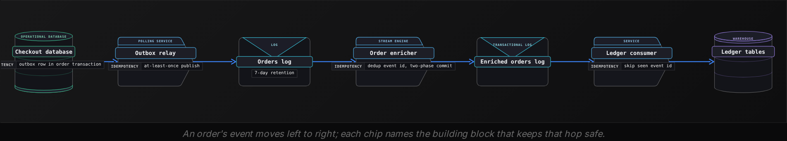
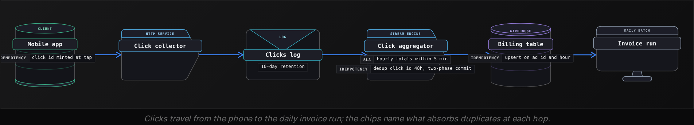

Advanced·Pipeline Architecture · 38 min · 11 challenges

# Idempotent Reruns: Advanced

Uber has written publicly about processing Uber Eats ad clicks exactly once, because each click becomes money a restaurant pays. Suppose the click aggregator crashes at 7:58 p.m. during the Friday dinner rush, holding 40 seconds of clicks it has counted but not yet acknowledged. On restart, those clicks arrive again. Whether 3,000 restaurants pay twice for them depends on choices this lesson teaches.


<br>

---

## Idempotency in Streaming Is Harder

In batch, a rerun has a name. The job that builds `orders_daily` for 2026-10-23 reads a closed set of input files, and the fix you learned is to overwrite that partition. The input will never grow, the output has a single place to land, and running the job 5 times leaves the same partition behind.

A stream job has no such unit. Its input is an unbounded log, read by position: partition 4, offset 1000, then 1001, and on with no end. The job keeps 2 records that must agree: the output it has written, and the position it has marked as done. Those 2 writes go to different systems at different moments, and a crash can land between them.


<br>

### Where the crash lands

| Time | Job action | Rows in sink | Saved position |
| --- | --- | --- | --- |
| 12:00:00 | Reads offsets 1000 to 1499 | 0 | 999 |
| 12:00:03 | Writes 500 enriched rows | 500 | 999 |
| 12:00:04 | Crashes before saving the position | 500 | 999 |
| 12:00:20 | Restarts and resumes after 999 | 500 | 999 |
| 12:00:23 | Writes offsets 1000 to 1499 again | 1,000 | 1499 |

The replayed slice, offsets 1000 to 1499, is whatever arrived between the last saved position and the crash. No partition, hour or file in the output corresponds to it, so the batch move of replacing the unit of work has no unit to replace. The 500 duplicated rows sit beside the originals, indistinguishable from them.

Streams have 2 more properties that make this harder. Outputs are often still open: a running count for the current minute is updated many times before the minute closes, so a replay lands on a number that is mid-change. And operator state, such as those running counts, lives in memory and restores from a periodic snapshot. If that snapshot and the saved position were taken at different moments, the restored state either already includes some replayed records or misses some skipped ones.


<br>

### Patterns that survive replay unaided

Whether a replay corrupts output depends on what an operator does with a record it has already handled. The test: apply the same event e twice, and compare the result with applying it once.

| Operation | Result of applying e twice | Safe on replay? |
| --- | --- | --- |
| Map or filter, upserted by `event_id` | Same row rewritten with same values | Yes |
| Latest value per key, such as a driver's last location | Same final value once replay passes the newest event | Yes |
| Max or min per key | max(x, e, e) equals max(x, e) | Yes |
| Add to a set of distinct users | The set already holds e | Yes |
| Count or sum per key | Total grows by a second contribution | No |
| Append to an insert-only table | Identical row written twice | No |
| Call an outside system: push notification, card charge | A second notification, a second charge | No |
| Key or value created at processing time, `uuid4()` or `now()` | Second row under a new key | No |

The safe rows share a property: the effect depends only on the event's content and lands at an address the event determines. An upsert on `event_id` sends the replayed record to the row it wrote before. A max returns the slot's existing value. The unsafe rows either accumulate, as counts, sums and appends do, or create something new on every run, such as a fresh UUID or a second HTTP request.

> **TIP**
>
> Latest value per key is safe because a log preserves order within a partition, so the replay finishes on the same newest event. If 2 partitions can update the same key, replay order can differ from the original and the final value can flip.

> Keys minted at processing time
>
> An operator that sets `id = uuid4()` or `processed_at = now()` turns a safe upsert into an unsafe append, because the replayed record arrives with a new key. Derive keys from the event: an ID the producer assigned, or a hash of fields fixed when the event was created.

**A job reads trip events from a log and crashes. On restart it replays the last 2,000 events it had already processed. Which operator leaves its output exactly as a crash-free run would?**

- **A.** Add 1 to trips_today[driver_id] for every event, then write the new total.
- **B.** Insert each event into a table with row_id = uuid4() as its primary key.
- **C.** Upsert longest_trip_km[driver_id] as the max of the stored value and the event's distance.
- **D.** Send the rider a push notification with the fare when each trip event arrives.

<details>
<summary>Solution</summary>

**C.** Upsert longest_trip_km[driver_id] as the max of the stored value and the event's distance.

Max is idempotent: the replayed distance is already reflected in the stored maximum, so the value stays put.

**Why the others are wrong**

- **A.** Each replayed event adds 1 again, so every driver with a replayed trip ends up with too many trips. Counters accumulate.
- **B.** The replayed copy gets a fresh UUID, so the primary key never collides and 2,000 duplicate rows land.
- **D.** The phone has no snapshot to roll back. Every replayed event sends a second notification.

</details>


<br>

---

## Exactly-Once vs Effectively-Once

When a stream engine advertises exactly-once, it is describing committed effects. Execution still repeats: after the crash in the last section, offsets 1000 to 1499 ran twice no matter what the engine promised. The guarantee is that only the effects of a single execution survive, inside a boundary the engine controls.


<br>

### What exactly-once covers

An engine that offers exactly-once takes periodic snapshots that capture 3 things together: the input positions, the operator state and the output not yet released. On a crash it rolls all 3 back to the last completed snapshot and runs forward again. Because everything inside the boundary rewinds at once, the second run's effects replace the first run's instead of adding to them.

Anything outside that boundary keeps whatever it received. Read this operator with a crash in mind:

```sql
def on_order(event, state):
    state['orders'] += 1
    send_receipt_email(event['user_id'])
    return state
```

After a crash, `state['orders']` restores from the snapshot and the count comes out right. The email server has no snapshot: it already accepted the first run's message, and now it accepts the second's. The engine kept its promise, and the customer still received 2 receipts.


<br>

### Effectively-once

Effectively-once reaches the same visible outcome by a different route. Records are delivered at least once, and every effect is made idempotent so the extra deliveries change nothing. The email operator becomes effectively-once if the email service accepts an idempotency key, such as the `order_id`, and drops any second send carrying a key it has seen.

| ✓ Exactly-once (transactional) | ✗ Effectively-once (idempotent) |
| --- | --- |
| • Positions, state and output snapshot together<br><br>• The sink must take part in the engine's commit<br><br>• Output appears only when a snapshot completes<br><br>• Covers effects inside the engine's boundary<br><br>• Breaks at any hop that cannot join the commit | • Delivery is at least once; duplicates are expected<br><br>• The sink deduplicates on a key the event carries<br><br>• Output appears as soon as it is written<br><br>• Covers any system that honors the key<br><br>• Breaks if the key is minted at processing time |


<br>

### Auditing an exactly-once claim

A claim of 'exactly-once, end to end' describes a deployment, and every hop in that deployment either keeps the guarantee or breaks it. Walk the path from the first producer to the last reader and ask the same 6 questions at each hop.

Audit questions for every hop

- Can the source be re-read from a recorded position?
- Do positions, state and output commit in the same snapshot?
- Does the sink join that commit, or deduplicate by key?
- Do readers of the sink see committed data only?
- Does any operator call a system outside the engine?
- Does the producer deduplicate its own send retries?

Run the audit on a common deployment. A checkout service publishes orders to a log. A stream engine sums revenue per store and writes the totals transactionally to an output log. A notification service reads that output and emails each store manager.

| Hop | Question that fails | What goes wrong |
| --- | --- | --- |
| Checkout service to log | Producer retries without dedup | A send that timed out but landed is sent again; the order appears twice |
| Engine to output log | None | Totals commit once per snapshot |
| Output log to notification service | Reader sees uncommitted data | It reads totals from an attempt that later aborted, then reads the retry's totals |
| Notification service to email | Outside call without a key | Each redelivery sends the manager another email |

Exactly-once holds on 1 hop of 4. The engine's documentation is accurate about that hop and silent about the other 3. The fixes are per hop: enable producer deduplication, where the log gives each producer an ID and drops repeated sequence numbers; configure the notification service to read committed data only; and send `store_id` plus the report period as the email's idempotency key.


<br>

### Choosing for the system

Choose exactly-once when every hop can join a single commit and the use case tolerates output that appears once per snapshot. Choose effectively-once when the path crosses systems that cannot join, such as an email provider or a service's own database, or when freshness needs are tighter than the snapshot rhythm. Most production pipelines combine them: exactly-once for the engine's internal state, effectively-once at every exit.

**A payments team reads their stream engine's documentation: 'exactly-once from source to sink.' Their job reads card authorizations from a log, sums them per merchant into transactional output, and calls a fraud API that opens a case for each authorization over $5,000. Which part of this deployment falls outside the guarantee?**

- **A.** The fraud API call, because the outside system has no snapshot to roll back after a crash.
- **B.** The per-merchant sums, because operator state is discarded on each crash and restarted from zero.
- **C.** The log source, because a log cannot be re-read from a recorded position after delivery.
- **D.** Nothing, because the guarantee extends to every call an operator makes during processing.

<details>
<summary>Solution</summary>

**A.** The fraud API call, because the outside system has no snapshot to roll back after a crash.

On recovery the engine replays authorizations since the last snapshot, and every replayed authorization over $5,000 opens a second case. Pass the authorization ID as an idempotency key.

**Why the others are wrong**

- **B.** Operator state restores from the last completed snapshot together with the positions, so the sums are inside the guarantee.
- **C.** Re-reading from a recorded position is what logs are built for, and every replay depends on it.
- **D.** The engine can roll back only what it snapshots. A call to an outside system sits outside that set.

</details>


<br>

---

## Building Blocks of Idempotency

Every guarantee in the last section rests on 3 mechanisms. Each protects a particular kind of hop, and a real architecture chains them.


<br>

### Two-phase commit

Two-phase commit lets a coordinator make several participants commit together or not at all. In phase 1, prepare, each participant does its work, makes it durable but invisible, and votes yes or no. In phase 2, the coordinator records its decision, then tells every participant to commit, or to abort if any vote was no.

A stream engine runs this protocol at every snapshot. The engine coordinates; the sink participates. Between snapshots the sink writes into an open transaction that no reader can see.

| Step | Engine (coordinator) | Sink (participant) |
| --- | --- | --- |
| 1 | Snapshot starts at offset 1499 | Flushes transaction txn-42 and votes yes |
| 2 | Stores offset 1499, state and txn-42 in the snapshot | Holds txn-42 prepared and invisible |
| 3 | Snapshot completes; sends commit for txn-42 | Commits txn-42; rows become visible |
| 4 | Crashes before the sink's acknowledgment arrives | txn-42 is committed, but the engine cannot tell |
| 5 | Restarts from the snapshot; resends commit for txn-42 | Sees txn-42 already committed and ignores the repeat |

Step 5 shows that commit must itself be idempotent, because a restarted coordinator cannot know whether its first commit landed. The protocol also has 2 costs. Rows become visible only at commit, so a 60-second interval delays each record by up to 60 seconds, about 30 on average. The sink also holds prepared transactions open until commit, so its timeout must exceed the longest snapshot plus the longest restart. A sink that times out first aborts a transaction the engine has already recorded as done, and those rows vanish.


<br>

### Transactional outbox

A service that saves an order to its database and also publishes an `OrderPlaced` event writes to 2 systems. If the publish fails after the database commits, the order exists and no downstream system hears about it. If the publish succeeds and the database transaction rolls back, consumers act on an order that was never saved. Retrying either write cannot repair the other.

The outbox reduces 2 writes to 1. The service inserts the event into an `outbox` table in its own database, inside the transaction that saves the order:

```sql
def place_order(conn, order):
    with conn:
        conn.execute(
            'INSERT INTO orders (order_id, user_id, total_cents) VALUES (?, ?, ?)',
            (order.order_id, order.user_id, order.total_cents),
        )
        conn.execute(
            'INSERT INTO outbox (event_id, order_id, payload) VALUES (?, ?, ?)',
            (f'placed-{order.order_id}', order.order_id, order.to_json()),
        )
```

Both rows commit or neither does. A separate relay process polls the outbox and publishes what it finds:

```sql
SELECT
  event_id,
  order_id,
  payload
FROM outbox
WHERE published_at IS NULL
ORDER BY created_at
LIMIT 100
```

After the log acknowledges a batch, the relay sets `published_at` on those rows. A crash between the acknowledgment and that update republishes the batch on restart, so the outbox delivers at least once. Accept that trade: a duplicate can be removed downstream, and a lost event cannot be recovered at all. Removing duplicates is the third block's job.


<br>

### Idempotent consumers

An idempotent consumer stores each event's ID in the same transaction as the event's effect, and skips events whose ID is already stored. With the effect and the ID in a single commit, there is no gap for a crash to fall into. A ledger can make the ID part of the row it writes:

```sql
INSERT INTO ledger_entries
SELECT
    s.event_id,
    s.order_id,
    s.total_cents
FROM staged_events AS s
WHERE NOT EXISTS (
    SELECT
        1
    FROM ledger_entries AS l
    WHERE l.event_id = s.event_id
)
```

The `NOT EXISTS` check misses 2 cases: 2 consumer instances loading overlapping batches at once, and both copies of a republished event sitting in the same staged batch, since neither is in `ledger_entries` yet. Reduce the batch to its first row per `event_id`, and add a unique constraint on `event_id`, which catches both where enforced. Keep IDs in a pruned dedup table longer than your deepest possible rewind, or that rewind reinserts events whose IDs are gone.


<br>

### Chaining the blocks across boundaries



| Boundary | Failure to survive | Building block |
| --- | --- | --- |
| Service database to orders log | Publish fails after the order commits | Transactional outbox |
| Relay to orders log | Relay republishes a batch after a crash | Dedup on `event_id` in the enricher |
| Orders log through enricher to enriched log | Crash in the middle of a snapshot | Two-phase commit |
| Enriched orders log to ledger | Redelivery of committed records | Idempotent consumer |

Look at the second row. Two-phase commit guarantees that each record in the log affects the output once, and a republished outbox event is 2 records in the log. Exactly-once processing of a duplicate produces it twice, once per copy. The enricher therefore deduplicates on `event_id` in its state before emitting, which makes it an idempotent consumer and a two-phase-commit participant at the same time.

**A team sums revenue per store in their stream engine and writes the totals to the warehouse with two-phase commit. Their orders arrive through a transactional outbox. After each outbox relay restart, the totals run about 0.3% high. Which change fixes the totals?**

- **A.** Shorten the snapshot interval so fewer records sit inside each open transaction.
- **B.** Raise the warehouse transaction timeout above the longest snapshot plus restart.
- **C.** Commit the outbox row in a second transaction right after the order commits.
- **D.** Deduplicate on the outbox event_id in the engine's state before summing.

<details>
<summary>Solution</summary>

**D.** Deduplicate on the outbox event_id in the engine's state before summing.

A republished event is a second record in the log, and exactly-once processing counts each record. Dropping repeated IDs before the sum removes the 0.3%.

**Why the others are wrong**

- **A.** Fewer records per transaction changes how much a crash rewinds, but the extra records come from the relay, before the engine ever reads them.
- **B.** That timeout prevents prepared rows from being lost. The symptom here is extra revenue, which comes from duplicate input.
- **C.** That recreates the dual write the outbox exists to remove, and it does nothing about the relay republishing.

</details>


<br>

---

## Replay Infrastructure

Every mechanism so far handles replays nobody asked for: a crash rewinds a few seconds of input. Built on purpose, the same machinery lets you rewind deliberately, to recompute output after a bug fix, to fill a new table from history, or to rebuild state lost with a cluster. Kappa's replay depends on it, and this section prices it.

What a deliberate replay needs

- **Retained source** *The log keeps what it delivered*\
  Retention reaches back to the furthest point you will rewind to.
- **Addressable positions** *Every output knows where its input ended*\
  Offsets per partition, plus a lookup from timestamp to offset.
- **Idempotent downstreams** *Re-sent output changes nothing*\
  Replayed results overwrite or deduplicate instead of adding.


<br>

### Retained source: paying for history

A log bills retention by the byte, multiplied by its replica count. Take an orders log ingesting 50 MB per second and storing 3 replicas of every segment:

| Retention | Logical size | Stored with 3 replicas |
| --- | --- | --- |
| 1 day | 4.32 TB | 12.96 TB |
| 7 days | 30.24 TB | 90.72 TB |
| 30 days | 129.6 TB | 388.8 TB |

Most teams tier it. A few days stay hot in the log for fast rewinds, and older segments are copied to object storage as files, where a single copy backed by the store's own durability replaces 3 replicas. A replay reads the archived files first and switches to the live log at the boundary, which works only if the archive preserves each record's partition and offset.


<br>

### Addressable positions: knowing where to rewind

'Replay from Tuesday's 14:05 deploy' requires a translation from a timestamp to an offset in every partition, which logs that index offsets by timestamp can answer. The harder half sits on the output side: to rewind to where a bug began, each output must record which input positions it reflects. A commit table with a row per committed snapshot and partition does that.

```sql
SELECT
  partition_id,
  MAX(end_offset) AS last_good_offset
FROM revenue_commits
WHERE committed_at < TIMESTAMP '2026-10-20 14:05:00'
GROUP BY partition_id
```

Per partition, the query returns the last offset committed before the deploy. Restart the fixed job from those positions and every record the faulty version handled passes through the fixed code.

A stateful job also needs its state rebuilt. A 7-day rolling revenue total restarted at the deploy offsets would begin from zero, so the job must start 7 days before the deploy, or load a state snapshot taken before it. Retention therefore equals the state horizon plus time to notice a bug plus time to approve the rewind. A 7-day window, with bugs found within 3 days and approved within 1, needs 11 days of log, or 4 days plus a pre-deploy state snapshot.


<br>

### Idempotent downstreams: where replayed output lands

A replay re-emits output that consumers have already received. In-place replay sends corrected results through the same keyed upserts, so each key ends at its fixed value; it is safe only when every consumer of that output is idempotent. Shadow replay writes to a new version, `revenue_v2`, while the live job keeps serving `revenue_v1`. Once v2 has caught up and its numbers check out, readers move to it in a single atomic switch, the snapshot isolation you saw in lakehouse tables. Shadow replay pays for a second job and a second copy of the output while it runs.


<br>

### Catch-up time

A replay chases a log that keeps growing. If the job reads 5 times faster than data arrives, each wall-clock hour consumes 5 hours of backlog while 1 new hour lands, so the lag shrinks by 4 hours every hour.

- **42 hours** — catch-up time for a 7-day rewind at 5x

> **TIP**
>
> Size replay capacity as a multiple of live throughput. The same 7-day rewind takes 7 days at 2x and 35 days at 1.2x, because only the margin above live speed eats into the backlog.

**An aggregator keeps a 14-day rolling count of orders per store. Bugs are found, on average, 4 days after they ship, and approving a rewind takes another day. What is the shortest log retention that lets the team rebuild correct state from the log alone?**

- **A.** A 14-day retention, because the window size alone sets how much input a rebuild reads.
- **B.** A 19-day retention, covering the 14-day window plus 5 days of detection and approval.
- **C.** A 5-day retention, because only records the buggy version processed need to pass through again.
- **D.** A 7-day retention, because retention past a week always costs more than state snapshots.

<details>
<summary>Solution</summary>

**B.** A 19-day retention, covering the 14-day window plus 5 days of detection and approval.

State at the moment the bug shipped depends on the 14 days before it, and the rewind starts 5 days after it. Adding 5 to 14 gives 19.

**Why the others are wrong**

- **A.** The rebuild must restore state as of the moment the bug shipped, 5 days before the rewind starts. A 14-day log reaches back only to 9 days before the bug.
- **C.** Those records need correct state to fold into, and that state depends on the 14 days before the bug shipped.
- **D.** Snapshots can replace retention, but the question asks for a rebuild from the log alone, and 7 days reaches nowhere near the start of the window.

</details>


<br>

---

## Two Streaming Aggregators

The same stream of food-delivery events feeds 2 aggregators. One bills restaurants for ad clicks. The other feeds an operations dashboard of orders per city per minute. Their guarantees point in opposite directions, and building both the same way either overspends on the dashboard or overbills restaurants.


<br>

### Aggregator A: ad-click billing

Each click must be billed once, and an invoice cannot change after it is issued. Latency of a few minutes costs nothing, because invoices run daily. Duplicates arrive from 3 places: the app resends a click upload over a flaky connection, the collector republishes after a crash, and the aggregator replays after its own crash.



| Choice | Why it fits billing |
| --- | --- |
| `click_id` minted on the phone at tap time | A resent upload carries the same ID; a server-minted ID would turn each resend into a new click |
| Dedup state on `click_id`, kept 48 hours | The app gives up resending after 24 hours, so 48 covers every resend with margin |
| Hourly totals per `ad_id`, upserted | A replayed total overwrites its row with the same number |
| Transactional sink, 60-second snapshots | All of an hour's totals become visible in the same commit |
| Log retention of 10 days | 2 days to rebuild dedup state, 7 to catch a billing bug, 1 to approve the rewind |

The hourly upsert already makes the sink idempotent, so two-phase commit contributes something narrower: atomic visibility. Without it, the daily invoice run could read an hour in which 6,000 ads carry new totals and 4,000 still show old ones. Up to a minute of delay buys never invoicing from a half-updated hour.

The dedup state is the expensive part. At 200 million clicks a day and 16-byte IDs, 48 hours of IDs occupy this much memory before any index overhead:

- **6.4 GB** — raw dedup state per 48 hours

**An engineer proposes cutting Aggregator A's dedup state from 48 hours to 1, arguing that two-phase commit already prevents double billing. What is wrong with that?**

- **A.** Two-phase commit only works when dedup state lasts as long as the 10-day log retention.
- **B.** Nothing: with two-phase commit in place, 1 hour of dedup state is a safe saving.
- **C.** Two-phase commit undoes the engine's own replays, but an app resend hours later is a new record.
- **D.** Two-phase commit creates duplicate rows on every restart, so dedup must stay at 48 hours.

<details>
<summary>Solution</summary>

**C.** Two-phase commit undoes the engine's own replays, but an app resend hours later is a new record.

A resend is a separate record in the log, and exactly-once processing bills each one. Only dedup outliving the 24-hour resend window catches it.

**Why the others are wrong**

- **A.** Two-phase commit has no dependency on dedup state. The 48 hours follow from the 24-hour resend window.
- **B.** A click resent 3 hours later passes a 1-hour check, and two-phase commit bills it cleanly.
- **D.** Commit is idempotent and the snapshot rewinds output, so restarts create no duplicates. Resends do.

</details>


<br>

### Aggregator B: orders-per-city dashboard

An operations lead watches orders per city per minute to spot outages, and the chart refreshes every 10 seconds. No payment or invoice is computed from it, so freshness matters most: 60-second snapshots would leave the chart up to a minute behind, with several refreshes showing nothing new.

| Choice | Why it fits the dashboard |
| --- | --- |
| At-least-once delivery, position saved every 5 seconds | A crash replays at most 5 seconds of events |
| Increments into counters keyed by city and minute | Fast and stateless; replayed seconds are counted twice |
| No transactional sink, no dedup state | Removes the latency floor and the dedup memory |
| Log retention of 1 day | Nobody rewinds a dashboard; history lives in the warehouse |

Measure the error before accepting it. A city running 1,200 orders a minute sees 20 per second, so a crash that replays 5 seconds adds 100 orders to a single minute's bar: a blip of roughly 8% after each crash, with the minutes on either side untouched. For a chart read for its shape, that beats up to a minute of staleness on every refresh. If the same counter ever feeds anyone's pay, the error stops being cosmetic.


<br>

### When exactly-once is over-engineering

- The sink is a keyed upsert of absolute values, so effectively-once already holds
- The readers are people watching trends, and a duplicate is smaller than normal noise
- The freshness target is shorter than the snapshot interval a transactional sink imposes
- Another hop, such as an outside API, breaks the guarantee anyway
- Nobody will ever rewind the output, so the cost buys protection for rare crashes only

**Product wants to pay couriers $1 for every order delivered during the dinner rush, reusing Aggregator B's counters keyed by courier instead of city. Which change makes the payouts correct?**

- **A.** Save the position every second instead of every 5, so a crash replays fewer events.
- **B.** Raise log retention from 1 day to 10 days so a bad payout run can be rewound.
- **C.** Move the counters to a faster store so a replay finishes before the minute closes.
- **D.** Write each bonus as a row keyed by order_id, upserted, and sum the rows for pay.

<details>
<summary>Solution</summary>

**D.** Write each bonus as a row keyed by order_id, upserted, and sum the rows for pay.

A replayed delivery rewrites its own row, so each order pays once, effectively-once at the dashboard's latency.

**Why the others are wrong**

- **A.** A shorter interval shrinks each error but keeps it. Any replayed delivery still pays $1 twice.
- **B.** Rewinding into increment counters re-adds every replayed delivery, so more retention only means bigger errors.
- **C.** Speed changes only when the duplicate lands; a replayed delivery still adds 2.

</details>


<br>

---

## Putting It All Together

Back at Uber Eats, imagine the ads team owning both paths from the same click stream: the billing path that turns clicks into restaurant invoices, and a live chart of clicks per city that the team watches during dinner rush. The aggregator that crashed at 7:58 p.m. sits on the billing path, and the chart's counters sit on the other.

- The click ID minted on the phone is an event-derived key, not one minted at processing time; without it, no later stage could tell a resend from a new click.
- The billing aggregator dedups resends in state and commits hourly totals with two-phase commit, combining an idempotent consumer with a transactional sink, because exactly-once processing alone would bill each resent click.
- An audit of the billing path checks every hop, including the invoice run reading only committed totals, before anyone calls it exactly-once.
- Log retention of 10 days follows the replay formula: 2 days of dedup state horizon, 7 days to catch a billing bug, 1 day to approve the rewind.
- The live chart takes at-least-once increments with a measured blip after crashes, because waiting up to a minute for each snapshot commit would cost freshness on every refresh to prevent an error nobody is billed from.


<br>

---

## Key Takeaways

- A stream has no closed unit of work, so a crash replays an arbitrary slice of offsets that no output partition matches.
- Operations whose effect is fixed by the event's content and address, such as keyed upserts, max, set adds and latest value, survive replay; counters, appends, outside calls and processing-time keys do not.
- Exactly-once covers what the engine snapshots; effectively-once extends the same outcome to any system that honors an idempotency key.
- Audit a guarantee hop by hop: replayable source, atomic snapshot, participating or deduplicating sink, committed-only readers, no outside calls, deduplicated producers.
- Two-phase commit, the transactional outbox and idempotent consumers each guard a different boundary, and exactly-once processing still counts a duplicate input once per copy.
- Replay retention equals state horizon plus detection and approval time, and catch-up speed depends on the margin above live throughput.
- Spend on exactly-once where a duplicate costs money; accept at-least-once with a measured error where freshness matters more.

Exercises for this lesson: [_exercises/pa_idempotency_advanced.md](_exercises/pa_idempotency_advanced.md)
