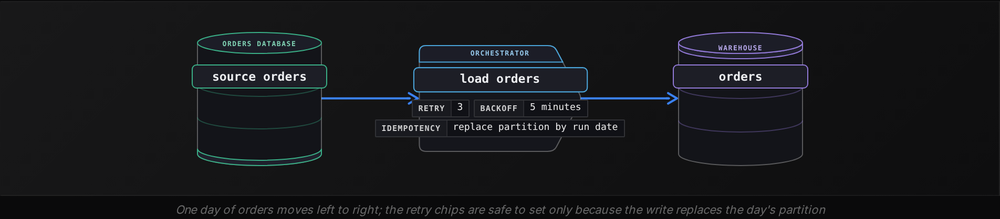

Beginner·Pipeline Architecture · 25 min · 10 challenges

# Idempotent Reruns: Beginner

Early Sunday morning at Airbnb, the 01:00 job that loads Saturday's bookings into the warehouse dies partway through with a connection reset. The on-call engineer shrugs at the error and clicks retry. Monday's revenue dashboard shows the best Saturday in company history. Nobody made a booking twice; the retry loaded most of them a second time. The write pattern this lesson teaches is the difference between those 2 Mondays.


<br>

---

## The Retry That Doubled the Rows

Every night at 01:00 a loader copies the previous day's orders from the orders database into the warehouse table `orders`. For 2026-04-25 the source holds 250,000 rows. The loader reads them in chunks of 10,000, and after each chunk it runs an `INSERT INTO` and commits, so a crash never loses more than one chunk of progress. That sounds careful, and it's exactly the design that doubles the rows.


<br>

### The night of 2026-04-25

At chunk 19 the network connection to the warehouse resets. The loader raises an error and exits. Chunks 1 through 18 are already committed: 180,000 rows for 2026-04-25 sit in the warehouse table. The orchestrator marks the task failed and pages the on-call engineer, who sees a dropped connection that won't happen again and clicks retry 5 minutes later.

The retry starts from the beginning. It reads all 250,000 source rows, because nothing tells it that 180,000 of them have already arrived. It appends every one of them. The task finishes green. The warehouse now holds 430,000 rows for a day that had 250,000 orders, and 180,000 of those rows are exact copies of rows above them.

| Event | Rows in source | Rows written this attempt | Rows in warehouse for 2026-04-25 |
| --- | --- | --- | --- |
| Run 1 starts | 250,000 | 0 | 0 |
| Run 1 crashes at chunk 19 | 250,000 | 180,000 | 180,000 |
| Retry starts 5 minutes later | 250,000 | 0 | 180,000 |
| Retry completes | 250,000 | 250,000 | 430,000 |


<br>

### Why nobody notices until Monday

The retry succeeded, so no alert fires. Every one of the 430,000 rows is a real order with a real customer and a real amount; the problem is that 180,000 of them appear twice. The day's row count is 1.72 times the true figure. Revenue summed from `amount` for 2026-04-25 is inflated by about as much, since the doubled chunks are ordinary orders with ordinary amounts, and a sales lead spends Monday morning asking why Saturday was the best day of the year.

The query that exposes the damage compares the number of rows to the number of distinct order ids. A day loaded once shows the 2 numbers equal. A day loaded one and a bit times shows the gap.

```sql
SELECT
  order_date,
  COUNT(*) AS row_count,
  COUNT(DISTINCT order_id) AS distinct_orders,
  COUNT(*) - COUNT(DISTINCT order_id) AS duplicate_rows
FROM orders
WHERE order_date = DATE '2026-04-25'
GROUP BY order_date
```

| order_date | row_count | distinct_orders | duplicate_rows |
| --- | --- | --- | --- |
| 2026-04-25 | 430,000 | 250,000 | 180,000 |


<br>

### Naming the failure mode

> Three ingredients of the doubled day
>
> - A partial failure: the run crashed after some of its writes were committed and before the rest.
> - An append write: `INSERT INTO` adds rows and never asks what's already there.
> - A retry: a person or the orchestrator started the whole run again from the first row.
> - Remove any one of the 3 and the duplicates vanish.

The first ingredient can't be removed; networks drop and processes die. The third is something you want, because a retry is how a failed night becomes a finished night without anyone rewriting data by hand. That leaves the write. The rest of this lesson changes the write so that the other 2 ingredients become harmless.

> **TIP**
>
> The row count against distinct order ids is a 1-line check you can run on any table that has a unique id. Run it on the last 7 days of every daily table you own and you will learn which loaders append.

**The same loader runs the next night for 2026-04-26, which has 300,000 source rows. It crashes after committing 3 chunks, and the on-call engineer retries once. The retry completes. How many rows does the warehouse hold for 2026-04-26?**

- **A.** 300,000, because the retry notices the 30,000 existing rows and starts from chunk 4.
- **B.** 330,000, because the 30,000 committed before the crash stay and the retry appends all 300,000.
- **C.** 600,000, because a retry always writes the whole day a second time on top of a whole first copy.
- **D.** 270,000, because the retry deletes the 30,000 partial rows and inserts the remaining chunks.

<details>
<summary>Solution</summary>

**B.** 330,000, because the 30,000 committed before the crash stay and the retry appends all 300,000.

Three chunks of 10,000 were committed before the crash. The retry appends the full 300,000 on top, so 30,000 rows are doubled.

**Why the others are wrong**

- **A.** The retry has no record of what the first attempt wrote. It reads the source from the first row and appends everything.
- **C.** The first attempt wrote 3 chunks, not the whole day. The duplicate count equals the rows committed before the crash.
- **D.** This loader never deletes. A write that clears the partial rows first is the fix, and this loader does not have it.

</details>


<br>

---

## Idempotency in One Sentence

An operation is idempotent when running it once and running it again leave the system in the same state. The number of runs does not change the result; 50 runs end in the same place as 1. The definition ignores what the second run costs in time and money, and it does not care whether that run does any work. It only compares end states.


<br>

### The two-run test

- Start from a known state and run the operation once. Record what the system looks like.
- Run the exact same operation again with the same input. Record the state again.
- Compare the 2 records. Identical means idempotent. Any difference means it is not.

The test is mechanical, which is its value. You don't need to understand what a piece of code intends; you run it twice and diff the results. Point it at a whole pipeline or at a single SQL statement inside one task, and it gives the same kind of answer.


<br>

### Everyday operations under the test

| Operation | After run 1 | After run 2 | Idempotent? |
| --- | --- | --- | --- |
| Set the thermostat to 20 degrees | 20 | 20 | Yes |
| Raise the thermostat by 2 degrees | 22 | 24 | No |
| Create the folder `reports` if it is missing | folder exists | folder exists | Yes |
| `INSERT INTO orders` the day's 250,000 rows | 250,000 rows | 500,000 rows | No |
| Delete the day's rows, then insert the day's 250,000 rows | 250,000 rows | 250,000 rows | Yes |
| `UPDATE accounts SET balance = balance + 10` | 110 | 120 | No |
| `UPDATE accounts SET balance = 110` | 110 | 110 | Yes |

A pattern runs through the table. Operations that state the end result (set to 20, make the folder exist, the day's rows are exactly these) pass. Operations that describe a change relative to what is already there (raise by 2, add these rows, add 10) fail, because the second run starts from a different place than the first did.

> **TIP**
>
> When you cannot tell whether a step is idempotent, ask what it would do if you pressed the button twice by accident. If the answer contains the word 'more', it fails the test.


<br>

### Same operation, same input

The test says the exact same operation with the same input. A loader that reads `WHERE order_date = CURRENT_DATE` is a different operation on Thursday than it was on Tuesday, because its input moved under it. Idempotency is judged for a fixed input: the run for 2026-04-25, with the source rows for 2026-04-25. Two runs of that are the comparison. A run for a different day is a different operation, and it is supposed to produce different rows.

```sql
def record_total_append(totals, day, amount):
    totals.append((day, amount))


def record_total_set(totals, day, amount):
    totals[day] = amount


log = []
record_total_append(log, '2026-04-25', 1_250_000)
record_total_append(log, '2026-04-25', 1_250_000)
print(len(log))

book = {}
record_total_set(book, '2026-04-25', 1_250_000)
record_total_set(book, '2026-04-25', 1_250_000)
print(len(book))
```

Both functions receive the same input twice. The first grows the list by one entry per call, so the second run is visible in the result. The second writes to a key named by the input, so the second call lands on the same key and the dictionary looks exactly as it did after the first call. The key makes the difference: the write is addressed by the day, and the day is part of the input.


**Apply the two-run test. Which statement leaves the table in the same state whether it runs once or twice?**

- **A.** UPDATE orders SET attempts = attempts + 1 WHERE order_id = 7
- **B.** INSERT INTO shipments (order_id) VALUES (7)
- **C.** UPDATE orders SET shipped_at = NOW() WHERE order_id = 7
- **D.** UPDATE orders SET status = 'shipped' WHERE order_id = 7

<details>
<summary>Solution</summary>

**D.** UPDATE orders SET status = 'shipped' WHERE order_id = 7

The statement names the end state. After the first run status is shipped; the second run sets it to shipped again and nothing changes.

**Why the others are wrong**

- **A.** The second run reads the value the first run wrote and adds 1 again, so attempts ends 1 higher after each run.
- **B.** Each run adds one more row for order 7. After 2 runs the table holds 2 shipments for an order that shipped once.
- **C.** The input changes between runs because NOW() moves. The second run overwrites the timestamp with a later one, so the states differ.

</details>


<br>

---

## Replace, Do Not Append

The replace pattern needs one idea about how the warehouse table is organized. The `orders` table is split by `order_date`: every row for 2026-04-25 is stored together under that date, and every row for 2026-04-26 under its own. One date's slice is called a partition. A query that filters on a single date touches one partition, and a write that targets a single date can replace that partition without reading or touching any other day.

The daily loader's unit of work is one day. The partition's unit of storage is one day. When those 2 units match, the idempotent write is 2 statements: remove whatever the partition holds, then insert the day's rows computed fresh from the source.

```sql
DELETE FROM orders
WHERE order_date = DATE '2026-04-25'
```

```sql
INSERT INTO orders
SELECT
  order_id,
  customer_id,
  amount,
  order_date
FROM source_orders
WHERE order_date = DATE '2026-04-25'
```

Some engines offer one statement that performs both steps at once, often written `INSERT OVERWRITE`. Written out, that statement is the pair above: clear the partition, fill the partition. The end state is the same either way. The partition holds exactly the day's rows from the source, and nothing from any previous run survives.


<br>

### The two-run test on the replace

| Scenario | Partition before | DELETE removes | INSERT adds | Partition after |
| --- | --- | --- | --- | --- |
| Clean first run | 0 | 0 | 250,000 | 250,000 |
| Rerun after a clean run | 250,000 | 250,000 | 250,000 | 250,000 |
| Retry after a crash at chunk 19 | 180,000 | 180,000 | 250,000 | 250,000 |
| Third rerun, for no reason | 250,000 | 250,000 | 250,000 | 250,000 |

Every row of the table ends at 250,000. The partial 180,000 from the crashed run are exactly what the DELETE removes, so the retry cleans up the mess the first attempt left without knowing the mess exists. The replace produces the correct end state whatever the previous state was, and no step in it detects or repairs the failure.


<br>

### The partition must match the run

The DELETE and the INSERT must describe the same set of rows. If the run reads one day from the source, it clears one day in the target. A loader that deleted the whole table and inserted one day would wipe 2 years of history on every run. A loader that deleted one day and inserted a week would leave 6 days doubled. Match the scope of the delete to the scope of the insert, and make both come from the same value.


<br>

### Where the date comes from

That value is the run's date, and it must come from the orchestrator rather than from the clock. The orchestrator schedules a run for 2026-04-25 and hands that date to the task. If the task computed `CURRENT_DATE - INTERVAL '1' DAY` instead, a rerun on Thursday for Tuesday's failed run would delete and insert Wednesday, leaving Tuesday still broken and Wednesday rewritten for nothing. Every statement in the run for a given day is scoped to that day, however many days later the run happens to execute.

```sql
def load_orders(conn, run_date):
    conn.execute('DELETE FROM orders WHERE order_date = ?', [run_date])
    conn.execute(
        'INSERT INTO orders '
        'SELECT order_id, customer_id, amount, order_date '
        'FROM source_orders WHERE order_date = ?',
        [run_date],
    )
```

| ✓ Append with INSERT INTO | ✗ Replace the partition |
| --- | --- |
| • A second run doubles the day<br><br>• A partial failure leaves rows the retry can't see<br><br>• Correct only if the run happens exactly once<br><br>• One statement to write, a long cleanup afterwards | • A second run equals the first<br><br>• A partial failure is erased by the next DELETE<br><br>• Correct for any number of runs<br><br>• Two statements, both scoped by the run date |

| ✓ Do | ✗ Don't |
| --- | --- |
| • Scope the DELETE and the INSERT by the same run date<br><br>• Take the run date from the orchestrator, never from the clock<br><br>• Partition the target by the same unit the loader processes | • Append daily loads with a bare INSERT INTO<br><br>• Filter on CURRENT_DATE inside a scheduled task<br><br>• Delete a wider range than the run inserts |

*Between the DELETE and the INSERT the partition is empty for a few seconds, and a query during that window sees no rows for the day. A single overwrite statement closes that gap, which is one reason engines offer it. The end state is identical.*

**A loader deletes WHERE order_date = CURRENT_DATE - INTERVAL '1' DAY and then inserts the rows for the run_date the orchestrator passed. Tuesday's run failed partway. On Thursday the on-call engineer reruns it for Tuesday. What happens to the table?**

- **A.** Tuesday's partition is deleted and rewritten, because the INSERT decides which partition the DELETE targets.
- **B.** Wednesday's rows are deleted, and Tuesday's rows are appended on top of whatever Tuesday's failed run left behind.
- **C.** Nothing is deleted, because Thursday minus 1 day is a date the table does not hold, and Tuesday is rewritten correctly.
- **D.** Both Tuesday and Wednesday are deleted and both are rewritten, so the table ends correct after a few seconds.

<details>
<summary>Solution</summary>

**B.** Wednesday's rows are deleted, and Tuesday's rows are appended on top of whatever Tuesday's failed run left behind.

On Thursday the clock says Wednesday, so Wednesday is cleared. The inserted rows carry Tuesday's date and land in Tuesday's partition, doubling the partial rows already there.

**Why the others are wrong**

- **A.** The DELETE has its own filter and it says Wednesday. Nothing links the 2 statements except the value you give each one.
- **C.** Thursday minus 1 day is Wednesday. Wednesday loaded correctly, and its full day of rows is what gets deleted.
- **D.** The single DELETE is scoped to Wednesday, while the INSERT brings in Tuesday's rows. Wednesday ends empty and Tuesday ends doubled.

</details>


<br>

---

## Why Retries Need Idempotency

An orchestrator retries a failed task on its own. You set `retries: 3` on the loader so that a dropped connection at 01:00 does not need a human at 01:05. The orchestrator waits and runs the task again, and it repeats that after each failure for up to 3 extra attempts. That behaviour is the orchestrator doing its job; the trouble comes from what each attempt does to the table.


<br>

### Tracing 3 retries on an append

Take a bad night. Attempt 1 crashes after 180,000 rows, attempt 2 after 60,000 and attempt 3 after 240,000; attempt 4 completes all 250,000. The task's final status is success, and the orchestrator's run page shows 1 green box. Trace the partition through the 4 attempts under both write modes.

| Attempt | Rows committed in this attempt | Partition after (append) | Partition after (replace) |
| --- | --- | --- | --- |
| 1 | 180,000 | 180,000 | 180,000 |
| 2 | 60,000 | 240,000 | 60,000 |
| 3 | 240,000 | 480,000 | 240,000 |
| 4 | 250,000 | 730,000 | 250,000 |

Under append, every attempt's partial progress survives into the next, and the finished partition holds 730,000 rows for 250,000 orders. Under replace, each attempt begins by clearing whatever the previous one left, so only the last attempt's rows remain, and the last attempt is the one that completed. The replace column passes through 3 wrong states on its way, but the state the retries settle on is right.

- **480,000** — phantom rows after 3 retries
- **2.9x** — warehouse rows per real order


<br>

### Retries multiply whatever the write does

The retry repeats the write, and the write creates the duplicates. A retry is a multiplier on the write's behaviour. An idempotent write run 4 times still leaves one day's rows. An append run 4 times leaves the full day from the attempt that succeeded plus the partial fragment from every attempt that failed before it, up to nearly 4 days' worth of rows. The retry count is the wrong dial to turn. Setting `retries: 0` on an append loader doesn't protect the table: the on-call engineer retries by hand, the manual run appends the same way, and the day doubles exactly as before.




<br>

### Anything that can run twice, will

The orchestrator's retry is the most visible second run, and far from the only one. A scheduler that fires twice after a restart, an engineer who clicks run on the wrong day, a deploy that restarts a task mid-flight, a backlog of failed nights all rerun on one afternoon: each is a second run of the same operation on the same input. With an idempotent write, every one of them leaves the partition as a single run would; with an append, each one doubles a day.

> What idempotency buys the on-call engineer
>
> - Retry without reading the logs first, because the worst case of a retry is wasted compute.
> - Rerun a week of failed nights in any order, because each run owns its own partition.
> - Stop asking whether the first attempt wrote anything before pressing the button.

**An append loader has retries: 2. One night attempt 1 commits 100,000 rows and fails, attempt 2 commits 50,000 and fails, and attempt 3 completes all 250,000. What does the partition hold, and what would it hold if the write replaced the partition instead?**

- **A.** 400,000 under append, and 400,000 under replace, because 3 attempts wrote rows either way.
- **B.** 400,000 under append, and 250,000 under replace, because replace keeps only the last attempt.
- **C.** 250,000 under append, and 250,000 under replace, because failed attempts roll back their rows.
- **D.** 500,000 under append, and 250,000 under replace, because each failed attempt counts as a full day.

<details>
<summary>Solution</summary>

**B.** 400,000 under append, and 250,000 under replace, because replace keeps only the last attempt.

Append keeps 100,000 plus 50,000 plus 250,000. Replace deletes the partial rows at the start of each attempt and ends with the completed 250,000.

**Why the others are wrong**

- **A.** Under replace each attempt clears the partition before writing, so attempt 3's 250,000 rows are the only ones left.
- **C.** The loader commits after every chunk, so failed attempts leave their committed rows behind, and no rollback removes them.
- **D.** A failed attempt leaves exactly the rows it committed, 100,000 and then 50,000, so the append total is 400,000.

</details>


<br>

---

## Side by Side: Idempotent vs Not

Here is the loader as it ran on the night of 2026-04-25, followed by the version that replaced it. The 2 differ in 3 places. In both, `chunks` splits the rows into lists of 10,000 and `log` is the task's logger. Read both, then the table that lists each difference and what it contributes to idempotency.

```sql
from datetime import date, timedelta


def load_orders(source, target):
    yesterday = date.today() - timedelta(days=1)
    rows = source.query(
        'SELECT order_id, customer_id, amount, order_date '
        'FROM orders WHERE order_date = ?',
        [yesterday],
    )
    for chunk in chunks(rows, 10_000):
        target.execute('INSERT INTO orders VALUES (?, ?, ?, ?)', chunk)
        target.commit()
    log.info('loaded %d rows', len(rows))
```

```sql
def load_orders(source, target, run_date):
    rows = source.query(
        'SELECT order_id, customer_id, amount, order_date '
        'FROM orders WHERE order_date = ?',
        [run_date],
    )
    target.execute('DELETE FROM orders WHERE order_date = ?', [run_date])
    target.commit()
    for chunk in chunks(rows, 10_000):
        target.execute('INSERT INTO orders VALUES (?, ?, ?, ?)', chunk)
        target.commit()
    log.info('loaded %d rows for %s', len(rows), run_date)
```

| Line | Before | After | Carries the property? |
| --- | --- | --- | --- |
| Function signature | `load_orders(source, target)` | `load_orders(source, target, run_date)` | Yes: the caller fixes the input, so 2 runs can receive the same day |
| Date used for the read | `date.today() - 1 day` | `run_date` | Yes: the same run reads the same rows on Thursday as on Tuesday |
| Write preamble | none | `DELETE ... WHERE order_date = run_date` | Yes: clears every row a previous attempt wrote for this day |
| Insert loop | `INSERT INTO` per chunk | `INSERT INTO` per chunk | No: unchanged, an append is fine once the partition is cleared |
| Commit per chunk | after each chunk | after each chunk | No: decides how much a crash leaves behind, and the DELETE handles any amount |
| Log line | row count | row count and run date | No: logging has no effect on the table |

The property depends on 3 lines working together. The `run_date` parameter makes 2 runs comparable. The read filtered by `run_date` makes both runs fetch the same rows. The DELETE filtered by `run_date` makes the second write land on a cleared partition. Remove any one and the two-run test fails, at the latest when a run executes on a different day from the one it is for. Without the parameter the day drifts with the clock; without the read filter the loader clears one day but reads every day in the source, so every other day is reloaded on top of itself; and if the DELETE goes, the rows pile up.


<br>

### Lines that look important and are not

The `INSERT INTO` is unchanged between the 2 versions. An append is a fine statement; an append without a preceding clear is what fails the test. The chunk size and the commit per chunk decide how much a crash leaves behind, 180,000 rows or 10,000 or none, and the next DELETE erases any amount, so they don't change the end state once a rerun succeeds. They do change what a reader of the table sees during the load. The DELETE commits first and every chunk commits as it lands, so for the whole load, far longer than the few seconds of the second section's pair of statements, a query sees an empty day and then a partial one. If every retry fails, the partial day stays. Running the DELETE and all the inserts in one transaction, or using a single overwrite statement, closes that window. The log line is the one most often mistaken for a safeguard. It records that something happened; it can't stop it from happening twice.


<br>

### Running the test against both

| Run sequence | Before (append, clock) | After (replace, run_date) |
| --- | --- | --- |
| Run once on 2026-04-26 for the 25th | 250,000 on the 25th | 250,000 on the 25th |
| Crash at chunk 19, retry the same night | 430,000 on the 25th | 250,000 on the 25th |
| Rerun on 2026-04-28 for the 25th | 25th unchanged, 27th doubled | 250,000 on the 25th, no other day touched |

The before column fails on the second line and produces something stranger on the third: a rerun meant to fix the 25th instead loads the 27th a second time, because the clock chose the day. The after column is one number repeated, which is what the two-run test looks for.

> **TIP**
>
> When reviewing a loader, find the 3 places: where the run's date is fixed, where the read is bounded by it, and where the write clears by it. If any of the 3 is missing, the code is one retry away from a doubled day.

**A colleague edits the fixed loader so the DELETE reads DELETE FROM orders WHERE order_date = CURRENT_DATE - INTERVAL '1' DAY, and leaves the read on run_date. Which run sequence still passes the two-run test?**

- **A.** A rerun on 2026-04-28 for the 25th: the DELETE clears the 27th and the INSERT refills the 25th, ending at 250,000.
- **B.** Every sequence, because the read still uses run_date and the read is the line that carries the property.
- **C.** Two runs on the night of 2026-04-26 for the 25th: both runs clear and refill the 25th, so the partition ends at 250,000.
- **D.** No sequence, because a DELETE that depends on the clock fails the test even when the clock agrees with the run.

<details>
<summary>Solution</summary>

**C.** Two runs on the night of 2026-04-26 for the 25th: both runs clear and refill the 25th, so the partition ends at 250,000.

On the 26th, the clock minus 1 day gives the 25th, which matches the date the read uses. The test passes only while that agreement holds.

**Why the others are wrong**

- **A.** The 25th is never cleared, so its rows are appended on top of what it already held, and the 27th is wiped for nothing.
- **B.** The property needs all 3 lines. A read bounded by the run date with a DELETE bounded by the clock drifts apart as soon as the 2 disagree.
- **D.** The test compares end states. If the clock and the run date agree, each run clears the same partition before refilling it, so the end states match.

</details>


<br>

---

## Putting It All Together

A food delivery company loads each day's completed deliveries into a warehouse partition at 02:00, and the courier payout team sums that partition every Friday to pay riders. The loader fails on Tuesday night with a dropped connection after 140,000 of 310,000 rows. The orchestrator retries with retries: 3, the first 2 retries also fail partway, and the third retry completes all 310,000 rows. On Friday the payout query runs.

- With an append loader, the 140,000 partial rows plus every later attempt's partial rows plus the full 310,000 land in Tuesday's partition, and riders are paid for deliveries that never happened.
- With a replace loader scoped by the orchestrator's run date, each retry begins by clearing Tuesday's partition, so the completed attempt is the only one whose rows survive and the payout is exact.
- The two-run test is how the team proves it before Friday: run the loader twice for Tuesday in a test schema and compare the row count against distinct delivery ids.
- Because every statement in the loader is scoped by run_date rather than by the clock, a rerun on Thursday for Tuesday repairs Tuesday and leaves Wednesday untouched.


<br>

---

## Key Takeaways

- A partial failure plus an append plus a retry produces duplicate rows, and the retry succeeds, so nothing alerts.
- An operation is idempotent when 1 run and 2 runs leave the same end state; the two-run test checks it mechanically.
- Replace the partition instead of appending to it: DELETE the run's day, then INSERT the run's day from the source.
- The run date comes from the orchestrator, and every statement in the load is scoped by that one value.
- Retries multiply whatever the write does, so automatic retries are safe only on an idempotent write.

Exercises for this lesson: [_exercises/pa_idempotency_beginner.md](_exercises/pa_idempotency_beginner.md)
