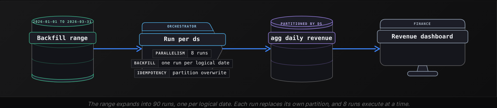
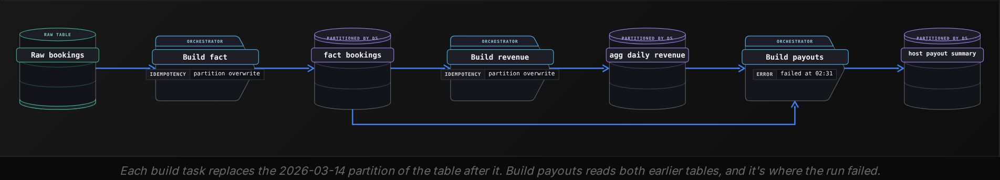

Intermediate·Pipeline Architecture · 32 min · 10 challenges

# Idempotent Reruns: Intermediate

Take a fix to the currency conversion in Airbnb's nightly booking revenue. Every day from January 1 to March 31 is wrong by a few percent, and finance wants all 90 days corrected before the quarter closes. Rerunning 90 nights of a pipeline that writes 3 tables works only if every write, every read and every key choice gives the same answer twice.


<br>

---

## Three Idempotent Write Patterns

The beginner lesson closed on a single rule: replace, don't append. Which way to replace depends on the destination table's shape: is it partitioned by the column that scopes the run, keyed by an entity ID, or neither? It also depends on a single run's unit of work, which is either a complete day of data or a batch of rows that changed since the previous run.


<br>

### Partition overwrite

Use it when the destination is partitioned by the same column that scopes the run, usually a date column `ds`, and each run computes the full contents of a single partition. The write swaps the old partition for the new one as a unit. The run for `ds = '2026-03-14'` produces 41,200 rows. A retry produces the same 41,200 rows and installs them in place of the first attempt's. Every other partition stays as it was.

```sql
INSERT INTO fact_bookings
SELECT
    booking_code,
    listing_id,
    guest_id,
    amount_usd,
    ds
FROM staging_bookings
WHERE ds = '2026-03-14'
```

It is safe only when the run holds the whole partition. Suppose a run carries only the 300 bookings that changed since yesterday. Overwriting with those 300 erases the other 40,900. The price is rewriting all 41,200 rows even when 3 of them changed. That's fine for a daily fact table and wasteful for a large table where a handful of rows move each hour.


<br>

### MERGE on a key

Use it when the destination holds a row per entity and those rows change over time, such as `dim_listing` with a row per `listing_id`. The run's unit is the set of listings that changed. MERGE joins incoming rows to the table on the key. A matched key updates its row, and an unmatched key inserts a new row. Replaying the same 500 changes leaves the table identical, for 2 reasons. Setting a column to the value it already holds changes nothing. And every key now exists, so no insert fires.

```sql
MERGE INTO dim_listing AS t
USING listing_changes AS s
ON t.listing_id = s.listing_id
WHEN MATCHED THEN
    UPDATE SET
        nightly_price = s.nightly_price,
        status = s.status
WHEN NOT MATCHED THEN
    INSERT (listing_id, nightly_price, status)
    VALUES (s.listing_id, s.nightly_price, s.status)
```

It is safe only when the key is unique in both the table and the incoming batch, which is the subject of the next section. The price is a join between the batch and the target on every run, even when the batch is small.

**An hourly job reads the bookings that changed in the last hour. It writes them to fact_bookings, which is partitioned by ds, using partition overwrite. What does each run do to the partitions it touches?**

- **A.** Replaces each partition with the changed rows and deletes the unchanged bookings
- **B.** Adds the changed rows to each partition, so every change is stored twice
- **C.** Leaves the partitions correct, since partition overwrite is always idempotent
- **D.** Fails, since a partition cannot be replaced before its day ends

<details>
<summary>Solution</summary>

**A.** Replaces each partition with the changed rows and deletes the unchanged bookings

Overwrite installs whatever the run supplies, and changed rows are a fraction of each partition. MERGE fits this unit of work.

**Why the others are wrong**

- **B.** Overwrite never appends. The partition shrinks to the changed rows.
- **C.** A second run repeats the first run's result, and that result had already lost rows.
- **D.** The engine accepts the write. Nothing checks that the run supplied a whole partition.

</details>


<br>

### DELETE-then-INSERT

Use it when a run owns a set of rows you can name with a predicate, but that set does not line up with a partition. `fact_payouts` is partitioned by `payout_month` because readers query by month, while the pipeline runs daily. Overwriting the March partition from a daily run would erase the other 30 days of March. Instead, the run deletes the rows it owns, those whose `payout_date` is its day, and inserts the recomputed rows. A retry deletes the same set, including anything the failed attempt left behind, and inserts it again.

```sql
DELETE FROM fact_payouts
WHERE payout_date = DATE '2026-03-14'
```

```sql
INSERT INTO fact_payouts
SELECT
    payout_id,
    host_id,
    amount_usd,
    payout_date,
    payout_month
FROM staging_payouts
WHERE payout_date = DATE '2026-03-14'
```

Two conditions keep it safe. First, the DELETE predicate and the INSERT filter must name the same rows. Say the delete matches on `payout_date`, the insert on `created_at`, and a payout is created March 14, dated March 15. Every run of March 14 inserts another copy its delete never matches. The March 15 run deletes every copy, inserts none back, and the payout vanishes. Second, a failure between the 2 statements leaves March 14 empty until the rerun, which the last section addresses.

| Pattern | Destination shape | Unit of work | Cost per run | Breaks when |
| --- | --- | --- | --- | --- |
| Partition overwrite | Partitioned by the run's date | A complete partition | Rewrites the whole partition | The run holds part of a partition |
| MERGE | A row per entity key | Changed rows | Joins batch to target | The key repeats in source or target |
| DELETE-then-INSERT | Partitioned coarser than the run, or not at all | Rows matching a predicate | Delete scan plus insert | Delete and insert filters disagree |

**A daily run computes a day's host earnings. host_earnings holds a row per host per day and is partitioned by earnings_month. Which write keeps a rerun of a single day idempotent?**

- **A.** Overwrite the month partition that the run's day falls in
- **B.** MERGE on host_id, which appears once in each run's output
- **C.** DELETE rows whose earnings_date is the run's day, then INSERT them
- **D.** INSERT the day's rows and let a weekly job drop duplicates

<details>
<summary>Solution</summary>

**C.** DELETE rows whose earnings_date is the run's day, then INSERT them

The run owns a set named by a predicate. Deleting and reinserting that set repeats identically.

**Why the others are wrong**

- **A.** The run holds a single day, so replacing the month erases every other day in it.
- **B.** The table has a row per host per day, so this match overwrites other days' rows.
- **D.** Readers see doubled earnings until the cleanup runs, and the cleanup must guess which copy is right.

</details>


<br>

---

## Choosing a Business Key

A MERGE is idempotent only when each incoming row finds the target row that stands for the same real-world thing, or finds nothing. The columns that do the finding are the business key. These are the values that identify a booking, a listing or a guest night, whatever the table's grain is.

| Key kind | Example | Origin | Safe for MERGE when |
| --- | --- | --- | --- |
| Natural | `booking_code` | Assigned by the booking app | The source never reuses or reassigns it |
| Surrogate | `booking_key` | Generated by the pipeline | It is computed from the natural key the same way on every run |
| Composite | (`booking_code`, `night_date`) | Several source columns together | The set names a single row at the table's grain |

#### Natural keys

A natural key comes from the source system, so a rerun sees the same value the first run saw. The risk sits in the source: a key that can change or be reused. An email address fails both ways. Guests change their emails, and someone else can register a closed account's address.

#### Surrogate keys

A surrogate key is a value the pipeline assigns. Pipelines often use one to replace a long string or to join several sources under a single ID. It goes wrong when the pipeline generates it fresh on each run. If the job calls `uuid()` and merges on the result, every retry produces keys the table has never seen. Nothing matches, and every row is inserted again.

After the first run

| booking_key | booking_code | amount_usd |
| --- | --- | --- |
| 9f2c41 | HMX41 | 212.00 |
| c71a08 | HMX42 | 95.50 |

After a retry with uuid() keys

| booking_key | booking_code | amount_usd |
| --- | --- | --- |
| 9f2c41 | HMX41 | 212.00 |
| c71a08 | HMX42 | 95.50 |
| 3be9d2 | HMX41 | 212.00 |
| e0457f | HMX42 | 95.50 |

The fix is a deterministic surrogate: a hash of the natural key. The same `booking_code` hashes to the same value on every run, so retries and later recomputations land on the rows they already wrote.

```sql
SELECT
  TO_HEX(SHA256(TO_UTF8(booking_code))) AS booking_key,
  booking_code,
  amount_usd
FROM staging_bookings
```

#### Composite keys

When a single column cannot name a row, combine several. A table of booked nights holds a row per booking per night. A 3-night stay therefore has 3 rows sharing `booking_code`, and the key is (`booking_code`, `night_date`). Getting the set wrong in either direction makes reruns misbehave. With too few columns, distinct rows collapse onto a single row, and each one overwrites the last. With too many, such as adding `updated_at`, every change to a booking looks like a new row, and the table grows with every edit.


<br>

### Enforcing uniqueness

Uniqueness has to hold on both sides of the MERGE. If the target stores a key twice, a single incoming row updates 2 rows. A key can also appear twice in the incoming batch, because the source emitted an update twice or ingestion delivered a file twice. Then the MERGE has 2 candidates for a single target row. Most engines reject the statement. An engine that accepts it has to pick a source row, and a retry may pick the other. Deduplicate the batch before merging, keeping a row per key by a fixed order.

```sql
WITH ranked AS (
  SELECT
    booking_code,
    listing_id,
    amount_usd,
    updated_at,
    ROW_NUMBER() OVER (
      PARTITION BY booking_code
      ORDER BY updated_at DESC, ingest_offset DESC
    ) AS rn
  FROM staging_bookings
)

SELECT
  booking_code,
  listing_id,
  amount_usd,
  updated_at
FROM ranked
WHERE rn = 1
```

The second sort column matters. If 2 copies share an `updated_at`, ordering by that column alone leaves the choice to the engine, and the winner can differ between runs. `ingest_offset` differs between the copies, so the same row wins every time.

**The staging batch holds 2 rows for booking HMX42. They were emitted within the same second, with equal updated_at and different amount_usd. The dedupe orders by updated_at DESC only. What can a rerun do?**

- **A.** Insert HMX42 twice, since both rows are new to the target
- **B.** Keep the other amount, since the engine may break the tie differently
- **C.** Fail, since window functions reject equal sort values
- **D.** Keep both rows, since row_number() gives ties the same number

<details>
<summary>Solution</summary>

**B.** Keep the other amount, since the engine may break the tie differently

With a tie, the engine can pick either row. Add a second sort column such as ingest_offset.

**Why the others are wrong**

- **A.** The dedupe still keeps a single row per key. The risk is which row survives.
- **C.** Ties are allowed. row_number() numbers them in an arbitrary order.
- **D.** That describes rank(). row_number() gives distinct numbers, so a single row survives.

</details>

```sql
SELECT
  booking_code,
  COUNT(*) AS row_count
FROM dim_booking
GROUP BY booking_code
HAVING COUNT(*) > 1
```

| ✓ Do | ✗ Don't |
| --- | --- |
| • Merge on a key that exists in the source before the pipeline touches it<br><br>• Hash the natural key when a surrogate is needed<br><br>• Deduplicate the batch with a tie-breaking second sort column | • Merge on a uuid() or sequence generated during the run<br><br>• Put changing columns like updated_at in the key<br><br>• Key on values a person can edit, such as email |

**dim_booking should hold a row per booking. Its MERGE matches on (booking_code, updated_at). A booking is created on Monday and edited 3 times later that week. How many rows does that booking have by Sunday?**

- **A.** 1, because the MERGE updates the matching row on every edit
- **B.** 2: the first version and the latest version
- **C.** 0, because the edits conflict and the MERGE rejects them
- **D.** 4, because each edit has a new key and inserts a row

<details>
<summary>Solution</summary>

**D.** 4, because each edit has a new key and inserts a row

A changing column in the key turns every edit into a new key. Key on booking_code alone.

**Why the others are wrong**

- **A.** Each edit carries a new updated_at, so no existing row matches it.
- **B.** Nothing removes the middle versions. Each edit inserted its own row.
- **C.** Each edit's key is distinct, so the MERGE has no conflict to reject.

</details>


<br>

---

## Reads Can Be Non-Idempotent Too

A partition overwrite or a MERGE guarantees that the write replaces. It says nothing about what it replaces the data with. If the query returns different rows when it runs again, the rerun faithfully installs a different answer. A run is idempotent only when its inputs are fixed, and the most common moving input is the clock.

```sql
SELECT
  booking_code,
  amount_usd,
  booked_at
FROM raw_bookings
WHERE booked_at >= CURRENT_TIMESTAMP - INTERVAL '1' DAY
```

The scheduled run starts at 02:00 on March 15 and covers the day leading up to that moment. It fails, and the on-call engineer retries it at 09:40. The retry's window slides forward with it. It drops the early morning of March 14 and picks up the morning of March 15, which belongs to the next run.

- **7h 40m** — of March 14 the retry never reads

The fix is to hand the run its time bounds. Each scheduled run has a logical date, which is the period the run is responsible for. The logical date is fixed when the run is created and is unrelated to when the run actually starts. The orchestrator passes the start and end of that period into the run, and the query filters on them. The run for March 14 then reads March 14 whether it executes at 02:00, at 09:40 or months later.

```sql
SELECT
  booking_code,
  amount_usd,
  booked_at
FROM raw_bookings
WHERE booked_at >= TIMESTAMP '2026-03-14 00:00:00'
  AND booked_at < TIMESTAMP '2026-03-15 00:00:00'
```

> Other clocks hiding in a query
>
> - `current_date`, `now()` or `current_timestamp` anywhere in a filter, join or computed column
> - Reading the newest file in a folder instead of the file for the run's date
> - Joining a dimension as it looks today when the run describes a past day
> - A `processed_at` column stamped by the run, if any reader depends on its value

**This job writes yesterday's bookings per listing into a ds partition. It always reads whole days, yet a recomputation of last month comes out wrong. Which change fixes it?**

```sql
SELECT
    listing_id,
    count(*) AS bookings
FROM raw_bookings
WHERE booked_at >= date_trunc('day', current_timestamp - INTERVAL '1' DAY)
    AND booked_at < date_trunc('day', current_timestamp)
GROUP BY listing_id
```

- **A.** Replace both current_timestamp bounds with the run's logical-date bounds
- **B.** Truncate to the hour instead of the day for finer windows
- **C.** Filter on landed_at instead of booked_at
- **D.** Switch the write from partition overwrite to MERGE

<details>
<summary>Solution</summary>

**A.** Replace both current_timestamp bounds with the run's logical-date bounds

Truncating to whole days still follows the clock, so every past run read the same yesterday.

**Why the others are wrong**

- **B.** Finer truncation still tracks the clock, so every past run reads recent hours.
- **C.** This keeps the clock in the filter and changes what the report means.
- **D.** The write was correct. The read returns the wrong day for every past run.

</details>


<br>

### Event time and processing time

A booking row usually carries 2 timestamps. Event time is when the thing happened in the world: the guest pressed Book at 23:58 on March 14. Processing time is when the pipeline received or handled the row: it landed in the raw table at 00:07 on March 15. The 2 timestamps differ by seconds on a good day. They differ by hours when a phone was offline or an upstream export ran late.

| booking_code | booked_at (event) | landed_at (processing) | Day by event time | Day by processing time |
| --- | --- | --- | --- | --- |
| HMX41 | 2026-03-14 10:12 | 2026-03-14 10:12 | March 14 | March 14 |
| HMX57 | 2026-03-14 23:58 | 2026-03-15 00:07 | March 14 | March 15 |
| HMX63 | 2026-03-14 18:30 | 2026-03-15 06:45 | March 14 | March 15 |

A report of bookings made on March 14 means event time, so it groups on `booked_at`. Grouping on `landed_at` would credit HMX57 and HMX63 to March 15, and the totals would shift with every slow export. Selecting rows is a second choice. Event-time bounds, as in the query above, read March 14's raw rows, late arrivals included. `landed_at` bounds read only rows new since the last run, but those can span several event days, so the run must rewrite each event-time partition they touch.

Rerun the March 14 event-time partition a week later, and it may hold 3 more bookings, because rows that landed late are now in the raw table. That is correct, because idempotency means the same inputs give the same output. When more facts about March 14 exist, the rerun reflects them, and running it twice more changes nothing further.

> **TIP**
>
> Name time columns by what they record, such as `booked_at` and `landed_at`, and never use a bare `ts` or `timestamp`. A reader of the query should see which kind of time each filter uses without opening the source documentation.

**Finance asks for the number of bookings made per day. A transform groups by date(landed_at). On the night an upstream export runs 6 hours late, what happens to the totals?**

- **A.** Nothing changes, since every booking lands eventually
- **B.** Both days come up short, since late rows are dropped
- **C.** One day is low and the next day is high by the same bookings
- **D.** The run fails, since landed_at is later than booked_at

<details>
<summary>Solution</summary>

**C.** One day is low and the next day is high by the same bookings

Late rows count under their landing day. Group by date(booked_at) to match the request.

**Why the others are wrong**

- **A.** The rows do land, but on the next day by landed_at, so the totals move.
- **B.** No row is dropped. Each late row is credited to the day it landed.
- **D.** Nothing compares the 2 columns. The grouping silently uses processing time.

</details>


<br>

---

## The Backfill Operation

A backfill runs the pipeline for a range of past logical dates. Two reasons start most backfills: a gap where runs never happened, and a logic fix that makes past output wrong. Take the second. A currency conversion bug inflated `agg_daily_revenue` for every day from 2026-01-01 through 2026-03-31. After the fix ships, those 90 logical dates have to run again with the corrected code.



```sql
from datetime import date, timedelta

start = date(2026, 1, 1)
end = date(2026, 3, 31)

ds = start
while ds <= end:
    run_pipeline(ds=ds.isoformat())
    ds += timedelta(days=1)
```


<br>

### Why only idempotent pipelines survive it

All 90 partitions already hold data from runs that succeeded. A backfill is therefore 90 reruns at once, and every flaw a single retry would expose shows up 90 times. Each earlier section of this lesson predicts a failure.

| Flaw in the pipeline | What the 90-day backfill leaves behind |
| --- | --- |
| Appends instead of replacing | Every day holds the old inflated rows plus the corrected rows, more than twice the true revenue |
| Filters relative to the clock | Each run reads the 24 hours before its start, so 90 partitions hold overlapping recent slices |
| Merges on a `uuid()` key | Every row is inserted again under a new key, next to its old copy |
| DELETE and INSERT filters disagree | Rows the delete misses survive, so old values linger beside new values |
| Idempotent writes, explicit time bounds, unique keys | Each partition is replaced with its corrected contents, and nothing else changes |

**A pipeline reads the 24 hours before current_timestamp and writes into its run's ds partition by partition overwrite. In June, it backfills 2026-01-01 to 2026-03-31. What do the 90 partitions hold afterwards?**

- **A.** Corrected data, since partition overwrite makes reruns safe
- **B.** Recent June bookings in overlapping slices, under 90 dates
- **C.** Their old data with the June bookings appended
- **D.** No rows, since a June run finds no January bookings

<details>
<summary>Solution</summary>

**B.** Recent June bookings in overlapping slices, under 90 dates

Each run reads the 24 hours before its start and files them under its date.

**Why the others are wrong**

- **A.** The write replaces correctly, but the rows it writes come from the wrong day.
- **C.** Overwrite replaces the partition, so the old rows are gone.
- **D.** The filter finds June bookings, because nothing ties it to the run's date.

</details>


<br>

### Order and parallelism

When each run reads only its own day's inputs and writes only its own partition, the 90 runs are independent. They can run in any order and several at once, limited by the cluster and by the source systems they read. Some runs read the previous day's output, as a running total, a cumulative guest count or a first-booking flag does. Then day N needs day N-1 finished and corrected first. Those runs go one at a time, oldest first, and a single failure stops everything after it.

At 12 minutes per run, the 2 approaches finish at very different times:

- **18 h** — wall clock, a run at a time
- **2 h 24 m** — wall clock, 8 runs at a time


<br>

### Before starting the range

> A backfill checklist
>
> - Confirm every table the run writes uses one of the 3 replace patterns
> - Search the code for `current_date`, `now()` and `current_timestamp`
> - Check that the raw data for the whole range still exists and has not aged out
> - Run a single day, compare it with the old output, then launch the rest
> - List the tables built from `agg_daily_revenue`, because they need the same range rerun afterwards
> - Tell the dashboard's readers which dates will change and when

**guest_lifetime_value for day N adds day N's spend to the value stored for day N-1. You backfill January after a fix. How should the 31 runs execute?**

- **A.** 8 at a time in any order, since each run writes its own partition
- **B.** Newest first, so that recent values are corrected soonest
- **C.** All 31 at once, then a second pass to repair any mistakes
- **D.** A run at a time from January 1, each after the previous one succeeds

<details>
<summary>Solution</summary>

**D.** A run at a time from January 1, each after the previous one succeeds

Each day needs the corrected day before it, so the chain runs oldest first.

**Why the others are wrong**

- **A.** Separate partitions don't make the runs independent, because each run reads the previous day's result.
- **B.** January 31 would build on the old January 30 value, which is still wrong.
- **C.** The first pass builds on wrong values, and the second pass repairs them only if it runs in order.

</details>


<br>

---

## Idempotency Across Several Tables

The nightly run for `ds = '2026-03-14'` writes 3 tables in order: `fact_bookings`, then `agg_daily_revenue` built from it, then `host_payout_summary` built from both. At 02:31 the third task fails on a lost connection. The first 2 tables hold fresh March 14 data. The third still holds whatever an earlier attempt for that day left, or nothing.



| Table | After the failure at 02:31 | After the rerun at 06:10 |
| --- | --- | --- |
| fact_bookings | March 14 replaced, 41,200 rows | Replaced again with the same 41,200 rows |
| agg_daily_revenue | March 14 replaced | Replaced again with identical totals |
| host_payout_summary | Earlier contents for March 14 | March 14 replaced for the first time this run |

The rerun converges if each table's write is idempotent by itself and scoped to the run's logical date: tables 1 and 2 are replaced with identical contents, and table 3 catches up. Retrying only the failed task also works, provided the tables it reads still hold this run's output. Rerunning the whole run is the safer default whenever an upstream table might have changed in between.


<br>

### The window between failure and rerun

Convergence fixes the end state. It does nothing for readers between 02:31 and 06:10. A dashboard that joins `agg_daily_revenue` to `host_payout_summary` shows corrected revenue next to stale payouts, and an analyst who exports it at 05:00 ships numbers that never existed together. Publishing last or writing a completion marker closes that window.

#### Publish last

Each task writes to a staging copy of its table, scoped to the run's date, and readers never query staging. A final publish task copies each staging partition into the table readers use, by partition overwrite. A failure in any build task leaves the reader tables on the previous complete version of March 14. The publish task still writes 3 tables. But it runs in seconds and holds no business logic, so the window shrinks from hours to moments. Like every other write, the publish is idempotent.

#### A completion marker

The run's last task writes a row to `run_status` saying March 14 is `complete`. It uses MERGE on `ds`, so a rerun updates that row instead of adding a second one. Downstream jobs wait for the row, and readers filter on it. On a rerun or backfill, the marker already says `complete` from the earlier success, so the rerun's first task must set it to `running` before touching any table. Otherwise readers trust March 14 while its tables change underneath them.

```sql
SELECT
  r.ds,
  r.revenue_usd,
  p.total_payout_usd
FROM agg_daily_revenue AS r
JOIN host_payout_summary AS p
  ON p.ds = r.ds
JOIN run_status AS s
  ON s.ds = r.ds
WHERE s.status = 'complete'
```

**A run builds 3 tables in staging, publishes them by partition overwrite, and then writes the complete marker. On the day's first run, the publish succeeds for 2 tables and fails on the third. What do readers who filter on the marker see for that day?**

- **A.** No data for the day until a rerun publishes all 3 tables and writes the marker
- **B.** The 2 published tables, with the third table missing from the join
- **C.** The staging contents of the third table in place of its reader table
- **D.** An error, since the published tables and the marker disagree

<details>
<summary>Solution</summary>

**A.** No data for the day until a rerun publishes all 3 tables and writes the marker

Readers join on the marker, and only the last task writes it, so a partial publish stays hidden.

**Why the others are wrong**

- **B.** The join to run_status drops the whole day, because no complete row exists yet.
- **C.** Readers never query staging, and the third reader table keeps its old partition.
- **D.** Nothing compares them. The missing marker filters the day out without any error.

</details>


<br>

### A single appending write breaks the run

The run is idempotent only if every write in it is. A step that appends a row to `payout_events` on each run, or calls the payments service to pay hosts, turns a safe rerun into duplicate events or double payouts. Key each such write on the logical date and the step, and MERGE on that key. Send that key with each payment call so the service skips repeats. A local log of sent keys leaves a gap: a crash between payment and log write pays the host twice. The advanced lesson builds this out.

**A run writes fact_bookings by partition overwrite. It then MERGEs dim_guest on a uuid() generated each run, and finally marks the day complete in run_status. The marker task fails, and the whole run is retried. What is true after the retry succeeds?**

- **A.** Every table is correct, since the first attempt never wrote the marker
- **B.** fact_bookings holds duplicates, since it was written twice
- **C.** dim_guest holds every guest twice, under 2 different keys
- **D.** run_status holds 2 complete rows for the day

<details>
<summary>Solution</summary>

**C.** dim_guest holds every guest twice, under 2 different keys

Fresh uuid() keys never match, so the retry inserted every guest again. Hash the natural key instead.

**Why the others are wrong**

- **A.** The marker controls what readers see. It cannot remove the rows the first attempt already merged.
- **B.** Partition overwrite replaced it with identical rows. It is the safe table here.
- **D.** Only the retry wrote the marker, and MERGE on ds keeps it to a single row.

</details>


<br>

---

## Putting It All Together

Picture the Airbnb currency fix from the opening. Ninety days, 2026-01-01 through 2026-03-31, of fact_bookings, agg_daily_revenue and host_payout_summary must be recomputed before finance closes the quarter. The engineer first audits each table's write pattern. The audit turns up a uuid() key on a guest table and a current_date in the revenue filter, and the engineer fixes both. Next, they rerun March 14 alone and compare it with the old output. Then they launch the range 8 runs at a time, with publish-last staging and a run_status marker keeping half-finished days off the finance dashboard.

- The write pattern decides what a rerun replaces. The key and the time bounds decide what it replaces that data with.
- Hashing the natural key lets a MERGE target survive the backfill, because every rerun lands on the rows it wrote before.
- Explicit logical-date bounds make 90 parallel runs read 90 different days instead of the same recent day.
- Event-time partitions explain why the backfill picks up late bookings: the bounds are the same, but more facts exist, so the answer is corrected.
- The completion marker makes the 3-table run visible as a single unit. Resetting the marker first keeps the backfill from exposing half-replaced days.


<br>

---

## Key Takeaways

- Pick the write pattern from the destination's shape and the run's unit of work: a whole partition, keyed changes, or a slice named by a predicate.
- A MERGE is only as idempotent as its key, which must stay stable across runs and be unique in both the target and the incoming batch.
- A deterministic surrogate comes from hashing the natural key. A uuid ( ) generated per run duplicates every row on retry.
- Feed every run explicit time bounds from its logical date. In each transform, decide whether event time or processing time drives each filter.
- A backfill is many reruns at once. Independent days can run in parallel, while days that read yesterday's output must run in order.
- Across several tables, make each write idempotent first. Then hide partial states with publish-last or a completion marker that each rerun resets before it starts.

Exercises for this lesson: [_exercises/pa_idempotency_intermediate.md](_exercises/pa_idempotency_intermediate.md)
