# Ingestion Patterns: Advanced - Exercises

Lesson: [pa_ingestion_patterns_advanced.md](../pa_ingestion_patterns_advanced.md)

### Exercise 1 of 11

**● TASK**

An order handler writes each order to Postgres and publishes to Kafka in the same function; about 0.4% of orders get no event, and rolled-back orders still trigger notifications. Redesign it so the handler commits to Postgres alone and each committed order is captured off the database and published to Kafka, with no distributed transaction. The recommendation and notification consumers keep reading Kafka and react to each event as it lands, not on a schedule.

**Starting canvas** (already placed for you):

- Order service handler (writes Postgres and publishes Kafka in one function) (source, API)
- Postgres orders database (storage, PostgreSQL)
- Kafka order_events topic (queue, Kafka)
- Recommendation service consumer (consumer, API)
- Customer notification service consumer (consumer, Email)

<strong>Solution</strong>

#### 2 commits, no shared transaction

A **dual write** is 2 independent commits in one handler: the order row to Postgres, then the event to Kafka. Every line can be correct and the pair is still not atomic, so 4 outcomes exist. Both succeed, or both fail, and nothing breaks. Postgres commits and the publish fails: an order with no event, the 0.4% that never reach the notification service. The publish succeeds and Postgres rolls back: an event for an order that does not exist, which is how customers get emails for shipments that never happened.

| ✕ Database committed, publish failed | ✓ Published, database rolled back |
| --- | --- |
| The order exists but no event was sent. Recommendations and notifications never hear about it, and nothing retries it later. | The event names an order id that is not in Postgres. Consumers act on a phantom order they cannot look up. |

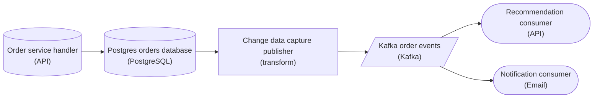

*The handler commits once, to Postgres. Change data capture turns each committed order into a Kafka event that triggers both consumers.*

The fix removes the second commit instead of trying to coordinate it. The handler writes Postgres and stops there. A change data capture stage reads committed changes from the database log, so it only ever sees rows that survived the commit, and publishes each one to Kafka. A rolled-back order never reaches the log. A committed order cannot be skipped, because the log is the record of the commit.

| Pitfall: A distributed transaction moves the risk instead of removing it |
| --- |
| Two-phase commit across Postgres and Kafka needs a coordinator that holds locks until both sides vote, so a stalled broker blocks order writes. Kafka's own transactions only cover writes inside Kafka, so they cannot include the Postgres commit. |

| Key insight: Consumers wake on the event, not the clock |
| --- |
| Both services stay event driven: each committed order arrives as a Kafka message, and that message triggers the work. A scheduled job that compares Postgres against Kafka could find the missing events, but only hours after the customer missed the email. |

**Follow-up questions**

1. If the change capture stage restarts mid-stream, could a consumer see the same order twice, and what makes that harmless?\
   *Extends the design to redelivery and to consumers that are idempotent on the order id.*
2. Which of the 4 outcomes would a nightly reconciliation job catch, and how late would it catch them?\
   *Contrasts event-triggered delivery with a schedule that only detects the gaps after the fact.*

 

### Exercise 2 of 11

**● TASK**

Each order is written to Postgres and its order_placed event published to Kafka from one handler, so one order in 250 commits with no event and rollbacks leave phantom events. Replace the dual write with a transactional outbox: the handler writes the order and an outbox row in one transaction, and a separate publisher, named for whether it polls the table or tails the change log, drains it to Kafka. The consumer must ignore events resent after a publisher crash.

**Starting canvas** (already placed for you):

- Order service handler (currently dual-writes; producing ghost orders) (source, API)
- Postgres orders database (storage, PostgreSQL)
- Kafka order_events topic (queue, Kafka)
- Recommendation service consumer (consumer, API)

<strong>Solution</strong>

#### Why the two writes drift

The fix is the **transactional outbox** pattern. Instead of writing the order to Postgres and publishing to Kafka as two independent calls, the handler writes two rows to one database in a single transaction: the order into `orders`, and its event into an `outbox` table. They commit or roll back together, so a committed order always carries its event and a rolled-back one leaves no phantom. A separate publisher drains `outbox` to `order_events` afterward.

| Pitfall: Two systems cannot share one commit |
| --- |
| The original handler commits Postgres, then calls `produce()` on Kafka. Nothing binds those calls: a crash or broker timeout after the commit drops the event (your 1-in-250 gap), and producing before the commit and then rolling back leaves an event for an order that never existed. Reordering them just moves the failure; only folding the event into the order's transaction removes it. |

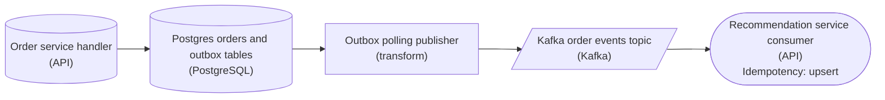

*The handler's only write is one Postgres transaction; the polling publisher is the sole path to Kafka, and the consumer upserts on `event_id` so a resent event changes nothing.*

| ✕ Polling publisher | ✓ CDC tailer |
| --- | --- |
| An `outbox-poller` runs `SELECT ... FROM outbox WHERE published_at IS NULL ORDER BY id` on an interval, produces each row, then stamps it published. No new infrastructure; the cost is poll latency and query load. The name says it reads the table. | A `cdc-relay` (Debezium) tails the Postgres write-ahead log and emits the instant the `outbox` insert is durable. Lower latency, no polling load, but now you operate a connector. The name says it reads the change log. |

| Real world: The relay is at-least-once, so dedupe downstream |
| --- |
| Either publisher can crash between producing to Kafka and marking the row published, so the same event ships twice. Make that harmless: give each outbox row a stable `event_id` and have the recommendation consumer upsert on it, skipping repeats. At-least-once delivery plus an idempotent consumer is the standard contract; chasing exactly-once across the broker is not worth it. |

**Follow-up questions**

1. What keeps the `outbox` table from growing without bound?\
   *Expect a retention job that deletes rows safely behind the published watermark.*
2. `order_events` has several partitions, so how do you keep one order's events ordered?\
   *Key the Kafka message by order id so all of an order's events land on the same partition.*

 

### Exercise 3 of 11

**● TASK**

The producer bursts to 50k events/sec during a flash sale, but the consumer drains only 5k/sec and crashes, losing orders that must not be lost. Buffer the spike with a durable queue between them, named with its depth and what happens to events past it. Replace the consumer with a stream processor that pulls from the queue at its own rate and lands orders within 15 minutes.

**Starting canvas** (already placed for you):

- Producer service (50k events/sec during spike) (source, API)
- Consumer (5k events/sec capacity; crashes on spike) (transform, Pandas)
- Iceberg raw_events landing (storage, Iceberg)

<strong>Solution</strong>

#### Backpressure: decide where the extra events wait

Backpressure is what a pipeline does when the producer outruns the consumer. At 50k events/sec in and 5k out, 45k/sec have nowhere to go, and with nothing between the 2 stages they pile up in the consumer's memory until it dies. Buffering the spike splits the problem in two: a durable queue holds the surplus, and a stream processor pulls from it continuously at the rate it can sustain. The spike turns into queue depth and lag instead of lost orders.

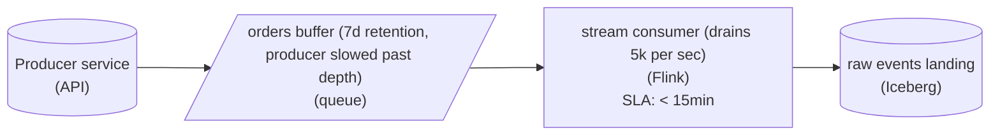

*The buffer sits inline and absorbs the 10x burst; the stream consumer pulls at its own 5k/sec pace, so the gap becomes lag it works off after the sale.*

| Pitfall: A bigger in-memory queue just relocates the crash |
| --- |
| An unbounded `list` or `asyncio.Queue` inside the consumer is the failure you were handed: memory grows until the host crashes and every in-flight order vanishes on restart. A durable queue keeps each message until the consumer acknowledges it, so a crash only delays those orders instead of losing them. |

| Key insight: The consumer pulls, it is never pushed |
| --- |
| A batch job that wakes up hourly would let the backlog grow for the whole hour and then hit it all at once. A stream processor with a `< 15min` freshness target reads continuously, so it drains the backlog at full capacity the moment the burst eases. Pulling is what makes it safe: the consumer never accepts more than it can process. |

| Real world: The queue's name states its bound |
| --- |
| `orders buffer (7d retention, producer slowed past depth)` tells on-call how much runway exists and what happens past it. Orders must not be lost, so past the bound the producer is slowed rather than the oldest events aged out; for debug telemetry, dropping the oldest would be the right call. |

**Follow-up questions**

1. The spike lasts 30 minutes at 50k/sec while the consumer drains 5k. How deep does the queue get, and how long until the lag is back under 15 minutes?\
   *Sizing depth from the drain deficit instead of by feel.*
2. If freshness had to stay under 1 minute during the sale, what would you change about the stream consumer?\
   *When buffering alone is not enough and the stream processor must scale out.*

 

### Exercise 4 of 11

**● TASK**

A platform pages the HTTP APIs of 3,000 free, pro and enterprise accounts by incremental cursor, and one shared puller pool fetches every page. When the largest enterprise account surges, its pages fill the pool and every other tenant falls behind. Redesign it so pull work waits in a queue per lane, the enterprise tier gets its own lane, pullers back off and retry when an account's rate limit throttles them, and on-call can see pull lag per tier.

**Starting canvas** (already placed for you):

- customer account APIs (source, API)
- cursor scheduler (transform)
- shared API puller pool (transform)
- raw landing (storage, Iceberg)

<strong>Solution</strong>

#### One lane for the loud tier

Splitting one shared puller pool into lanes is **resource isolation**. Instead of every tenant competing for the same workers, each lane gets its own queue of pull work and its own pullers. An enterprise surge still happens, but it becomes a longer enterprise queue rather than a slower platform.

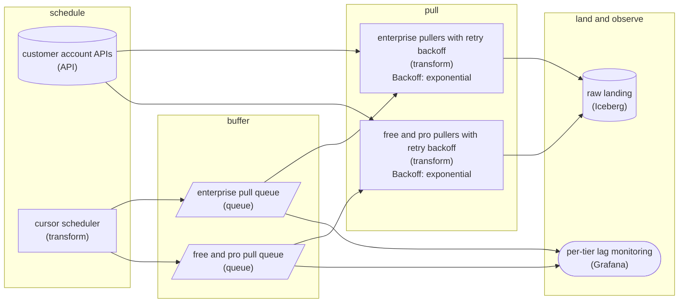

*The scheduler drops each account's next cursor into its lane's queue. Each lane's pullers page the account APIs into shared raw landing, retrying throttled requests with exponential backoff, and queue lag feeds per-tier monitoring.*

The API is why the shared pool breaks. Each account is paged by cursor and capped by its own rate limit, so a surging account becomes thousands of pages that can only be fetched so fast. When the API throttles a request, the puller waits with exponential backoff and retries the same cursor, so no page is skipped and the account is not hammered. In a shared pool those slow, backing-off jobs hold workers while free and pro jobs wait behind them. With a queue per lane, the enterprise pullers work through that backlog at the account's pace, and free and pro cursors stay current.

| Pitfall: More pullers is not isolation |
| --- |
| Growing the shared pool only raises the ceiling. The next surge fills it again, and enterprise pages still crowd out everything queued behind them. Isolation means a separate queue and separate pullers, so the noisy tier can only use up its own capacity. |

| Real world: Lag per lane is what on-call reads |
| --- |
| Report 2 numbers for each queue: how many pull jobs are waiting, and how far that tier's cursors trail the newest event. On-call then sees the enterprise lane hours behind while free and pro sit near zero, and can scale the enterprise pullers without touching the other lanes. |

**Follow-up questions**

1. A single pro tenant surges inside the shared free and pro lane. How do you stop it from monopolizing that lane without a queue per tenant?\
   *Extends tier isolation to fair scheduling between tenants that share a lane.*
2. Your largest enterprise customer wants guaranteed capacity. When does a dedicated lane per tenant beat a lane per tier?\
   *Weighs stronger isolation against cost as the tenant count grows.*

 

### Exercise 5 of 11

**● TASK**

Redesign an order service that dual-writes to Postgres and Kafka so the handler commits each order and its event in one Postgres write to an outbox, and a change-data-capture connector drains that outbox into the Kafka order_events topic read by the warehouse, recommendation, and notification consumers. Route events the connector cannot deliver to a dead-letter queue, and add an alert that pages on-call when drift reappears.

**Starting canvas** (already placed for you):

- Order service handler (currently dual-writes to DB and Kafka) (source, API)
- Postgres orders database (storage, PostgreSQL)
- Kafka order_events topic (queue, Kafka)
- Downstream consumers (warehouse, recommendation, notification) (consumer, API)

<strong>Solution</strong>

#### One commit, then a log

A **transactional outbox** fixes dual-write drift by turning two writes into one. The handler inserts the order into `orders` and the event it owes into an `outbox` table inside the same Postgres transaction, so both rows commit or neither does. A change-data-capture connector then tails the write-ahead log and publishes each committed `outbox` row to `order_events`. The handler never talks to Kafka at all.

| Pitfall: No ordering of two writes is safe |
| --- |
| Commit then `produce()` loses the event when the process dies between them, which is where the silent drops came from. Publish then commit emits a phantom event for an order that rolled back. Swapping the order only changes which bug you get. A retry loop around `produce()` does not help either, because the crash can happen before the retry runs. |

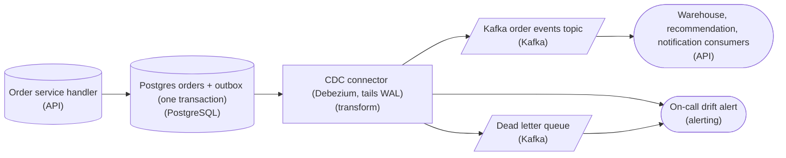

*The handler's only external write is the Postgres transaction; every hop after it replays a durable log.*

1. **Let the connector drain the outbox**

   The connector commits its log offset only after Kafka acks, so a crash re-reads from the last offset. That is at-least-once delivery: duplicates are possible, losses are not. Carry a generated `event_id` in each `outbox` row so consumers can dedupe a replay.

2. **Park the poison events and page on drift**

   An event that fails after a bounded retry budget goes to the dead letter queue instead of blocking the stream, where it waits to be replayed after a fix. The connector's lag and the queue's depth feed a paging alert, so drift pages on-call in minutes instead of surfacing in the next reconciliation.

| Real world: Reconciliation becomes a smoke alarm |
| --- |
| The same shape gets events out of any service-owned database without a distributed transaction: user signups feeding a CRM, payment state feeding a ledger. The nightly diff can stay, but it no longer carries the weight. |

**Follow-up questions**

1. The notification consumer sees the same `event_id` twice. Where does the dedupe live, and why does it matter more there than in the warehouse loader?\
   *Idempotency belongs at side-effecting consumers.*
2. What prunes `outbox` rows the connector has already published?\
   *An outbox needs a retention path or it grows without bound.*

 

### Exercise 6 of 11

**● TASK**

Migrate a 3,000-account order platform off its dual write: each handler writes Postgres and publishes to Kafka separately, and a flash sale just overwhelmed ingestion. Write the order and an outbox row in one Postgres transaction, and add a CDC source node that publishes committed outbox rows to Kafka. Keep Kafka as the burst buffer, isolate tenants by tier, and add a Grafana dashboard showing per-tenant consumer lag. Give each event a stable id so every sink applies it idempotently. Route the warehouse, recommendation and notification consumers through the outbox-fed topics.

**Starting canvas** (already placed for you):

- Order service handler (currently dual-writes) (source, API)
- Multi-tenant ingest source (3,000 accounts) (source, API)
- Postgres orders database (storage, PostgreSQL)
- Kafka event topics (queue, Kafka)
- Iceberg multi_tenant_raw (storage, Iceberg)
- Three downstream consumers (warehouse, recommendation, notification) (consumer, API)

<strong>Solution</strong>

#### Why the dual write breaks, and what replaces it

Getting Postgres and Kafka to agree again comes down to the **transactional outbox pattern**. Instead of the order handler doing 2 independent operations, writing the order to Postgres and then publishing to Kafka, it writes the business row and an `outbox` row inside a single Postgres transaction. Because both live in the same database, one commit makes both durable or neither. The event is now a committed fact, and a separate reader ships it to the broker afterward.

| Pitfall: The dual write has no shared commit |
| --- |
| In the legacy handler the Postgres `INSERT` and the Kafka `publish()` are 2 separate calls with no atomic bracket around them. When the broker is down but the row commits, the order exists and no event ever fires. When Postgres rolls back after a successful publish, consumers act on an order that was never persisted. A single-system outage always leaves them disagreeing. |

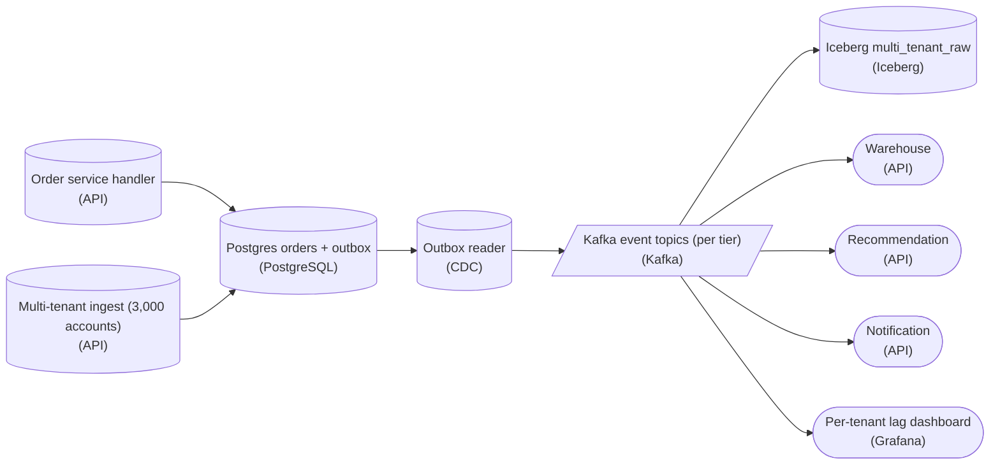

*Kafka sits downstream of the Postgres transaction boundary: nothing reaches the broker until the outbox row has committed.*

1. **Make the write atomic**

   The handler opens one transaction and writes both the order row and an `outbox` row carrying the event payload and a stable `event_id`. They commit together, so a broker outage can no longer split them. You replace a cross-system publish with a same-database `INSERT`, which Postgres already gives you atomically.

2. **Let a CDC reader carry committed rows to Kafka**

   The CDC node tails the `outbox` table through the write-ahead log and publishes only committed rows to the Kafka topics. It sees an event exactly when the transaction commits, never before. The handler no longer talks to Kafka at all, so its request path cannot fail on a broker hiccup.

3. **Absorb the burst and isolate the tenants**

   Keep Kafka between producers and consumers as the shock absorber: size retention to hold the flash-sale peak, so a slow consumer falls behind inside a bounded buffer instead of dropping events. Partition or route topics by tenant tier so one noisy account fills its own partitions instead of starving everyone. Then point a `Grafana` dashboard at per-tenant consumer lag so rising backlog on any tier is visible before it becomes an outage.

| Key insight: A stable event id turns redelivery into a no-op |
| --- |
| Kafka and CDC both deliver at least once, so every sink will occasionally see the same event twice. Because each `outbox` row carries a stable `event_id`, each consumer applies idempotently, keyed on that id: the warehouse upserts, the recommendation store dedupes, notifications skip an id already sent. A redelivered event converges to the same final state as a single delivery. |

**Follow-up questions**

1. The outbox table grows without bound. Where and how do you prune rows once CDC has published them?\
   *The outbox is a relay buffer, not a permanent log, and needs a cleanup job keyed on what has been published.*
2. What ordering guarantee does each consumer actually get, and what breaks if 2 orders for the same tenant land on different partitions?\
   *Partition-key choice: per-tenant ordering versus throughput, and why the key must match the isolation boundary.*
3. If the CDC reader crashes mid-batch and resumes, how do you keep it from skipping or reordering outbox rows?\
   *Idempotency extended to the relay itself: checkpointed log positions over the outbox.*

 

### Exercise 7 of 11

**● TASK**

A ride-hailing trip handler inserts each trip into PostgreSQL and publishes a trip event to Kafka, a dual write that leaves about 1 in 10,000 trips stored but unbilled, or billed but unstored. Redesign it for 2 million trips a day so the handler writes to one system only and both the trip database and billing are fed from that write, billing triggered by the trip event stream. Kafka redelivers events after restarts, so a replay must never store a trip twice.

<strong>Solution</strong>

#### One write, and everything else reacts to it

A **dual write** is two independent commits pretending to be one. The handler inserts the trip and publishes the event, and no transaction spans both systems. A broker outage leaves a stored trip that nobody bills; a failed commit leaves billing charging for a trip that does not exist. At 2 million trips a day, a 1 in 10,000 split is about 200 broken trips every day. The fix is architectural: the handler commits to exactly one system, and every other system reacts to that commit as an event.

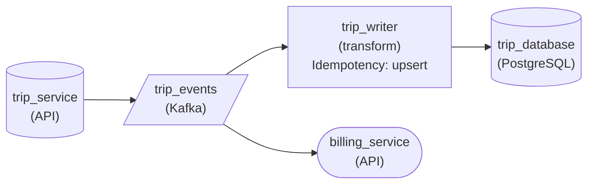

*The handler publishes once to `trip_events`; `trip_writer` upserts into `trip_database` and `billing_service` charges, each reacting to that one event.*

Here the single write is the publish. Once Kafka acknowledges it, two readers act independently: `trip_writer` writes the row into the database and `billing_service` charges the rider. If `trip_writer` is down, events wait in the topic and it catches up later. Nothing is lost, because nothing depends on a second commit inside the request.

| Trick: Redelivery is why the writer upserts |
| --- |
| Kafka delivers at least once, so after a restart `trip_writer` reprocesses events it may already have written. A plain `INSERT` turns each replay into a duplicate trip. Keying the write on `trip_id` and upserting lands the replay on the row that already exists, so catching up on an hour of events leaves the table exactly as it was. |

| Pitfall: Retrying the publish does not close the gap |
| --- |
| Wrapping the Kafka call in retries, or publishing before the insert instead of after, only changes which half can fail alone. As long as the handler itself touches two systems, two of the 4 outcomes still break the invariant. Only removing the second write removes them. |

| Key insight: The database now trails the event |
| --- |
| Because a consumer writes the trip row, a read in the same request may not find it yet. That is fine here: the handler only returns the trip id to the driver app, and the row appears moments later. |

**Follow-up questions**

1. A rider-receipts service now needs every completed trip. What changes?\
   *Whether a new reader subscribes to the existing stream instead of adding a write to the handler.*
2. Kafka redelivers a trip event after a consumer restart. What stops billing from charging twice?\
   *Idempotent consumption on the billing side, not just the database side.*
3. How would you notice that `trip_writer` has fallen hours behind `trip_events`?\
   *Monitoring consumer lag so a stalled writer is caught before trips go missing from reports.*

 

### Exercise 8 of 11

**● TASK**

A payment service writes each captured payment to PostgreSQL, and a ledger loader reads payment events from Kafka into a finance warehouse. Use a transactional outbox: the payment and its event commit in one transaction, and a separate publisher drains unpublished outbox rows to Kafka. The publisher may crash after Kafka confirms but before marking a row published, so replays must leave each payment in the warehouse exactly once.

<strong>Solution</strong>

#### The outbox moves the duplicate, it does not remove it

A transactional outbox fixes atomicity, not delivery. Writing the payment and its outbox row in one PostgreSQL transaction means neither can exist without the other, but the publisher draining the outbox still talks to Kafka across a separate boundary. It sends, waits for the confirmation, then sets `published_at`. A crash between those 2 steps leaves the row unpublished, so the next run sends it again. The outbox delivers **at least once**, and an idempotent write downstream is what turns that into exactly once in the ledger.

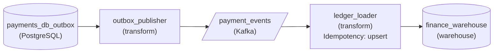

*One transaction writes the payment and its outbox row; the publisher drains unpublished rows to Kafka; the loader upserts on `event_id`.*

1. **Commit the payment and the event together**

   The payment service never calls Kafka. Inside the transaction that inserts the payment, it inserts an outbox row with a stable `event_id`, the `event_type` '`payment_captured`' and the payload. A commit or a rollback covers both rows at once.

2. **Let the publisher drain, and expect it to resend**

   The publisher selects rows where `published_at IS NULL`, which the partial index keeps cheap, publishes each to Kafka, and marks it only after the broker confirms. That order is correct, and it also guarantees a crash can resend an event Kafka already has.

3. **Make the warehouse write idempotent on the event ID**

   The loader writes each event into the ledger as an upsert keyed on the outbox `event_id`. A resent event hits the same key and rewrites the identical row, so a rerun leaves one ledger entry per payment. Key on the event, not the payment, so a later refund for the same payment is never mistaken for a duplicate.

| Pitfall: Marking before sending loses events instead |
| --- |
| Setting `published_at` before the Kafka send looks like it removes the duplicates. It does, by turning a crash into a payment the ledger never hears about. Keep the confirm-then-mark order and absorb the resend at the warehouse write. |

**Follow-up questions**

1. A fraud scorer starts reading the payment topic too. What does it need?\
   *Idempotency belongs to each reader: every consumer of an at-least-once topic needs its own guard on `event_id`.*
2. How do you keep the outbox table from growing without bound?\
   *Published rows are history; the partial index on `published_at IS NULL` keeps draining fast, and a cleanup of old published rows keeps the table small.*

 

### Exercise 9 of 11

**● TASK**

A multiplayer game emits match results, which must never be lost and feed a leaderboard that may lag during spikes, and frame-timing telemetry, which a performance dashboard only needs as a sample. On launch nights match results peak at 60k events/sec and telemetry at 240k/sec, 10 times the steady load, while the stream processor handles 40k/sec. Design the ingestion so each event type gets the backpressure strategy that fits it.

<strong>Solution</strong>

#### Two event types, two backpressure strategies

Backpressure stops being one decision the moment a stream carries data of different worth. Here the spike is 300k events/sec against a processor that drains 40k/sec, but the two event types answer the section's questions differently: a match result must not be lost and its lateness is tolerable, while a telemetry frame is worth little on its own. Slowing the producer is off the table too, because a client holding an unsent result loses it when the player quits.

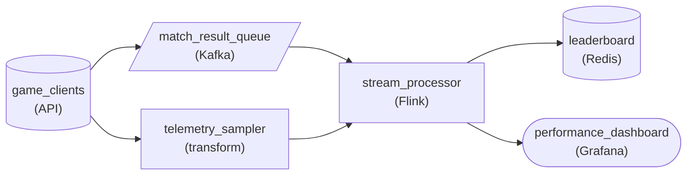

*Match results wait in `match_result_queue`; telemetry is cut down in `telemetry_sampler` before `stream_processor`.*

1. **Queue what must not be lost**

   Match results peak at 60k/sec against 40k/sec of drain, and a lost result is a wrong leaderboard. That is exactly the case a durable queue covers: `match_result_queue` takes the burst, `stream_processor` drains it at its own rate, and the price is lag the players already accept.

2. **Shed what is only worth a sample**

   Telemetry at 240k/sec could never be drained in time, and queueing it buys nothing because the dashboard reads percentiles. `telemetry_sampler` keeps a small slice, around 1 percent at peak, so the processor sees a few thousand frames a second and the estimate stays sound.

| Performance: The backlog clears in about 20 minutes |
| --- |
| With telemetry sampled, the processor spends about 37k/sec on match results, so the queue grows by roughly 23k/sec: around 40 million events over a 30-minute spike. When input falls back to 6k/sec and sampling stays on until the lag clears, about 34k/sec of headroom drains it in roughly 20 minutes. Queue storage is the cost, which is why only match results go in. |

| Pitfall: Buffering telemetry turns a spike into hours of lag |
| --- |
| Sending both streams through one queue feels safe, but the backlog then grows by about 260k/sec, close to 470 million events in 30 minutes. With only 10k/sec of steady-state headroom that takes over 13 hours to drain, and every match result sits behind frames nobody needed. |

**Follow-up questions**

1. What changes if the spike lasts 6 hours instead of 30 minutes?\
   *Whether queue retention and the resulting leaderboard lag still fit what players tolerate.*
2. What if the dashboard also needs an exact count of crash events from telemetry?\
   *How the worth of the data moves a subset of telemetry into the must-not-lose class.*

 

### Exercise 10 of 11

**● TASK**

A marketplace pulls orders from 940 sellers' paginated storefront APIs by incremental cursor, and on one shared worker pool the 40 large sellers (2 million rows per pull) starve the 900 small ones. Apply resource isolation per tier: a separate pull queue and worker pool for large and for small sellers, both landing in one shared warehouse. Small sellers' orders must land within 15 minutes, large sellers' within an hour. Retry rate-limited API calls with backoff.

<strong>Solution</strong>

#### Isolate the pulls by tier, share the landing table

This section has three layers of isolation, and resource isolation is the middle one. Tenants still share the platform, but each tier gets capacity that no other tier can take. Here the noisy neighbor is a large seller whose cursor walk pages through 2 million rows and holds a worker for most of an hour. On one shared pool, enough of those pulls fill every worker, and the 900 small sellers queue up behind them. With a separate queue and pool per tier, a large-seller backlog can only delay other large sellers.

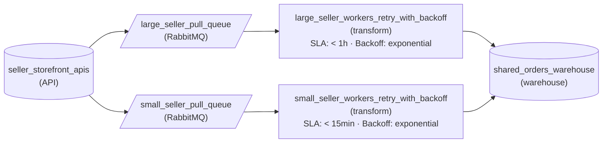

*Each tier has its own queue and worker pool. Both pools retry throttled calls with exponential backoff and land in the one `shared_orders_warehouse`, where sellers stay separated by seller id.*

| Pitfall: A bigger shared pool is still shared |
| --- |
| Adding workers to the single pool raises total throughput but not fairness. When a burst of large-seller pulls arrives, the new workers go to them too. Isolation is about who can claim capacity, not how much capacity exists. |

| Trick: Back off inside the tier, never across it |
| --- |
| A throttled call that waits out its backoff holds a worker only in its own pool. So a seller API rate-limiting a long pull in `large_seller_workers_retry_with_backoff` cannot stall a single pull in `small_seller_workers_retry_with_backoff`. |

| Key insight: Match the isolation layer to where the SLO breaks |
| --- |
| Storage stays logical: one warehouse filtered by seller id, because reads do not compete the way pulls do. The pull layer gets resource isolation because that is where the 15-minute SLO fails. Physical isolation, a dedicated stack per seller, is worth its cost only when one seller's SLO cannot be met inside its tier. |

**Follow-up questions**

1. A small seller grows to 500,000 rows per pull. How does it move between tiers without losing its cursor?\
   *Tier assignment as data that changes, and keeping incremental state independent of which pool runs the pull.*
2. Within the small tier, one seller's API is slow and every page takes 30 seconds. Is per-tier isolation still enough?\
   *When to cap concurrency per tenant inside a tier rather than adding another tier.*

 

### Exercise 11 of 11

**● TASK**

A ticketing platform's order service writes each order to PostgreSQL and its event to an outbox table in the same transaction. When a big show goes on sale, checkout bursts to 20,000 orders per minute for 10 minutes while the warehouse loader drains 5,000 per minute, and checkout must never be slowed to match. Design the ingestion: capture the outbox with CDC, absorb the burst without losing an order event, and load the warehouse so a redelivered event never creates a duplicate order row. Reporting dashboards read the warehouse within 2 hours.

<strong>Solution</strong>

#### Buffer the burst, never throttle the buyer

Once the outbox and CDC are in place, the open question is backpressure: for 10 minutes orders arrive 4 times faster than the loader writes, and something has to give. Of the 3 responses the lesson covered, 2 fail this workload. Slowing the producer means slowing checkout, and dropping events means losing paid orders, so what is left is a **durable buffer** that holds the surplus while the loader catches up at its own pace.

1. **Let the outbox be the only write**

   Checkout commits the order row and its outbox row in one PostgreSQL transaction and returns. Nothing in the request path waits on the broker or the warehouse, which is exactly what keeps checkout at full speed during the burst.

2. **Capture the outbox into a durable log**

   CDC reads the outbox from the database change log and publishes each event to Kafka. The log is the buffer: it accepts 20,000 events a minute as they arrive, keeps them on disk, and the loader's consumer offset simply falls behind. Size retention to the worst backlog with margin.

3. **Make the load an upsert on the order**

   CDC is at-least-once: a connector restart replays from its last checkpoint, so the loader sees some events twice. Setting `idempotencyStrategy` to 'upsert', keyed on the order id, turns a repeat into an overwrite of the same row instead of a second sale.

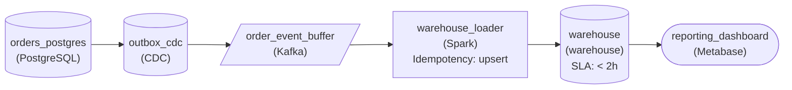

*Checkout writes the order and its outbox row; CDC streams the outbox into Kafka, which holds the burst; an upserting loader drains it into the warehouse the dashboards read.*

| Pitfall: Throttling checkout moves the queue onto customers |
| --- |
| Blocking the producer is the right backpressure answer when the producer is a batch job that can wait. Here the producer is a fan holding a card: added latency means abandoned purchases, and the backlog still exists, it just lives in browser tabs instead of a log. |

| Key insight: Dropping is only for events whose loss nobody can see |
| --- |
| If the stream also carried seat-map refreshes, shedding those under load would be fine: the next one supersedes them. The test is whether a lost event changes a number someone reconciles. A paid order always does. |

| Performance: The backlog is minutes of disk, not a scaling problem |
| --- |
| The surplus is 15,000 events a minute for 10 minutes, so the log peaks near 150,000 events. After the sale, checkout falls to about 500 a minute and the loader clears the backlog in roughly half an hour, well inside the 2-hour freshness the dashboards need. |

**Follow-up questions**

1. What changes if a confirmation email must go out within a minute, even mid-sale?\
   *Giving a second reader its own offset on the same log so it is not stuck behind the warehouse backlog, and keeping it idempotent.*
2. What happens if Kafka is unavailable for 20 minutes during an on-sale?\
   *Recognizing that the outbox table itself holds the events and CDC resumes from its position with nothing lost.*

