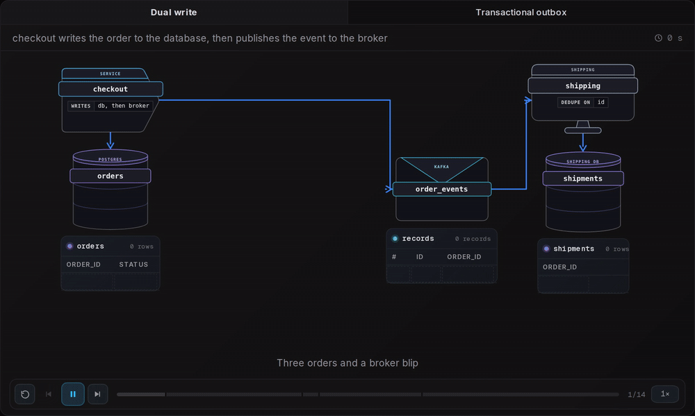
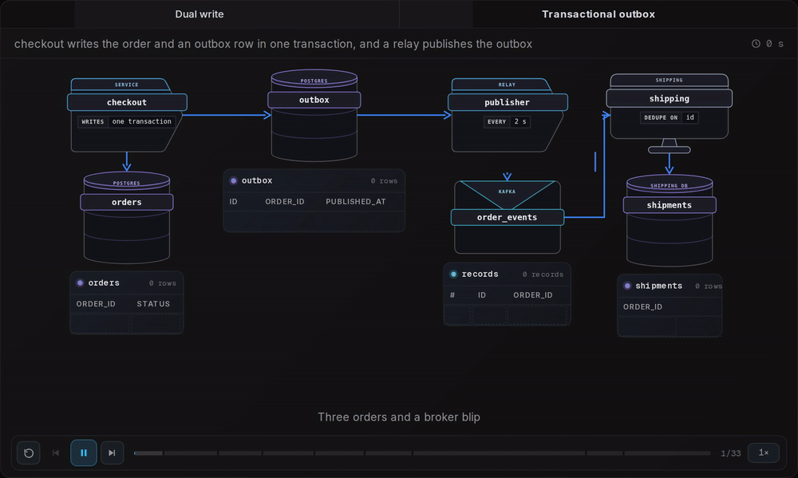
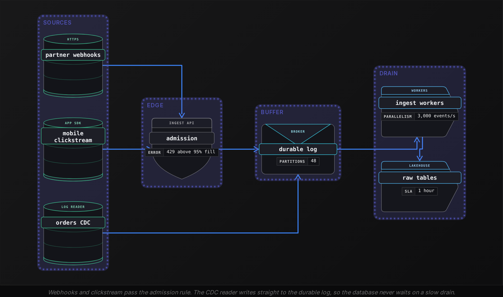
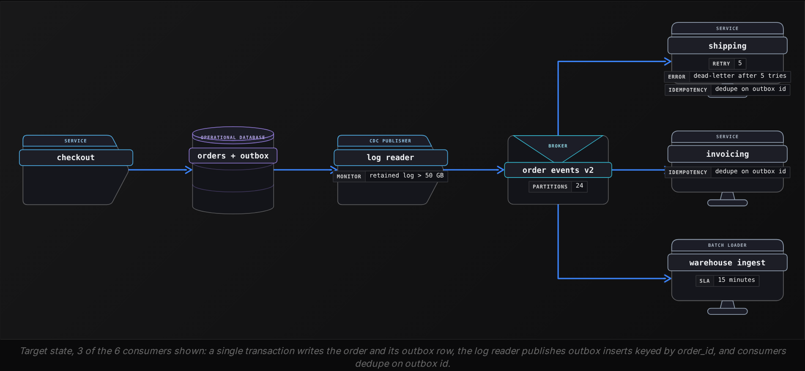

Advanced·Pipeline Architecture · 38 min · 11 challenges

# Ingestion Patterns: Advanced

Noon on Black Friday at Shopify: a celebrity sneaker drop opens and orders pour into a shared database. The event pipeline must copy those orders out without slowing checkout, hand every order to shipping even if the broker blinks, swallow a surge it can't stop, and keep every other merchant's data flowing while a single storefront eats the capacity.


<br>

---

## Reading Live Databases Safely

Every query an extract sends to a production database competes with the application the database serves. Checkout wants a few milliseconds per query and a cache full of hot rows, while a bulk extract wants every page of a big table once. Left alone, the extract wins because it asks for more, so a safe reader is built to lose.


<br>

### Four ways a reader hurts its source

| Mechanism | What the extract does | What the application feels |
| --- | --- | --- |
| Held snapshot | Reads a 400M-row table inside 1 transaction for 6 hours | Old row versions pile up, so every query reads more pages |
| Cache eviction | Pulls the cold pages of a full scan into memory | Hot rows get pushed out and are read from disk again |
| Disk and CPU contention | Reads sequentially at full speed | Every query sharing those disks waits longer |
| Locks and connections | Takes a table lock to dump, or opens 32 parallel connections | Writes queue behind the lock, or the app's connection pool runs dry |

Databases that keep multiple row versions leave each updated row's old version in place until no open transaction could still read it, so a 6-hour transaction makes every busy table carry 6 hours of dead versions. Live queries then scan more pages for the same rows, and latency climbs while CPU graphs look normal.


<br>

### Read from a replica, in short transactions

A read replica takes cache and CPU contention off the primary, making it the first move for any large extract. But a replica constantly replays the primary's changes, and a long query can hold rows a replayed change must remove, so the replica cancels the query or pauses replay and falls behind. Reporting the replica's open snapshots to the primary stops the cancellations by moving the old-version pileup back onto the primary. Either way, the extract must run as many short transactions.

#### Keyset chunks instead of OFFSET

Paging with OFFSET makes the database read and discard every row before the page it returns, so each page costs more than the last. Keyset paging starts each chunk after the last key it read: every chunk is an index range read of 10,000 rows in its own short transaction, and the reader can stop or resume between chunks. On a 400M-row orders table read 10,000 rows at a time, the totals compare like this:

- **8 trillion** — rows touched by OFFSET paging
- **20,000x** — OFFSET's work relative to keyset

```sql
SELECT
  order_id,
  customer_id,
  status,
  total_cents,
  updated_at
FROM orders
WHERE order_id > 184020000
ORDER BY order_id
LIMIT 10000
```


<br>

### Throttle on the application's own signals

A fixed pause between chunks is a guess that fails on every busy day. One workable rule instead: start at 5 chunks per second; when replica lag passes 10 seconds or checkout's p99 latency passes 200 ms, halve the rate; after a full minute with both healthy, add 1 chunk per second. Then add limits the throttle can never raise, such as 2 connections and a 30-second statement timeout, so a bad query plan dies in seconds.


<br>

### A consistent snapshot without a table lock

Starting log-based CDC on an existing table needs a full copy plus every change after it. The old recipe locks the table, records the log position and dumps the rows, blocking writes until the dump finishes. The watermark recipe keeps the log reader running and copies in keyset chunks, bracketing each chunk with 2 marker rows written to a small dedicated table: a low watermark before the SELECT, a high watermark after it. These are log positions, unrelated to event-time watermarks. Any key the log shows changing between the 2 markers is taken from the log and dropped from the chunk, since the log version is at least as new.

| Step | Reader action | Emitted downstream |
| --- | --- | --- |
| 1 | Insert low watermark L | Nothing |
| 2 | SELECT order_id 5001 to 5003; all 3 read as placed | Nothing yet |
| 3 | Insert high watermark H | Nothing |
| 4 | Read the log from L to H: order 5002 changed to shipped | 5002 shipped, from the log |
| 5 | Reach H in the log and drop 5002 from the chunk | 5001 placed, 5003 placed |

**A nightly extract on a replica pages through orders with OFFSET in 1 transaction lasting 5 hours. The replica kept canceling it, so the team turned on snapshot reporting to the primary. It now finishes, but checkout latency on the primary creeps up every night. What fixes the cause?**

- **A.** Turn reporting off again and give the replica more memory, so the long query stops getting canceled.
- **B.** Rewrite the extract as keyset chunks in short transactions, so no snapshot stays open for hours anywhere.
- **C.** Keep the single transaction and switch OFFSET to keyset paging, so each page reads far fewer rows.
- **D.** Move the extract back to the primary, where no replay happens and no query gets canceled.

<details>
<summary>Solution</summary>

**B.** Rewrite the extract as keyset chunks in short transactions, so no snapshot stays open for hours anywhere.

Reporting made the primary keep old versions for the 5-hour snapshot. Short chunks release each snapshot in seconds.

**Why the others are wrong**

- **A.** More memory leaves the replay conflict in place, so the cancellations come back.
- **C.** Keyset cuts scan work, but the 5-hour snapshot still pins old versions on the primary.
- **D.** The 5-hour snapshot then bloats the primary directly, and its reads compete with checkout for cache and disk.

</details>


<br>

---

## The Transactional Outbox Pattern

When an order commits, checkout has 2 jobs: save the order and tell shipping. The database and the broker are separate systems, and no transaction spans both. If checkout commits first and then publishes, a crash or broker outage between the 2 steps loses the event. Publishing first fails the other way: a rollback leaves shipping with an event for an order that doesn't exist.

The transactional outbox moves the second write into the first system. Checkout inserts the event as a row in an outbox table inside the order's own transaction, so both rows commit or neither does. A separate publisher reads committed outbox rows and sends them to the broker, retrying until it accepts. The animation runs 3 orders through both designs during a 2-second broker outage.

**Dual write**



**Transactional outbox**



In the dual-write variant, the order at second 3 arrives while the broker is down: its row commits but its publish fails, so shipping never hears of it. In the outbox variant, rows written during the outage wait in the table. Then the publisher crashes after sending 103 and before marking it, so its next run sends 103 again, and shipping dedupes on the outbox id to create 1 shipment. The outbox turns maybe-never into at-least-once; consumer dedupe makes it effectively-once.


<br>

### Designing the outbox table


| Column | Why it is there |
| --- | --- |
| id | The dedupe key consumers store, and the polling publisher's read order. Never reused. |
| aggregate_id | The broker partition key, so each order's events land in 1 partition, in order. |
| event_type, schema_version | Consumers route and parse by declared type and version; versions change by expand-contract. |
| payload | The event as its data contract defines it, built inside the transaction. Internal columns stay out. |
| published_at | Polling publishers only: NULL until the broker acknowledges the row. |


<br>

### Polling publisher or CDC publisher

| ✓ Polling publisher | ✗ CDC publisher |
| --- | --- |
| • Queries the outbox every few seconds; delay is about the poll interval<br><br>• Adds query load on the primary at every poll, even an empty one<br><br>• Writes published_at per acknowledgement: 1 extra write per event<br><br>• Needs only SQL access | • Reads outbox inserts from the log; delay under a second<br><br>• Adds no query load: the log is written anyway<br><br>• Lets outbox rows be deleted soon after insert<br><br>• Needs a running log reader whose retention and failover you own |

**At peak, a payments service writes 3,000 outbox rows per second on a primary near 70% CPU. Fraud scoring needs each event within 1 second, and log-based CDC already runs for 2 other services. Which publisher fits?**

- **A.** A CDC publisher: no query load on a busy primary, sub-second delay, and the log reader is already operated here.
- **B.** Polling every 200 ms: frequent polls meet the 1-second target, and SQL access avoids operating a log reader.
- **C.** Polling every 5 seconds with 500 rows per batch: fewer queries keep the load on the primary low.
- **D.** CDC on the payments table itself, skipping the outbox, since the log already holds every change.

<details>
<summary>Solution</summary>

**A.** A CDC publisher: no query load on a busy primary, sub-second delay, and the log reader is already operated here.

It meets the 1-second target without adding polls or marking writes to a primary with little headroom.

**Why the others are wrong**

- **B.** It meets the delay, but adds 5 polls and 3,000 published_at writes a second to a busy primary.
- **C.** It drains 100 rows a second against 3,000 arriving, and the interval alone breaks the target.
- **D.** Every consumer then depends on the table's internal columns, so a rename breaks them all.

</details>

#### The gap a bookmark poller falls into

Sequence ids are assigned at insert, but rows become visible at commit. Transaction A takes id 207, transaction B takes 208, and B commits first. A poller that tracks id > last_id sends 208, moves its bookmark to 208, and never sees 207 when A commits a moment later. Polling on published_at IS NULL keeps a late-committing row visible until it is sent:

```sql
SELECT
  id,
  aggregate_id,
  event_type,
  schema_version,
  payload
FROM outbox
WHERE published_at IS NULL
ORDER BY id
LIMIT 500
```

> **TIP**
>
> Per-order ordering survives late commits: an order's second event comes from a transaction that updates the same order row, so it waits for the first to commit and takes a higher id.

**This poller runs every 2 seconds, then stores the highest id it sent as the next bookmark. Every order has an outbox row, yet a few orders a month never reach consumers. Why?**

```sql
SELECT
    id,
    aggregate_id,
    payload
FROM outbox
WHERE id > 48211
ORDER BY id
LIMIT 500
```

- **A.** LIMIT 500 cuts each batch short, and rows past the limit are discarded instead of waiting for the next poll.
- **B.** A 2-second interval is shorter than some transactions, so the poller reads rows before they commit and loses them.
- **C.** A transaction holding a lower id committed after a higher id was sent, so the bookmark had already passed it.
- **D.** ORDER BY id ignores created_at, so rows inserted in the same millisecond come back shuffled and get skipped.

<details>
<summary>Solution</summary>

**C.** A transaction holding a lower id committed after a higher id was sent, so the bookmark had already passed it.

Ids are assigned at insert and rows appear at commit. Polling on published_at IS NULL catches late rows.

**Why the others are wrong**

- **A.** Rows past the limit have ids above the new bookmark, so the next poll picks them up.
- **B.** Uncommitted rows are invisible to the poller. The interval only decides when it looks.
- **D.** Ids are unique, so ordering by id is total. Timestamps never decide what gets skipped.

</details>


<br>

---

## Backpressure at the Ingestion Layer

Backpressure travels upstream from a slow stage to a faster one until it reaches the pipeline's edge. Ingestion is that edge, and the next hop upstream is a system you do not run. When arrivals outpace what ingestion can drain, you have 3 possible responses. Which of them are open to you depends on the source.

- **Buffer** *Absorb now, drain later*\
  Hold the surge in durable storage. Costs freshness and disk, and fails when the surge outlasts the buffer.
- **Signal the producer** *Ask it to slow down*\
  Return 429 with Retry-After. For pull-based sources, stop pulling; for credit-based ones, stop granting credits. Works only if the producer holds data while it waits.
- **Drop selectively** *Discard by rule*\
  Sample, shed low-priority event types, or keep only the latest value per key. Works only where consumers agreed to the loss.


<br>

### Classify the source before choosing

| Source | Can it wait? | Can it replay? | Response |
| --- | --- | --- | --- |
| Partner order webhooks | Yes, retries for a limited window | Within that window | Buffer; return 429 near full |
| Mobile clickstream | No, the app discards what it can't send | No | Buffer, then sample under pressure |
| Internal payment events | Yes, rows wait in its outbox | Yes, from the outbox | Signal; the outbox is the buffer |
| Vehicle location pings | No | No | Keep the latest per vehicle, drop the rest |
| Log-based CDC | Yes, but the database holds its log meanwhile | Within log retention | Drain fast into your own log; slow down after it |


<br>

### Sizing the buffer you depend on

A worked surge: traffic normally runs at 2,000 events per second and workers drain 3,000. A promotion pushes arrivals to 12,000 per second for 15 minutes, with events averaging 1 KB. During the surge the backlog grows by the gap between arrivals and drain; afterwards it shrinks only by the spare drain capacity.

- **8.1 GB** — backlog when the surge ends
- **45 min** — peak freshness lag
- **135 min** — time to drain the backlog

Buffer capacity must cover the longest planned surge, with margin. The peak lag must fit the freshness SLA, and if it does not, a bigger buffer cannot help: the fix is more drain capacity or a drop rule for part of the stream. Recovery time depends on spare capacity, so doubling the workers' headroom halves it.


<br>

### When backpressure reaches the database

Slowing a CDC reader looks harmless because the source can wait, but the database waits by keeping every log segment the reader hasn't confirmed. A reader stalled for 6 hours on a primary writing 20 GB of log an hour pins 120 GB of disk, and a full disk stops the primary taking writes: ingestion has taken down checkout. So the CDC reader never absorbs backpressure: it copies changes into a durable log you own as fast as the database produces them, and every slowdown happens after that log. Track the log bytes retained for the reader, with a ceiling past which you drop it and re-snapshot in chunks.



#### An admission rule that uses all 3

This handler fronts a shared ingestion endpoint. Below 70% fill it accepts everything. Between 70% and 90%, loss-tolerant events are sampled down to 1 in 10, and above 90% they are all dropped. Must-keep events are accepted until 95%, after which producers get 429 with a Retry-After header.

```sql
def admit(event, buffer, dropped):
    fill = buffer.size() / buffer.capacity
    if event.loss_tolerant:
        sampled = event.sample_key % 10 == 0
        if fill < 0.70 or (fill < 0.90 and sampled):
            buffer.put(event)
        else:
            dropped[event.event_type] += 1
        return 202, {}
    if fill < 0.95:
        buffer.put(event)
        return 202, {}
    return 429, {"Retry-After": "30"}
```

Dropped events still get 202, because a producer told to retry something you chose to discard only adds load. Every drop is counted by event type, since an uncounted drop shows up as a fake traffic decline.

**A fleet of 50,000 scooters sends GPS positions every 2 seconds with no retries. The only consumer is a live map of each scooter's current position. The shared buffer nears full during a surge. Which response fits?**

- **A.** Return 429 so scooters back off and resend their positions once the buffer drains.
- **B.** Let the buffer grow without a bound, so no position from any scooter is ever lost.
- **C.** Drop a random 90% of all events on the endpoint, from every source sharing it.
- **D.** Keep the latest position per scooter, drop superseded ones, and count the drops.

<details>
<summary>Solution</summary>

**D.** Keep the latest position per scooter, drop superseded ones, and count the drops.

A live map needs only the newest position, and an older one is worthless once a newer one arrives.

**Why the others are wrong**

- **A.** These devices never resend, so a 429 discards positions anyway and adds a round trip.
- **B.** Unbounded growth becomes a disk or memory outage later, and stale positions are worthless here.
- **C.** Random drops hit must-keep sources too. Dropping must be scoped to sources that tolerate it.

</details>


<br>

---

## Multi-Tenant Ingestion Fairness

A multi-tenant ingestion layer runs many customers' data through the same workers and queues and writes it to shared sinks. Sharing keeps hardware busy and cheap, and lets the largest tenant's worst day land on every tenant. Fairness means each tenant's freshness depends on its own load and plan, whatever its neighbors are doing.


<br>

### One resync, 300 tenants waiting

A shared queue serves 301 tenants. At 09:00, tenant acme requests a full resync, and 50M rows enter the queue. The other 300 tenants each add 2,000 rows every 15 minutes, and the workers process 200,000 rows per minute.

| Scheduler | A small tenant's 09:05 batch waits | acme's resync finishes after |
| --- | --- | --- |
| First in, first out | 250 minutes or more | About 250 minutes |
| Fair across tenants | 3 minutes at most | About 313 minutes |

Fairness costs acme about an hour and saves each small tenant more than 4 hours. The small tenants' rows use 3 minutes of every 15, and acme gets the rest, because a fair scheduler is work-conserving: capacity a tenant leaves unused goes to whoever has work.


<br>

### Deficit round robin across tenant queues

Fair scheduling needs a queue per tenant and a scheduler that hands out capacity in rounds. In deficit round robin, each tenant with work earns a quantum of rows per round, scaled by its weight, and spends that credit on its queued batches:

```sql
def schedule_round(queues, weights, deficit, quantum=2000):
    for tenant, queue in queues.items():
        if not queue:
            deficit[tenant] = 0
            continue
        earned = quantum * weights.get(tenant, 1)
        deficit[tenant] = deficit.get(tenant, 0) + earned
        while queue and queue[0].rows <= deficit[tenant]:
            batch = queue.popleft()
            deficit[tenant] -= batch.rows
            yield tenant, batch
```

Weights express plan tiers: a weight-4 tenant gets 4 times a weight-1 tenant's share while both have work. Resetting `deficit` for empty queues stops an idle tenant from banking credit and bursting later. A batch larger than its credit waits extra rounds, so large loads should arrive as keyset chunks.


<br>

### When sharing itself is the risk

A scheduler divides worker time and nothing else: it cannot stop an oversized file from crashing a shared worker, or a single tenant from filling the buffer. Each stronger level of isolation costs more capacity:

| Level | How it works | Protects against | Cost |
| --- | --- | --- | --- |
| Fair scheduling | Per-tenant queues sharing a worker pool by weight | Queue starvation | Lowest; a bad payload can still crash shared workers |
| Per-tenant quotas | A token bucket per tenant on rows or bytes per second at admission | A single tenant flooding the buffer | Tenants over quota wait or get 429 |
| Bulkheads | Separate worker pools per tier or for the largest tenants | Crashes and memory blowups spreading | Idle capacity in every pool |
| Dedicated cell | A full ingestion stack for a single tenant | Every shared resource | Highest; for tenants whose load would dominate any pool |


<br>

### Per-tenant observability

Averages hide the tenant in trouble. With 300 tenants at 2 minutes of lag and a single tenant at 6 hours, mean lag reads around 3.2 minutes against a 15-minute SLA, and the dashboard stays green. Track freshness and dead-letter rate per tenant. Compare each tenant's volume against its own history and alert on its schema changes, then report the worst tenant and the count past SLA:

```sql
SELECT
  tenant_id,
  MAX(lag_seconds) AS worst_lag_seconds,
  SUM(rows_ingested) AS rows_today,
  SUM(rows_dead_lettered) AS rows_dead_lettered
FROM ingest_batches
WHERE batch_date = DATE '2026-10-24'
GROUP BY tenant_id
HAVING MAX(lag_seconds) > 900
ORDER BY worst_lag_seconds DESC
```


<br>

### Carry tenant_id in every record's structure

Ingestion stamps `tenant_id` at admission and rejects records without it. From there it is a required envelope field, part of every table's primary key and a partition column in storage. Recovering the tenant later by joining to an accounts table fails when it matters most: when 2 tenants each have an order 1001, when an account moves between tenants, or when a departing tenant's rows must all be found and deleted.


> **TIP**
>
> Partition the broker by tenant_id alone and the largest tenant lands in 1 hot partition. Key large tenants by tenant_id plus entity id instead: per-entity order holds, load spreads across partitions, and tenant_id still travels in every record.

**Tenant boreal uploads 40 GB JSON files that exhaust worker memory. Each crash fails every batch on that worker, whichever tenants they belong to. Fair scheduling is already in place. What's the smallest change that protects the other tenants?**

- **A.** Move boreal's files to a separate worker pool sized for them, so its crashes stay inside its own bulkhead.
- **B.** Raise boreal's scheduling weight so its files finish sooner and spend less time on shared workers.
- **C.** Give boreal a dedicated ingestion cell with its own queues, workers, sinks and buffer.
- **D.** Add a per-tenant quota on boreal's rows per second at admission.

<details>
<summary>Solution</summary>

**A.** Move boreal's files to a separate worker pool sized for them, so its crashes stay inside its own bulkhead.

A bulkhead contains the crash itself: other tenants keep their pool while boreal's workers fail.

**Why the others are wrong**

- **B.** Weight changes the share of worker time, and a 40 GB file still crashes a shared worker.
- **C.** It works, but duplicates the whole stack when only the worker pool is failing.
- **D.** A quota limits rate, and a single 40 GB file under quota still crashes a shared worker.

</details>


<br>

---

## Dual-Write to Outbox + CDC

A marketplace's checkout service publishes order_placed to the broker inside its database transaction before commit. It logs and ignores publish errors so checkout never fails on them. Its 6 consumers are shipping, invoicing, search, fraud and email, plus warehouse ingestion. A 30-day reconciliation against 9.2M orders found both failure kinds from the outbox section:

- **4,140** — orders that never got an event
- **610** — events for orders that rolled back

The missing events cluster around broker restarts, when the publish failed and the commit went ahead. The phantom events come from constraint violations at commit, after the publish had gone out. Both counts form the baseline, and the new path's target is zero.


<br>

### Measure before you move

The reconciliation is a left join from orders to events, counted per hour so failures line up with incidents. count(DISTINCT ...) keeps duplicate deliveries from hiding a gap. The mirror query, from events to orders, counts phantoms.

```sql
SELECT
  DATE_TRUNC('hour', o.created_at) AS order_hour,
  COUNT(DISTINCT o.order_id) AS orders,
  COUNT(DISTINCT e.order_id) AS orders_with_event
FROM orders AS o
LEFT JOIN order_placed_events AS e
  ON e.order_id = o.order_id
WHERE o.created_at >= TIMESTAMP '2026-09-01 00:00:00'
GROUP BY DATE_TRUNC('hour', o.created_at)
ORDER BY order_hour
```


<br>

### The migration in 5 phases

| Phase | Change | Exit check |
| --- | --- | --- |
| 1. Expand | Add the outbox: checkout writes an order_placed row in the order's transaction, still publishing directly | Every new order has exactly 1 outbox row |
| 2. Shadow | A CDC publisher fills a new topic, order_events_v2, that no consumer reads yet | Reconciliation on v2 shows zero missing and zero phantom for 7 days |
| 3. Cut over | Move consumers to v2 in turn: search, warehouse, fraud, email, invoicing, shipping | Each consumer's output matches its v1 output across the overlap |
| 4. Contract | Delete the direct publish from checkout | v1 receives no new events |
| 5. Clean up | Retire the v1 topic once its retention passes; keep outbox rows 7 days | Nothing reads v1 |

Phases 1 and 2 change nothing consumers see, so the new path is proven before anyone depends on it. Consumers then move from cheapest mistake to costliest: a wrong search index rebuilds in minutes, while a duplicate shipment costs money.


<br>

### The overlap at cutover

Events on v1 carry no outbox id, so a consumer switching topics can't dedupe across the 2 streams by id. It switches on a business key instead: it notes the time of its last v1 event, reads v2 from 10 minutes before that, and upserts on `(order_id, event_type)`, unique because an order is placed once. Duplicates in the overlap collapse, and any event v1 lost in those 10 minutes arrives from v2.

**Shipping switches to v2. It starts reading v2 from 10 minutes before its last v1 event and dedupes on outbox id. What goes wrong?**

- **A.** Nothing goes wrong: outbox ids are unique, so every repeated order in the overlap is caught.
- **B.** Orders in the 10-minute overlap ship twice, because their v1 copies carry no outbox id to match.
- **C.** Orders in the overlap never ship, because the dedupe treats their v2 events as repeats.
- **D.** Events from v2 arrive out of order, so shipments are created before their orders exist.

<details>
<summary>Solution</summary>

**B.** Orders in the 10-minute overlap ship twice, because their v1 copies carry no outbox id to match.

Dedupe across the switch needs a key both streams share, here (order_id, event_type).

**Why the others are wrong**

- **A.** Ids are unique within v2 only, and the v1 copies carry no outbox id to match.
- **C.** Shipping has stored no outbox ids for those orders, so no v2 event looks like a repeat.
- **D.** v2 is keyed by order_id, so per-order ordering holds. The failure is duplicate shipments.

</details>




<br>

### What the new path costs to run

> Costs to plan for
>
> - Log retention: a stalled reader pins log on the primary, so set a retained-bytes ceiling. A reader that crosses it gets dropped and re-snapshotted.
> - Outbox growth: around 9.2M rows a month, deleted after 7 days in off-peak keyset chunks.
> - Failover: a new primary may lack the reader's log position. Replay outbox rows by id range within the 7-day retention.
> - Payload ownership: checkout builds the event, so its schema falls under the data contract.
> - Duplicates: delivery is at least once, so every consumer stores processed outbox ids and skips repeats.

**Phase 2 has run 7 days. Reconciliation on v2 shows 12 orders missing, all committed within 2 minutes before a database failover. What should the team do?**

- **A.** Move on to phase 3: 12 misses is far below the dual-write baseline, so the new path already wins.
- **B.** Keep the direct publish permanently as a safety net running next to the outbox publisher.
- **C.** Switch to a polling publisher, since a log reader cannot survive a database failover.
- **D.** Hold phase 3, replay outbox rows by id range from before the failover, and make that replay part of every failover.

<details>
<summary>Solution</summary>

**D.** Hold phase 3, replay outbox rows by id range from before the failover, and make that replay part of every failover.

The outbox still holds the skipped rows. Replaying by id range closes the gap, and consumers dedupe on id.

**Why the others are wrong**

- **A.** The exit check is zero, and this cause will recur at every failover.
- **B.** That reintroduces the dual write, phantoms included, while the outbox already holds the 12 rows.
- **C.** Polling adds load and delay, and replay from the outbox fixes the failure where it happens.

</details>


<br>

---

## Putting It All Together

Back at Shopify at noon on Black Friday, the sneaker drop tests every part of this lesson at once. The CDC reader that seeded the orders stream weeks earlier did it in watermark chunks on a replica, so the sale starts with a complete stream and no bloated tables. Each order commits with its outbox row, so a broker restart mid-drop costs a few seconds of delay instead of lost shipments. The surge fills the ingestion buffer, clickstream gets sampled, order events keep their reserved headroom, and the CDC reader keeps draining the log so the shared database never fills its disk. Deficit round robin keeps every other merchant's orders minutes fresh while the hot merchant's backlog drains, and the worst-tenant lag query is the number the on-duty engineer watches.

- Keyset chunking appears 3 times: in the safe extract, in the watermark snapshot, and in deleting old outbox rows, because every bulk operation on a live database has to be small transactions.
- The outbox is both a delivery mechanism and a backpressure buffer: payment events can be signaled to wait because their rows sit safely in the outbox.
- A stalled CDC reader turns ingestion backpressure into a disk problem on the primary, which is the same harm to the application that the first section guards against.
- Dedupe on a stable key is what makes at-least-once safe, from the outbox id at shipping to the (order_id, event_type) key at cutover.
- tenant_id in the outbox and in the partition key is what lets fair scheduling and per-tenant freshness work downstream without lookups.
- The dual-write migration is expand-contract applied to delivery: the outbox and v2 are added alongside the old path, proven by reconciliation, then the old path is removed.


<br>

---

## Key Takeaways

- Read production databases in short keyset chunks from a replica, throttled on replica lag and application latency, so no snapshot stays open for hours.
- Seed log-based CDC with watermark-bracketed chunks: changes the log shows between the markers override the chunk's copy, and no table lock is needed.
- The transactional outbox commits the event with the business change; the publisher delivers at least once, and consumers dedupe on the outbox id.
- Poll the outbox on published_at IS NULL, never on an id bookmark, and choose a CDC publisher when query load or delay rules polling out.
- Match backpressure to the source: buffer what can replay, signal what can wait, drop only what consumers agreed to lose, and never let a CDC reader stall.
- Fairness in shared ingestion comes from per-tenant queues and weighted scheduling. For stronger isolation, add quotas and bulkheads or split tenants into cells.
- Stamp tenant_id at admission, carry it in keys and partitions, and watch the worst tenant instead of the average.
- Migrate a dual write by expanding into an outbox, shadowing on a new topic, cutting consumers over on a business key, then removing the direct publish.

Exercises for this lesson: [_exercises/pa_ingestion_patterns_advanced.md](_exercises/pa_ingestion_patterns_advanced.md)
