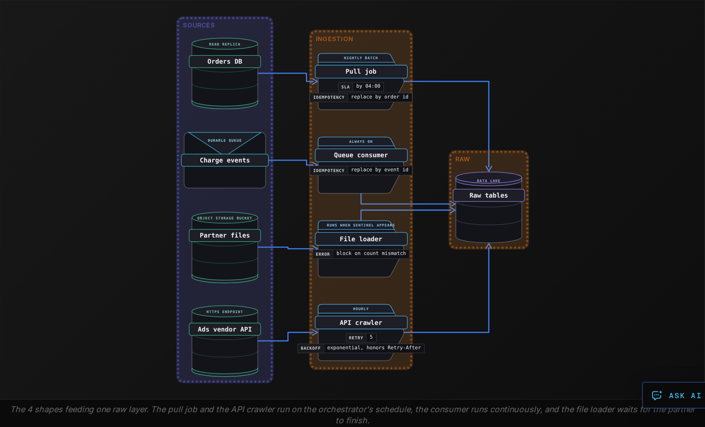
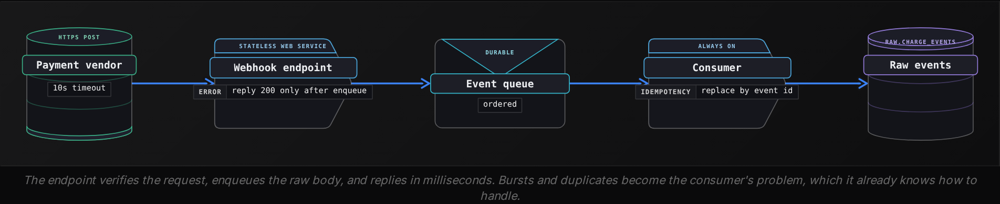

# Ingestion Patterns: Beginner

Black Friday weekend at Shopify. Orders flood the storefront database, a payment partner fires a webhook for every charge, a shipping carrier drops a settlement file at 02:00, and the marketing team wants yesterday's ad spend from a vendor's API before the morning standup. Four sources, 4 ways the data shows up. The ingestion job written for each one decides whether Monday's dashboards are right or quietly short.


<br>

---

## The Four Shapes of Ingestion

Ingestion is the first role in any pipeline: the step that copies data out of a system you do not control into storage you do. What changes from source to source is how the data arrives, and that decides how the job is written, how it fails, and how you rerun it.


<br>

### Who moves first, and what arrives

Two questions sort every source: who initiates the transfer, your job or the source, and what unit shows up. The answers give 4 shapes, and each carries its own way of remembering where it stopped.

| Shape | Who initiates | Unit that arrives | Typical source | How you track progress |
| --- | --- | --- | --- | --- |
| Pull from a database | Your job | Rows matching a query | Your company's orders database | The largest timestamp you have loaded |
| Push from a queue or webhook | The source | One event at a time | A payment provider sending charge events | The offset you last committed |
| File drop | The source, on its schedule | A whole file or a batch of files | A partner uploading a nightly CSV | The list of files already processed |
| API pull | Your job | A page of records per request | A vendor's web endpoint | The cursor of the last page fetched |




<br>

### Picking a shape for a new source

The source makes most of the choice. If you can run SQL against the system, pull from it. If it emits events or offers webhooks, let it push, and each event arrives seconds after it happened. If a partner can only hand you files, you have a file drop. If a vendor exposes a web endpoint and nothing else, you are writing an API job. The real decision comes when a source offers 2 shapes, such as webhooks plus an API: webhooks give freshness, the API fetches what the webhooks missed, and mature setups run both.

> Four questions every ingestion job answers
>
> - Where did I stop last time? The marker in the table's last column.
> - What if the same data arrives twice? Replace by key, so the second landing changes nothing.
> - How do I know the batch is complete? A frozen time window, a sentinel file, or a last page with no cursor.
> - What happens to a record that fails a check? Warn or block, decided before the first run.

> **TIP**
>
> Store the progress marker in the same place you write the data, and move it only after the write succeeds. Every shape in this lesson comes back to that one rule.

**A marketing vendor holds your campaign spend. It offers a web endpoint returning 100 campaigns per request and, on your enterprise plan, a nightly CSV in a bucket you own. The spend feeds a daily report. Which shape do you start with?**

- **A.** API pull. A web endpoint is always fresher than a nightly file, and 100 campaigns per request means the whole dataset arrives in 1 request.
- **B.** Push from a webhook. The vendor sends spend changes as they happen, so you never need to store a progress marker or validate a batch.
- **C.** File drop. The vendor already produces a complete nightly snapshot in storage you own, which can be validated whole and reloaded in 1 step.
- **D.** Pull from the database. Enterprise plans usually include read access to the vendor's database, and a direct query is the most reliable shape.

<details>
<summary>Solution</summary>

**C.** File drop. The vendor already produces a complete nightly snapshot in storage you own, which can be validated whole and reloaded in 1 step.

The file matches the report's daily rhythm, can be checked against a manifest, and is replaced as 1 partition on rerun. Keep the API for backfills.

**Why the others are wrong**

- **A.** A daily report needs no hourly freshness, and a large account takes hundreds of requests, each a chance to drift or be rate limited.
- **B.** The vendor offers no webhooks, and even a push source needs a progress marker: the committed offset.
- **D.** Vendors do not hand customers a connection to their production database. The 2 shapes on offer are the file and the endpoint.

</details>


<br>

---

## Pull Ingestion from a Database

Pull ingestion is a query your job runs against a source database on a schedule. You decide when it runs and how much it asks for, which makes pull the most controllable shape, and asking for too much slows the application that shares the database.


<br>

### Full load: ask for everything

A full load reads every row and replaces the destination table. For a `product_categories` table of 3,000 rows this is the right answer: the query takes under a second, there is no marker to maintain, and a row deleted at the source vanishes on the next run. The job empties `raw.product_categories`, then runs the insert below.

```sql
INSERT INTO raw.product_categories
SELECT
    category_id,
    category_name,
    parent_category_id,
    updated_at
FROM source.product_categories
```


<br>

### Incremental load: ask for what changed

An `orders` table with 400 million rows cannot be reread nightly. An incremental load asks only for rows changed since the last run. It needs a column that moves whenever a row changes, almost always `updated_at`, and a stored high-water mark: the largest `updated_at` the previous run loaded, kept in a small state table next to the raw data.

| source_table | high_water_mark | last_run |
| --- | --- | --- |
| orders | 2026-10-22 03:00:00 | 2026-10-22 nightly |
| customers | 2026-10-22 03:00:00 | 2026-10-22 nightly |
| refunds | 2026-10-21 03:00:00 | 2026-10-21 nightly (failed on 10-22) |

```sql
SELECT
  order_id,
  customer_id,
  status,
  total_cents,
  updated_at
FROM source.orders
WHERE updated_at > TIMESTAMP '2026-10-22 03:00:00'
  AND updated_at <= TIMESTAMP '2026-10-23 03:00:00'
ORDER BY updated_at
```

The upper bound matters. Without it, the query captures rows written while it runs, and the mark you record may not match what you loaded. Freezing both bounds at the start makes the run repeatable: the same 2 timestamps return the same rows, which a rerun after a failure needs.


<br>

### Write first, then move the mark

```sql
def run_incremental(conn, state, run_started_at):
    low = state.read_mark("orders")
    high = run_started_at
    rows = conn.query(ORDERS_SQL, low=low, high=high)
    write_replace_by_key(rows, table="raw.orders", key="order_id")
    state.write_mark("orders", high)
```

The order of the last 2 lines is the whole design. If the mark moved first and the write failed, the next run would start above rows that never landed. With the write first, a failure leaves the mark in place, the retry re-pulls the same window, and `write_replace_by_key` makes the second landing identical to the first. The `refunds` row above shows this: its 10-22 run failed, so its mark stayed at 10-21 and tonight's run covers 2 days.


<br>

### Two rows an incremental load misses

The first is the slow transaction. An application opens a transaction at 02:59:40, sets `updated_at` to that moment, and commits at 03:00:20. Your run's high bound was 03:00:00 and the row was not yet committed, so the query missed it. Tomorrow's run starts above 03:00:00, and the row's 02:59:40 sits below that, so it is skipped forever. The fix is an overlap: pull from the mark minus 10 minutes, and let the replace-by-key write absorb the rows that arrive twice.

The second is the hard delete. A removed row has no `updated_at` left to move, so no incremental query sees it and the destination keeps a ghost. Until the source flags deletions instead of removing rows, the usual answer is a weekly pull of the primary keys alone, compared against the destination to remove the ghosts.

| ✓ Full load | ✗ Incremental load |
| --- | --- |
| • Replaces the whole table each run<br><br>• No progress marker to maintain<br><br>• Picks up deletes for free<br><br>• Cost grows with table size | • Reads only the changed window<br><br>• Needs an updated_at column and a stored mark<br><br>• Blind to hard deletes<br><br>• Cost grows with change volume |

**A nightly job loads raw.orders incrementally in this order: advance the high-water mark to the run start time, run the query, write the rows with replace by order_id. On Tuesday the write failed halfway and the orchestrator's retry on Wednesday succeeded. Which rows are at risk?**

- **A.** No rows. The retry re-pulled the same window because the write replaces by key, so whatever Tuesday half wrote was overwritten with the full set.
- **B.** The rows changed between Monday's mark and Tuesday's run start. The mark moved before the write, so the retry pulled from Tuesday's mark onward and never revisited them.
- **C.** The rows changed during the retry itself. The mark was set before the retry started, so anything changed while it ran was captured twice.
- **D.** Every row in the table. A failed write leaves the destination half replaced, and the retry cannot know which half landed and which did not.

<details>
<summary>Solution</summary>

**B.** The rows changed between Monday's mark and Tuesday's run start. The mark moved before the write, so the retry pulled from Tuesday's mark onward and never revisited them.

Advancing the mark first means a failed write leaves a window nobody will pull again. Writing first and moving the mark last is the fix.

**Why the others are wrong**

- **A.** Replace by key absorbs duplicates; it cannot recover a window nobody pulled. The retry read a mark already past Tuesday's rows.
- **C.** A frozen upper bound leaves rows changed during a run to the next window, and a second copy would be harmless under replace by key.
- **D.** Replace by key rewrites whatever it pulls, so the half that landed does not matter. The damage is the window the mark skipped.

</details>


<br>

---

## Push from Queues and Webhooks

In push ingestion the source does the moving. An event happens, the source hands it to a queue or sends it to an endpoint you run, and your consumer sees it seconds later. You gain freshness and give up control: events arrive whether or not your consumer is healthy, in bursts the source decides, and sometimes more than once.


<br>

### Reading from a queue: the offset

A queue keeps events in order and numbers them. Your consumer reads from a position called the offset, processes what it read, and commits a new offset so a restart resumes from the right place. Where that commit sits relative to the storage write is the question the pull section asked about its mark, and the answer is the same.

| Order of operations | Crash between the 2 steps | After restart |
| --- | --- | --- |
| Commit offset, then write to storage | Offset moved, write never happened | Events lost, and nothing records that they existed |
| Write to storage, then commit offset | Write landed, offset did not move | Events replayed and land a second time |

Replay is the one you can live with. The consumer writes each event under its `event_id` with a replace, so a replayed event overwrites itself and the table ends up identical. Loss leaves a hole only the source can fill, and a source that pushed an event once may have no way to send it again.

```sql
def consume(queue, sink, batch_size=500):
    while True:
        batch = queue.poll(max_records=batch_size)
        if not batch:
            continue
        rows = [to_row(event) for event in batch]
        sink.replace_by_key(rows, table="raw.charge_events", key="event_id")
        queue.commit(batch[-1].offset + 1)
```


<br>

### Webhooks: a push with no queue in it

A webhook is a push over plain HTTP. The vendor sends a POST to a URL you own each time something happens, waits a few seconds for a `200`, and retries if it does not get one. The retry schedule is the vendor's: some give up after a few attempts over minutes, others keep trying for days. Either way the vendor keeps no offset for you, so you cannot ask it to resend from a position. Design as if events can be lost, and keep a backfill path such as the vendor's API.

The trap is doing real work inside the endpoint. An endpoint that parses the payload, looks up the customer and writes to the warehouse before replying takes 4 seconds on a normal day and 30 seconds when the warehouse is busy. Against a 10-second timeout, the vendor declares failure on the busy day and retries, and 2 copies of every event pile onto the same slow warehouse. The way out is a queue between the endpoint and the work.



What the endpoint does, and nothing more

- Check the vendor's signature header, so a forged request cannot reach the queue.
- Write the raw body and a received_at timestamp, which shows how late each event arrived, to the queue unparsed.
- Return 200. Parsing, validation and warehouse writes happen in the consumer, where a slow night costs lag rather than duplicates.

**Your webhook endpoint for a shipping vendor parses each payload and appends it straight into raw.shipments. Monitoring shows 3% of shipment events appear twice, and the share rises on nights when the warehouse is busy. What is the most likely cause, and the fix?**

- **A.** The warehouse insert sometimes exceeds the vendor's timeout, so the vendor retries. Enqueue the raw payload, return 200 at once, and have a consumer write with replace by the event id.
- **B.** The vendor sends each event twice by design, so filter the second copy at the endpoint by remembering the last 1,000 event ids in memory.
- **C.** The queue commits offsets before the write, so events replay on restart. Move the commit after the write and the duplicates stop.
- **D.** The orchestrator retried the ingestion DAG after a transient failure. Set its retry count to 0 so each payload is processed once.

<details>
<summary>Solution</summary>

**A.** The warehouse insert sometimes exceeds the vendor's timeout, so the vendor retries. Enqueue the raw payload, return 200 at once, and have a consumer write with replace by the event id.

Duplicates that track warehouse load point at timeouts. The queue makes the reply fast, and the replace makes any remaining retry harmless.

**Why the others are wrong**

- **B.** A duplicate rate that moves with warehouse load is a timeout symptom, and in-memory ids vanish on every restart.
- **C.** This design has no queue; the endpoint writes directly. Committing before the write would cause loss.
- **D.** A webhook endpoint is a web service that no orchestrator retries, and removing retries elsewhere would only add failures.

</details>


<br>

---

## File Drop Ingestion

A file drop is a push with the slowest rhythm. A partner, a bank or another team writes files to a bucket or shared folder you can read, on a schedule they control. Your job notices the files, checks them, loads them, and remembers that it did. Each step can go wrong, and the fixes are conventions you agree with the partner before the first file lands.


<br>

### The half-written file

Uploading a 2GB file takes minutes. A job that lists the folder at 02:03 and finds `settlements_2026-10-22.csv` cannot tell whether the upload finished or whether the file holds the first 1.3GB of 2. Loading it produces a row count that passes any loose check and a daily total short by a third.

Two conventions solve this; ask the partner for at least 1. With write-then-rename, the partner uploads to `settlements_2026-10-22.csv.tmp` and renames it when the upload ends, and your job ignores anything ending in `.tmp`. With a sentinel, an empty file named `_SUCCESS` by convention is written only after every data file in the batch has landed; if it is missing, your job exits and tries again on its next schedule.


<br>

### The manifest

A sentinel says the batch is complete. A manifest says what complete means: a small file listing every data file in the batch with its row count and a checksum. With a manifest your job can prove it received the batch the partner sent, rather than whatever happened to be in the folder when it looked.

```sql
{
  "batch_date": "2026-10-22",
  "generated_at": "2026-10-23T01:47:12Z",
  "files": [
    {
      "name": "settlements_2026-10-22_part1.csv",
      "rows": 184220,
      "sha256": "9f2c7a..."
    },
    {
      "name": "settlements_2026-10-22_part2.csv",
      "rows": 184301,
      "sha256": "41be03..."
    }
  ],
  "total_rows": 368521
}
```

```sql
def load_batch(folder, store):
    if not folder.exists("_SUCCESS"):
        return "waiting"
    manifest = folder.read_json("manifest.json")
    checksums = [f["sha256"] for f in manifest["files"]]
    if store.already_loaded(manifest["batch_date"], checksums):
        return "already loaded"
    all_rows = []
    for entry in manifest["files"]:
        name = entry["name"]
        if not folder.exists(name):
            raise ValueError(f"missing file: {name}")
        if folder.sha256(name) != entry["sha256"]:
            raise ValueError(f"{name}: checksum does not match manifest")
        rows = folder.read_csv(name)
        if len(rows) != entry["rows"]:
            raise ValueError(f"{name}: expected {entry['rows']} rows, got {len(rows)}")
        all_rows.extend(rows)
    store.replace_partition("raw.settlements", manifest["batch_date"], all_rows)
    store.record_loaded(manifest["batch_date"], checksums)
    return "loaded"
```

A missing file, a checksum that differs from the manifest, or a row count that differs from it raises and blocks the load: the manifest and the data disagree, and loading either version in silence would be wrong. Replacing the whole `batch_date` partition makes a rerun safe. Recording the checksums means a partner who re-uploads yesterday's batch, sentinel and all, triggers a run that reads the manifest and stops.


<br>

### Defensive validation

| Check | What it catches | Action |
| --- | --- | --- |
| Sentinel present | A batch still uploading | Wait, retry next schedule |
| Every manifest file exists in the folder | A file lost in transfer | Block, alert the partner |
| Row count equals the manifest | A truncated or half-written file | Block |
| Header matches expected columns | A renamed or reordered column | Block on rename, warn on an added column |
| File is not empty | The partner's export produced nothing | Block |
| Checksums not seen before | A re-upload of an old batch | Skip and log |

The header check is the schema drift lesson applied to files. A CSV carries its column names in line 1. A partner who adds `currency` at the end has made a backward-compatible change you accept with a warning; one who renames `amount` to `amount_cents` has broken the contract, and you stop and talk before loading a row of the new shape.

> **TIP**
>
> Ask for the manifest and the sentinel before the first file arrives. A partner who has shipped 6 months of files without them will resist changing a process that works for them.

**A bank drops 3 settlement files nightly plus _SUCCESS. On Thursday the sentinel appears and the manifest lists 3 files, but only 2 are in the folder, and the row counts of those 2 match the manifest. What should the loader do?**

- **A.** Load the 2 files that match and leave the partition short, since the sentinel proves the bank considers the batch finished.
- **B.** Wait for the third file, because the bank's transfer is still in progress and the file will appear within the next schedule.
- **C.** Load the 2 files and record the batch as loaded, so Friday's run picks up the third file as part of Friday's batch.
- **D.** Block the load and alert: the sentinel says the batch is complete, but the manifest and the folder disagree, so a file was lost after the bank's export finished.

<details>
<summary>Solution</summary>

**D.** Block the load and alert: the sentinel says the batch is complete, but the manifest and the folder disagree, so a file was lost after the bank's export finished.

The manifest lets you distinguish a late upload from a lost file. Here the evidence points at loss, which needs the bank, so the run stops and says so.

**Why the others are wrong**

- **A.** The sentinel claims completeness, and the folder contradicts it. Loading a partial batch hides a lost file inside a total that looks finished.
- **B.** The sentinel is written after every data file, so the bank's side is done. Waiting would never resolve a file lost in transfer.
- **C.** Friday's manifest lists Friday's files. The missing file belongs to Thursday, and marking Thursday loaded hides the gap.

</details>


<br>

---

## API Ingestion: The Bug Magnet

An API pull looks like a database pull with a web request in place of a query, and the differences are what break it. A vendor's endpoint answers 1 page at a time, against data that changes between pages, behind a limit on how often you may ask, maintained by a team that does not know your job exists.


<br>

### Pagination: offsets drift, cursors do not

A vendor with 23,000 campaigns returns 100 per request, newest first. Offset pagination asks for `offset=0`, then `offset=100`, and so on for 230 requests. A campaign created while you are on page 40 lands on page 1 and pushes every later record down 1 position, so the last record of page 40 becomes the first of page 41 and you load it twice. A deletion above your page shifts records up and you skip 1. With an oldest-first sort, a new campaign lands at the end and repeats nothing.

Cursor pagination returns an opaque token with each page that means continue after this record, so inserts and deletes elsewhere cannot move your position. When a vendor offers both, use the cursor, and store it after each page's write, so a job that dies on page 180 resumes there.

Offset pagination

| Request | Returns |
| --- | --- |
| ?offset=0&limit=100 | records 1 to 100 |
| ?offset=100&limit=100 | records 101 to 200, shifted if an insert landed |
| ?offset=200&limit=100 | records 201 to 300, 1 may repeat or be skipped |

Cursor pagination

| Request | Returns |
| --- | --- |
| ?limit=100 | 100 records and cursor c1 |
| ?limit=100&after=c1 | the 100 after c1 and cursor c2 |
| ?limit=100&after=c2 | the 100 after c2 and cursor c3 |


<br>

### Rate limits: the vendor's 429

Vendors commonly cap requests, say 600 per minute per account. The 601st gets status `429` and often a `Retry-After` header saying how many seconds to wait. A `429` is a transient failure: retry with exponential backoff, and when the header is present use its number instead of your own. Hammering a vendor that has told you to wait can get API keys suspended.

```sql
import time


def fetch_all(client, state):
    cursor = state.read_cursor("campaigns")
    delay = 1
    while True:
        response = client.get("/campaigns", params={"limit": 100, "after": cursor})
        if response.status == 429:
            wait = int(response.headers.get("Retry-After", delay))
            time.sleep(wait)
            delay = min(delay * 2, 60)
            continue
        response.raise_for_status()
        page = response.json()
        if not page.get("ok", True):
            raise RuntimeError(f"vendor returned 200 with error: {page.get('error')}")
        write_replace_by_key(page["data"], table="raw.campaigns", key="campaign_id")
        delay = 1
        cursor = page.get("next_cursor")
        if cursor is None:
            state.write_cursor("campaigns", None)
            return
        state.write_cursor("campaigns", cursor)
```

Four things keep the loop honest. The `429` branch sleeps for the vendor's number when present and doubles its own otherwise, capped at 60 seconds. The `ok` check reads the body, because some vendors return `200` with an error inside. The cursor is written only after the page's rows land, so a crash resumes on the failed page. On the last page the stored cursor is cleared, because it exists to resume one crawl: left in place, it would start the next hourly run at the final page, and the other 22,900 campaigns would never be re-read.


<br>

### The failure modes vendors create

What vendors change underneath you

- A page cap: the endpoint returns an empty page for any offset of 10,000 or more, so a 23,000-record pull stops at record 10,000 with no error.
- A field that turns nullable: budget_cents was always present, then 1 campaign returns null and the integer cast fails on page 77.
- A timeout on page 230 with no cursor stored, so the retry re-crawls from page 1 and spends the rate limit on pages it already loaded.

| ✓ Do | ✗ Don't |
| --- | --- |
| • Pull by updated_since when offered, with a few minutes of overlap<br><br>• Honor Retry-After before applying your own backoff | • Retry a 401 or 403: the credential is wrong and waiting cannot fix it<br><br>• Parse timestamps without confirming the vendor's timezone in writing |


<br>

### Practice: the drifting count

**Your hourly campaign pull uses offset pagination over a newest-first list and appends rows to raw.campaigns. Row counts run 2 to 5 higher than the vendor's dashboard most hours, never lower. What explains it?**

- **A.** The rate limit makes retried pages load twice. Honor Retry-After before backing off and the counts will match.
- **B.** Campaigns created during the pull push later records down 1, so a boundary record repeats, and the append keeps both copies.
- **C.** Deleted campaigns shift records the other way, so each deletion causes a skipped record and the count drifts upward.
- **D.** The high-water mark advanced before the write, so each run re-pulls the previous hour and loads it twice.

<details>
<summary>Solution</summary>

**B.** Campaigns created during the pull push later records down 1, so a boundary record repeats, and the append keeps both copies.

Inserts at the top of a newest-first list cause repeats, and an append cannot collapse them. Switch to the cursor and replace by campaign_id.

**Why the others are wrong**

- **A.** A 429 response carries no data, so a retried page loads once. The limit slows the job without duplicating rows.
- **C.** A skipped record lowers the count, so deletions would leave the table short, and the symptom is a surplus.
- **D.** This job has no high-water mark, and re-pulling a whole hour would add far more than 2 to 5 rows.

</details>


<br>

### Capstone: the webhook outage

**A payments vendor offers webhooks and an events API that returns the same events under the same event_id, with cursor pagination and an updated_since filter. Your webhook endpoint, which enqueues to a queue, was down for 40 minutes on Monday from 14:00, and the vendor's retries for that window are exhausted. Which approach restores Monday's data?**

- **A.** Ask the vendor to replay the webhooks from 14:00 onward, since it keeps a per-customer offset and can resend from any position.
- **B.** Rerun the queue consumer from the offset it held at 14:00, because the queue retained every event from the outage.
- **C.** Pull the events API with updated_since set to 13:50 and write with replace by event_id, so lost events arrive and landed ones are overwritten with identical copies.
- **D.** Wait for the vendor's nightly settlement file and load it over the webhook table, since it holds every event of the day.

<details>
<summary>Solution</summary>

**C.** Pull the events API with updated_since set to 13:50 and write with replace by event_id, so lost events arrive and landed ones are overwritten with identical copies.

The API is the backfill path webhooks lack. It returns the webhook's own events and ids, so the replace lines up, and the 10-minute overlap guards the boundary.

**Why the others are wrong**

- **A.** A webhook vendor keeps no offset for you, and its retries for this window have run out, so there is no position to resend from.
- **B.** The endpoint was down, so nothing reached the queue. Replaying it reprocesses events that already landed and recovers none.
- **D.** This design has no file drop, and a settlement file carries settled amounts rather than the event stream.

</details>


<br>

### Capstone: 4 sources, 4 markers

**Four sources feed a new raw layer: the orders database, a payment event queue, a bank's nightly files, and an ads vendor's cursor-paginated API. Which set of progress markers is right for all 4?**

- **A.** Orders: high-water mark on updated_at. Queue: the committed offset. Files: checksums of each loaded batch. API: the cursor written after each page's rows land.
- **B.** Orders: the committed offset. Queue: high-water mark on updated_at. Files: the last cursor returned. API: checksums of each loaded batch.
- **C.** Orders: high-water mark on updated_at. Queue: high-water mark on the event timestamp. Files: the presence of the sentinel. API: the page number last fetched.
- **D.** Orders: a hash of the whole table. Queue: the committed offset. Files: checksums of each loaded batch. API: the offset value last fetched.

<details>
<summary>Solution</summary>

**A.** Orders: high-water mark on updated_at. Queue: the committed offset. Files: checksums of each loaded batch. API: the cursor written after each page's rows land.

Each marker matches its shape and moves only after its write, the rule every section repeated.

**Why the others are wrong**

- **B.** Every marker sits on the wrong shape: a database has no offsets, a queue has no updated_at you control, and files have no cursor.
- **C.** Event timestamps arrive out of order, so a timestamp mark skips late events; a sentinel records nothing about loading; page numbers drift.
- **D.** A table hash says something changed but not which rows, so it cannot drive an incremental pull, and an offset marker inherits offset drift.

</details>


<br>

---

## Putting It All Together

A ride-hailing company launches in a new country. Trips come from its own trips database on a read replica, driver payouts arrive as webhooks from a local payments provider, the tax authority receives a nightly fares file and drops a nightly file of adjustments back into a shared bucket, and the mapping vendor exposes an hourly API of road closures. One raw layer, all 4 shapes, and a launch-day dashboard that has to be right by 07:00 on the first morning.

- The trips pull uses a high-water mark on updated_at with a 10-minute overlap, writing with replace by trip_id , so a failed night is rerun by leaving the mark where it was.
- The payout webhooks go through an endpoint that only verifies and enqueues; the consumer behind the queue writes with replace by event_id and commits its offset last, and the provider's API with updated_since backfills any outage.
- The adjustments file is loaded only when _SUCCESS is present, checked row by row against the manifest, blocked on a count mismatch, and replaced as one partition per batch date.
- The road closures pull follows the cursor, stores it after each page lands, sleeps for the vendor's Retry-After on a 429, and reads the body for an error before trusting a 200.
- All 4 jobs answer the same questions from the first section: where did I stop, what if it arrives twice, how do I know it is complete, and what do I do with a record that fails a check.


<br>

---

## Key Takeaways

- Ingestion comes in 4 shapes, sorted by who initiates and what unit arrives: database pull, queue or webhook push, file drop, and API pull.
- Every shape stores a progress marker, and the marker moves only after the write succeeds: high-water mark, committed offset, loaded checksums, cursor.
- Duplicates are the price of a safe progress marker. Replace by key absorbs them; append keeps every copy.
- Completeness needs a signal the data cannot give by itself: a frozen upper bound, a sentinel plus a manifest, or a page with no next cursor.
- A webhook endpoint verifies, enqueues and replies. The parsing and writing belong to a consumer behind a queue.
- Cursors beat offsets, Retry-After beats your own backoff, and a 200 whose body says error is still a failure.

Exercises for this lesson: [_exercises/pa_ingestion_patterns_beginner.md](_exercises/pa_ingestion_patterns_beginner.md)
