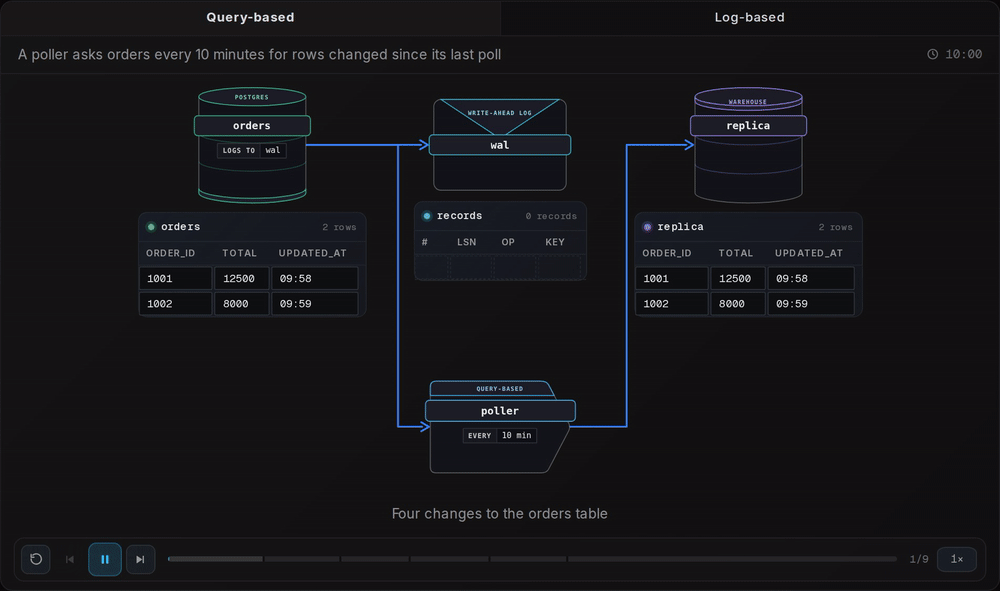
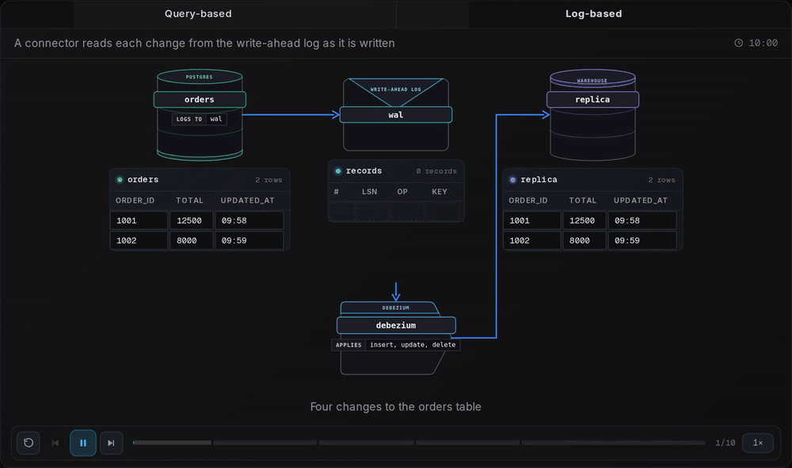
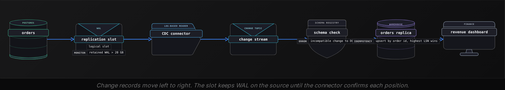
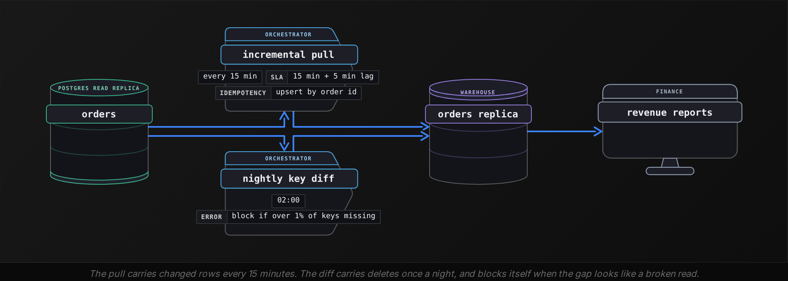

Intermediate·Pipeline Architecture · 32 min · 12 challenges

# Ingestion Patterns: Intermediate

Netflix keeps search indexes in sync with production databases. When a title is pulled from the catalog, a poller asking for recently changed rows never learns the row was deleted, so the title stays searchable. Re-dumping the table under a lock would stall writes. Netflix engineers published a framework that reads the database's change log and dumps existing rows without locks. This lesson builds that design for an `orders` table.


<br>

---

## Full, Incremental, and Bookmarks

Every ingestion run against a database first decides which rows to read. A full load reads every row and replaces the target copy. An incremental load reads only rows changed since the previous run and merges them into the target by primary key, which depends on a small piece of saved state.


<br>

### Full load: read everything, replace everything

A full load runs a `SELECT` over the whole table and overwrites the target. Correctness comes built in. Every change shows up, hard deletes included, because the target becomes an exact copy as of the read, and the next run repairs a bad one. The cost grows with the size of the table, whatever the amount of change. The `stores` table has 1,800 rows; the `orders` table has 40 million, and a nightly full load reads all of them even on a day when only 300,000 changed.


<br>

### Incremental load: read only what changed

An incremental load needs a column that moves forward every time a row changes: usually `updated_at`, set by the application on each write, or an ever-growing `id` for tables that only receive inserts. Each run reads rows past the point the previous run reached and upserts them by primary key. The column needs an index on the source, or every small run still scans the whole table to find its rows.

- **25 min** — nightly full load of orders
- **4 s** — hourly incremental run on orders

Incremental loads have 2 blind spots. A hard delete removes the row, so its `updated_at` never moves again and the target keeps the order forever. A write that skips `updated_at`, such as a bulk fix run by hand, is invisible too. Teams cover both with a periodic full comparison, or by moving to change data capture, the next section's subject.

| ✓ Full load | ✗ Incremental load |
| --- | --- |
| • Reads every row on every run<br><br>• Catches every change, hard deletes included<br><br>• Needs no change-tracking column<br><br>• The next run repairs a bad run<br><br>• Cost grows with table size | • Reads rows changed since the bookmark<br><br>• Misses hard deletes and untracked writes<br><br>• Needs a reliable updated_at or growing id<br><br>• Needs a bookmark store and a keyed upsert<br><br>• Cost grows with change volume |


<br>

### The bookmark store

The point an incremental load has reached is its bookmark, also called its high-water mark. It is the only state carried between runs, so where it lives and when it is written decide whether rows get lost. A bookmark in a file on the worker vanishes when the worker is replaced. Keep it in a small table in a durable database.


Each run inserts a row holding both bounds of its window. The history buys 2 things over a single overwritten value: a backfill of a bad hour replays exactly that run's window, and gaps between consecutive windows show up in a query. The next run starts from the latest row.

```sql
SELECT
  high_bound
FROM ingest_bookmarks
WHERE source_table = 'orders'
ORDER BY run_id DESC
LIMIT 1
```

#### Write the bookmark last

The run loads and commits its window first, and only after that commit does it insert its bookmark row. If the worker dies between the data commit and the bookmark insert, the next run reads the old bookmark and loads the same window again; the upsert by primary key makes that replay harmless. Reverse the order, and a crash after the bookmark insert skips the window forever, with no error anywhere.


<br>

### The bounded query

The tempting query filters `WHERE updated_at > :bookmark` and saves the largest `updated_at` it saw as the next bookmark. That loses rows. The application stamps `updated_at` when the statement runs, but other sessions see the row only once its transaction commits. A transaction that stamps 09:59:58 and commits at 10:00:03 is invisible to a query running at 10:00:01. That query saves a bookmark about 10:00:00, and every later run starts after the late row.

The fix is a window whose ends are both fixed before the read starts. The lower bound is the stored bookmark. The upper bound is the run's start time minus a safety lag longer than the source's longest transaction. With a 5-minute lag, the 10:00 run stops at 09:55, and the row stamped 09:59:58 lands in the 11:00 run's window, long after its commit. An `id` bookmark has the same gap, because id 5001 can commit after id 5002; for insert-only tables, bound a `created_at` timestamp with the same lag instead.

```sql
SELECT
  order_id,
  total,
  updated_at
FROM orders
WHERE updated_at > TIMESTAMP '2026-03-14 08:55:00'
  AND updated_at <= TIMESTAMP '2026-03-14 09:55:00'
```

| Run starts | Lower bound (excluded) | Upper bound (included) | Bookmark saved |
| --- | --- | --- | --- |
| 10:00 | 08:55 | 09:55 | 09:55 |
| 11:00 | 09:55 | 10:55 | 10:55 |
| 12:00 | 10:55 | 11:55 | 11:55 |

The strict `>` on the lower bound and `<=` on the upper make consecutive windows meet with no gap and no overlap, so a row stamped exactly 09:55:00 belongs to the 10:00 run alone. The lag costs freshness: a row reaches the warehouse 5 to roughly 65 minutes after it is stamped, the lag plus up to one hourly interval.

**An hourly job on orders was changed to insert its bookmark row first and load the window second. Tonight the worker is killed right after the bookmark insert. What does the next run do?**

- **A.** It loads the same window again, and the upsert by primary key absorbs the repeated rows.
- **B.** It starts after the window that never loaded, so that hour of changes is skipped with no error.
- **C.** It fails on a duplicate key in ingest_bookmarks, which pages the on-call before data is lost.
- **D.** It reads the table from the beginning, because the latest bookmark row has no rows_loaded.

<details>
<summary>Solution</summary>

**B.** It starts after the window that never loaded, so that hour of changes is skipped with no error.

The bookmark claims the window is done. Nothing rereads it and nothing fails, so the gap stays until someone compares counts.

**Why the others are wrong**

- **A.** That replay is what happens when the bookmark is written last. Here the new bookmark already points past the unloaded window.
- **C.** Each run inserts a row with a new run_id, so no key collides and nothing pages.
- **D.** The next run reads high_bound from the latest row, which is filled in, and continues past the missing hour.

</details>


<br>

---

## CDC: The Three Families

Change data capture (CDC) turns each write to a source table, deletes included, into a change record the pipeline can apply downstream. The bounded pull from the previous section is already a crude form of it. The 3 families of CDC differ in where they find the changes: in a side table the database fills, in the table itself, or in the database's own log.


<br>

### Trigger-based: the database copies each change

A trigger is a function the database runs inside the same transaction as a write. A CDC trigger on `orders` inserts a row into `orders_changes` for every write to it, deletes included. Each of those rows records which operation ran and when, along with the key and the new values. Ingestion reads `orders_changes` with a bounded window and prunes what it has loaded. Deletes are captured, and so is every intermediate value.

The source pays for it. Every write to `orders` now performs a second write, which adds write latency and storage. Every column change to `orders` also needs a matching change to the trigger and the side table. Trigger-based CDC fits databases that expose no change log, or tables with modest write rates where nobody can get log access.


<br>

### Query-based: poll the table for changes

Query-based CDC is the bounded incremental pull run on a timer of 10 minutes, or as little as 1 minute. It needs only a read-only login and an `updated_at` column. It sees each row as it stands at poll time, so 2 updates between polls arrive as a single change, and a hard-deleted row never arrives at all. Every poll is also a query on the source, so a shorter interval means more load.


<br>

### Log-based: read the replication log

Every relational database records each change in a log before applying it to the table, so it can recover after a crash and feed replicas. Postgres calls this the write-ahead log (WAL); other engines call theirs a binlog or redo log. A log-based connector reads that log the way a replica would and emits a record per change, in commit order, deletes included. The source does no extra writes, and changes arrive seconds after commit. The cost moves to operations, the subject of the next section.

The animation runs 4 changes to `orders` between 10:00 and 10:11: order 1001's total rises to 13000 at 10:03, order 1003 is inserted at 10:05, order 1002 is deleted at 10:06, and 1001 rises again to 13500 at 10:08. Play both variants and compare the replica at the end.

**Query-based**



**Log-based**



The query-based poller fires at 10:10 with its bookmark at 10:00. It copies 1001 at 13500 and the new 1003, and never learns that 1001 passed through 13000 or that 1002 was deleted, so the replica still shows order 1002 at 8000. The log-based connector applies each change around 2 seconds after it is written, and the replica ends identical to the source.

| Family | Hard deletes | Intermediate states | Extra source writes | Access needed | Latency |
| --- | --- | --- | --- | --- | --- |
| Trigger-based | Captured | Captured | A second write per change | Create triggers and tables | Poll interval of the side table |
| Query-based | Missed | Collapsed to the latest | None | Read-only login | Poll interval |
| Log-based | Captured | Captured | None | Replication privilege, log config | Seconds |

#### Choosing a family

When deletes or every intermediate state matter and you can get replication access, log-based wins. When the source is a vendor-hosted database that grants a read-only login, query-based is the only family on offer, and you ask the owners for soft deletes, a `deleted_at` column, so a delete becomes an update the poll can see. Trigger-based is the fallback for when deletes matter but log access is impossible, provided the write rate can absorb a second write.

**A fraud model needs every status a payment passes through (authorized, captured, refunded), and some payments move through all 3 within a minute. Hard deletes never happen. The source is a self-hosted Postgres your team administers. Which family fits?**

- **A.** Query-based every minute, since rows are never deleted and a read-only login is enough
- **B.** Trigger-based, writing each status to a side table inside the payment's own transaction
- **C.** Log-based, reading each status change from the WAL through a replication slot
- **D.** A full load every 5 minutes, capturing each payment's final status without a bookmark

<details>
<summary>Solution</summary>

**C.** Log-based, reading each status change from the WAL through a replication slot

Each committed status is its own log record, the source does no extra writes, and your team can enable it.

**Why the others are wrong**

- **A.** No deletes removes one blind spot, but a minute-long poll still collapses 3 statuses into the last one.
- **B.** It captures every status, but adds a write to every payment when log access is already available.
- **D.** It rereads the whole table every 5 minutes and still sees a single status per payment per run.

</details>


<br>

---

## Operating Log-Based CDC

A log-based pipeline on Postgres needs ongoing care in 3 places: the first copy of rows that existed before it started, the replication slot that holds its place in the log, and table definitions that change while it runs.




<br>

### The initial snapshot

The WAL keeps recent history, usually hours to days, and never the whole life of a table. A connector started today on `orders` would see today's changes and none of the 40 million rows already there. So every log-based pipeline begins with a snapshot: a full copy of the table, stitched to a position in the log.

Postgres makes that stitch exact. Creating a logical replication slot fixes its starting position, an LSN (log sequence number), and can export a transaction snapshot that sees the database as of that LSN. The connector copies the table through that snapshot, then streams from the slot. Everything committed before the LSN arrives in the copy, and everything after it arrives through the log.

The catch is duration. Copying 40 million rows in a single transaction can take hours, and a transaction open that long stops Postgres from cleaning up dead rows on the source. Chunked snapshots, the approach in the Netflix framework from the intro, copy primary-key ranges and reconcile each chunk with the live stream, so no transaction stays open for long. Either way, a connector that restarts mid-snapshot copies some rows twice, so the sink upserts by key.


<br>

### Replication slot lag

A replication slot remembers the last LSN the connector confirmed, and Postgres keeps every WAL file after that point, because the connector may still need it. While the connector keeps up, retained WAL stays small. When it stops (a crashed worker, an expired credential, a deploy paused halfway), WAL accumulates on the source's own disk.

The slot retains WAL for the whole database cluster, every table, even when the pipeline reads only `orders`. Suppose the cluster writes 6 GB of WAL an hour and its disk has 150 GB free. A connector that dies on Friday evening fills that disk by Saturday night, and a Postgres primary that cannot write WAL shuts down, taking the application with it.

- **25 h** — until a stalled slot fills that disk

```sql
SELECT
  slot_name,
  active,
  PG_WAL_LSN_DIFF(PG_CURRENT_WAL_LSN(), restart_lsn) AS retained_bytes
FROM pg_replication_slots
WHERE slot_type = 'logical'
```

> 3 defenses against slot lag
>
> - Alert when `retained_bytes` passes 20 GB and page at 50 GB, so someone acts with hours to spare.
> - Set `max_slot_wal_keep_size` (Postgres 13 and later) well below free disk, such as 100 GB, so Postgres invalidates the slot before the disk fills.
> - Drop the slot when its pipeline is retired. An inactive slot retains WAL exactly like a stalled one.

The cap trades a large incident for a smaller one. An invalidated slot cannot stream again, and the changes between its last LSN and now are gone from the log, so the pipeline takes a new snapshot. That costs hours of copying; a full disk costs the application its database.


<br>

### When the table's definition changes

Postgres logical decoding carries row changes and no DDL. After someone runs `ALTER TABLE orders ADD COLUMN currency text`, the connector finds out from the next change to `orders`, which arrives with a relation message describing the new column list. Records from then on carry the extra field, and records already in the stream keep the old shape.

| Change on the source | What the stream shows | Who breaks |
| --- | --- | --- |
| Add a nullable column | A new field from the next change on | Nobody, if readers ignore unknown fields |
| Rename a column | Old field gone, new field present | Every reader of the old name |
| Drop a column | Field missing from new records | Readers that require it |
| Widen `integer` to `bigint` | Same field, larger values possible | Sinks typed to the narrow type |

Treat the change stream like any other event stream. Register its schema and let backward-compatible changes through. Renames and type changes go through expand-contract on the source. A change the registry rejects goes to the dead letter queue instead of corrupting the replica.

**The orders connector crashed 9 hours ago. Retained WAL is 54 GB, the slot has no max_slot_wal_keep_size cap, and the disk has 96 GB free. The connector fix is ready. What should happen first?**

- **A.** Restart the connector on the existing slot so it drains the backlog from its confirmed LSN.
- **B.** Drop the slot to free the 54 GB, then start the connector on a new slot.
- **C.** Take a fresh snapshot of orders before restarting, in case the slot's backlog is stale.
- **D.** Set the cap to 50 GB first, so Postgres frees disk space before the connector restarts.

<details>
<summary>Solution</summary>

**A.** Restart the connector on the existing slot so it drains the backlog from its confirmed LSN.

The slot holds every change since the crash, and 96 GB of headroom leaves 16 hours. Draining loses nothing.

**Why the others are wrong**

- **B.** Dropping the slot discards 9 hours of changes, which forces a full snapshot of 40 million rows.
- **C.** The backlog is complete and current. A snapshot costs hours and adds nothing the slot does not already hold.
- **D.** Retained WAL already exceeds 50 GB, so the slot would be invalidated and the pipeline would need a new snapshot.

</details>


<br>

---

## Idempotent At-Least-Once Ingest

Every ingestion consumer does 2 things per batch, whatever it reads from: it writes the records to the sink, and it saves its position (an offset for a queue, an LSN for a replication slot, a file name when it reads a folder of files) so it can resume after a restart. A crash can land between the 2 steps, and their order decides what that crash costs.

| ✓ Write, then save position | ✗ Save position, then write |
| --- | --- |
| • Crash in between: the batch is read again<br><br>• Cost: duplicate records in the sink<br><br>• Called at-least-once delivery | • Crash in between: the batch is never written<br><br>• Cost: records silently missing<br><br>• Called at-most-once delivery |

Ingestion picks at-least-once, because a duplicate can be found and removed while a missing record leaves no trace. A restarted CDC connector rereads changes after its last confirmed LSN, a queue redelivers anything unacknowledged, and a retried API page returns rows already loaded. The sink can turn each of these repeats into a no-op in 3 ways.


<br>

### Dedupe by key

When each record carries a stable id, keep a single row per id. A queue event usually has a producer-assigned `event_id`. A CDC change is identified by its primary key plus its LSN: a replay repeats both, while 2 real updates to order 1001 have different LSNs. Dedupe each staged batch before it touches the target.

Staged batch, with a redelivery

| order_id | lsn | op | total |
| --- | --- | --- | --- |
| 1001 | 41210 | update | 13000 |
| 1003 | 41388 | insert | 4200 |
| 1001 | 41210 | update | 13000 |
| 1002 | 41502 | delete | null |
| 1001 | 41640 | update | 13500 |

After dedupe on order_id and lsn

| order_id | lsn | op | total |
| --- | --- | --- | --- |
| 1001 | 41210 | update | 13000 |
| 1003 | 41388 | insert | 4200 |
| 1002 | 41502 | delete | null |
| 1001 | 41640 | update | 13500 |

*LSNs appear here as small integers. Real ones are 64-bit log positions that Postgres prints as 2 hex numbers, such as 0/16B3748.*

```sql
SELECT
  order_id,
  lsn,
  op,
  total
FROM (
  SELECT
    order_id,
    lsn,
    op,
    total,
    ROW_NUMBER() OVER (
      PARTITION BY order_id, lsn
      ORDER BY received_at
    ) AS rn
  FROM staged_order_changes
) AS ranked
WHERE rn = 1
```


<br>

### Uniqueness enforced at the sink

Staging dedupe only catches repeats inside a batch. A replay that arrives tomorrow lands in a different batch, so the lasting guarantee has to live in the target: a uniqueness rule on the record id that rejects or skips a second copy. An operational database enforces it with a primary key or unique index. Many warehouses accept a primary key declaration without enforcing it, so the load enforces it with an anti-join against rows already stored.

```sql
INSERT INTO order_changes
SELECT
  s.order_id,
  s.lsn,
  s.op,
  s.total
FROM deduped_order_changes AS s
LEFT JOIN order_changes AS t
  ON s.order_id = t.order_id
  AND s.lsn = t.lsn
WHERE t.order_id IS NULL
```

A current-state table, with a row per order, also needs a version rule: upsert by `order_id`, and apply a change only when its LSN is higher than the stored one. A replay of the 10:03 change (total 13000) arriving after the 10:08 change (total 13500) compares lower and is skipped, so the replica keeps 13500 instead of rolling back. Apply a delete as a tombstone, a row flagged deleted that keeps the delete's LSN; otherwise a late replay of an older update to 1002 finds no stored row and revives the order. Purge tombstones once replays can no longer arrive.


<br>

### Content-hash ids

Some sources give you no id: a partner's daily CSV, an API that returns rows without keys. Build one by hashing the fields that make a record what it is. The same input then always produces the same id, on the first load and on every retry, and the sink's uniqueness rule does the rest.

```sql
SELECT
  TO_HEX(
    SHA256(
      TO_UTF8(
        CONCAT(
          file_name,
          '|',
          CAST(line_number AS VARCHAR),
          '|',
          raw_line
        )
      )
    )
  ) AS row_id,
  file_name,
  line_number,
  raw_line
FROM staged_partner_files
```

Include whatever differs between 2 genuinely different records, and nothing that differs between 2 deliveries of the same record.

| Hash input | Same file retried | 2 identical purchases on different lines | Verdict |
| --- | --- | --- | --- |
| `raw_line` | Same id | Same id, a purchase lost | Too few inputs |
| `raw_line` + `ingested_at` | New id, duplicate loaded | Different ids | Too many inputs |
| `file_name` + `line_number` + `raw_line` | Same id | Different ids | Right |

> **TIP**
>
> Put a separator between hashed fields. Without one, `ab` followed by `c` and `a` followed by `bc` build the same string and the same id.

*The third row holds while the partner never resends a file under the same name with its lines reordered. If they do, ask them for a row id.*

**A consumer reads a queue, writes each batch to the warehouse with an anti-join on event_id, then acknowledges the batch. A teammate proposes acknowledging before the write to stop redeliveries. What does the change do?**

- **A.** Removes duplicates and keeps every event, since the anti-join still runs on each write
- **B.** Has no effect, because the queue redelivers unacknowledged batches in both designs
- **C.** Doubles the duplicates, since each batch is now delivered before and after the write
- **D.** Turns a crash between the steps from a harmless redelivery into permanent loss of the batch

<details>
<summary>Solution</summary>

**D.** Turns a crash between the steps from a harmless redelivery into permanent loss of the batch

The batch is marked delivered but never written. The anti-join had already made redeliveries harmless.

**Why the others are wrong**

- **A.** The anti-join only sees events that reach the write. After a crash past the acknowledgement, the batch never does.
- **B.** The batch is already acknowledged, so the queue treats it as delivered and never sends it again.
- **C.** An acknowledgement ends delivery for that batch; it never triggers a second one.

</details>


<br>

---

## Three Ways to Ingest from Postgres

Postgres supports all 3 strategies from this lesson, and a single database often uses all 3, table by table. The choice for each table comes down to 4 questions: how big is the table and how fast does it change, are rows hard-deleted, how fresh must the copy be, and who will be on call for it.

| Strategy | How it reads | Scale | Hard deletes | Freshness | Team cost |
| --- | --- | --- | --- | --- | --- |
| Nightly full snapshot | `SELECT` the whole table, replace the target | Up to a few million rows | Caught | Once a day | A scheduled job |
| Incremental pull | Bounded window on `updated_at`, keyed upsert | Large tables with an indexed change column | Missed | Run interval plus safety lag | Bookmark store and idempotent sink |
| Log-based CDC | Logical replication slot, snapshot then stream | Any size, high change rates | Caught | Seconds | Slot monitoring, re-snapshot runbook, DBA access |


<br>

### Three tables in a single database

`stores` has 1,800 rows and changes a few times a week. A nightly full snapshot copies it in under a second, catches the occasional closed store that someone deletes, and has no bookmark to corrupt.

`products` has 2 million rows and about 50,000 updates a day, and is never hard-deleted: a discontinued product gets `discontinued_at` set, which also moves `updated_at`. The catalog team reads it hourly. An hourly incremental pull with a 5-minute lag meets every requirement, and it can run against a read replica so the primary never sees the query.

`orders` has 40 million rows and 300,000 changes a day, and the application hard-deletes orders that customers cancel within 10 minutes of placing them. Finance wants revenue within 5 minutes. An incremental pull would keep every cancelled order in revenue forever, and the nightly full copy takes 25 minutes and leaves the warehouse a day behind. Log-based CDC meets both needs, and that is why the team takes on its slot monitoring and re-snapshot runbook.


<br>

### When the team cannot run CDC

Team capacity can overrule the table. Log-based CDC needs `wal_level = logical` on the source, a setting that takes a database restart, plus a role with replication privilege and an on-call engineer who knows what a stalled slot does to the primary's disk. A 2-person team without DBA access can serve `orders` with a hybrid: an incremental pull every 15 minutes, and a nightly job that lists every `order_id` in the source, compares the list with the replica, and deletes the orders that are gone.



The hybrid has a price. Revenue can trail the source by 20 minutes instead of 5, since the pull interval stacks on top of the lag. A cancelled order also stays in revenue until the 02:00 diff removes it. Agree on both with finance before launch, or ask the application team for soft deletes so cancellations become updates the pull already sees.

| ✓ Do | ✗ Don't |
| --- | --- |
| • Decide per table, weighing size and change rate against delete and freshness needs and who will run it<br><br>• Keep full snapshots for small tables even when big ones move to CDC<br><br>• Save the bookmark only after the data commits<br><br>• Make every sink absorb repeats, whether by dedupe or by a uniqueness or version check<br><br>• Alert on retained WAL long before it threatens the source disk | • Run CDC on a 1,800-row table that a full copy refreshes in a second<br><br>• Trust updated_at before confirming every writer sets it<br><br>• Leave a replication slot behind when its pipeline is retired<br><br>• Let a key diff delete a large share of rows without a threshold check |

**A refunds table has 6 million rows and gains 20,000 a day. Rows are never updated or deleted; corrections arrive as new rows. Analysts need it hourly, and your team has no replication access. Which strategy fits?**

- **A.** Log-based CDC, because only the log guarantees that every new refund is seen
- **B.** Nightly full snapshot, because an append-only table never needs a bookmark
- **C.** Incremental pull on created_at, with both bounds fixed and a 5-minute lag
- **D.** Trigger-based CDC into a side table, so that every insert is recorded twice

<details>
<summary>Solution</summary>

**C.** Incremental pull on created_at, with both bounds fixed and a 5-minute lag

Rows never change after insert, so created_at is a complete change column, and a read-only login suffices.

**Why the others are wrong**

- **A.** A bounded window with a lag also sees every committed insert, and the team lacks the access CDC needs.
- **B.** It rereads 6 million rows a day and misses the hourly need. Append-only is the strongest case for incremental.
- **D.** With no updates or deletes, the table already shows everything. The trigger only doubles the source's writes.

</details>


<br>

---

## Putting It All Together

A food-delivery marketplace feeds its warehouse from a single Postgres cluster. stores reloads in full each night, products arrives through an hourly bounded pull, and orders streams through a logical replication slot so finance sees revenue within 5 minutes, cancellations included. One Saturday the connector's credential expires. Retained WAL climbs past the 20 GB alert, the on-call renews the credential, and the connector drains 4 hours of backlog, some of it applied once already before the stall.

- The per-table choices are the decision from the last section. Size and change rate pick full or incremental, and hard deletes plus the 5-minute need are what put a table on CDC.
- The products pull is the bounded window: lower bound from the bookmark store, upper bound fixed at start minus 5 minutes, bookmark saved after the commit.
- Orders uses the log-based family because only the log reports hard deletes and every intermediate total.
- The stall is slot lag: WAL for every table piles up until the connector confirms, and the 20 GB alert fires hours before the disk is at risk.
- The replayed changes are harmless because the sink dedupes on order_id plus LSN, applies an upsert only when the LSN is higher, and keeps deleted orders as tombstones.


<br>

---

## Key Takeaways

- A full load is correct by construction and costs the table's size; an incremental load costs the change volume and misses hard deletes.
- Fix both ends of an incremental window before reading, lag the upper bound past the longest transaction, and save the bookmark after the data commits.
- Each CDC family finds changes in a different place: trigger-based in a side table, query-based in the table itself, log-based in the database's log. Where it looks decides whether deletes and intermediate states arrive, and how much load the source carries.
- Log-based CDC starts with a snapshot stitched to an LSN, and its slot retains WAL for the whole cluster until the connector confirms.
- Ingestion delivers at least once, so sinks absorb repeats, usually by deduping on a key or enforcing uniqueness, or else with LSN version checks or content-hash ids.
- Choose per table, from its size and its delete and freshness needs, and from which team will operate the pipeline.

Exercises for this lesson: [_exercises/pa_ingestion_patterns_intermediate.md](_exercises/pa_ingestion_patterns_intermediate.md)
