# Orchestration: Beginner - Exercises

Lesson: [pa_orchestration_beginner.md](../pa_orchestration_beginner.md)

### Exercise 1 of 11

**● TASK**

A daily orders pipeline runs 5 bash scripts by cron at 1am, 2am, 3am, 4am and 5am, so when the 1am extract runs long, the 2am clean step reads stale data and the dashboard shows wrong numbers. Replace the cron timers with an orchestrator: each step starts only after the one it depends on has succeeded, the whole chain runs on one daily trigger with automatic retries, and the daily mart still lands in the Snowflake warehouse that the Looker dashboard reads.

**Starting canvas** (already placed for you):

- Postgres orders source (source, PostgreSQL)
- extract_orders.sh (cron 1:00am, runs 30-90 min) (transform, SQL)
- clean_orders.sh (cron 2:00am) (transform, SQL)
- join_orders.sh (cron 3:00am) (transform, SQL)
- aggregate_orders.sh (cron 4:00am) (transform, SQL)
- publish_orders.sh (cron 5:00am) (transform, SQL)
- Snowflake daily_orders mart (storage, Snowflake)
- Morning dashboard (consumer, Looker)

<strong>Solution</strong>

Dependency-driven orchestration is the fix here: model the pipeline as a directed acyclic graph where each task starts only after the task it depends on has actually **succeeded**. The orchestrator watches run state, not the wall clock. That one shift turns 5 hopeful `cron` timers into a chain that either produces correct numbers or fails loudly.

| Pitfall: A timestamp is not a promise of completion |
| --- |
| The starter fires `clean_orders.sh` at 2am on the assumption the 1am extract is done. When the extract runs 90 minutes, clean fires anyway, reads yesterday's rows, and every downstream step succeeds on stale data. Nothing throws, so the dashboard is green and wrong. Spacing the crons further apart only widens the gap; it never closes it. |

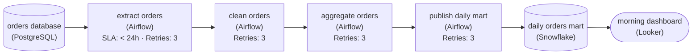

*One daily schedule on the root of the DAG, 4 orchestrated tasks chained by dependency edges and retried on failure, landing in the daily orders mart the morning dashboard reads.*

1. **Collapse the 5 timers into one trigger**

   The whole graph gets a single `@daily` schedule; the individual steps get none. `clean orders` has no time of its own to fire on, so there is no clock left for it to race against.

2. **Turn each arrow into a real dependency**

   Each task declares its upstream: `clean orders` depends on `extract orders`, `aggregate orders` on `clean orders`, `publish daily mart` on `aggregate orders`. A task starts only after its parent reports success, so a slow extract just delays clean instead of letting it read stale rows.

3. **Give each task automatic retries**

   A warehouse timeout shouldn't cost the whole day. Set a retry count on each task so a transient failure re-runs itself; only a genuine, repeated failure stops the downstream tasks and leaves the run visibly failed. `cron` could never do this because it never knew whether a step even ran.

| Key insight: The destination never changed, only what controls timing |
| --- |
| The cleaned mart still lands in the Snowflake warehouse and the Looker dashboard still reads it. You didn't rebuild the transforms or move the warehouse; you replaced time-based coupling with state-based coupling and got correctness and retries for free. |

**Follow-up questions**

1. If cleaning splits into 2 independent branches that both feed `aggregate orders`, how does the DAG change?\
   *Tests whether dependency edges and fan-in, not a single line of steps, are the mental model.*
2. The 1am run failed and you notice at 9am. How do you re-run just that day without disturbing today's schedule?\
   *Re-running a single day's DAG run on its own.*

 

### Exercise 2 of 11

**● TASK**

Wire three Airflow tasks, extract_orders, clean_orders and aggregate_orders, into a DAG that loads the PostgreSQL orders source into the daily_orders mart in the warehouse. Draw directed edges from upstream to downstream so each task starts only after the one before it finishes, with aggregate_orders writing to the mart and the morning dashboard reading from it. No edge may point back to an earlier task: the graph must stay acyclic.

**Starting canvas** (already placed for you):

- PostgreSQL orders source (source, PostgreSQL)
- extract_orders (transform, Airflow)
- clean_orders (transform, Airflow)
- aggregate_orders (transform, Airflow)
- daily_orders mart (storage, warehouse)
- Morning dashboard (consumer, dashboard)

<strong>Solution</strong>

#### A DAG is the schedule, drawn as a graph

A **directed acyclic graph** turns a schedule into something you draw instead of something you write: each arrow says "this finishes before that starts", and Airflow reads the whole shape to decide what runs when. The edges from `extract_orders` to `clean_orders` to `aggregate_orders` ARE the schedule. Airflow sorts the graph topologically, starts a task as soon as all its upstream arrows report done, and refuses to start one whose parents have not. Order lives in the structure, not in sleep timers or cron offsets.

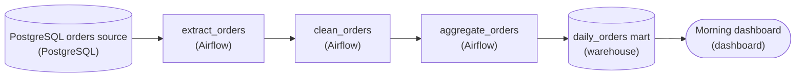

*Every arrow points upstream to downstream; `aggregate_orders` cannot start until `clean_orders` reports done.*

| Pitfall: A back-edge makes the graph unschedulable |
| --- |
| Draw an arrow from a later task back to an earlier one, such as `aggregate_orders` back to `extract_orders`, and the graph has a cycle. A topological sort then has no valid answer, so Airflow rejects the DAG instead of deadlocking at run time. The quieter failure is a MISSING edge: drop the edge from `clean_orders` to `aggregate_orders` and Airflow treats the 2 tasks as independent, running both at once on stale rows. |

| Key insight: Edge direction means depends-on |
| --- |
| The arrow points from `extract_orders` to `clean_orders` because cleaning DEPENDS ON extraction finishing. Data flows the same way here, so the 2 directions coincide, but the scheduler only tracks the dependency. That is why the arrow from the `daily_orders` mart to the dashboard sits outside the Airflow tasks: the dashboard reads the mart on its own cadence. |

| ✕ The cron chain you replaced | ✓ The DAG |
| --- | --- |
| `clean_orders` ran at a fixed 02:15 and hoped `extract_orders` had finished by then. A slow extract overlapped the clean; a failed one left the later steps running on missing data. | `clean_orders` starts on the EVENT of `extract_orders` succeeding. A slow extract just delays its children; a failed one stops them. Order is structural, so there is no timing to tune. |

**Follow-up questions**

1. If `aggregate_orders` needed both `clean_orders` and a separate `clean_refunds` done first, how many incoming edges would it have, and what would Airflow wait for?\
   *Tests seeing a task's parents as an AND-join: every incoming edge must complete before the task starts.*
2. Why is the arrow from the `daily_orders` mart to the dashboard not something Airflow schedules?\
   *Checks the boundary between orchestrated tasks and downstream readers that run on their own cadence.*

 

### Exercise 3 of 11

**● TASK**

A daily orders pipeline runs its twelve-hour aggregation inside an Airflow operator, in the scheduler's own process, so other DAGs queue behind it and the UI lags. Redraw the flow so Airflow keeps owning scheduling, ordering, retries, and the on-call view, while a separate worker runs the aggregation, reading orders from Postgres and landing the daily mart in Snowflake for the morning dashboard.

**Starting canvas** (already placed for you):

- Postgres orders source (source, PostgreSQL)
- Airflow orchestrator (transform, Airflow)
- Airflow operator: heavy aggregation (12-hour, in-process) (transform, Airflow)
- Snowflake daily_orders mart (storage, Snowflake)
- Morning dashboard (consumer, Looker)

<strong>Solution</strong>

#### The scheduler keeps time; it should not do the lifting

Airflow exists to keep time: hand out work, order DAGs, retry failures, and show on-call what is running. When an operator runs the twelve-hour aggregation itself, that work executes in an Airflow worker slot and the scheduler becomes the executor. For half a day the slot is pinned crunching orders, every other DAG queues behind it, and the UI lags, because the **control plane and the data plane are now the same process**. The redraw separates them: Airflow submits and monitors, and a worker reads `orders` and lands the `daily_orders` mart.

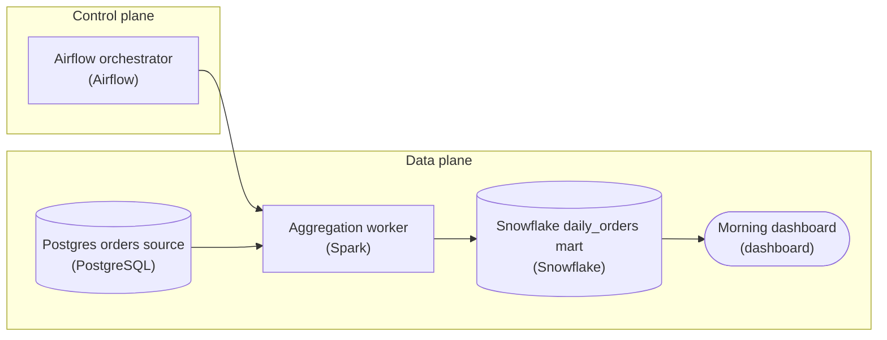

*Airflow submits and watches; the `Aggregation worker` reads `orders` and writes `daily_orders`. The heavy edge never touches the scheduler process.*

| Pitfall: A `PythonOperator` doing the work is the trap |
| --- |
| The natural first draft is a `PythonOperator` whose callable runs the whole aggregation. It reads cleanly in the DAG, but the compute executes in-process on an Airflow worker, so one task pins a slot for twelve hours and starves every other pipeline. The answer is not a bigger scheduler; it is an operator that dispatches the job elsewhere. |

1. **Make Airflow submit and poll, not compute**

   Swap the in-process operator for one that hands the job to a worker and watches it: a `KubernetesPodOperator`, an `EcsRunTaskOperator`, or a deferrable operator that submits and then releases the slot while it waits. Airflow still owns the edges, the schedule, and the retry policy; a deferrable operator is strongest because it frees the slot during the long wait, so the scheduler stays responsive even while the job runs.

2. **Make the worker idempotent, partitioned by day**

   Because Airflow owns retries, a re-run must not double-count. Write `daily_orders` partitioned by order date and replace the target partition each run (delete-and-insert or `MERGE` on the day key) instead of appending. That makes a retry safe and turns a full recompute into an incremental build: aggregate only the day in question rather than re-scanning all of `orders`.

**Follow-up questions**

1. If the `Aggregation worker` dies halfway, how do you keep an Airflow retry from double-counting?\
   *Idempotency lives in the worker as a partition replace on the day key, not in append-only writes.*
2. What changes to build only the latest day instead of recomputing all of `daily_orders`?\
   *Incremental vs full loads, partitioning by `order_date`.*

 

### Exercise 4 of 11

**● TASK**

Three cron jobs build a daily orders-by-region summary: extract the day's orders from Postgres, clean the rows, aggregate to one row per region. When the extract ran long, the aggregate still fired on the clock and summarized half-loaded data. Rebuild them as one daily DAG owned by Airflow: tag all three steps Airflow and wire extract, then clean, then aggregate so each starts only after its upstream succeeds, ending in the Snowflake mart the dashboard reads.

**Starting canvas** (already placed for you):

- Orders app DB (source, PostgreSQL)
- Extract day's orders (transform, SQL)
- Clean and standardize rows (transform, SQL)
- Aggregate orders by region (transform, SQL)
- Snowflake mart_orders_by_region (storage, Snowflake)
- Regional orders dashboard (consumer, Looker)

<strong>Solution</strong>

#### Order by dependency, not by the clock

A DAG lets one orchestrator decide run order from what each step reads, not from a wall-clock time you guessed at. You took three jobs that used to fire independently and made them one graph: extract runs, and only when it **succeeds** does clean start, and only when clean succeeds does aggregate start, landing in the `mart_orders_by_region` table the dashboard reads. That single ownership under `Airflow` is the whole point, the schedule now lives in one place, and the edges, not the clock, sequence the work.

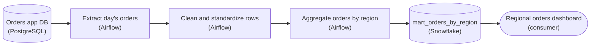

*One daily DAG: each Airflow task starts only after its upstream succeeds, ending in `mart_orders_by_region`.*

| Pitfall: A fixed fire time assumes the last step already finished |
| --- |
| The old design gave each step its own cron time and hoped the gaps were wide enough. On a normal night they were; on the night the pull ran long, the aggregate step fired at its scheduled minute anyway and summarized half-loaded rows. Cron answers "is it 3:15 yet?", it never answers "did the clean step finish?" That is the gap a DAG closes. |

| Key insight: Success is the trigger, not the timestamp |
| --- |
| In a DAG the edge from clean to aggregate means "aggregate may run once clean reports success." If extract runs long, everything downstream simply waits, and if a step fails the ones after it never start rather than running on stale data. You schedule the DAG once, daily; the dependency edges handle ordering for you. |

This is how late or slow-arriving data is handled in practice. Real DAGs push it further, a sensor that blocks the first task until the source is actually ready, an SLA that alerts when a run drifts past its window, but they all rest on the same move you just made: express the pipeline as dependencies so a slow upstream delays the answer instead of corrupting it.

**Follow-up questions**

1. If the extract step fails three days running, what should the dashboard show, yesterday's numbers or nothing?\
   *Extends the idea to failure semantics: a DAG stops downstream work, but the consumer still needs a defined behavior for a missing run.*
2. How would you change the graph if the clean step could start on partial data as each `region` finishes loading?\
   *Probes when a strict succeed-then-start edge is too coarse and finer-grained dependencies are worth the complexity.*

 

### Exercise 5 of 11

**● TASK**

Build a three-task Airflow DAG from Postgres production.orders to the Snowflake mart.orders_by_region. Add extract_orders (production.orders to raw.orders), clean_orders (raw.orders to stg.orders) and aggregate_orders (stg.orders to mart.orders_by_region), naming each node with its read and write tables, chained in that order with the dashboard reading the mart. Name the orchestrator with its daily 2am schedule and 3 retries with exponential backoff from 2 minutes.

**Starting canvas** (already placed for you):

- Postgres production.orders (source, PostgreSQL)
- Airflow orchestrator (set schedule and retry policy) (transform, Airflow)
- Snowflake mart.orders_by_region (storage, Snowflake)
- Morning regional dashboard (consumer, Looker)

<strong>Solution</strong>

#### Let the data decide when a task runs, not the clock

With **DAG orchestration** the pipeline becomes a directed acyclic graph: each task declares the one before it as its upstream dependency, and the orchestrator starts a task only when that upstream has actually finished. That is the whole fix for a stale read. `clean_orders` does not run at a fixed wall-clock time and hope `extract_orders` is done; it runs because `extract_orders` reported success. The chain `extract_orders` then `clean_orders` then `aggregate_orders` is a dependency order, and the edges you drew ARE that order made explicit.

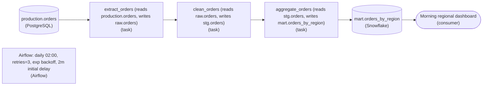

*Each task names the table it reads and the table it writes, so the `raw` to `stg` to `mart` flow is legible straight from the graph.*

| Pitfall: Clock offsets assume a duration that will not hold |
| --- |
| The version that pages on-call is three tasks each on their own clock trigger: `extract_orders` at 02:00, `clean_orders` at 02:10, `aggregate_orders` at 02:20. It works right up until `extract_orders` runs long. Now `clean_orders` fires at 02:10 and reads a half-written `raw.orders`, and the dashboard shows numbers that are quietly wrong rather than obviously broken. Clock-chaining assumes a duration; a dependency edge assumes nothing. Make `clean_orders` depend on `extract_orders` finishing and the race disappears. |

The three-table hop is the other half of the design: **batch processing through staging layers**. `raw.orders` is the untouched extract, `stg.orders` is the cleaned intermediate, and `mart.orders_by_region` is the aggregate the dashboard reads. Splitting it this way means a failure in `clean_orders` never corrupts the raw landing zone, and you can re-run one stage without re-pulling from `production.orders`. Recording each read and write table in the node name lets anyone reading the diagram trace where a bad number came from without opening the code.

| Key insight: One retry policy on the DAG, not three in the tasks |
| --- |
| You put `retries=3`, exponential backoff, and a 2-minute initial delay on the Airflow orchestrator so every task inherits it, rather than hand-coding retry logic inside `extract_orders`, `clean_orders`, and `aggregate_orders`. Exponential backoff (2m, then 4m, then 8m) is deliberate: a transient Postgres blip or a warehouse cold-start usually clears on its own if you wait a little longer each attempt, and backing off avoids hammering a source that is already struggling. Setting it once on the DAG keeps the policy uniform and in one place to change. |

**Follow-up questions**

1. If `aggregate_orders` keeps failing after all 3 retries, should the dashboard show yesterday's mart or nothing?\
   *Tests whether the learner sees that retry exhaustion needs a failure policy, not just more retries.*
2. How would you add a check that `raw.orders` actually landed rows before `clean_orders` starts?\
   *Extends the dependency idea from task-success to a data-quality gate between stages.*
3. What changes if a second dashboard needs the data hourly instead of at 2am?\
   *Probes whether the DAG's schedule is separable from its task dependencies.*

 

### Exercise 6 of 11

**● TASK**

Replace a six-job cron chain with one orchestrator (Airflow, Dagster, or Prefect) that owns the daily schedule, retries, and dependency resolution. Wire a DAG with explicit edges: extract_orders to clean_orders, extract_payments to clean_payments, both into join_orders_payments, then publish_fact. Delegate the clean, join, and publish compute to a worker engine (dbt, Spark, PySpark, Databricks, Snowflake, or BigQuery) rather than running it inside the orchestrator, and publish the fact table to a warehouse (Snowflake, BigQuery, Redshift, or Databricks) that the dashboard reads.

**Starting canvas** (already placed for you):

- Postgres app (source, PostgreSQL)
- Stripe API (source, API)
- Dashboard (consumer, Metabase)

<strong>Solution</strong>

#### From six cron jobs to one DAG

The concept you applied here is **DAG orchestration**: describe the work as a directed acyclic graph, one node per task, and let an orchestrator resolve run order from the edges. `clean_orders` starts not because it is 3:15 AM but because `extract_orders` finished. That shift from time-coupling to dependency-coupling is the whole point.

| Pitfall: Why the dashboard showed yesterday's numbers |
| --- |
| Each cron job was pinned to a fixed time. When the Postgres pull ran 2 hours long, `clean_orders` fired on schedule anyway, cleaned stale rows, and `publish_fact` published them. Nothing failed loudly, the chain just ran on old data. Real edges would have held `clean_orders` until `extract_orders` actually completed. |

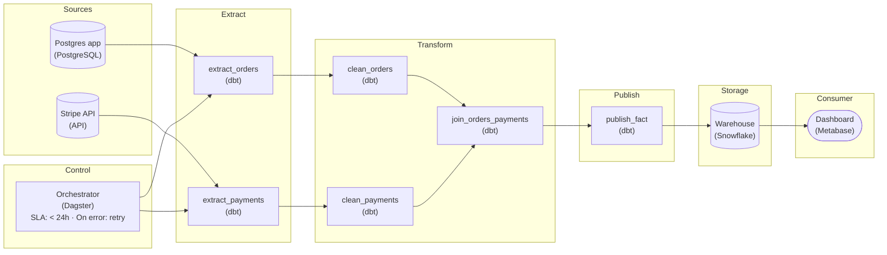

*A daily orchestrator with task retries resolves run order from explicit edges, a worker engine (`dbt`) does the heavy compute, and the fact table lands in the warehouse the dashboard reads.*

1. **Let the edges encode the dependencies, not the clock**

   The 2 extracts are independent, so they run in parallel. `join_orders_payments` needs both cleans done, so it takes 2 inbound edges, the fan-in a cron chain can never express. The orchestrator runs what it can and blocks what it cannot.

| Key insight: A daily schedule plus per-task retries is the safety net |
| --- |
| One orchestrator (`Dagster` or `Prefect` suits a small new build) attaches a daily schedule to the DAG and a retry policy to each task. The clean and join steps delegate to a worker engine like `dbt`, so the orchestrator only triggers, watches, and retries. Now a slow extract holds downstream instead of poisoning the fact table. |

**Follow-up questions**

1. If `extract_orders` keeps timing out, should its retry policy back off, alert, or both, without blocking `extract_payments`?\
   *Tests per-task retries and that independent branches stay independent.*
2. The team wants orders refreshed hourly but payments only daily. How would you express 2 cadences in one graph?\
   *Scheduling granularity beyond one DAG-level daily trigger.*

 

### Exercise 7 of 11

**● TASK**

A daily report joins yesterday's ad spend from an ad platform API with yesterday's conversions from a Postgres orders database, landing the result in a warehouse table that a return-on-ad-spend dashboard reads. Cron runs both pulls at midnight and the join at 3am, so a slow pull leaves the join reading stale data. Design it with an orchestrator that starts the join only after both pulls finish and retries the API pull when it times out.

<strong>Solution</strong>

#### Completion, not clock time, starts the join

Swapping cron for an orchestrator changes where a task's start signal comes from. Cron fires the join at 3am because someone guessed the pulls would be done by then; an orchestrator fires it when both pulls report success. On the night the API pull crawls until 3:40, the join simply waits, and the dashboard shows a **late but correct** number instead of an on-time wrong one.

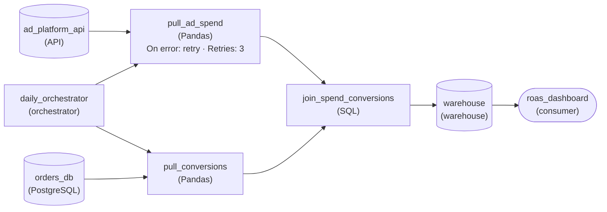

*`daily_orchestrator` starts both pulls once a day; `join_spend_conversions` runs only after `pull_ad_spend` and `pull_conversions` both succeed.*

1. **Turn each clock time into an edge**

   Every place the cron schedule encoded a guess about when work would be done, the design now has an edge. Both pulls feed `join_spend_conversions`, so the join has two upstream tasks and starts when the slower one finishes, whichever that is tonight.

2. **Put the retry on the task that fails**

   Only the API pull times out, so the retry lives on `pull_ad_spend`. Under cron a retry was risky: a second attempt could still be running at 3am when the join fired. With the join waiting on completion, a retry just delays it a few minutes.

| Pitfall: A later clock time only moves the bug |
| --- |
| The tempting fix is pushing the join to 5am. That buys slack on normal nights, fails the same way the night the API stays slow past 5, and makes every normal night's report two hours later than it needs to be. |

| Real world: Silent staleness is worse than a failure |
| --- |
| A join that reads yesterday's spend beside today's conversions still succeeds, writes rows and turns nothing red. Depending on completion converts that silent wrong answer into a visible delay someone can see and fix. |

**Follow-up questions**

1. Refunds from the payments database now have to be pulled before the join too. What changes?\
   *Whether a new upstream task is one more edge rather than one more clock time.*
2. The API pull fails all 3 of its retries. What should happen to the join and the dashboard?\
   *What a dependency means when an upstream task never succeeds.*

 

### Exercise 8 of 11

**● TASK**

Each night a job loads the day's clickstream files, then two tasks aggregate the loaded clicks: one sessionizes visits, one counts page views. A report task joins both aggregates into a daily report table. Draw it as a DAG run by an orchestrator: both aggregations run in parallel after the load, and the report waits for both to succeed. No edge may point back upstream.

<strong>Solution</strong>

#### The edges are the schedule

A DAG is the shape an orchestrator can compute an order from: tasks are nodes, each edge says which task must succeed before the next may start, and no path leads back to where it began. Here the 4 tasks form a diamond. The load is the single root, the two aggregations fan out from it, and the report fans them back in. The orchestrator reads those edges and nothing else to decide what runs when.

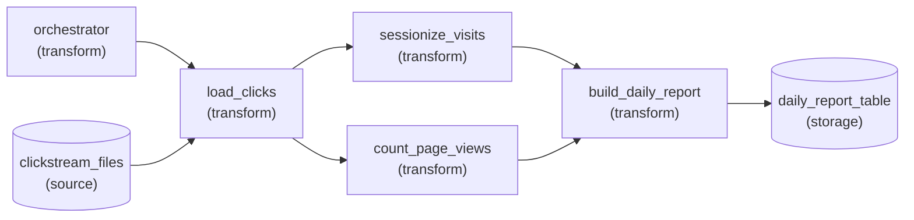

*The orchestrator triggers `load_clicks`; the two aggregations fan out from it and fan back into `build_daily_report`.*

1. **Point each edge from producer to consumer**

   An edge runs from the task that writes data to the task that reads it. `load_clicks` writes the clicks both aggregations read, so it points at `sessionize_visits` and `count_page_views`, and each of those points at `build_daily_report`. Because the report has two incoming edges, the orchestrator holds it until both have succeeded, which is exactly the rule the report needs.

2. **Draw no edge between the aggregations**

   Neither aggregation reads the other's output, so there is nothing to order between them. With no edge, both can start the moment the load succeeds, and a failure in one does not stop the other from finishing.

| Pitfall: A straight chain invents a dependency |
| --- |
| The common draft lines everything up: load, sessionize, count, report. It runs, but `count_page_views` now waits on `sessionize_visits` for no reason, the night takes the sum of both durations instead of the longer one, and a sessionizing failure blocks page counts that never needed it. Draw only the edges the data demands. |

| Key insight: One back edge makes the graph unschedulable |
| --- |
| Suppose `build_daily_report` wrote a 'done' marker that `load_clicks` checks before starting. The load now waits on the report, which waits on the aggregations, which wait on the load: every task is waiting, and there is no valid order to compute. Whatever tomorrow needs from tonight stays outside this night's graph. |

**Follow-up questions**

1. A new bot-filter task must run on the loaded clicks before page counting. Where do its edges go?\
   *Inserting a task into a fan-out without adding a dependency sessionizing does not have.*
2. If the report also read yesterday's `daily_report_table`, would that create a cycle?\
   *Telling apart reading an earlier run's output from a back edge inside the same run.*

 

### Exercise 9 of 11

**● TASK**

Each night, shipment scans from a carrier API are pulled, cleaned and loaded into a warehouse table that a delivery-times dashboard reads every morning. Design the pipeline so an orchestrator owns all four of its responsibilities: it starts the run on a nightly schedule, runs pull, clean and load in dependency order, retries the pull up to 3 times because the API often times out, and alerts the on-call engineer when a run still fails.

<strong>Solution</strong>

#### Four jobs, one owner

An orchestrator earns its name by owning four things at once: when a run starts, the order its tasks run in, what happens when one fails, and who finds out. In the shipment-scans design each one lands on a specific part of the canvas, and each leans on the others. The retry on `pull_scans` only works because `clean_scans` waits on it, and the alert only means something because the failure is recorded as a run event instead of an exit code nobody reads.

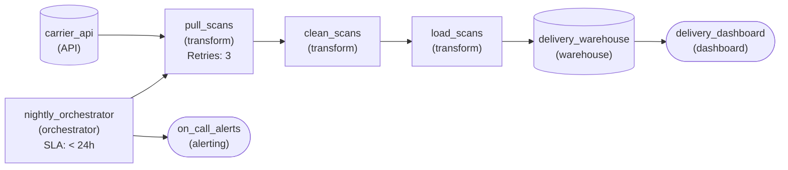

*One nightly run: the orchestrator starts `pull_scans`, the tasks follow in dependency order, and a final failure pages on-call.*

1. **Schedule the DAG, not each task**

   `nightly_orchestrator` fires once a night and creates the run. The three tasks have no clock of their own: `clean_scans` starts when `pull_scans` finishes, and `load_scans` when `clean_scans` finishes. A slow pull just delays everything behind it instead of letting cleaning start on a half-pulled night.

2. **Retry the task that actually fails**

   Only the carrier API times out, so the retry policy sits on `pull_scans` with up to 3 attempts. Because the orchestrator tracks dependencies, a retried pull still holds cleaning back until it succeeds, and a timeout that clears on the second try costs a few minutes instead of the morning numbers.

| Pitfall: A retry loop inside the script is invisible |
| --- |
| The tempting fix is a loop in the pull code that tries three times. It works until the third attempt fails: the orchestrator sees one long task, no attempt is recorded, and nobody is told. A task-level retry policy makes each attempt an event the run can count, show and react to. |

| Key insight: Visibility means a failure reaches a person |
| --- |
| A red box in a UI only helps whoever happens to look. The edge from `nightly_orchestrator` to `on_call_alerts` turns a final failure into a page before the dashboard is opened, which is the point of the fourth responsibility. |

**Follow-up questions**

1. Finance also wants a carrier-cost table built from the cleaned scans. Where does that task hang in the DAG?\
   *Fanning out from a shared upstream task under one schedule instead of adding a second clock.*
2. What would make a retried pull load the same scans twice?\
   *Why retries depend on the work being safe to run more than once.*

 

### Exercise 10 of 11

**● TASK**

A subscription business needs revenue by plan per day, built nightly from the payments table in its MySQL billing database. Design it as an orchestrated DAG of three tasks: extract the day's payments, clean and standardize them, then aggregate them into a warehouse summary table with one row per plan per day. The DAG runs once a day at 3:00 UTC, each task waits for the one before it, and every task retries twice before the run fails.

<strong>Solution</strong>

#### One schedule on the DAG, order on the edges

What you drew is a DAG in its simplest useful form: a straight chain. Each edge exists because the downstream task reads what the upstream one wrote, so clean depends on extract and aggregate depends on clean. The schedule belongs to the DAG, not to the tasks: at 3:00 UTC the orchestrator creates a run, sees that extract is the only task with nothing upstream, and starts it. Everything after that is triggered by completion, not by the clock.

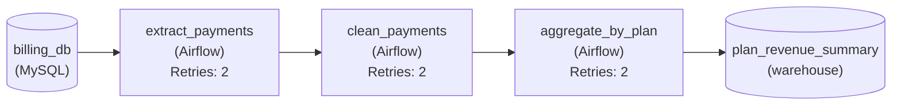

*`billing_db` feeds `extract_payments`, then `clean_payments`, then `aggregate_by_plan`, which writes `plan_revenue_summary`. Each task retries twice.*

1. **Draw each edge from what a task reads**

   Ask of every task: whose output does it read? `clean_payments` reads only what `extract_payments` wrote, and `aggregate_by_plan` reads only what `clean_payments` wrote. That gives two edges, three tasks and no cycle. A task with no edge into it may start the moment the run begins, so a missing edge is a race.

2. **Give every task the same retry setting**

   In code the section used `default_args` so one retry policy applies to all three tasks at once. On the canvas that is the same retry count on each task node. A retry reruns one task, not the whole chain: if the database blips during extract, extract tries again and clean simply waits.

| Pitfall: A clock time per task is cron with extra steps |
| --- |
| The tempting version schedules extract at 3:00, clean at 3:20 and aggregate at 3:40. That guesses durations instead of declaring order, and on a slow night clean reads a half-written extract. One schedule on the DAG plus edges between tasks removes the guess. |

**Follow-up questions**

1. Finance also wants the summary by country. Where does a second aggregate task attach?\
   *Fan-out: both aggregates read the cleaned rows and can run side by side.*
2. Extract fails all three attempts. What do clean and aggregate do on that run?\
   *Downstream tasks never start when the task they depend on has failed.*

 

### Exercise 11 of 11

**● TASK**

Each night a mobile game's match logs are pulled from the game API and cleaned, then joined with player accounts from PostgreSQL to compute day-one retention into a warehouse table the retention dashboard reads. The draft DAG also draws an edge from the retention task back to the cleaning task so cleaning can drop flagged bots, which forms a cycle. Redraw it as a valid DAG run by one orchestrator that starts it daily at 3am, retries a failed task, and alerts on-call when a run fails.

<strong>Solution</strong>

#### A DAG has a first task and a last task

A directed acyclic graph means the arrows only go forward. The draft edge from `compute_retention` back to `clean_matches` broke that rule: cleaning waited on retention, and retention waited on cleaning, so neither could start. An orchestrator rejects a graph like that before it ever schedules a run. Once the loop is gone, the 4 orchestrator jobs from the lesson each have one clear place on the canvas.

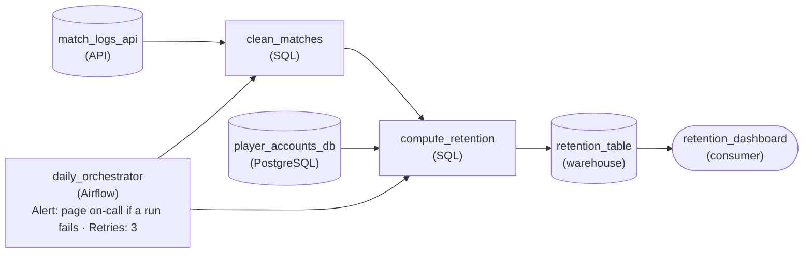

*Every arrow points forward. `daily_orchestrator` starts the run at 3am, triggers `clean_matches` and then `compute_retention`, retries a failed task, and pages on-call.*

1. **Delete the back edge, move the filter**

   Bot flags only matter for the retention numbers, so `compute_retention` drops flagged players itself. Cleaning no longer needs anything from a later task, and the edge from `compute_retention` to `clean_matches` simply goes away.

2. **Give each orchestrator job a home**

   When: Airflow starts the run daily. In what order: the edges, so `clean_matches` finishes before `compute_retention` begins. Retries: `retryCount` set to 3 on the orchestrator. Showing what happened: the `monitorAlert` that pages on-call when a run fails.

| Pitfall: A feedback arrow is not a dependency |
| --- |
| Drawing retention back into cleaning feels natural because the information really does flow that way. But a dependency edge means 'must finish first', and 2 tasks cannot each finish before the other. If cleaning truly needed bot flags, it would read the flags a previous night's run already stored, never today's unfinished task. |

| Key insight: Yesterday's output is an input, not an edge |
| --- |
| Loops across days are fine; loops inside one run are not. Last night's `retention_table` can be read like any other source, because it already exists before tonight's run starts. That is how recommendation models, bot lists and running totals feed themselves without a cycle. |

**Follow-up questions**

1. A geo-IP lookup file now has to feed retention by country. Where does it attach?\
   *Adding a new upstream dependency without creating a cycle or a second schedule.*
2. Cleaning fails three times in a row. What does the orchestrator do with `compute_retention` that night?\
   *How retries and dependency tracking work together: a downstream task never runs on a failed upstream.*

