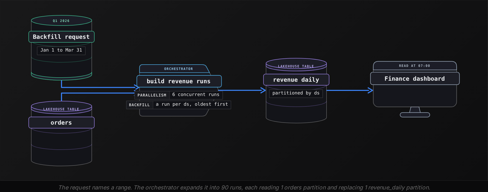
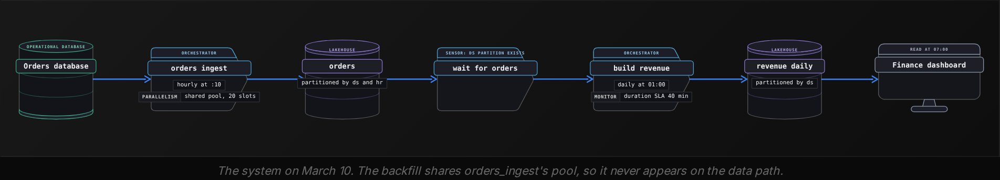

Advanced·Pipeline Architecture · 40 min · 11 challenges

# Orchestration: Advanced

Take the Airbnb team that owns nightly booking revenue. A bug fix lands at 16:00 that changes how cleaning fees are counted, and the last 30 days need recomputing before finance reads them at 07:00 tomorrow. The same warehouse runs the 01:00 loads behind host payouts. How the orchestrator schedules, limits and watches those 30 reruns decides whether anyone gets paged tonight.


<br>

---

## Asset vs Task Orchestration

Every DAG you have built so far is task-based. The orchestrator stores tasks, the edges between them, and runs: `build_revenue` ran for logical date 2026-02-09 and succeeded at 01:22. It stores nothing about the table that task wrote. The only record of which task feeds which table is the SQL and the memory of whoever wrote it.

An asset-based orchestrator keeps the books the other way round. You declare assets, the tables, files or models a pipeline produces, and for each one the assets it is computed from. The orchestrator then records materializations: asset `orders`, partition 2026-02-09, written at 00:40 by code version a91f. Tasks still execute underneath, but the graph the orchestrator reasons about connects data, and it keeps state per partition.


<br>

### The same pipeline, stored 2 ways

Task-based: what is stored

| Record | Value |
| --- | --- |
| DAG | revenue_pipeline |
| Run | 2026-02-09, success |
| Task | wait_for_orders, success at 01:00 |
| Task | build_revenue, success at 01:22 |
| Edge | wait_for_orders to build_revenue |

Asset-based: what is stored

| Record | Value |
| --- | --- |
| Asset | orders, daily partitions |
| Asset | revenue_daily, daily partitions |
| Dependency | revenue_daily reads orders |
| Materialization | orders 2026-02-09 at 00:40 |
| Materialization | revenue_daily 2026-02-09 at 01:22 |

```sql
with DAG("revenue_pipeline", schedule="0 1 * * *") as dag:
    wait_for_orders = PartitionSensor("wait_for_orders", table="orders", partition="yesterday")
    build_revenue = SqlTask("build_revenue", sql="build_revenue.sql")
    wait_for_orders >> build_revenue
```

```sql
daily = DailyPartitions(start="2026-01-01")


@asset(partitions=daily)
def orders(partition):
    run_sql("load_orders.sql", ds=partition)


@asset(partitions=daily, deps=[orders])
def revenue_daily(partition):
    run_sql("build_revenue.sql", ds=partition)
```

The SQL inside both versions is identical. What differs is which questions the orchestrator can answer without a person reading code.


<br>

### What changes for the person on call

| Question | Task-based | Asset-based |
| --- | --- | --- |
| Is revenue_daily for February 9 current? | Find the DAG that writes it, then inspect its February 9 run | Read the latest materialization of that partition |
| The orders logic changed. What is stale now? | Search the code for everything that reads orders | List downstream partitions built from an older orders version |
| Another team needs orders | They add a sensor on your DAG's runs, tied to your schedule | They depend on the orders asset, whichever run produces it |
| Rebuild Q1 | Rerun 90 DAG runs with every task in each | Materialize 90 partitions of only the assets named |

The third row matters most once several teams share tables. In the intermediate lesson, a downstream DAG waited on an upstream DAG's run through a sensor, which silently encodes the upstream schedule and what a successful run used to mean. An asset dependency names the data instead, so the upstream team can change when and how often `orders` is built without breaking the consumer. Section 4 takes apart an incident that turned on this difference.


<br>

### What asset orchestration costs

> The price of tracking data
>
> - Every write must be declared. A task that writes 2 tables but declares 1 leaves the graph wrong, and people trust a wrong graph.
> - Work that produces no table fits poorly: emailing a report, calling a partner API, rotating a credential.
> - Partitions must be mapped. Hourly orders feeding a daily rollup needs an explicit rule tying 24 hourly partitions to 1 day.
> - Migration costs real effort: every existing task is reworked into 1 or more assets, and every sensor into a dependency.


<br>

### Picking a model

| ✓ Task-based fits when | ✗ Asset-based fits when |
| --- | --- |
| • The pipeline is a sequence of actions: export, upload, notify<br><br>• A single team owns the whole graph end to end<br><br>• Outputs are effects in other systems rather than tables anyone queries<br><br>• The graph is small and rarely changes shape | • Many teams build tables on top of each other's tables<br><br>• People keep asking whether a table is current<br><br>• Backfills of specific partitions are routine work<br><br>• Upstream cadences change and consumers should not need to care |

> **TIP**
>
> Many platforms run both: assets for the shared table graph, and task DAGs for operational jobs such as exports and notifications, with a task DAG triggered whenever a given asset materializes.

**A team owns a nightly job that exports yesterday's invoices to a partner's file server, then emails a confirmation, and no other job reads the export. The team also owns 40 shared tables used by 5 other teams, who keep asking whether those tables are current. Which arrangement fits?**

- **A.** Assets for both, so the export gets the same partition tracking as the 40 tables
- **B.** Assets for the 40 shared tables, and a task DAG for the export and email
- **C.** Task DAGs for both, with sensors so the 5 teams can wait on the right runs
- **D.** Task DAGs for the tables, and an asset for the export because the partner has a deadline

<details>
<summary>Solution</summary>

**B.** Assets for the 40 shared tables, and a task DAG for the export and email

Many consumers ask whether the tables are current, which assets answer directly. The export is a chain of actions, which a task DAG models well.

**Why the others are wrong**

- **A.** The export produces no table anyone queries, so wrapping it as an asset adds bookkeeping that answers nothing.
- **C.** Sensors tie each consuming team to the producer's schedule and still cannot say whether a partition is current.
- **D.** This inverts the fit. Either model can watch a deadline; what decides is whether the output is a shared table.

</details>


<br>

---

## Backfills as First-Class Operations

A backfill recomputes past partitions: a bug fix changes how revenue is summed, a new column needs history, or a source resends February. Whether a 90-day backfill takes an afternoon or a week of cleanup depends on 3 properties of the task, all set when it was first written.

A backfillable task

- **Reads its date from the run** *Parameterized*\
  Every date in the query comes from the run's logical date. Launched for February 9 in October, it computes February 9.
- **Writes only its own partition** *Partition-scoped*\
  A run for February 9 replaces February 9 and touches no other date, so many dates can be rebuilt side by side.
- **Runs as an orchestrator backfill** *Managed*\
  The orchestrator expands a date range into dated runs, caps how many run at once, and lists the dates that failed.


<br>

### The clock inside the query

```sql
INSERT INTO revenue_daily
SELECT
  ds,
  sum(amount_usd) AS revenue_usd,
  count(*) AS order_count
FROM orders
WHERE ds = current_date - INTERVAL '1' DAY
GROUP BY ds
```

On schedule, `current_date - INTERVAL '1' DAY` equals the logical date, so the bug can hide for months. Launch a 30-day backfill ending February 9 on February 20 and every run in it computes February 19 and appends it: `revenue_daily` gains 30 more February 19 rows, and the 30 dates you meant to fix stay as they were.

The fix takes the date from the run instead of the clock, and clears the target partition before writing it:

```sql
DELETE FROM revenue_daily
WHERE ds = DATE '2026-02-09'
```

```sql
INSERT INTO revenue_daily
SELECT
  ds,
  sum(amount_usd) AS revenue_usd,
  count(*) AS order_count
FROM orders
WHERE ds = DATE '2026-02-09'
GROUP BY ds
```

Both statements name the run's date and no other. Because `revenue_daily` is partitioned by `ds`, the delete drops 1 partition and the insert fills it, so each run's work scales with 1 day of data. A run for February 10 never touches February 9, which lets several dates run at once. Between the 2 statements a reader sees February 9 empty; tables that can overwrite a partition in a single commit close that gap.


<br>

### Let the orchestrator own the range

A shell loop that calls the job 90 times works until day 47 fails at 03:00 and nobody knows which days finished. An orchestrator backfill takes a DAG and a date range, creates 1 run per logical date, runs them under the DAG's limits, and records each outcome, so 2 failed dates mean rerunning 2 dates.




<br>

### Choosing concurrency

Each `build_revenue` run takes around 12 minutes on a quiet warehouse, and Q1 2026 holds 90 dates. Concurrency trades wall-clock time against the load you add beside production:

- **18 h** — Q1 at 1 run at a time
- **3 h** — Q1 at 6 runs at a time

Past the point where the warehouse saturates, more concurrent runs stop shortening the backfill: each query slows, and the nightly jobs on the same warehouse slow with them. Size concurrency from the headroom the warehouse has beside production, the number section 3 turns into a pool.

#### Tables that must run oldest date first

Some tables read their own previous partition. `customer_lifetime_value` for February 9 is the February 8 value plus February 9's orders. Backfill such a table at concurrency 1, oldest date first. At 6, the February 9 run can read a February 8 partition the backfill has not rebuilt yet and carry the old logic forward.

| ✓ Do | ✗ Don't |
| --- | --- |
| • Read every date from the run's logical date<br><br>• Clear or overwrite exactly the partition the run owns<br><br>• Launch backfills through the orchestrator so failed dates are listed<br><br>• Run tables that read their own prior partition at concurrency 1 | • Call current_date or now() inside a transform<br><br>• Append rows without clearing the target date first<br><br>• Loop over dates in a shell script<br><br>• Backfill a table before the inputs it reads are rebuilt |

**The orchestrator substitutes each run's logical date wherever 2026-02-09 appears in this query. A 30-day backfill of it runs at concurrency 6. What does daily_active_users hold for those 30 dates afterwards?**

```sql
INSERT INTO daily_active_users
SELECT
  DATE '2026-02-09' AS ds,
  count(DISTINCT user_id) AS dau
FROM events
WHERE event_ts >= current_timestamp - INTERVAL '24' HOUR
```

- **A.** A correct row per date, since each run labels its output with its own ds
- **B.** Only the old rows, because INSERT fails when a row for that ds already exists
- **C.** Correct counts, but only once concurrency is lowered to 1 so runs stop overlapping
- **D.** An extra row on each date, every new one counting the 24 hours before the backfill ran

<details>
<summary>Solution</summary>

**D.** An extra row on each date, every new one counting the 24 hours before the backfill ran

The ds comes from the run, but the WHERE clause reads the clock and nothing clears the old row, so each date keeps its old row and gains a copy of the same recent count.

**Why the others are wrong**

- **A.** The label is right, but the filter reads the 24 hours before the backfill ran, so every row counts the same recent day.
- **B.** Nothing in this table rejects a second row for a ds. The insert succeeds and adds a row beside the old one.
- **C.** Lowering concurrency changes nothing here: at 1, every run still filters on the time the backfill ran.

</details>


<br>

---

## SLAs at the Orchestrator Level

An orchestrator-level SLA is a condition the orchestrator checks against every run: a task finishes within so many minutes of starting, or a partition exists by a set time. When it fails, the orchestrator alerts while the run is still in progress, so the first person to hear about a late table is an engineer who can still fix it.


<br>

### Duration SLAs and deadline SLAs

| SLA type | Declared on | Fires when | Catches |
| --- | --- | --- | --- |
| Duration | A task | A run is still going N minutes after the task started | A slow query: a bad plan, skewed data, a busy warehouse |
| Deadline | A DAG run or an asset partition | The output is not complete by a clock time | Any cause of lateness, including steps that never started |

A duration SLA starts its clock when the task starts, so a task that never starts never breaches it. A deadline SLA is pinned to the wall clock and catches every cause of lateness at once: a slow query, a failing upstream step, a run stuck in a queue. Declare deadlines on what consumers read, and durations where you want an early hint.


<br>

### Thresholds from run history

A threshold picked by feel is usually wrong in 1 of 2 directions. Orchestrators keep a table of every task run, so the real distribution is a query away. This one reads 60 days of successful runs:

```sql
SELECT
  task_id,
  COUNT(*) AS runs,
  APPROX_PERCENTILE(DATE_DIFF('minute', start_ts, end_ts), 0.5) AS p50_min,
  APPROX_PERCENTILE(DATE_DIFF('minute', start_ts, end_ts), 0.95) AS p95_min,
  APPROX_PERCENTILE(DATE_DIFF('minute', start_ts, end_ts), 0.99) AS p99_min
FROM task_runs
WHERE task_id IN ('load_orders', 'build_revenue')
  AND state = 'success'
  AND logical_date BETWEEN DATE '2026-01-01'
  AND DATE '2026-03-01'
GROUP BY task_id
```

| task_id | runs | p50_min | p95_min | p99_min |
| --- | --- | --- | --- | --- |
| load_orders | 60 | 24 | 33 | 52 |
| build_revenue | 60 | 22 | 31 | 48 |

Half the `build_revenue` runs finish within 22 minutes, 1 in 20 runs past 31, and the p99 night took 48. The slow nights cluster on the 1st of each month, when the query also rebuilds month-to-date totals. A 25-minute threshold sits between p50 and p95, so it fires on ordinary nights and gets muted. A 90-minute threshold sits above every night in the history and fires after the damage is done.

Set the duration SLA a margin above p95, 25 percent here. When the history is bimodal, add a second, higher threshold for month-start runs rather than 1 number that is too tight for them and too loose for every other night. For the deadline, work back from the consumer: finance reads `revenue_daily` at 07:00, and on-call needs enough time to rerun a failed step and its downstream.

- **40 min** — duration SLA on build_revenue
- **05:00** — deadline SLA on revenue_daily
- **2 h** — on-call window before 07:00


<br>

### Alerts that say what to do next

Route each alert to the team that owns the step that is late or blocking, which is often upstream of the asset that missed. The revenue team gets a notice, and the orders-platform team gets the page when `orders` is what holds everything up. Then put into the alert what the responder would otherwise spend 20 minutes finding:

```sql
{
  "alert": "deadline_sla_missed",
  "asset": "revenue_daily",
  "partition": "2026-04-14",
  "deadline": "2026-04-15T05:00:00Z",
  "consumer_reads_at": "2026-04-15T07:00:00Z",
  "state": "waiting on upstream",
  "blocked_on": {
    "asset": "orders",
    "partition": "2026-04-14, hr 23",
    "state": "failed 3 attempts: source connection refused",
    "owner": "orders-platform"
  },
  "route_to": "orders-platform on-call",
  "notify": "revenue team channel",
  "deadlines_missed_last_60_days": 0,
  "logs": "https://orchestrator.internal/runs/orders/2026-04-14"
}
```

> Every SLA alert carries
>
> - The asset or task and partition that is late
> - Its deadline, and when the consumer actually reads it
> - What it waits on now: queued, running, failed or never started
> - The owner of the blocking step, who receives the page

**build_revenue carries a 40-minute duration SLA, and revenue_pipeline has no deadline SLA. On February 12, load_orders fails at 00:35 and keeps failing until 06:40, so wait_for_orders waits. What does the orchestrator report about build_revenue before finance reads at 07:00?**

- **A.** Nothing, because the task has not started and its 40-minute clock has not begun
- **B.** A duration breach at 01:40, 40 minutes after the DAG run began at 01:00
- **C.** A deadline breach at 07:00, since finance reads revenue_daily at that time
- **D.** A duration breach on load_orders, since it has been failing for over 40 minutes

<details>
<summary>Solution</summary>

**A.** Nothing, because the task has not started and its 40-minute clock has not begun

A duration SLA measures from the task's own start. An upstream failure keeps the task waiting, and no duration rule can see that.

**Why the others are wrong**

- **B.** The SLA is declared on the task, so its clock starts when build_revenue starts, which has not happened by 07:00.
- **C.** No deadline SLA is declared. The orchestrator checks the conditions it was given, and nobody gave it 07:00.
- **D.** The 40-minute SLA belongs to build_revenue alone, and load_orders has no SLA of its own to breach.

</details>


<br>

---

## Concurrency, Pools, and Priority

One warehouse serves the 01:00 production loads, a year-long backfill and analysts' scheduled notebooks. It runs roughly 20 queries at once before every query starts to slow. The orchestrator will launch 200 tasks at once if they are ready, so something in its configuration has to decide which 20 run and which wait.


<br>

### Four limits and their scopes

| Setting | Scope | Answers |
| --- | --- | --- |
| Max active runs | 1 DAG | How many dated runs of this DAG may be in progress at once, such as backfill runs |
| Max active tasks | 1 DAG | How many of this DAG's tasks may run at once, across all its runs |
| Pool | Every task assigned to it, in any DAG | How many slots a shared resource offers, whoever asks |
| Priority weight | 1 task | Which queued task takes the next free slot in its pool |

The first 2 settings are DAG-level and know nothing about other DAGs: 10 DAGs each capped at 4 tasks still send 40 queries. A pool is the only limit that counts across DAGs for 1 named resource; an instance-wide task cap spans DAGs too, but cannot tell warehouse queries from anything else. Name a pool after the resource it protects, give it as many slots as the resource tolerates, and assign it to every task that uses the resource. A task that is ready but finds its pool full waits in that pool's queue.


<br>

### Splitting 20 slots across 3 pools

```sql
pools:
  wh_prod:
    slots: 11
  wh_backfill:
    slots: 6
  wh_adhoc:
    slots: 3
```

A single pool of 20 would let an uncapped backfill take all 20. Split 3 ways, the backfill never holds more than 6 slots, and production always has 11 that nothing else can take. The price is idle capacity: at 04:00 production has finished and its 11 slots sit empty while backfill tasks wait, which many teams accept as the cost of the guarantee.

```sql
tasks:
  load_orders:
    pool: wh_prod
    priority_weight: 10
  build_revenue:
    pool: wh_prod
    pool_slots: 2
    priority_weight: 10
  refresh_marketing_attribution:
    pool: wh_prod
    priority_weight: 3
  sessions_daily_backfill:
    pool: wh_backfill
    priority_weight: 1
```

Setting `pool_slots: 2` makes `build_revenue` count double, because a slot counts a task and a 22-minute rollup weighs more on the warehouse than a 2-second lookup. Priority weight orders the queue: when `wh_prod` is full, the waiting task with the highest weight takes the next free slot. Some orchestrators give each task an effective weight equal to its own weight plus the weights of every task downstream of it, so a load that 8 tables wait on outranks a report nobody waits on.


<br>

### Priority orders a queue, pools reserve capacity

Priority acts only when a slot frees up. A backfill task that is already running keeps its slot for its full 12 minutes, whatever its weight. Under a steady stream of high-weight work, low-weight tasks can wait indefinitely. Use pools to guarantee capacity to a workload, and priority to order tasks that share 1 pool.

| ✓ Shared pool of 20 slots | ✗ Pools of 11, 6 and 3 |
| --- | --- |
| • At 23:30, an uncapped 365-day backfill fills all 20 slots<br><br>• At 01:00, build_revenue queues behind backfill tasks of 12 minutes each<br><br>• Priority 10 wins each slot that frees, but slots free slowly<br><br>• Analyst notebooks stand in the same queue as finance's loads | • At 23:30, the backfill holds 6 slots and its other runs wait<br><br>• At 01:00, build_revenue starts at once in wh_prod<br><br>• Analyst notebooks wait in wh_adhoc and slow nothing else<br><br>• The backfill finishes later; production finishes at its usual time |

> **TIP**
>
> Size each pool below the point where the warehouse starts queuing queries internally, then watch how long tasks wait in each pool. Long waits in `wh_prod` while `wh_backfill` idles mean the split is wrong; long waits everywhere mean the warehouse is too small.

**Production DAGs and a 365-day backfill share 1 pool of 20 slots. Production tasks carry priority 10 and backfill tasks priority 1, yet nightly loads finish 2 hours late while the backfill runs. Which change fixes it?**

- **A.** Raise production priority to 100 so it outranks the backfill by a wider margin
- **B.** Grow the pool to 40 slots so both workloads fit at the same time
- **C.** Move the backfill to its own 6-slot pool and production to its own 11-slot pool
- **D.** Set production's max active runs to 1 so its own runs stop competing

<details>
<summary>Solution</summary>

**C.** Move the backfill to its own 6-slot pool and production to its own 11-slot pool

Production gets 11 slots nothing else can hold, and the backfill can never exceed 6, so the queue that delayed the loads disappears.

**Why the others are wrong**

- **A.** Only the order of weights matters, and production already comes first. Running backfill tasks still hold their slots.
- **B.** The warehouse slows past about 20 concurrent queries. Forty slots sends it 40, and every query, production included, slows down.
- **D.** The delay comes from backfill tasks in the shared pool, and this setting only limits production's own runs.

</details>


<br>

---

## Postmortem: Cadence Change Bug

At 07:00 on March 10, finance read $4.1M of revenue for March 9. The correct figure, recomputed after 10:30, was $4.6M. Every task in every DAG had succeeded and no alert had fired. The causes sat in 4 separate layers, and none of them alone would have produced the wrong number.


<br>

### The setup

The orders-platform team owns `orders_ingest`, which loads the orders database into `orders`. Until March 2 it ran daily at 00:15 and committed all of yesterday in 1 write around 00:40. The revenue team owns `revenue_pipeline`, which starts at 01:00: its sensor `wait_for_orders` passes once an `orders` partition exists for yesterday's `ds`, then `build_revenue` writes `revenue_daily` from the revenue team's own small pool. Its 40-minute duration SLA is the only SLA in the system.




<br>

### Timeline

| When | What happened |
| --- | --- |
| March 2 | orders_ingest switches to hourly runs at :10, each loading the previous hour into orders, now partitioned by ds and hr |
| March 9, 21:30 | An uncapped 365-day backfill of sessions_daily starts in the shared 20-slot warehouse pool, queuing over 300 tasks |
| March 9, 22:10 | The run loading hour 21 queues behind them at equal priority; the 23:10 and 00:10 runs join it |
| March 10, 01:00 | wait_for_orders finds ds=2026-03-09 present and passes at once |
| March 10, 01:22 | build_revenue succeeds inside its SLA and writes $4.1M for March 9 |
| March 10, 03:40 | Hours 21 to 23 land in orders, and nothing reruns build_revenue |
| March 10, 07:00 | Finance reads $4.1M while every orchestrator view shows green |
| March 10, 10:30 | Finance escalates, and a manual rerun of build_revenue writes $4.6M |


<br>

### Layer by layer

#### The seam: a sensor that encoded a cadence

Under the daily schedule, the whole day landed in 1 commit, so a partition existing meant the day was complete. Hourly loading made `ds=2026-03-09` appear at about 01:10 on March 9, nearly a full day before it was complete. Nothing in the sensor's code mentioned cadence, so it kept passing. For a week the hour-23 load happened to finish by about 00:25, before 01:00, which hid the bug.

#### The contract: completeness nobody owned

Nobody had written down when a day of `orders` is complete. The revenue team inferred it from the old schedule, and orders-platform announced the change as 'orders is now hourly and fresher' without knowing who relied on the daily boundary. In freshness-tier terms the node moved from a daily tier to an hourly one, and the promise its consumer used, that day D is whole before 01:00 on D+1, vanished with no owner to notice.

#### The pool: a cadence that multiplied exposure

`orders_ingest` ran in the shared 20-slot `warehouse` pool at the same priority as everything else in it. A single load at 00:15 rarely met evening work. Twenty-four loads a day meant several always overlapped whatever ran in the evening, and on March 9 that was a backfill whose queued tasks stood ahead of the 22:10, 23:10 and 00:10 loads.

#### The SLA: green on a partial day

`build_revenue` ran for 22 minutes, well inside its 40-minute duration SLA, so the 1 signal that existed was green. No SLA anywhere watched `orders`, the asset that was actually late, and no check compared what `build_revenue` read with what a full day holds.

**Which single signal would have reached a human before finance read the wrong number at 07:00?**

- **A.** A tighter duration SLA on build_revenue, such as 25 minutes
- **B.** A deadline SLA on orders for March 9 at 00:45, routed to orders-platform
- **C.** A deadline SLA on revenue_daily at 05:00, routed to the revenue team
- **D.** A longer timeout on wait_for_orders so the sensor waits for more data

<details>
<summary>Solution</summary>

**B.** A deadline SLA on orders for March 9 at 00:45, routed to orders-platform

At 00:45 hours 21 to 23 were still queued, so orders-platform would have been paged with over 6 hours to act.

**Why the others are wrong**

- **A.** build_revenue ran for 22 minutes, so 25 stays green. The task was fast; its inputs were incomplete.
- **C.** revenue_daily was written at 01:22, so this deadline passes green. It checks when the table was written and ignores what went into it.
- **D.** The sensor passed at once because its condition was already true, and a longer timeout never changes a condition that passes.

</details>


<br>

### The redesign

| Layer | Before | After |
| --- | --- | --- |
| Seam | Sensor passes when any orders partition for the day exists | revenue_daily for day D depends on all 24 hourly orders partitions for D |
| Contract | Unwritten, inferred from the old daily schedule | Published by orders-platform: day D complete by 00:45 on D+1, with cadence changes reviewed against it |
| Pool | Hourly loads share an uncapped 20-slot pool with backfills at equal priority | wh_prod 11, wh_backfill 6, wh_adhoc 3, with production loads at priority 10 |
| SLA | Duration SLA on build_revenue only | Deadline SLAs: orders at 00:45 paging orders-platform, revenue_daily at 05:00 paging the revenue team |

The pool fix removes this night's trigger. The seam and contract fixes turn any future delay into a late number instead of a wrong one, and the SLA fix tells a person before finance notices. On assets, the dependency also marks `revenue_daily` for day D stale when hours of D land after it was built, and with an automatic-rebuild policy on `revenue_daily` the orchestrator rebuilds it: on March 10 that alone would have replaced the wrong figure with a correct one at roughly 04:05.

**Suppose the team had fixed only the pool layer. Which failure can still reach finance?**

- **A.** None, because hourly loads can no longer queue behind a backfill in a shared pool
- **B.** The backfill, now capped, starves build_revenue at 01:00 instead of the hourly loads
- **C.** Revenue arrives correct but after 07:00, because production now has fewer slots than before
- **D.** A source export runs 2 hours late, the sensor passes on a partial day, and SLAs stay green

<details>
<summary>Solution</summary>

**D.** A source export runs 2 hours late, the sensor passes on a partial day, and SLAs stay green

The seam, contract and SLA layers are untouched, so any late hour, whatever its cause, still flows into revenue_daily unnoticed.

**Why the others are wrong**

- **A.** Queuing was 1 cause of a late hour. A slow source or a failing load still causes one, and nothing else changed.
- **B.** The backfill is held to 6 slots in wh_backfill, so it cannot take capacity from any production task.
- **C.** Production now holds 11 slots it never shares, which is more than the hourly loads could get on March 9.

</details>


<br>

---

## Putting It All Together

At 16:00 the Airbnb revenue team merges its cleaning-fee fix. Thirty days of revenue_daily must be rebuilt before finance reads at 07:00, on the warehouse that also runs the 01:00 production loads, while orders arrives hourly from another team.

- revenue_daily is an asset with daily partitions, so the code change flags every partition the old code version built as stale; the orchestrator names exactly which ones, and the team materializes the last 30 from that list now.
- Each run takes its ds from the run and replaces only that partition, so the 30 runs can overlap.
- The backfill runs in wh_backfill at 6 slots: 30 runs of 12 minutes finish in about an hour, while the 01:00 loads keep their 11 slots in wh_prod.
- Deadline SLAs, 00:45 on orders and 05:00 on revenue_daily, page the owner of whichever step stalls, with the blocking partition named in the alert.
- Because revenue_daily depends on all 24 hourly orders partitions under a published contract, an upstream cadence change cannot hand it a partial day.


<br>

---

## Key Takeaways

- Task-based orchestrators record runs; asset-based ones record which data partitions exist and how current they are, so freshness, staleness and cross-team dependencies become questions the orchestrator answers.
- A backfillable task takes its date from the run, replaces only its own partition, and runs as an orchestrator backfill at a concurrency the warehouse can absorb beside production.
- Deadline SLAs on what consumers read catch every cause of lateness; set duration thresholds a margin above p95 of run history, and page the owner of the blocking step with its state in the alert.
- Pools are the only limit that spans DAGs for 1 named resource: give each workload its own pool on a shared resource, and use priority to order tasks inside a pool.
- A dependency on a run, or on a partition merely existing, encodes the producer's cadence; when the cadence changes, it can keep passing on incomplete data.

Exercises for this lesson: [_exercises/pa_orchestration_advanced.md](_exercises/pa_orchestration_advanced.md)
