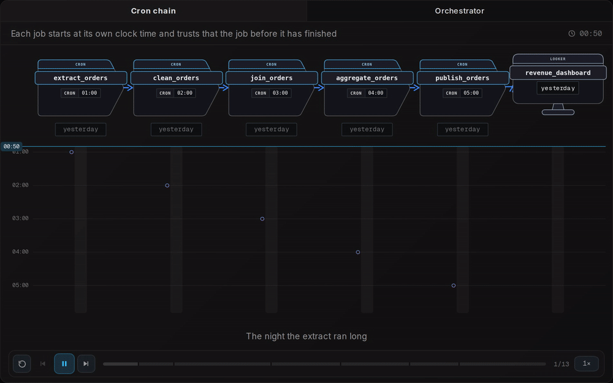
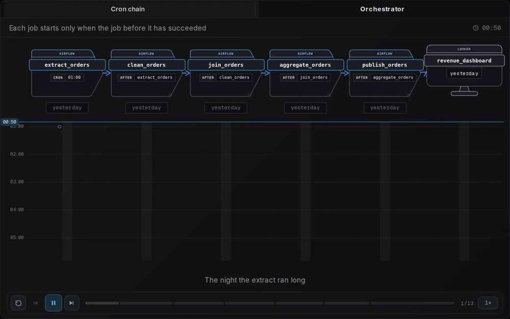
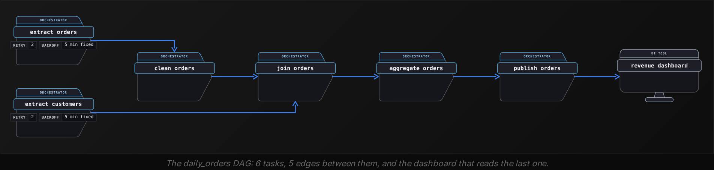

Beginner·Pipeline Architecture · 25 min · 11 challenges

# Orchestration: Beginner

At Airbnb, a nightly cron chain turns yesterday's bookings into the host payouts report finance reads at 8am. Tonight the bookings extract runs 50 minutes long. Every downstream job still fires on its clock time and reads a bookings table the extract has not refreshed. The report lands on time and looks complete, and it is wrong. Whether anyone notices depends on one design choice: clock or dependency.


<br>

---

## Why Cron Is Not an Orchestrator

### A schedule is a list of start times

Cron is a program that lives on a server and starts a command at a clock time. A cron entry has 2 parts: when, written as 5 time fields, and what, the command to run. That is the whole contract. Cron does not read the command's output, does not wait for it to finish, and does not know that the entry on the next line depends on the one above.

A nightly orders pipeline built on cron looks like 5 entries in 1 file. Each entry starts an hour after the previous one, because an hour is longer than any of these jobs has ever taken.

| Clock time | Cron fields | Job | Usual duration |
| --- | --- | --- | --- |
| 01:00 | 0 1 \* \* \* | extract_orders | 40 min |
| 02:00 | 0 2 \* \* \* | clean_orders | 20 min |
| 03:00 | 0 3 \* \* \* | join_orders | 15 min |
| 04:00 | 0 4 \* \* \* | aggregate_orders | 10 min |
| 05:00 | 0 5 \* \* \* | publish_orders | 5 min |

The hour-long gaps are a guess about durations, and the guess holds until the first night it does not.

**Cron chain**



**Orchestrator**




<br>

### Reading the night step by step

Play the cron chain variant. extract_orders starts at 01:00 as always, but a slow source database stretches it to 1h47m, so it finishes at 02:47. At 02:00, clean_orders starts on schedule and reads the extract table, which still holds yesterday's rows because tonight's have not been written yet. It cleans yesterday's data and writes the result with tonight's timestamp. At 03:00 join_orders reads that fresh-looking table, at 04:00 aggregate_orders rolls it up, and at 05:05 publish_orders hands the revenue dashboard yesterday's revenue under today's date.

Every job exited with status 0, and no log line says error. The number on the dashboard is plausible, because yesterday's revenue looks a lot like today's. This is the canonical cron failure: the chain runs to completion on stale input, and the first sign of it is a question from finance 3 days later.

Now play the orchestrator variant. clean_orders has no clock time of its own; its trigger is the success of extract_orders. It waits until 02:47, runs for 20 minutes, and join_orders starts at 03:07. The chain finishes at 03:37, 1h28m earlier than the cron chain managed, and every table it wrote holds today's rows.


<br>

### Failure modes of a cron chain

> The cron chain fails in 3 shapes
>
> - Late: an upstream job overruns its slot, and every downstream job processes the previous run's output as if it were new.
> - Failed: an upstream job crashes at 01:10 without alerting anyone, and the 4 jobs after it run anyway on whatever the table held.
> - Invisible: when the dashboard is questioned, the evidence is 5 log files on 1 server with no record of which run fed which.


<br>

### What an orchestrator adds

An orchestrator keeps the clock time and adds a graph. Its jobs are now called tasks, and it stores the edges between them under 1 rule: a task starts when the tasks it depends on have all succeeded. It retries a task that fails, and it keeps a record of every run, so the question of what fed the 2026-10-22 dashboard has an answer. Cron supplies the clock and none of the rest.

| ✓ Cron knows | ✗ An orchestrator knows |
| --- | --- |
| • The current time<br><br>• The command on this line<br><br>• Nothing about the line above or below | • The current time and the schedule<br><br>• Which tasks this task depends on<br><br>• Whether those tasks succeeded, and when<br><br>• How many times to retry a failure<br><br>• The history of every run |

*Cron is still the right tool for 1 job with no dependents, such as rotating a log file. The trouble starts at the second line that reads what the first line wrote.*

> **TIP**
>
> A quick test for whether a set of cron entries is secretly a pipeline: if deleting the first entry would make the second one produce garbage, they depend on each other, and the clock is pretending to be an edge.

**On the cron chain above, extract_orders crashes at 01:10 with a database connection error and writes nothing. What does clean_orders do at 02:00?**

- **A.** It waits until someone reruns the extract, because cron queues entries behind a failed one.
- **B.** It starts at 02:00 and reads the extract table, which still holds yesterday's rows, so the chain publishes stale data with a fresh timestamp.
- **C.** It fails immediately because its input table is empty after the crash.
- **D.** It is skipped because cron saw the non-zero exit code of the extract.

<details>
<summary>Solution</summary>

**B.** It starts at 02:00 and reads the extract table, which still holds yesterday's rows, so the chain publishes stale data with a fresh timestamp.

The crashed extract wrote nothing, so the table kept the previous night's rows. The 4 jobs after it run on time anyway and carry those rows from clean through publish to the dashboard.

**Why the others are wrong**

- **A.** Cron holds no queue. Each entry fires at its own time regardless of what happened to any other entry.
- **C.** The table is far from empty. A crash before any write leaves the previous run's rows in place, which is what makes the failure silent.
- **D.** Cron writes an exit code to its own log at most. It never uses one to decide whether a different entry runs.

</details>


<br>

---

## The DAG: Tasks, Edges, No Cycles

The graph an orchestrator holds has a name: a directed acyclic graph, DAG for short. Each of the 3 words rules out one thing, and the things ruled out are what make the graph runnable.

| Word | Meaning | What it rules out |
| --- | --- | --- |
| Directed | Every edge is an arrow from an upstream task to a downstream task | An edge that says 2 tasks are related without saying which runs first |
| Acyclic | No path of arrows returns to the node it started from | A task that waits, through any chain of edges, for itself |
| Graph | Nodes joined by edges, any number of edges per node | A plain list, which can only say one after another |


<br>

### Nodes are tasks, edges are must-finish-before

A node is a task: a named unit of work with 1 command, such as clean_orders running python clean.py. An edge is a promise about order. The edge from extract_orders to clean_orders says that clean_orders may not start until extract_orders has succeeded. Succeeded means the command exited cleanly; a task that exits with an error does not release the edges leaving it, and a task that is still running has not released them either.



The diagram adds a second root, extract_customers, which depends on nothing. Tasks with no upstream edges become ready at the same moment, so the orchestrator runs the 2 roots side by side when it has 2 workers free. join_orders has 2 upstream edges, so it is released only after both extracts have succeeded; a customer extract that finishes in 4 minutes does not let the join start early.


<br>

### Reading a DAG declaration

Orchestrators build the graph from a declaration. The one below uses the shape they share: a name and a schedule, then a list of tasks in which each task names the ones it depends on. No arrow is written anywhere; every edge is implied by a depends_on entry.

```sql
dag: daily_orders
schedule: "0 1 * * *"
tasks:
  - name: extract_orders
    depends_on: []
  - name: extract_customers
    depends_on: []
  - name: clean_orders
    depends_on: [extract_orders]
  - name: join_orders
    depends_on: [clean_orders, extract_customers]
  - name: aggregate_orders
    depends_on: [join_orders]
  - name: publish_orders
    depends_on: [aggregate_orders]
```

Count nodes and edges before running anything. There are 6 tasks. Each name inside a depends_on list is 1 edge pointing into that task. The 2 extracts have 0 and join_orders has 2; clean_orders has 1, as do aggregate_orders and publish_orders. That makes 5 edges. The 2 tasks with empty lists are the roots, and from the lists alone the orchestrator works out the waves in which tasks become ready.

| Wave | Tasks that become ready | Waiting on |
| --- | --- | --- |
| 1 | extract_orders, extract_customers | nothing |
| 2 | clean_orders | extract_orders |
| 3 | join_orders | clean_orders and extract_customers |
| 4 | aggregate_orders | join_orders |
| 5 | publish_orders | aggregate_orders |

A wave is a convenience for reading, and the orchestrator does not wait for a whole wave. clean_orders starts the moment extract_orders succeeds, even while extract_customers is still running, because clean_orders has 1 upstream edge and that edge is satisfied.


<br>

### Why no cycles

Suppose publish_orders writes a summary table and someone adds publish_orders to the depends_on list of aggregate_orders to read it. Now aggregate_orders waits for publish_orders, which waits for aggregate_orders. Neither can become ready, so the rule that starts a task once its upstream tasks have succeeded finds nothing to start. An orchestrator that reads a declared graph, like the file above, checks for cycles when it parses the declaration and refuses the file before the first night, since a graph with a cycle has no order to run in.

> **TIP**
>
> If a task needs the output of a task downstream of it, that need is about the previous run, not this one. Point it at yesterday's output, or split the work into a task of its own, rather than drawing an arrow backward.

**An engineer wants tonight's extract_orders to wait until tonight's publish_orders has finished, so the dashboard is never mid-update while the next extract runs. They add publish_orders to the depends_on list of extract_orders. What happens?**

- **A.** The orchestrator refuses to load the DAG, because the new edge closes a cycle: extract waits on publish, which waits, through 4 tasks, on extract.
- **B.** The DAG loads, and tonight's extract waits until tonight's publish finishes, exactly as intended.
- **C.** The orchestrator loads the DAG and runs publish_orders first, since it now has an outgoing edge to the root.
- **D.** The DAG loads, but extract_orders runs twice per night, once before publish and once after it.

<details>
<summary>Solution</summary>

**A.** The orchestrator refuses to load the DAG, because the new edge closes a cycle: extract waits on publish, which waits, through 4 tasks, on extract.

Within 1 run each task exists once. Extract now has an upstream edge from publish, and publish has a chain of edges back to extract, so no task in the loop can ever become ready. The load-time check catches it.

**Why the others are wrong**

- **B.** Tonight's publish cannot start until tonight's extract succeeds, and tonight's extract now waits for publish. The intention describes 2 different runs, which a single run cannot express.
- **C.** An outgoing edge never makes a task ready. publish_orders still has aggregate_orders upstream, and aggregate_orders traces back to extract_orders.
- **D.** A task appears once per run. The declaration has no way to schedule the same task twice, and the orchestrator does not invent a second copy to escape a cycle.

</details>


<br>

---

## What an Orchestrator Does

Strip an orchestrator down to its duties and 4 remain. Each answers a question cron left open, and each concerns control of the work; other systems handle the data itself.

| Responsibility | Question it answers | In the orders pipeline |
| --- | --- | --- |
| Scheduling | When does a run begin? | A run starts at 01:00 every day |
| Dependency resolution | Which task may start now? | join_orders starts when clean_orders and extract_customers have both succeeded |
| Failure handling | What happens when a task exits with an error? | Retry twice, 5 minutes apart; then mark it failed and hold everything downstream |
| State and visibility | What ran, when, for how long, with what result? | The 2026-10-22 run page shows extract_orders took 1h47m and the rest waited |


<br>

### Scheduling and dependency resolution

Scheduling creates a run: at 01:00 the orchestrator records that the daily_orders run for 2026-10-22 exists and that none of its tasks have started. Dependency resolution then runs in a loop for the life of the run. Every few seconds the orchestrator asks, for each task not yet started, whether all of its upstream tasks have succeeded, and starts the ones where the answer is yes. The 2 roots pass on the first check; clean_orders passes the moment extract_orders reports success, whether that is 01:40 or 02:47.


<br>

### Failure handling

A task fails when its command exits with a non-zero code or runs past its timeout. The orchestrator then applies the task's retry policy: wait the retry delay, run the same command again, up to the retry count. During the retries every downstream task keeps waiting, which cron could never do. When the last retry fails, the task is marked failed and every task downstream of it is marked upstream-failed without running. An alert goes out only if the DAG declares a target for it, such as an email address or a chat channel.

A retry starts the command from the beginning, because the orchestrator has no idea what the first attempt wrote before it died. A task that appended 10,000 rows and then crashed will append them again on the retry. Writing tasks so that a second run produces the same result as a first run is its own subject, covered in a later lesson; for now, know that the orchestrator provides the retry and the task has to be written so that a rerun does no harm.


<br>

### State and visibility

Every task attempt gets a row in the orchestrator's database. The row carries the task name with its run date and attempt number, when the attempt started and ended, its final state, and a pointer to its log. The web interface colours each node of the DAG by state, and the run history shows 30 nights of durations. With that record, a question about a bad night has an answer: open the 2026-10-15 run, see extract_orders red with 3 attempts, and read the connection error in the first attempt's log.


<br>

### What it hands to other systems

The orchestrator issues commands and reads exit codes; the work inside each command happens elsewhere. extract_orders runs a query against the operational database and lands files in the lake. join_orders sends a SQL statement to the warehouse and waits while the warehouse engine runs the join and stores the result. Keep that boundary sharp. A task that pulls 200GB through a worker holds the slot for hours while ready tasks queue behind it, and the worker can run out of memory or disk.

| Work | Owner |
| --- | --- |
| Deciding that a run starts at 01:00 | Orchestrator |
| Deciding that join_orders may start | Orchestrator |
| Running the SELECT that joins orders to customers | Warehouse engine |
| Holding the joined table between runs | Warehouse storage |
| Moving bytes from the operational database into the lake | The extract program |
| Running the extract a second time after a timeout | Orchestrator |
| Recording that attempt 2 succeeded at 01:57 | Orchestrator |

> Owns versus delegates
>
> - Owns: when a run begins, in what order tasks start, what to do on failure, and the record of what happened.
> - Delegates: all work on the data itself, from the first read to the stored result.

**Which of these is the orchestrator's own job, rather than work it delegates to another system?**

- **A.** Executing the join between the cleaned orders and the customers table.
- **B.** Compressing the extracted files before they land in the lake.
- **C.** Deciding that join_orders may start because clean_orders and extract_customers have both succeeded.
- **D.** Keeping the joined table on disk so that aggregate_orders can read it.

<details>
<summary>Solution</summary>

**C.** Deciding that join_orders may start because clean_orders and extract_customers have both succeeded.

Dependency resolution is the second of the 4 responsibilities. The orchestrator checks the upstream states on each loop and releases the task when both report success.

**Why the others are wrong**

- **A.** The warehouse engine executes the join. The orchestrator sends the statement and records the exit code when the engine finishes.
- **B.** The extract program compresses and writes the files. The orchestrator started that program and will learn only whether it exited cleanly.
- **D.** Storage belongs to the warehouse or the lake. The orchestrator's database holds metadata about runs and attempts, never the pipeline's data.

</details>


<br>

---

## The Major Orchestrators by Name

Most open source orchestration runs on 3 tools, and each gives a different answer to the question of what a pipeline author should write down first. All 3 run the model from the previous section underneath.


<br>

### Airflow: tasks and operators

Airflow came out of Airbnb's data team, where a nightly set of cron jobs had grown past what anyone could reason about, and it has been an Apache project since. Its unit is the task, declared in Python inside a DAG object, and its main draw is a library of operators: prebuilt task types, such as one that runs a SQL statement and one that waits for a file to appear, with others that call APIs. Airflow emphasizes breadth. If a system exists, there is probably an operator for it. Most engineers have also already seen its scheduler and web interface.

- **2015** — Airflow open sourced
- **2019** — Airflow top-level Apache project


<br>

### Dagster: assets first

Dagster starts from the tables a pipeline produces rather than the steps that produce them. You declare an asset, such as clean_orders, as a function that returns the data, and name the assets it reads in its arguments; the edges come from those arguments. The emphasis is on knowing which code and inputs produced each table, and when. Dagster also puts weight on running a pipeline on a laptop with typed inputs and outputs before it runs on a schedule, so a broken declaration fails at development time instead of at 01:00.


<br>

### Prefect: plain Python functions

Prefect treats a workflow as a Python function, called a flow, that calls other functions, called tasks. The graph is whatever the function does when it runs, so a flow can loop over a list of 40 regions and create 40 tasks at run time without declaring each in advance. The emphasis is on writing the pipeline as ordinary code and letting the orchestrator wrap it with retries and state records as it runs.


<br>

### The shared model

Side by side, the 3 use different words for the same nouns. Each has a container for a graph, a node that does work, a schedule that creates runs, a retry policy per node, and a run history behind a web interface. Learn the model once and the first week on any of the 3 is vocabulary.

| Concept | Airflow calls it | Dagster calls it | Prefect calls it |
| --- | --- | --- | --- |
| Graph container | DAG | job, or the asset graph | flow |
| Unit of work | task | op, or asset | task |
| One execution | DAG run | run | flow run |
| When runs begin | schedule on the DAG | schedule on the job | schedule on the deployment |

Under the declarations the 3 ship the same moving parts. A scheduler process creates runs and resolves dependencies, a pool of workers executes commands, and a metadata database holds every state change; the web interface is a window onto that database. On any of the 3, if the metadata database is down, no run starts.

What differs is the thing you write first. Airflow asks for the task and its order, Dagster asks for the table and its inputs, Prefect asks for the function. A pipeline designed as a graph of tasks with a schedule and retry counts moves between them with its design intact; what changes is the file that declares it.

If your company already runs one of them, use that one; a second orchestrator doubles the number of places a run can hide. For a team starting fresh, Airflow's operator library covers the most systems out of the box, Dagster's asset view answers the question of what made a table without extra work, and Prefect keeps the declaration closest to the Python the team already writes.


*Cloud providers sell managed versions of all 3. The model is unchanged; what changes is who runs the scheduler and the metadata database.*

**Your team moves the daily_orders pipeline from one of the 3 orchestrators to another. Which part of the design can you keep without a redesign?**

- **A.** Only the SQL inside each task; the graph, schedule and retries must be rethought from scratch for the new system.
- **B.** Nothing, because each orchestrator runs a different model and the pipeline must be rebuilt as a new kind of object.
- **C.** Only the schedule, since every orchestrator reads the same cron expression and nothing else is shared.
- **D.** The graph of 6 tasks and 5 edges, the 01:00 schedule and the retry count per task, each re-declared in the new orchestrator's vocabulary.

<details>
<summary>Solution</summary>

**D.** The graph of 6 tasks and 5 edges, the 01:00 schedule and the retry count per task, each re-declared in the new orchestrator's vocabulary.

Those are the shared model. The new declaration spells them differently, but tasks still run in the same order on the same schedule, and failures are handled the way they were.

**Why the others are wrong**

- **A.** Those parts are the shared model. They are rewritten in the new orchestrator's words, which is a translation and not a redesign.
- **B.** All 3 run a graph, a schedule, per-node retries and a run history. They differ in the unit you write first, which is a task in Airflow and an asset in Dagster, while Prefect starts from a function.
- **C.** The schedule does carry over, and so do the graph of tasks and edges and the retry counts on each task.

</details>


<br>

---

## First DAG: 3 Tasks, 1 Schedule

The pipeline is the smallest version of the orders chain: extract, clean, publish, started at 01:00 with 1 retry policy for every task. The code below is illustrative. It has a name and a schedule, the retry policy, and 3 tasks joined by 2 edges, which is the shared shape; each orchestrator spells those same parts in its own syntax.

```sql
from orchestrator import DAG, task

with DAG(
    dag_id="daily_orders",
    schedule="0 1 * * *",
    retries=2,
    retry_delay_minutes=5,
) as dag:
    extract = task("extract_orders", command="python extract.py")
    clean = task("clean_orders", command="python clean.py")
    publish = task("publish_orders", command="python publish.py")

    extract >> clean >> publish
```


<br>

### Reading it line by line

What each line declares

- schedule="0 1 \* \* \*": the 5 cron fields. Minute 0 of hour 1, on every day of every month, whatever the weekday. One run per night at 01:00.
- retries=2: each task gets 3 attempts in total, the first run plus 2 retries, and the policy on the DAG applies to every task in it.
- retry_delay_minutes=5: the orchestrator waits 5 minutes between a failed attempt and the next one.
- task(...): a named node with 1 command. The name is what the run page and the alert will show, so it names the output.
- extract >> clean >> publish: 2 edges. Read >> as 'must succeed before': the task on the left must succeed before the task on the right may start.

| Cron field | Value | Meaning |
| --- | --- | --- |
| minute | 0 | at minute 0 |
| hour | 1 | of hour 1, so 01:00 |
| day of month | \* | every day |
| month | \* | every month |
| day of week | \* | every day of the week |


<br>

### The order of execution

The orchestrator reads the edges, and the order the tasks were written in plays no part. extract has no upstream edge, so it is the only task ready at 01:00. clean has 1 upstream edge from extract, so it becomes ready when extract succeeds. publish has 1 upstream edge from clean. With 3 tasks and 2 edges there is 1 possible order, and the orchestrator finds it by asking on each loop which task has nothing unfinished above it.

| Time | Event on a normal night |
| --- | --- |
| 01:00 | Run created; extract_orders attempt 1 starts |
| 01:40 | extract_orders succeeds; clean_orders starts |
| 02:00 | clean_orders succeeds; publish_orders starts |
| 02:05 | publish_orders succeeds; run marked success |

**You add a fourth task, extract_customers. publish_orders reads its output, but clean_orders does not. Which single change starts every task as soon as its inputs exist?**

- **A.** Add extract_customers >> clean, so customer data lands before cleaning starts.
- **B.** Add publish >> extract_customers, so the customer extract follows the publish.
- **C.** Add extract_customers >> publish, so publish waits on both clean and the customer extract.
- **D.** Give extract_customers a cron entry at 00:30, so it finishes before the 01:00 run.

<details>
<summary>Solution</summary>

**C.** Add extract_customers >> publish, so publish waits on both clean and the customer extract.

publish gets 2 upstream edges, and extract_customers becomes a second root that starts at 01:00.

**Why the others are wrong**

- **A.** Publish still waits for customers, through clean, but cleaning now waits on data it never reads.
- **B.** The arrow is backward: publish would run before the customer data it reads exists.
- **D.** A clock time is a guess about duration; one slow night brings back the cron chain failure.

</details>


<br>

### A night with a failure

Now the source database drops the connection 12 minutes in. The orchestrator marks attempt 1 failed, waits the 5 minute delay, and starts attempt 2 at 01:17. The whole extract runs again from the first row, succeeds at 01:57, and clean becomes ready. The dashboard is 17 minutes later than usual and correct. Nobody was paged, and the run page shows 2 attempts on extract_orders with the error sitting in the first attempt's log.

| Time | Event on the failure night |
| --- | --- |
| 01:00 | extract_orders attempt 1 starts |
| 01:12 | attempt 1 fails: connection reset |
| 01:17 | attempt 2 starts after the 5 minute delay |
| 01:57 | attempt 2 succeeds; clean_orders starts |
| 02:17 | clean_orders succeeds; publish_orders starts |
| 02:22 | publish_orders succeeds; run marked success |

If attempts 2 and 3 fail as well, the sequence ends differently. After the third failure the orchestrator marks extract_orders failed and sets clean_orders and publish_orders to upstream-failed without starting either. It then fails the run and sends the alert. The published table keeps yesterday's rows, which is the right outcome: a stale table that everyone knows is stale beats a fresh-looking table built from the wrong night.

| ✓ Do | ✗ Don't |
| --- | --- |
| • Name tasks after what they produce, so the run page reads as the pipeline<br><br>• Give every task a retry count, even 1, so a flaky connection does not page anyone<br><br>• Let the edges decide order; never encode order in start times<br><br>• Read the run page after the first night and note each task's duration | • Chain tasks by giving each its own clock time inside one DAG<br><br>• Set so many retries that a broken source gets queried again and again for hours<br><br>• Move data through the orchestrator's own workers<br><br>• Put 2 unrelated pipelines in 1 DAG because they share a schedule |


<br>

### Capstone

**extract_orders succeeds at 01:40. clean_orders then fails on all 3 attempts because a column it expects is missing. At 02:30, what is the state of publish_orders, and what does the dashboard show?**

- **A.** publish_orders ran at 02:30 as scheduled and published the uncleaned extract, so the dashboard shows raw rows.
- **B.** publish_orders is marked upstream-failed and never ran; the dashboard shows the previous night's published table, and the run page is red at clean_orders.
- **C.** publish_orders is retrying, because the retry policy on the DAG applies to the run as a whole.
- **D.** publish_orders succeeded, because the orchestrator skips a failed upstream task once its retries are spent.

<details>
<summary>Solution</summary>

**B.** publish_orders is marked upstream-failed and never ran; the dashboard shows the previous night's published table, and the run page is red at clean_orders.

A task whose retries are spent is marked failed, and everything downstream of it is held. The dashboard is stale, the run is visibly failed, and the missing column is in the log of each attempt.

**Why the others are wrong**

- **A.** publish_orders has no clock time of its own. Its only trigger is clean_orders succeeding, which never happened.
- **C.** Retries attach to each task's own attempts. publish_orders never started, so it has no attempt to retry.
- **D.** A spent retry policy marks the task failed and holds its downstream. Skipping would publish bad data silently, which is the cron failure the DAG exists to prevent.

</details>


<br>

---

## Putting It All Together

Return to the Airbnb host payouts chain from the intro, rebuilt as a DAG with the same 01:00 schedule. The bookings extract runs 50 minutes long, and the payouts task waits on its edge instead of its clock, so it reads a complete table. A connection dropped 12 minutes in costs 1 retry and 17 minutes, because the extract reruns from the first row after the 5 minute delay. If every attempt fails, finance opens a run page that is red at the extract and reads the error, instead of a report that arrived on time and wrong.

- The cron chain from Section 0 and the rebuilt DAG differ in 1 thing: whether the payouts task is triggered by a clock time or by the extract's success.
- The edges from Section 1 are what let the payouts task wait 50 extra minutes; the orchestrator's dependency loop from Section 2 is what releases it the moment the extract reports success.
- The retry policy from Section 4 turns a connection dropped 12 minutes in into a 17 minute delay; the failure handling from Section 2 turns 3 dropped connections into a held downstream and an alert.
- Whichever orchestrator from Section 3 runs the payouts DAG, the data work happens in the extract program and the warehouse. The orchestrator records which task ran and when.


<br>

---

## Key Takeaways

- Cron starts a command at a clock time and knows nothing about the entry above or below it; a gap between start times is a guess about duration.
- A DAG is tasks joined by must-succeed-before edges with no path leading back to its start, and the orchestrator derives the running order from the edges alone.
- An orchestrator owns 4 things: when a run begins, which task may start, what to do when a task fails, and the record of what happened.
- Other systems do the data work: rows are read from the source, and the warehouse or the lake computes and holds the result. The orchestrator sends commands and reads exit codes.
- Airflow and Dagster share a model with Prefect: a graph on a schedule, with retries and a run history. They differ in what you write first, which is a task in Airflow and an asset in Dagster, while Prefect starts from a function.
- A task that fails its last retry holds every downstream task and alerts the target the DAG declares; a stale table everyone knows about beats a fresh-looking wrong one.

Exercises for this lesson: [_exercises/pa_orchestration_beginner.md](_exercises/pa_orchestration_beginner.md)
