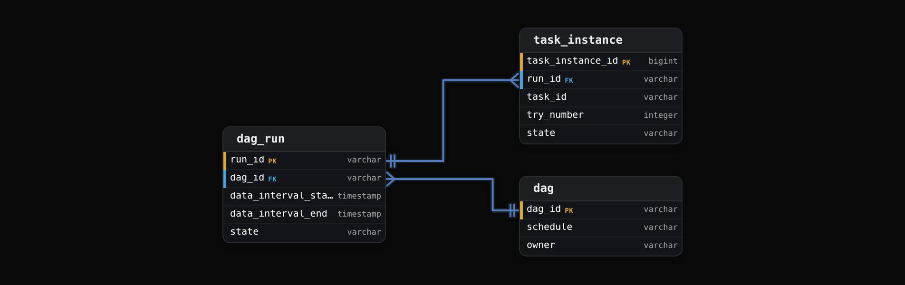
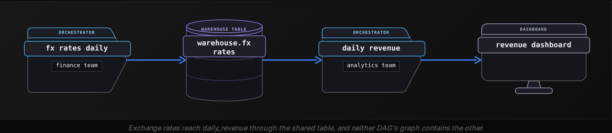
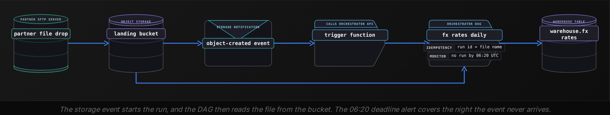
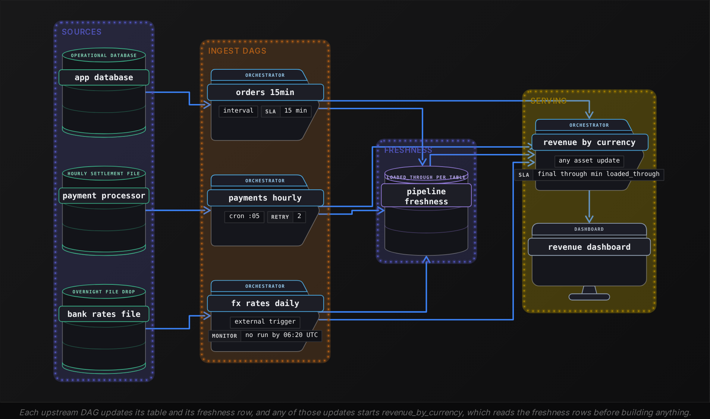

# Orchestration: Intermediate

One of the most widely used workflow orchestrators began as an internal project at Airbnb. Say a revenue job there is set for 03:00 because the exchange-rate load usually finishes by 02:40. Tonight that load finishes at 03:25. The revenue job runs anyway, prices a day of bookings at stale rates, and reports success. What should have told it to wait?


<br>

---

## Schedules: Cron, Interval, Event

A schedule tells the orchestrator when to start a new run of a DAG. Nearly every pipeline uses one of 3 kinds: a cron schedule names moments on the wall clock, an interval schedule names a fixed gap between runs, and an event schedule names a signal, such as a file landing, and starts a run each time the signal arrives.

| Schedule | Written as | Starts runs at | A run starts because |
| --- | --- | --- | --- |
| Cron | `0 6 \* \* \*` | 06:00 every day | the clock reached a named minute |
| Cron | `\*/15 \* \* \* \*` | :00, :15, :30 and :45 | the clock reached a named minute |
| Interval | every 15 minutes from 10:07 | 10:07, 10:22, 10:37 | a fixed gap passed since the anchor |
| Event | on file `rates_2026-10-23.csv` | whenever the file lands | a signal arrived |


<br>

### Cron: when the clock is the contract

A cron expression has 5 fields: minute, hour, day of month, month and day of week, so `0 6 * * 1-5` means 06:00, Monday to Friday. Cron fits when the data is complete by a known time and the consumer reads at a known time. A finance report opened at 09:00, built from a ledger that closes at midnight, belongs on cron at 02:00, leaving hours of slack for a slow night.

Cron trusts the clock and never looks at the data. If the ledger closes late, the 02:00 run reads a half-written day and still finishes green. Cron also inherits the calendar's oddities. On 8 March 2026, New York clocks jumped from 02:00 to 03:00, so a job set for 02:30 local time had no 02:30 to fire at; on 1 November 2026, 01:30 happens twice. Depending on the scheduler, such a run is skipped, shifted or doubled. Writing every schedule in UTC removes both cases.


<br>

### Interval: an even rhythm, anchored to a start

An interval schedule says "every 15 minutes" and counts from an anchor, usually the moment the DAG was switched on. Anchored at 10:07, it starts runs at 10:07, 10:22 and 10:37, where `*/15` would start them at 10:15, 10:30 and 10:45. Both give equal windows. Pick interval when the gap matters and the clock positions do not, or when cron cannot express the gap: every 90 minutes takes 2 cron lines, because the minute alternates between :00 and :30.

The gap also caps freshness. A row that lands a second after a run reads its source waits a full gap for the next run, then waits for that run to finish. With a 15-minute gap and a 5-minute load, the dashboard can show data up to 20 minutes old. Gap plus run time must stay within the consumer's age limit.

**A dashboard must show orders no older than 20 minutes, and each load takes 6 minutes. What is the longest gap that meets the limit?**

- **A.** Every 20 minutes
- **B.** Every 10 minutes
- **C.** Every 26 minutes
- **D.** Every 14 minutes

<details>
<summary>Solution</summary>

**D.** Every 14 minutes

A 14-minute gap plus 6 minutes of load is exactly 20.

**Why the others are wrong**

- **A.** Gap plus load makes a worst-case age of 26 minutes.
- **B.** Worst-case age is 16 minutes, within the limit, but a longer gap also fits.
- **C.** This adds the load time to the limit, giving a worst-case age of 32 minutes.

</details>


<br>

### Event: when arrival time is unpredictable

Some data arrives on its own clock. A partner uploads a file sometime between 22:00 and 05:00. A cron at 05:30 is safe, but on a 22:00 night the consumer waits 7.5 hours for data that was ready. An event schedule starts the run when the file lands, so the data reaches the consumer within minutes and no run reads a missing file. The cost is predictability: run times move every night, and if the signal never comes, nothing runs and nothing fails. Event schedules need a separate check that notices silence, covered with sensors and external triggers below.

| Data arrives | Consumer expects data | Choose |
| --- | --- | --- |
| complete by a known time | ready at a fixed reading time | cron, after the usual arrival plus slack |
| continuously, all day | no older than a stated age | interval or cron, with gap plus run time within that age |
| at unpredictable times | soon after it lands | event trigger, plus an alert for silence |
| at unpredictable times | ready at a fixed reading time | cron after the latest arrival, or event plus deadline alert |

**A bank sends a settlement file. Over the last 30 days it landed between 01:10 and 04:50 UTC. Treasury wants each file's totals within 30 minutes of landing. Which schedule fits?**

- **A.** Cron at 05:00 UTC, after every arrival in the last 30 days
- **B.** Event trigger on the file landing, plus an alert if none by 06:00
- **C.** Interval every 30 minutes, loading any new file present when it fires
- **D.** Cron at 01:10 UTC, the earliest arrival in the last 30 days

<details>
<summary>Solution</summary>

**B.** Event trigger on the file landing, plus an alert if none by 06:00

Each run starts minutes after the file lands, whatever the night, and the alert turns a missing file into a page.

**Why the others are wrong**

- **A.** No observed night reads a missing file, but a 01:10 file waits almost 4 hours, far past the 30-minute target.
- **C.** A file landing right after a run waits 30 minutes plus the load, which overshoots the target.
- **D.** On almost every night the file has not landed by 01:10, so the run finds nothing to load.

</details>


<br>

---

## Task vs DAG vs Run for Retries

When something breaks at 04:00, people use 5 words loosely, and the right fix depends on which one you mean. Take a DAG named `daily_revenue` with 3 tasks in a line: `extract_bookings`, then `convert_currency`, then `publish_report`.

| Term | What it is | In daily_revenue | How many |
| --- | --- | --- | --- |
| DAG | the definition: tasks, edges, schedule | `daily_revenue` as written in code | 1 |
| Task | a single node in the definition | `convert_currency` | 3 |
| DAG run | a single execution of the DAG for a single data interval | the run for 2026-10-23 | 1 per interval |
| Task instance | a task inside a specific run | `convert_currency` in the 2026-10-23 run | 3 per run |
| Attempt | a single try at a task instance | try 2 of that task instance | the retry count plus 1 |

Daily runs over 30 days produce 30 DAG runs and 90 task instances from 1 DAG and 3 tasks. Every state the orchestrator shows (queued, running, success, failed, up for retry) belongs to a task instance or a run. Each run is identified by its data interval, which the schedule cuts: at 03:00, the 2026-10-23 run covers 03:00 on the 23rd to 03:00 on the 24th and starts as it closes. A task needing calendar 23 October filters on the run's date.



Success and failure live on `task_instance` rows, so every fix below acts on runs and task instances.


<br>

### Automatic retries act on a single task instance

Say `convert_currency` fails in the 2026-10-23 run with a retry count of 2. The orchestrator leaves the rest of the run alone: it moves that task instance to up for retry, waits the configured delay, and starts attempt 2. `extract_bookings` keeps its success and doesn't execute again, and `publish_report` keeps waiting. A retry count of 2 allows 3 attempts. Only when attempt 3 fails does the task instance become failed, and only then does the run fail.

```sql
dag_id: daily_revenue
schedule: "0 3 * * *"
timezone: UTC
default_retries: 2
retry_delay_minutes: 5
tasks:
  - id: extract_bookings
    retries: 4
  - id: convert_currency
    depends_on: [extract_bookings]
  - id: publish_report
    depends_on: [convert_currency]
    retries: 0
```

**An hourly DAG has 4 tasks, each with a retry count of 1. After 7 days, how many task instances exist, and how many attempts did a task instance that ended failed use?**

- **A.** Task instances: 672; attempts on the failed one: 2
- **B.** Task instances: 168; attempts on the failed one: 2
- **C.** Task instances: 672; attempts on the failed one: 3
- **D.** Task instances: 4; attempts on the failed one: 2

<details>
<summary>Solution</summary>

**A.** Task instances: 672; attempts on the failed one: 2

Each of 168 hourly runs holds 4 task instances, and 1 retry allows 2 attempts.

**Why the others are wrong**

- **B.** That counts runs; each run holds its own instance of all 4 tasks.
- **C.** The instance count is right, but 1 retry after the first try makes 2 attempts.
- **D.** The definition has 4 tasks; every run creates its own instance of each task.

</details>


<br>

### Choosing the scope of a manual rerun

Automatic retries suit a task that may succeed a few minutes later on the same inputs. When a person steps in after fixing something, there are 4 scopes, and each re-executes a different set of task instances.

| Action | Re-executes | Use it when |
| --- | --- | --- |
| Clear a single task instance | that task instance only | it failed and nothing downstream has run yet |
| Clear with downstream | that task instance and every later one in the same run | its output changed after later tasks read it |
| Clear the whole run | every task instance in the run | the run's inputs were wrong from the first task |
| Trigger a new run | a fresh run with a new run id | you want an extra execution that leaves existing runs untouched |

The common mistake is clearing too little. Suppose `extract_bookings` for 2026-10-23 succeeded while its source was still filling in. You wait for the source to finish and clear only `extract_bookings`. It reruns and succeeds, while `convert_currency` and `publish_report` keep their earlier success, so the report still shows partial numbers. Once a task's output changes, every task that read it must run again in the same run, which is what clearing with downstream does.

The other mistake is triggering a new run to repair an old one. A manual run gets its own run id and, depending on how it is started, its own data interval. A report task that filters on its run's interval then builds numbers for 24 October and leaves 23 October broken. To repair an interval, act on that interval's run.

**In the 2026-10-23 run of daily_revenue, all 3 tasks succeeded. Then you learn the rates table that convert_currency read was missing 2 currencies, and the table is now fixed. What should you do?**

- **A.** Clear convert_currency only, so the conversion reruns on fixed rates
- **B.** Trigger a new run of daily_revenue so every task runs again
- **C.** Clear convert_currency with downstream in the 2026-10-23 run
- **D.** Clear the whole 2026-10-23 run, starting from extract_bookings

<details>
<summary>Solution</summary>

**C.** Clear convert_currency with downstream in the 2026-10-23 run

Conversion reruns on the fixed rates, publish_report rebuilds from the new output, and extract_bookings keeps its correct result.

**Why the others are wrong**

- **A.** The conversion reruns, but publish_report keeps its earlier success and the report still carries the wrong totals.
- **B.** The new run has its own id and may cover a different interval, so the 2026-10-23 report stays wrong.
- **D.** This repairs the report too, but it re-extracts bookings that were already correct and pays for a full run.

</details>


<br>

---

## Cross-DAG Dependencies

Once 2 teams own 2 DAGs, one DAG's output becomes another's input, and the link between them sits outside both graphs. `fx_rates_daily` belongs to the finance data team and loads each day's exchange rates into `warehouse.fx_rates`. `daily_revenue` belongs to analytics and reads that table. The orchestrator links them only if you build the link, with a time offset, a sensor or an asset trigger.




<br>

### Time offset: a dependency nobody wrote down

Schedule `fx_rates_daily` at 01:00 and `daily_revenue` at 03:00, because the rates load has finished by 02:40 on every night anyone checked. Neither DAG records the dependency. It costs nothing to build and fails silently: on a night when the load takes 2 hours 25 minutes, `daily_revenue` reads the previous day's rates at 03:00, succeeds, and publishes. Offsets also decay, since the upstream grows slower month by month and nobody downstream hears when it crosses 03:00.


<br>

### Sensor: wait for the upstream task

A sensor is a task whose only job is to check a condition on a timer; it succeeds once the condition holds. Put one first in `daily_revenue`, waiting for `load_rates` in `fx_rates_daily` to succeed for the matching data interval. A slow night now delays revenue instead of corrupting it, and a missed night fails the sensor at its timeout. The cost is coupling. The sensor names another team's DAG id and task id, and it finds the matching upstream run from a fixed time difference between the 2 schedules. If finance renames `load_rates`, or moves the DAG from 01:00 to 01:30, the sensor waits for a task instance that will never exist.


<br>

### Asset trigger: depend on the table itself

An asset trigger moves the contract from the DAG to the data. The `load_rates` task declares that it updates the asset `warehouse.fx_rates`, and when that task instance succeeds, the orchestrator records an update event. `daily_revenue` names the asset as its schedule, so each update event creates a run. Downstream now knows a table name and nothing about who writes it or when: finance can rename tasks, split the DAG or move it to 01:30 without telling analytics. Revenue also starts seconds after the rates land, on slow nights and fast ones.

```sql
- dag_id: fx_rates_daily
  schedule: "0 1 * * *"
  tasks:
    - id: load_rates
      produces: [warehouse.fx_rates]
- dag_id: daily_revenue
  schedule:
    on_assets: [warehouse.fx_rates]
  tasks:
    - id: extract_bookings
    - id: convert_currency
      depends_on: [extract_bookings]
```

Asset triggers have 2 limits. An update event says the asset changed and says nothing about which slice of data changed, so a downstream that cares must check the content, which the last section of this lesson builds. And the event exists only if the write happened inside the same orchestrator, or the outside writer reports it through the orchestrator's API.

| Approach | Downstream must know | Upstream runs slow | Upstream changes schedule |
| --- | --- | --- | --- |
| Time offset | the usual finish time | runs on stale data and succeeds | breaks with no error |
| Sensor on the upstream task | DAG id, task id, schedule difference | waits, then runs | waits until timeout, then fails |
| Asset trigger | the asset name | runs when the update lands | keeps working |

**Which failure can a time offset produce that a sensor and an asset trigger both prevent?**

- **A.** The downstream waits until a timeout and then fails
- **B.** The downstream breaks when the upstream renames a task
- **C.** The downstream starts once for every upstream update
- **D.** The downstream succeeds on stale input with no error

<details>
<summary>Solution</summary>

**D.** The downstream succeeds on stale input with no error

An offset starts on the clock; the other 2 wait for evidence the upstream finished.

**Why the others are wrong**

- **A.** That is a sensor's behavior when the upstream is missing, and someone sees it.
- **B.** That's the sensor's weakness; an offset never references task names.
- **C.** Starting on every update is how an asset trigger behaves by design.

</details>

> **TIP**
>
> Keep a time offset only where reading the previous day's data is acceptable, and write that reason into the DAG's description. When both DAGs live in the same orchestrator, prefer an asset trigger. Use a sensor where the upstream lives outside the orchestrator, the subject of the next section.

**orders_load runs hourly in your orchestrator and writes warehouse.orders. Its owners reorganize its tasks every quarter. Your DAG must start within minutes of each load. Which dependency fits?**

- **A.** An asset trigger on the warehouse.orders table
- **B.** A sensor on the final task of orders_load
- **C.** A schedule 20 minutes after every hour
- **D.** A sensor on the first task of orders_load

<details>
<summary>Solution</summary>

**A.** An asset trigger on the warehouse.orders table

It depends only on the table name, survives every reorganization, and starts a run as each load succeeds.

**Why the others are wrong**

- **B.** It starts promptly, but a quarterly reorganization can rename that task and leave the sensor waiting until timeout.
- **C.** It ignores whether the load finished, so a slow hour runs on the previous hour's data with no error.
- **D.** The first task succeeding says nothing about the table being written, and it still depends on task names.

</details>


<br>

---

## Sensors and External Triggers

Asset triggers need the write to happen where the orchestrator can see it. Many inputs are produced elsewhere: a bank drops a file on a server, a vendor's API marks a report ready, a partner writes into your storage bucket. For those, the orchestrator has 2 ways to learn that data exists: it asks, with a sensor, or it is told, with an external trigger.


<br>

### Where a sensor belongs

A sensor belongs at the boundary: the first task of the DAG that consumes the outside data, waiting on the exact object that run needs. For the 2026-10-23 run, that is `landing/rates/2026-10-23.csv`, a path built from the run's data interval. A sensor waiting for any file in `landing/rates/` succeeds on yesterday's file, and a sensor in the middle of a DAG lets earlier tasks run before the input exists, then holds the run open for hours.

#### Timeouts decide what silence means

A sensor without a timeout waits forever, and a run that waits forever alerts nobody. Work the timeout back from the consumer's deadline. Treasury reads the rates report at 07:00 and the load plus report take 40 minutes, so the latest useful arrival is 06:20. A sensor starting at 22:00 gets a timeout of 8 hours 20 minutes and fails at 06:20, early enough for someone to call the bank. Check every few minutes, since each check interval adds at most that much delay and faster polling loads the partner's server for nothing the consumer sees.


<br>

### Sensor execution modes and worker slots

A worker slot is a task attempt's place on a worker, so a cluster with 32 slots runs 32 attempts at once. A sensor's execution mode decides how long it holds a slot while it waits.

| Mode | Slot held while waiting | Each check is | Fits |
| --- | --- | --- | --- |
| Blocking (poke) | yes, for the whole wait | a loop inside a single attempt | waits of a few minutes with frequent checks |
| Reschedule | only during each check | a short attempt started on a timer | waits of hours, checked every few minutes |
| Deferred | none; an async process holds the wait | a callback from that process | hundreds of long waits at the same time |

Suppose 40 partner files each get a blocking sensor that starts at 22:00 and waits around 6 hours, on a cluster of 32 slots. By 22:01 the sensors hold every slot and the rest queue. When a file lands, its sensor frees a slot, and the transform for that file competes for it with the sensors still queued. The same sensors in reschedule mode, checking every 5 minutes, hold a slot for a few seconds per check and leave the cluster to real work.

- **8** — sensors queued at 22:01
- **72** — reschedule checks per sensor each night


<br>

### External triggers: let the source call in

An external trigger reverses the direction, and it lets finance drop the 01:00 cron from `fx_rates_daily`. The storage bucket emits an event when `landing/rates/2026-10-23.csv` is written, and a small function receives it and calls the orchestrator's API to start `fx_rates_daily`, passing the file path in the run's configuration. Nothing polls, and the run starts seconds after the write. Events can also be lost or duplicated. A lost event means no run and no error, so back every external trigger with a deadline check that alerts if no run has started by the consumer's cutoff. A duplicated event means 2 runs for 1 file, and using the file name as the run id makes the orchestrator reject the second as a run that already exists.



**fx_rates_daily starts from an external trigger and has no deadline check. One night the storage event is lost. What does the team see?**

- **A.** The sensor in fx_rates_daily times out and pages the on-call engineer
- **B.** No run starts and nothing fails, so no alert reaches anyone
- **C.** The orchestrator retries the trigger until the event gets delivered
- **D.** A failed run appears in the UI with an error about the event

<details>
<summary>Solution</summary>

**B.** No run starts and nothing fails, so no alert reaches anyone

The orchestrator never learns the file exists; only a deadline check turns this silence into an alert.

**Why the others are wrong**

- **A.** An externally triggered DAG has no sensor waiting, so no timeout exists to fire.
- **C.** Retries apply to task instances that ran and failed; a run that never started has none.
- **D.** A run must start before it can fail, and the lost event means it never started.

</details>

| ✓ Do | ✗ Don't |
| --- | --- |
| • Wait on the exact file or partition named for this run's interval<br><br>• Derive the timeout from the consumer's deadline<br><br>• Back every external trigger with a deadline alert | • Sense another DAG where an asset trigger fits<br><br>• Hold a worker slot through a wait of hours<br><br>• Poll a partner's server every few seconds |

**A vendor posts a report between 23:00 and 03:00. The consumer reads at 08:00, and the downstream load takes 1 hour. You run 200 such sensors each night on a 64-slot cluster. Which sensor setup fits?**

- **A.** Blocking mode, timeout at 07:00, checking every 10 minutes
- **B.** Reschedule mode, no timeout, checking every 10 seconds
- **C.** Deferred mode, timeout at 07:00, checking every 10 minutes
- **D.** Deferred mode, timeout at 08:00, checking every 10 minutes

<details>
<summary>Solution</summary>

**C.** Deferred mode, timeout at 07:00, checking every 10 minutes

Deferred waits hold no slots, 07:00 leaves the 1-hour load time to finish by 08:00, and 10-minute checks keep delay small.

**Why the others are wrong**

- **A.** The timeout is right, but 200 blocking sensors would hold all 64 slots for hours and starve every transform.
- **B.** Without a timeout a missing report never alerts, and 10-second checks add load the consumer gains nothing from.
- **D.** The mode fits, but a report landing at 07:59 passes the sensor and can't be loaded by 08:00.

</details>


<br>

---

## Three Cadences, One Output

A revenue team wants hourly revenue in USD, and each hour should appear on the dashboard only once all of its inputs are in. Those inputs arrive on 3 cadences, from 3 DAGs owned by 3 teams.

| Upstream DAG | Writes | Schedule | Loaded through, at finish |
| --- | --- | --- | --- |
| `orders_15min` | `warehouse.orders` | interval, every 15 minutes from :01 | the quarter hour that ended |
| `payments_hourly` | `warehouse.payments` | cron `5 \* \* \* \*` | the top of the current hour |
| `fx_rates_daily` | `warehouse.fx_rates` | event, when the bank's file lands | midnight ending the day that is starting, whose rates the overnight file carries |


<br>

### The offset design and where it breaks

A first draft schedules `revenue_by_currency` at :30 past every hour, reasoning that orders finish by :06, payments by :15 and rates by 06:20. That stacks 3 time offsets, each failing silently: a payments file 40 minutes late means the 14:30 run builds 13:00 to 14:00 without payments and publishes it as final. Sensors fit badly too: the event-triggered rates DAG has no schedule from which to compute the run to wait for, and mapping each hourly run to 4 orders runs works but hard-codes both teams' cadences.


<br>

### Join on freshness instead

In the design that holds up, every upstream DAG ends with a task that records how far its table is loaded, as a row in `pipeline_freshness`, and that task declares the table as an asset. Then `revenue_by_currency` runs whenever any of the 3 assets updates, and its first task asks the freshness table a single question: up to which hour are all 3 inputs complete?



#### pipeline_freshness at 14:40 UTC on 2026-10-24

| table_name | loaded_through | updated_at |
| --- | --- | --- |
| warehouse.orders | 2026-10-24 14:30 | 2026-10-24 14:36 |
| warehouse.payments | 2026-10-24 14:00 | 2026-10-24 14:12 |
| warehouse.fx_rates | 2026-10-25 00:00 | 2026-10-24 03:25 |

```sql
SELECT
  DATE_TRUNC('hour', MIN(loaded_through)) AS build_through,
  MIN_BY(table_name, loaded_through) AS slowest_input,
  COUNT(*) AS inputs_reporting
FROM pipeline_freshness
WHERE table_name IN (
  'warehouse.orders',
  'warehouse.payments',
  'warehouse.fx_rates'
)
```

The run then builds every hour that ends by `build_through` and has not been built yet, and it writes `build_through` beside the output so the dashboard can label its numbers final through 14:00. If `inputs_reporting` is below 3, an upstream has never reported, and the run fails loudly. The slowest input sets the line, whichever input that happens to be.

**At 09:50 UTC on 2026-10-24, pipeline_freshness shows orders loaded through 2026-10-24 09:45, payments through 2026-10-24 09:00 and fx_rates through 2026-10-24 00:00. What does the freshness query return?**

- **A.** build_through 09:00, slowest input warehouse.payments
- **B.** build_through 09:00, slowest input warehouse.orders
- **C.** build_through 09:45, slowest input warehouse.orders
- **D.** build_through 2026-10-24 00:00, slowest input warehouse.fx_rates

<details>
<summary>Solution</summary>

**D.** build_through 2026-10-24 00:00, slowest input warehouse.fx_rates

Rates for 24 October haven't landed, so no hour of that day can convert to USD, and the dashboard holds at midnight.

**Why the others are wrong**

- **A.** Payments trails orders, but the rates table trails both: it covers no hour of 24 October yet.
- **B.** Orders is the freshest input, and truncating 09:45 doesn't make it the slowest.
- **C.** The query takes the minimum across inputs; the maximum plays no part.

</details>

| Time (UTC) | Update that starts the run | build_through | Hours built |
| --- | --- | --- | --- |
| 14:06 | orders loaded through 14:00 | 13:00 | none new |
| 14:12 | payments loaded through 14:00 | 14:00 | 13:00 to 14:00 |
| 14:21 | orders loaded through 14:15 | 14:00 | none new |
| 14:36 | orders loaded through 14:30 | 14:00 | none new |
| 15:06 | orders loaded through 15:00 | 14:00 | none new |
| 15:12 | payments loaded through 15:00 | 15:00 | 14:00 to 15:00 |

When a payments file is 2 hours late, orders updates keep starting runs that find `build_through` stuck at 14:00, so the dashboard keeps saying final through 14:00 rather than publishing the hour ending 15:00 with no payments. The alert pages the owner of `slowest_input`, with a threshold per input: orders or payments at 90 minutes behind the clock, rates only if still slowest after 06:20, since until the bank's file lands they hold `build_through` at midnight every night.

**A teammate proposes running revenue_by_currency only when all 3 assets have updated since its last run. What happens to the dashboard?**

- **A.** Hourly revenue arrives about once a day, after the rates file lands
- **B.** Hourly revenue arrives every 15 minutes, after each orders load
- **C.** Hourly revenue arrives every hour, after each payments load
- **D.** Hourly revenue stops entirely, since the 3 assets never align

<details>
<summary>Solution</summary>

**A.** Hourly revenue arrives about once a day, after the rates file lands

The condition waits for the slowest cadence, and fx_rates_daily updates once a day, so a day of hours lands together.

**Why the others are wrong**

- **B.** That is what running on any update does; the all-assets condition also waits for payments and rates.
- **C.** A payments update alone does not meet the condition; the rates asset must update too, once a day.
- **D.** The condition counts updates since the last run, so it is met once a day when the rates land.

</details>


<br>

---

## Putting It All Together

Picture the finance analytics team at Airbnb rebuilding the revenue job from the opening. Bookings land every 15 minutes, payment settlements land hourly, and the exchange-rate file arrives whenever the rates provider sends it overnight. The team retires the 03:00 offset and has to decide, for each piece, which schedule, which cross-DAG link, which way of waiting on the outside world and which rerun scope applies.

- Each upstream keeps the schedule its source calls for: an interval for bookings, cron at :05 for hourly settlements, an external trigger for the rates file.
- A failed settlement load retries as a single task instance, and its freshness row advances only when that load succeeds.
- Revenue links to all 3 inputs through asset triggers, so a rename or reschedule on another team's DAG leaves it working.
- Both outside inputs are guarded at the boundary: payments_hourly opens with a reschedule-mode sensor on that hour's settlement file, timed out before the next hour, and the rates file enters through an external trigger backed by the 06:20 deadline alert.
- The revenue DAG builds only through the minimum loaded_through, so the slowest input decides what the dashboard calls final.


<br>

---

## Key Takeaways

- Pick a schedule from how data arrives and how fresh the consumer needs it: cron for known times, interval for steady flow, event for unpredictable arrival.
- Worst-case staleness on a schedule is the gap plus the run time.
- Retries and reruns act on task instances inside a run; after a task's output changes, clear it with downstream in that same run.
- Time offsets fail silently, sensors couple you to another team's ids and schedule, and asset triggers couple you only to a table name.
- Sensors belong first in the consuming DAG at the orchestrator's boundary, with a timeout worked back from the deadline and a mode that frees slots during long waits.
- External triggers need a deadline alert, because a lost event produces no run and no error.
- When inputs arrive on different cadences, run on any update and build only through the minimum loaded_through across inputs.

Exercises for this lesson: [_exercises/pa_orchestration_intermediate.md](_exercises/pa_orchestration_intermediate.md)
