# Pipeline Anatomy: Advanced - Exercises

Lesson: [pa_what_is_a_pipeline_advanced.md](../pa_what_is_a_pipeline_advanced.md)

### Exercise 1 of 12

**● TASK**

Turn the curated fct_orders table into a written data contract: set its slaFreshness to < 1h so consumers know how fresh it is. Then add a Great Expectations quality_gate node and draw a data-flow edge from fct_orders into it, so the next upstream schema drift is caught before downstream teams read broken numbers.

**Starting canvas** (already placed for you):

- Postgres orders (source, PostgreSQL)
- fct_orders (storage, warehouse)
- Finance dashboard (consumer, dashboard)
- ML feature store (storage, Feast)
- Ops runbook (consumer, Grafana)

<details>
<summary><strong>Solution</strong></summary>

#### A table with a promise attached

Treating a pipeline as a product means `fct_orders` ships with a **data contract**: a written promise its readers can check. 2 clauses carry it. A freshness commitment says how stale the table may get before it counts as broken. A quality gate says what the rows must look like to be trusted. Freshness without the gate is half a contract, and upstream schema drift lives in exactly that missing half.

| Pitfall: Fresh rows can still be wrong |
| --- |
| When an upstream field changes meaning, the load still lands on schedule, so any lateness check stays green. A freshness SLA measures when data arrived, never what shape it arrived in. Only a check that reads the values catches an upstream field change before readers do. |

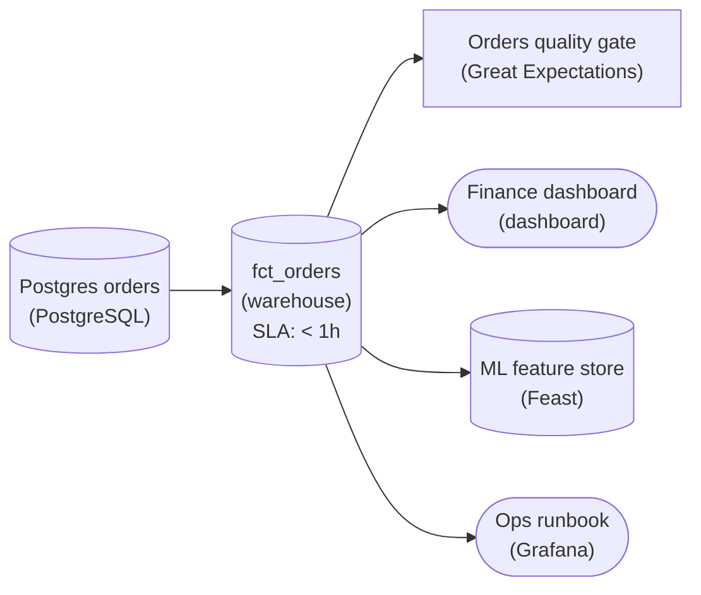

*Reference design: `fct_orders` carries `slaFreshness` '< 1h', and a data-flow edge feeds it into a Great Expectations gate that watches the table all 3 readers depend on.*

1. **Set the SLA as a property, not a label**

   Put '< 1h' in the node's `slaFreshness` field. Writing 'SLA < 1h' into the tech label reads fine to a person but is an annotation, not a commitment: nothing can alert on it. Choose the bound from what the readers need, not from how often the job happens to run today.

2. **Wire the gate to the table it guards**

   A `quality_gate` node sitting beside `fct_orders` with no edge monitors nothing. The edge from `fct_orders` into the gate is what points its expectations (values in range, totals reconcile, unique order keys) at the curated output. That one edge turns a silent upstream field change into a failed check.

| Real world: The contract is versioned with the model |
| --- |
| In practice the SLA and the expectation suite live in the same repo as the `fct_orders` model, and a failing checkpoint blocks promotion instead of only sending email. The same shape guards a `dim_customers` table feeding CRM syncs: one freshness bound, one gate, one edge. |

**Follow-up questions**

1. Should a failing gate block the load entirely, or quarantine the bad partition and keep serving the last good data?\
   *Whether a gate is a circuit breaker or just a report.*
2. If an upstream field is legitimately new, how does the expectation suite evolve without accepting every future drift?\
   *Connects the contract to deliberate schema evolution.*

</details>


<br>

### Exercise 2 of 12

**● TASK**

A daily Python script, triggered by cron, pulls from Postgres into Snowflake for a Looker dashboard. Before next week's compliance audit, keep those 4 roles as they are and give each concern the script leaves unowned its own node: a scheduler that owns the run, a monitor that checks the warehouse output lands on time and correct, a secrets manager holding the hardcoded database password, and a CI runner that tests code changes before they ship.

**Starting canvas** (already placed for you):

- Postgres app (source, PostgreSQL)
- Daily Python ETL (no orchestrator, no monitor, hardcoded creds) (transform, Pandas)
- Production warehouse (storage, Snowflake)
- BI dashboard (consumer, Looker)

<details>
<summary><strong>Solution</strong></summary>

#### 4 loose ends, 4 named owners

Undercurrents are the concerns that run beneath every role, and the rule for them is plain: **every operational concern a pipeline depends on needs a named owner**, not a side effect of the one script that happens to do the work. Your daily job moves data from `Postgres` into `Snowflake` and `Looker` reads the result, and that data path is fine. But 4 concerns were riding on nothing: what triggers the run, what confirms it landed on time and correct, where the password lives, and what proves a code change is safe before it ships. The fix is not more Python in the script. It is 4 nodes, each owning exactly one of those concerns, sitting beside the 4 data roles you kept in place.

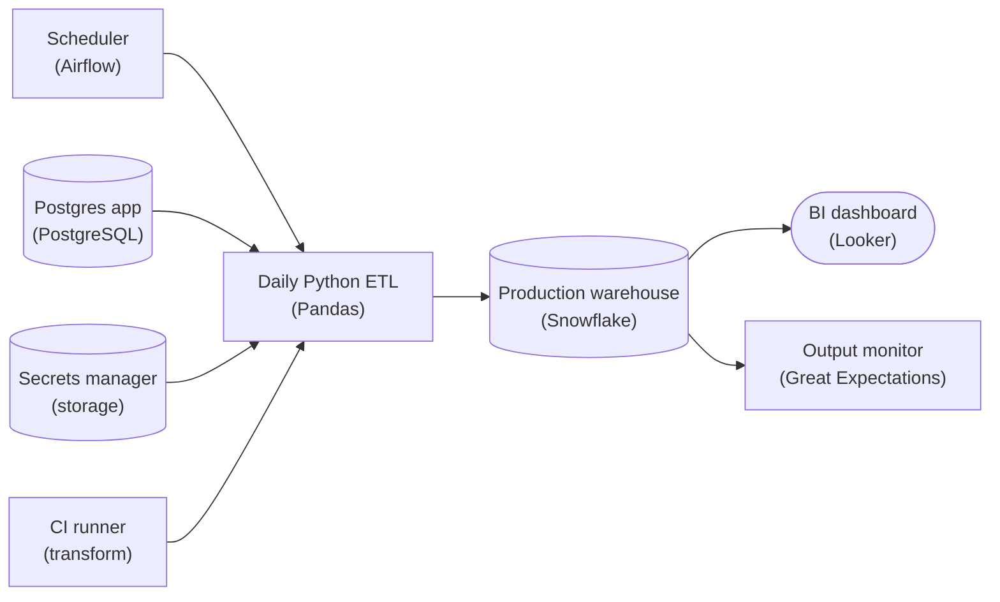

*The 4 data roles stay as they were. The scheduler, the output monitor, the secrets manager and the CI runner each own one loose end, and nothing on the data path had to move.*

1. **Give the run an orchestrator, not a cron line**

   A `cron` entry fires the script blindly: no retries, no dependency awareness, no record of whether yesterday's run even happened. A scheduler like `Airflow` owns the schedule as a DAG. It knows the run's start, its upstream dependencies, its retries and its history, so a failed 6am run gets retried and alerted instead of silently skipped. That is DAG orchestration, and it belongs to a tool, not a crontab.

2. **Watch the output, not just the exit code**

   A script that exits 0 tells you it ran, not that it was right. The monitor reads the warehouse and checks what the business actually uses: did the table land on time, is the row count in range, are the key columns non-null. Because it watches the output independently of the job that writes it, a broken transform surfaces before a stale dashboard does.

3. **Move the password out of the file**

   A hardcoded credential lives in every clone, every backup and the whole commit history. A secrets manager holds the password and hands it to the job at run time, so the code carries a reference instead of the secret. Rotating the password becomes a config change, with no code redeploy.

4. **Gate the change before it ships**

   Shipping straight to production means the first test of any change is the production run. A CI runner executes the test suite on every change and blocks the deploy when it fails, so the warehouse stops being the place you discover a broken transform. The pipeline's code gets the same gate every other service's code already has.

| Pitfall: More code in the script is not an owner |
| --- |
| The tempting wrong move is to answer all 4 with more Python: a `try/except` retry loop for scheduling, a row-count `assert` for quality, `os.getenv` for the password, a `pytest` call at the top of the file. That just relocates the 4 loose ends into the same unowned file. Each concern needs a node that owns it whether or not the script runs today. |

| Real world: Silent failure is the default without owners |
| --- |
| Most incidents where the pipeline was down and nobody noticed look exactly like this: the job had been failing for days, nothing watched the `Snowflake` output, and the first signal was a VP asking why `Looker` was stale. Naming an owner for each concern turns a script nobody maintains into a system somebody can be paged for. |

**Follow-up questions**

1. The scheduler adds failure modes of its own. What watches whether `Airflow` itself is running?\
   *Applies the monitoring concern to the orchestrator itself, not just the data output.*
2. If a second daily job also needs the `Postgres` password, what changes in how the secrets manager is set up?\
   *Extends the secrets concern to shared credentials and access scoping.*
3. The monitor flags a table that landed late. Should it page a human or block the dashboard from reading the stale data?\
   *Pushes on what monitoring should do once it detects a problem.*

</details>


<br>

### Exercise 3 of 12

**● TASK**

One Airflow instance owns a 60-task mega-DAG spanning three teams: ingestion, analytics-engineering curation, and ML feature extraction. When the analytics dbt step fails, the unrelated ML feature extraction halts and pages cross team lines all night. Apply the section's split-DAG framing and split the orchestrator along ownership boundaries so a failure in one team's branch does not halt unrelated work in another.

**Starting canvas** (already placed for you):

- Postgres app (source, PostgreSQL)
- payments API (source, API)
- bronze object storage (storage, object storage)
- Airflow (single mega-DAG, all three teams) (transform, Airflow)
- silver warehouse (storage, warehouse)
- BI dashboard (consumer, dashboard)
- ML feature store (storage, Feast)

<details>
<summary><strong>Solution</strong></summary>

#### Split the DAG along ownership boundaries

Splitting by ownership means **one DAG per owning team**, with the teams connected by data-aware scheduling instead of task dependencies. A mega-DAG that spans ingestion, analytics-engineering and ML puts all 60 tasks under a single scheduler, a single retry policy, a single SLA and a single on-call. That is why a failure in the analytics dbt step reaches ML feature extraction: the two were never truly dependent, they only shared one DAG. When the orchestration boundary follows the team boundary, each branch fails, retries and pages inside the team that owns it.

| Pitfall: A cross-team sensor rebuilds the coupling |
| --- |
| A common mistake is to cut the mega-DAG into three DAGs and then chain them with an `ExternalTaskSensor` that makes `ml_features_dag` wait for the analytics DAG to finish. That reproduces the exact coupling you were trying to remove: a dbt failure still blocks ML. ML features read from the silver warehouse, not from the dbt marts. They should trigger off the same upstream signal as analytics, side by side, never behind it. |

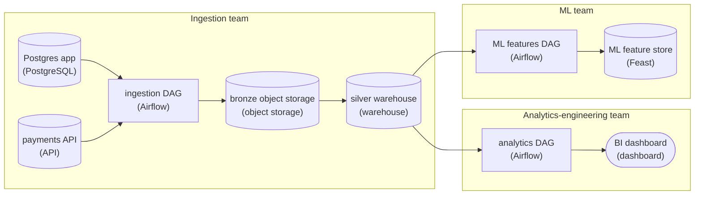

*Three team-owned DAGs meet at the silver warehouse. Ingestion writes it, and analytics and ML each read it on their own schedule, so neither can halt the other.*

1. **Cut the DAG where the teams are**

   Give each team its own DAG: `ingestion_dag`, `analytics_dag` and `ml_features_dag`. Each gets its own schedule, `retries`, `sla` and `default_args` owner, so a page routes to the team that can fix it. The point of the split is not smaller files. It is a separate blast radius for each owner.

2. **Replace the internal edge with a shared signal**

   Where the mega-DAG used a task dependency to connect teams, publish a Dataset on the silver warehouse instead. The silver load in `ingestion_dag` declares `outlets=[silver_ready]`, and both `analytics_dag` and `ml_features_dag` set `schedule=[silver_ready]`. When silver lands, Airflow wakes both consumers as peers. A dbt failure inside `analytics_dag` never enters the `ml_features_dag` run at all.

**Data-aware wiring across the three DAGs**

```python
from airflow.datasets import Dataset

silver_ready = Dataset("warehouse://silver")

# ingestion_dag: the load task announces silver is fresh
load_silver = SQLExecuteQueryOperator(
    task_id="load_silver",
    outlets=[silver_ready],
    ...
)

# analytics_dag: runs when silver updates
with DAG("analytics_dag", schedule=[silver_ready], ...):
    run_dbt = BashOperator(task_id="dbt_run", ...)

# ml_features_dag: also runs when silver updates, in parallel
with DAG("ml_features_dag", schedule=[silver_ready], ...):
    build_features = PythonOperator(task_id="build_features", ...)
```

*The producer emits one Dataset, and each consumer schedules on it independently.*

| Real world: The orchestrator boundary tracks the org chart |
| --- |
| This is the standard shape once a platform grows past one team. The orchestrator boundary tracks the team boundary, and cross-team hand-offs become Datasets (or an event or queue). That also gives each DAG its own lineage and its own SLA clock. Two signs that a design is drifting back toward a mega-DAG: a cross-team `ExternalTaskSensor`, or a task in one team's DAG that reaches into another team's tables. |

**Follow-up questions**

1. If ML features genuinely need the dbt marts, not just silver, how do you express that without re-coupling to the whole analytics DAG?\
   *Emitting a second, narrower Dataset on just the marts table rather than sensing a whole DAG's completion.*
2. How would you let analytics run on a schedule AND when silver updates, whichever comes first?\
   *Combining time-based and Dataset schedules.*

</details>


<br>

### Exercise 4 of 12

**● TASK**

Redraw this hand-rolled fintech reporting stack so ingestion, storage and cleaning run on bought or open-source components and the attribution model stays the only custom code. The bought CDC connector lands source rows unchanged straight in the warehouse, so decide whether the cleaning the Python extractor does today runs before the load or inside the warehouse. The attribution model reads the cleaned rows and keeps feeding the dashboard.

**Starting canvas** (already placed for you):

- Postgres app DB (source, PostgreSQL)
- Custom Python extractor (transform, Pandas)
- Postgres reporting DB (custom) (storage, PostgreSQL)
- Custom attribution Python script (transform, Pandas)
- Attribution dashboard (consumer, Metabase)

<details>
<summary><strong>Solution</strong></summary>

#### Buy the plumbing, load first, keep the model

Moving the cleaning from before the load to inside the warehouse is the shift from **ETL to ELT**, and buying the ingestion layer is what forces it. The Python extractor is ETL: it reshapes rows in flight, which is exactly why an engineer has to own it. A bought CDC connector only extracts and loads, so the cleaning has to run where the rows land, as SQL inside the warehouse. Run the same per-layer test on the rest: ingestion and storage differentiate nothing, so they are bought; the attribution model is what makes the company different, so it stays built.

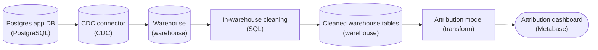

*The connector loads rows unchanged into the warehouse, SQL cleans them inside it into cleaned tables, and the attribution model is the only custom code.*

| ✕ ETL: clean before the load | ✓ ELT: clean inside the warehouse |
| --- | --- |
| The Python extractor cleans rows in flight and writes only the cleaned result, so the cleaning logic lives inside a custom ingestion job the team has to keep alive. | The connector lands rows unchanged, and SQL inside the warehouse turns them into cleaned tables. Ingestion is bought, and the cleaning is a few queries on a store you already pay for. |

| Pitfall: A transform before the load keeps a custom layer alive |
| --- |
| A Python step between the connector and the warehouse looks tidy, but it rebuilds the ETL layer you meant to buy. The connector only pays off when it writes straight to the warehouse and the cleaning follows the load. |

| Real world: Move the model without rewriting it |
| --- |
| Point the attribution code at the cleaned tables and keep its logic as it is. The win is freeing the layers around the model, not risking the one piece that differentiates the business. |

**Follow-up questions**

1. The attribution model needs a per-customer aggregation of the cleaned rows. Should that run as SQL in the warehouse after the load, or stay in the Python model?\
   *Where the line sits between in-warehouse transformation and the in-house model.*
2. A new source sends personal data that must never reach the warehouse. Does all of its cleaning still belong after the load?\
   *When transforming before the load is still the right call.*

</details>


<br>

### Exercise 5 of 12

**● TASK**

Postgres, Stripe and Salesforce feed six point-to-point Python jobs that write straight into a finance dashboard, a product dashboard and an ML feature store, all under one orchestrator. Redesign it with a shared raw storage layer and a shared curated layer in a bought warehouse that all three consumers read, with a freshness commitment on it. Split the orchestrator in two at team boundaries and add a node that monitors the flow so failures stop being silent.

**Starting canvas** (already placed for you):

- 3 sources (Postgres, Stripe, Salesforce) (source, PostgreSQL)
- 6 custom point-to-point Python jobs (transform, Pandas)
- single_airflow (one orchestrator owns everything) (transform, Airflow)
- 3 consumers (Finance, Product, ML) (consumer, Tableau)

<details>
<summary><strong>Solution</strong></summary>

#### Untangling the graph along ownership seams

To redesign a tangled DAG graph, start by asking where ownership changes hands. The old canvas wired every job from a source straight to a consumer, and one orchestrator scheduled all of them. So a single Postgres schema change broke six jobs at once, and nobody clearly owned the failure. The redesign gives the data a shape: a shared raw layer, then a shared curated warehouse. It also gives each stretch of that shape **its own orchestrator**, run by the team that owns it.

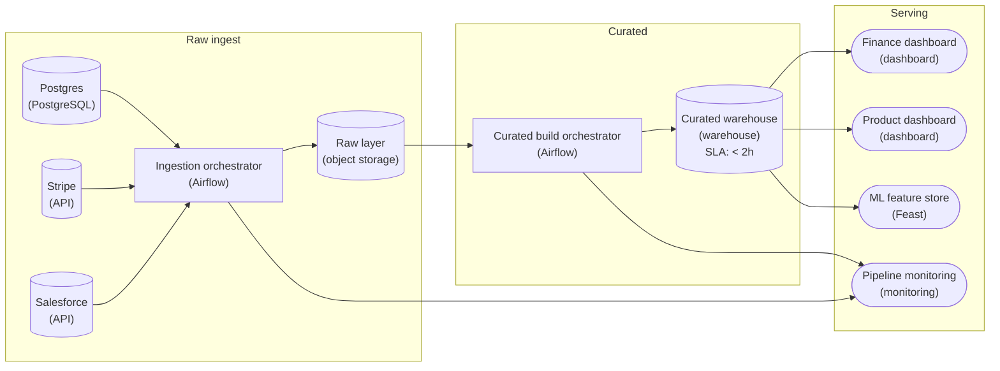

*The ingestion orchestrator lands each source once in the raw layer. The curated build orchestrator turns raw into the curated warehouse that all three consumers read. Both orchestrators report to monitoring.*

1. **Land every source once in a shared raw layer**

   The ingestion orchestrator runs one DAG with a task per source, and each task copies its source unchanged into the raw layer. No consumer reads from here. The raw layer exists so the curated tables can be rebuilt without pulling from Stripe or Salesforce again.

2. **Build the curated warehouse once and commit to its freshness**

   A second DAG, owned by the analytics team, transforms raw data into conformed tables in a bought warehouse. All three consumers read the same tables, and that is what stops the dashboards from disagreeing. The freshness commitment on the curated warehouse is the promise this team makes to its readers.

3. **Split the orchestrator where the teams split**

   Ingestion and curation now run in separate orchestrators. If a Stripe load fails, it fails inside the ingestion DAG and pages the team that owns it. The curated build waits for fresh raw data instead of breaking along with the load. Both orchestrators report to a monitoring node, so a failed run or a missed freshness target gets noticed.

| Pitfall: One bigger DAG keeps the old coupling |
| --- |
| It is tempting to add the new layers as more tasks in the single orchestrator, because it looks tidier. But every team still shares one failure domain and one deploy queue. Splitting only pays off when each orchestrator has exactly one owning team. |

**Follow-up questions**

1. The ML team wants to rebuild features from the curated warehouse every hour. Does that work go in the curated build orchestrator or a new one?\
   *Tests splitting by cadence as well as by ownership.*
2. The ingestion DAG runs late one night. How does the curated build orchestrator know to wait instead of building on stale raw data?\
   *Tests dependencies that cross a team seam.*
3. A bad Stripe deploy writes malformed rows into the raw layer. Where do you catch them before a dashboard shows them?\
   *Tests where quality checks sit once raw and curated are separated.*

</details>


<br>

### Exercise 6 of 12

**● TASK**

A fintech runs 412 DAGs under one shared Airflow: 80 feed Finance, Product, and ML with no written contracts, and 332 have no consumer anyone can name, all built on hand-written extracts from Postgres, Stripe, Salesforce, and Kafka. Design the target: land the sources in a shared raw layer that feeds a curated layer with a stated freshness promise, with data quality checks and monitoring as their own stages. Split the one orchestrator so Finance, Product, and ML each own their scheduling. Track the 332 orphans in a data catalog with a notice period and a sunset date.

**Starting canvas** (already placed for you):

- 4 sources (Postgres, Stripe, Salesforce, Kafka) (source, PostgreSQL)
- Custom extracts per source (no shared raw) (transform, Pandas)
- 80 mission-critical ETLs (no contracts) (transform, Pandas)
- 332 orphan DAGs (no identified consumers) (transform, Pandas)
- single_airflow (owns every DAG) (transform, Airflow)
- 3 consumer surfaces (Finance, Product, ML) (consumer, Tableau)

<details>
<summary><strong>Solution</strong></summary>

#### Pipelines as products, at platform scale

Treating a pipeline as a **product** means every table has an owner, a written promise about what it delivers and how fresh it is, and a way to retire it. Fixing 412 drifting DAGs is that framing applied to the whole platform: sources land once in a shared raw store, a quality gate guards promotion to a curated store that promises freshness under an hour, each team runs its own orchestrator, and the orphans move through a catalog toward a sunset date.

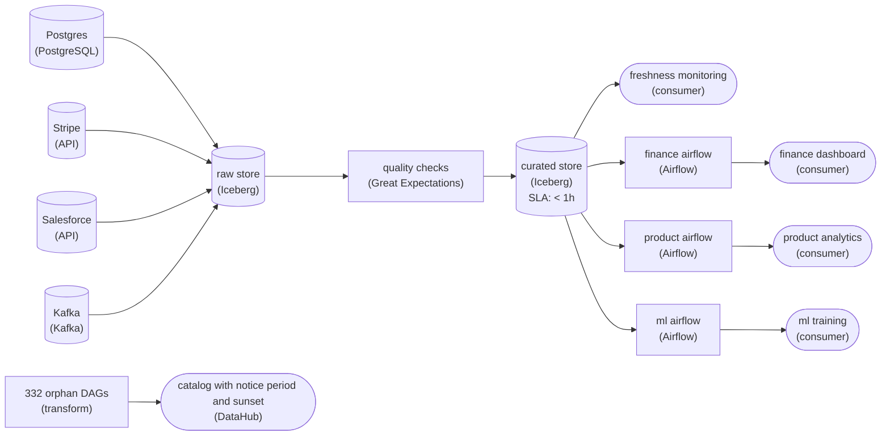

*Shared raw and curated layers with a stated freshness, quality and monitoring as their own stages, one Airflow per team, and the orphans tracked in a catalog until sunset.*

1. **Land once, publish curated with a promise**

   The 80 critical tables stop depending on hand-written extracts once every source writes into one raw store and a single curated layer is built from it. The freshness setting on the curated store is the contract's number: Finance, Product, and ML read one promise instead of guessing from last night's run.

2. **Make quality and monitoring stages, not afterthoughts**

   A quality gate between raw and curated means a load that breaks a declared expectation (nulls, row counts, ranges) never reaches the curated tables. Freshness monitoring reads the curated store, so the owner sees a slipping promise before a consumer does.

3. **Split orchestration where ownership splits**

   With one Airflow per team, Finance can deploy, pause, or retry its own DAGs without touching Product's. The curated tables become the boundary between teams: depending on another team means depending on a published table, not on their DAG code.

| Pitfall: Silent for 90 days is not the same as unused |
| --- |
| The tempting move is to delete the 332 orphans outright. In a fintech some feed a report that runs only at quarter- or year-end, so no reads in 90 days does not prove no consumer. A catalog entry, a published notice period and a sunset date give a hidden owner the chance to speak up before anything is switched off. |

**Follow-up questions**

1. How would the curated store serve both a daily Finance close and a near-real-time ML feed without a second pipeline?\
   *Whether one curated layer can carry two freshness promises.*
2. When Stripe adds a field, where is the schema change absorbed, and what should the quality gate do with it?\
   *Schema evolution against declared expectations.*

</details>


<br>

### Exercise 7 of 12

**● TASK**

Design a pipeline that enforces the written contract for a daily customer-activity feed: the producer is the app's PostgreSQL database, the consumer is a churn model that retrains every morning, and each day's data must land in the warehouse within 24 hours. Enforce the contract's expectations (no null customer ids, row count within 20% of yesterday's) before the warehouse load, and when a check fails, stop the load and page the producing team.

<details>
<summary><strong>Solution</strong></summary>

#### A contract only counts when the pipeline enforces it

A data contract is only real when the pipeline enforces it. The written part names the producer (the app database), the consumer (the morning churn retrain), the delivery (one day of activity) and the cadence (within 24 hours). Data quality checks are how the last clause, what happens when a delivery fails, becomes behavior instead of a promise: each declared expectation turns into a check on every batch, and every check needs both a position in the flow and a destination for its failure.

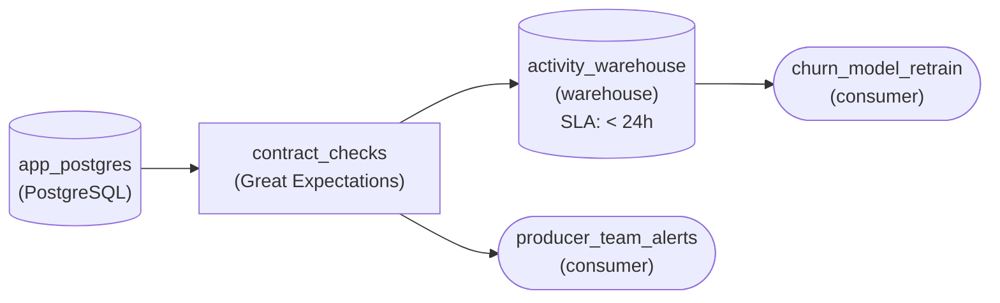

*The contract enforced: `contract_checks` gates the load into `activity_warehouse` and pages the producing team when an expectation fails.*

1. **Put the checks in front of the load**

   The quality gate sits between the extract and the warehouse, so a batch with a null customer id or a row count far off yesterday's never becomes the table the model trains on. Because the gate blocks the load, yesterday's good data stays in place and the retrain runs on that instead of a broken day.

2. **Send every failure to its owner**

   The contract names the producer, so a failed check routes to the producing team's alerts. The people who can actually fix the extract hear about it that morning, before anyone downstream notices a strange churn score.

| Pitfall: A check after the load is a report, not a gate |
| --- |
| Running the checks on the warehouse table after it loads tells you the contract broke, but the churn model has already read the bad day. Enforcement means the failing batch never reaches the consumer. |

| Real world: Row-count drift catches what null checks miss |
| --- |
| A half-empty extract has no nulls at all: every row it did deliver is valid. Comparing against yesterday's count is what catches a source that silently dropped a chunk of the day, the most common way a daily feed breaks without throwing an error. |

**Follow-up questions**

1. A quarterly finance report starts depending on the `plan_tier` column. What changes in the contract and the checks?\
   *Adding a second named consumer, and a column-presence expectation that protects it.*
2. The producer wants to switch the extract to hourly to save cost. How should the contract surface that before it ships?\
   *Cadence as a contract term that every named consumer has to agree to.*

</details>


<br>

### Exercise 8 of 12

**● TASK**

Each night a partner API export and a CRM file drop are loaded and combined into a revenue mart that a dashboard reads. Today each step starts at a fixed clock time, so a late API export leaves the mart built on half the data. Redesign it as a dependency graph run by an orchestrator: the mart build waits on both loads, each load retries its own failures, and any failed task pages on-call.

<details>
<summary><strong>Solution</strong></summary>

#### Ordering by dependency, not by clock

Orchestration is the undercurrent that decides when each step is allowed to run. A clock answers that with a time; an orchestrator answers it with a dependency: the mart build runs once both loads succeed, whenever that is. That one change turns a late partner export from a wrong dashboard into a late one, which is the failure you want.

1. **Draw the fan-in**

   Give each feed its own load task, then point both at the mart build. The 2 edges into `build_revenue_mart` are the whole contract: the orchestrator will not start it until `load_partner_api` and `load_crm_files` have both finished.

2. **Retry the task that failed**

   A timeout on the partner API should rerun that one load a few times while the CRM load stays done. Retries set per task mean a flaky source costs minutes, not a rerun of the whole night.

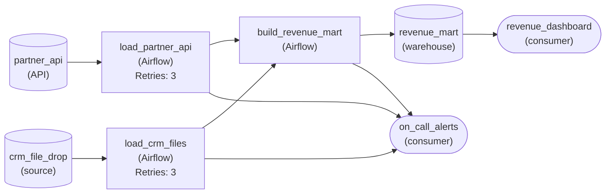

*Both loads fan in to `build_revenue_mart`; each load retries on its own and every task pages `on_call_alerts` when it fails.*

| Pitfall: A start time is not a dependency |
| --- |
| Scheduling the build at 4am because the API is usually ready by 3am works until the night it is not. The build still succeeds, on half the data, and nothing fails. Moving the build later only shrinks the odds; an edge removes them. |

| Key insight: Failures left after retries have to reach a person |
| --- |
| Retries absorb the transient failures. The ones left are real, so every task routes to `on_call_alerts`: once retries run out, the run stops loudly instead of leaving yesterday's numbers on the dashboard. |

**Follow-up questions**

1. The CRM drop sometimes arrives with zero files. Should `load_crm_files` succeed?\
   *Whether a task can succeed while delivering nothing, and where a check belongs in the graph.*
2. A load half-wrote its rows before it failed. What has to be true for its retry to be safe?\
   *Whether task-level retries assume the write can be repeated without duplicating rows.*

</details>


<br>

### Exercise 9 of 12

**● TASK**

One Airflow DAG runs an hourly load of app events from Kafka and a daily revenue rollup together, so the rollup is scheduled hourly too and a slow rollup run holds back the next load. Split it at the cadence boundary: an hourly DAG that lands the events in the warehouse, and a daily DAG that reads the landed events and builds the revenue table a finance dashboard reads.

<details>
<summary><strong>Solution</strong></summary>

#### Split where the schedules disagree

Cadence is the second boundary the section names, and it is the one this pipeline crossed. A DAG has exactly one schedule, so an hourly load and a daily rollup sharing it force a bad choice: the rollup runs 24 times a day for no reason, or the hourly loads queue behind a slow rollup. Splitting at the cadence boundary gives each piece the schedule it needs, and the price is a seam between two DAGs that now has to be coordinated.

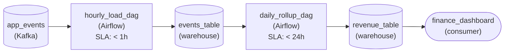

*Two DAGs, two clocks: `hourly_load_dag` lands events hourly, `daily_rollup_dag` reads `events_table` once a day.*

1. **Give each cadence its own DAG**

   The event load must finish every hour; the rollup only matters once a day. Each gets its own orchestrated DAG with its own schedule, so a long rollup can no longer delay the next hourly load, and a failed hourly run retries without touching revenue.

2. **Hand off through the landed table**

   The two DAGs never call each other's tasks. The hourly DAG writes `events_table`; the daily DAG reads it. That stored table is the contract at the seam: as long as its shape and completeness hold, either side can change internally.

| Pitfall: A daily task inside an hourly DAG runs on the wrong clock |
| --- |
| Leaving the rollup in the hourly DAG and guarding it with a 'only run at midnight' branch keeps the coupling: the rollup still shares the hourly DAG's runs, failures and retries. If the work has a different cadence, it belongs in a different DAG. |

| Key insight: Splitting buys independence and costs a wait |
| --- |
| The daily DAG must not start until the day's last hourly load has landed. That cross-DAG wait (a sensor, or a completeness check on `events_table`) is the coordination cost you accepted. Split when that cost is smaller than the coupling it removes. |

**Follow-up questions**

1. Another team wants hourly features from the same landed events. Do they get a task in `hourly_load_dag` or their own DAG?\
   *Applies the ownership boundary when the cadence already matches.*
2. The rollup drops to 5 minutes. Is the split still worth keeping?\
   *Weighs coupling against coordination once the symptom shrinks but the cadences still differ.*

</details>


<br>

### Exercise 10 of 12

**● TASK**

Orders from an app's Postgres arrive through a bought change-data-capture connector and CRM accounts through a bought API connector; both land rows unchanged in the warehouse. A payment partner's legacy API has no connector, so you build its extractor, and raw card numbers from it must never reach the warehouse. Decide where each source is transformed, ELT or ETL, so a daily revenue dashboard reads SQL models built from all three.

<details>
<summary><strong>Solution</strong></summary>

#### The connector you buy decides where the transform lives

Whether a source is ELT or ETL is often settled by a build-versus-buy call made one layer earlier. A bought connector copies rows as they are, so every source it handles is ELT by construction: the reshaping moves into SQL models in the warehouse. The one source you build yourself is where you still get to choose, and here a contract makes that choice for you.

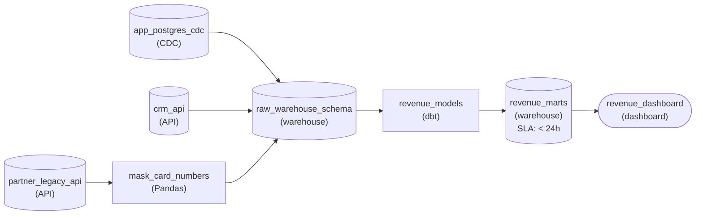

*Bought connectors land raw; only the built partner extractor masks before load; `dbt` models in the warehouse build the daily revenue marts.*

1. **Let the bought connectors load raw**

   The Postgres change feed and the CRM connector land rows unchanged in a raw schema. That is not a compromise: raw history in the warehouse means a model bug is fixed by rebuilding the model, not by re-extracting from the source.

2. **Transform before load where a rule forbids raw**

   The partner extractor is code you own, so it can mask card numbers in flight. The contract says raw numbers never reach the warehouse, which rules out loading first and masking in a model: that one source is ETL, and everything after the raw schema is the same SQL modeling the other two get.

| Pitfall: Masking in a model is already too late |
| --- |
| Landing the partner rows raw and masking them in a `dbt` model looks tidy, since every source then follows one ELT pattern. But the raw card numbers sat in the warehouse between load and model run, and in its time travel and backups too. A rule about what may land is a rule about the load step. |

| Real world: Build the one connector, not the platform |
| --- |
| The extractor is the only built piece here, and it carries the hidden cost the section described: you now own its retries, the on-call page when the partner renames a field, and its eventual replacement. That is worth paying for one source no vendor covers; it is not worth paying for Postgres or the CRM. |

**Follow-up questions**

1. A connector vendor ships a column-hashing feature that runs before load and supports the partner API. Does the partner source change?\
   *Whether the build decision survives once a buy option can do the in-flight transform, weighed against the extractor's ongoing ownership cost.*
2. Analysts later need each card's issuing country, which comes from the leading digits of the raw number. Where does that derivation run?\
   *Whether a new derivation must move before load when the field it depends on is masked, rather than into the warehouse models.*

</details>


<br>

### Exercise 11 of 12

**● TASK**

Six DAGs each read Postgres orders directly and compute their own weekly active users, so one schema change breaks all six. Redesign it as layers: an orchestrated ingestion task with retries lands orders in a shared raw store, and one curated build writes the shared tables to a warehouse. The reporting dashboard reads only the curated layer, and a failed ingestion pages the owning team.

<details>
<summary><strong>Solution</strong></summary>

#### One owner per layer, not one DAG per team

Redesigning a tangled graph starts with fan-in. When six DAGs each pull Postgres orders, the source has six readers, so one column rename fails six runs at once and nobody knows whose page it is. The layered shape fixes the dependency graph itself: one ingestion task owns the source, one curated build owns the shared definitions, and everything downstream depends on the curated layer instead of the source.

1. **Give the source exactly one reader**

   Replace the six direct reads with one orchestrated ingestion task that lands orders unchanged in the raw store. A schema change now breaks one task with one owner, fixed in one place. Retries live on that task, because a source timeout is a task-level failure the orchestrator can rerun without touching anything downstream.

2. **Make consumers depend on curated, not raw**

   Weekly active users disagreed because each team wrote its own version. Move the definition into one curated build that reads raw and writes the shared tables to the warehouse, then point the dashboard at the warehouse. The edges now run raw, then curated, then consumers, and the orchestrator orders the tasks the same way.

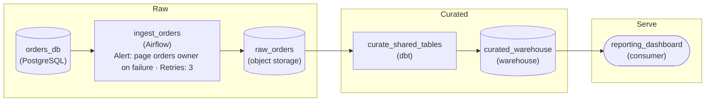

*One orchestrated ingestion lands orders raw; one curated build feeds the warehouse the dashboard reads.*

| Pitfall: Merging the six DAGs into one file changes nothing |
| --- |
| Consolidating code without changing the edges keeps six readers on the source. The test is the graph: if any consumer still has an edge to Postgres or to the raw store, the next schema change still fans out. |

| Key insight: A page should land on whoever owns the failing task |
| --- |
| Half the night pages had no owner because tasks crossed team lines. Once each layer has one task and one team, the failure alert on ingestion reaches the people who can actually fix the source. |

**Follow-up questions**

1. A billing API now has to join the curated tables. Where does it enter the graph?\
   *Whether a new source becomes a second ingestion task into the same raw layer rather than another point-to-point DAG.*
2. The curated build fails after ingestion succeeds. What should rerun?\
   *Task-level reruns: only the curated build reruns, reading raw data that already landed.*

</details>


<br>

### Exercise 12 of 12

**● TASK**

A grocery-delivery platform runs one 48-task Airflow DAG holding the platform team's hourly Postgres orders load and the finance team's nightly payout reconciliation, so a failed finance task holds back the hourly load. The platform team also runs a separate hourly DAG for inventory from the fulfillment API, started 20 minutes later by clock. Redraw the boundaries as one DAG per owner and cadence. At the seam, the platform's hourly output must state a freshness under one hour and pass a contract check before the nightly side reads it, with the platform team paged on failure.

<details>
<summary><strong>Solution</strong></summary>

#### Draw the boundary where the owner or the cadence changes

Where one DAG ends and the next begins is a decision about failure and ownership, not task count. Two rules settle it: split wherever the owning team changes or the cadence changes, and **merge work that shares both**. The hourly orders load and the nightly payout reconciliation differ on both counts, so they belong in separate DAGs. The orders and inventory loads share an owner and an hour, so they belong in one.

1. **Split finance out of the hourly DAG**

   In one shared DAG a failed reconciliation task holds the run open, and the next hourly run waits behind it. Give finance its own nightly DAG and the hourly load stops sharing its fate. Each team now owns the retries and the alerts for its own graph.

2. **Merge the two hourly platform loads**

   An inventory DAG that starts 20 minutes later is a clock standing in for a dependency. Same owner, same cadence: fold it into the hourly DAG as a task downstream of the orders load, so it starts when orders actually finish rather than when they probably have.

3. **Publish the seam as a contract**

   The nightly DAG reads a hand-off table, never the hourly DAG's internals. The table states its freshness promise of '< 1h', a quality gate checks it before finance reads, and a failure pages the platform team because the producer owns the fix.

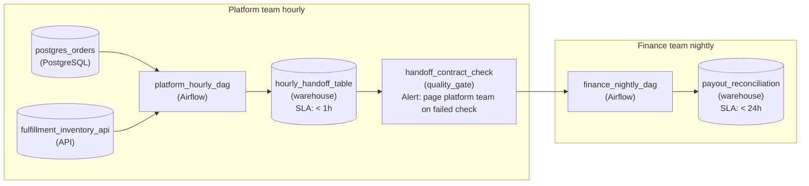

*Two DAGs, one per owner and cadence, meeting at a checked hand-off table that pages its producer.*

| Pitfall: A split without a contract just moves the coupling |
| --- |
| Cutting the shared DAG in two and wiring the nightly DAG to wait on an hourly task by name keeps the hidden dependency: rename that task and finance breaks without warning. The seam has to be a table with a stated freshness and a check, so each side can change its internals freely. |

**Follow-up questions**

1. Inventory moves to a 15-minute cadence while orders stay hourly. Do the two loads still belong in one DAG?\
   *Applies the cadence rule on its own, with the owner held constant.*
2. The hand-off check fails at 1am. What should the nightly DAG do, and who reruns what?\
   *Tests that the contract names the failure behavior on both sides of the seam.*

</details>
