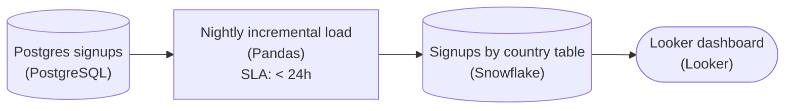
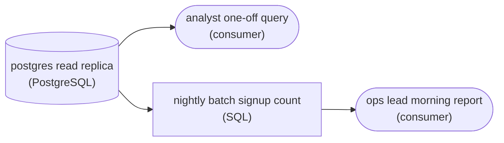
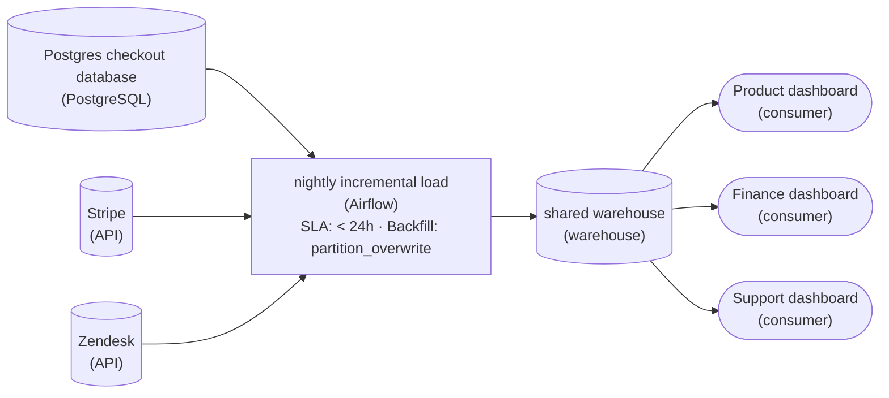
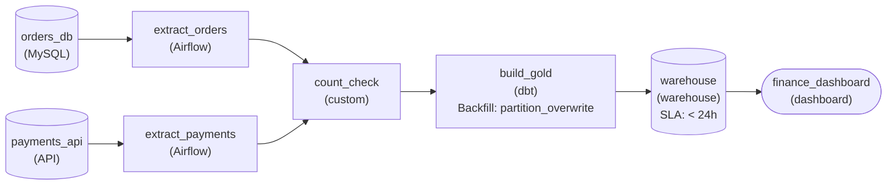
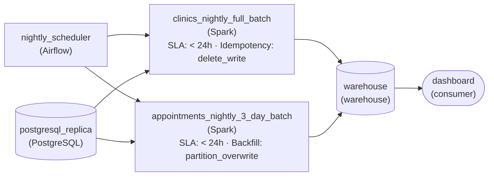
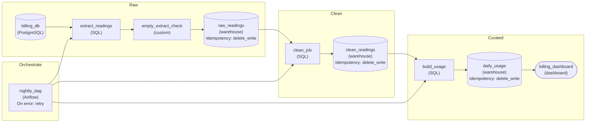

# Pipeline Anatomy: Beginner - Exercises

Lesson: [pa_what_is_a_pipeline_beginner.md](../pa_what_is_a_pipeline_beginner.md)

### Exercise 1 of 6

**● TASK**

Every night a Python batch job wipes and reloads a Snowflake table of daily signups by country straight from Postgres, and a Looker dashboard reads that table each morning. Postgres keeps only 90 days of signups, so each full reload throws away every day older than that. Wire the source, the job, the table and the dashboard end to end, and choose how the nightly load runs so the table keeps every past day while still refreshing once a day.

**Starting canvas** (already placed for you):

- Postgres signups (90-day retention) (source, PostgreSQL)
- Daily Python ETL (transform, Pandas)
- Snowflake daily_signups_by_country (storage, Snowflake)
- Looker dashboard (consumer, Looker)

<strong>Solution</strong>

#### Full reload or incremental: the 90-day trap

An **incremental load** adds only the slice of data that is new since the last run. A full reload rebuilds the whole destination from the source every time. Which one fits depends on what the source still remembers. Postgres prunes signups after 90 days, so a full reload can only ever rebuild 90 days, and every night it quietly drops the 91st. The table can outgrow its source only if each nightly batch run appends its own day and leaves the older days alone.

*One source, one nightly batch transform, one destination: each run appends a single day, so history outlives Postgres's 90 days.*

1. **Read one bounded day per run**

   The job runs once a night as a batch over a bounded input: the signups created on the run's date. Take that window from the run's date, not the clock, so a rerun of 14 March next week reads the same day. Each run produces one row per country for its day.

2. **Append that day and leave the rest alone**

   The load writes those rows into the Snowflake table and touches nothing older. Days Postgres has already pruned survive because no run ever rewrites them. Each morning the dashboard reads the whole table and sees every day since the job started.

| Pitfall: A full reload is capped at the source's memory |
| --- |
| Wipe-and-reload feels safe because the table always matches Postgres. That is the problem: it matches a source that forgets. The dashboard's history shrinks back to 90 days every night, and nobody notices until someone asks for last spring. |

| Key insight: Full reloads still win when the source keeps everything |
| --- |
| If the source holds its full history and is small enough to reread in one night, a full reload is simpler: there is no window to get wrong, and edits to old rows are picked up for free. The trade flips once the source forgets, or grows past what one night can reread. |

**Follow-up questions**

1. A refund edits a signup from 3 days ago. Does the incremental load ever see that change?\
   *What an append-only daily window misses when older rows change.*
2. The 14 March run fails and the 15 March run succeeds. What is missing from the table, and how does the date window help you fill it?\
   *Why taking the window from the run's date makes a single missed day easy to rerun.*
3. If Postgres kept every signup forever, would you still choose an incremental load?\
   *Weighing simplicity against nightly cost once retention is no longer the constraint.*

 

### Exercise 2 of 6

**● TASK**

A startup built a six-node pipeline (Postgres to Fivetran to S3 to dbt to Snowflake to Looker) for the CEO's one-time question about last quarter's signups; nobody reads it now. The ops lead does want yesterday's signup count each morning. Redesign for the cheapest shape that covers both, with no reads on the production database: decide which need a person answers by querying directly and which earns a scheduled batch job.

**Starting canvas** (already placed for you):

- Postgres app DB (production) (source, Postgres)
- Fivetran extract (transform, Fivetran)
- S3 raw (storage, S3)
- dbt curated (transform, dbt)
- Snowflake quarterly_signups (storage, Snowflake)
- Looker - 'CEO question' dashboard (consumer, Looker)

<strong>Solution</strong>

#### A query for the one-off, a batch job for the recurring

Batch processing earns its place when the same bounded question comes back on a schedule; a question asked once is just a query. The CEO's count of last quarter's signups is bounded and asked once. One analyst runs it by hand against a read replica, and that is the end of it. The ops lead's count of yesterday's signups is just as bounded, but it is asked every morning. That makes it the one need here that earns a **scheduled batch job**: a nightly run that reads only the previous day's rows from the replica and delivers one number.

*2 needs, 4 nodes. The analyst reads the replica once by hand. One nightly batch job counts one day's rows on the replica and sends the ops lead a single number.*

| Pitfall: Keeping the warehouse to serve one daily number |
| --- |
| The tempting fix is to keep the six-node chain and point the daily count at it. That keeps an extract, a raw layer, dbt models, a warehouse table and a dashboard running to serve one integer a day. A nightly job that counts one day's rows on the replica needs none of them. Its input is bounded, it finishes in seconds, and a failed run is fixed by running that one day again. |

| Key insight: The replica carries every read |
| --- |
| Both needs read the replica, never the checkout instance. That one extra instance takes the load off production for the analyst and the nightly job alike, so neither has to copy data anywhere first. |

**Follow-up questions**

1. The ops lead now wants a year of daily counts kept and charted. What is the first thing you add, and why that one?\
   *Tests when stored history, rather than the count itself, starts to justify a storage stage.*
2. The nightly job fails on Tuesday and nobody notices until Thursday. What does the rerun need to read, and why is that cheap here?\
   *Tests that a bounded daily input turns a rerun into a one-day job.*

 

### Exercise 3 of 6

**● TASK**

Nine team-specific extracts read three sources (the Postgres checkout database, Stripe and Zendesk) into three dashboards (Product, Finance and Support), so every source is scanned three times a night. Replace them with one nightly batch job, run by a scheduler, that loads all three sources into one shared warehouse the three dashboards read from. Each run loads only the day it owns rather than reloading full history, so rerunning a failed night replaces just that day.

<strong>Solution</strong>

#### Nine extracts, one scheduled batch job

A **scheduled batch job** fits whenever readers can wait until morning. It reads a bounded slice of each source once, at an hour the source is quiet, and writes that slice where every reader can find it. The nine extracts were already nine batch jobs. The problem was that each source paid for three reads a night, so the checkout database spent its night-time disk and memory on the same rows three times while it was still taking payments. Collapsing the nine into one costs the dashboards nothing, because all three were a day behind already, and it cuts the reads on every source to one.

*Read left to right: three sources, one scheduled nightly load that writes only the day it owns, one shared warehouse, and three dashboards reading from it.*

1. **Read each source once**

   Every source gets exactly one arrow out, into the same nightly load. A fourth team that wants these numbers adds a new reader on the warehouse. It never adds a new extract against the checkout database.

2. **Hand the start time to a scheduler**

   The scheduler owns when the job runs and in what order its tasks go, so the run starts at night without anyone pressing a button. The warehouse is written only after the extract for that night has finished.

3. **Load only the day the run owns**

   The 14 March run reads only the rows that changed on 14 March and writes only that day's slice of the warehouse. Setting the load to `partition_overwrite` means a rerun of a failed night replaces that one day and leaves every other day untouched.

| Pitfall: A full reload repeats the scan you were escaping |
| --- |
| Reloading full history every night is simpler to write, but it re-reads every row the checkout database has ever stored on the same machine that takes payments. It also makes a rerun as expensive as the first run. Loading one day keeps each night's read bounded, however long the shop has been open. |

**Follow-up questions**

1. A Stripe refund can arrive three days after the payment it reverses. Which day's run should pick it up, and what does that do to the day it owns?\
   *Extends the incremental load to rows that change after their own day has already been loaded.*
2. Finance asks for its numbers by 06:00 and Support asks for 09:00. Does that call for one nightly job or two?\
   *Tests whether a different deadline justifies a second scheduled job.*

 

### Exercise 4 of 6

**● TASK**

Build the nightly batch as an orchestrated DAG: an orders extract from MySQL and a payments extract from an API both feed a row-count check, and only after it passes does a gold build load the warehouse behind the finance dashboard. Each run loads only its own date's orders and payments, never the full history, so rerunning a past night replaces just that day's slice. Finance checks the dashboard once each morning, so a daily refresh is enough.

<strong>Solution</strong>

#### One bounded day per run

This pipeline is a nightly batch job: it wakes once, reads a bounded slice of input, produces a finished result and stops. The slice is the part worth getting right. Each run takes its window from the run's date, not the clock, so the run for 14 March reads the orders and payments created on 14 March and nothing else. That is an **incremental load scoped by date partition**, and it is why a rerun next week reads the same slice instead of whatever the source holds by then.

*The nightly batch: `extract_orders` and `extract_payments` each read one day and fan in at `count_check`; `build_gold` overwrites that day's partition in the `warehouse`, refreshed daily for the `finance_dashboard`.*

1. **Scope each extract to the run date**

   Both extracts filter on the run's date, so each produces exactly one day of raw rows that can be opened and counted. They read different systems, so they run side by side and fan in at `count_check`, and nothing downstream starts until both have succeeded.

2. **Overwrite the day's partition on load**

   `build_gold` writes into the warehouse with `backfillStrategy` set to partition overwrite: the run for a date replaces that date's partition and touches nothing else. Rerun 14 March after late refunds and that day's totals are corrected while every other day stays as it was.

| ✕ Full reload every night | ✓ Load only the run date |
| --- | --- |
| Reads every order ever placed, rebuilds every total and rewrites the whole table. Simple, but the work grows with history, and a peak month makes every night slower. | Reads one day, writes one partition. The work stays the size of a day, and a rerun is a targeted correction instead of a rebuild. |

| Pitfall: Appending a rerun counts the day twice |
| --- |
| An incremental load that appends instead of overwriting looks fine on the first run. The day a night is rerun, its rows land a second time and the dashboard shows that day doubled. Scoping the read to a date is only half of it; the write has to replace the same date. |

**Follow-up questions**

1. Refunds keep arriving for up to 3 days. How would each night also refresh the two days before it?\
   *Widening the incremental window from one partition to a short trailing range of partitions.*
2. When would reloading the full history every night be the better choice?\
   *A small source, or rows that change anywhere in history, can make a full reload simpler and still cheap.*

 

### Exercise 5 of 6

**● TASK**

Clinic managers read yesterday's numbers on a warehouse dashboard at 7am, rebuilt by hand each morning from the PostgreSQL replica. Choose what replaces that hand step (a query, the replica, a cache or a scheduled batch job) and design how it runs between the midnight close and 7am, including the bounded input each table's run reads. Clinics: 300 rows, edited and deleted in place. Appointments: 40M rows, a 9-hour full read, edited up to 3 days after a visit.

<strong>Solution</strong>

#### A recurring reader earns a nightly batch

Batch processing earns its place here because the reader comes back every morning and only wants yesterday. A query, the replica or a cache would each leave someone repeating the hand step. Once you choose the batch, the work is structuring its execution. A batch run starts on a schedule, reads an input fixed before it starts, runs to completion and stops, and here it has the 7 hours between midnight and 7am to do all of that. Each table's run gets its own bounded input sized to that window. The 300 `clinics` rows fit whole every night. A 9-hour full read of `appointments` does not fit, so its run reads only the recent days that can still change.

| ✕ A query, the replica or a cache | ✓ A scheduled nightly batch |
| --- | --- |
| A hand-run query answers one question once. The replica only moves scans off the primary database, and a cache only speeds up an answer that already exists. None of them puts yesterday's numbers in the warehouse before managers arrive, so someone keeps repeating the hand step every morning. | A scheduled batch runs once a night over a fixed slice of each table, reads from the replica, and lands the numbers before the first manager looks. A reader who returns every day is what pays for the job. |

*A scheduled nightly batch over the `postgresql_replica`. `nightly_scheduler` starts both runs through dependency edges after midnight. Each run reads an input fixed by its run date, completes under a daily '< 24h' freshness, and stops before the 7am dashboard. `clinics_nightly_full_batch` reads all 300 rows and replaces its table; `appointments_nightly_3_day_batch` reads the last 3 days and overwrites those partitions in the `warehouse`.*

1. **Give the batch a trigger and a cadence**

   Nobody should have to start this job, so a scheduler owns it. `nightly_scheduler` triggers both batch runs once the day closes after midnight. Its edges are dependencies, not data. The cadence comes from the reader: managers only ask about yesterday, so each run carries '< 24h'. A continuous feed would add a job to keep alive for a freshness no one reads.

2. **Bound each run's input to fit the window**

   A batch run fixes its input before it starts, keys it to its run date, and must complete inside the 7 hours between midnight and 7am. For `clinics` that input is a full snapshot of 300 rows, and `delete_write` replaces the table, so a closed clinic simply disappears. For `appointments` it is the 3 days before the run date, roughly 75,000 rows at 25,000 a day, written with `partition_overwrite`. Tonight's window overlaps 2 days that last night already loaded, so the run rewrites those partitions instead of appending a second copy.

| Pitfall: An unbounded read outgrows the night |
| --- |
| Rereading all 40 million `appointments` rows takes 9 hours, past the 7 hours between midnight and 7am, and the read grows every day as history piles up. A batch run keyed to its run date reads a fixed slice instead, so its runtime stays flat. Shrinking that slice to 1 day goes too far: an edit made the next afternoon would never arrive, which is why the window covers 3 days. |

**Follow-up questions**

1. Appointment edits can now arrive up to 30 days after the visit. What happens to the nightly read volume, and is a bounded batch still the right call?\
   *Sizing a lookback window: 30 days at 25,000 a day is about 750,000 rows, still far below a full read.*
2. The `clinics` table grows to 5 million rows after a merger. At what point would you move it off a full load?\
   *A full load's cost tracks table size, so a growing table eventually earns an incremental load.*
3. Finance asks for the total number of appointments ever booked, once, for a board slide. Does that need a change to this nightly batch?\
   *A question asked once is answered by a query on the replica, not by a new scheduled job.*

 

### Exercise 6 of 6

**● TASK**

Design a nightly batch pipeline that loads one day of water meter readings (about 3 million rows) from a PostgreSQL billing database into a warehouse, landing them raw, cleaning them, and building a daily usage table read by a billing dashboard. An orchestrator must run the stages in dependency order and retry a stage that fails. Because a retry reloads the same day, every load must be idempotent, by partition overwrite or MERGE, so a rerun leaves that day's rows unchanged. If the extract returns zero rows, the run must stop before it overwrites good data.

<strong>Solution</strong>

#### A retry is only as safe as the write it repeats

Idempotency is what turns a retry from a risk into a repair. The orchestrator will rerun a failed stage on its own, so every write in this pipeline has to leave the same 3 million rows whether it runs once or 5 times. In practice that means each layer replaces the day it owns instead of appending to it. It also means nothing gets replaced until a check has confirmed there is something to replace it with.

*`nightly_dag` runs extract, clean and build in order with retries; every layer overwrites its own day, and an empty extract stops at `empty_extract_check`.*

| ✕ Partition overwrite | ✓ MERGE |
| --- | --- |
| Delete the day's partition and write the fresh extract in one transaction (`delete_write`). It fits here: readings arrive as whole days and a corrected day is re-extracted in full, so replacing the whole partition is exactly right. It is also cheap, one bulk write per day with no per-row key lookup. | Match each incoming row on meter and reading time, then update or insert (`upsert`). Reach for it when a run carries a mix of days or only the rows that changed, because it never deletes what the run did not mention. The price is a key comparison against the target for every row. |

| Pitfall: An overwrite trusts its input completely |
| --- |
| Partition overwrite is idempotent, and it will just as reliably replace a full day with nothing. If the extract times out and returns zero rows, a blind `delete_write` wipes the day in `raw_readings`, and every later stage faithfully carries the empty day to the dashboard. The row-count check in front of the raw write fails the run instead, so the good rows stay put and the failure is visible. |

| Key insight: Retries need idempotent stages and real dependencies |
| --- |
| The 'retry' action on `nightly_dag` reruns whichever task failed, which is safe only because each write it repeats replaces its day. Put the same retry on an append and a timeout at 02:04 becomes a duplicated day at 02:31. The dependency edges matter as much: `clean_job` starts when the raw write succeeds, not at a clock time cron guessed. |

**Follow-up questions**

1. Corrected readings now arrive up to 3 days late. What changes in the nightly run?\
   *Extending partition overwrite to a rolling window: each night re-extracts and overwrites the last 3 day partitions, and reruns stay idempotent.*
2. A `meters` table of 400,000 accounts, edited in place, must also reach the dashboard. Full or incremental load?\
   *Choosing a full load for a small table that changes in place, versus the incremental daily load that suits append-only readings.*

