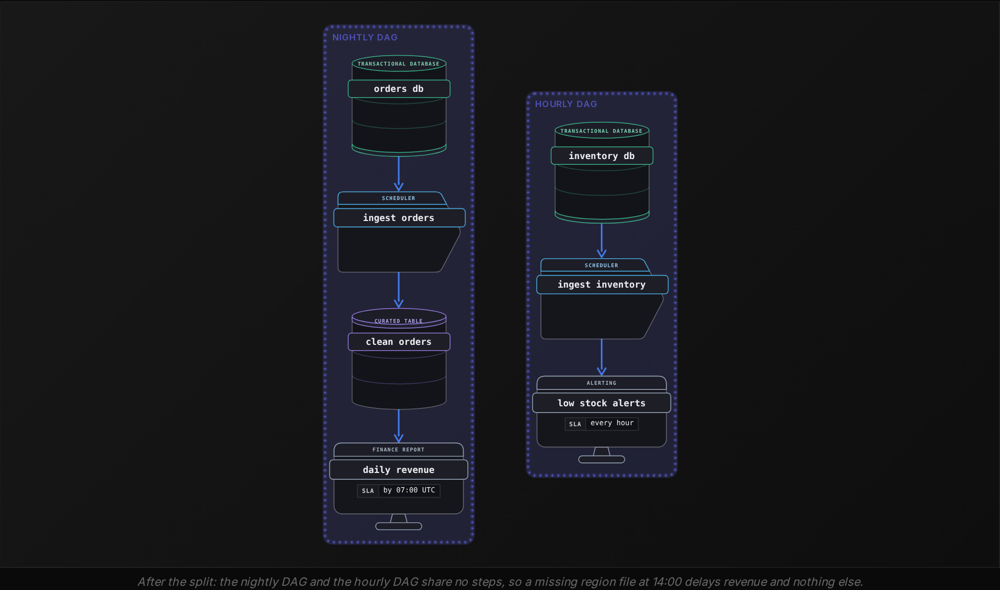
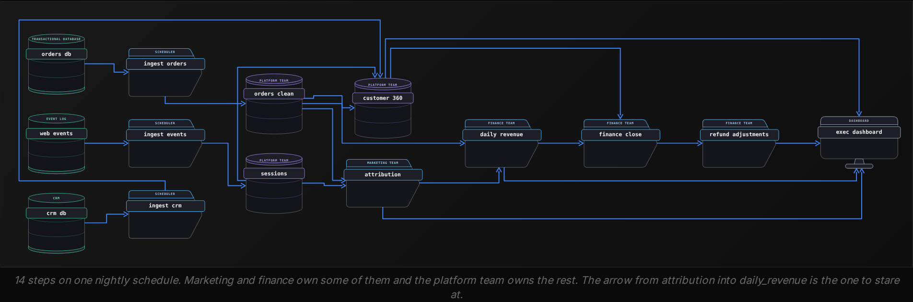
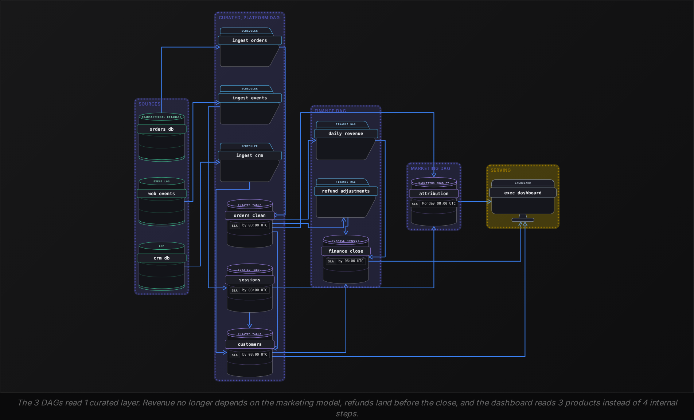

# Pipeline Anatomy: Advanced

Picture Spotify in October: the Wrapped team needs a listening-sessions table that a recommendations team built 4 years ago for its own model. Royalty reporting reads it too. Wrapped wants column names frozen until December, recommendations wants rows by 06:00, royalties wants every row. That is 3 promises from 1 pipeline, and none of them is written down. This lesson is about writing them down.


<br>

---

## Pipelines as Products

The intermediate lesson drew pipelines as boxes and arrows: sources on the left, a curated layer in the middle, consumers on the right. Those diagrams answer where data moves. A product framing asks a second question of every box on the right edge: who reads this, and what did we promise them? A pipeline is a product when it has a named consumer and a written contract, and when someone has planned how it will be retired. A pipeline with none of those is a script that happens to run on a schedule, and the first person to notice it broke is a stranger on another team.


<br>

### Name the consumer

Take a curated table of music listening sessions, one row per user per session, read by 3 teams. Each reads it for a different reason, so each breaks in a different way.

| Consumer | What they read | What breaks them |
| --- | --- | --- |
| Recommendations | sessions from the last 24 hours, by 06:00 | a table that lands at 09:00 misses the morning model refresh |
| Royalty reporting | every session in a calendar month | a day with 2% of rows missing understates payouts |
| Yearly recap campaign | 12 months of sessions, read once in December | a renamed `ms_played` column 3 days before launch |

Without this list, every design decision is a guess. Should the pipeline ship a partial day at 06:00 or a complete day at 09:00? Recommendations wants partial and royalties wants complete. The answer is 2 outputs: a `listening_sessions_early` snapshot at 06:00 with recommendations as its only consumer, and the final table at 09:00 for everyone else.


<br>

### Write the contract

A contract is the promise in writing: what a row means, which columns exist with which types, when the table is ready, how complete it is, how it may change, and who gets paged when any of that fails. It fits on one screen, and each consumer signs off on it before the first row lands. Here is the contract for the final table.

```sql
product: curated.listening_sessions
owner: listening-data-team
grain: one row per user per listening session
consumers:
  - royalty-reporting
  - yearly-recap
ready_by: "09:00 UTC"
completeness: at least 99.5 percent of the sessions landed in raw for that day
columns:
  user_id: bigint, never null
  session_start: timestamp, never null
  ms_played: bigint
  event_date: date, partition key
change_policy: additive only, 30 days notice before any removal or rename
paged: listening-data-oncall
```

Each line of the contract maps to a check the pipeline runs on itself. The `ready_by` and `completeness` lines become the query below, run at 09:00. It fails if the curated table holds under 99.5% of the sessions that landed in `raw.listening_sessions` for yesterday, or if yesterday's latest session started before 23:00, a sign the day was cut off. The `columns` line becomes a check on names and types.

```sql
SELECT
  COUNT(*) >= 0.995 * (
    SELECT
      COUNT(*)
    FROM raw.listening_sessions
    WHERE event_date = CURRENT_DATE - INTERVAL '1' DAY
  ) AS is_complete,
  MAX(session_start) >= CAST(CURRENT_DATE - INTERVAL '1' DAY AS TIMESTAMP) + INTERVAL '23' HOUR AS reaches_day_end
FROM curated.listening_sessions
WHERE event_date = CURRENT_DATE - INTERVAL '1' DAY
```


<br>

### Define the deprecation path

Every table is eventually replaced. The product framing plans that replacement on day 1, because the consumer list is the only way to know who the replacement will hurt. The path has 4 steps, and the contract's `consumers` field drives the 3rd.

- Ship the replacement under a new name, listening_sessions_v2, with its own contract
- Run both for a fixed window, 30 days, and publish the differences between them
- Contact each listed consumer and confirm they have moved; the list is the migration checklist
- Announce a final date for the old table, then drop it on that date, not 'soon'

> **TIP**
>
> Write the contract before the first row lands. A contract written after launch describes what the pipeline happens to do; a contract written before launch describes what the consumer needs, and every surprise a consumer hits comes from the difference between the 2.

**A team runs a nightly job that writes orders_daily. It has run for 3 years, 6 dashboards query it, and nobody on the team can say which 6. Which single change moves it furthest toward being a product?**

- **A.** Add a _v2 suffix to the table name so a future replacement has somewhere to go
- **B.** Query the warehouse's access logs, list the 6 dashboards and their owners, and record them with the table
- **C.** Add a row-count check so the team is paged when the nightly write produces 0 rows
- **D.** Move the job to a 09:00 schedule so it has time to finish before the dashboards refresh

<details>
<summary>Solution</summary>

**B.** Query the warehouse's access logs, list the 6 dashboards and their owners, and record them with the table

The other changes depend on the consumer list: the contract is written for those 6 owners, and the deprecation path uses the list as its checklist.

**Why the others are wrong**

- **A.** Versioning only helps once you know who to migrate. Without the consumer list, the suffix is a name change with no checklist behind it.
- **C.** A check belongs to a contract, but a check without a known consumer guards a promise nobody asked for. It is the 2nd step, after naming the consumer.
- **D.** Picking a time before knowing when the dashboards refresh is a guess; 1 of the 6 may refresh at 08:00 and break the moment the schedule moves.

</details>


<br>

---

## The Cross-Cutting Undercurrents

The beginner lesson had 4 roles: source and consumer at the ends, with transform and storage between them. The undercurrent map regroups them into 4 columns that read left to right. Source stays as it was. Ingest is the first transform, the one that pulls data out of the source. Transform covers the remaining steps and the storage they write. Serve is the stored output as consumers read it. The undercurrents run the other way. Each is a concern no single box owns, so each shows up in all 4 columns, and a design that handles it in 1 column and forgets the other 3 still fails.


<br>

### The 6 undercurrents

- **Reruns** *a step runs twice*\
  A nightly load fails at 02:10 and someone restarts it at 08:00. If the first attempt had already written 400,000 rows, does the table now hold 800,000?
- **Failures** *a step stops partway*\
  The transform step dies after writing 3 of 12 regions. Does the serving step wait, run on the 3, or run on yesterday's 12?
- **Change** *a source changes shape*\
  The orders service renames amount to amount_cents. Which step is the first to notice, and is that step a check or a dashboard?
- **Lateness** *a row arrives after its day closed*\
  A session that ended at 23:58 on Tuesday reaches the pipeline at 00:40 on Wednesday, after Tuesday's totals were served. Does Tuesday ever get corrected?
- **Visibility** *someone asks if the table is right*\
  At 09:00 an analyst asks whether yesterday is complete. Can anyone answer from a dashboard, or only by running queries by hand?
- **Cost** *the bill arrives*\
  The pipeline scans 2 TB a night. Is that because consumers need 2 TB, or because a rerun also rescans 30 days it did not need to?

Each undercurrent has a different answer in each role, which is why mapping them is worth a table. Read it one row at a time: the reruns row asks what the source does under a rerun, then what ingest does, then transform, then serve. A cell that nobody on the team can fill is a gap in the design, found before it is found in production.

| Undercurrent | Source | Ingest | Transform | Serve |
| --- | --- | --- | --- | --- |
| Reruns | can the source be read twice for the same window | does a 2nd pull for the same window replace the 1st | does rerunning a day overwrite that day's output | does a consumer see the half-written state mid-rerun |
| Failures | does the source return partial data or an error | is a partial pull discarded or kept | does a step that dies leave a marker the next step reads | does serving fall back to the last complete day |
| Change | does the source announce changes to its shape | are unknown columns kept, dropped, or rejected | does a renamed column fail the step or silently null the output | does the consumer's contract say which columns are stable |
| Lateness | how long after an event can the source still emit it | is the pull window wider than the lateness | are closed days reopened, and how many days back | does the consumer know a day's number may move |
| Visibility | does the source expose its own row counts | is the pulled row count recorded per run | is output row count compared with input | is each day's ready time recorded where consumers look |
| Cost | does each pull hit a production database | is the pull incremental or full | does a rerun touch 1 day or 30 | does each consumer's query read only the partitions it needs |


<br>

### Walking a design through the map

Take the listening sessions pipeline and walk the lateness row. Source: the mobile app buffers sessions while the phone is offline, so a session can arrive up to 3 days late. Ingest: the nightly pull reads yesterday only, so a 2-day-old session is never pulled. That cell already fails. Transform and serve never see the row, so nothing in their cells can recover it. The fix belongs in ingest: widen the pull to 3 days and rewrite those 3 days each night. That fix then changes the reruns row, because 3 days are rewritten and the write must replace rather than add, and the cost row, because 3 days are scanned instead of 1. One undercurrent pulled 2 others with it, which is the normal case.

> How the rows pull on each other
>
> - Lateness forces reruns: a day that reopens is a day that is written twice
> - Reruns force cost: every reopened day is rescanned, so the rerun window is a bill
> - Failures force visibility: a step that stops partway is safe only if the next step can see it stopped
> - Change forces contracts: a renamed column is harmless to a consumer whose contract never promised it

**A pipeline serves daily revenue. On Thursday a consumer notices that Monday's revenue figure changed by 0.4% overnight, with no alert and no note anywhere. Which cell of the map holds the gap?**

- **A.** Transform, lateness: the step should refuse rows for a day that has already closed
- **B.** Ingest, reruns: the 2nd pull for Monday should have replaced the 1st instead of appending
- **C.** Source, change: the revenue source renamed a column and the pipeline did not notice
- **D.** Serve, lateness: the consumer was never told that a closed day's figure can move

<details>
<summary>Solution</summary>

**D.** Serve, lateness: the consumer was never told that a closed day's figure can move

The number moved for a good reason. The gap is in the serve cell: the contract never said days reopen, so the consumer read a correction as a bug.

**Why the others are wrong**

- **A.** Refusing late rows removes the surprise by dropping real revenue. The map asks whether closed days reopen, and for revenue the answer is yes.
- **B.** An append bug doubles rows or adds a large block. A 0.4% move with no other symptom matches late rows arriving and being counted correctly.
- **C.** A renamed column fails a step or nulls a whole column; it does not nudge a figure by 0.4%. The shape of the symptom rules this out.

</details>


<br>

---

## When to Split, When to Merge

A DAG, a directed acyclic graph, is one scheduled graph of steps that runs as a unit: the arrows point forward and no step waits on itself. When a step fails, every step downstream of it is skipped, and steps on other branches still run. So a fragile step upstream of an urgent one sits on its critical path. Put too much into 1 DAG and a step nobody cares about ends up upstream of the step everyone cares about. Split into too many and every boundary becomes a handoff that nobody monitors. 3 signals decide where the edges go. Ownership and cadence are the first 2; the third is what it costs to operate the boundary.


<br>

### The 3 splitting signals

| ✓ Split when | ✗ Merge when |
| --- | --- |
| • 2 teams own steps in the same graph, and 1 team's bug pages the other<br><br>• Steps need different cadences: an hourly step inside a nightly DAG runs 24 times or once, never right<br><br>• A failure in 1 consumer's steps should not block another consumer: 2 consumers of 1 source each get their own graph<br><br>• A rerun of 1 half rescans the other half for no reason | • A step exists only to feed the next, and no other consumer reads its output<br><br>• Both sides are owned by the same team and run at the same cadence<br><br>• The boundary would need its own contract and a ready-time check with an alert on it, and nobody would own them<br><br>• Each half would be fewer than 3 steps and the halves would always run together |


<br>

### Worked example: orders and inventory

An online store runs 1 nightly DAG: pull orders, pull inventory, clean both together, compute daily revenue, compute low-stock alerts. The low-stock alerts are wanted every hour, so the team schedules the whole DAG hourly. Now daily revenue is recomputed 24 times a day, the orders database is pulled 24 times, and when an orders region file is missing at 14:00, the shared cleaning step fails and no low-stock alert fires until the file appears. Cadence is the signal: 2 cadences in 1 DAG, and the slow half is on the fast half's critical path.



After the split, the orders database is pulled once a night and the inventory database once an hour. The boundary costs almost nothing because the 2 graphs share no step, so there is no handoff to monitor. The decision gets harder when they do share one.


<br>

### When they share a step

Suppose low-stock alerts need `clean_orders` too, to know what sold in the last hour. Now that table has 2 consumers at 2 cadences. The split still holds, but the shared step either moves into the hourly graph, which then pulls orders hourly, or becomes a product of its own with a ready-time check that both graphs read. The rule from the product framing applies: a step read by another DAG is a product and gets a contract, even a 3-line one. Merging the 2 DAGs back together to avoid that contract trades 1 monitored handoff for the 24-times-a-day revenue problem, which is the worse deal.


**A single DAG owned by the marketing team has 9 steps. Step 7, finance_close, is owned by finance and is the only step finance uses. It runs nightly like the rest and fails about once a week on a finance-side input file. Should the DAG split, and on which signal?**

- **A.** Split on ownership: a finance file failure pages marketing, and marketing cannot fix it
- **B.** Keep it merged: the cadences match, so a split would add a boundary with no benefit
- **C.** Split on cadence: a weekly failure means finance_close wants a weekly schedule
- **D.** Split on cost: 9 steps is past the size at which a DAG should always be divided

<details>
<summary>Solution</summary>

**A.** Split on ownership: a finance file failure pages marketing, and marketing cannot fix it

Matching cadence does not save the design. Every weekly failure wakes the wrong team, and the 2 steps after finance_close wait on a file marketing has never seen.

**Why the others are wrong**

- **B.** Cadence is 1 of 3 signals. An ownership mismatch alone justifies a split, and the boundary here is cheap because finance's step has a single input.
- **C.** How often a step fails says nothing about how often it should run. The step is wanted nightly; its failures come from an input, not a schedule.
- **D.** There is no step count that forces a split. The cost signal is about operating the boundary, and a 40-step DAG with 1 owner and 1 cadence can stay whole.

</details>


<br>

---

## Build vs Buy at Each Layer

Every layer of a pipeline can be built in-house or bought as a managed service: the connectors that pull from sources, the storage the curated layer sits in, the transform logic that encodes your definitions, the engine that runs that logic, the scheduler that runs the DAGs, and the tools that serve the output. The decision is made per layer, and the same team reasonably builds 1 of the 6 and buys the other 5. Each decision comes down to 3 weights.


<br>

### The 3 weights

- **Differentiation** *does building it make the product better for the consumer*\
  A connector that pulls a payment provider's API is identical whoever writes it; the consumer never sees it. A transform that encodes how your company defines an active user is yours alone, and buying it means buying someone else's definition.
- **Total cost of ownership** *build cost plus every year of running it*\
  The build is the cheap part. A connector takes 6 engineer-weeks to write and 1 engineer-day a month forever to keep working as the source changes, which is 2.5 more engineer-weeks a year, every year.
- **Strategic risk** *what happens if the choice has to be undone*\
  A bought storage layer holds your data in its format; leaving means a migration measured in months. A bought connector holds nothing; leaving means rewriting 1 pull. Risk is highest where data and logic accumulate.

| Layer | Default | Exception |
| --- | --- | --- |
| Ingest connectors | buy | the source is internal and proprietary, so no vendor sells a connector for it |
| Storage | buy | regulation requires the bytes to stay on hardware you control |
| Transform logic | build | the logic is a commodity, such as currency conversion from a published rate table |
| Transform engine | buy | a query shape the managed engine cannot finish inside the contract's ready-by time |
| Scheduler | buy | schedules depend on signals from internal systems the managed scheduler cannot see |
| Serving | buy | the consumer is a product feature with latency needs no dashboard tool meets |


<br>

### A worked total cost

The listening data team needs sessions from a third-party podcast host's API. A managed connector costs $1,500 a month. Building takes 1 engineer for 6 weeks, and the API changes often enough that it needs 1 engineer-day a month after that. At a loaded cost of $15,000 a month per engineer, the build is $22,500 up front and $750 a month to maintain. Year 1 costs $31,500 built against $18,000 bought. Year 3 cumulative is $49,500 built against $54,000 bought. The crossover lands in month 30. Because the connector is undifferentiated, the team buys it and spends the 6 weeks on transforms instead. The same arithmetic with a $5,000 a month connector crosses over in month 6 and points the other way, so each layer needs the calculation redone with its own prices.

| ✓ Do | ✗ Don't |
| --- | --- |
| • Decide per layer; buying storage and building transforms is the common shape<br><br>• Count maintenance in the build cost, in engineer-days per month, forever<br><br>• Ask which layer your data and logic would be stuck in if the vendor vanished | • Build a connector to a public API because it looks like a 2-week job<br><br>• Buy transform logic; the active-user definition is the product<br><br>• Compare year-1 costs only; the crossover is usually in year 2 or 3 |

**A team is choosing where the transform that defines a 'paying customer' lives. Finance and sales disagree on that definition, and support has a third version. A vendor sells a package that computes paying customers from billing data. Which weight decides this, and which way?**

- **A.** Total cost of ownership: the vendor package is cheaper in year 1, so buy it
- **B.** Strategic risk: the vendor could shut down, so build an in-house copy of its package
- **C.** Differentiation: the definition is the product, and buying it adopts the vendor's answer to a question 3 teams have not settled
- **D.** Total cost of ownership: 3 teams disagreeing means the build will take years, so buy

<details>
<summary>Solution</summary>

**C.** Differentiation: the definition is the product, and buying it adopts the vendor's answer to a question 3 teams have not settled

Transform logic is the layer where the company's own definitions live. Buying it ends the argument by letting an outsider win it.

**Why the others are wrong**

- **A.** Year-1 cost is the wrong horizon, and cost is the wrong weight here. The package is cheap because it answers a question the company has not asked yet.
- **B.** Copying the vendor's definition in-house still adopts the vendor's definition. The risk weight is about being stuck, and this decision is about whose answer counts.
- **D.** The disagreement is a reason to settle the definition, and the settled definition is then a few lines of SQL. The cost of the argument is organizational, and buying does not pay it.

</details>


<br>

---

## Redesigning a Tangled Graph

Here is a graph as it looks after 3 years of growth: 14 steps owned by 3 teams, all on 1 nightly schedule. Each step was added by whoever needed it at the time, reading from whichever step already had the data. Read it the way the intermediate lesson taught, left to right, then look for arrows that point the wrong way.




<br>

### Diagnosis

> What the graph shows
>
> - `daily_revenue`, a finance figure, reads `attribution`, a marketing model: a change to the model moves the revenue number
> - `exec_dashboard` reads 4 steps across 3 teams, so any team's failure blanks the dashboard
> - `customer_360` has 3 consumers and no contract; it is a product nobody declared
> - Because there is one schedule, the attribution model reruns every night even though it is wanted weekly, and it sits on the critical path to finance
> - `refund_adjustments` runs after `finance_close`, so a refund posted at 23:00 reaches the dashboard but never the close

Apply the 3 framings in order. Products first: accounting reads the close, marketing reads its attribution report, and executives read the dashboard. Behind them sit 3 products with 3 contracts: `finance_close` and `attribution`, plus the curated layer that both DAGs and the dashboard read, which holds `orders_clean` and `sessions` along with `customers`. Undercurrents second: walk the failures row and the critical path shrinks to the steps finance needs. Split third: 3 owners and 2 cadences, so 3 DAGs around a curated layer the platform team owns.


<br>

### The redesign



| Product | Owner | Consumers | Ready by | Change policy |
| --- | --- | --- | --- | --- |
| curated layer: `orders_clean`, `sessions`, `customers` | platform | finance DAG, marketing DAG, dashboard | 03:00 UTC | additive only, 30 days notice |
| `finance_close` | finance | dashboard, accounting export | 06:00 UTC | column set frozen for the fiscal year |
| `attribution` | marketing | dashboard | Monday 08:00 UTC | model version in a column, old column kept 2 cycles |

Check the result against the undercurrents. Failures: a marketing model failure now delays 1 weekly report, and finance closes on time. Reruns: a curated rerun clears the ready marker first, then writes each day aside and swaps it in at once, so nobody reads a half-written day at 03:00 or at 10:00. Lateness: late refunds reopen `refund_adjustments` and the close, and the finance contract says so. Change: `customer_360` was renamed `customers` through the deprecation path, with both names served for 30 days. Visibility: each product records its ready time, so the 09:00 question has a dashboard answer. Cost: the attribution model runs 1 night in 7 instead of 7.


<br>

### Capstone

**The marketing team, 6 months after the redesign, wants attribution to run nightly and asks to move it into the finance DAG so it can reuse the finance schedule. Using the 3 splitting signals, what is the right response?**

- **A.** Agree: the cadences now match, which was the signal that split them in the first place
- **B.** Decline: ownership still differs, so attribution gets its own nightly schedule reading the same curated layer
- **C.** Agree, as long as marketing writes a contract for attribution before the move
- **D.** Decline: the finance DAG already holds 3 steps and cannot take a 4th

<details>
<summary>Solution</summary>

**B.** Decline: ownership still differs, so attribution gets its own nightly schedule reading the same curated layer

A 2nd nightly DAG costs 1 schedule entry. Merging costs finance its independence from a model it does not own and cannot fix at 04:00.

**Why the others are wrong**

- **A.** Cadence was only one of the signals behind the split. Ownership still differs, and a marketing model failure inside the finance DAG puts the close back on marketing's critical path.
- **C.** A contract describes what attribution promises its consumers. It does nothing about who gets paged when a step inside the finance DAG fails.
- **D.** No step count forces or forbids a merge. The finance DAG could hold 30 finance-owned steps; the objection is about the owner, not the count.

</details>

Retiring a single table needs a finer list than the products table gives: every reader of that one table, including steps inside the owning DAG, the readers teams most often forget.

**The platform team wants to retire sessions and replace it with sessions_v2, which has a different grain. Which part of the redesign makes this possible without a surprise, and what does the team do first?**

- **A.** The curated layer's change policy; the team drops sessions and announces sessions_v2 the same day
- **B.** The finance DAG's 06:00 ready time; the team ships sessions_v2 before 06:00 so nothing downstream notices
- **C.** The 30-day notice in the contract; the team ships sessions_v2 beside sessions and works through every reader of sessions
- **D.** The weekly cadence of attribution; the team swaps the table on a Tuesday when the model is not running

<details>
<summary>Solution</summary>

**C.** The 30-day notice in the contract; the team ships sessions_v2 beside sessions and works through every reader of sessions

This is the deprecation path: new name, parallel window, the consumer list as checklist, then a final date. The per-table list for sessions is attribution and the platform's own customers step, which must move to sessions_v2 without changing its own grain within the 30 days. If it misses that window, finance_close and the dashboard break through it.

**Why the others are wrong**

- **A.** A grain change is a removal of the old shape, and the policy promises 30 days notice before any removal. Dropping first breaks the policy the team wrote.
- **B.** Ready time governs when a table lands, not what it contains. A table with a new grain landing on time still breaks every query written for the old grain.
- **D.** Timing the swap around 1 consumer's schedule avoids 1 failed run and leaves next Monday's run to fail instead. The cadence is not the mechanism.

</details>


<br>

---

## Putting It All Together

A food delivery company has 1 nightly graph that feeds driver payouts, the restaurant partner dashboard, and the promotions model, which the growth team owns and needs refreshed only weekly. Payouts are late twice a month because the promotions model fails on a feature table it builds from the same deliveries data, and nobody on the payments team can say which dashboards read the deliveries table they maintain.

- Products: the 3 consumers with contracts are payouts and the partner dashboard, plus the promotions model. The deliveries table is a 4th product the payments team never declared.
- Undercurrents: the failures row shows the promotions model on the payout critical path, and the lateness row shows a delivery completed at 23:55 missing that day's payout with no contract saying so.
- Split: growth and payments are 2 owners. Payouts run nightly while the model runs weekly, so 2 DAGs read 1 contracted deliveries table with a ready-time check between them.
- Build versus buy: the company buys the connector to the third-party payment processor and the storage. It builds and owns the pull from its own courier app, which no vendor sells, and the definition of a completed delivery, because that definition decides who gets paid.
- Redesign: with the consumer list in hand, the deliveries table can later move to a new grain through the deprecation path without a surprise on payout day.


<br>

---

## Key Takeaways

- The consumer list comes first: a pipeline becomes a product once it has a named consumer, and the written contract and the deprecation path both depend on that list.
- Reruns and failures, change and lateness, visibility and cost: each of these 6 undercurrents needs an answer in all 4 roles, and a fix in 1 row usually moves 2 others.
- Split a DAG where owners differ or cadences differ, and weigh what the boundary costs to run; merge when a step feeds only the next step under the same owner at the same cadence.
- Decide build versus buy per layer: buy connectors and storage by default, along with engines and schedulers, and build the transform logic because the definitions are the product.
- Untangle a grown graph in order: name the products, walk the undercurrents, then split on owners and cadences around a shared contracted curated layer.

Exercises for this lesson: [_exercises/pa_what_is_a_pipeline_advanced.md](_exercises/pa_what_is_a_pipeline_advanced.md)
