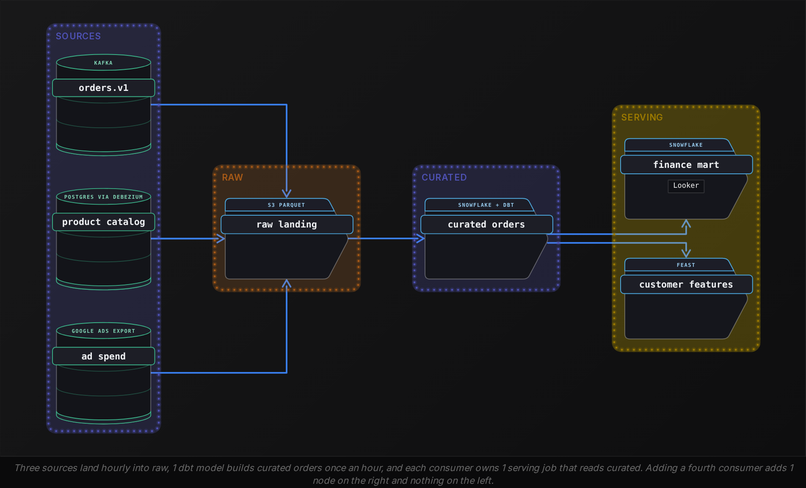
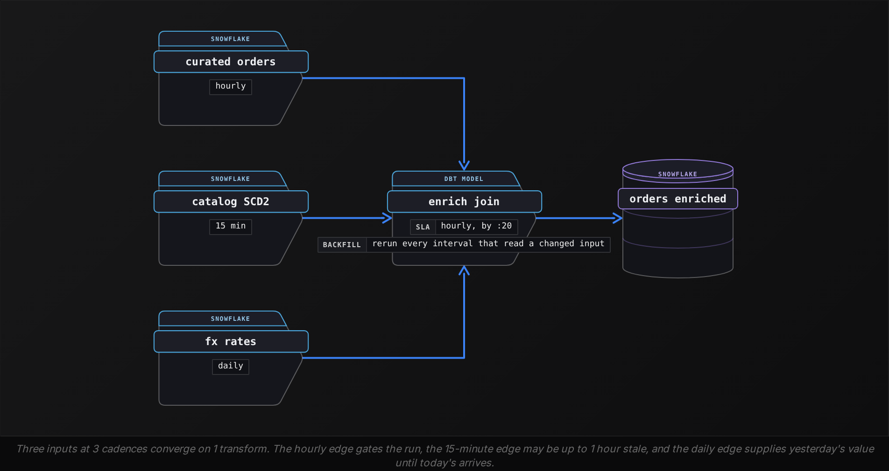
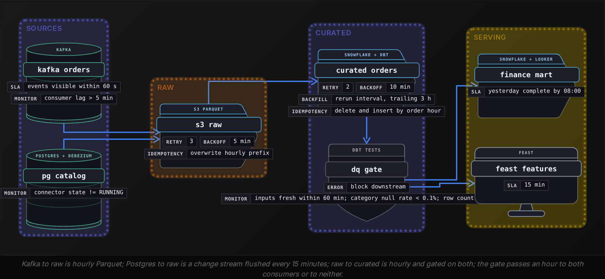
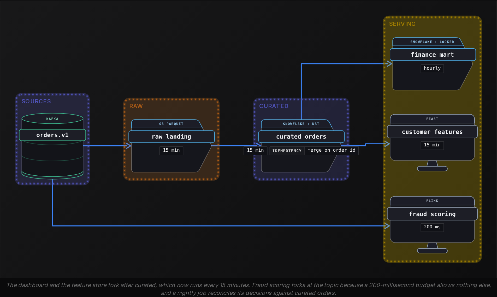

Intermediate·Pipeline Architecture · 20 min · 11 challenges

# Pipeline Anatomy: Intermediate

A retailer's order events start life in a single Kafka topic. Within a year finance, marketing and the recommendations team each want them, each with their own idea of what counts as an order, and the product catalog, ad spend and support tickets want joining in. The chain built for 1 source and 1 consumer has to become something with 4 of each, and its shape has to change.


<br>

---

## Many Sources, One Curated Layer

At a mid-size retailer the order pipeline begins as 1 chain. A Kafka topic `orders.v1` feeds an hourly Spark job that writes Parquet to S3, and a Snowflake task loads `fct_revenue_hourly` for the finance dashboard. The first change request comes from marketing, which wants orders joined to ad spend, and the quickest path is a second job reading the same topic. Three months later the recommendations team builds a third. Each job drops test orders, casts `amount` from string to NUMERIC and deduplicates on `order_id`, and each does it a little differently.

The cost arrives as disagreement. For Tuesday hour 14 finance counts 40,000 orders, marketing counts 40,210 because its job never filtered the staff-discount test accounts, and the recommendations model trains on 39,600 because its deduplication keys on `order_id` plus `updated_at` and drops legitimate resubmissions. Three teams hold 3 numbers, and a meeting decides which one is real. New sources multiply the problem: once the Postgres product catalog, the Zendesk ticket API and the Google Ads spend export arrive as sources, 4 sources and 3 consumers wired point to point need 12 jobs, and the cleaning of each source is written in 3 of them.


<br>

### The trigger is the second consumer

One source and 1 consumer need no middle layer; the transform can shape data for its only reader, which is the beginner pipeline. The second consumer of the same source is the moment to split, because the cleaning either gets copied or gets shared, and copied cleaning drifts within weeks. The second source feeding the same consumer is the other trigger: conforming keys, such as the catalog's `sku` against the order line's `product_code`, is work every later consumer needs too. Either event turns N x M jobs into N + M, with 1 landing job per source and 1 serving job per consumer.


<br>

### What each layer promises

The medallion names, bronze, silver and gold, already describe the 3 layers. Designing them means writing down what each one promises to the layer beside it, because that promise lets finance and recommendations stop reading the Kafka topic themselves.

| Layer | Holds | Promise to the next layer | Owner |
| --- | --- | --- | --- |
| Raw (bronze) | Every record as the source sent it, Parquet on S3 partitioned by arrival hour, never updated | Nothing lost, nothing changed, replayable from any hour | Data platform |
| Curated (silver) | 1 row per order, typed, deduplicated, test accounts removed, catalog keys conformed | The company's single definition of an order | Data platform with domain owners |
| Serving (gold) | Aggregates and joins shaped for 1 consumer, derived only from curated | Fast for its reader, rebuildable from curated at any time | The consuming team |



The layer is paid for in latency and storage. Each extra hop runs on its own schedule, so an hourly curated layer bounds every serving table at hourly freshness or slower. Storage roughly triples, but at around $23 per compressed TB a month, 3 copies of the retailer's 2TB order history cost about $140 a month, less than 1 hour of 3 teams reconciling revenue numbers.

The layer also moves where a bug gets fixed. When the test-account filter missed a new pattern of staff accounts in March, the fix landed in 1 dbt model and every serving table picked it up on its next run. Point to point, the same fix is 3 pull requests to 3 repositories, and the third ships a month late.

**The recommendations team needs order data for a model. Today 1 Spark job reads orders.v1, filters test accounts, deduplicates and writes fct_revenue_hourly, an hourly aggregate finance reads. What should the team read?**

- **A.** A new consumer on orders.v1 with its own filtering and deduplication
- **B.** fct_revenue_hourly, since the cleaning is already done
- **C.** Split the existing job: land raw to S3, build a curated orders table that holds the cleaning, and have both the finance aggregate and the model read it
- **D.** A nightly export of fct_revenue_hourly to S3 for the model to load

<details>
<summary>Solution</summary>

**C.** Split the existing job: land raw to S3, build a curated orders table that holds the cleaning, and have both the finance aggregate and the model read it

Both consumers read 1 definition of an order, the cleaning is written once, and the next consumer is 1 serving job added on the right of the diagram.

**Why the others are wrong**

- **A.** That is the second copy of the cleaning. The 2 jobs agree for a few weeks, then 1 of them changes a rule and the model trains on a different set of orders than finance reports.
- **B.** The table is aggregated by hour for finance's reader. It has no customer_id or order_id, and finance may reshape it whenever its dashboard changes.
- **D.** It inherits the aggregate's shape and adds a hop and a day of latency on top.

</details>


<br>

---

## ETL vs ELT

### Where the transform runs

ETL and ELT differ in where the transform runs, and that single fact decides what the loaded data looks like. In ETL, an engine between source and warehouse (Informatica PowerCenter, SSIS, a Spark cluster) reads the source, cleans and reshapes rows in its own memory, and loads only finished tables. The warehouse never holds raw data. In ELT, the loader copies source data into the warehouse as close to verbatim as the types allow, and the transform runs inside the warehouse as SQL, usually versioned and scheduled by dbt. The raw copy stays and can be queried.

The ETL default came from the economics of the 2000s warehouse. A Teradata or Oracle appliance was bought by the rack, its compute fixed and shared by every analyst, so a transform scanning 2TB of raw clickstream inside it slowed every dashboard in the company. A separate ETL server protected the expensive box. The price was flexibility: a question the loaded tables could not answer needed a new extract, a change request to the ETL team and often weeks of waiting.

Cloud warehouses broke the constraint in 2 places. BigQuery (2011) and Snowflake (2015) separated storage from compute, so stored bytes cost object-store prices and compute is sized per workload, with Snowflake billing isolated virtual warehouses by the second. Redshift (2013) made cluster compute rentable and resizable by the hour, and separated storage only with RA3 nodes in 2019. The 2TB transform now runs on its own compute for a few dollars, and the raw copy it reads costs around $46 a month. With storage that cheap and compute that elastic, loading raw first became the default, and dbt (2016) gave SQL transforms the version control and tests ETL tools had kept inside their GUIs.

| ✓ ETL: transform before load | ✗ ELT: transform after load |
| --- | --- |
| • A separate engine owns the compute; the warehouse holds only finished tables<br><br>• Raw data is gone after load; a new question needs a new extract<br><br>• Masking, parsing and model inference run in general-purpose code<br><br>• Fits data that must be reduced or protected before it lands | • Warehouse compute does the work, sized per job<br><br>• Raw tables persist; a new model is a new SQL file over old rows<br><br>• Transforms are SQL, tested and versioned with dbt<br><br>• Fits any transform SQL can express over data allowed to land |


<br>

### Choose per transform

The retailer's curated layer holds both. Casting `amount` to NUMERIC, deduplicating on `order_id` and removing test accounts are ELT: dbt models over raw tables that keep every row, so a rule change reruns against history without touching the source. The model below does the cast, filter and deduplication for curated orders, and it runs in Snowflake in about 40 seconds over 1 hour of raw data.

```sql
select
  order_id,
  cast(amount as numeric(12, 2)) as amount,
  customer_id,
  sku,
  date_trunc('hour', ordered_at) as order_hour
from {{ source('raw', 'orders') }}
where customer_id not in (select customer_id from {{ ref('test_accounts') }})
qualify row_number() over (
  partition by order_id order by ingested_at desc
) = 1
```

> Transforms that run before load
>
> - Protection: card numbers and emails in order events are hashed by the ingestion job, so no warehouse table ever holds them and Time Travel cannot bring them back.
> - Expression: extracting features from product images or scoring a model is Python, so it runs in Spark before load and only its outputs land.
> - Volume: raw clickstream at 3 million events an hour is 72 million rows a day; sessionizing before load cuts warehouse storage and every downstream scan by roughly 50x.

The rule that falls out: a transform that must happen before the data may exist in the warehouse, or that SQL cannot express, runs before load. Everything else runs after, where it is cheaper to change and leaves the raw rows in place to answer the next question.

**An ingestion job pulls support tickets from the Zendesk API into Snowflake. Ticket bodies contain customer emails and, a few times a week, card numbers typed into free text. Analysts need the ticket text searchable. Where does the masking run?**

- **A.** In a dbt model after load, with the raw table dropped once the model has run
- **B.** In the ingestion job, before the row is written anywhere in the warehouse
- **C.** In a view over the raw table, granting analysts the view only

<details>
<summary>Solution</summary>

**B.** In the ingestion job, before the row is written anywhere in the warehouse

Protection is a constraint on what may land, so this transform runs before load. Masked text is still searchable, and the card number was never useful to an analyst.

**Why the others are wrong**

- **A.** The raw text has already landed in a warehouse 40 analysts can query, and Snowflake Time Travel keeps a dropped table recoverable for 1 to 90 days.
- **C.** The raw table still holds the numbers, every role with raw access reads them, and a misgranted role or a zero-copy clone leaks them.

</details>


<br>

---

## Steps That Merge Many Inputs

In the curated layer, `orders_enriched` joins 3 inputs: curated orders (hourly, from Kafka), the product catalog (Debezium change capture out of Postgres, landing every 15 minutes) and FX rates (1 daily file from the European Central Bank, published around 16:00 CET). A step with 3 inputs faces 3 questions a single-input step never does: when it may run, which version of each input it reads, and what it does when 1 input has not arrived.


<br>

### Cadence collapses to the slowest input

The join can run for hour 14 only when every input it needs for hour 14 exists. Orders land by 14:05 and catalog changes by 14:15, so the join could start at 14:15. The FX rate arrives once a day, so an hourly join at 03:00 UTC either waits 12 hours for today's rate or reads yesterday's. The orchestrator makes the wait explicit: in Airflow, an `ExternalTaskSensor` per upstream DAG or a Dataset schedule on all 3; in Dagster, 3 declared upstream assets. Either way, the step's effective cadence is the slowest of its inputs unless the design names which inputs may be stale and by how much.

| Input | Cadence | Typically lands | Staleness the join accepts |
| --- | --- | --- | --- |
| Curated orders | hourly | :05 past the hour | None, the run waits |
| Product catalog (SCD2) | every 15 minutes | :15 past the hour | Up to 1 hour, prices change rarely |
| FX rates | daily | 15:00 UTC | Previous day's rate until today's lands, rate date recorded |




<br>

### Which version of each input

A join that reads the current catalog gives a different answer on a rerun than it gave the first time. A backfill of March 12 run on March 20 would price March 12 orders at March 20 prices and file them under categories renamed in between. A merge step needs an as-of rule per input, each tied to the run's `data_interval_start`: orders whose `order_hour` equals the interval, catalog rows whose `valid_from` and `valid_to` bracket the interval's start, and the FX rate for the interval's date. With all 3 rules the step is reproducible, and reproducibility is what makes its retries and backfills safe.

```sql
SELECT
  o.order_id,
  o.amount,
  c.category,
  o.amount * fx.rate_to_usd AS amount_usd,
  fx.rate_date
FROM curated_orders AS o
LEFT JOIN catalog_scd2 AS c
  ON c.sku = o.sku
    AND c.valid_from <= '2024-03-15 14:00:00'
    AND (
      c.valid_to > '2024-03-15 14:00:00'
      OR c.valid_to IS NULL
    )
LEFT JOIN fx_rates AS fx
  ON fx.currency = o.currency
    AND fx.rate_date <= '2024-03-15'
WHERE o.order_hour = '2024-03-15 14:00:00'
QUALIFY ROW_NUMBER() OVER (
  PARTITION BY o.order_id
  ORDER BY fx.rate_date DESC
) = 1
```


<br>

### What a missing input does to the output

An inner join on the catalog drops every order whose `sku` has not arrived, and the drop is silent: 40,000 orders in, 39,850 out, and the dashboard shows $3,600 less revenue than the payment processor settled. A left join keeps the 150 orders and leaves `category` null, which is visible and recoverable, because a trailing-window rebuild fills them in when the catalog catches up. The characteristic failure of a merge step is partial input dressed as complete input, so the step checks before it writes. A row-count assertion that `orders_enriched` for the hour equals curated orders for the hour guards against the inner-join drop. A null-rate check on `category` above 0.1% guards against the late catalog, whose 150 nulls are 0.375% of the hour.

The step also changes what an upstream rerun means. When the catalog CDC job is backfilled for a day, every join run that read that day must rerun, or the enriched table keeps pre-fix prices. Dagster's partitioned assets, with partition mappings, propagate that backfill to the dependent join partitions. Airflow Datasets record the dependency, but a Dataset update triggers 1 new join run at the current date, so the affected intervals still need an explicit backfill of the join DAG over the same dates. A merge step with 3 inputs is 3 places a backfill can start from and 1 place all of them must pass through.

**The orders_enriched join for hour 03 UTC cannot find an FX rate for today, because the ECB publishes around 15:00 UTC. The finance dashboard needs hourly revenue in USD through the day. Which design serves it?**

- **A.** Put a sensor on the FX file so the hour 03 join waits until 15:00
- **B.** Join on the most recent rate on or before the interval's date, record rate_date in the row, and restate the day's rows after the new rate lands
- **C.** Inner join on today's rate and let unmatched orders fall out until the rate arrives
- **D.** Move the whole join to a daily run at 16:00

<details>
<summary>Solution</summary>

**B.** Join on the most recent rate on or before the interval's date, record rate_date in the row, and restate the day's rows after the new rate lands

The join keeps its hourly cadence, the staleness is visible in the data, and the restatement makes the final numbers exact.

**Why the others are wrong**

- **A.** Every hour before 15:00 waits up to 12 hours, so the dashboard shows nothing for the morning.
- **C.** Orders disappear from the morning's revenue, and nothing records that they were dropped.
- **D.** It removes the FX wait by making every input daily, and the dashboard loses the intraday revenue it was built to show.

</details>


<br>

---

## Reading a Real Pipeline Diagram

The diagram below is the retailer's order pipeline as it runs today, with the operating facts a production diagram carries and a sketch leaves off. Reading it is a procedure, and applied to a 40-node diagram at a new job it tells you in 20 minutes what a month of incidents would otherwise teach.




<br>

### Ends first, then the fan-in

Start at the 2 ends, because they set the requirements. Sources decide arrival behaviour: Kafka delivers within seconds and replays from any offset inside its 7 days of retention, while the Debezium connector follows the Postgres write-ahead log and fails its task when it loses its replication slot. Consumers decide freshness: the finance mart promises yesterday complete by 08:00, the feature store promises 15-minute freshness. Then find where edges converge. Here orders meet the catalog at `curated_orders`, the role `orders_enriched` played in section 2: its cadence is bounded by its slowest input, and every consumer inherits that bound.


<br>

### Cadence per edge

An edge carries no words, so each one gets 2 questions: what moves along it and how often. Curated to the mart is hourly aggregation; curated to the feature store is a 15-minute refresh reading an hourly table, so 3 of every 4 refreshes return nothing new. A cadence mismatch across an edge is a finding, and the next section resolves this one.


<br>

### Failure behaviour per node

For each node, 3 questions. Does it retry, and is its write safe to retry? The raw landing overwrites an hourly S3 prefix, so 3 retries leave 1 copy. The curated load deletes and inserts by `order_hour` in 1 transaction, so a retry after a timed-out commit removes its own earlier rows before loading. A load that appended instead would commit 40,000 rows, lose the acknowledgement, and commit 40,000 more on attempt 2, with every task green and finance seeing double revenue at 08:00. Does a failure block downstream or let stale data through? The gate blocks, so a bad hour never reaches the mart, at the price of a frozen dashboard. Who is paged? The `monitorAlert` on each node names the condition, and the owner column names the person.

| Node | Cadence | On failure | Owner |
| --- | --- | --- | --- |
| kafka_orders | continuous | lag alert at 5 min, replay within 7 days | Checkout team |
| pg_catalog | change stream, flushed every 15 min | connector-state alert, no automatic recovery after slot loss | Catalog team |
| s3_raw | hourly | 3 retries 5 min apart, overwrite prefix | Data platform |
| curated_orders | hourly | 2 retries, delete and insert, pages platform on-call | Data platform |
| dq_gate | hourly | blocks both consumers, pages platform on-call | Data platform |
| finance_mart | hourly | 2 retries, dashboard shows stale hours | Finance analytics |
| feast_features | 15 min | 1 retry, model serves last good values | Recommendations |


<br>

### Ownership at the layer boundary

Ownership changes hands where the layer changes. The checkout team owns the topic and its schema, the catalog team owns the Postgres tables, the data platform owns raw through the gate, and each consuming team owns its serving table. The boundary between layers is where the contract lives: the checkout team may add fields to `orders.v1` but may not rename `order_id`, and the platform may change how `curated_orders` is built but not what a row means. A diagram without owners turns every cross-boundary incident into 20 minutes of finding out who to call.

> Five questions for any pipeline diagram
>
> - Which nodes are sources and consumers, and what freshness does each consumer need?
> - Where do edges converge, and which input bounds that node's cadence?
> - What moves along each edge, and how often?
> - For each node: does it retry safely, does it block or pass stale data, who is paged?
> - Where does ownership change, and what is the contract at that boundary?

**At 02:00 the Debezium connector for the catalog loses its replication slot and its task fails. Reading the diagram above, what does the finance mart show at 09:00, and who was paged?**

- **A.** Hours 02 to 08 present with category null for new products; nobody paged, because every task succeeded
- **B.** The mart frozen at hour 01; the catalog team paged by the connector alert at 02:00, and the platform on-call paged when the gate blocked hour 02
- **C.** The mart up to date, because the join reads the SCD2 catalog and existing products still resolve
- **D.** Hours 02 to 08 missing after Airflow retried curated_orders twice and gave up, paging only platform

<details>
<summary>Solution</summary>

**B.** The mart frozen at hour 01; the catalog team paged by the connector alert at 02:00, and the platform on-call paged when the gate blocked hour 02

Each node pages its own owner. The catalog team recreates the slot and re-snapshots; the gate's errorAction holds both consumers until the catalog is fresh again.

**Why the others are wrong**

- **A.** The connector-state alert fires at 02:00, and the gate's freshness check fails hour 02 before any null reaches the mart.
- **C.** Existing rows resolve, but a frozen input fails the gate's freshness check whether or not the join would produce nulls.
- **D.** Retrying the join reads the same stale catalog and succeeds each time. The gate stops the data, and the connector alert pages the catalog team too.

</details>


<br>

---

## One Source, Two Consumers

Two teams read the retailer's orders. The finance dashboard wants hourly revenue by category, complete for yesterday by 08:00 and refreshed through the day. The recommendations team wants per-customer features in Feast: orders in the last 7 days, average basket, most recent category, refreshed every 15 minutes, and computed point-in-time so that a training set built for March 12 sees only what was known on March 12. Same source, 2 consumers, and 2 places the pipeline can fork.


<br>

### Fork at ingestion

The first design gives each consumer its own reader on `orders.v1`. The dashboard path is the hourly batch already built. The feature path is a 15-minute Spark Structured Streaming job that reads the topic, cleans, aggregates per customer and writes to Feast's offline store, with its own test-account filter, deduplication and cast of `amount`. It ships fast, because neither team waits on the other, and it recreates the drift section 0 opened with.


<br>

### Fork at the curated layer

The second design keeps 1 raw landing and 1 curated `orders` table, and forks after it: 1 serving job aggregates curated orders into the finance mart, and 1 computes features from the same rows. The cost is that the curated layer must run at the faster consumer's cadence. An hourly curated table cannot feed a 15-minute feature refresh, so the curated load moves to a 15-minute micro-batch, and the finance mart, still hourly, reads 4 curated slices per run. A 15-minute `MERGE` over 10,000 orders completes in under 30 seconds on an X-Small Snowflake warehouse.

- **96** — curated loads a day at 15-minute cadence
- **1** — definition of an order both teams read



| Concern | Fork at ingestion | Fork at curated |
| --- | --- | --- |
| Definition of an order | 2 implementations that drift | 1 dbt model, both read it |
| Fix to the test-account filter | 2 pull requests, 2 deploys | 1 change, both consumers next run |
| Freshness | each path at its own cadence | curated at the fastest consumer's cadence |
| Reconciliation | numbers disagree, a meeting picks one | both derive from the same rows |

Point-in-time correctness decides it. A training set asks, for each order on March 12, what the customer's 7-day order count was at that moment. From curated orders with `order_hour` as event time, that is a window over 1 table. From a streaming path with its own deduplication, the answer depends on which late orders the stream happened to see, and the model trains on features the dashboard cannot reproduce. Forking at curated makes the model's orders match finance's by construction.


<br>

### When the fork belongs at ingestion

A consumer that needs latency the curated layer cannot provide reads the source directly. Fraud scoring at checkout needs a decision within 200 milliseconds of the order event, and a 15-minute micro-batch is 4,500 times too slow. It gets a Flink job on `orders.v1` with minimal cleaning, plus a nightly job reconciling its decisions against curated orders. The early fork is deliberate and bounded, and its reconciliation cost is written into the design.

**A fourth consumer appears: fraud scoring that must accept or hold an order within 200 milliseconds of the event. The curated layer runs every 15 minutes. Where does this consumer attach?**

- **A.** To the curated orders table, polling every minute
- **B.** To orders.v1 directly, through a Flink job with minimal cleaning, plus a nightly job reconciling its decisions against curated orders
- **C.** To the raw S3 landing, since it is the earliest batch copy
- **D.** To the finance mart, which already has revenue by hour

<details>
<summary>Solution</summary>

**B.** To orders.v1 directly, through a Flink job with minimal cleaning, plus a nightly job reconciling its decisions against curated orders

The requirement forces the fork before the curated layer, and the reconciliation keeps the 2 definitions of an order from drifting unnoticed.

**Why the others are wrong**

- **A.** The freshest row in curated is up to 15 minutes old, 4,500 times the budget.
- **C.** Raw is written every 15 minutes too, so it is no fresher than curated and holds unfiltered rows.
- **D.** It is an hourly aggregate with no order-level rows, built for a different reader.

</details>

| ✓ Do | ✗ Don't |
| --- | --- |
| • Split a pipeline into layers at the second consumer or the second source, before cleaning gets copied<br><br>• Write each layer's promise down: raw is complete and untouched, curated is the one definition<br><br>• Pin every input of a merge step to the run's interval with an as-of rule<br><br>• Run the curated layer at the fastest consumer's cadence and let slower consumers aggregate<br><br>• Put a count and freshness check between curated and serving, and make it block | • Don't let a consumer read another consumer's serving table as if it were curated<br><br>• Don't inner join a late-arriving dimension; keep the rows and make the nulls visible<br><br>• Don't mask PII in a model after the raw rows have landed in the warehouse<br><br>• Don't fork at ingestion for a consumer a 15-minute curated layer would satisfy |


<br>

---

## Putting It All Together

A grocery delivery company, 2 years after launch, has 6 jobs reading its order topic: finance, marketing, a demand forecast, a courier-dispatch feature store, a fraud model and a customer support view. Finance and marketing report order counts 3% apart every week, the forecast team spent a quarter rebuilding deduplication the finance team had already written, and the dispatch features are refreshed every 5 minutes from a topic that the fraud model also reads with its own filters. The platform team is asked to redraw it.

- Six consumers on 1 topic is 4 triggers past the point where a curated layer pays for itself; the redesign lands raw once, builds 1 curated orders table, and gives each team a serving job (section 0).
- Deduplication, test-account removal and the join to the store catalog move into dbt over raw tables, while address and payment fields are hashed in the ingestion job before anything lands (section 1).
- The curated table joins orders to a catalog that changes hourly and a delivery-zone file published daily, so its cadence is set by the orders feed and each input is pinned to the run interval with the zone file allowed to be a day stale and recorded as such (section 2).
- The new diagram carries retry policy, alert condition and owner on every node, and a blocking gate between curated and serving, so the morning the catalog connector stops, 1 team is paged and every dashboard freezes with a reason (section 3).
- The dispatch feature store sets the curated cadence at 5 minutes and finance aggregates 12 slices an hour from it; only the fraud model keeps a direct reader on the topic, with a nightly reconciliation against curated orders (section 4).


<br>

---

## Key Takeaways

- The second consumer of a source, or the second source into a consumer, is the moment to add a curated layer: N x M jobs become N + M, and cleaning lives once.
- ETL and ELT differ in where compute runs; cloud warehouses made load-raw-then-transform cheaper, and protection, expression and volume still force a transform before load.
- A merge step's cadence is bounded by its slowest input, every input needs an as-of rule tied to the run interval, and partial input is checked before the write.
- Read a diagram ends first, then the fan-in, then cadence per edge, failure behaviour per node and ownership at each layer boundary.
- Fork at the curated layer and run it at the fastest consumer's cadence; fork at ingestion only when a latency requirement forces it, and reconcile.

Exercises for this lesson: [_exercises/pa_what_is_a_pipeline_intermediate.md](_exercises/pa_what_is_a_pipeline_intermediate.md)
