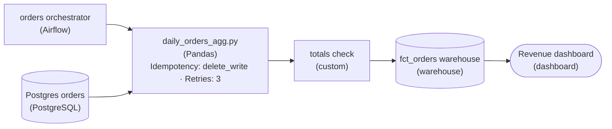
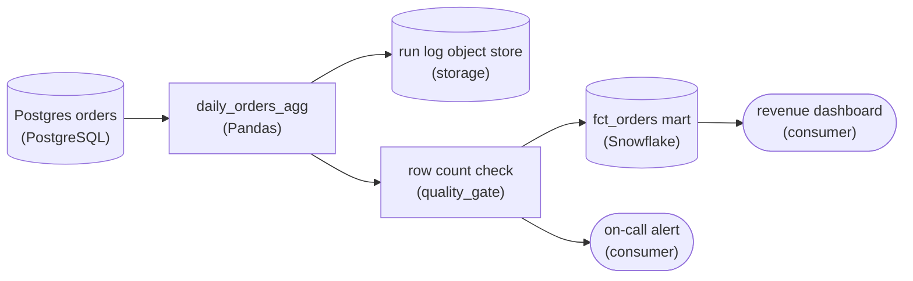
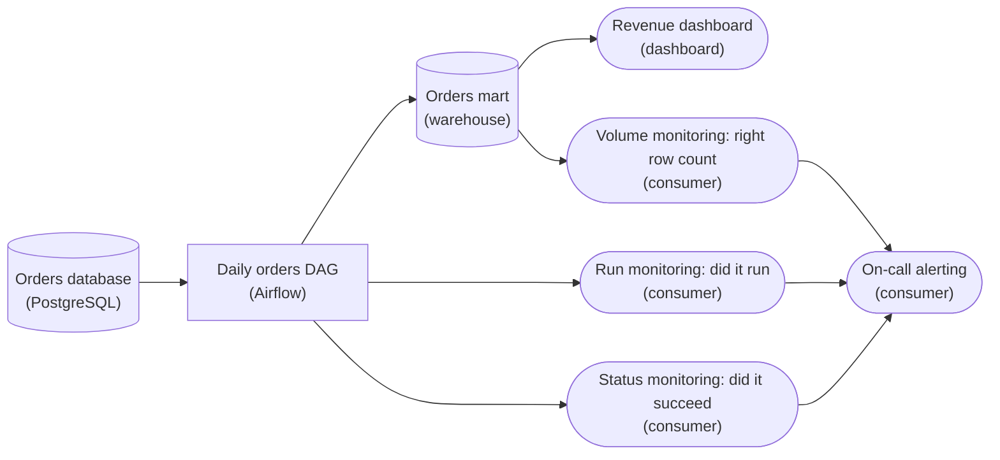
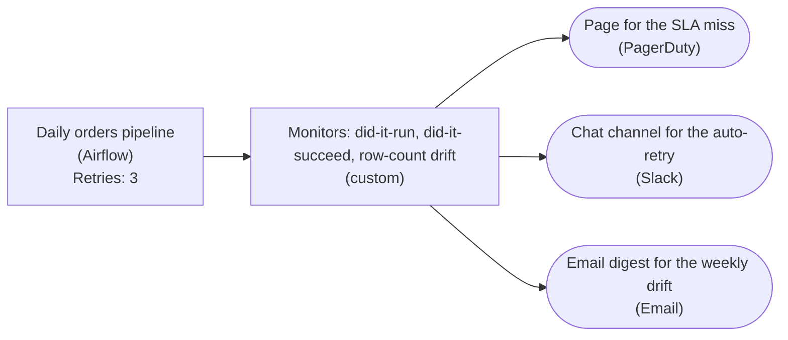
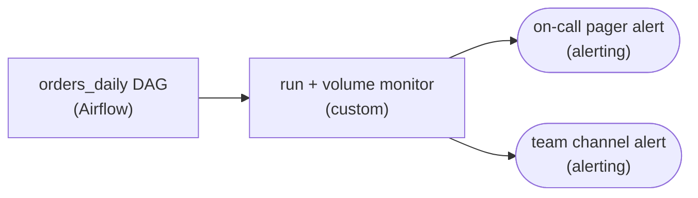
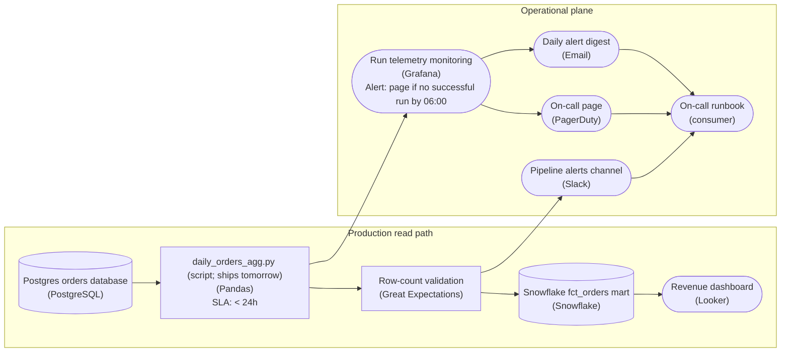
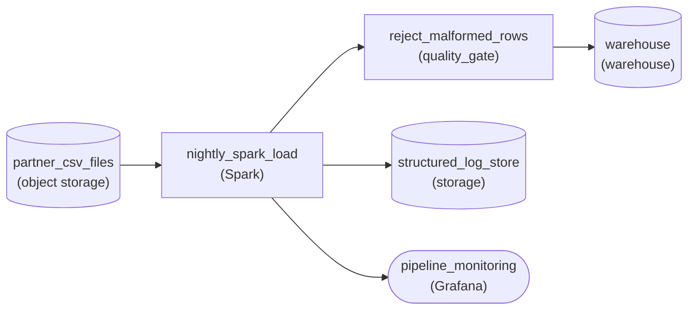
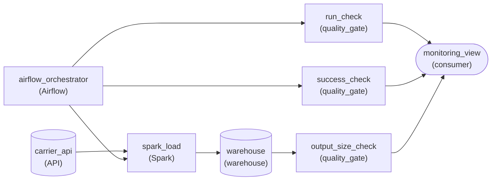
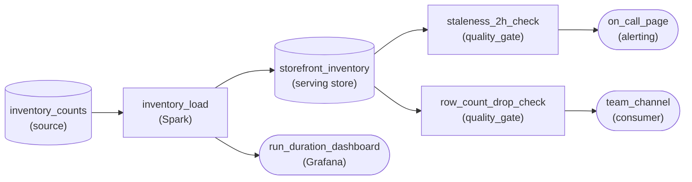
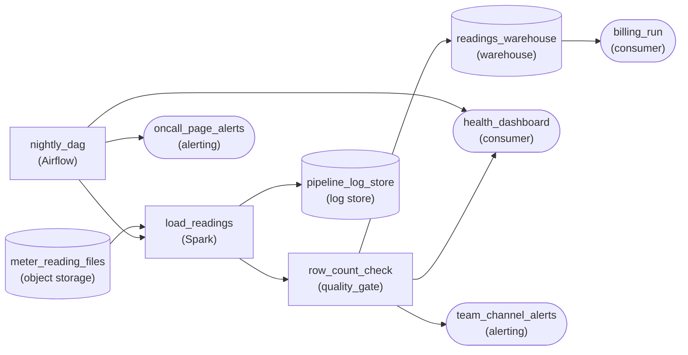

# Pipeline Operations: Beginner - Exercises

Lesson: [pa_pipeline_operations_beginner.md](../pa_pipeline_operations_beginner.md)

### Exercise 1 of 10

**● TASK**

`daily_orders_agg.py` runs from cron on its author's server: when the 02:00 run dies nobody reruns it, and last week's hand rerun appended a second copy of the day's revenue to `fct_orders`. Make it operable: run it under an orchestrator that retries a failed run, make the warehouse write safe to rerun, and check the totals before they reach `fct_orders`.

**Starting canvas** (already placed for you):

- Postgres orders (source, PostgreSQL)
- daily_orders_agg.py (transform, Pandas)
- fct_orders warehouse (storage, warehouse)
- Revenue dashboard (consumer, dashboard)

<strong>Solution</strong>

#### From a script to a job someone else can run

An operable pipeline is one a stranger can run without its author: it starts on time, recovers from a passing failure, can be rerun without damage, and refuses to publish numbers nobody should trust. `daily_orders_agg.py` already computed the right totals. What it lacked was everything around the computation. Cron on one server starts it, but nothing retries a dead run, so the only recovery is a person running it again by hand. That hand rerun appended a second copy of the day to `fct_orders`.

*The data path is unchanged. The orchestrator starts and retries the job, the job replaces its own day instead of appending, and the totals check sits between the job and `fct_orders`.*

1. **Hand the schedule to an orchestrator**

   Cron fires the command and forgets it. An orchestrator records every run, so 'did last night happen' has an answer. It also retries a failed task a few times before giving up, which clears the brief database blips that kill most nightly runs.

2. **Make the write idempotent**

   Retries and hand reruns are only safe when running a day twice leaves the table as if it ran once. Deleting that day's rows and writing them fresh gives that guarantee. A plain append adds another copy of the day's revenue on every rerun.

| Pitfall: Retries on an appending job multiply the damage |
| --- |
| Adding retries to a job that appends turns one failure into several copies of the same day. Retry and an idempotent write are a pair: wire the first only once the second is in place. |

3. **Check the totals before they are published**

   The check runs between the job and `fct_orders`, so a day with zero orders or negative revenue stops before the dashboard shows it. Otherwise the people reading the numbers are the ones who discover the problem.

**Follow-up questions**

1. If the source database is down for 3 hours, how many retries and what spacing would you want before the run gives up?\
   *Extends retry handling to an outage longer than a blip.*
2. Finance corrects an order from 2 days ago. How would you reload that one day without touching the others?\
   *Applies the rerun-safe write to a deliberate backfill.*

 

### Exercise 2 of 10

**● TASK**

The nightly daily_orders_agg job loads the Snowflake revenue mart but logs only to stdout, so an overnight failure leaves no trace. Write its run events as structured logs to durable object storage an on-call engineer can read after the fact. Check its output for an empty or short load before it reaches the mart, and send a failed check to whoever is on call.

**Starting canvas** (already placed for you):

- Postgres orders database (source, PostgreSQL)
- daily_orders_agg (stdout only) (transform, Pandas)
- Snowflake fct_orders mart (storage, Snowflake)
- Revenue dashboard (consumer, Looker)

<strong>Solution</strong>

#### Making a batch job answer for itself

Structured run logs and a row-count metric answer different questions at 3am. The logs say what one run did; the metric says whether its output looks like a normal day. A job that only prints to stdout gives neither once the terminal scrolls away. You added a durable home for the logs, a check on the row count before the mart, and a path from a failed check to a human, so `daily_orders_agg` is no longer a silent script.

*Run logs land in object storage; the row count check sits between the job and the mart and fans out to the on-call alert when it fails.*

1. **Persist run logs to a durable store**

   stdout dies with the process. Write each run's id, start time, row counts and outcome as one structured log record to object storage, so the responder can read it hours later. That is the difference between 'it broke' and 'it loaded 0 rows at 02:14'.

2. **Gate the mart on a row-count check**

   Put the check between the job and `fct_orders`, not after it. An empty or short load is the classic overnight failure, and the row count is the metric that exposes it. Catching it here stops the bad batch before it reaches the mart and the dashboard.

3. **Route a failed check to on-call**

   A gate that fails silently is no better than the stdout you replaced. Send the check's failure to a destination a human watches, so the page arrives before the revenue number is wrong rather than after someone notices it.

| Pitfall: A check that logs but does not block |
| --- |
| The common miss is a check that writes a warning to the log and lets the load proceed anyway. If the gate does not stop the write to `fct_orders`, you have a record of the damage but no protection from it. The check has to sit in the data path, not beside it. |

**Follow-up questions**

1. Should the alert carry the failure detail, or point at the run's log record?\
   *Shows how the alert and the log work together: the page says the run failed, the log says why.*

 

### Exercise 3 of 10

**● TASK**

The starter canvas is a new daily orders pipeline: an Airflow DAG scheduled at 2am loads a warehouse orders mart that feeds a revenue dashboard. Add the three day-one monitors: one that reads the orchestrator to catch a run that never started, one that reads it to catch a run that failed, and one that reads the mart to catch an output whose row count falls outside its expected band. Wire every monitor to an on-call alert destination.

**Starting canvas** (already placed for you):

- Orders database (source, PostgreSQL)
- Daily orders DAG (transform, Airflow)
- Orders mart (storage, warehouse)
- Revenue dashboard (consumer, dashboard)

<strong>Solution</strong>

#### The three day-one monitors

A brand-new pipeline earns exactly three monitors, and they map to three questions you ask in order: **did it run, did it succeed, and was the output the right size**. Each one watches a different failure surface. Together they catch most of what breaks in a pipeline's first month. They are not redundant: a run can be missing entirely, present but failed, or succeeded but wrong, and only one signal tells you which. That is why each question gets its own monitor: a single "is it healthy" check cannot tell those three states apart.

*Two monitors read the orchestrator's run records, and the third reads the orders mart. All three alert the same on-call.*

1. **Did it run: read the orchestrator, not the data**

   The run monitor asks a question the data cannot answer: is there a run record for today at all? It queries the orchestrator's run history for the daily orders DAG and fires when no run exists by 2:30am. This is the monitor that catches a dead scheduler, a paused DAG, or a schedule that silently stopped firing. In those cases the mart still holds yesterday's rows, and every check on the table passes while the pipeline is dead.

2. **Did it succeed: the run exists but failed**

   The status monitor reads the same run record but checks its terminal state instead of whether it exists. Suppose a run starts, then throws on a source schema change or a bad credential. It leaves a record, so the run monitor is satisfied, but its state is 'failed'. This monitor alerts on that state. It catches code errors and upstream drift: the pipeline tried and told you it could not finish.

3. **Right size: read the destination**

   The volume monitor is the only one that reads the orders mart directly. It counts today's rows and fires when the count falls outside an expected band. This catches what the first two miss: a run that started on time and exited cleanly but wrote a tenth of the usual rows, because a silent filter dropped a category or a source extract was partial. A clean exit on a half-empty output is the classic silent failure.

| Pitfall: A single "is it healthy" check hides the state you need |
| --- |
| The tempting shortcut is one monitor that alerts if anything looks off. But "no run today", "run failed" and "wrong output" each demand a different response: restart the scheduler, fix the code, or hunt the silent filter. A merged check tells you none of them. Worse, a check that only reads the mart cannot see a missing run at all, because a stale table looks normal until someone compares dates. |

| Real world: Three now, the specific checks later |
| --- |
| On day one you do not yet know the pipeline's real failure modes, so blanketing it in column-level monitors just buys noise. Ran, succeeded and right size is the minimal set that covers the structural failures every pipeline shares. Add the specific checks, such as null spikes on `order_total`, once the pipeline has shown you where it actually hurts. |

**Follow-up questions**

1. The DAG is scheduled at 2am but a legitimately slow run finishes at 3am: how do you set the run monitor's window so it does not fire on a slow day?\
   *Freshness is measured against an expected start or completion time plus tolerance, not wall clock.*
2. How would you choose the row-count band for a pipeline whose volume swings strongly between weekdays and weekends?\
   *Pushes a static band toward a day-of-week baseline.*
3. If the orders database is down at 2am, which of the three monitors fires, and is that the signal you want?\
   *Whether a failed extract surfaces as a failed run or as a missing one.*

 

### Exercise 4 of 10

**● TASK**

The monitors on this daily orders pipeline raise three alerts: a customer-facing SLA was missed and needs action within the hour, a daily DAG failed but will retry on its own, and a row count has drifted 5 percent over the past week. Give the DAG's tasks 3 automatic retries so that failure recovers unattended, then route each alert to the destination whose urgency matches it, wiring a PagerDuty page, a Slack channel and an email digest off the monitors.

**Starting canvas** (already placed for you):

- Daily orders pipeline (transform, Airflow)
- Monitors: did-it-run, did-it-succeed, row-count drift (quality_gate, custom)

<strong>Solution</strong>

#### One monitor, three severities, three channels

Severity-based alert routing is the discipline you just applied: each signal goes to a destination whose interruption budget matches how fast someone must act. A missed customer SLA has to wake someone inside the hour, so it earns a page. A DAG failure is only a heads-up once the tasks carry retries: three automatic attempts absorb a refused connection before any consumer feels it, so the failed attempt belongs in a chat channel on-call can glance at. A five-percent row-count drift over a week is a trend, so it rolls into an email digest nobody reads at 2am.

*Retries on the DAG's tasks keep the run failure off the pager; the monitor block fans out to three destinations split by severity, not by which check produced the signal.*

| Key insight: Retries turn a failure into a record, not a page |
| --- |
| Setting `retryCount` on the DAG's tasks is what lets the run-failure alert sit in chat. Without retries, a refused connection at 02:00 leaves the orders table empty until someone reruns it by hand, and that failure would deserve a page. With them, most causes heal unattended, and if they do not, the SLA monitor still pages on the symptom the consumer feels. |

| Pitfall: Every alert on the pager trains you to ignore the pager |
| --- |
| The wrong build wires all three monitors to the pager because paging feels thorough. It is the opposite. When the auto-retry failure and the drift warning page alongside the real SLA miss, on-call learns most pages are noise and acks them on reflex, and that reflex is what swallows the twenty-first page. The loud channel only means something if it stays rare. |

| ✕ Split by who produced it | ✓ Split by how fast someone must act |
| --- | --- |
| Everything to the pager: the retry failure and the drift warning interrupt at the same volume as the SLA breach, so the alert that needs action in an hour looks identical to the one that fixes itself. | Three channels tiered by urgency: the pager carries only what a human must handle now, chat what they should notice today, email what they review weekly. Each channel's cost matches the response time it demands. |

| Real world: Severity is a routing key, not a text label |
| --- |
| This is why paging tools attach a severity to every alert and drive escalation off it. The check that emits a signal and the decision about who gets woken stay separate: the same drift check that emails a digest can be re-tiered to page once drift breaks a downstream contract. Severity on the alert makes routing a table you edit, not a rewiring job. |

**Follow-up questions**

1. If all three retries fail and the run is still down at 05:00, which alert should fire, and where does it go?\
   *Tests whether you route on exhausted retries rather than on the first failed attempt.*
2. A new monitor is added next quarter with no severity assigned. Where does it route by default?\
   *Tests whether routing fails safe: an unclassified alert should land somewhere visible but low-urgency, not silently page or vanish.*

 

### Exercise 5 of 10

**● TASK**

2 problems keep hitting the on-call for the orders_daily DAG: a run that finishes but writes a half-empty orders table, and a minor warning that pages someone who cannot act until morning. Extend the pipeline so each run is checked for completion and expected volume, failures that need action within the hour reach the on-call pager, and lower-severity warnings land in a channel the team reads during business hours.

**Starting canvas** (already placed for you):

- orders_daily DAG (Airflow scheduled 2am) (transform, Airflow)
- run + volume monitor (quality_gate, custom)
- on-call pager alert (consumer, alerting)

<strong>Solution</strong>

#### The 2 checks a green run still needs

2 ideas carry the pipeline you just extended. A quality gate judges the output, not the exit status: an `orders_daily` run can finish cleanly and still write a half-empty table, so "did it finish" and "did it produce the right data" are separate questions. And routing by severity: a signal reaches the destination matched to how fast a human must act. The starter had one check and one destination; you split each in two.

*One gate reads each `orders_daily` run, then fans out by severity: the pager for act-now, the team channel for act-later.*

1. **Check that the run completed**

   The signal the orchestrator hands you for free: did the `orders_daily` DAG reach its terminal task without erroring? This catches the crash, the timeout, the upstream that never landed. Necessary, but not enough, which is why the starter missed the second failure mode.

2. **Check that it produced its expected volume**

   Compare the run row count against a normal day. A run that writes 4k rows when yesterday wrote 400k passed every status flag and is still broken. This assertion is what turns a silent half-empty `orders` table into a signal instead of a next-morning surprise.

| Pitfall: A green run is not a good run |
| --- |
| Alerting only on task failure is tempting because that status is free. But partial writes, a truncated source, a filter that matched nothing all finish 'SUCCESS'. Without a volume or freshness assertion downstream of the run, the pipeline is blind to the failure that woke someone at 3am. |

| Key insight: Route by time-to-act, not by source |
| --- |
| Severity is a property of the consequence, not the check. Ask whether someone must act within the hour. A half-empty `orders` table blocks every downstream report, so it pages the on-call; a retried-and-recovered task is a warning for the team channel, read during business hours. Route everything to the pager and people learn to ignore it. |

**Follow-up questions**

1. How would you set the expected volume when `orders_daily` has strong weekday and seasonal swings?\
   *Pushes past a hardcoded threshold toward a rolling baseline, like this run versus a trailing 7-day median for the same weekday.*
2. A warning sits unacknowledged in the team channel for 2 days. Should it ever escalate to the pager?\
   *Tests whether severity is static or a function of age, and where that escalation logic lives.*

 

### Exercise 6 of 10

**● TASK**

Make the orders script operable before it ships tomorrow, keeping Looker reading the Snowflake `fct_orders` mart. Send run telemetry to a monitoring node that watches whether the job ran and succeeded, and add a row-count validation that checks the output is the right size. Wire both into three alert tiers, a PagerDuty page for a missed or failed run, a Slack channel for a size breach and an email digest for the rest. Connect every alert destination to an on-call runbook node.

**Starting canvas** (already placed for you):

- Postgres orders database (source, PostgreSQL)
- daily_orders_agg.py (script; ships tomorrow) (transform, Pandas)
- Snowflake fct_orders mart (storage, Snowflake)
- Revenue dashboard (consumer, Looker)

<strong>Solution</strong>

#### Operability is a layer you build, not a property the script has

A batch job that runs is not the same as a batch job you can operate. `daily_orders_agg.py` already reads Postgres, aggregates, and writes the `fct_orders` mart. What it lacks is the **operational shell**: durable telemetry, monitors that notice when reality diverges from expectation, and a routed path from a failure to the human who fixes it. You are not changing the transform; you are wrapping it so the next 2 a.m. failure arrives as a page with a runbook link instead of a silent gap on the revenue dashboard.

*The read path still ends at Looker on `fct_orders`; the operational plane watches it. Every signal carries `run_id`, and every alert tier lands on the same runbook.*

| Key insight: `run_id` is the thread that ties the three signals together |
| --- |
| Logs, metrics, and traces are only useful if you can join them. Mint one `run_id` at the top of the script and stamp it on every log line, every metric point (`rows_written{run_id=...}`), and the run's trace span. When an alert fires, on-call pastes the `run_id` into the monitoring node and reads exactly that execution. |

1. **Give the job durable telemetry, not stdout**

   stdout dies with the process. Ship structured logs, counters such as `run_started`, `run_completed` and `rows_written`, and one trace span per run to the monitoring node. That node answers the first 2 day-one questions: did it run (no `run_started` by the expected time) and did it succeed (a missing `run_completed`).

2. **Check the output size where the data flows**

   The third question, was the output the right size, is about the data, not the process. A row-count validation between the script and `fct_orders` compares `rows_written` to a sane band from recent history and catches the half-load an exit code happily calls success.

3. **Route by severity so a page means act now**

   Missed or failed runs page through PagerDuty because the dashboard is going stale. A size breach goes to the Slack channel: degraded, worth eyes within hours, not adrenaline. Trends and near-misses go to the email digest. Three tiers keep a page meaning a real problem.

4. **Link every alert to one runbook**

   Every tier points at the runbook: what the pipeline owns, what each alert means, how to diagnose from the `run_id`, how to re-run safely without clobbering the live `fct_orders` rows, and who to escalate to. The fix arrives with the alert.

| Pitfall: The green run that shipped bad data |
| --- |
| Wiring only a success monitor is the classic gap: the job exits 0 after a Postgres hiccup wrote a fraction of the rows, the monitor reports all-clear, and revenue quietly drops on the dashboard. The row-count validation exists as its own signal for exactly this case. |

**Follow-up questions**

1. The `rows_written` band false-alarms on Black Friday and month-end. How would you make it seasonal?\
   *Moves the size check from a fixed band to a seasonal baseline.*
2. The script becomes three chained tasks. Where does `run_id` live now, and what does the did-it-run monitor watch?\
   *Extends one-run observability to a multi-task DAG.*
3. The size check fires after half a day of `fct_orders` is already on the dashboard. What is the safe recovery?\
   *Tests an idempotent re-run against a live read path.*

 

### Exercise 7 of 10

**● TASK**

A nightly Spark job loads about 2 million partner CSV rows from object storage into the warehouse and reports nothing about its runs. Add a check that rejects malformed rows before they reach the warehouse, and give the job the two signals it is missing: per-run metrics (rows read, rows rejected, run duration) charted on a monitoring dashboard, and structured JSON logs keyed by `run_id` in a searchable log store. Keep the two signals in separate stores.

<strong>Solution</strong>

#### A number per run, a line per event

Logs and metrics are both things a pipeline says about itself. They answer different questions, so they belong in different stores. A metric is a number recorded once per run, like `rows_read` or run duration. It is tiny, cheap to keep for years, and made for a chart where a bad night stands out against the trend. A log is a timestamped record of one event: a JSON line with a level, a message and fields like `run_id` and `file_name`. Logs are high-volume and read by a person after something has already gone wrong. The row check sits between them: each rejection adds one to a count for the chart and writes one line saying why.

*The Spark load passes rows through a malformed-row check into the warehouse. Its per-run numbers, rejected count included, go to monitoring, and its event lines go to a separate log store.*

1. **Reject malformed rows before the warehouse**

   Rows read and run duration exist on any run, but rows rejected only means something once a check decides what a bad row is. A partner row with no partner id or a non-numeric amount is stopped before it reaches the warehouse. Every stop gives each signal something to report: one more in the run's count, and one log line naming the file and the reason.

2. **Send counts and duration to monitoring**

   3 numbers a night is about a thousand points a year, which is the scale a dashboard is built for. The morning glance shows a run that read its usual 2 million rows but rejected 40,000, without anyone opening a file.

3. **Send event lines to the log store**

   Fifty thousand JSON lines a run is too many to chart and too detailed to throw away. Keyed by `run_id`, they let you go from the odd point on the chart straight to that run's lines and read which files the rejections came from.

| Pitfall: Logs on a dashboard cost money and blur the chart |
| --- |
| Pushing every log line into the metrics backend turns each `run_id` or file name into a new series. Storage grows with log volume and the chart becomes noise. The reverse mistake, counting rejected rows by searching logs, turns the morning check into a search job. Count once inside the job and emit the count as a metric. |

| Real world: `run_id` stitches the signals together |
| --- |
| Traces, the third signal, follow one run through every step it passes. With a single job, the shared `run_id` on metrics and logs does that work. Once the load splits into several tasks, a trace shows which one took the time. |

**Follow-up questions**

1. The job splits into separate extract, validate and load tasks. Which signal tells you which task made last night's run slow?\
   *Where traces earn their place next to logs and metrics.*
2. A partner adds a column and rejected rows jump to 30 percent. Which signal shows it first, and which one explains why?\
   *Matching each question to the signal built to answer it.*

 

### Exercise 8 of 10

**● TASK**

A new nightly job pulls about 500,000 shipment records from a carrier API at 2am, loads them with Spark under Airflow, and writes them to the warehouse. Add the three day-one monitors: a run check that flags no run by 2:30am, a success check on the latest run's final status, and an output-size check on the rows loaded. All three feed one monitoring view.

<strong>Solution</strong>

Day-one monitoring is the smallest set of checks that makes a new pipeline operable: did it run, did it succeed, and was the output the right size. Each question has one honest source of truth. The design work is wiring each check to that source, not to whatever node happens to sit nearby.

*Airflow's run records feed the run and success checks, the warehouse feeds the size check, and all three land in one monitoring view.*

1. **Read run state from the orchestrator**

   If no run record exists by 2:30am, the scheduler never fired, and only Airflow can tell you that. The success check reads from the same place: the latest run's terminal status. A check attached to the warehouse cannot tell a run that never started from one that failed halfway.

2. **Read row counts from the warehouse**

   Size is a property of what landed, so the output-size check reads the loaded table and compares its row count against a band around the expected 500,000. A run can start on time and finish green yet still write 40 rows, for example when the carrier API returns an empty page.

| Pitfall: A green run can still load nothing |
| --- |
| Treating success as proof of correctness is the gap the third monitor closes. The status checks watch the job, and only the size check watches the data. Drop it, and consumers find the empty table before you do. |

| Key insight: One view, three separate answers |
| --- |
| Routing all three checks into one monitoring view means a single morning glance covers the pipeline. Keep them as three checks, though: a combined 'pipeline OK' flag hides which question actually failed. |

**Follow-up questions**

1. The carrier starts sending 2 million records on Mondays. How should the size check's expected band change?\
   *Whether the threshold follows the data's real shape rather than one fixed number.*
2. The job moves from 2am to 4am. What in the run check has to change?\
   *The run check's deadline is the schedule plus a tolerance, so it moves with the schedule.*

 

### Exercise 9 of 10

**● TASK**

An hourly Spark job loads inventory counts into a serving table the storefront reads, and once that table is two hours stale shoppers buy items that are gone. Apply the page-worthy test to three signals: staleness past two hours, a daily row-count drop someone should review next business day, and per-run duration, which needs no action. Route each to one tier: an on-call page, a team channel, or a dashboard only.

<strong>Solution</strong>

#### Rationing pages with the page-worthy test

The page-worthy test asks three questions before an alert may wake anyone: does it need action within the hour, can that action not wait for business hours, and can the on-call engineer actually do something? An hourly inventory load makes the answers concrete. Two hours of staleness means the storefront sells stock that is gone, and the on-call can rerun the load, so it passes all three. Every other signal drops a tier.

*Only `staleness_2h_check` reaches `on_call_page`; the row-count drop goes to `team_channel` and run duration lands on a dashboard.*

1. **Give the page to staleness alone**

   `staleness_2h_check` reads the serving table and feeds `on_call_page`. It is the only edge into the page, and that is the point: when the page fires, the engineer knows shoppers are affected right now and a rerun will fix it.

2. **Send the volume drop to the team channel**

   A daily row-count drop is usually a supplier sending a short file, sometimes a real change in stock. Someone should look, but the next business morning is soon enough, so `row_count_drop_check` posts to `team_channel`.

3. **Chart run duration without notifying**

   A run creeping from six minutes to 9 is worth seeing on `run_duration_dashboard` when someone investigates, but no single reading calls for action. The dashboard notifies nobody.

| Pitfall: Every extra route to the pager spends the budget |
| --- |
| The tempting design wires all three checks to the page because each signal is real. Then the on-call is paged whenever a supplier sends a short file, learns that most pages can wait, and treats the staleness page the same way. A lower tier is not a weaker alert; it is why the page still gets answered. |

**Follow-up questions**

1. What changes if the load ran nightly and fed a report read at 9am?\
   *Applying the test when the deadline is hours away: a failed run has slack, so it may drop out of the page tier.*
2. If the row count fell by 90 percent instead of a few percent, should it still go to the channel?\
   *Whether a severe version of a lower-tier signal earns its own page-worthy threshold.*

 

### Exercise 10 of 10

**● TASK**

A nightly Airflow DAG uses Spark to load about 3 million smart-meter readings from object storage into the warehouse, and the 6am billing run reads them. Triage three failures by routing each to its tier: a run that fails or has not finished by 5am pages on-call; a load whose row count is far off the usual volume alerts the team channel without paging; malformed readings Spark skips go only to a log store, with no alert. Send the run and row-count metrics to a health dashboard.

<strong>Solution</strong>

#### Severity decides where each signal goes

Triage means deciding, before anything breaks, how bad each failure is and who has to hear about it. Three failures share this one pipeline but earn three different responses. A run that misses 5am blocks billing for about 3 million meters, so it pages. A volume swing might be a real loss or just a holiday, so it goes to the team channel for a human to judge in daylight. A skipped malformed reading is expected noise, so it is only logged.

*Run status leaves `nightly_dag` for the pager, `row_count_check` alerts the team channel, and skipped readings only reach `pipeline_log_store`.*

1. **Match each failure to its signal**

   Run status and lateness are metrics the orchestrator already emits. The row count is a metric the check produces. A malformed reading is a log line carrying the bad record's details. Metrics tell you something is wrong; logs tell you exactly what.

2. **Rate severity by who is blocked**

   A failed or late run stops billing at 6am, so a human must act now: page. A strange row count needs judgment, not a 3am wake-up: team channel. A few dozen skipped readings block nobody: no alert at all, just a searchable record.

3. **Give every tier its own destination**

   Keeping `oncall_page_alerts` and `team_channel_alerts` separate is what makes the tiers real: nothing non-urgent can ever reach the pager. Both metrics also land on `health_dashboard`, so whoever gets paged has context the moment they open it.

| Pitfall: One channel for every signal trains people to ignore it |
| --- |
| Wiring the row count and the skipped-reading count to the pager feels safe, but the on-call starts getting woken for holidays and routine noise. Within weeks the pages get skimmed, and the one that says billing is blocked gets skimmed too. |

**Follow-up questions**

1. Skipped readings jump from a few dozen to 200,000 in one night. Should that still only be logged?\
   *Turning a log-only signal into a counted metric with its own threshold and tier.*
2. The load slows from 40 minutes to three hours but still finishes before 5am. What shows where the time went, and should it page?\
   *Using a trace to locate slow steps, and keeping a degraded but on-time run off the pager.*

