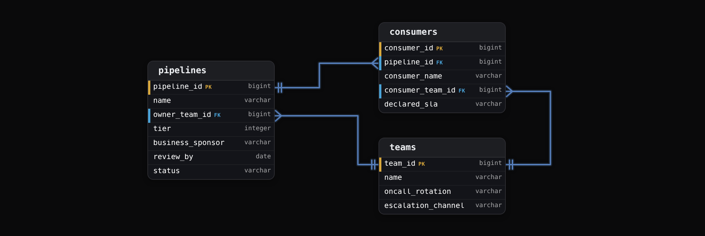
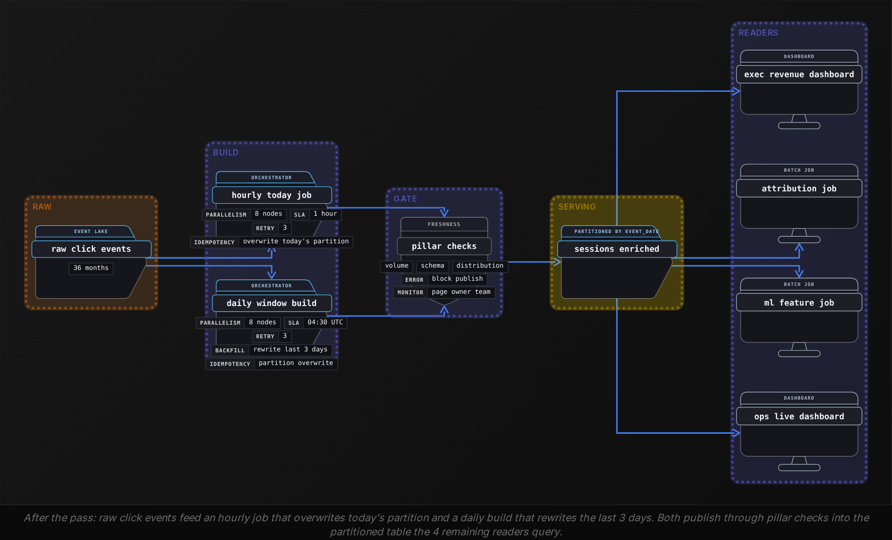

Advanced·Pipeline Architecture · 40 min · 11 challenges

# Pipeline Operations: Advanced

At a quarterly review at Airbnb, finance asks the data platform team one question: why did the warehouse bill grow 3 times faster than the team that runs it? Somewhere in hundreds of pipelines, an hourly job feeds a dashboard nobody has opened since spring, and its owner left in June. Your answer decides whether next quarter's budget funds new work or old waste.


<br>

---

## Cost Optimization as Ongoing Work

A pipeline's cost moves every month without anyone deciding to move it. Source tables grow, a new dashboard queries the output every 15 minutes, a backfill leaves a full copy behind, and a cluster sized for last year's peak keeps running at that size. A one-time cleanup removes this month's waste and leaves those forces in place, so cost work has to recur on a schedule.


<br>

### The line spend should stay under

Spend and headcount both grow, and the number worth watching is their ratio. Track **spend per data engineer** every month. If the team grows 20% and spend grows 20%, each engineer's pipelines cost what they did a year ago. If spend grows 60% over the same year, new work is paying for old waste, and the gap compounds.

| Metric | Last October | This October | Growth |
| --- | --- | --- | --- |
| Data engineers | 40 | 48 | 20% |
| Monthly data spend | $100,000 | $160,000 | 60% |
| Spend per engineer | $2,500 | $3,333 | 33% |

**Last October the team had 40 engineers and spent $100,000 a month on data. This October it has 50 engineers. What is the highest monthly spend that stays at or under the headcount-growth trend?**

- **A.** Spend of $140,000, keeping spend growth below 50%
- **B.** Spend of $130,000, keeping spend per engineer nearly flat
- **C.** Spend of $150,000, funding each of 50 engineers at $3,000
- **D.** Spend of $125,000, holding spend per engineer at $2,500

<details>
<summary>Solution</summary>

**D.** Spend of $125,000, holding spend per engineer at $2,500

Headcount grew 25%, so spend may grow 25%: $100,000 times 1.25 is $125,000.

**Why the others are wrong**

- **A.** Headcount grew 25%. Spend growing 40% lifts spend per engineer from $2,500 to $2,800.
- **B.** Nearly flat is above the line: $130,000 across 50 engineers is $2,600 each.
- **C.** That raises spend per engineer by 20%. The trend line holds it at $2,500.

</details>


<br>

### The 5 levers and their order

A pipeline's monthly bill is runs per month, times data processed per run, times the price of processing each unit of data, plus any work nobody reads. Each lever shrinks 1 of those terms.

| Lever | Term it shrinks | Typical move | What can break |
| --- | --- | --- | --- |
| Stop doing it | The whole term | Retire tables and refreshes with no reads in 90 days | A hidden reader that lineage missed |
| Run less often | Runs per month | Hourly to daily where every reader looks daily | A reader with a real freshness SLA |
| Recompute less | Data per run | Full rebuild to incremental with a late-data window | Late rows outside the window |
| Scan less | Data per run | Partition filters, fewer columns, sampled dev data | A query that loses its partition filter |
| Pay less per unit | Price per unit | Right-sized clusters, cheaper compute for retryable batch | Slower runs that miss an SLA |

The order matters because the first levers remove work and the last one discounts whatever work remains. Stop doing it removes a whole term and needs nothing but lineage and query logs. Pay less per unit goes last: right-size a cluster before converting its job to incremental and you've sized it for a job about to shrink, so you size it twice.


<br>

### The monthly cost rhythm

One cycle, 4 weeks

- **Week 1: Rank** *Cost-by-pipeline rollup*\
  Pull spend by pipeline tag. List the top 10 by dollars and the top 10 by month-over-month growth.
- **Week 2: Assign** *Owner teams*\
  Each listed pipeline's owner team names 1 lever and an expected saving, or records why the spend is worth it.
- **Week 3: Ship** *Normal review and CI*\
  Make 1 change at a time, so a number that regresses has 1 cause to look at.
- **Week 4: Verify** *Against the baseline*\
  Compare cost per run with the baseline, confirm last cycle's savings still hold, and plot spend per engineer.

```sql
SELECT
  pipeline,
  owner_team,
  SUM(IF(cost_month = DATE '2026-10-01', cost_usd, 0)) AS oct_cost,
  SUM(IF(cost_month = DATE '2026-09-01', cost_usd, 0)) AS sep_cost,
  SUM(
    IF(cost_month = DATE '2026-10-01', cost_usd, - cost_usd)
  ) AS growth_usd
FROM ops.pipeline_cost_monthly
WHERE cost_month IN (DATE '2026-09-01', DATE '2026-10-01')
GROUP BY pipeline, owner_team
ORDER BY growth_usd DESC
LIMIT 10
```

Ranking by growth_usd puts a pipeline that jumped from $500 to $9,000 above a steady $20,000 one. The growth list catches new waste while its author still remembers why it exists. The dollar list catches the old giants nobody has questioned in a year, and a saving from last cycle that has crept back shows up in both.

**A pipeline costs $18,000 a month. It rebuilds 4 years of order history every hour on a 32-node cluster. Its 3 consumers each read once a day, and 1 has had no queries in 120 days. Which change comes first?**

- **A.** Shrink the cluster to 8 nodes, since most of the bill is compute time.
- **B.** Retire the unread consumer, then move the build from hourly to daily.
- **C.** Convert the build to incremental and keep the hourly schedule as it is.
- **D.** Add partition filters to the 3 consumers' queries before touching the build.

<details>
<summary>Solution</summary>

**B.** Retire the unread consumer, then move the build from hourly to daily.

Stop doing it removes a whole term, and daily runs cut runs per month 24 times without starving any reader.

**Why the others are wrong**

- **A.** Pay less per unit goes last. This sizes the cluster for a job about to shrink.
- **C.** Incremental helps, but 720 runs a month still serve readers who look once a day.
- **D.** The 3 daily readers are a small share of the bill. The hourly 4-year rebuild is the cost.

</details>


<br>

---

## Environment Management

Each environment exists to catch 1 class of failure, and only the failures its data can produce will show up there. A fixture of 12 hand-written rows catches a wrong join condition in seconds and can never show that 1 customer key holds 40% of the rows. A full copy of prod shows that skew and costs as much as prod to run. Choose each environment's data from the failure it is there to catch.

| Environment | Data shape | Catches | Misses |
| --- | --- | --- | --- |
| Dev | A 1% key sample of prod, last 30 days, PII masked | Logic errors and wrong joins on realistic values | Skew, rare values, full-volume runtime |
| CI | Repo fixtures; slim CI builds only changed models, on small inputs | Regressions, contract breaks, edge cases someone wrote down | Any case nobody wrote a fixture for |
| Staging | Snapshot clone of prod at full volume | Runtime, memory, skew, migration behaviour | Data that lands after the snapshot |
| Prod | Live data | Everything, after consumers are exposed | Nothing |


<br>

### Sampling dev data by key

Sampling each table at random breaks joins. Take 1% of orders and, separately, 1% of customers: only 1% of the sampled orders find their customer, so every dev join comes back nearly empty and looks like a bug. Sample by a shared key instead. Keep every row for customers in a fixed bucket, in every table that carries `customer_id`, and the same customers exist everywhere.

```sql
CREATE TABLE dev.orders AS
SELECT
  o.order_id,
  o.customer_id,
  o.order_date,
  o.amount,
  to_hex(hmac_sha256(to_utf8(o.email), k.secret)) AS email_hash
FROM prod.orders AS o
CROSS JOIN prod_secrets.masking_key AS k
WHERE mod(o.customer_id, 100) = 7
  AND o.order_date >= current_date - INTERVAL '30' DAY
```

Bucket 7 is arbitrary. What matters is that dev.customers, dev.payments and every other table keyed on customer_id filter on mod(customer_id, 100) = 7. The email goes through hmac_sha256 with a key only prod can read. The same address always yields the same hash, so the column stays unique and joinable, and without the key nobody can hash a list of known emails to match it. A plain sha256 would let them.

> **TIP**
>
> Mask in the copy job, before rows land in dev. A dev table that holds raw emails for even 1 day has widened who could read them, and deleting it later doesn't narrow that.

**A team builds dev by keeping 1% of rows from each table with an independent random filter. Their dev join of orders to customers returns around 1% of the sampled orders. What fixes it?**

- **A.** Raise each table's sample to 10% so more of the join keys overlap.
- **B.** Replace dev tables with full prod copies so every join finds its key.
- **C.** Keep every row whose customer_id falls in 1 bucket, in every table.
- **D.** Switch to a LEFT JOIN so the unmatched orders still appear in results.

<details>
<summary>Solution</summary>

**C.** Keep every row whose customer_id falls in 1 bucket, in every table.

The same customers survive everywhere, so each sampled order finds its customer, as in prod.

**Why the others are wrong**

- **A.** Independent 10% samples match about 10% of orders, at 10 times the cost.
- **B.** That fixes the join at prod cost and puts unmasked PII in dev.
- **D.** Unmatched orders arrive with null customer columns, which hides the sampling bug.

</details>


<br>

### Staging at full volume

Staging runs at prod volume because performance failures only appear there. A join on a key where 1 value holds 40% of rows finishes on a 1% slice and spills to disk on the full table. A snapshot clone gives full volume for the price of metadata: the staging table points at prod's immutable files as of 1 snapshot, and staging writes create new files without touching prod. Staging pays for the compute it runs and the storage of what it changes.

| ✓ Dev and CI data | ✗ Staging data |
| --- | --- |
| • Runs in seconds to minutes<br><br>• Shaped by fixtures or key sampling<br><br>• Answers: is the logic right?<br><br>• Cheap to rebuild nightly | • Same volume and distribution as prod<br><br>• Cloned from a prod snapshot<br><br>• Answers: will it run at scale?<br><br>• Pays a full run each release |

> Signs the data shapes are wrong
>
> - Dev queries take 20 minutes: the slice is too large to iterate on.
> - Prod incidents are mostly skew or timeouts: staging is below full volume.
> - CI passes and prod fails on a null: no fixture has nulls in that column.
> - Staging costs as much as prod: it runs on a schedule instead of per release.

**A change adds a join on merchant_id. In prod, 1 merchant accounts for 35% of transactions, and the new join runs out of memory on that key. Which environment is set up to catch this before release?**

- **A.** Staging, because its full-volume clone holds the same 35% skew on that key.
- **B.** Dev, because the 1% key sample contains real merchant IDs from prod.
- **C.** CI, because slim CI runs every modified model on each pull request.
- **D.** Prod, because skew of this kind only shows up under live traffic.

<details>
<summary>Solution</summary>

**A.** Staging, because its full-volume clone holds the same 35% skew on that key.

The clone has prod's rows, so the skewed key and its memory pressure appear before release.

**Why the others are wrong**

- **B.** Real IDs at 1% of the volume: the skewed key fits in memory and the join passes.
- **C.** Slim CI builds only the changed model on small inputs, never a full-volume run, so the skewed key fits in memory.
- **D.** The skew already sits in prod data, so a full-volume clone reproduces it without live traffic.

</details>


<br>

---

## Declarative vs Imperative Pipeline

Pipeline-as-code comes in 2 models. Imperative code lists the steps: fetch a page, loop until the cursor is empty, delete a partition, insert the rows. Declarative code describes the end state: this table equals this query, depends on those tables, and is fresh by 06:00. An engine compares the description with what exists and works out the steps.


<br>

### 2 workloads, 2 models

```sql
asset: analytics.daily_revenue
owner: finance-data
depends_on:
  - curated.orders
  - curated.refunds
materialization: incremental
partition_by: order_date
lookback_days: 3
freshness_sla: "06:00 UTC"
query: sql/daily_revenue.sql
```

```sql
def ingest_invoices(client, warehouse, run_date):
    rows = []
    cursor = None
    while True:
        page = client.get_invoices(updated_on=run_date, cursor=cursor)
        rows.extend(page["items"])
        cursor = page.get("next_cursor")
        if cursor is None:
            break
    warehouse.delete_partition("raw.invoices", run_date)
    warehouse.insert("raw.invoices", rows)
```

The YAML never says what order to build in or which partitions to rewrite. The engine reads the order from depends_on, rewrites the last 3 partitions because of lookback_days, and can print a plan before it runs. The Python owns each of those decisions: the page loop, the stop condition, and delete_partition before insert so a rerun replaces the partition instead of doubling it.


<br>

### Trade-offs of each model

| ✓ Declarative | ✗ Imperative |
| --- | --- |
| • Plan before apply: the engine lists what will rebuild<br><br>• Drift detection when prod stops matching the code<br><br>• Build order inferred from references<br><br>• Reruns replace by default<br><br>• Control flow the format cannot express needs an escape hatch | • Any control flow: loops, retries, branches on runtime data<br><br>• Fits APIs, pagination, per-tenant fan-out, model training<br><br>• Debuggable line by line in a general-purpose language<br><br>• Idempotency, ordering and cleanup are the author's job<br><br>• No plan: the only preview is a run |

| Workload | Fits | Why |
| --- | --- | --- |
| Set-based SQL transforms in a curated layer | Declarative | Output is a function of inputs, so the engine can plan and order it |
| Ingesting a paginated API | Imperative | The stop condition depends on each response |
| Per-tenant jobs over a tenant list that changes daily | Either, with dynamic partitions on the declarative side | Fan-out depends on runtime data |
| Buckets, permissions, schedules | Declarative | Desired state is stable and drift matters |
| Training a model with early stopping | Imperative | Branches on intermediate results |
| A shared layer where 200 analysts add tables | Declarative | Reviewers read a diff of end states |

**An ingestion node pulls from a partner API that returns 500 records per page with a next-page cursor, and it must stop when the cursor is empty. Which model fits the node?**

- **A.** Declarative, because the engine infers page order from depends_on.
- **B.** Imperative, because the stop condition depends on each response at run time.
- **C.** Declarative, because drift detection catches pages missing after the run.
- **D.** Imperative, because declarative engines cannot write to the raw layer.

<details>
<summary>Solution</summary>

**B.** Imperative, because the stop condition depends on each response at run time.

The loop ends when a response has no cursor, a run-time decision imperative code states directly.

**Why the others are wrong**

- **A.** depends_on orders tables relative to each other and knows nothing about pages.
- **C.** Drift detection compares declared and actual state afterwards. It cannot fetch the next page.
- **D.** The model is right and the reason is wrong: the runtime stop condition decides it.

</details>

Many teams settle on a hybrid: a declarative graph of assets in which a few nodes are imperative functions. The graph keeps planning, lineage and ordering for every node, and the function handles the API loop. The failure on either side is forcing the wrong model: 400 lines of templated YAML conditionals to express a loop, or a script that builds 60 tables in a hand-kept order and breaks when someone adds the 61st.

> **TIP**
>
> When declarative config grows its own if-statements and loops, it has become an imperative language without a debugger. Move that node into a function and let the graph call it.

**A team builds 140 curated tables with a Python script that runs CREATE TABLE statements in a hand-kept order. Last month a new table was placed before its parent and read yesterday's data. Which change prevents this class of bug?**

- **A.** Add a CI step that diffs the script against the previous release.
- **B.** Retry the new table once after the rest of the script finishes.
- **C.** Split the script into 1 script per table and run them in parallel.
- **D.** Declare each table with its query and let the engine infer order.

<details>
<summary>Solution</summary>

**D.** Declare each table with its query and let the engine infer order.

References become the dependency graph, so no table builds before its parent, however many are added.

**Why the others are wrong**

- **A.** A diff shows the change, but a reviewer still has to spot the ordering mistake.
- **B.** That patches 1 table and leaves the hand-kept order wrong for the next addition.
- **C.** With no dependency information, parallel children can start before their parents finish.

</details>


<br>

---

## Deprecation and Ownership

A pipeline without an owner keeps running and keeps costing, and nobody has the authority to change or stop it. Ownership by a named person ends the day that person changes teams. Assign each pipeline to a team, and record it where tooling can read it, so lineage, alert routing and the cost rollup all point at the same name.


<br>

### An ownership record tooling can read



What each field decides

- Owner team: a team, so the record survives people moving.
- On-call rotation: who gets paged. A team without one cannot own a tier 1 pipeline.
- Tier: 1 pages at night, 2 pages in working hours, 3 opens a ticket.
- Business sponsor: the person who can say the output is still worth its cost.
- Review-by date: yearly, the owner confirms or starts deprecation. A lapsed date flags the pipeline.
- Consumers: who to tell before a change. Lineage and query logs fill the gaps.

When a team dissolves, its pipelines move to the team that owns the largest consumer. With no consumer team to take them, they go to the platform team with 90 days to find an owner or start deprecation. A pipeline with neither an owner nor a consumer goes straight to phase 1.

**A tier 2 pipeline's owner team was dissolved last week. Its output has 2 registered consumers, and the larger one belongs to the growth team. What does the ownership model do?**

- **A.** Move ownership to the growth team, owner of the largest consumer.
- **B.** Assign it to the engineer who last committed to its code.
- **C.** Start phase 5 and delete it, since it has no owner team.
- **D.** Leave it running unowned until its review-by date lapses.

<details>
<summary>Solution</summary>

**A.** Move ownership to the growth team, owner of the largest consumer.

The largest consumer has the most at stake and the context to run or retire it.

**Why the others are wrong**

- **B.** That records an individual, and the record breaks again when they move.
- **C.** It has 2 live consumers. Deleting skips the announce, freeze, migrate and brownout phases.
- **D.** Unowned pipelines keep costing with nobody able to change them, which the model exists to prevent.

</details>


<br>

### Deprecation in 5 phases

| Phase | When | What happens | Exit condition |
| --- | --- | --- | --- |
| Phase 1: Announce | Week 1 | Find every reader from lineage and 90 days of query logs; publish the removal date and the replacement | Every reader notified by name |
| Phase 2: Freeze | Week 1 to deletion | No new consumers or columns; metadata marks the table deprecated | Freeze enforced in access rules |
| Phase 3: Migrate | Weeks 2 to 10 | Owner helps each reader move and tracks who remains | Remaining list empty or escalated |
| Phase 4: Brownout | Weeks 10 to 12 | Revoke read access for set windows: 1 hour, then 1 day | No new complaints in the last window |
| Phase 5: Delete | Week 13 | Stop the schedule, keep a final snapshot for the retention period, remove the code, drop the data | Schedule, code and storage gone |

```sql
SELECT
  user_name,
  COUNT(*) AS queries,
  MAX(query_start) AS last_read
FROM ops.query_log
WHERE CONTAINS(referenced_tables, 'analytics.legacy_sessions')
  AND query_start >= CURRENT_TIMESTAMP - INTERVAL '90' DAY
GROUP BY user_name
ORDER BY last_read DESC
```

Lineage shows declared dependencies, and the query log shows people. A notebook export, a spreadsheet connector and a colleague's ad hoc query appear in the log and in no lineage graph. Run the query in phase 1 and again before phase 4: a name in the second result that was missing from the first is a consumer the freeze failed to stop.

**Brownouts** exist because some readers never see announcements. A 1-hour revocation on a Tuesday afternoon makes a hidden reader's job fail while the table still exists and restoring access takes a minute. Found during a brownout, a hidden reader costs an hour. Found after deletion, it costs a restore from the final snapshot, if the retention period has not run out.

| ✓ Do | ✗ Don't |
| --- | --- |
| • Name the replacement in the announcement, or say why there is none<br><br>• Count readers from query logs as well as lineage<br><br>• Brown out in growing windows before deleting<br><br>• Keep a final snapshot through the retention period | • Delete on the announced date while readers remain<br><br>• Record an individual as the owner<br><br>• Let a deprecated table pick up new consumers<br><br>• Skip the brownout because lineage shows no readers |

**The phase 1 query-log check found 4 readers. The rerun before brownout finds 5, and the fifth started reading in week 6. Which phase failed?**

- **A.** Announce, because the fifth reader was missing from the notified list.
- **B.** Brownout, because it should have started before migration began.
- **C.** Freeze, because a new consumer began reading a deprecated table.
- **D.** Lineage, because the fifth reader should have appeared in the graph.

<details>
<summary>Solution</summary>

**C.** Freeze, because a new consumer began reading a deprecated table.

Freeze exists to block new consumers, and one got through in week 6.

**Why the others are wrong**

- **A.** The fifth reader did not exist in week 1, so no announcement could have named them.
- **B.** The brownout has not run yet. The rerun before it is what caught the new reader.
- **D.** Lineage misses ad hoc readers by design. The query log is the check for them.

</details>


<br>

---

## Worked Example: 10x Cost Cut

`analytics.sessions_enriched` builds user sessions from raw click events. At $40,000 a month it tops the cost rollup, and its spend grew 40% in 6 months while the team grew 10%. The owner team runs a cost pass in 3 stages: read lineage, pull the levers in order, and verify each change against the observability pillars before the next.

| Component | How it runs | Monthly cost |
| --- | --- | --- |
| Transform | Full rebuild of 36 months, hourly: 720 runs at $40 | $28,800 |
| Consumer queries | Six readers query a 140-column unpartitioned table | $7,200 |
| Storage | Raw events for 36 months plus 30 kept copies of the output | $2,800 |
| Dev and CI | Full-volume clones rebuilt nightly | $1,200 |
| Total |  | $40,000 |


<br>

### Stage 1: read lineage before changing anything

| Reader | Reads | Needs data by | Queries in 90 days, excluding auto-refresh |
| --- | --- | --- | --- |
| Exec revenue dashboard | Daily | 06:00 UTC | 2,100 |
| Marketing attribution job | Daily | 06:00 UTC | 90 |
| ML feature job | Daily | 05:00 UTC | 90 |
| Ops live dashboard | Hourly | Today, within 1 hour | 8,400 |
| Legacy funnel dashboard | Every 15 minutes | No SLA | 0 |
| Retention test dashboard | Every 15 minutes | No SLA | 0 |

Of the 6 readers, 2 dashboards refresh every 15 minutes and have had no human queries in 90 days, and 3 readers look once a day. Only the ops dashboard needs data within the hour, and only for today. An hourly rebuild of 36 months exists to serve 1 reader's need for 1 day of data.


<br>

### Stage 2: pull the levers in order

| Lever | Change | Monthly total after |
| --- | --- | --- |
| Stop doing it | Retire the 2 unread dashboards, saving $4,800 in queries; delete the 30 output copies, saving $1,200, since snapshots already keep 7 days | $34,000 |
| Run less often | Full build moves to daily at 04:00 UTC; a small hourly job writes only today's partition, at $1.50 a run | $7,480 |
| Recompute less | The daily build rewrites the last 3 days, the late-data window, instead of 36 months: $40 a run becomes $12 | $6,640 |
| Scan less | Output partitioned by event date; builds and readers select 22 of 140 columns; dev and CI use a 1% key sample | $4,020 |
| Pay less per unit | Cluster shrinks from 32 to 8 nodes; runs take longer but cost $8 daily and $0.75 hourly | $3,780 |

Run less often removed $26,520, the largest share, because no reader needed what hourly full rebuilds produced. Scan less shrank each daily run from $12 to $10 and each hourly run from $1.50 to $1.00, halved the readers' query bill to $1,200, and cut dev and CI to $200. Storage settled at $1,600 because raw events stay for 36 months under the retention policy. Pay less per unit came last because it tunes a job every earlier lever had already shrunk.

**Another team copies this pass for a pipeline whose only reader is a fraud model that scores each payment within 2 minutes of the event. Which lever is ruled out by the reader's needs before any cost data is pulled?**

- **A.** Scan less, because a fraud model reads every column on each score.
- **B.** Stop doing it, because a single reader means nobody depends on it.
- **C.** Pay less per unit, because a smaller cluster always misses 2 minutes.
- **D.** Run less often, because a 2-minute freshness need sets the cadence floor.

<details>
<summary>Solution</summary>

**D.** Run less often, because a 2-minute freshness need sets the cadence floor.

The reader's freshness need fixes how often data must land, so cadence can't drop.

**Why the others are wrong**

- **A.** The reader's only stated need is freshness, so column and partition pruning still apply.
- **B.** One reader scoring every payment is a live dependency, the opposite of unused.
- **C.** Smaller clusters miss tight targets only sometimes. Measure before ruling it out.

</details>




<br>

### Stage 3: verify with the 5 pillars

Each lever shipped as a shadow build first: the new logic wrote `analytics.sessions_enriched_v2` for 7 days beside the old table, and readers switched only after the comparison passed. A cost cut that changes the numbers is a data incident with a smaller bill.

| Pillar | What was checked | Pass condition |
| --- | --- | --- |
| Freshness | Daily build finish time; lag of today's partition | Daily done by 04:30 UTC; today under 1 hour behind |
| Volume | Sessions per event date, old versus v2 | Exact match for days older than 3 days |
| Schema | Names and types of the 22 columns readers select | No change |
| Distribution | Median session length, null rate of `user_id`, sessions by country | Within 1% of the old table each day |
| Lineage | Query log on retired tables; reader job status | Zero reads of retired tables, zero reader failures |

```sql
WITH before_cut AS (
  SELECT
    event_date,
    COUNT(*) AS sessions
  FROM analytics.sessions_enriched
  WHERE event_date >= DATE '2026-10-01'
  GROUP BY event_date
),
after_cut AS (
  SELECT
    event_date,
    COUNT(*) AS sessions
  FROM analytics.sessions_enriched_v2
  WHERE event_date >= DATE '2026-10-01'
  GROUP BY event_date
)

SELECT
  COALESCE(b.event_date, a.event_date) AS event_date,
  b.sessions AS old_sessions,
  a.sessions AS v2_sessions
FROM before_cut AS b
FULL OUTER JOIN after_cut AS a
  ON b.event_date = a.event_date
WHERE b.sessions IS DISTINCT FROM a.sessions
ORDER BY event_date
```

On the last shadow day the query returned 2 rows, the 2 most recent days. That is expected: the old table rebuilt every hour and had already absorbed late events that v2 picks up at its next 04:00 run. A mismatch on any day older than 3 days would mean events arriving outside the late-data window, and the switch would have waited until the window was widened and the run cost recalculated.

- **10.6x** — monthly cost reduction
- **$36,220** — saved every month
- **0** — reader failures after the switch

**The rollup shows sessions_enriched at $9,300 a month, 6 weeks after the switch. It ran 1,440 times last month, and each kind of run costs what it did after the pass. What happened, and where does it surface first?**

- **A.** Reader queries grew, and the volume pillar flags it on the next check.
- **B.** The daily build was rescheduled hourly, and week 1's growth ranking flags it.
- **C.** The cluster went back to 32 nodes, and the freshness pillar catches it.
- **D.** Late events widened the window, and the distribution pillar catches it.

<details>
<summary>Solution</summary>

**B.** The daily build was rescheduled hourly, and week 1's growth ranking flags it.

Run count rose from 750 to 1,440: 690 extra builds at $8 add $5,520, which tops the growth ranking, and week 4 confirms a past win crept back.

**Why the others are wrong**

- **A.** Reader queries leave run count untouched. The extra runs are builds.
- **C.** Cost per run is unchanged, so cluster size is too. A bigger cluster would raise no freshness alarm.
- **D.** A wider window raises cost per run, which stayed flat. Run count is what moved.

</details>


<br>

---

## Putting It All Together

A food-delivery marketplace closes its annual plan: the data team grows from 30 to 36 engineers, and finance holds data spend growth to the same 20%. The cost rollup shows 3 pipelines carrying 45% of spend. The largest is a legacy order-events table whose owner team was folded into another group. A pricing notebook still reads it nightly, and a script rebuilds it in full every hour by running 60 statements in a hand-kept order.

- The 20% headcount growth draws the line spend must stay under, and week 1 of the monthly rhythm puts the 3 pipelines carrying 45% at the top of both lists.
- Before any lever moves, the ownership record assigns the orphaned table to the team owning its largest consumer, since only an owner can approve retiring work.
- The pricing notebook shows up only in the query log, so the announce phase names it and the brownout confirms no other reader was missed.
- Readers who look nightly make run less often the first lever after retiring unread work, and incremental rebuilds of a late-data window follow.
- The rebuilt table becomes a declarative asset: set-based logic, inferred build order, and a plan that lists what changes before it applies.
- Key-sampled dev catches logic errors, a full-volume staging clone catches skew, and a shadow build checked on the 5 pillars proves the cut changed cost and nothing else.


<br>

---

## Key Takeaways

- A pipeline's bill is runs, times data per run, times price per unit, plus work nobody reads. Pull the 5 levers in the order that removes work before discounting it.
- A 4-week rhythm of rank, assign, ship and verify keeps spend per engineer flat while the team grows, and catches old wins that crept back.
- Give each environment the data that exposes its failure class: key-sampled dev, fixture CI, full-volume snapshot staging.
- Declare set-based transforms and infrastructure, write imperative code where control flow depends on run-time data, and let a declarative graph call imperative functions.
- Teams own pipelines in a record tooling can read, and every deprecation runs announce, freeze, migrate, brownout, delete.
- A cost cut ships as a shadow build verified on all 5 pillars, because changed numbers are an incident whatever the bill says.

Exercises for this lesson: [_exercises/pa_pipeline_operations_advanced.md](_exercises/pa_pipeline_operations_advanced.md)
