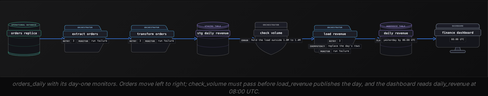

Beginner·Pipeline Architecture · 25 min · 10 challenges

# Pipeline Operations: Beginner

An engineer is 3 weeks into a Google SRE on-call rotation. At 06:00 UTC her pager fires: yesterday's rows are missing from a revenue rollup she has never opened, and finance reads it at 08:00. Its author is asleep. Whether those 2 hours are enough depends on choices made months earlier: which signals the job emits, which alert paged her, and whether a runbook says what to try first.


<br>

---

## Script vs Operable Pipeline

Most pipelines begin as a script written by a single engineer and understood by the same engineer. This one reads yesterday's orders, sums revenue by region, writes the totals to a warehouse table and prints a line at the end. On its author's server it has worked every night for months. The first night it fails, the people who notice are the ones reading the revenue numbers.

```sql
import datetime

import db
import warehouse


def main():
    day = datetime.date.today() - datetime.timedelta(days=1)
    rows = db.query("SELECT region, amount FROM orders WHERE order_date = %s", day)
    totals = {}
    for row in rows:
        totals[row["region"]] = totals.get(row["region"], 0) + row["amount"]
    warehouse.insert("daily_revenue", day, totals)
    print("done")


main()
```

What the script leaves unanswered

- print("done") writes to a terminal nobody watches. Seen from anywhere else, a failed night and a good night look the same.
- date.today() ties the processed day to the clock, so once Monday has passed there is no way to ask for Monday again.
- warehouse.insert appends. Two runs for the same day write that day's totals twice, the duplicate-row bug from Idempotent Reruns.
- Nothing records the row count or the run time, so nobody can say whether a night's 312,880 orders is normal or a warning.

**orders.py fails at 02:00 on Tuesday. The Wednesday 02:00 run succeeds. At 09:00 on Wednesday an analyst spots a gap and runs the script once more by hand. What does daily_revenue now hold for Monday and Tuesday?**

- **A.** Monday and Tuesday once each, because the hand run filled in the day that failed to load.
- **B.** Monday is missing and Tuesday appears twice, because both Wednesday runs processed Tuesday and appended.
- **C.** Monday once and Tuesday missing, because the hand run went back and processed Monday's orders.
- **D.** Tuesday once and Monday missing, because the second insert overwrote the totals from the first.

<details>
<summary>Solution</summary>

**B.** Monday is missing and Tuesday appears twice, because both Wednesday runs processed Tuesday and appended.

Both Wednesday runs got Tuesday from today minus a day, so warehouse.insert loaded Tuesday's rows a second time. Only the failed Tuesday run would have loaded Monday.

**Why the others are wrong**

- **A.** The hand run read the clock like every other run, so it processed Tuesday again, and no run ever requested Monday.
- **C.** No input lets a run go back a day. On Wednesday, date.today() minus a day is Tuesday.
- **D.** warehouse.insert appends, so the second Wednesday run added another copy of Tuesday's totals.

</details>


<br>

### Operable means a stranger can run it

An operable pipeline can be run as a service by people who did not write it. Without opening the code, a stranger can find out whether last night's run happened, whether its output can be trusted, who must hear when it cannot, and what to do next. Each of those 4 answers is work the script never did.

| ✓ Working script | ✗ Operable pipeline |
| --- | --- |
| • Started by cron on a single server<br><br>• Processes whatever day the clock says<br><br>• Appends on every run<br><br>• Reports success to a terminal<br><br>• Breakage found by the people reading dashboards | • Scheduled and retried by an orchestrator<br><br>• Takes the date to process as an input<br><br>• Replaces the day's rows, so reruns are safe<br><br>• Sends its logs and metrics somewhere searchable, along with the status of each run<br><br>• Monitors watch the output and alerts reach an owner, with a runbook to follow |

> The 3 a.m. test
>
> Suppose the pipeline breaks at 03:00 and the only person awake has never looked at it. Can they tell it is broken before a customer says so, and how much it matters? Can they fix it, or hand it to the right team, without phoning the author? Every 'no' marks a missing piece.

The rest of this lesson works on `orders_daily`, the same job rebuilt as a DAG under an orchestrator. Its facts stay fixed in every section:

| Property | Value |
| --- | --- |
| Pipeline | `orders_daily` |
| Schedule | Daily at 02:00 UTC, processing the previous day |
| Tasks | `extract_orders`, `transform_orders`, `load_revenue` |
| Source | Orders database, read through a replica |
| Output | `daily_revenue`, a row per region per day |
| Normal runtime | About 40 minutes, done by 02:40 |
| Normal volume | 1.0 to 1.4 million orders a day |
| Freshness promise | Yesterday's rows present by 06:00 UTC |
| Consumer | Finance dashboard, opened at 08:00 UTC |

> **TIP**
>
> Name an owning team before the pipeline ships. An alert from a pipeline that nobody owns reaches nobody, however well it is written.

**Which change to orders.py lets a stranger recover Monday's revenue from that incident without making anything worse?**

- **A.** Wrap db.query in a retry loop, so a failed extract is attempted 3 times before the script exits.
- **B.** Print the row count next to done, so every run reports how many orders it loaded.
- **C.** Move the cron entry to a larger server, so the script has more memory and fails less often.
- **D.** Take the date as an argument and replace that date's rows on write, so Monday can be rerun safely.

<details>
<summary>Solution</summary>

**D.** Take the date as an argument and replace that date's rows on write, so Monday can be rerun safely.

The stranger can now ask for Monday on any day, and replacing the day's rows means a repeated run cannot double it.

**Why the others are wrong**

- **A.** Retries help with a brief outage on the night. Wednesday's hand run would still read the clock and append.
- **B.** The count still lands in a terminal nobody watches, and runs still process the clock's day.
- **C.** Fewer failures still leave each one with the same lost day and the same double count.

</details>


<br>

---

## Logs, Metrics, and Traces

Once `orders_daily` runs under an orchestrator, every run can leave evidence behind. That evidence comes in 3 kinds called signals. Each kind answers a different question, and reaching for the wrong one is how a team ends up scrolling through thousands of log lines for an answer a graph would have shown at a glance.


<br>

### Logs: what happened, in detail

A log is a timestamped record of a single event, written by the code as it runs: a task started, a retry began, a connection was refused. Logs carry the detail an investigation needs: host, attempt number, exact error. Written as named fields, they can be searched, so `level = ERROR AND task = extract_orders` returns every extract failure at once.

```sql
{
  "ts": "2026-03-16T02:14:07Z",
  "level": "ERROR",
  "pipeline": "orders_daily",
  "task": "extract_orders",
  "run_date": "2026-03-15",
  "attempt": 4,
  "message": "connection refused",
  "host": "orders-replica",
  "port": 5432
}
```


<br>

### Metrics: how much, over time

A metric is a named number recorded on every run or every minute: rows loaded, minutes taken, runs failed. Each value is a few bytes, so years of history stay cheap and draw as a line on a graph. Metrics are where you notice that something changed. They hold none of the detail that explains the change.

| run_date | rows_loaded | duration_minutes |
| --- | --- | --- |
| 2026-03-04 | 1,198,402 | 41 |
| 2026-03-05 | 1,214,977 | 39 |
| 2026-03-06 | 1,302,115 | 43 |
| 2026-03-07 | 1,087,560 | 38 |
| 2026-03-08 | 1,121,833 | 40 |
| 2026-03-09 | 1,233,090 | 42 |
| 2026-03-10 | 312,880 | 12 |

The March 10 row stands out: about a quarter of the usual orders, loaded in under a third of the usual time. The metric cannot say why. The logs for that run can. Among them is a warning from `extract_orders` reading `replica lag 18h04m`: the replica the job reads from had stopped copying new orders at 07:56 on March 10.


<br>

### Traces: where the time went

A trace follows a single unit of work through each step it passes and records every step as a span with a start and an end. In a batch pipeline, a run is the trace and each task is a span. Traces answer the question the other 2 signals leave open: which step made a slow run slow? This is the trace for March 13, a run that ended at 04:55.

| Span | Start | End | Minutes | Usual minutes |
| --- | --- | --- | --- | --- |
| `extract_orders` | 02:00 | 02:24 | 24 | 24 |
| `transform_orders` | 02:24 | 04:49 | 145 | 10 |
| `load_revenue` | 04:49 | 04:55 | 6 | 6 |

The duration metric for that night reads 175 and says only that the run was slow. The trace puts all 135 extra minutes inside `transform_orders`, so the search starts in that task's logs and skips the other 2.

**Finance says revenue for the last 2 weeks of March looks low next to the first 2. Which signal do you open first?**

- **A.** The logs for every run in March, filtered to lines at the ERROR level.
- **B.** The trace for the most recent run, to see which task took the most time.
- **C.** The rows_loaded metric for March, to see when the daily count changed and by how much.
- **D.** The orchestrator's list of failed runs, since low revenue means some runs must have failed.

<details>
<summary>Solution</summary>

**C.** The rows_loaded metric for March, to see when the daily count changed and by how much.

A month of counts on a single graph shows the night the drop began, which tells you whose logs to read next.

**Why the others are wrong**

- **A.** A run that loads too few orders can finish without writing a single ERROR line.
- **B.** A single run's timing shows nothing about a trend across 4 weeks.
- **D.** March 10 succeeded and still loaded a quarter of its orders, so the failure list can be empty.

</details>


<br>

### Matching the signal to the question

| Question | Signal | Why that one |
| --- | --- | --- |
| Has the daily order count dropped this week? | Metric | A trend across many runs |
| Why did `extract_orders` fail at 02:14? | Log | The error text belongs to a single event |
| Which task stretched the March 13 run to 175 minutes? | Trace | Spans show each step's share of the time |
| Which order IDs did the transform reject? | Log | Per-record detail lives in events |

> **TIP**
>
> Investigations often use the signals in turn: a metric shows that something changed, a trace narrows it to a step, and that step's logs explain why.

**load_revenue failed on its last attempt in the run for March 16. You know the task and the run. Which signal tells you whether a rerun is worth trying?**

- **A.** Its log, because the error text shows whether the cause is transient, like a refused connection, or permanent, like a missing column.
- **B.** Its duration metric, because a long attempt shows the task got far enough that a rerun will finish.
- **C.** Its trace, because span lengths show which task failed, and that is enough to decide on a rerun.
- **D.** The failed-runs metric, because a high count this month marks the error as a known pattern to rerun.

<details>
<summary>Solution</summary>

**A.** Its log, because the error text shows whether the cause is transient, like a refused connection, or permanent, like a missing column.

Only the error text says which kind of failure this is, and a permanent one fails again on every rerun.

**Why the others are wrong**

- **B.** How long an attempt ran says nothing about why it stopped.
- **C.** You already know the task. Timing cannot tell a refused connection from a missing column.
- **D.** A count shows how often runs fail, without saying what failed this time.

</details>


<br>

---

## Day-One Monitoring

Signals sit unread until something checks them. A monitor is a scheduled check that reads a signal and returns pass or fail. A new pipeline needs only the handful of monitors that between them catch its most common breakages, and each one should catch something the others cannot.


<br>

### 3 monitors to ship with

- **Run failure** *Reads run status from the orchestrator*\
  Fails when a task ends as failed with its retries used up. Fires earliest and names the task, but sees only runs that started.
- **Freshness** *Reads the newest date in daily_revenue*\
  Fails when yesterday's rows are missing at 06:00 UTC. Watches the output, so it notices runs that never started or never ended.
- **Volume** *Reads the order count for the run's date*\
  Fails when the count falls outside 1.0 to 1.4 million. Judges the data, so it notices runs that succeed with the wrong amount.



For the volume check to act as a gate, `transform_orders` now writes to a staging table, `stg_daily_revenue`, with the same columns as `daily_revenue`. A fourth task, `check_volume`, counts the orders in that table. `load_revenue` copies the day across only when the count passes.


<br>

### What each monitor catches alone

Each column below imagines a single monitor as the only one installed. Each row is a real way `orders_daily` breaks.

| What broke | Run failure alone | Freshness alone | Volume alone |
| --- | --- | --- | --- |
| `extract_orders` fails after 3 retries | Fires at 02:15 | Fires at 06:00 | Silent: check never runs |
| A deploy leaves the schedule paused | Silent: no run, no failure | Fires at 06:00 | Silent: check never runs |
| `transform_orders` hangs for 6 hours | Silent: still running | Fires at 06:00 | Silent: check never runs |
| Replica lag: 312,880 orders, run succeeds | Silent: run succeeded | Silent: the date is present | Fires before publish |

Freshness fires in 3 of the 4 rows, which makes it the monitor to keep if only a single one were allowed: it watches what the consumer will see, so it notices failures no task reported. Run failure fires 3 hours and 45 minutes sooner in the first row and names the broken task. Volume is the only check that judges the data; without it, the quarter-sized March 10 load reaches the dashboard.

**A Friday deploy leaves the orders_daily schedule paused. The team installed only the run-failure and volume monitors. When does anyone find out?**

- **A.** At 02:15 on Saturday, when the run-failure monitor sees that no run started and reports it.
- **B.** Before publish on Saturday, when the volume check counts 0 orders for Friday and holds the load.
- **C.** At 06:00 on Saturday, when the orchestrator marks the skipped run as failed and alerts.
- **D.** When someone notices stale numbers on the dashboard, since neither monitor fires without a run.

<details>
<summary>Solution</summary>

**D.** When someone notices stale numbers on the dashboard, since neither monitor fires without a run.

Both monitors need a run to happen. Only a check on the output would notice that nothing arrived.

**Why the others are wrong**

- **A.** Run failure reads the status of runs that exist. A paused schedule creates no run to fail.
- **B.** The volume check is a task in the paused DAG, so it never runs either.
- **C.** No run was scheduled, so the orchestrator has nothing to mark. Noticing missing output is what freshness does.

</details>


<br>

### Writing the data checks


The freshness query runs at 06:00 UTC against the table above and fails when `days_behind` is greater than 1.

```sql
SELECT
  MAX(revenue_date) AS latest_date,
  DATE_DIFF('day', MAX(revenue_date), CURRENT_DATE) AS days_behind
FROM daily_revenue
```

The volume query runs against the staging table after `transform_orders`. The orchestrator writes the run's date into it, so a rerun for March 10 counts March 10.

```sql
SELECT
  SUM(order_count) AS orders
FROM stg_daily_revenue
WHERE revenue_date = DATE '2026-03-10'
```

> **TIP**
>
> Only the freshness query reads the clock, because it asks about the present: is yesterday loaded yet? Every check that judges a run's data should use that run's date.

Set the range wide, from a few weeks of history; 1.0 to 1.4 million covers every normal March night. A 1.9-million-order sale day will trip it on good data, and the owner raises the ceiling for that date.

> What can wait until week 2
>
> - Duration: flag runs over 80 minutes, twice the usual 40, before they threaten 06:00
> - Null and uniqueness checks on `revenue_date` and `region`
> - Volume per region, once each region's normal range is known

**A volume check is written as below. On March 12, the owner reruns the pipeline for March 10. Which day's orders does this check count?**

```sql
SELECT
  sum(order_count) AS orders
FROM stg_daily_revenue
WHERE revenue_date = current_date - INTERVAL '1' DAY
```

- **A.** March 10, because the rerun passes its date to every task, including this check.
- **B.** March 11, because the query takes yesterday from the clock, whatever date the run is for.
- **C.** March 10 and March 11 together, because the interval covers the 2 days before today.
- **D.** No day at all, because current_date is undefined while a rerun is in progress.

<details>
<summary>Solution</summary>

**B.** March 11, because the query takes yesterday from the clock, whatever date the run is for.

On March 12, current_date minus a day is March 11, so the gate judges the wrong day's rows.

**Why the others are wrong**

- **A.** This query never reads the run's date. It computes yesterday from the clock.
- **C.** The condition is an equality on a single date. INTERVAL '1' DAY shifts that date by a day.
- **D.** current_date always returns today's date, so the query runs and counts March 11.

</details>


<br>

---

## Alerting That Stays Useful

A monitor decides pass or fail. An alert decides who hears about a failure, and how fast. Keeping the 2 decisions apart lets every monitor record its result while only a few results interrupt a person.


<br>

### 3 severities

| Severity | What happens | Use it when | In orders_daily |
| --- | --- | --- | --- |
| Page | Rings the on-call engineer at any hour until acknowledged | A consumer will be harmed soon and only a person can stop it | Freshness fails at 06:00 |
| Ticket | Opens a work item handled in working hours | A person must act, but a day's wait harms no one | 3 slow nights in a row |
| Record | Writes to a dashboard or channel, interrupting nobody | Context for later, or a problem already handled | A retry that succeeded |

Choosing between a page and a ticket comes down to 2 durations: how long until a consumer is harmed, and how long a fix takes. At 06:00 the dashboard is 2 hours away and a rerun takes about 40 minutes, so a 06:00 page leaves room to finish the repair.


<br>

### Page on what the consumer feels

Pages work best on symptoms, the effects a consumer would notice: data that is late or missing, or numbers that are wrong. Causes such as a refused connection or a slow task fit tickets and records better, since retries absorb many of them. A symptom page also stands in for the several cause alerts a single incident sets off.

| Monitor | Fires | Goes to |
| --- | --- | --- |
| Run failure | When a task runs out of retries | Team channel and a ticket |
| Volume gate | Before publish | Team channel and a ticket; the load is held |
| Freshness | 06:00 UTC | A page to the on-call engineer |
| Duration over 80 minutes | After the third slow night in a row | A ticket |
| Retry that succeeded | Any time | A record only |

With this routing, the extract outage in the run for March 15 produces a single page. The run-failure post from 02:15 is already in the channel when the freshness page arrives at 06:00, so the engineer starts with the cause named.

**A different pipeline feeds a report that opens at 08:00. A rerun takes 3 hours. Its only page is a freshness check at 06:00. What should change?**

- **A.** Page when a task fails, because a 06:00 page leaves 2 hours for a fix that needs 3.
- **B.** Keep the 06:00 page and add a ticket for each failure, so causes are reviewed the next day.
- **C.** Move the freshness check to 07:30, so it fires closer to the moment the report opens.
- **D.** Turn the freshness page into a ticket, since paging at 06:00 wakes people for nothing.

<details>
<summary>Solution</summary>

**A.** Page when a task fails, because a 06:00 page leaves 2 hours for a fix that needs 3.

The page has to arrive while the time left before harm still exceeds the time a fix takes. Paging on symptoms assumes the symptom leaves time to fix. Here it does not, so the earliest signal pages, even a cause.

**Why the others are wrong**

- **B.** The review happens after the report has opened without data, and the page still comes too late.
- **C.** At 07:30 only 30 minutes remain for a 3-hour fix, which makes the gap wider.
- **D.** The report is about to be harmed, which is when a page is justified. It needs to come sooner.

</details>


<br>

### Noise wears out the on-call

Each page that turns out to need no action teaches the on-call engineer that pages can wait. After enough of them, a real page waits too. Picture a team whose alert history for a week looked like this:

- **41** — pages in a single week
- **3** — pages that needed a person

Most of the rest were retries that later succeeded and volume ranges drawn too tight. Demoting the first to records and widening the second removes the noise and hides no real incident.


<br>

### What a page should say

| ✓ Hard to act on | ✗ Ready to act on |
| --- | --- |
| • Task failed: extract_orders<br><br>• No date, so the reader hunts for the run<br><br>• No impact, so the reader cannot judge urgency<br><br>• No link, so the reader starts from a blank screen | • orders_daily: no rows in daily_revenue for 2026-03-15 at 06:00 UTC<br><br>• Impact: finance dashboard shows stale revenue from 08:00 UTC<br><br>• Cause so far: extract_orders failed at 02:14 after 3 retries<br><br>• Runbook: runbooks/orders_daily, freshness section |

| ✓ Do | ✗ Don't |
| --- | --- |
| • Page only when a consumer will be harmed and a person must act now<br><br>• Give every page the date and impact, plus a link to the runbook<br><br>• Demote any alert that fired twice with no action taken | • Page on a retry that went on to succeed<br><br>• Page more than once for a single incident<br><br>• Route alerts to a shared inbox nobody owns |

**For the third night in a row, orders_daily ran over 80 minutes. Each run still finished before 03:40. How should this alert be routed?**

- **A.** Page the on-call engineer, because 3 slow nights in a row put the 06:00 promise at risk.
- **B.** Record it on the dashboard only, because the data arrived on time and needs no person.
- **C.** Open a ticket for the owning team, because a person should look but a day's wait harms no one.
- **D.** Page the source database team, because slow runs usually start in the system being read.

<details>
<summary>Solution</summary>

**C.** Open a ticket for the owning team, because a person should look but a day's wait harms no one.

The slowdown gets investigated in working hours, before it reaches 06:00, with no overnight page.

**Why the others are wrong**

- **A.** Every run finished more than 2 hours early. Nobody is harmed tonight, so waking someone buys nothing.
- **B.** A slowdown that keeps growing will miss 06:00 eventually, so a person should look at it.
- **D.** No trace has placed the slowdown in any step yet, and the source team does not own this alert.

</details>


<br>

---

## A First Runbook

A runbook is the written procedure for a single alert. Its reader is the engineer the alert has reached, who may never have opened the pipeline's code. Its 5 sections run in the order that reader needs them: symptom and impact first, then diagnosis and response, with escalation last. Here is the runbook for the `orders_daily` freshness page.


<br>

### Runbook: orders_daily freshness page

#### Symptom

The freshness monitor found no rows in daily_revenue for yesterday at 06:00 UTC. A normal run finishes by roughly 02:40.

#### Impact

Finance opens the revenue dashboard at 08:00 UTC. Until the load lands, the newest day it shows is the day before yesterday. No other team reads this table.

#### Diagnosis

- **Step 1.** Open the orders_daily run for yesterday's date in the orchestrator. If no run exists, the schedule is paused or did not trigger: go to Response A.
- **Step 2.** If the run is still going, open its trace and compare each task with its usual minutes: extract 24, transform 10, load 6. Go to Response B.
- **Step 3.** If extract_orders, transform_orders or load_revenue failed, read the ERROR line from its last attempt. connection refused or timeout: the replica was unreachable, go to Response C. column not found or a type error: the source schema changed, go to Escalation and do not rerun.
- **Step 4.** If check_volume failed, run the volume query for yesterday's date and note the count. Go to Response D.

#### Response

- **A.** Unpause the schedule, then trigger a run with --date set to yesterday.
- **B.** If a task has run past 3 times its usual minutes, stop the run and start it again with --date. Otherwise check again at 06:30.
- **C.** Run SELECT 1 against orders-replica port 5432. If it answers, rerun with --date; load_revenue replaces the day's rows, so the rerun is safe. If refused, go to Escalation.
- **D.** Under 1.0 million usually means replica lag. Measure it on the replica with SELECT date_diff('minute', max(created_at), current_timestamp) FROM orders and rerun once it is under 10 minutes. Over 1.4 million on a known sale day: raise that date's ceiling, then rerun. Over 1.4 million otherwise: likely duplicated source rows, so page the orders database on-call and do not rerun.
- Finish every response by running the freshness query. days_behind must be 1.

#### Escalation

- No acknowledgement within 15 minutes: the secondary on-call is paged automatically.
- Not fixed by 07:30 UTC: tell the finance channel that yesterday's revenue is late, and when the next update will come.
- Replica down for over 30 minutes, or a schema change: page the orders database on-call.
- Owner: revenue data team. Last followed end to end on 2026-03-01.

**At 06:00 on March 21 the freshness page fires. In the run for March 20, extract_orders and transform_orders succeeded. Then check_volume failed at 02:12, so load_revenue never started. The volume query returns 402,115. What does the runbook have you do?**

- **A.** Step 3 applies because a task failed, so confirm the replica accepts connections and rerun at once.
- **B.** Step 4 applies, and Response D says to check replica lag, wait until it is under 10 minutes, then rerun.
- **C.** Step 4 applies, and the low count is real, so lower the floor to 400,000 and rerun the load.
- **D.** Step 1 applies because no data was published, so unpause the schedule and trigger a new run.

<details>
<summary>Solution</summary>

**B.** Step 4 applies, and Response D says to check replica lag, wait until it is under 10 minutes, then rerun.

A count far under 1.0 million points at replica lag. Rerunning before the replica catches up fails the gate again.

**Why the others are wrong**

- **A.** Step 3 is for a failed extract_orders or transform_orders, and it also covers load_revenue. A failed check_volume is Step 4.
- **C.** That would publish a fraction of the day's revenue. Response D moves the range only for a known sale day.
- **D.** The run exists and its tasks ran, so the schedule is working. Step 1 does not match.

</details>


<br>

### Writing for a stranger at 3 a.m.

- Name the exact query, command or screen; 'check the logs' names none of them
- Give each check its possible results and the next step for every result
- Say when a rerun would make things worse, as well as when it helps
- Have an engineer new to the pipeline follow it in working hours, and record the date
- Update it after each incident, while the missing steps are fresh


**A draft runbook's diagnosis section reads: 'Check the logs and fix the issue.' Which rewrite helps an engineer who has never seen the pipeline?**

- **A.** Add a paragraph on how the pipeline was designed, so the reader understands the code before acting.
- **B.** Rerun the pipeline first, and read the logs only if the rerun fails as well.
- **C.** Contact the pipeline's author, who knows the code best and can find the problem fastest.
- **D.** Name the log line to read, list the errors it may show, and give the next step for each.

<details>
<summary>Solution</summary>

**D.** Name the log line to read, list the errors it may show, and give the next step for each.

Each result now leads somewhere: a transient error to a rerun, a schema change to escalation.

**Why the others are wrong**

- **A.** Background slows the reader down at 03:00. They need a next action, and this gives none.
- **B.** A schema change fails again on rerun, and the wait comes out of the 2 hours before 08:00.
- **C.** A runbook exists so the fix does not depend on the author being awake.

</details>


<br>

---

## Putting It All Together

A marketplace pays its sellers every Friday at 09:00 UTC from a nightly seller_payouts pipeline. On a Thursday night the source replica falls behind, and the run reads 40% of the usual orders while every task reports success.

- The volume check, run against Thursday's date, holds the load, so no seller is paid from partial numbers.
- The run-failure post names the gate, and the order-count metric shows the drop happened on a single night.
- Freshness pages at its deadline because sellers are harmed within hours and a rerun fits inside that window.
- The runbook's volume step sends the on-call engineer to check replica lag and wait for it to clear before rerunning; replacing the day's rows makes the rerun safe.
- If the replica stays down, the escalation section tells the payments team before 09:00 that payouts will be late.


<br>

---

## Key Takeaways

- A script becomes an operable pipeline when a stranger can tell it ran, trust its output, know who to tell and know what to do, all without reading the code.
- Metrics show that something changed, traces show which step changed, and logs show why.
- Ship with 3 monitors: run failure for speed and detail, freshness for anything that keeps data from arriving, volume for runs that succeed with the wrong data.
- Checks on a run's data use the run's date; only the freshness check reads the clock.
- Page when a consumer will be harmed and only a person can stop it in time; send everything else to tickets and records.
- A runbook gives symptom, impact, ordered diagnosis checks, a response for each cause, and who to escalate to and when.

Exercises for this lesson: [_exercises/pa_pipeline_operations_beginner.md](_exercises/pa_pipeline_operations_beginner.md)
