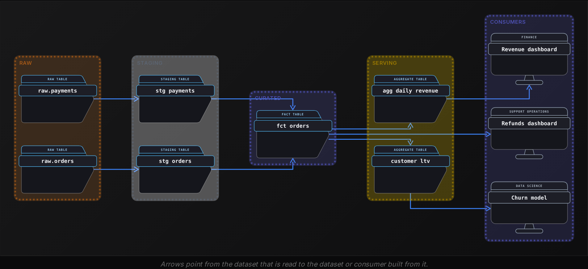
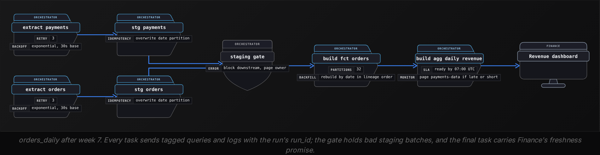

Intermediate·Pipeline Architecture · 32 min · 12 challenges

# Pipeline Operations: Intermediate

Say a pull request at Netflix changes `watch_time` in a playback table from seconds to minutes on a Monday. A forward lineage walk names the 140 downstream tables and dashboards and their owners, and a data diff in CI shows every row's `watch_time` divided by 60 before merge. Those steps keep Tuesday's Top 10 built on real viewing numbers, and this lesson works them on a small orders pipeline.


<br>

---

## What Telemetry Is Worth Keeping

Every log line is paid for in 3 places, and so is every metric series and trace span. Ingest and storage are the first 2; the third is each query that reads it. It is paid for again in attention, because a dashboard of 60 panels hides the 3 that matter during an incident. Telemetry is worth keeping when it answers a question that someone acts on, and the table below applies that test to each signal.


<br>

### Start from the question, then pick the signal

| Question | Signal that answers it | Who acts on it |
| --- | --- | --- |
| Is the output late or wrong right now? | Freshness and row-count checks on the final tables | On-call engineer, from an alert |
| Which task in which run failed, and why? | Task logs that carry `run_id`, plus task status | On-call engineer, while debugging |
| Is this pipeline getting slower or more expensive? | Daily rollups of duration and cost per task | Owning team, at a monthly review |
| What did row 8,812,004 look like inside step 3? | No telemetry; query the table or the dead letter queue | Almost nobody, almost never |

The last row is where budgets leak. A task that logs every row of a 200-million-row load writes 200 million lines per run; at 300 bytes a line, that is 60GB of logs a day from 1 task, and the line for row 8,812,004 will never be read. Log once per batch instead: the `run_id` and the duration, and how many rows came in and went out, with rejected rows counted separately. Those few lines per run answer the second question in the table.


<br>

### Cardinality decides the metric bill

A metrics store keeps 1 time series per unique combination of label values. Storage cost grows with the series count, and so does query cost. With pipeline and task as its labels, the metric rows_written makes 480 series over 40 pipelines of 12 tasks each. That is cheap, and it is enough to see which pipeline and task slowed down or shrank. Add a customer_id label, which has 50,000 distinct values, and each of those series splits 50,000 ways.

- **24M** — rows_written series with customer_id

A label belongs on a metric when its set of values grows with the platform, such as pipeline and task, or env and status. Values that grow with the data go into log lines, where they leave no permanent series behind; customer_id and order_id are examples, as are run_id and partition_date. run_id looks harmless, but as a label it mints a new series every run, each holding the points of a single run.


<br>

### Keep detail briefly, keep summaries for 13 months

Questions about raw detail come within days of an incident. Questions about trends, such as whether `orders_daily` has slowed since spring, come months later. Retention is therefore tiered: full detail for a short window, then downsampled rollups for a long one.

| Signal | Full detail kept | After that | Why this window |
| --- | --- | --- | --- |
| Task logs | 14 days | Error lines kept 90 days, the rest deleted | Incidents are debugged within a week; repeat errors show up over a quarter |
| Task metrics at 10-second points | 15 days | 5-minute rollups kept 13 months | 13 months lets you compare a month with the same month last year |
| Run traces | Every failed run and 5% of successful runs, for 7 days | Deleted | Failures need the full path; latency trends need only a sample |
| Query cost records | 13 months | Deleted | Small rows that feed the monthly cost review |

> **TIP**
>
> Before adding a signal, name the thing that will read it. That can be an alert or a dashboard panel, or a step in a runbook. A signal nothing reads is cost with no return, and it buries the signals that matter.

**A teammate proposes adding order_id as a label on the rows_rejected metric so on-call can see which orders failed validation. The pipeline rejects roughly 2,000 of its 400,000 daily orders, each with a new order_id. What should the review say?**

- **A.** Ship it: 2,000 rejected orders a day is a small number of series, well within what a metrics store handles.
- **B.** Keep rows_rejected labelled by pipeline and task, and write each rejected order_id and its reason to a log line or the dead letter queue.
- **C.** Add the label, and cut metric retention from 13 months to 15 days so the old order_id series age out quickly.
- **D.** Remove the rows_rejected metric, because every rejected order already sits in the dead letter queue with its reason.

<details>
<summary>Solution</summary>

**B.** Keep rows_rejected labelled by pipeline and task, and write each rejected order_id and its reason to a log line or the dead letter queue.

The metric stays at a bounded series count and still drives an alert on rejection rate. The per-order detail lives where per-row detail belongs, with retention measured in days.

**Why the others are wrong**

- **A.** The daily count is small, but every day adds 2,000 new series. After a year that is over 700,000, each created for 1 order and never useful again, and the count keeps growing.
- **C.** Shorter retention caps storage, but it throws away the 13-month trend for every other series, and the store still creates 2,000 new series each day.
- **D.** The queue holds the records, but an alert on rejection rate needs a metric. Without it, a jump from 2,000 to 40,000 rejections a day goes unnoticed until someone opens the queue.

</details>


<br>

---

## Lineage and Blast Radius

Lineage is the graph of which datasets are built from which. The nodes are tables and models, plus the dashboards that read them, and each edge records that 1 node reads another. The same graph answers 2 different questions depending on the direction you walk it.

| ✓ Backward lineage (upstream) | ✗ Forward lineage (downstream) |
| --- | --- |
| • From a node to everything it reads, then everything those read<br><br>• Answers: where could this bad number have come from?<br><br>• Used during an incident to find the origin | • From a node to everything that reads it, and onward<br><br>• Answers: what breaks if this node changes or goes bad?<br><br>• Used before a change and during an incident to size the damage |


<br>

### The orders_daily graph



Blast radius is the set of nodes forward of a change or a failure, together with the people who own them. Walking forward from `stg_payments` reaches 6 nodes. Half of them are the revenue and refunds dashboards and the churn model; the rest are the internal tables `fct_orders` and `agg_daily_revenue`, plus `customer_ltv`. The count alone misleads, so weight each node by who depends on it: the revenue dashboard that Finance closes the month with outranks 3 internal tables.


<br>

### Column-level lineage narrows the radius

Table-level lineage says fct_orders reads stg_payments. Column-level lineage says which columns feed which: fct_orders.net_revenue is computed from stg_payments.fee_usd, and of the nodes after fct_orders only agg_daily_revenue reads net_revenue. A change to how fee_usd is rounded therefore alters values in fct_orders and agg_daily_revenue and on the revenue dashboard, 3 nodes in all, and the refunds and churn owners need no warning. Renaming or dropping fee_usd is different, because the build of fct_orders fails, everything after it goes stale, and the radius is back to all 6.


<br>

### Where lineage comes from

| Capture method | How it works | What it misses |
| --- | --- | --- |
| Parse pipeline code | Read each task's SQL and record the tables in its `FROM` and `JOIN` clauses | Dashboards, notebooks and ad hoc queries that read tables directly |
| Parse query logs | Read every query the warehouse ran over a window, from any client | Readers that did not run during the window |
| Declared task inputs and outputs | Each orchestrator task lists what it reads and writes | Anything someone forgot to declare |

Code parsing alone never sees the analyst whose notebook reads `fct_orders` every Monday, and that analyst is the person who gets surprised. Merging code lineage with 30 days of query logs covers most real readers; declared inputs fill the gaps where SQL is assembled at runtime and cannot be parsed.


<br>

### Root cause: walk back until the inputs are healthy

On the morning of 2026-10-21, Finance reports the revenue dashboard showing 2026-10-20 revenue 38% below its 7-day average. Backward lineage from the dashboard lists the nodes to check; a row count on each for that date shows its health.

| Node | Rows for 2026-10-20 | 7-day average | Status |
| --- | --- | --- | --- |
| fct_orders | 255,000 | 410,000 | Low |
| stg_payments | 254,600 | 408,900 | Low |
| stg_orders | 411,200 | 409,800 | Normal |
| raw.payments | 409,700 | 408,300 | Normal |
| raw.orders | 411,500 | 410,100 | Normal |

The origin is the most upstream node that is unhealthy while every node it reads is healthy. fct_orders is low, but stg_payments, one of its inputs, is also low, so the fault entered earlier. stg_payments is low while its only input, raw.payments, is normal: the rows disappeared inside stg_payments. Its last deploy on 2026-10-19 added WHERE currency = 'USD'. A payment processor onboarded that week sends 'usd' in lowercase. The fix lands in stg_payments, and the backfill rebuilds it and every node forward of it, in lineage order.

**A Monday alert says customer_ltv has 0 rows for 2026-10-25. Every node upstream of it, from fct_orders back to both raw tables, has normal row counts for that date. Which reading of the lineage is correct?**

- **A.** The fault originated in the customer_ltv build, and its blast radius is the churn model.
- **B.** The fault originated in raw.payments, since the most upstream table is where data incidents begin.
- **C.** The fault originated in customer_ltv, and its blast radius includes the revenue and refunds dashboards.
- **D.** The origin is unknown without column-level lineage, so check every column of fct_orders for nulls first.

<details>
<summary>Solution</summary>

**A.** The fault originated in the customer_ltv build, and its blast radius is the churn model.

customer_ltv is unhealthy and its only input, fct_orders, is healthy, so it is the origin. Forward lineage from customer_ltv reaches only the churn model.

**Why the others are wrong**

- **B.** The origin is the highest unhealthy node whose inputs are healthy. raw.payments is healthy, so walking back past customer_ltv finds nothing broken.
- **C.** The origin is right, but those dashboards read agg_daily_revenue and fct_orders, which are healthy. They sit on other branches from fct_orders and never read customer_ltv.
- **D.** Table-level health already isolates the origin: the only unhealthy node has healthy inputs. Column-level lineage helps size a change to values, and this incident is a missing build output.

</details>


<br>

---

## Cost Attribution

A warehouse bill reports daily spend for each account and compute cluster. It cannot say that `orders_daily` cost $4,200 last month, because the warehouse has no idea what a pipeline is. Cost attribution supplies that idea: every query a pipeline sends carries a tag naming who sent it, and the warehouse's query log turns into a ledger you can group by pipeline and then break down by task or by run.


<br>

### What goes in a query tag

```sql
{
  "pipeline": "orders_daily",
  "task": "build_fct_orders",
  "run_id": "orders_daily__2026-10-20T06:00",
  "owner": "payments-data",
  "env": "prod"
}
```

Each field has a job. pipeline and task are the grouping keys for the rollup. run_id ties a query's cost to 1 run and to that run's logs; it is safe here because the query log stores 1 row per query and mints no metric series. owner says whom to talk to. env keeps CI and development spend out of the production numbers.

Many warehouses let a client attach a tag or label to its session and record it on each query in the log. Set the tag in 1 place, the orchestrator's task wrapper or the shared database client, so every task inherits it. A hand-typed tag is missing from the first query someone writes in a hurry, which lands in the untagged bucket.


<br>

### The rollup

```sql
SELECT
  COALESCE(
    JSON_EXTRACT_SCALAR(query_tag, '$.pipeline'),
    'untagged'
  ) AS pipeline,
  COUNT(DISTINCT JSON_EXTRACT_SCALAR(query_tag, '$.run_id')) AS runs,
  SUM(cost_usd) AS total_cost_usd
FROM query_history
WHERE start_time >= CURRENT_TIMESTAMP - INTERVAL '30' DAY
  AND COALESCE(JSON_EXTRACT_SCALAR(query_tag, '$.env'), 'prod') = 'prod'
GROUP BY 1
ORDER BY total_cost_usd DESC
```

Joined with lineage, the rollup gains its most useful column: how many distinct users and dashboards queried the pipeline's output tables in the same 30 days, from the query-log lineage of the previous section.

| pipeline | 30-day cost | runs | cost per run | prior 30 days, cost per run | readers in 30 days |
| --- | --- | --- | --- | --- | --- |
| clickstream_sessions | $11,800 | 720 | $16.39 | $16.10 | 3 |
| marketing_attribution | $6,900 | 30 | $230 | $228 | 0 |
| orders_daily | $4,200 | 30 | $140 | $60 | 9 |
| untagged | $3,000 | 0 | n/a | n/a | n/a |
| inventory_snapshot | $2,100 | 30 | $70 | $69 | 5 |

- **$28,000** — total 30-day warehouse spend
- **10.7%** — of 30-day spend carries no tag


<br>

### Reading it for savings

Patterns worth a closer look

- **No readers** *marketing_attribution*\
  It spends $6,900 a month on tables nobody queried in 30 days. Ask the owner what still depends on them before pausing the schedule.
- **Cost per run jumped** *orders_daily*\
  Same cadence, cost per run up from $60 to $140. Something in the code changed, often a deploy that swapped an incremental load for a full rebuild.
- **Cadence above need** *clickstream_sessions*\
  It makes 720 hourly runs for 3 readers. If each run reprocesses the whole day so far and readers look once each morning, a daily run removes most of the repeated work.
- **Untagged spend** *the untagged row*\
  Find who sends untagged queries first. The $3,000 here exceeds inventory_snapshot's whole month, enough to hide a pipeline that size; a working threshold, such as 5% of spend, says when to chase it.

Rank these by expected saving, then by the risk of acting. Pausing an unread pipeline saves the most here and comes undone in a minute. The `orders_daily` jump is smaller in dollars, but it is a defect that keeps billing until someone finds it, and the `run_id` in every tag leads to the first expensive run. The steady pipelines can wait.

> **TIP**
>
> Report cost per run alongside monthly cost. A pipeline whose monthly cost doubles because it now runs twice as often reflects a cadence decision; one whose cost per run doubles hides a code change to find.

**The team has 1 afternoon for orders_daily, whose cost per run rose from $60 to $140 starting with the first run after a deploy on 2026-09-24. Which next step uses the attribution data most directly?**

- **A.** Move orders_daily to a smaller compute cluster so each run costs less, and check the bill again next month.
- **B.** Run orders_daily every other day, which halves the monthly cost while the cause is investigated.
- **C.** Ask the 9 readers whether they still need the output, and pause the pipeline if fewer than half reply.
- **D.** Group query_history for orders_daily by task, before and after 2026-09-24, and read the deploy's diff for the task whose cost moved.

<details>
<summary>Solution</summary>

**D.** Group query_history for orders_daily by task, before and after 2026-09-24, and read the deploy's diff for the task whose cost moved.

The tag's task field turns a pipeline-level jump into a task-level one, and the date ties it to a specific deploy. That narrows the search to 1 task and 1 change.

**Why the others are wrong**

- **A.** A smaller cluster may lower the price per run but leaves whatever the deploy changed in place, and runs may slow down or fail. The cause stays unknown.
- **B.** Halving the cadence halves the bill and ships stale data to 9 readers. Cost per run, the number that moved, is unchanged.
- **C.** That is the move for a pipeline with no readers. Here readers exist, and the rollup points at a regression in the code.

</details>


<br>

---

## CI/CD for Pipelines

A pipeline change can pass every compile check and still double the rows or drop a filter. It can also change what a column means. CI for pipelines therefore tests the data a change produces as well as the code. The constraint is time: a CI run that takes most of an hour gets skipped, batched into pull requests too large to review, or merged around.


<br>

### 4 layers, cheapest first

| Layer | What runs | What it catches | Rough time |
| --- | --- | --- | --- |
| 1. Static | Parse every SQL file, load every DAG, lint, check for cycles and missing references | Syntax errors, broken imports, a task reading a table that no longer exists | Under 1 minute |
| 2. Unit | Transform logic on hand-written fixture rows with expected outputs | Wrong dedupe or join logic, mishandled nulls and edge cases | 1 to 2 minutes |
| 3. Integration | Build changed tables in a CI schema from 1 recent day of prod inputs, then run the quality checks prod runs | Row explosions, failed uniqueness, nulls in required columns | 3 to 10 minutes |
| 4. Data diff | Compare the CI output with prod output for the same day | Silent changes: rows gained or lost, amounts that moved | 1 to 5 minutes |

Each layer catches failures the one before it cannot see. Static checks know nothing about data. Unit tests prove logic on a few hand-written rows, never on 400,000 real ones. An integration build can pass every check and still shift a revenue total; the data diff turns 'the build passed' into 'here is what changes in prod'.

#### Layer 2: a unit test on fixture rows

```sql
def dedupe_latest(rows):
    latest = {}
    for row in rows:
        key = row["order_id"]
        if key not in latest or row["updated_at"] > latest[key]["updated_at"]:
            latest[key] = row
    return sorted(latest.values(), key=lambda r: r["order_id"])


def test_dedupe_keeps_latest_version():
    rows = [
        {"order_id": 7, "status": "placed", "updated_at": 1},
        {"order_id": 7, "status": "shipped", "updated_at": 2},
        {"order_id": 9, "status": "placed", "updated_at": 1},
    ]
    result = dedupe_latest(rows)
    assert [r["status"] for r in result] == ["shipped", "placed"]
```

The fixture holds 3 rows built around the case that matters: 2 versions of order 7. A useful next fixture is 2 versions with the same `updated_at`, which the function resolves by keeping whichever arrived first. The test needs no warehouse and runs in milliseconds, so it runs on every push.

#### Layer 4: a data diff against prod

```sql
SELECT
  COUNT_IF(c.order_id IS NULL) AS missing_in_ci,
  COUNT_IF(p.order_id IS NULL) AS new_in_ci,
  COUNT_IF(p.amount_usd <> c.amount_usd) AS amount_changed
FROM prod.fct_orders AS p
FULL OUTER JOIN ci_pr_412.fct_orders AS c
  ON p.order_id = c.order_id
WHERE COALESCE(p.order_date, c.order_date) = DATE '2026-10-20'
```

For a pure refactor, every count should be 0. For the lowercase `'usd'` fix from the lineage example, diffing 2026-10-20 against the broken prod output should show around 155,000 rows in `new_in_ci` and nothing missing or changed. That number is the evidence the fix restores the lost payments and touches nothing else.


<br>

### Slim CI: build only what the change touches

Slim CI uses lineage to choose the build set, which is the tables a pull request modified plus every table downstream of them. Unmodified upstream tables are read from prod instead of rebuilt. In a project of 600 tables, a pull request that edits stg_payments builds 4 tables, stg_payments and fct_orders as well as agg_daily_revenue and customer_ltv; the dashboards and the churn model sit outside the project and stay as they are.

- **52 min** — CI time when building all 600 tables
- **6 min** — slim CI time for the stg_payments change

> Where slim CI can miss
>
> - Reading upstream tables from a stale prod state tests against old data; refresh that state before each CI run.
> - A change to shared code or config, such as a common SQL snippet or a currency list, must mark every table that uses it as modified.
> - A full build on the main branch each night catches whatever slim selection skipped during the day.


<br>

### CD: ship the artifact you tested

Deployment promotes the exact code that passed CI to prod on merge, with no rebuild in between. A backfill for changed values runs in forward-lineage order, so each table is rebuilt only from inputs already on the new logic. Order alone leaves a window: until `agg_daily_revenue` is rebuilt, the refunds dashboard shows new values and the revenue dashboard old ones. Building the affected partitions in a separate schema and swapping them in together closes it.

**A pull request that edits fct_orders is described as 'refactor, no behavior change'. Its data diff reports missing_in_ci = 0, new_in_ci = 0 and amount_changed = 18,400. What should the reviewer conclude?**

- **A.** The change is safe: no rows were gained or lost, and the amount differences are rounding noise to ignore.
- **B.** The diff layer is too noisy for refactors, so the reviewer should rely on layers 1 to 3 for this change.
- **C.** The refactor changed behavior: 18,400 orders now carry a different amount, and the merge waits until those rows are explained.
- **D.** Merge it, then backfill fct_orders so prod matches the new amounts and the diff returns to zero.

<details>
<summary>Solution</summary>

**C.** The refactor changed behavior: 18,400 orders now carry a different amount, and the merge waits until those rows are explained.

A true refactor diffs to all zeros. Pull a few changed orders, compare the 2 amounts, and either fix the code or rewrite the description and plan a backfill.

**Why the others are wrong**

- **A.** Matching row counts say nothing about values. A refactor should leave every amount identical, and 18,400 changed amounts is a behavior change until shown otherwise.
- **B.** Layers 1 to 3 passed and missed this. The diff is the only layer that compares values with prod, which is why it runs on refactors.
- **D.** That ships an unexplained change to the revenue dashboard and every other reader. A backfill follows a change that is understood and approved.

</details>


<br>

---

## Instrumenting a Pipeline E2E

Take `orders_daily` as it stood before this lesson: 6 tasks on a daily schedule, failure emails to a shared inbox, no metrics or lineage, and no tags or CI. Instrumenting all of it in 1 project takes a quarter and pays nothing until the end. Sequencing it so each step works on its own gives the team a better pipeline every week, and a point to stop at whenever priorities shift.


<br>

### 7 steps, each useful alone

| Week | Step | Value on its own | Builds on |
| --- | --- | --- | --- |
| 1 | Freshness and row-count check on `agg_daily_revenue` at 07:00 UTC, paging the owner | The team hears about a late or short load before Finance's 08:00 UTC review | Nothing |
| 2 | `run_id` on every log line from every task | A single search returns a failed run's whole story | The week 1 page links to the run |
| 3 | Duration and row metrics per task, labelled `pipeline` and `task` | Shows which task slowed down or shrank, and since when | `run_id` links a metric spike to the run's logs |
| 4 | Quality gates at the `stg_payments` and `stg_orders` boundaries | Bad batches stop before they reach `fct_orders` | Week 3 metrics: block below 50% of the trailing average, tighten after a few weeks |
| 5 | Lineage from parsed code and 30 days of query logs | Every page names the downstream nodes and their owners | Week 1 pages now carry the blast radius |
| 6 | Query tags on every task | Cost per run and per task on the monthly rollup | Week 2 `run_id` joins a costly query to its run's logs |
| 7 | Slim CI with the 4 test layers | Broken changes stop at the pull request | Week 5 lineage picks the build set; week 4 gates run in layer 3 |

The order follows the questions an incident raises: is something wrong, where, who is affected, what is it costing, and how do we stop the next one. Detection goes first because every later step assumes the team knows a failure happened. CI comes last here even though it prevents incidents, because slim selection needs lineage and layer 3 needs the gates.



| ✓ Do | ✗ Don't |
| --- | --- |
| • Ship each step to prod before starting the next<br><br>• Alert on the output table first and on task failures second<br><br>• Reuse run_id as the key that joins logs to tags, and to pages too<br><br>• Set gate thresholds from the metric history you already collect | • Start with CI on a pipeline whose failures nobody sees<br><br>• Label metrics with run_id or order_id, or with partition_date<br><br>• Rely on engineers to type query tags by hand in each task<br><br>• Roll out all 7 steps as 1 change at the end of the quarter |

> When the order should change
>
> - If the bill is the complaint, start with query tags: `pipeline` and `task` work alone, and `run_id` can join later.
> - When detection already works and deploys cause most incidents, CI moves earlier: start with layers 1 and 2.
> - If lineage shows the pipeline has no readers, ask whether it should run at all before instrumenting it.

**Another team asks for help instrumenting clickstream_sessions, the $11,800-a-month hourly pipeline with 3 readers. Failures are rare; the bill is the complaint. Which first 2 steps fit?**

- **A.** Tag every query with pipeline and task, then register lineage from query logs to see who the 3 readers are and how often they read.
- **B.** Build slim CI with all 4 layers, since preventing bad merges protects every step that comes after it.
- **C.** Add a session_id label to the duration and row metrics, then set gate thresholds from their history.
- **D.** Copy the orders_daily plan step for step, starting with the freshness page and run_id logging in weeks 1 and 2.

<details>
<summary>Solution</summary>

**A.** Tag every query with pipeline and task, then register lineage from query logs to see who the 3 readers are and how often they read.

Tags turn the bill into cost per task, and lineage shows whether the 3 readers need hourly data.

**Why the others are wrong**

- **B.** Slim CI prevents breakage and needs lineage first. This team's problem is spend, which CI does not measure.
- **C.** session_id grows with the data, so every value mints a series. The metrics bill would climb while the warehouse bill stays where it is.
- **D.** That order suits a pipeline whose failures go unseen. Here cost is the question, so tags come first, as the callout above describes.

</details>


<br>

### Practice across all 5 sections

**In week 9 the 07:00 UTC check pages: agg_daily_revenue has no partition for 2026-10-23. The page links run orders_daily__2026-10-23T06:00. The staging gate passed, and logs show build_fct_orders still running at 50 minutes, against the 12 its duration metric shows on a normal day. Its tagged queries have already cost 3 times a normal run, and the only change since the last good run is a merge on 2026-10-22. Which response uses the instrumentation best?**

- **A.** Raise build_fct_orders to 5 retries with backoff so the task recovers on its own, and check the dashboard after lunch.
- **B.** Walk backward lineage to raw.payments and raw.orders first, since an incident's origin is always a source table.
- **C.** Add run_id as a label on the duration metric so the next slow run appears as its own series on the dashboard.
- **D.** Revert the 2026-10-22 merge, rerun from build_fct_orders forward, and warn the owners the page lists that revenue will be late.

<details>
<summary>Solution</summary>

**D.** Revert the 2026-10-22 merge, rerun from build_fct_orders forward, and warn the owners the page lists that revenue will be late.

The tags isolate cost to 1 task, the merge date names the change, the gate clears staging, and lineage on the page names whom to warn. After reverting, check why the pull request's CI did not flag it.

**Why the others are wrong**

- **A.** Nothing has failed, so retries never trigger, and a slow, costly run is the merged code's behavior. Retrying would repeat it at the same cost.
- **B.** The origin is the highest unhealthy node whose inputs are healthy. The gate cleared staging, and the only change sits in build_fct_orders.
- **C.** That mints a new series every run. run_id belongs in logs and tags, where it is already doing this job.

</details>


<br>

---

## Putting It All Together

On a Monday at a ride-hailing company, the driver payouts dashboard shows weekend earnings 12% below normal, and the same week Finance asks why warehouse spend rose by a fifth. The payouts pipeline already has a freshness page, run_id on every log line, task metrics labelled by pipeline and task, lineage from code and query logs, query tags and slim CI.

- Backward lineage from the dashboard, with a row count per node, finds the first short table whose inputs are normal, and that is where the payout rows were lost.
- The run_id of that table's run leads to its logs and, through the query tags, to what the same run cost.
- The cost rollup grouped by task shows whether the spend rise and the short table trace back to the same deploy.
- Forward lineage from the origin lists every payout report and owner to warn, and sets the order of the backfill.
- The fix goes through slim CI, where the data diff should show the missing weekend rows returning and no other values moving.
- Tiered retention keeps the weekend's full logs for 14 days, long enough for this investigation, and 13 months of rollups to show when the spend began to climb.


<br>

---

## Key Takeaways

- Keep a signal only when a named alert or panel reads it, or a step in a runbook does; keep detail for days and rollups for 13 months.
- Metric labels take values that grow with the platform; values that grow with the data, run_id included, belong in logs.
- The origin of an incident is the most upstream unhealthy node whose inputs are healthy; forward lineage from a change or failure is its blast radius.
- Tag every query from the orchestrator, then read the cost rollup for unread outputs, cost-per-run jumps and cadence above need.
- Test pipeline changes in 4 layers, and let lineage limit CI to changed tables and their descendants so it runs on every push.
- Instrument an existing pipeline detection first and prevention last, shipping each step before starting the next.

Exercises for this lesson: [_exercises/pa_pipeline_operations_intermediate.md](_exercises/pa_pipeline_operations_intermediate.md)
