# Schema Drift: Beginner - Exercises

Lesson: [pa_schema_evolution_beginner.md](../pa_schema_evolution_beginner.md)

### Exercise 1 of 11

**● TASK**

The checkout_completed event gained a field, discount_code_applied, and the loader on the canvas now fails every row because it writes into a strict fixed-column table. Of a loader's 3 reactions to an unexpected field (reject, silently drop, accept), choose accept: replace the loader and target with a destination that absorbs new fields through schema evolution, such as a lakehouse table. The checkout dashboard must read from that new destination.

**Starting canvas** (already placed for you):

- Checkout service (checkout_completed events; new field discount_code_applied) (source, API)
- Strict loader: SELECT INTO fixed columns (rejects rows with unexpected fields) (transform, SQL)
- Strict target table (no discount_code_applied column) (storage, PostgreSQL)
- Checkout dashboard (consumer, dashboard)

<strong>Solution</strong>

#### Schema evolution, not schema enforcement

Schema evolution is a pipeline's ability to absorb a new field without anyone touching the loader first. The `SELECT INTO` loader had the opposite property: it was pinned to a fixed column set, so the moment `discount_code_applied` appeared on `checkout_completed`, every row carrying it fell outside the target's shape and the load failed. The fix is not to race the backend team with a matching column each time. **Land the whole payload in a table that already tolerates extra keys**, and let readers pick out the fields they care about.

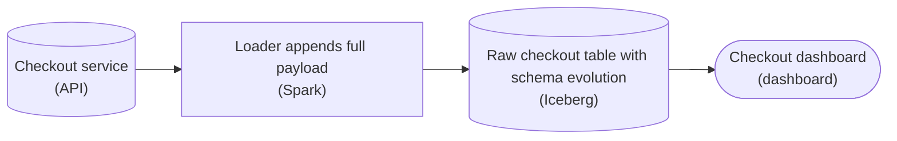

*The strict loader and fixed-column target give way to a loader that keeps the whole payload and a lakehouse table whose schema grows when `discount_code_applied` appears; the dashboard reads from that table.*

| Pitfall: Reject is the loud failure; silent drop is the quiet one |
| --- |
| There are 3 reactions a loader can have to an unexpected field. The strict loader chose 'reject': loud, and you found out the same afternoon. The dangerous sibling is 'silent drop': a loader that quietly discards `discount_code_applied` runs green for months while the field never lands, until someone asks where the numbers went. 'Accept', keeping the whole payload, is the only reaction that neither crashes nor loses the field. |

| ✕ Fixed-column target | ✓ Schema-evolving landing |
| --- | --- |
| The target enumerates its columns, so the loader must know every field in advance. A producer change becomes a schema migration on your side, and any row arriving before you catch up fails the load. | A lakehouse table with schema evolution enabled (or a semi-structured `JSON` column in a warehouse) stores the whole payload. New keys ride along with no migration, and you promote them to typed columns when a consumer needs them. |

**Follow-up questions**

1. What happens the day the backend team changes `discount_code_applied` from a string to a nested object?\
   *Adding a column is the easy case; a retyped field is where schema evolution needs a decision about compatibility.*
2. A consumer wants `discount_code_applied` as a first-class column: how do you expose it without re-ingesting history?\
   *Because the raw payload was kept, the field can be surfaced from data already landed, so no backfill from the producer is needed.*

 

### Exercise 2 of 11

**● TASK**

The producer starts writing a new user_signup schema next Monday, but the consumer reading the Kafka topic stays on the old schema for two more weeks, so old consumer code must keep reading the new events. Add a schema registry node between the producer and the topic, named for the compatibility mode the topic must enforce, so an incompatible schema is rejected at registration before it can be published.

**Starting canvas** (already placed for you):

- Producer: user_signup events (shipping new schema next Monday) (source, API)
- Kafka user_signup topic (mixed v1 and v2 events in flight) (queue, Kafka)
- Consumer: signup analytics (still on old schema for two more weeks) (transform, Pandas)

<strong>Solution</strong>

#### Forward compatibility: old code reading new data

The whole puzzle turns on one term the lesson named: **forward compatibility**. A schema is forward-compatible when data written with a *newer* version can still be read by a consumer running the *older* version. That is exactly the two-week gap here: the producer starts emitting the v2 `user_signup` event on Monday, but the analytics consumer stays on v1 until its own deploy lands. The old code has to read the new data. So the topic must enforce the 'FORWARD' mode, and the registry has to enforce it at the moment the producer tries to register v2, before a single new event reaches Kafka.

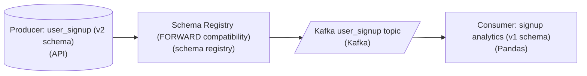

*The registry sits on the write path, between producer and topic, so v2 is validated before it can be published.*

| Trick: The gate goes before the topic, not after |
| --- |
| Placement is half the answer. If the registry sits after Kafka, the incompatible schema is already in the topic and the old consumer has already choked on it. Registration is a write-path check: the producer submits v2, the registry compares it against the last version under the topic's rule, and a schema that the v1 reader could not parse is rejected at registration. Nothing bad reaches the topic because the bad schema never gets an ID to publish under. |

| ✕ FORWARD (what this topic needs) | ✓ BACKWARD (the tempting wrong pick) |
| --- | --- |
| Old reader, new data. 'FORWARD' guarantees a consumer on the previous schema can read events written with the new one. The registry lets you add a field or drop an optional one, because a v1 reader safely ignores what it does not know about. This matches producer-ships-first, consumer-catches-up-later. | New reader, old data. 'BACKWARD' guarantees a consumer on the new schema can read events written with the old one, which is the consumer-ships-first ordering. Pick this here and the registry validates the wrong direction: it would happily accept a v2 that the still-running v1 analytics job cannot parse. |

| Pitfall: BACKWARD is the default, and it is wrong here |
| --- |
| Most registries ship with 'BACKWARD' as the default compatibility mode, so the easy mistake is to add the node and leave it unnamed or generic. The direction is set by *who deploys first*. Here the producer moves first while the old consumer keeps reading, so you need 'FORWARD'. Reach for 'BACKWARD' only when consumers upgrade ahead of producers. |

In production this is how two teams ship on independent schedules without a coordinated big-bang cutover. The topic owner sets the compatibility mode once, and from then on the registry is the contract: it refuses any schema change that would break a reader still on the old version, so a producer cannot accidentally strand a consumer mid-migration. The mode you choose encodes your rollout order, and 'FULL' (both directions at once) is what you set when you cannot guarantee which side deploys first.

**Follow-up questions**

1. The v2 change adds a new required field with no default. Does 'FORWARD' let the producer register it?\
   *Tests that forward-compatible additions must be readable by the old reader; a required field with no default breaks a v1 consumer, so it is rejected.*
2. Both teams may deploy in either order over the next month. Which mode covers you?\
   *Points at 'FULL' compatibility, which enforces both forward and backward at once.*

 

### Exercise 3 of 11

**● TASK**

The orders stream feeds a daily revenue dashboard through a nightly load into a warehouse. Next release, the producer team plans 3 changes: add an optional coupon field, drop the promo flag, and rename amount to order total. Design the path from the stream to the dashboard so the additive change flows straight through while a removal or rename is caught before it corrupts the load.

**Starting canvas** (already placed for you):

- orders events (source, Kafka)

<strong>Solution</strong>

Every change a producer proposes falls into one of 3 buckets, and sorting them is most of the work of **schema evolution**. Adding an optional `coupon_code` is additive: no existing reader ever asked for it, so nothing breaks. Dropping `promo_flag` is destructive: any query that reads it fails or quietly goes NULL. Renaming `amount` to `order_total` is the one that fools people, because to every reader it is a drop plus an add.

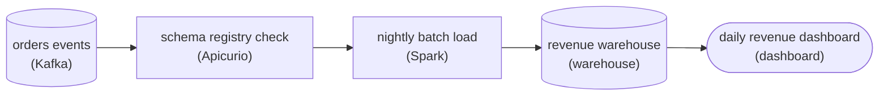

*The registry check reads the stream before the nightly load, so a breaking change stops at ingest instead of in the warehouse.*

#### Where the checkpoint sits

The schema registry check reads straight off the stream, before the nightly load touches anything. Under backward compatibility it accepts a new schema version that only adds an optional field, so the coupon change flows through with no work on your side. It refuses a version that drops or relabels a field the load reads. The failure shows up at the checkpoint, not as a revenue number that went to zero overnight.

| Pitfall: A rename is a drop plus an add |
| --- |
| Renaming `amount` to `order_total` looks harmless in a pull request, but every reader still asks for `amount`. The load either fails or reads NULL revenue. Treat a rename as destructive until it is coordinated. |

| Key insight: Rename by expanding, then contracting |
| --- |
| The safe rename is coordinated. First the producer adds `order_total` alongside `amount` and writes both. Next, consumers switch to `order_total`. Only then is `amount` dropped. Each step on its own is either additive or a drop that no reader depends on anymore. |

**Follow-up questions**

1. The producer wants to change `amount` from an integer to a decimal. Is that additive, destructive, or coordinated?\
   *Applies the same classification to a type change.*
2. If the producer skipped straight to dropping `amount`, which step would the registry reject?\
   *Checks that the compatibility mode lines up with the expand-then-contract steps.*

 

### Exercise 4 of 11

**● TASK**

Mobile checkout events are queued offline and can reach the pipeline days late: one stamped Tuesday 09:14 arrived Thursday. The daily aggregation counts each event on the day it arrived, so Finance's daily revenue lands late checkouts in the wrong day. Rework the aggregation to count revenue on the day the checkout happened, and add a step that recomputes the recent days on every run, safe to rerun without double counting, so late arrivals correct their own day.

**Starting canvas** (already placed for you):

- Mobile SDK events (queued offline; arrival runs days behind when the action happened) (source, API)
- Daily aggregation (currently counts each event on the day it arrived; late events land in the wrong day) (transform, SQL)
- Snowflake daily_revenue (mart) (storage, Snowflake)
- Finance dashboard (consumer, Looker)

<strong>Solution</strong>

#### Count on the day it happened, not the day it landed

Every event carries two clocks: **event time**, when the checkout happened (the Tuesday `09:14` the SDK stamped), and arrival time, when the row reached the warehouse. The old job grouped by arrival, so a phone that reconnected Thursday booked Tuesday's revenue into Thursday. Group `daily_revenue` by the event-time date instead, and a straggler knows its day no matter when it lands.

| Pitfall: `WHERE arrival_date = CURRENT_DATE` freezes late rows out |
| --- |
| The tempting shape appends only rows that arrived since the last run, grouped by arrival day. Cheap, and wrong: the Tuesday checkout that lands Thursday counts under Thursday, and Tuesday is never revisited. Once a day scrolls past the run window its total freezes with a hole in it. |

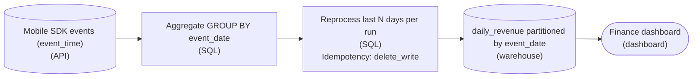

*Group by the event-date column, then overwrite a trailing window of partitions every run.*

1. **Re-key the aggregation on `event_date`**

   Derive `event_date` from each event's own timestamp and make it the partition key of `daily_revenue`. `GROUP BY event_date` routes the Tuesday checkout to Tuesday's partition however late it arrives. This is what makes correctness possible at all.

2. **Recompute a trailing window, don't append**

   Each run, rebuild the last N days of partitions from the raw events rather than appending new rows, with N sized to your worst realistic arrival lag. Every day stays open across the window, so Thursday's straggler folds into Tuesday's total on the next run. Past N you accept stragglers as negligible: a deliberate cost trade.

| Trick: Overwrite the partition so reruns don't double-count |
| --- |
| The window heals history only if a rerun lands the same answer instead of stacking a second copy. Replace each day's partition wholesale (`DELETE`+`INSERT` or `INSERT OVERWRITE` keyed on `event_date`), never a blind `INSERT`. The job is then safe after a retry or backfill, because each partition is a pure function of that day's raw events. |

**Follow-up questions**

1. How would you choose N, and what happens to an event that arrives on day N+1?\
   *Ties N to the measured arrival-lag distribution and names the backfill fallback.*
2. If reprocessing 7 days per run gets too expensive, how would you rebuild only the partitions that received late rows?\
   *Pushes toward tracking touched `event_date` values over a blanket window.*

 

### Exercise 5 of 11

**● TASK**

The nightly daily_revenue job computes today only, so a mobile event that arrives 5 days late is never counted. Apply a seven-day rerun window: add an orchestrator that schedules the daily run and states the seven-day window in its name. Replace the append-only destination with a lakehouse table that overwrites each event_date partition, so rerunning a day replaces its row instead of duplicating it, and keep the dashboard reading from it.

**Starting canvas** (already placed for you):

- Mobile events source (raw events retained for last 30 days) (source, Custom)
- daily_revenue aggregation (today-only; freezes each day's number) (transform, SQL)
- Plain Snowflake daily_revenue: INSERT INTO append (no partition overwrite; reruns duplicate) (storage, Snowflake)
- Finance dashboard (consumer, Looker)

<strong>Solution</strong>

#### Widening the window so late data lands

The fix you just wired is a **rerun window** (a backfill or lookback window): instead of computing only today, the pipeline recomputes a trailing span of days on every run, so an event that arrives late still gets folded into the day it belongs to. The old design froze each day's `daily_revenue` the night it ran, so a mobile event 5 days late landed nowhere. You added an orchestrator that schedules a daily run recomputing the last seven `event_date` partitions, which gives late events up to a week to show up and still be counted.

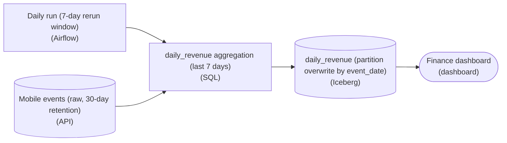

*The orchestrator triggers a daily run scoped to the last seven `event_date` partitions; the lakehouse sink overwrites each partition so the rerun is idempotent.*

| Key insight: A wider window is worthless without an idempotent write |
| --- |
| Looking back seven days only helps if re-running a day produces the same row, not a second one. That is why the destination moves off a plain `INSERT INTO` append and onto a lakehouse table (Iceberg or Delta) that does partition overwrite by `event_date`: re-running 'March 3' replaces the 'March 3' partition wholesale instead of adding to it. Same input, same output, however many times the run fires. |

| Pitfall: Seven reruns, seven copies |
| --- |
| The tempting half-fix is to widen the window but keep the `INSERT INTO` append. Now every morning you re-insert seven days of rows on top of the seven you wrote yesterday, and `daily_revenue` inflates by roughly 7x. A longer lookback on a non-idempotent sink makes the numbers worse, not better. The partition overwrite is the load-bearing half of the pattern, not an optional nicety. |

| Real world: The window can't outrun your raw retention |
| --- |
| The mobile source keeps raw events for 30 days, so a seven-day window is safe: the data you recompute against is still there. If retention were shorter than the window, the rerun would recompute days whose source rows had already aged out and quietly undercount them. In practice you size the window against both how late events realistically arrive and how long upstream keeps the raw data, and the shorter of those 2 caps it. |

**Follow-up questions**

1. How would you move from a fixed seven-day window to one that only reruns the `event_date` partitions with newly-arrived late events?\
   *Tests whether you see the window length as a cost knob: a full seven-partition overwrite every night is wasted work if only one day actually changed.*

 

### Exercise 6 of 11

**● TASK**

Apply all four beginner-tier fixes to this consumer-app event pipeline. Replace the strict loader and Snowflake target with a flexible-shape destination (a lakehouse table with schema_evolution, or VARIANT columns) that absorbs new producer fields and supports atomic partition overwrite by event_date. Rebucket the daily aggregation by event_time instead of processing_time, and add an orchestrator (Airflow, Dagster, or Prefect) whose name states a rerun window of at least seven days. Point the dashboard at the new destination.

**Starting canvas** (already placed for you):

- Mobile SDK source (producers ship new fields ungated; events arrive late) (source, Custom)
- Strict-schema loader (rejects rows with unexpected fields) (transform, Python)
- daily_revenue aggregation (buckets by processing_time; late events misrouted) (transform, SQL)
- Plain Snowflake daily_revenue: INSERT INTO append (no rerun, no partition overwrite) (storage, Snowflake)
- Finance dashboard (consumer, Looker)

<strong>Solution</strong>

#### Four beginner fixes, wired into one line

This capstone assembles the four techniques the earlier sections taught, each aimed at one failure in the broken pipeline: **schema evolution** so producer additions absorb without a code change, event-time bucketing so late mobile events land in the day they happened, partition overwrite so a rerun replaces a day instead of stacking on it, and DAG orchestration with a rerun window so late data actually gets reprocessed. None of them is exotic; the lesson is that they only work together. A flexible loader that still buckets by `processing_time` fixes nothing, and an idempotent destination that never gets rerun freezes the same wrong number forever.

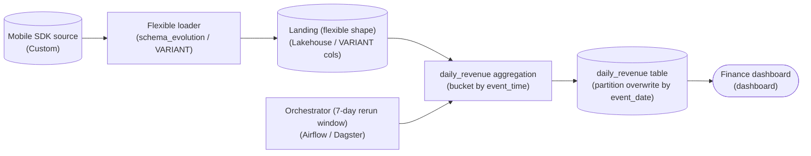

*The orchestrator drives the aggregation on a rolling 7-day window; each rerun overwrites its `event_date` partition, so the dashboard reads a self-healing number.*

1. **Make the destination shape-flexible so new fields absorb**

   Swap the strict loader plus plain warehouse for a flexible-shape landing: a lakehouse format with `schema_evolution` on, or VARIANT-typed columns in the warehouse. Now when a producer ships a new field ungated, the row lands instead of being rejected. This is the difference between a pipeline that pages you every time mobile ships an app update and one that quietly keeps the new field for whenever you need it.

2. **Bucket the aggregation by `event_time`, not `processing_time`**

   The old aggregation grouped rows by when they were processed, so a mobile event that arrived 2 days late counted toward the wrong day. Re-key the bucket on `event_time` (the moment the event happened on the device). This is what makes late data correctable at all: a row's day is now a fact about the event, fixed and known, not an accident of when the loader happened to see it.

3. **Write with partition overwrite by `event_date`**

   Replace the append-only `INSERT INTO` with a destination that overwrites the `event_date` partition. Appending means a rerun adds a second, duplicate row for the day; overwriting means a rerun replaces the day's number outright. That single property is what makes the whole job safe to run twice, which is the precondition for step 4 doing anything useful.

4. **Add an orchestrator that reruns a rolling seven-day window**

   An idempotent write is worthless if you only run each day once. Put a DAG on top whose schedule reprocesses the last seven days on every run, not just today. A late event that lands on day+3 gets swept up when its `event_date` partition is recomputed and overwritten. Seven days is the deliberate trade: it covers realistic mobile lateness without recomputing all of history nightly.

| Key insight: Idempotency and rerun are one mechanism |
| --- |
| The 2 easiest pieces to wire up wrong are the pair that only mean something together. `event_date` partition overwrite makes a rerun safe; the 7-day window makes reruns happen. Ship overwrite without the window and late data never gets reprocessed; ship the window over an append-only table and every rerun doubles the revenue. On the canvas, the dashboard must read from the final reconciled `daily_revenue` table, downstream of both, so it always shows the self-healed value. |

**Follow-up questions**

1. What breaks if you widen the rerun window from seven days to ninety?\
   *Tests whether they see the cost side of the window: correctness reach vs. nightly recompute volume.*
2. A VARIANT column absorbs new fields, but the finance dashboard needs `revenue` as a typed number. Where does that projection belong?\
   *Tests that schema flexibility at the landing does not excuse an untyped serving layer.*
3. How would you handle an event whose `event_time` is older than the rerun window when it finally arrives?\
   *Tests the boundary of late-data handling: the window is a bound, not a guarantee.*

 

### Exercise 7 of 11

**● TASK**

Thermostat firmware rolls out over six weeks, so old and new firmware publish readings to one Kafka topic side by side while the stream job that parses them upgrades on day one. Add a schema registry that checks every new firmware schema before it publishes, and name the stage for the compatibility mode that lets the job upgrade first. Land the parsed readings in a table fresh within 15 minutes for the operations dashboard.

<strong>Solution</strong>

#### The reader moves first, so the check is backward

Backward compatibility means the new code reads the old data. In this rollout the new code is the parsing job, upgraded on day one, and the old data is every reading from thermostats still on last month's firmware, which keeps arriving for six weeks. So the registry enforces **backward compatibility**: a new firmware schema is accepted only if a reader built on it can still parse what older firmware writes. Forward compatibility answers the opposite question, whether old code reads new data, and here no old reader is left once day one passes.

1. **Ask which side upgrades first**

   The direction falls out of the deploy order. If the reader upgrades first, it will see old data, so you need backward. If the writer upgrades first, old readers will see new data, so you need forward. Here the job ships on day one and the firmware takes six weeks, so backward it is.

2. **Put the check in front of the topic**

   A compatibility rule only protects the job if it runs before a reading is published. The registry sits between the thermostats and the Kafka topic, so a firmware schema that fails the backward check is rejected at publish time instead of crashing the parser hours later.

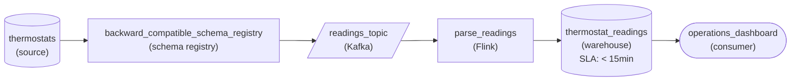

*Thermostats publish through a backward compatibility check into Kafka; the stream job parses both firmware versions into a table fresh within 15 minutes for the dashboard.*

| Pitfall: Forward mode lets the breaking schema through |
| --- |
| Picking forward because the firmware is the newer side is the common slip. Suppose new firmware adds a required `humidity` field with no default. A forward check passes it, since an old reader just ignores the extra field. But the job is already on the new schema, and every reading from old firmware lacks `humidity`, so the parser fails. A backward check rejects that schema; an optional field with a default passes both. |

| Real world: Neither direction means a lockstep deploy |
| --- |
| A change that is neither backward nor forward compatible forces every writer and reader to switch at the same instant. With two million thermostats updating over six weeks, that instant never exists, which is why teams pin the registry mode to their rollout order before the first schema ships. |

**Follow-up questions**

1. A billing job will keep its old code for three months while firmware rolls out. What mode does the registry need now?\
   *An old reader of new data adds forward compatibility on top of backward, so both directions must hold.*
2. What if the firmware shipped first and the parsing job upgraded a week later?\
   *Writer first means old code reads new data: the mode flips to forward.*

 

### Exercise 8 of 11

**● TASK**

Trip events reach a warehouse from a Kafka topic, and the producer team wants to rename `fare` to `fare_amount` while new optional fields keep arriving. Design the pipeline so a schema check between the topic and the warehouse lets additive changes through but rejects an uncoordinated rename or removal. During the switch producers publish both names, and the warehouse must keep one fare column.

<strong>Solution</strong>

#### Let the additive change carry the rename

The asymmetry from this section does the work: adding `fare_amount` is safe, dropping `fare` is not. So the rename never ships as one change. The producer adds `fare_amount` beside `fare`, which every existing reader ignores, and removes `fare` only once nothing downstream asks for it. A schema check on the topic is what makes that order enforceable instead of a hope.

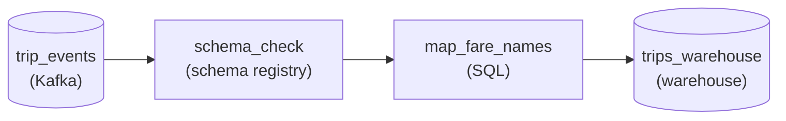

*`trip_events` passes `schema_check`, then `map_fare_names` folds both fare names into one column in `trips_warehouse`.*

1. **Put the check between the topic and the warehouse**

   Register the trip event schema and check every new version against it. An added optional field passes, because old readers never asked for it. A version missing `fare` fails, so a rename that skipped the dual-publish phase is stopped at the producer instead of surfacing in a broken report.

2. **Resolve both names into one column**

   While both names ship, `map_fare_names` takes `fare_amount` when it is present and falls back to `fare` for older events. The warehouse keeps its single fare column, and when the producer finally drops `fare`, this step is the only place that changes.

| Pitfall: A rename is a removal plus an addition |
| --- |
| Treating `fare` to `fare_amount` as one edit means every reader of `fare` sees it vanish at once: joins on it return nothing and sums quietly fall to zero. Splitting it into add, publish both, then remove turns one breaking change into safe steps. |

| Real world: Registries enforce the rule APIs already follow |
| --- |
| A REST API adds response fields without a version bump but needs a major version to remove one. A schema registry in a backward-compatible mode applies the same rule to events: additions register freely, removals are refused until readers are ready. |

**Follow-up questions**

1. What if the producer also wants `fare` to switch from integer cents to a decimal?\
   *Whether a retype is handled like a rename: add a new field, publish both, then drop the old one.*
2. How do you know when it is safe to remove `fare` from the schema for good?\
   *Confirming no reader still depends on the old field before the destructive step.*

 

### Exercise 9 of 11

**● TASK**

Smart electricity meters buffer readings offline and can upload them up to three days late, so land every raw reading with its event_time plus an ingestion_time stamped on arrival. Billing sums usage by ingestion day, because an issued invoice must never change. The grid-load dashboard sums usage by event hour, so a late reading counts in the hour it was measured. Design the pipeline that feeds both from the same landed readings.

<strong>Solution</strong>

#### One reading, two clocks

Late data is the gap between `event_time`, when the meter measured, and `ingestion_time`, when the reading reached you. A reading taken Monday 18:00 that uploads Wednesday is two days late. Neither clock is wrong: each answers a different question, and which one you bucket by is a promise to the consumer reading the total.

1. **Stamp `ingestion_time` when the reading lands**

   The meter owns `event_time`; nobody records arrival unless the pipeline does. Landing raw readings with both values means every downstream job can choose its clock, and lateness itself becomes something you can measure.

2. **Choose the bucket per consumer**

   Billing buckets by arrival day: Monday's late reading joins Wednesday's total, so Monday's invoice stays exactly as issued. The dashboard buckets by event hour: the same reading lands in Monday 18:00, which changes that hour after the fact, and that is the correct answer for operators.

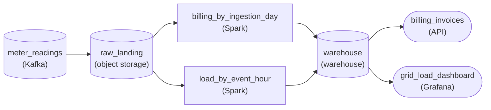

*Both aggregations read the same `raw_landing` readings: `billing_by_ingestion_day` groups on `ingestion_time`, `load_by_event_hour` groups on `event_time`.*

| Pitfall: One aggregate cannot keep both promises |
| --- |
| A single job grouped on `event_time` rewrites invoices that already went out; grouped on `ingestion_time` it moves Monday evening's peak onto Wednesday's chart. Dropping late readings keeps the math simple but undercharges every customer whose meter went offline. |

| Real world: Money closes by arrival, analysis by event time |
| --- |
| Ledgers and invoices usually close on arrival because a published figure must stay put, while capacity and behaviour analysis follows `event_time` because it asks what happened when. |

**Follow-up questions**

1. What changes if billing may add a correction line to next month's invoice for late usage?\
   *Whether billing could follow `event_time` once history is amended through a separate adjustment instead of edited.*
2. How would you report how much usage arrives more than a day late?\
   *Using `ingestion_time - event_time` on the landed readings to measure lateness itself.*

 

### Exercise 10 of 11

**● TASK**

A mobile game's SDK retries failed uploads, so session events can arrive up to seven days after their event time. Land the raw session events in object storage, then add a nightly batch job that recomputes the last seven days of daily active player counts by event time and overwrites those daily partitions in a warehouse, so running it twice gives the same counts. A dashboard reads the daily counts from the warehouse.

<strong>Solution</strong>

#### Recompute a trailing week, overwrite what you recompute

A **rerun window** is the batch answer to late data: each night the job rebuilds today plus the previous seven event-time days from the raw events, so a session played last Tuesday that only uploads on Friday is counted in Tuesday's bucket on Friday night. Seven days matches this SDK's retry tail: almost every late upload falls inside it. The window is only safe because each recomputed day replaces what was there before.

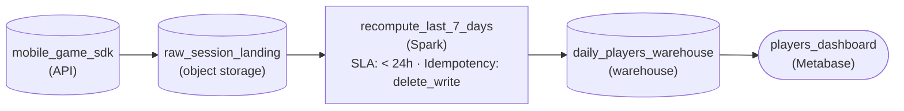

*Raw sessions land in `raw_session_landing`; each night `recompute_last_7_days` rebuilds 8 event-time days and overwrites them in `daily_players_warehouse`.*

| Pitfall: Appending makes every rerun count twice |
| --- |
| If the job inserts rows for each recomputed day, tonight's run adds Tuesday's players on top of the Tuesday rows written last night, and the number climbs every night for a week. Write with `delete_write` (or overwrite each day's partition) so recomputing a day replaces it, and a second run on the same night changes nothing. |

| Performance: 8 days of reading buys a week that corrects itself |
| --- |
| The job reads 8 days of raw events instead of one, so daily compute is roughly 8x. A 3-day window is cheaper but misses the slow retries; a 30-day window catches nearly everything at about 31x the cost. Size the window to where the late tail actually ends, not to zero misses. |

**Follow-up questions**

1. A new SDK release can hold uploads for 14 days. What changes, and what does it cost?\
   *Sizing the window to the late tail: each run reads about 15 days instead of 8.*
2. A session arrives 10 days late. What happens to it, and how could you catch it without widening the nightly window?\
   *What a fixed window misses, and a less frequent wider rerun as a cheaper second pass.*

 

### Exercise 11 of 11

**● TASK**

Retail stores upload point-of-sale events through an API whenever their connection returns, so a sale can arrive up to 14 days after its event time, and the vendor keeps adding fields to the event. Land every raw upload in a store that accepts added columns without failing the load. Each night, rebuild the daily sales table from that raw store over a rerun window sized to the lateness, overwriting each event-date partition so a rerun replaces the day instead of counting it twice. A store-sales dashboard reads the daily table.

<strong>Solution</strong>

#### Let the rerun window correct history

Late data and schema drift break a batch pipeline in the same way: the day you computed last night is not the day that exists today. Both are fixed from the same place, a raw store that keeps every upload as it arrived, so any day can be recomputed from it. On top of that, the nightly job rebuilds a trailing window of event days instead of one, and writes each day by replacing its partition whole.

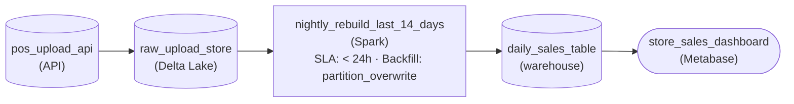

*Uploads land raw in `raw_upload_store`; `nightly_rebuild_last_14_days` overwrites the last 14 event-date partitions of `daily_sales_table` every night.*

1. **Size the window to the slowest store**

   Stores can lag 14 days, twice the seven-day default from the lesson, so a seven-day rerun would freeze days 8 through 14 before their late sales arrive. Rerun the last 14 event days every night. Key the window on event date, not arrival date: a sale stamped the 3rd that lands on the 15th must correct the 3rd.

2. **Replace each partition, never append**

   Each night the window is recomputed from `raw_upload_store` and every event-date partition of `daily_sales_table` is overwritten whole. A day rebuilt fourteen nights in a row ends with the same total one run would give, plus any late sales that arrived since. That idempotent write is what lets history correct itself safely.

| Pitfall: Appending a rerun counts every sale twice |
| --- |
| Inserting the recomputed days on top of the rows already there doubles every sale the earlier run counted. A rerun window is only safe because the write replaces the partition instead of adding to it. |

| Key insight: Added fields belong in the raw layer first |
| --- |
| The vendor's new fields are additive, the safe kind of change. A raw store that accepts added columns keeps them without failing the load, and because the rebuild reads raw, the fields are already there the day the dashboard wants them. |

**Follow-up questions**

1. What if one store stays offline for 3 weeks?\
   *Whether a one-off rebuild of older partitions beats widening the nightly window for every run.*
2. What changes if the vendor renames `amount` to `sale_amount`?\
   *Contrasts a rename, which breaks readers, with the added fields the raw store absorbs.*

