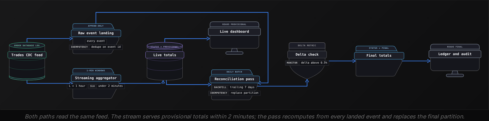
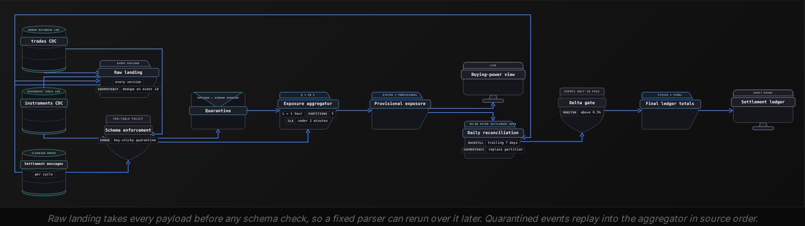

Advanced·Pipeline Architecture · 40 min · 11 challenges

# Schema Drift: Advanced

This lesson follows a busy Thursday afternoon at Robinhood. At 2:12 p.m., a database migration renames a column on the trades table, and buying power for 1,900 customers stops updating. The app must stay live for everyone else, and the settlement ledger, closed once those trades settle the next business day, must be exact to the cent. Which pipeline choices let both hold?


<br>

---

## Schema Enforcement in CDC

Change data capture (CDC) reads a database's own change log and turns each insert, update and delete into an event. An event carries the row's columns after the change, the operation, and the change's position in the source log, a number that only grows. Downstream, the pipeline rebuilds the table by applying those events in position order.

That makes a CDC feed the most drift-prone source a pipeline reads. Its producer is an application team running migrations against its own database, often unaware a feed exists. Each migration lands mid-stream: rows written before and after it sit side by side in the same partition, and the pipeline meets the new shape on the first row committed afterward.


<br>

### Each DDL change as it arrives downstream

| Change at the source | What the event stream shows | Safe for readers? |
| --- | --- | --- |
| Add nullable `promo_code` | New field, absent on older events | Yes |
| Widen `qty` INT to BIGINT | Same field, larger values | Yes, if the target widens |
| Rename `qty` to `quantity` | `qty` vanishes, `quantity` appears | No: a drop plus an add |
| Drop `fee` | Field missing from new events | No, for readers of `fee` |
| `price` VARCHAR to DECIMAL(18,6) | Same name, new type | No: 2 types in one column |
| New `status` value `PARTIAL_FILL` | Same type, unseen value | Schema yes, meaning no |

The rename row causes the worst incidents. Row events carry no rename marker: the old name stops appearing and a new one starts. A pipeline that accepts every change writes nulls into qty from the migration onward, and every report summing qty loses the volume traded after it, with no error anywhere.


<br>

### Additive, block-breaking and quarantine policies

- **Additive** *Evolve the target, never stop*\
  Compatible changes are applied to the target automatically, and breaking ones are absorbed as additions: a renamed column becomes a new column beside an old one that fills with nulls.
- **Block-breaking** *Stop at the first incompatible event*\
  Compatible changes flow through. The first breaking event halts that table's stream and pages its owner, and nothing after it applies until someone decides.
- **Quarantine** *Divert the bad, keep the rest moving*\
  Compatible events flow. Breaking ones land in a quarantine table with their raw payload and schema version, and the rest of the stream keeps applying.

| Property | Additive | Block-breaking | Quarantine |
| --- | --- | --- | --- |
| Freshness during a breaking change | Unaffected | Whole table stalls | Affected keys stall |
| How it fails | Silent nulls and mixed types | Source log expires before restart | Keys applied out of order |
| Who notices | A consumer, days later | On-call, within minutes | A quarantine-volume alert |
| Fits | Exploration and sandbox tables | Ledgers, billing, audited tables | High-volume operational tables |

Block-breaking carries a deadline. The source keeps its change log for a window its operators size in hours or days to cap disk use. A table blocked past that window loses its place in the log, and recovery turns from a resume at the last applied position into a full re-read of the table.

**One CDC feed carries invoices (monthly billing), user_sandbox (an analyst playground) and positions (40,000 changes a minute behind a live dashboard). Which assignment fits?**

- **A.** invoices additive, user_sandbox block-breaking, positions quarantine
- **B.** All 3 block-breaking, so no table can ever hold wrong data
- **C.** invoices quarantine, user_sandbox additive, positions block-breaking
- **D.** invoices block-breaking, user_sandbox additive, positions quarantine

<details>
<summary>Solution</summary>

**D.** invoices block-breaking, user_sandbox additive, positions quarantine

Billing stops rather than goes wrong, the sandbox absorbs change, and unaffected positions stay fresh.

**Why the others are wrong**

- **A.** Additive on billing risks silent nulls; blocking a sandbox wastes on-call time.
- **B.** Correct, but one rename stalls the live dashboard for every account.
- **C.** Quarantine applies some invoices while others wait, and blocking positions stalls the dashboard.

</details>


<br>

### Quarantine must respect order within a key

For a CDC table, quarantine can corrupt state, because events for one key are only correct when applied in source order. Below, the event at position 1002 is quarantined because `price` arrived as a DECIMAL, and 1003 applies. When the fix ships and 1002 is replayed as an upsert by `order_id`, the older state lands on top.

| Source position | order_id | status | Outcome |
| --- | --- | --- | --- |
| 1001 | 42 | NEW | Applied |
| 1002 | 42 | PARTIAL_FILL | Quarantined |
| 1003 | 42 | FILLED | Applied: target says FILLED |
| 1002 (replay) | 42 | PARTIAL_FILL | Upsert: target says PARTIAL_FILL |

Key-sticky quarantine parks every later event for a key once one of its events is parked, so the key goes stale instead of wrong. A version guard makes the write order-proof: the target stores the source position of the state it holds, and an incoming event applies only when its position is higher. Replaying 1002 against a row already at 1003 then changes nothing, and a rebuild from history uses the same rule. Careful pipelines run both.

```sql
SELECT
  order_id,
  status,
  price,
  source_position
FROM (
  SELECT
    order_id,
    status,
    price,
    source_position,
    ROW_NUMBER() OVER (
      PARTITION BY order_id
      ORDER BY source_position DESC
    ) AS rn
  FROM order_changes
) AS ranked
WHERE rn = 1
```

**A trades table runs quarantine with no key-sticky parking. Event 1002 for order 42 is quarantined and 1003 (FILLED) applies. After the fix, the replay upserts by order_id with no position check. What does order 42 show, and what makes the replay safe?**

- **A.** FILLED, since an upsert keeps the first row it wrote; no change is needed
- **B.** PARTIAL_FILL, since the replay wrote last; a source-position check on write fixes it
- **C.** PARTIAL_FILL, since the replay wrote last; running the replay a second time fixes it
- **D.** FILLED, since quarantined events are discarded; a full re-read of the table is needed

<details>
<summary>Solution</summary>

**B.** PARTIAL_FILL, since the replay wrote last; a source-position check on write fixes it

The replay is the latest write. A version guard rejects it because 1002 is lower than the stored 1003.

**Why the others are wrong**

- **A.** An upsert by key overwrites, so the last write wins, and the replay writes last.
- **C.** The diagnosis is right, but a second replay writes the same stale state again.
- **D.** Quarantine keeps the payload so it can be replayed, so nothing was discarded.

</details>


<br>

---

## Watermarks for Irregular Streams

Every watermark strategy assumes something about how late events arrive. The common default, bounded out-of-orderness, sets the watermark to the newest event time seen minus a fixed delay D. It works when lateness is steady and capped, as on a feed of order fills from a trading engine. Real sources break that assumption in 3 ways: a long tail of stragglers, partitions that fall silent, and clocks that run fast.


<br>

### Profile the source before picking a strategy

| Source | Lateness profile | Idleness profile | Strategy that fits |
| --- | --- | --- | --- |
| Order fills from the trading engine | p99 under 5 minutes, steady | Quiet overnight | Fixed delay plus idle timeout |
| Mobile app events | Long tail: offline phones replay hours later | Rarely idle | Percentile delay plus late-event handling |
| Clearing-house settlement messages | Arrive in batches per cycle | Silent for hours between cycles | Producer markers |
| Field sensors | Small, but some clocks drift ahead | Devices drop off for days | Future-time cap plus idle timeout |


<br>

### The 4 strategies and the late data each one misses

- **Fixed delay** *W = max event time - D*\
  Predictable and cheap. Fails on a tail longer than D: those events arrive behind the watermark and miss their window.
- **Percentile delay** *D tracks observed lateness*\
  D is recomputed from a trailing percentile, such as p99 lateness over the last hour. A watermark may never move backward, so a sudden rise in D freezes it, and a sudden fall lets it race ahead of stragglers.
- **Idle timeout** *Ignore quiet partitions*\
  A partition with no events for T is dropped from the minimum. When it wakes, its first events may sit behind a watermark that moved on without it.
- **Producer markers** *The source says when it is done*\
  The producer sends a marker meaning nothing older than time X is coming. Exact for sparse batch sources, and useless when the producer cannot make that promise.

**Settlement messages arrive in batches up to 3 hours long, with hours of silence between cycles. Which watermark strategy fits?**

- **A.** Fixed delay of 30 seconds with a 2-minute idle timeout
- **B.** Percentile delay set from the trailing hour's p99 lateness
- **C.** A marker from the producer at the end of each cycle
- **D.** Fixed delay of 3 hours with no idle timeout

<details>
<summary>Solution</summary>

**C.** A marker from the producer at the end of each cycle

The producer knows when a cycle is complete; no delay estimate can.

**Why the others are wrong**

- **A.** Most of each batch lands behind the watermark and counts as late.
- **B.** Hours of silence leave nothing current to measure, and spikes freeze it.
- **D.** It covers the lateness, but every result trails by at least 3 hours.

</details>


<br>

### One quiet partition stalls the whole job

An engine reading several partitions takes the minimum of the per-partition watermarks, because the slowest partition bounds what it can promise. A partition that stops receiving events stops its own watermark, and the job's watermark stops with it. No window closes and no result is emitted, while every other partition keeps filling state. The table below is the trades job at 10:05:00, with D = 30 seconds.

| Partition | Newest event time | Last event received | Partition watermark |
| --- | --- | --- | --- |
| p0 | 10:04:58 | 10:05:00 | 10:04:28 |
| p1 | 10:04:51 | 10:04:59 | 10:04:21 |
| p2 | 09:58:10 | 09:58:12 | 09:57:40 |

Without an idle timeout the job watermark is 09:57:40, and no window after 09:57 can close. With a 2-minute idle timeout, p2 has been silent for nearly 7 minutes, so it drops out and the job watermark becomes 10:04:21. The price comes later: if p2 resumes with events stamped 09:58:30, they arrive nearly 6 minutes behind the watermark. They are late, and whether they still count depends on the allowed-lateness budget the next section sizes.


<br>

### A fast clock is worse than a slow partition

A sender whose clock runs 3 hours ahead stamps an event 13:05 when real time is 10:05. Its partition's newest event time leaps to 13:05 and that partition's watermark to 13:04:30. The minimum across partitions hides this only while the others stay active. Once idle timeouts drop them, the fast partition sets the job watermark alone, it jumps 3 hours, and every honest event after it is late. The defense is a cap: clamp event time to processing time plus 5 seconds, and quarantine anything stamped beyond that.

```sql
from datetime import timedelta

DELAY = timedelta(seconds=30)
IDLE_TIMEOUT = timedelta(minutes=2)
FUTURE_TOLERANCE = timedelta(seconds=5)


def job_watermark(partitions, now, previous):
    candidates = []
    for p in partitions:
        if now - p["last_received"] > IDLE_TIMEOUT:
            continue
        newest = min(p["newest_event_time"], now + FUTURE_TOLERANCE)
        candidates.append(newest - DELAY)
    if not candidates:
        return previous
    if previous is None:
        return min(candidates)
    return max(previous, min(candidates))
```

**Start from the partition table above at 10:05:00 with a 2-minute idle timeout. p2 sends nothing more, and p1 goes silent after 10:04:59. At 10:07:30, p0's newest event time is 10:07:28. What is the job watermark?**

- **A.** 10:06:58, from p0 alone, because p1 and p2 are both past the idle timeout
- **B.** 10:04:21, from p1, because a silent partition holds its last watermark
- **C.** 09:57:40, from p2, because the minimum includes every partition ever seen
- **D.** 10:07:28, from p0, because idle partitions also remove the 30-second delay

<details>
<summary>Solution</summary>

**A.** 10:06:58, from p0 alone, because p1 and p2 are both past the idle timeout

p1 has been quiet for 2 minutes 31 seconds, so only p0 counts: 10:07:28 minus 30 seconds.

**Why the others are wrong**

- **B.** That holds with no idle timeout. At 10:07:30, p1 is past the 2-minute limit.
- **C.** An idle timeout exists to drop p2 from the minimum, and it has.
- **D.** The delay applies to every active partition; idleness only changes which ones count.

</details>


<br>

---

## Allowed Lateness Versus Accuracy

Allowed lateness L keeps a window's state alive after the watermark passes its end. An event that arrives within L still updates the window, and the engine emits a corrected result; one that arrives later is dropped or sent to a side output. Together, D and L decide 3 things at once: how complete the streaming result is, how much state the engine holds, and how often a consumer sees a number change.


<br>

### Coverage comes from the lateness distribution

An event updates its window while the watermark, newest event time minus D, is still below the window's end plus L. Lateness is how far an event's time trails the newest one seen on arrival. Lateness up to D + L always counts, and an event stamped early in its 1-minute window gets almost a minute more. For the trades feed with D = 30 seconds, a month of measured lateness gives:

| Allowed lateness L | Counted if lateness up to | Events covered |
| --- | --- | --- |
| 0 | 30 s | 96.0% |
| 5 min | 5 min 30 s | 99.2% |
| 1 hour | 1 h 0 min 30 s | 99.93% |
| 24 hours | 24 h 0 min 30 s | 99.995% |


<br>

### State grows with the budget

With tumbling windows of size S, a key holds at most (D + L) / S open windows, rounded up, plus the one being filled. The job keys 1-minute windows by 500,000 active accounts at 400 bytes each. A window exists only once its account trades, so the table is a ceiling: every account trading every minute.

| L | Open windows per key | Engine state | Events covered |
| --- | --- | --- | --- |
| 0 | 2 | 400 MB | 96.0% |
| 5 min | 7 | 1.4 GB | 99.2% |
| 1 hour | 62 | 12.4 GB | 99.93% |
| 24 hours | 1,442 | 288.4 GB | 99.995% |

Read the table as marginal cost: 0 to 5 minutes buys 3.2 points for at most 1 GB more state, while 1 hour to 24 hours buys 0.065 points for up to 276 GB, reloaded on every restart. That flattening makes a large L poor value. No L reaches 100%, because some events arrive later than any finite budget.


<br>

### Count coverage in the unit the consumer uses

Coverage by event count can flatter a stream. On the trades feed, the 0.07% of events that land after a 1-hour budget are mostly corrections and cancellations sent from back-office systems, and each one moves far more money than a typical fill. Weighted by notional value, the same budget covers less.

- **98.6%** — of notional value counted at L = 1 hour
- **1.4%** — of notional value left to correct later


<br>

### Choosing a percentile target

- Start from the consumer: what coverage, in its own unit, makes the live number usable?
- Find the smallest L that reaches that percentile on a month of measured lateness.
- Check the state at that L against the job's memory and restart-time budget.
- Send events past L to a side output so the tail stays measured.
- Hand everything beyond L to a reconciliation pass rather than raising L further.

For the trades job that lands on L = 1 hour: 99.93% of events, 62 windows per key, 12.4 GB of state, and a tail small enough for a nightly pass to correct. Each late event inside the hour re-emits its window, so consumers upsert by account and window start, the idempotent write from earlier lessons.

**A dashboard needs 99% of events inside its live number, and the job has a 2 GB state budget. Using the tables above, which L fits?**

- **A.** 0, since 96.0% is close enough and state is smallest
- **B.** 5 minutes: 99.2% of events for at most 1.4 GB of state
- **C.** 1 hour, since a larger margin over 99% is always safer
- **D.** 24 hours, so the dashboard never needs reconciliation

<details>
<summary>Solution</summary>

**B.** 5 minutes: 99.2% of events for at most 1.4 GB of state

The smallest L that clears 99% and fits under 2 GB.

**Why the others are wrong**

- **A.** 96.0% is below the 99% target.
- **C.** Its ceiling is 12.4 GB, over 6 times the budget.
- **D.** Far over budget, and the tail still runs past 24 hours.

</details>

| ✓ Raise L | ✗ Keep L, reconcile the tail |
| --- | --- |
| • Live number closer to final<br><br>• State grows with every key and window<br><br>• Restarts reload more state<br><br>• More re-emissions downstream | • Live number labeled provisional<br><br>• State sized to the knee of the curve<br><br>• Tail corrected in batch from raw events<br><br>• Exactness arrives on the pass's schedule |

*Each re-emission replaces the window's earlier result, so a consumer that appends results counts that window twice.*

**A team raises L from 1 hour to 24 hours so finance stops reporting missing late trades. Using the tables above, what changes?**

- **A.** Coverage reaches 100%, so the nightly reconciliation can be retired
- **B.** State stays near 12.4 GB, since only late events add windows
- **C.** Coverage rises 3.2 points, matching the step from 0 to 5 minutes
- **D.** State can grow to 288.4 GB for 0.065 more points of event coverage

<details>
<summary>Solution</summary>

**D.** State can grow to 288.4 GB for 0.065 more points of event coverage

An account trading every minute holds 1,442 windows instead of 62.

**Why the others are wrong**

- **A.** It reaches 99.995%; some events arrive later than any budget.
- **B.** An account that trades keeps its windows open for the full budget, late events or not.
- **C.** That gain was the steep part of the curve; this step adds 0.065 points.

</details>


<br>

---

## Reconciliation Passes

Every allowed-lateness budget leaves a tail, and some consumers cannot accept one: a ledger, a regulatory report, an invoice. A reconciliation pass is a batch job that recomputes the streaming output from the complete record after the tail has arrived, compares the 2, writes the corrected version as the version of record, and publishes how far apart they were.




<br>

### Decisions that make the pass trustworthy

- **Source of truth** *Recompute from the full record*\
  Read raw landed events, including those the stream dropped as too late, or an authoritative outside record. The streaming output can only be compared against, never recomputed from.
- **Settle horizon** *Run after the tail arrives*\
  For the trades feed a 24-hour budget already reaches 99.995%, so a pass a day after the window closes sees nearly everything.
- **Same grain, same rules** *Match the stream exactly*\
  Compute at the stream's keys, account and window start, and dedupe on event_id. A pass that counts duplicates the stream removed reports a delta that does not exist.
- **Idempotent write** *Replace, never append*\
  Replace the partition for each recomputed day, so a rerun or the 7-day trailing backfill leaves one correct copy.
- **Explicit authority** *Provisional or final*\
  Label every row. Consumers that need audit-grade numbers read only final rows.


<br>

### Computing the delta

The pass and the comparison fit in one query: dedupe the raw events, aggregate at the stream's grain, then full-outer-join to the streaming output so a window missing on either side still shows up.

```sql
WITH latest AS (
  SELECT
    trade_id,
    account_id,
    trade_time,
    amount,
    status,
    ROW_NUMBER() OVER (
      PARTITION BY trade_id
      ORDER BY source_position DESC
    ) AS rn
  FROM raw_trade_events
  WHERE trade_date = DATE '2026-10-22'
),
recon AS (
  SELECT
    account_id,
    DATE_TRUNC('minute', trade_time) AS window_start,
    SUM(amount) AS net_amount
  FROM latest
  WHERE rn = 1
    AND status <> 'CANCELLED'
  GROUP BY account_id, DATE_TRUNC('minute', trade_time)
)

SELECT
  COALESCE(r.account_id, s.account_id) AS account_id,
  COALESCE(r.window_start, s.window_start) AS window_start,
  COALESCE(s.net_amount, 0) AS stream_amount,
  COALESCE(r.net_amount, 0) AS final_amount,
  COALESCE(r.net_amount, 0) - COALESCE(s.net_amount, 0) AS delta
FROM recon AS r
FULL OUTER JOIN stream_minute_totals AS s
  ON r.account_id = s.account_id
    AND r.window_start = s.window_start
WHERE COALESCE(s.window_start, r.window_start) >= TIMESTAMP '2026-10-22 00:00:00'
  AND COALESCE(s.window_start, r.window_start) < TIMESTAMP '2026-10-23 00:00:00'
```

Roll those rows up into the day's delta metric: the share of windows whose amounts differ, the summed absolute delta, and the share of events that only the pass counted. The last number has an expected value. With L = 1 hour, about 0.07% of trade events should appear only in the pass, so the metric gets a band, and readings outside it in either direction point to a different problem.

| Events counted only by the pass | Reading | Likely cause |
| --- | --- | --- |
| 0.06% to 0.09% | Healthy | The expected tail past 1 hour |
| 2.4%, all from 1 partition | Incident | An idle partition resumed more than L behind |
| 2.4%, starting at a migration | Incident | Key-sticky quarantine parked keys and was never replayed |
| 0.00% | Suspicious | The pass reads the streaming output instead of raw events |

> **TIP**
>
> Publish the delta as a metric with its own history and thresholds, the way the data quality lessons tuned checks against history. A delta that creeps from 0.07% to 0.3% over a month usually means the lateness tail grew, and L or D needs revisiting before it becomes an incident.

| ✓ Do | ✗ Don't |
| --- | --- |
| • Recompute from raw landed events, kept in every schema version<br><br>• Match the stream's keys and dedupe rules exactly<br><br>• Give the delta an expected band and alert on both sides of it<br><br>• Replace whole partitions so reruns leave one copy | • Diff the stream against a copy of its own output<br><br>• Let consumers mix provisional and final rows without a status column<br><br>• Raise L to shrink the delta when the pass already corrects it<br><br>• Treat a zero delta as proof of health |

**The daily pass reports 2.4% of events counted only by the pass, all stamped 09:58 to 10:26 and all from p2, which went quiet at 09:58 and resumed at 11:28. Other days sit near 0.07%. What happened?**

- **A.** p2 was dropped by the idle timeout, and its backlog resumed more than D + L behind
- **B.** p2 went idle and stalled the job watermark, so no partition's windows ever closed
- **C.** The pass double-counts p2's events because raw landing retried during that time
- **D.** A producer clock on p2 ran ahead and pushed honest events behind the watermark

<details>
<summary>Solution</summary>

**A.** p2 was dropped by the idle timeout, and its backlog resumed more than D + L behind

At 11:28 the watermark is about 11:27:30, past every one of those windows' end plus 1 hour.

**Why the others are wrong**

- **B.** A stall delays results but loses nothing, and it would not single out p2's events.
- **C.** The pass keeps one row per trade, so retried copies count once.
- **D.** A fast clock on p2 would make other partitions' events late, not p2's own.

</details>


<br>

---

## Late Trade Settlements

Here the 4 pieces run as one system. A brokerage serves 2 consumers from the same trades. The live buying-power view shows each account's net unsettled amount and must reflect a fill within 2 minutes. The settlement ledger needs exact totals per account per trade date. US equity trades settle on the next business day (T+1), so trades from Thursday 2026-10-22 settle Friday 2026-10-23.

| Input | Shape | Lateness and idleness |
| --- | --- | --- |
| `trades` table, via CDC | Insert per fill, update per correction or cancel | p99 4 minutes; quiet overnight |
| `instruments` table, via CDC | Reference data, rare changes | Changes a few times a day |
| Clearing-house settlement messages | A batch per cycle, owned by an outside firm | Silent for hours, then up to 3 hours of messages |


<br>

### Decisions, piece by piece

| Piece | Choice | Failure it prevents |
| --- | --- | --- |
| Schema: `trades` | Quarantine, key-sticky, version-guarded writes | A single bad migration stalling every account, or replays reverting state |
| Schema: `instruments` | Additive | Stalls over new descriptive columns no money depends on |
| Schema: settlement messages | Block-breaking | A changed amount format posting wrong cash to the ledger |
| Watermark: `trades` | D = 30 s, 2-minute idle timeout, 5 s future cap | Overnight quiet stalling results; a fast clock leaping the watermark |
| Watermark: settlements | End-of-cycle marker from the producer | Guessing completeness for a source that knows it |
| Allowed lateness | L = 1 hour on 1-minute account windows | 288.4 GB of state for 0.065 points |
| Reconciliation | 06:00 the morning after settlement date, trailing 7 days | Audit numbers that depend on the streaming tail |

The settlement feed gets the strictest policy. Its volume is small, its consumer tolerates hours of delay, and its producer is an outside firm whose changes no contract in CI can catch first. A stall there costs a page; a silently misread amount column costs a ledger that disagrees with the clearing house. Cancellations that arrive days later are picked up by the trailing 7-day rerun, which replaces each partition again.



**The clearing house starts sending amount in cents instead of dollars, with the same field name and type. Which piece catches it, and when?**

- **A.** Block-breaking enforcement, at the first message in the new format
- **B.** The reconciliation delta, at the next morning's pass
- **C.** The watermark, because the cycle marker arrives in a new format
- **D.** A distributional check on amount, at the first cycle in cents

<details>
<summary>Solution</summary>

**D.** A distributional check on amount, at the first cycle in cents

Values jump 100-fold while schema and both paths agree, which only a check on the values sees.

**Why the others are wrong**

- **A.** Name and type are unchanged, so the schema check passes it.
- **B.** Both paths read the same cents, so the delta stays in band.
- **C.** Markers report completeness only, so the watermark advances normally.

</details>


<br>

### Walking the 14:12 rename through the system

| Time | What happens | What each consumer sees |
| --- | --- | --- |
| Thu 14:12 | A migration renames `qty` to `quantity` in `trades` | Nothing yet |
| 14:12 to 15:40 | Every `trades` event after the rename lacks `qty` and is quarantined, parked by account, the aggregator's state key | The view marks the 1,900 accounts with a fill since 14:12 stale; 498,100 without one stay correct |
| Thu 15:40 | The parser now maps `quantity`; quarantine replays in source order through the version guard | Flagged accounts catch up, and no state reverts |
| Thu 15:40 | Replayed events stamped 14:12 to 14:38 are past L: the watermark kept advancing on events read before the schema check | Live totals for those minutes stay short |
| Sat 06:00 | The pass recomputes 2026-10-22 from raw landing with the fixed parser | The ledger gets exact final totals; delta reads 0.10% |

The delta of 0.10% sits above the healthy band and below the 0.5% alert, and it can be explained to the decimal: the usual 0.07% tail plus roughly 0.03 points from the quarantined window. The system is auditable because every gap between the live number and the final one traces to a policy someone chose and can defend.

**In the rename incident, the 15:40 replay runs through the version guard, yet live totals for 14:12 to 14:38 stay short until the Saturday pass. Why?**

- **A.** The version guard rejected those events because their source positions were too low
- **B.** Key-sticky quarantine discards events older than the idle timeout
- **C.** They trail the newest event time by more than D + L, so their windows had closed
- **D.** The settlement feed's block-breaking policy paused every table in the pipeline

<details>
<summary>Solution</summary>

**C.** They trail the newest event time by more than D + L, so their windows had closed

At 15:40 the watermark is around 15:39:30, past the end of each of those minutes plus 1 hour.

**Why the others are wrong**

- **A.** Key-sticky parking held their later events back, so nothing newer was applied.
- **B.** Quarantine keeps every payload, and the idle timeout governs watermarks only.
- **D.** Policies apply per table, so a settlement block would leave trades untouched.

</details>


<br>

---

## Putting It All Together

Picture a ride-hailing company like Uber showing drivers their earnings minutes after each trip, while the weekly payout statement must match every fare, tip and adjustment exactly. Trips arrive by CDC from the trips database, tips trail trips by hours as riders add them later, and support-team fare adjustments land days afterward.

- Schema policy: the trips table takes key-sticky quarantine with version-guarded writes, so a migration stales a few drivers instead of rewriting their earnings out of order.
- Watermarks: regional partitions that go quiet overnight need an idle timeout, and phones with fast clocks need a future-time cap.
- Allowed lateness: the live earnings view sets L at the knee of the tip-lateness curve and labels its totals provisional.
- Reconciliation: before each payout, a pass recomputes earnings from raw landed events, replaces the week's partitions, and holds the payout if the delta leaves its band.
- Together: the live view can stay lean because the pass guarantees exactness, and the pass stays small because the stream already covers almost everything.


<br>

---

## Key Takeaways

- In CDC, a rename arrives as a drop plus an add, so a permissive pipeline turns it into silent nulls.
- Choose additive, block-breaking or quarantine per table, by whether its consumer can better tolerate staleness or wrong numbers.
- Quarantine on a CDC table needs key-sticky parking or version-guarded writes, or replays revert state.
- Pick watermarks from the source's profile: fixed delay for steady feeds, idle timeouts for quiet partitions, producer markers for batch sources, and a future-time cap everywhere.
- Allowed lateness buys coverage at a falling rate while state grows with every open window, so stop at the knee and hand the tail to reconciliation.
- A reconciliation pass recomputes from raw events at the stream's grain, replaces partitions, and publishes a delta with an expected band.

Exercises for this lesson: [_exercises/pa_schema_evolution_advanced.md](_exercises/pa_schema_evolution_advanced.md)
