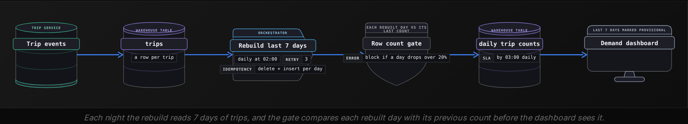

Beginner·Pipeline Architecture · 25 min · 11 challenges

# Schema Drift: Beginner

This lesson follows launch week for tipping in the Uber rider app. The trip service starts sending a new `tip_usd` field on Monday, and nobody warns the warehouse team. That same night, riders who finished trips in subway tunnels upload them days late. By Wednesday, finance wants to know why tips are missing and why Monday's trip count keeps moving.


<br>

---

## When a Producer Adds a Column

### The field your loader never expected

A producer is the system that writes the data a pipeline reads. Here it is the trip service, which emits an event per completed trip, and the loader is the step that copies those events into a warehouse table called `trips`. The loader was built when every event carried 4 fields, `trip_id` and `city` plus `fare_usd` and `completed_at`. Those names and the type of value each holds are the schema the loader expects.

```sql
{
  "trip_id": "t_88213",
  "city": "Lisbon",
  "fare_usd": 14.2,
  "completed_at": "2026-03-02T23:50:00Z",
  "tip_usd": 2
}
```

Then the producer team ships tipping, and each event gains `tip_usd`. Their change is correct: the app needs the field and their tests pass. Nobody on that team knows your loader exists, and nothing in the event announces a new shape. This is schema drift: the structure of data changes over time, and each system reading it finds out when the new shape arrives.


<br>

### 3 reactions to an unknown field

When the loader meets a field its table has no column for, it does 1 of 3 things, whether its author chose on purpose or inherited a library default. Learn which one yours does before the next producer release.

```sql
def load_event(event, table_columns, mode):
    unknown = [name for name in event if name not in table_columns]
    if unknown and mode == "reject":
        raise ValueError(f"unknown fields: {unknown}")
    if unknown and mode == "evolve":
        for name in unknown:
            add_column(name, infer_type(event[name]))
            table_columns.append(name)
    row = {name: event.get(name) for name in table_columns}
    insert_row(row)
```

What each reaction costs

- **Reject** *Stop the load and fail the run*\
  No wrong data reaches the table, but every dashboard reading trips goes stale. Retrying changes nothing: this is a permanent failure.
- **Ignore** *Load the known fields, drop the rest*\
  The run succeeds and trips stays fresh, while every tip value is thrown away. Without a raw copy of the events, those values are gone.
- **Evolve** *Add a column and load everything*\
  Tips land from the first event. The risk is unreviewed growth: a typo such as tipUsd in a single app version becomes a second permanent column.

Here is `trips` after a batch of 3 events: an old event with no tip, then 2 new events tipping 2.00 and 0.00.

| Reaction | New rows in trips | tip_usd column | Who notices, and when |
| --- | --- | --- | --- |
| Reject | 0 of 3: the batch fails | Absent | On-call, at the failed run |
| Ignore | 3 of 3 | Absent, values lost | An analyst, weeks later, asking for tips |
| Evolve | 3 of 3 | null, 2.00, 0.00 | Whoever reviews new columns, if anyone does |

**A nightly loader keeps succeeding after a producer release, with row counts that match the source. A week later an analyst finds the new promo_code field nowhere in the warehouse. Which reaction is the loader using?**

- **A.** Reject: the loader failed on the unknown field, and someone reran it without the field.
- **B.** Ignore: it loaded the fields its table knows and dropped promo_code without failing.
- **C.** Evolve: it added a promo_code column, but the column stays empty for new rows.
- **D.** Reject: the warehouse refused the new column, so the loader quietly kept the old schema.

<details>
<summary>Solution</summary>

**B.** Ignore: it loaded the fields its table knows and dropped promo_code without failing.

The table stayed fresh and the counts matched while the field went missing, which is what ignore does.

**Why the others are wrong**

- **A.** A reject reaction fails the run. Every run here succeeded, so nothing was stopped or rerun.
- **C.** Evolve would have created a column holding the values. The analyst found the field nowhere.
- **D.** Refusing the field and loading anyway is ignore behavior, whatever it is called. Reject stops the run.

</details>

No reaction is right everywhere. A table feeding driver payouts should reject, because a stale number is safer than a silently incomplete one. A clickstream table with hundreds of loosely owned fields often ignores, with an alert naming each dropped field, because stopping it would page someone every week. A table where analysts want new fields fast can evolve, if someone reviews each new column.

> **TIP**
>
> Keep every raw event in the lake exactly as it arrived. Then reject and ignore both become recoverable: once the team decides what `tip_usd` means, you reload it from the raw copy instead of asking the producer to resend.

**Your team owns payouts, which decides what drivers are paid each week, and app_clicks, which collects UI events from 40 product teams that add fields often. Which pairing of reactions fits best?**

- **A.** Evolve for both, so no field from any producer is ever lost.
- **B.** Reject for both, so no table ever holds data nobody reviewed.
- **C.** Ignore for payouts, reject for app_clicks, so money keeps flowing.
- **D.** Reject for payouts, ignore with an alert for app_clicks.

<details>
<summary>Solution</summary>

**D.** Reject for payouts, ignore with an alert for app_clicks.

Payouts stop rather than run on an unreviewed shape. Clicks stay fresh, and the alert names each dropped field.

**Why the others are wrong**

- **A.** Evolve lets an unreviewed field into payout math, and grows a column for every typo from 40 teams.
- **B.** Rejecting on app_clicks stops the load whenever any of 40 teams ships a field, paging someone constantly.
- **C.** This is backwards. A dropped field in payouts can underpay drivers, and stopping is costly for the click table.

</details>


<br>

---

## Forward vs Backward Compatibility

### Writers and readers upgrade separately

A schema change splits the data into 2 versions: events written before it and events written after. It also splits the code that reads them, because the producer team and the data team ship on different days. For a while, every mix of old and new runs somewhere, and compatibility describes which mixes still work.

| Day | Producer writes | Loader code | Mix in play |
| --- | --- | --- | --- |
| Monday | v1 events, 4 fields | v1 | Old reader, old data |
| Tuesday | v2 events, adds `tip_usd` | v1 | Old reader, new data |
| Thursday | v2 events | v2, knows `tip_usd` | New reader, new data |
| Thursday, reprocessing last week | v1 events from the raw copy | v2 | New reader, old data |


<br>

### Backward and forward

| ✓ Backward compatible | ✗ Forward compatible |
| --- | --- |
| • New reader, old data<br><br>• The v2 loader reads v1 events<br><br>• Needed when new code reprocesses history<br><br>• Breaks when a new reader requires a field old events lack | • Old reader, new data<br><br>• The v1 loader reads v2 events<br><br>• Needed in the gap before readers upgrade<br><br>• Breaks when an old reader needs a field new events dropped |

Name the direction from the reader's point of view. Backward means a new reader looks back at data from its past. Forward means an old reader receives data from its future. A change that keeps both working is *fully compatible*.


<br>

### 2 rules in the reading code

Compatibility comes down to 2 rules in the reading code. If the reader skips fields it doesn't recognize, new fields cannot hurt it. If every field it expects falls back to a default like null or 0 when missing, events that lack the field cannot hurt it. With both rules in place, the verdicts below follow.

| Change | Backward? | Forward? | Why |
| --- | --- | --- | --- |
| Add `tip_usd` with default 0 | Yes | Yes | New reader fills 0 for old events; old reader skips the field |
| Add `tip_usd` as required, no default | No | Yes | New reader finds no value in old events; old reader skips the field |
| Remove `promo_code`, which had a default | Yes | Yes | New reader skips it in old events; old reader fills the default |
| Remove `city`, required by old readers | Yes | No | New reader skips it in old events; old reader finds it missing |
| Rename `city` to `city_name` | No | No | Each side looks for a name the other side's events lack |
| Change `fare_usd` from a number to text | No | No | Neither reader expects the other's value type |

**The trip service wants to add a required field vehicle_type with no default. Readers skip fields they do not recognize. How does the change classify?**

- **A.** Forward compatible only: old readers skip it, but new readers fail on old events that lack it.
- **B.** Backward compatible only: new readers read old events, but old readers fail on the extra field.
- **C.** Fully compatible: adding a field never breaks a reader in either direction of time.
- **D.** Neither direction: any change to a schema breaks old readers and new readers alike.

<details>
<summary>Solution</summary>

**A.** Forward compatible only: old readers skip it, but new readers fail on old events that lack it.

Old readers skip the unknown field, so forward holds. New readers find no vehicle_type in older events, so backward fails.

**Why the others are wrong**

- **B.** This reverses the directions. Old readers skip unknown fields, so an extra field cannot break them.
- **C.** Adding a field is fully compatible only with a default. Without one, new readers have nothing for older events.
- **D.** Many changes keep one or both directions working. Here old readers survive because they skip the field.

</details>

On Tuesday the v1 loader meets v2 events, so the change must be forward compatible or Tuesday's load breaks. On Thursday the v2 loader rereads last week's v1 events, so it must be backward compatible or the reprocessing breaks. A batch pipeline that ever reprocesses history needs both, which is why a new field with a default is the change data teams hope to see.

> **TIP**
>
> For any proposed change, check 2 things. If today's reader can read the new events, the change is forward compatible. If next week's reader can read last month's events, it is backward compatible. A no to either means the change needs a plan.

**On Monday the producer drops the optional field promo_code, whose default is null. The loader is upgraded on Friday. The next week, the team reruns the new loader over 30 days of raw events. Which direction was needed, and when?**

- **A.** Backward from Monday to Friday, then forward during the 30-day rerun.
- **B.** Forward only, because once the loader is upgraded old events stop mattering.
- **C.** Forward from Monday to Friday, then backward during the 30-day rerun.
- **D.** Backward only, because the field was removed rather than added.

<details>
<summary>Solution</summary>

**C.** Forward from Monday to Friday, then backward during the 30-day rerun.

Before Friday, an old reader met new events: forward. In the rerun, a new reader met old events: backward.

**Why the others are wrong**

- **A.** Reversed. From Monday to Friday the old loader reads new events, which is forward.
- **B.** The rerun feeds old events to the new loader. That mix is backward, and it matters whenever you reprocess.
- **D.** Whatever the change was, the direction depends on whether the reader or the data was newer on that day.

</details>


<br>

---

## Adding Is Safe, Renaming Is Not

### 3 classes of schema change

The compatibility test judges a single change. A proposal also needs a verdict on its plan: can it ship today, or does it need a schedule agreed with other teams? Each proposal falls into 1 of 3 classes.

- **Additive** *Adds something readers can skip*\
  A new optional field with a default, or a new table. Readers keep working, so the producer ships without waiting for anyone.
- **Destructive** *Removes or reshapes something readers use*\
  Any single release that drops a field or changes its name or type. Some reader breaks the moment it ships, either loudly with an error or quietly with wrong numbers.
- **Coordinated** *A destructive goal reached in safe steps*\
  The same rename or type change, split so that no step removes anything a reader still uses. It takes weeks and needs every reader's owner to agree.


<br>

### A rename looks like a delete to every reader

A rename feels small to the team making it. To every reader it is 2 changes at once: a field they rely on disappears, and an unknown field appears. Suppose the trip service adopts a naming standard and renames `fare_usd` to `fare_amount_usd` in a release at 15:00 on March 10. The loader runs in ignore mode, so it skips the unknown name and stores null in `fare_usd`. Every load succeeds.

```sql
SELECT
  DATE(completed_at) AS trip_date,
  SUM(fare_usd) AS revenue_usd
FROM trips
WHERE DATE(completed_at) BETWEEN DATE '2026-03-08'
AND DATE '2026-03-11'
GROUP BY DATE(completed_at)
ORDER BY trip_date
```

| trip_date | revenue_usd |
| --- | --- |
| 2026-03-08 | 612,400 |
| 2026-03-09 | 598,900 |
| 2026-03-10 | 214,700 |
| 2026-03-11 | null |

March 10 holds only the fares from before 15:00, and March 11 sums nothing but nulls, which is null. Revenue appears to fall by almost two thirds and then vanish. No run fails, and a finance analyst is the first to notice. A reject loader would stop on March 10 instead. That is the better failure because it is louder, but readers break either way, so a single-step rename is destructive.

**Which of these proposals is coordinated?**

- **A.** Add an optional surge_multiplier field with a default of 1.0 in Thursday's release.
- **B.** Remove promo_code in Thursday's release, since the app no longer shows promo codes.
- **C.** Change completed_at from a timestamp to text in Thursday's release, keeping its name.
- **D.** Add rider_rating, copy values from rating, move readers over, then drop rating.

<details>
<summary>Solution</summary>

**D.** Add rider_rating, copy values from rating, move readers over, then drop rating.

A rename in safe steps. Each step keeps every current reader working, which makes it coordinated.

**Why the others are wrong**

- **A.** This is additive. A field with a default passes both directions and needs no schedule.
- **B.** Destructive as proposed. Any reader still selecting promo_code breaks or reads nulls on Thursday.
- **C.** A type change in place in one release is destructive. Readers doing date math break at once.

</details>


<br>

### The Safe Rename: Add, Copy, Switch, Drop

A coordinated rename reaches the same end state in 4 steps, and nothing a reader uses disappears until that reader has stopped using it.

| Step | Producer writes | Readers use | Why nothing breaks |
| --- | --- | --- | --- |
| 1. Add | Both `fare_usd` and `fare_amount_usd` | `fare_usd` | A new field passes both compatibility directions |
| 2. Copy | Both | `fare_usd` | Rows from before step 1 get `fare_amount_usd` filled from `fare_usd` |
| 3. Switch | Both | `fare_amount_usd`, a reader at a time | Both names hold the same values, so each reader moves on its own schedule |
| 4. Drop | `fare_amount_usd` only | `fare_amount_usd` | No reader is left on the old name |

```sql
SELECT
  COUNT(*) AS rows_missing_new_name
FROM trips
WHERE fare_amount_usd IS NULL
  AND fare_usd IS NOT NULL
```

Run the steps out of order and readers break. Drop before switch, and any reader still on `fare_usd` reads nulls: the March 11 dashboard again. Switch before the copy finishes, and a switched reader sees nulls for every row older than step 1. A type change uses the same steps under a new name: to store fares as whole cents, add `fare_cents`, copy, switch, then drop the old field.

| ✓ Do | ✗ Don't |
| --- | --- |
| • Ship new fields with a default so they pass both directions<br><br>• Treat every rename as add, copy, switch, drop<br><br>• List every reader of a field before removing it | • Rename or retype a field in a single release<br><br>• Drop the old field because the producer stopped writing it<br><br>• Trust ignore mode during a rename: it hides the break |

**A team renaming city to city_name finishes the add and copy steps, then removes city from the producer and the table the next morning. What happens?**

- **A.** Nothing breaks, because the copy step already put every value under the new name.
- **B.** Every reader that still selects city breaks, because the switch step was skipped.
- **C.** Only new events break, because old rows in the table still hold their city values.
- **D.** Readers break only if the loader is in reject mode, because ignore mode shields them.

<details>
<summary>Solution</summary>

**B.** Every reader that still selects city breaks, because the switch step was skipped.

Drop came before switch. Readers on the old name now fail or read nulls, depending on how they treat a missing field.

**Why the others are wrong**

- **A.** The copy moved the data, but readers still select city. Removing it before they switch breaks them.
- **C.** The column left the table too, so old rows lost it as well. Readers of city break for every date.
- **D.** Loader mode governs unknown incoming fields. A reader selecting a column that no longer exists breaks in every mode.

</details>


<br>

---

## What Late Data Means

### 2 clocks on every event

Every event has 2 timestamps, even if the pipeline stores only one. Event time is when the thing happened in the world: the moment the trip ended, recorded by the phone in `completed_at`. Processing time is when the pipeline received it: the loader stamps `loaded_at` on each row it writes into `trips`. Usually the 2 sit seconds apart, but sometimes they sit days apart.

| trip_id | completed_at (event time) | loaded_at (processing time) | Gap |
| --- | --- | --- | --- |
| t_88213 | 2026-03-02 23:50:00 | 2026-03-04 08:10:00 | 32 h 20 m |
| t_88214 | 2026-03-02 21:12:03 | 2026-03-02 21:12:07 | 4 s |
| t_88215 | 2026-03-02 18:40:00 | 2026-03-03 01:55:00 | 7 h 15 m |

Trip `t_88213` ended in a tunnel, and the phone held the event until it found a signal on the morning of March 4. Trip `t_88215` was sent on time, then sat in a buffer during a trip service outage. Gaps like these have a handful of causes:

- Phones offline in tunnels, on flights or in rural areas send events when they reconnect
- A producer outage holds events in a buffer, then releases hours of them at once
- A partner delivers Monday's file on Wednesday
- An upstream retry resends a failed batch long after its events happened


<br>

### An event is late once its period is computed

A gap matters once the pipeline has already answered a question about the event's period. The nightly job runs at 02:00 and counts the previous day's trips. At 02:00 on March 3 it published 41,200 trips for March 2. Trip `t_88215` arrived at 01:55 and made it in. Trip `t_88213` arrived more than 30 hours after that count went out. A late event is one whose event-time period was already computed when it arrived.

```sql
SELECT
  DATE_DIFF('hour', completed_at, loaded_at) AS hours_late,
  COUNT(*) AS trips
FROM trips
WHERE DATE(completed_at) = DATE '2026-03-02'
GROUP BY DATE_DIFF('hour', completed_at, loaded_at)
ORDER BY hours_late
```

**A row in trips shows completed_at 2026-03-05 22:10 and loaded_at 2026-03-06 09:30. Each day's count runs at 02:00 the next morning. Is this trip late, and for which day?**

- **A.** Late for March 5: that day was published at 02:00, 7.5 hours before the trip arrived.
- **B.** Late for March 6: it arrived on March 6, so March 6 is the day the trip belongs to.
- **C.** On time: it arrived within 12 hours of the trip, so no published day is affected.
- **D.** On time: late data only exists in streaming pipelines, and this pipeline runs nightly.

<details>
<summary>Solution</summary>

**A.** Late for March 5: that day was published at 02:00, 7.5 hours before the trip arrived.

Its event time falls on March 5, which was computed at 02:00 on March 6, before loaded_at.

**Why the others are wrong**

- **B.** March 6 is its processing date. The day a trip belongs to comes from event time: March 5.
- **C.** Lateness depends on whether its day was already computed. The size of the gap alone does not decide it.
- **D.** Batch pipelines get late events too, whenever a period is computed before all of its events arrive.

</details>


<br>

### 3 reactions to a late event

By the end of March 4, 180 more March 2 trips have arrived, all of them after that morning's 02:00 run. March 4 has 39,800 trips of its own. The pipeline can do 1 of 3 things with the 180.

| Reaction | What happens to the 180 | March 2 count | March 4 count | Cost |
| --- | --- | --- | --- | --- |
| Drop | Discarded as too late | 41,200 | 39,800 | March 2 undercounts by 180, forever |
| Update | Added to March 2, and the day recomputed | 41,380 | 39,800 | A published number moves after people saw it |
| Count on arrival | Added to the day they arrived | 41,200 | 39,980 | Both days are off; the 2-day total is right |

Count on arrival groups by processing time: a published day never moves and a month's total comes out right, while a Monday trip shows up as Wednesday's. Drop and update both group by event time and differ in whether a published day may change. Update is the one reaction that ends with every day correct, and the next section builds it for a batch pipeline.

> Which reaction fits which table
>
> - Finance close, where a filed number must never move: count on arrival, into the next open period
> - Daily trip counts feeding a demand forecast: update, since the model needs each day right
> - A live operations screen showing the last hour: drop, since a 2-day-old trip is noise there

**A payroll report is filed with a government agency each month, and a filed month can never be changed. Which reaction to late events fits it?**

- **A.** Update: recompute the filed month so it matches what really happened.
- **B.** Drop: discard late events so that the filed month stays fixed.
- **C.** Count on arrival: put late events into the next open month.
- **D.** Any of the 3: payroll is monthly, so lateness cancels out.

<details>
<summary>Solution</summary>

**C.** Count on arrival: put late events into the next open month.

The filed month never moves and nothing is lost: late events land in the next filing.

**Why the others are wrong**

- **A.** Update changes a published number, and here the filed number is not allowed to move.
- **B.** The month stays fixed, but real payroll events vanish from every future report.
- **D.** Lateness cancels out only under count on arrival. Drop loses events and update rewrites a filed month.

</details>


<br>

---

## Late Data: Rerun Last 7 Days

### Recompute the window every night

The update reaction needs a mechanism, and for a batch pipeline the simplest one is a wider rerun. Instead of computing only yesterday, the 02:00 job recomputes the last 7 days by event time. When `t_88213` lands in `trips` on March 4, the run at 02:00 on March 5 recomputes March 2 anyway, so the late trip reaches its correct day without anyone touching it.

| Run at 02:00 on | Days recomputed | March 2 count | What changed |
| --- | --- | --- | --- |
| March 3 | Feb 24 to Mar 2 | 41,200 | First count of March 2 |
| March 4 | Feb 25 to Mar 3 | 41,200 | Late trips not in yet |
| March 5 | Feb 26 to Mar 4 | 41,380 | All 180 late trips folded in |
| March 9 | Mar 2 to Mar 8 | 41,380 | Last run that touches March 2 |
| March 10 | Mar 3 to Mar 9 | 41,380 | March 2 is final |


<br>

### Replace Each Day, Never Append

The window works only if rerunning a day is idempotent. If the job appends, the March 4 run adds a second copy of March 2 on top of the first, and by March 9 the day has been inserted 7 times. The job must replace: delete the window's rows, then insert the recomputed ones. Run it once or 5 times and the table ends in the same state.

```sql
DELETE FROM daily_trip_counts
WHERE trip_date BETWEEN current_date - INTERVAL '7' DAY AND current_date - INTERVAL '1' DAY
```

```sql
INSERT INTO daily_trip_counts
SELECT
  date(completed_at) AS trip_date,
  city,
  count(*) AS trips
FROM trips
WHERE date(completed_at) BETWEEN current_date - INTERVAL '7' DAY AND current_date - INTERVAL '1' DAY
GROUP BY
  date(completed_at),
  city
```

Both the filter and the grouping use `completed_at`, the event time, because each day is rebuilt from every trip that belongs to it. If the insert fails after the delete, the retry repeats both statements and still ends correct.

**A team switches its nightly job to cover the last 7 days with INSERT INTO daily_trip_counts SELECT ... and no delete. What does the table hold for March 2 after the March 9 run?**

- **A.** The correct 41,380, since each run includes the late trips that arrived.
- **B.** Seven stacked copies of March 2's rows, so its total is about 7 times too high.
- **C.** Only the first count of 41,200, since a day cannot be inserted a second time.
- **D.** An empty March 2, since by March 9 the window has already moved past it.

<details>
<summary>Solution</summary>

**B.** Seven stacked copies of March 2's rows, so its total is about 7 times too high.

The runs on March 3 through March 9 each inserted the day again, piling up instead of replacing.

**Why the others are wrong**

- **A.** Each run adds rows without removing earlier ones. The late trips are there, and so are 6 earlier copies.
- **C.** A plain insert has no check for duplicates, so each of the 7 runs adds a full set of rows.
- **D.** March 2 is still inside the window on March 9, and an insert-only job never removes rows anyway.

</details>




<br>

### Choose the window from measured lateness

The 7-day window came from the lateness query in the previous section. Run it over a month and record what share of each day's trips had arrived by each point after the day ended.

| Arrived within | Share of the day's trips, March average |
| --- | --- |
| 2 hours (the first run) | 99.52% |
| 1 day | 99.81% |
| 3 days | 99.95% |
| 7 days | 99.99% |
| 30 days | 99.998% |

Widening from 1 day to 7 catches nearly all of the remaining tail. Widening to 30 recovers a sliver more for more than 4 times the nightly work, and keeps 30 days provisional for readers instead of 7.

- **7x** — nightly work vs a 1-day job
- **0.01%** — trips arriving after day 7

Where the window stops helping

- Trips arriving after day 7 reach trips but never daily_trip_counts. A daily check on rows loaded today with a completed_at over 7 days old counts them.
- The rerun reads 7 days of history with today's code, so every schema change must stay backward compatible for at least that long.

**A partner's daily sales file arrives late in this pattern: 92% of a day's rows within 1 day, 99.9% within 3 days, 99.95% within 14 days. Rebuilding a day takes 5 minutes. Which window is the best starting choice?**

- **A.** One day, since 92% is close enough for a sales table.
- **B.** Fourteen days, since it catches the most rows of any option.
- **C.** Thirty days, since a wider window is always safer for late data.
- **D.** Three days, since it catches 99.9% for 15 minutes a night.

<details>
<summary>Solution</summary>

**D.** Three days, since it catches 99.9% for 15 minutes a night.

Past day 3, each extra day catches very little. A 3-day window captures the tail cheaply, and a check counts the rest.

**Why the others are wrong**

- **A.** Missing 8% of each day at publish is large for sales, and widening costs only minutes.
- **B.** It runs 70 minutes a night to gain 0.05% over a 3-day window, which buys almost nothing.
- **C.** Each extra day costs another rebuild and keeps more history provisional, for rows that almost never come.

</details>


<br>

### Capstone: drift and lateness together

**The trip service starts renaming fare_usd to fare_amount_usd on March 10 with add, copy, switch, drop. The nightly job rebuilds 7 days of revenue from raw events stored exactly as they arrived. On March 14 the team points the job at fare_amount_usd alone. What happens to the rebuilt days?**

- **A.** Trips from before the rename rebuild with null revenue, since their raw events carry only fare_usd.
- **B.** Nothing changes, since the copy step already gave every old row the new field name.
- **C.** The job fails, since a renamed field can never be read across a rerun window.
- **D.** Only March 14 is affected, since earlier days in the window are already final.

<details>
<summary>Solution</summary>

**A.** Trips from before the rename rebuild with null revenue, since their raw events carry only fare_usd.

The copy filled the table, and raw events stayed as they arrived. Reading coalesce(fare_amount_usd, fare_usd) until the March 18 run keeps the rebuild backward compatible.

**Why the others are wrong**

- **B.** The copy updated the warehouse table. Raw events from before the rename still carry only fare_usd.
- **C.** It can, with a fallback such as coalesce. A field missing from an event usually reads as null.
- **D.** Every day in the window is rebuilt each night, including the trips from March 7 to 10 that predate the rename.

</details>


<br>

---

## Putting It All Together

Back at Uber's tipping launch, the trip service adds tip_usd with a default of 0. The loader runs in evolve mode with an alert naming each new column, and riders in tunnels upload trips days late. A nightly job rebuilds the last 7 days of daily_tips by completed_at, deleting and inserting each day. A month later, the team renames tip_usd to tip_amount_usd to match a naming standard.

- The default of 0 makes the launch additive for any reader that does not know tip_usd . In trips , evolve leaves pre-launch rows null. sum ( ) skips those nulls, and the rebuild reads them as coalesce ( tip_usd , 0 ) .
- Evolve mode lets tips land from the first event, and the alert gives a person the review that evolve skips.
- Late tunnel trips count toward their completed_at day because the window rebuilds by event time, which is the update reaction.
- Delete-then-insert makes each rebuilt day idempotent. A day rebuilt on 7 nightly passes, plus any retries, still never double counts.
- The later rename adds the new field, copies values into it, switches readers over and then drops the old one. The rebuild reads coalesce ( tip_amount_usd , tip_usd ) until its window starts after the add step.


<br>

---

## Key Takeaways

- A loader that meets an unknown field either rejects it or lets it through, and letting it through means ignoring the field or evolving the table to hold it. Know which one yours does before the next producer release.
- Backward compatible means a new reader reads old data. Forward compatible means an old reader reads new data.
- Adding a field with a default is additive and safe in both directions. Removing a field in one release is destructive, and so is changing its type or its name.
- Rename in 4 steps. Add the new field and copy values into it, then switch readers over, and drop the old field only after every reader has switched.
- Event time is when something happened; processing time is when the pipeline saw it. A late event arrives after its period was computed.
- A late event can be dropped, used to update the old result, or counted on arrival.
- Rebuilding the last 7 days nightly with delete-then-insert folds late events into their correct day, and measured lateness sets the window.

Exercises for this lesson: [_exercises/pa_schema_evolution_beginner.md](_exercises/pa_schema_evolution_beginner.md)
