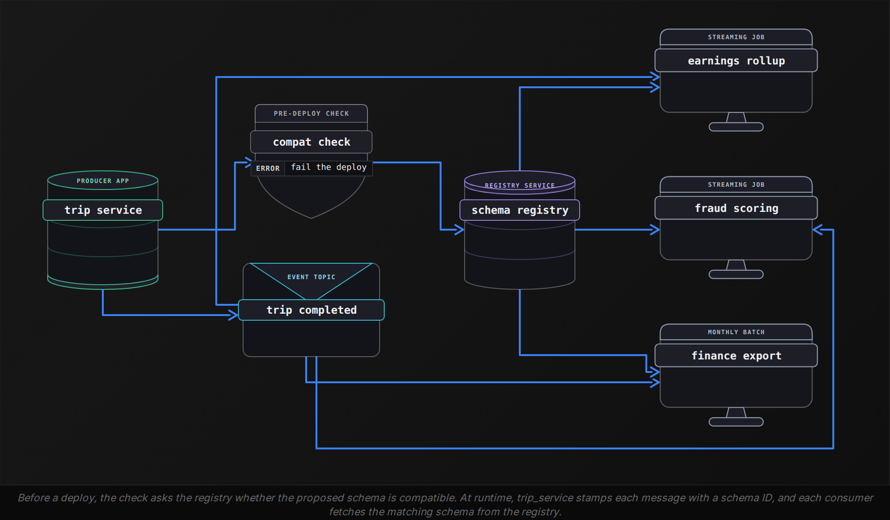
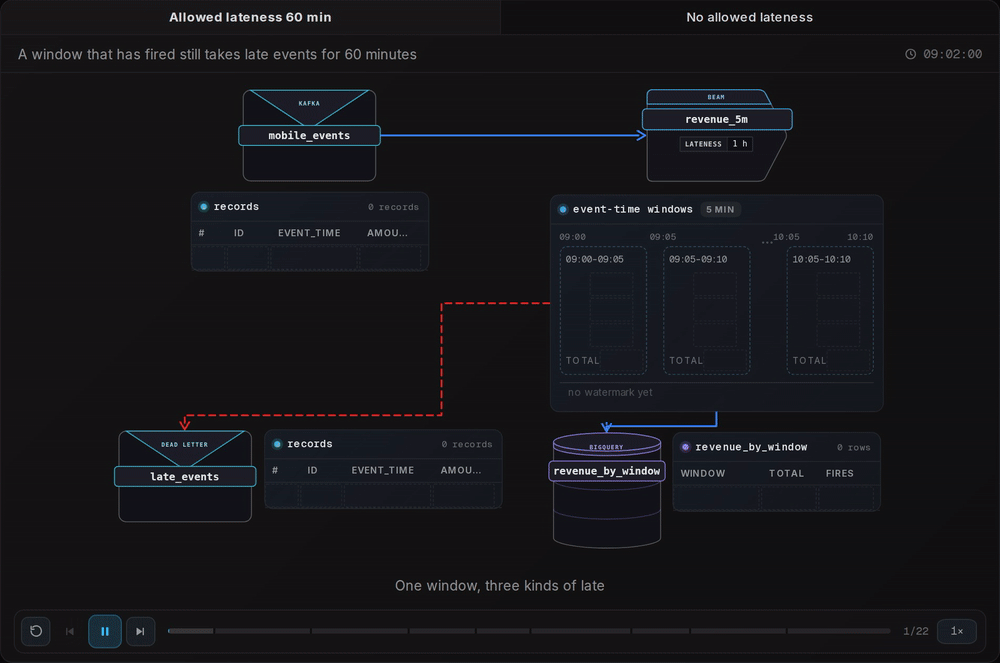
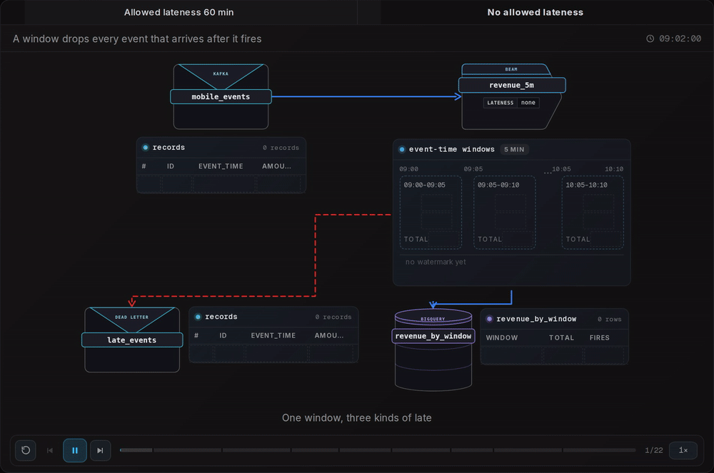

# Schema Drift: Intermediate

At Uber, a driver's phone climbs out of an underground garage at 09:34 and uploads a fare from a trip that ended at 09:02. The earnings pipeline published its 09:00 to 09:05 revenue total 28 minutes earlier. Reopen that total, drop the fare, or park it? The same app release also renamed the fare field. Two kinds of promise settle both: one about schema, one about time.


<br>

---

## Schema Registries: Where They Live

A schema registry is a small service that stores every version of every event schema and checks each proposed version against the versions before it. In the beginner lesson, a producer changed its event shape and a consumer broke at runtime. A registry moves that failure to deploy time, where it costs a red build instead of a broken dashboard.


<br>

### What the registry stores

Schemas are grouped by **subject**, usually 1 per topic, such as trip_completed-value. Each distinct schema receives a **schema ID** that is unique across the whole registry. A subject holds an ordered list of **versions**, and each version points to one of those IDs, so an identical schema registered under 2 subjects shares 1 ID. The subject also carries a **compatibility mode**: the rule every new version must pass before the registry accepts it.

```sql
{
  "subject": "trip_completed-value",
  "compatibility": "FULL",
  "versions": [
    {
      "version": 1,
      "schema_id": 412,
      "fields": [
        {
          "name": "trip_id",
          "type": "string"
        },
        {
          "name": "driver_id",
          "type": "string"
        },
        {
          "name": "fare",
          "type": "string"
        },
        {
          "name": "ended_at",
          "type": "timestamp"
        }
      ]
    },
    {
      "version": 2,
      "schema_id": 587,
      "fields": [
        {
          "name": "trip_id",
          "type": "string"
        },
        {
          "name": "driver_id",
          "type": "string"
        },
        {
          "name": "fare",
          "type": "string"
        },
        {
          "name": "ended_at",
          "type": "timestamp"
        },
        {
          "name": "tip_cents",
          "type": "long",
          "default": 0
        }
      ]
    }
  ]
}
```

The registry also changes what travels on the topic. Each message carries a short schema ID ahead of its payload, in place of the full schema. A consumer that meets ID 587 for the first time fetches that schema from the registry once, caches it, and decodes every later message stamped 587 with it.


<br>

### Deploy time and runtime



The check that matters runs before the deploy. When trip_service is about to ship a new event shape, a build step submits the proposed schema to the registry and asks whether it passes the subject's compatibility mode. A failure stops the release, so the incompatible shape never produces a message. Runtime is the backstop: a producer that skips the check and has auto-registration turned on tries to register the new version when it first serializes a message, and that send fails with a compatibility error where it expected a schema ID.


<br>

### The 4 compatibility modes

| Mode | Guarantee | Passes | Fails |
| --- | --- | --- | --- |
| BACKWARD | Readers on the new schema decode old messages | Delete a field; add a field with a default | Add a field with no default |
| FORWARD | Readers on the old schema decode new messages | Add a field; delete a field that has a default | Delete a field with no default |
| FULL | Both directions hold | Add or delete fields that have defaults | Add or delete a field with no default |
| NONE | No guarantee | Any change | Nothing |

**The trip_completed-value subject uses FORWARD compatibility. A proposed version 3 deletes driver_id, a required string with no default in version 2. What does the check return?**

- **A.** It passes, because FORWARD only inspects the fields a new version adds.
- **B.** It fails, because readers still on version 2 need driver_id and have no default.
- **C.** It passes, and readers still on version 2 get null wherever driver_id was.
- **D.** It fails, because FORWARD rejects every deletion, including fields that have defaults.

<details>
<summary>Solution</summary>

**B.** It fails, because readers still on version 2 need driver_id and have no default.

An old reader decodes the new message, finds no driver_id, and has nothing to substitute.

**Why the others are wrong**

- **A.** FORWARD asks whether old readers decode new messages, and deletions are what threaten them.
- **C.** Readers substitute only a declared default. With none declared, decoding fails, so the registry rejects it.
- **D.** Right verdict, wrong rule: deleting a field that has a default passes, since old readers fall back to it.

</details>

The mode also fixes who deploys first. Under BACKWARD, consumers upgrade first, since a new reader can decode old messages. Under FORWARD, the producer upgrades first, since old readers can decode new messages. FULL lets either side go first, which suits a topic read by several teams that ship on separate schedules.

Each mode compares a candidate with the latest version only. The transitive variants, such as FULL_TRANSITIVE, compare it with every registered version. Choose a transitive mode when consumers replay history: a topic that retains 30 days can hold messages written under 4 versions, and a replay from day 1 decodes all of them.

> A rename, as the registry sees it
>
> - Renaming `fare` to `fare_cents` deletes one field and adds another.
> - Under `FULL`, the added `fare_cents` has no default, so new readers cannot fill it in from old messages.
> - The deleted `fare` has no default either, so old readers find nothing to read in new messages.
> - The check fails on both counts. The next section makes the change anyway, in compatible steps.

**Which proposed version 3 change passes under FULL compatibility?**

- **A.** Add pickup_zone as an optional string with default 'unknown'.
- **B.** Change fare from a string to a long that holds cents.
- **C.** Add vehicle_type as a required string that has no default.
- **D.** Rename driver_id to partner_id and keep the same type.

<details>
<summary>Solution</summary>

**A.** Add pickup_zone as an optional string with default 'unknown'.

Old readers ignore the new field, and new readers fill 'unknown' into old messages.

**Why the others are wrong**

- **B.** A string reader cannot decode a long, and a long reader cannot decode a string.
- **C.** Old readers cope, but new readers have nothing to fill in for old messages.
- **D.** A rename deletes one required field and adds another, and FULL rejects both halves.

</details>


<br>

---

## The Expand-Contract Pattern

The registry blocks the rename, and the business still needs it. Today `fare` is a string such as `12.50 USD`, and each of the topic's 3 consumers parses it with code of its own. The target is a long `fare_cents` plus a string `fare_currency`. Expand-contract makes that change in 4 deploys, each compatible with the one before it, so no team waits on another team's release.

| ✓ One synchronized deploy | ✗ Expand-contract |
| --- | --- |
| • The producer and 3 consumers ship inside one release window<br><br>• A rollback has to undo all 4 deploys together<br><br>• A consumer that misses the window breaks on the first new message<br><br>• Messages already on the topic still carry the old shape | • Each team ships on its own schedule<br><br>• Each phase rolls back on its own<br><br>• Old and new fields coexist for as long as readers need<br><br>• The old field leaves only after its last reader has moved |


<br>

### The 4 phases

| Phase | Producer writes | Consumers read | Schema |
| --- | --- | --- | --- |
| 1. Expand | `fare`, `fare_cents`, `fare_currency` | `fare` | v3: adds 2 fields with null defaults, gives `fare` a default |
| 2. Migrate | all 3 fields | `fare`, while history is backfilled | v3, unchanged |
| 3. Switch | all 3 fields | each consumer moves to `fare_cents` on its own date | v3, unchanged |
| 4. Contract | `fare_cents`, `fare_currency` | `fare_cents` | v4: deletes `fare` |

#### Expand: add beside the old field

Version 3 adds `fare_cents` and `fare_currency`, both nullable with a default of null, and gives the existing `fare` a default of an empty string. Every change carries a default, so `FULL` passes. The producer now writes all 3 fields on every message. Nobody reads the new ones yet, so rolling back to version 2 breaks no reader. The default on `fare` does nothing today; it is what lets phase 4 delete the field.

#### Migrate: give history the new fields

The curated `trips` table holds 2 years of rows that only have `fare`. A backfill computes `fare_cents` and `fare_currency` for each `trip_date` partition and overwrites that partition, so a retried day produces the same rows. Before any consumer depends on the backfilled values, compare the backfill's parsing with what the producer wrote itself on recent days, where both columns exist.

```sql
SELECT
  trip_date,
  COUNT(*) AS rows_checked,
  COUNT_IF(
    fare_cents <> CAST(
      ROUND(CAST(SPLIT_PART(fare, ' ', 1) AS DOUBLE) * 100)
      AS BIGINT
    )
  ) AS mismatched_rows
FROM trips
WHERE trip_date >= DATE '2026-10-01'
GROUP BY trip_date
ORDER BY trip_date
```

**During phase 2, the backfill for partition 2025-03-14 fails after writing half its rows, and the orchestrator retries the task. What makes the retry safe?**

- **A.** The registry rejects the duplicate rows, since they carry the same schema ID.
- **B.** The backfill only writes fare_cents, so duplicates in other columns do no harm.
- **C.** FULL compatibility guarantees each message is decoded exactly once by readers.
- **D.** Each run overwrites the whole partition, so the retry replaces the partial write.

<details>
<summary>Solution</summary>

**D.** Each run overwrites the whole partition, so the retry replaces the partial write.

Overwriting a partition makes the task idempotent: after 1 run or 3, the partition holds the same rows.

**Why the others are wrong**

- **A.** The registry validates schemas and never sees rows, so duplicates pass straight through.
- **B.** A duplicated row doubles that trip's fare, whichever columns the job wrote.
- **C.** Compatibility modes govern schema shape and say nothing about how often a row is written.

</details>

#### Switch: consumers move one by one

Each consumer team changes its reads to `fare_cents`, ships, and watches its own outputs. The earnings rollup might switch in week 1 and the fraud model in week 3, with the finance export last. Keep a written list of the topic's 3 consumers with a sign-off column: the registry records schemas and keeps no record of who reads which field.

#### Contract: remove what nobody reads

When the last sign-off lands, the producer ships version 4, which stops writing `fare` and deletes it from the schema. Because `fare` gained a default in phase 1, `FULL` accepts the deletion. Dropping the `fare` column from `trips` comes last, once a week passes with no query reading it.

> **TIP**
>
> Contract is the one phase with a one-way door. Messages written under version 4 have no `fare`, so rolling the producer back restores the field for new messages only. Wait out a full release cycle of the slowest consumer before taking that step.

**Two of the 3 consumers of trip_completed read fare_cents. The third, the monthly finance export, still parses fare. The producer ships version 4, which stops writing fare. What does the finance export see on its next run?**

- **A.** A schema error, because the registry blocked version 4 for breaking an old reader.
- **B.** A decode failure on every message, because the fare field is missing.
- **C.** Messages decode, fare arrives as the empty-string default, and the parser finds no amount.
- **D.** Correct fares, because the reader rebuilds fare from fare_cents during decoding.

<details>
<summary>Solution</summary>

**C.** Messages decode, fare arrives as the empty-string default, and the parser finds no amount.

This is the cost of contracting early: the registry protects decoding, and only the sign-off list protects meaning.

**Why the others are wrong**

- **A.** fare gained a default in phase 1, so the deletion passes FULL and version 4 registers.
- **B.** Decoding succeeds. The reader's schema declares a default for fare and fills it in.
- **D.** A reader fills a missing field with its declared default and never converts one field into another.

</details>


<br>

---

## Event Time Versus Processing Time

Every trip event carries 2 timestamps that answer different questions. **Event time** is when the thing happened, stamped by the phone: the trip ended at 08:47. **Processing time** is when the pipeline handled the event: the streaming job saw it at 09:12. The gap between them is **skew**. On a good network skew is a few seconds; for a phone in a garage or on a flight it runs to hours.

| trip | ended_at (event time) | processed_at (processing time) | skew |
| --- | --- | --- | --- |
| T1 | 08:58:00 | 08:58:03 | 3s |
| T2 | 08:59:40 | 09:00:05 | 25s |
| T3 | 08:47:00 | 09:12:00 | 25m |
| T4 | 09:10:00 | 09:10:02 | 2s |
| T5 | 09:20:00 | 09:20:01 | 1s |
| T6 | 08:55:00 | 10:02:00 | 67m |

Count those 6 trips per hour and the 2 clocks disagree about every hour. T3 and T6 both ended in the 08:00 hour, yet T3 reached the pipeline at 09:12 and T6 at 10:02.

By event hour

| hour | trips |
| --- | --- |
| 08:00 | 4 |
| 09:00 | 2 |

By processing hour

| hour | trips |
| --- | --- |
| 08:00 | 1 |
| 09:00 | 4 |
| 10:00 | 1 |

The 2 queries differ only in the column inside date_trunc. This one buckets by event time; putting processed_at in place of ended_at produces the right-hand table.

```sql
SELECT
  DATE_TRUNC('hour', ended_at) AS event_hour,
  COUNT(*) AS trips
FROM trips
WHERE trip_date = DATE '2026-10-24'
GROUP BY DATE_TRUNC('hour', ended_at)
ORDER BY event_hour
```

The partition column inherits the same choice, and the query above assumes `trip_date` comes from `ended_at`. If `trip_date` comes from `processed_at`, a trip that ends at 23:50 and uploads at 00:40 lands in the next day's partition, and an event-time query for one day must scan 2 partitions to find all its trips.


<br>

### Which clock answers which question

Ask whether the question is about **the world** or about **the pipeline**. Questions about what riders and drivers did use event time. Questions about load, delay and cost inside the system use processing time.

| Consumer question | Clock | Reason |
| --- | --- | --- |
| Driver earnings for 08:00 to 09:00 | event time | Pay follows when the trip happened |
| Events ingested per minute, for capacity planning | processing time | Load lands when events arrive |
| Fraud rule: 5 trips on one card within 10 minutes | event time | The rule describes rider behaviour |
| Delay from phone to table, p95 | both | Delay is processed_at minus ended_at |
| Alert when the job falls behind | processing time | Falling behind is a property of the job |

**This query feeds the driver earnings page, which shows pay per hour of driving. What is wrong with it?**

```sql
SELECT
  driver_id,
  date_trunc('hour', processed_at) AS pay_hour,
  sum(fare_cents) AS earned_cents
FROM trips
WHERE trip_date = DATE '2026-10-24'
GROUP BY driver_id, date_trunc('hour', processed_at)
```

- **A.** Nothing, because processed_at is the more reliable of the 2 clocks for money.
- **B.** It should group by trip_date alone, since hourly pay needs no timestamp.
- **C.** It should sum fare, because fare_cents may still be null on old rows.
- **D.** It buckets by processed_at, so a trip that ended at 08:47 is paid in the 09:00 hour.

<details>
<summary>Solution</summary>

**D.** It buckets by processed_at, so a trip that ended at 08:47 is paid in the 09:00 hour.

Grouping on date_trunc('hour', ended_at) puts T3 back in the 08:00 hour, where the driver earned it.

**Why the others are wrong**

- **A.** A reliable clock measuring the wrong moment still misplaces pay, which follows when trips happened.
- **B.** The page shows hourly pay, so an hour bucket is required; the question is which clock fills it.
- **C.** Phase 2 backfilled history, so fare_cents is populated on old rows too.

</details>

> Event time can be wrong too
>
> - It is only as accurate as the clock that stamped it, and phone clocks drift or get set by hand.
> - A producer that stamps at send time records upload time under the name of event time.
> - Quarantine event times far in the future: they point to a bad clock.
> - Keep `processed_at` on every row so skew stays measurable after the fact.

**During a concert surge, the on-call engineer wants a chart showing whether the streaming job keeps up with incoming events. Which timestamp should the chart bucket by?**

- **A.** processed_at, because keeping up is about when the job handled each event.
- **B.** ended_at, because the surge is defined by when riders finished their trips.
- **C.** Either one, because both timestamps fall in the same hour for most trips.
- **D.** ended_at on the axis, with rows filtered to processed_at in the last hour.

<details>
<summary>Solution</summary>

**A.** processed_at, because keeping up is about when the job handled each event.

A backlog shows as handling falling behind arrival, and only the job's own clock shows its pace.

**Why the others are wrong**

- **B.** The surge's timing is a fact about riders, while this chart asks about the job.
- **C.** A lagging job widens the gap between the clocks, so they diverge exactly when the chart matters.
- **D.** Plotting by trip time moves late-handled events back to their trip times and hides the backlog.

</details>


<br>

---

## Watermarks: The Engine's Promise

A daily batch job knows yesterday is finished when the last file lands. A streaming job that sums revenue in 5-minute event-time windows gets no such signal, and T6 showed that a trip can surface 67 minutes after it ended. Before the job publishes a total for 09:00 to 09:05, it needs a rule for deciding it has waited long enough. A watermark is that rule.

A **watermark** is a timestamp in event time that the engine carries alongside the stream. When it reads W, the engine is asserting: no further events with event time earlier than W will arrive. A window covering [09:00, 09:05) counts as complete once the watermark reaches 09:05, and at that moment the engine emits, or **fires**, the window's total.


<br>

### Max event time seen, minus a lag

Most engines compute a heuristic watermark from the data itself: the largest event time seen so far, minus a fixed lag that absorbs ordinary out-of-order delivery. With a 60-second lag, an event stamped 09:06:01 moves the watermark to 09:05:01. It never moves backward, and it moves forward only when an event newer than every earlier one arrives.

| arrives | event | event_time | amount | watermark after | what happens |
| --- | --- | --- | --- | --- | --- |
| 09:02:18 | E1 | 09:02:14 | 100 | 09:01:14 | joins [09:00, 09:05), total 100 |
| 09:04:30 | E2 | 09:03:55 | 200 | 09:02:55 | joins [09:00, 09:05), total 300 |
| 09:06:02 | E5 | 09:06:01 | 40 | 09:05:01 | opens [09:05, 09:10); [09:00, 09:05) fires with 300 |
| 09:34:00 | E3 | 09:02:14 | 50 | 09:05:01 | event time sits behind the watermark: late |

Read the last row closely. E3 ended at 09:02:14, before the watermark of 09:05:01, so the engine's assertion turned out false. A heuristic watermark is a bet about the network, and a phone in a garage loses that bet. The watermark held at 09:05:01 as E3 arrived, since E3 is older than events the engine had already seen. What the engine does with E3 is a separate setting, the subject of the next section.

*Because this watermark is built from event times, a quiet stream holds it still. Window [09:05, 09:10) fires only when an event stamped at or after 09:11:00 arrives, however much wall-clock time passes first.*

**A job sums 5-minute windows with a 60-second watermark lag. Events arrive in this order, stamped 10:03:10, 10:05:30, 10:06:20, then 10:04:50. What happens to window [10:00, 10:05)?**

- **A.** It fires when the 10:05:30 event arrives, and the 10:04:50 event is late.
- **B.** It fires when the 10:06:20 event arrives, holding both 10:03:10 and 10:04:50.
- **C.** It fires when the 10:06:20 event arrives, holding only the 10:03:10 event.
- **D.** It fires when the 10:04:50 event arrives, because that event completes the window.

<details>
<summary>Solution</summary>

**C.** It fires when the 10:06:20 event arrives, holding only the 10:03:10 event.

The 10:06:20 event lifts the watermark to 10:05:20 and fires the window; 10:04:50 then arrives late.

**Why the others are wrong**

- **A.** That event moves the watermark only to 10:04:30, short of the window's end.
- **B.** The 10:04:50 event arrives after the firing, so the first total cannot contain it.
- **D.** Windows fire on the watermark, and an older event never moves it forward.

</details>


<br>

### Choosing the lag

| ✓ 10-second lag | ✗ 30-minute lag |
| --- | --- |
| • Totals publish about 10 seconds after a window ends<br><br>• Any event delayed past 10 seconds counts as late<br><br>• Open windows sit in memory briefly<br><br>• Suits alerting, where a fast rough answer beats a slow exact one | • Totals publish about 30 minutes after a window ends<br><br>• Only events delayed past 30 minutes count as late<br><br>• Every key holds 30 minutes of open windows in memory<br><br>• Suits billing, where completeness outranks speed |

The lag trades latency for completeness, so set it from measured skew. If the p99 of `processed_at` minus `ended_at` is 40 seconds, a 60-second lag leaves fewer than 1 event in 100 late in a steady stream, and every total waits about a minute past its window's end.

**A team raises the watermark lag on its revenue job from 60 seconds to 10 minutes. What should it expect?**

- **A.** Fewer late events and earlier totals, since the engine waits for stragglers.
- **B.** Fewer late events, totals about 9 minutes later, and more open windows in memory.
- **C.** The same late events, since lateness depends on allowed lateness alone.
- **D.** More late events, because a later watermark leaves more events behind it.

<details>
<summary>Solution</summary>

**B.** Fewer late events, totals about 9 minutes later, and more open windows in memory.

Each window stays open longer, so more stragglers make it in, results wait, and open windows pile up.

**Why the others are wrong**

- **A.** Waiting for stragglers delays every total by about 9 more minutes.
- **C.** Lateness is judged against the watermark, and the lag sets where the watermark sits.
- **D.** A larger lag puts the watermark further behind the newest events, so fewer fall behind it.

</details>


<br>

---

## 1-Hour Allowed Lateness

Allowed lateness is the second setting on a window. After the watermark fires a window, the engine keeps that window's state for a further stretch of event time, 60 minutes in this job. A late event that lands inside the stretch updates the total, and the window fires again with the corrected figure. An event that turns up after the stretch finds no state left to update and goes to `late_events`, a dead letter table where a person can find it.

| Class | Arrives while the watermark is | Example | Result for [09:00, 09:05) |
| --- | --- | --- | --- |
| On-time | before 09:05 | E1, E2 | In the first firing: 300 |
| Slightly late | from 09:05 up to 10:05 | E3, at 09:34 | Total becomes 350, window fires again |
| Very late | at or past 10:05 | E4, at 11:15 | State already discarded; E4 goes to late_events |

The animation replays all 6 events through the `revenue_5m` job in arrival order. Run the 60-minute variant, then the variant with no allowed lateness, and watch where E3 ends up each time.

**Allowed lateness 60 min**



**No allowed lateness**




<br>

### Lateness runs on the watermark

E6 decided E4's fate. Stamped 10:06:30, E6 moved the watermark to 10:05:30, past the window's end plus 60 minutes, so the engine discarded the window's state and E4 found nothing to join at 11:15. Had E6 never arrived, the watermark would still read 09:05:01 and E4 would have been accepted, however late the wall clock said it was. With allowed lateness at 0, the state goes the moment the window fires, so E3 and E4 both land in `late_events` and the total stays at 300.


<br>

### The window logic in plain Python

The function below holds the whole policy: a 5-minute window, a 60-second lag and 60 minutes of allowed lateness. For each event it checks whether the window's lateness has run out, updates the total, re-fires a window that already fired, then advances the watermark and fires or discards windows.

```sql
from datetime import datetime, timedelta

WINDOW = timedelta(minutes=5)
WATERMARK_LAG = timedelta(seconds=60)
ALLOWED_LATENESS = timedelta(minutes=60)


def at(hms):
    return datetime.strptime(hms, "%H:%M:%S")


def window_start(event_time):
    minute = event_time.minute - event_time.minute % 5
    return event_time.replace(minute=minute, second=0)


def run(events):
    totals, fires, output, late = {}, {}, {}, []
    watermark = datetime.min
    for event_id, event_time, amount in events:
        start = window_start(event_time)
        if watermark >= start + WINDOW + ALLOWED_LATENESS:
            late.append(event_id)
            continue
        totals[start] = totals.get(start, 0) + amount
        if start in fires:
            fires[start] += 1
            output[start] = totals[start]
        watermark = max(watermark, event_time - WATERMARK_LAG)
        for open_start in list(totals):
            end = open_start + WINDOW
            if watermark >= end and open_start not in fires:
                fires[open_start] = 1
                output[open_start] = totals[open_start]
            if watermark >= end + ALLOWED_LATENESS:
                del totals[open_start]
    return output, fires, late


events = [
    ("E1", at("09:02:14"), 100),
    ("E2", at("09:03:55"), 200),
    ("E5", at("09:06:01"), 40),
    ("E3", at("09:02:14"), 50),
    ("E6", at("10:06:30"), 60),
    ("E4", at("09:02:14"), 75),
]
output, fires, late = run(events)
```

| window | total | fires |
| --- | --- | --- |
| [09:00, 09:05) | 350 | 2 |
| [09:05, 09:10) | 40 | 1 |

The function returns `late` as `['E4']`. Window [10:05, 10:10) holds E6's 60 and has not fired, because the watermark stands at 10:05:30.


<br>

### Every re-fire replaces the last one

Each firing emits the window's full current total, and a later firing supersedes an earlier one. A sink that appends keeps both rows for 09:00, and a dashboard that sums the table reports 650. The sink has to upsert on the window key: the replace-not-append rule from idempotent reruns, applied to streaming output.

Append sink

| window | total |
| --- | --- |
| 09:00-09:05 | 300 |
| 09:00-09:05 | 350 |

Upsert on window

| window | total | fires |
| --- | --- | --- |
| 09:00-09:05 | 350 | 2 |

**A team's sink appended every firing to revenue_firings, one row per firing with a fired_at timestamp. Late refunds can lower a total on re-fire. Which aggregation returns the current total per window?**

- **A.** max_by(total, fired_at) grouped by window, keeping each window's latest firing.
- **B.** max(total) grouped by window, keeping each window's largest firing.
- **C.** sum(total) grouped by window, adding every firing together.
- **D.** The row at min(fired_at) per window, keeping each window's first firing.

<details>
<summary>Solution</summary>

**A.** max_by(total, fired_at) grouped by window, keeping each window's latest firing.

Every firing replaces the last, so the newest row holds the current total, whichever way it moved.

**Why the others are wrong**

- **B.** It matches only while totals grow. A late refund leaves the newest total below an earlier one.
- **C.** Firings restate one total. Summing E3's window gives 650 where 350 is correct.
- **D.** The first firing is the on-time total and misses every late correction, such as E3's 50.

</details>


<br>

### What an hour of lateness costs

Every window's state now outlives its firing by an hour of watermark progress, so each key carries the open window plus every window that fired in the previous hour. A revenue job keyed by city across 600 cities multiplies that by 600. Readers also see a number that may still change: the 09:00 total is final only once the watermark moves an hour past 09:05.

- **12** — fired windows held per key
- **7,200** — fired windows held across 600 cities

> Where very late events go
>
> - Route them to `late_events`; a silent drop hides how often lateness runs out.
> - Chart the daily count of `late_events` next to the window totals.
> - Let the batch rerun of the last 7 days fold them into the curated `trips` table.
> - If `late_events` keeps growing, measure skew again before raising allowed lateness.

**A job uses 5-minute windows, a 60-second lag and 60 minutes of allowed lateness. The watermark reads 14:40:00. Three events then arrive, stamped 14:03:00, then 15:06:00, then 14:04:00. What happens to window [14:00, 14:05)?**

- **A.** The 14:03:00 event is dropped, because the window fired 35 minutes of watermark earlier.
- **B.** Both old events update the total, since each is within an hour of the window.
- **C.** Both old events go to late_events, because they arrived after the window fired.
- **D.** The 14:03:00 event updates and re-fires it; the 14:04:00 event goes to late_events.

<details>
<summary>Solution</summary>

**D.** The 14:03:00 event updates and re-fires it; the 14:04:00 event goes to late_events.

At 14:40 the window is inside its lateness. The 15:06:00 event pushes the watermark to 15:05:00 and the state is discarded.

**Why the others are wrong**

- **A.** The window fired, but its lateness lasts until the watermark reaches 15:05, and it reads 14:40.
- **B.** The 15:06:00 event moves the watermark to 15:05:00, which ends the lateness before 14:04:00 arrives.
- **C.** Allowed lateness exists to accept events that arrive after a firing, for an hour of watermark.

</details>


<br>

---

## Putting It All Together

Picture Uber's earnings pipeline during the fare rename. Version 3 of trip_completed passes the registry's FULL check because every change carries a default. While the 3 consumers switch over the following month, the streaming earnings job keeps summing 5-minute windows by ended_at, with a 60-second watermark lag and 60 minutes of allowed lateness, and upserts each firing into the earnings table. Trips uploaded after their window's lateness runs out land in late_events, and the daily rerun of the last 7 days folds them into trips.

- FULL compatibility is what lets the 4 expand-contract phases ship on separate team schedules.
- The earnings job buckets by ended_at , because driver pay follows when a trip happened.
- The watermark lag comes from measured skew between processed_at and ended_at .
- Allowed lateness re-fires windows, so the sink upserts on window key: the replace-not-append rule from idempotent reruns.
- Very late trips reach late_events like a dead letter queue, and the 7-day batch rerun repairs the curated table.


<br>

---

## Key Takeaways

- A schema registry stores versions and schema IDs per subject, and its compatibility mode decides which new versions it accepts.
- BACKWARD means consumers deploy first, FORWARD means the producer deploys first, and FULL lets either side go first.
- Expand-contract turns a breaking rename into 4 compatible deploys: expand, migrate, switch, contract.
- Event time answers questions about the world; processing time answers questions about the pipeline.
- A watermark is the engine's assertion that no earlier events remain, and a window fires when the watermark reaches its end.
- Allowed lateness keeps a fired window's state for a stretch of watermark progress, so late events re-fire it and the sink must upsert.

Exercises for this lesson: [_exercises/pa_schema_evolution_intermediate.md](_exercises/pa_schema_evolution_intermediate.md)
