# Storage Layers: Advanced - Exercises

Lesson: [pa_storage_layers_advanced.md](../pa_storage_layers_advanced.md)

### Exercise 1 of 12

**● TASK**

Two Spark jobs write Kafka orders every 1 and 5 minutes into a table defined as every Parquet file under an object-storage directory, and a dashboard reads it. Readers count half-written batches, and a job that dies after 30 of its 50 files leaves those 30 behind. Add a metadata layer over the same Parquet files so each write commits all at once, and make sure a rerun of the same window adds no second copy of its rows.

**Starting canvas** (already placed for you):

- Kafka orders log (source, Kafka)
- Concurrent writer 1 (every 1min) (transform, Spark)
- Concurrent writer 2 (every 5min, overlapping partitions) (transform, Spark)
- Orders table (Parquet directory, no metadata layer) (storage, object storage)
- Analytics dashboard (consumer, dashboard)

<details>
<summary><strong>Solution</strong></summary>

#### The metadata file is the table

A lakehouse table is object storage plus a metadata layer, and the metadata is what you are really buying. Under a plain directory the table is whatever a listing returns. A reader that lists mid-write counts half a batch, and a job that dies after 30 of its 50 files leaves 30 files that every later query counts. With a table format such as Iceberg, the writer puts its Parquet files first and then commits one new metadata file naming them. Until that single put lands, the new files belong to no table at all.

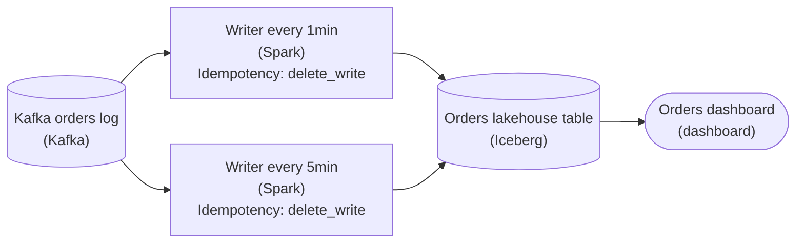

*Both Spark jobs commit into the Iceberg table, and the dashboard reads the files its metadata names, never a raw directory listing.*

1. **Commit both jobs through the table format**

   The data files stay the same columnar Parquet. What changes is how a reader finds them. Both Spark jobs write into the Iceberg table, so each 1-minute and 5-minute run becomes one atomic change. The dashboard plans from the metadata's file list instead of making 1,000 listing requests per million files.

2. **Make a window's write replaceable**

   Atomic commits stop torn reads, but the scheduler can still rerun a window that already committed. Set each writer's idempotency strategy to `delete_write`. The run deletes that window's rows and writes its new ones in the same commit, so a second run replaces the first instead of stacking on it.

| Pitfall: An atomic commit can still commit twice |
| --- |
| Atomicity means a write lands whole or not at all. It says nothing about whether the same write should land again. A plain append that commits, loses its success signal and is retried commits a second full copy of the window. Every reader then sees a clean table with doubled orders. |

| ✕ Directory of Parquet files | ✓ Metadata over Parquet files |
| --- | --- |
| The table is a listing. A half-finished batch is visible as soon as its first file lands, a failed job's files stay counted, and planning a million-file table takes 1,000 list calls. | The table is the file list the latest metadata names. New files join it in one put, a failed job's files are never named, and planning reads that list instead of the directory. |

**Follow-up questions**

1. If the 5-minute job dies after writing 30 of its 50 files, are those 30 files still in object storage, and does any query read them?\
   *Separates the files that exist from the files the table names.*
2. Both jobs commit to the same day's partitions within the same second. What has to be true for both commits to land without one erasing the other?\
   *Extends the single atomic commit to two writers racing to publish the next metadata file.*

</details>


<br>

### Exercise 2 of 12

**● TASK**

A regulator reviewed the daily revenue numbers 90 days ago, and the audit team must now reproduce those exact figures, but the curated orders table is plain Parquet on object storage and compaction has overwritten that history. Replace it with a table format that reads the table as it stood 90 days ago and keeps at least that much history. A refund job commits to the same table during the daily load, so a load that loses that commit race must retry, not fail.

**Starting canvas** (already placed for you):

- Kafka orders log (source, Kafka)
- Daily Spark transform (transform, Spark)
- Refund correction job (transform, Spark)
- Plain Parquet curated table fct_orders (no time travel) (storage, S3)
- Daily revenue dashboard (consumer, Looker)
- Regulatory audit consumer (90-day reproducibility) (consumer, Jupyter)

<details>
<summary><strong>Solution</strong></summary>

#### Time travel: reading a table as it used to be

The audit needs a **table format** with time travel: Apache Iceberg, Delta Lake, or Hudi. These are not a new file type. Your data still lives as Parquet on object storage. The format adds a metadata layer that records every commit as an immutable snapshot, and each snapshot points at the exact data files that were live at that moment. Old snapshots keep referencing their own files, so you can ask for the table's state at any past point and get back the numbers that were there then. The same snapshot pointer is what lets 2 writers share the table safely.

| Pitfall: Why plain Parquet forgot |
| --- |
| A plain Parquet directory has no history. When the daily compaction job rewrites small files into big ones, it overwrites the files in place. The bytes the regulator saw 90 days ago are gone, and nothing records that they ever existed. `fct_orders` looks like a table but is really just 'whatever files happen to be in the folder right now'. Compaction is correct for cost, but on plain Parquet it destroys history. |

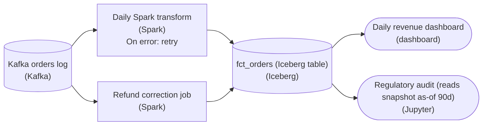

*The curated table becomes an Iceberg table on the same object storage, and the daily load retries a commit the refund job beat. The dashboard reads the latest snapshot; the audit reads an as-of snapshot of the same table.*

1. **Make the curated table a managed table format**

   Replace the plain-Parquet `fct_orders` with an Iceberg (or Delta) table. The daily Spark job stops overwriting the folder and commits a snapshot instead: it appends or `MERGE`s into the table, and the format atomically swaps in a new metadata pointer. Compaction becomes one more commit that writes new files into a new snapshot, and the old snapshot keeps its files.

2. **Set retention to cover the reproducibility window**

   Time travel only reaches back as far as your oldest retained snapshot. Default snapshot expiration is often much shorter than 90 days, so raise `history.expire.max-snapshot-age-ms` to at least the audit window. Skip this and the format is in place, but the snapshot the auditor needs has already expired, which looks exactly like the plain-Parquet failure you were fixing.

3. **Retry the load when the refund job wins the commit**

   Neither writer takes a lock. The daily load reads snapshot N, writes its data files, then tries to swap the pointer from N to its own. If the refund job committed first, that swap fails. With a retry setting on the load, it re-reads the refund job's snapshot, confirms the 2 commits touched different files, and swaps again by rewriting one small metadata file while reusing its data files. Only when both commits rewrote the same files does the retry have to recompute rows. Without the retry, every lost race fails the whole day.

**Time travel + retention (Iceberg)**

```sql
/* Read the curated table exactly as it stood in the audit window */
SELECT order_date, SUM(revenue) AS daily_revenue
FROM fct_orders
TIMESTAMP AS OF '2026-06-19 00:00:00'
GROUP BY order_date;

/* Keep at least 90 days of snapshots so that read stays reproducible */
ALTER TABLE fct_orders SET TBLPROPERTIES (
  'history.expire.max-snapshot-age-ms' = '7776000000'  /* 90 days */
);
```

*`TIMESTAMP AS OF` resolves to the snapshot live at that instant; you can also pin an exact `snapshot_id` or `VERSION AS OF` for a byte-stable audit.*

| Performance: Retention is a cost dial, not a free switch |
| --- |
| Every retained snapshot pins its data files, and no file can be deleted while a snapshot still lists it. Keeping 90 days of daily snapshots therefore keeps 90 days of superseded files on object storage. That is the real tradeoff behind `expire_snapshots`: retention long enough for the audit, and short enough that you are not paying to store years of dead files. |

**Follow-up questions**

1. The auditor wants the numbers as of a specific commit, not a wall-clock time. What do you hand them?\
   *Tests knowing that `snapshot_id` or `VERSION AS OF` pins one exact commit, while `TIMESTAMP AS OF` resolves to whichever snapshot was live at that time.*
2. The refund job starts rewriting the same day's files the load writes. What does the load's retry have to do now?\
   *Tests the conflict case: when both writers rewrite the same files, retrying the commit alone is not enough and the load has to recompute its rows.*

</details>


<br>

### Exercise 3 of 12

**● TASK**

A curated payments table is plain Parquet. Stripe adds new fields monthly; each schema change forces a 12-hour rewrite of every partition because plain Parquet embeds column names in the file footer. Apply the section's schema-evolution framing and replace the plain Parquet table with a lakehouse format whose metadata layer makes column additions, drops, and type widenings a sub-second metadata commit.

**Starting canvas** (already placed for you):

- Stripe payment events (producer adds fields monthly) (source, Stripe)
- Daily Spark transform (12-hour rewrite per schema change) (transform, Spark)
- Plain Parquet fct_payments (column names embedded in file footers) (storage, Parquet)
- Finance dashboard (consumer, Looker)

<details>
<summary><strong>Solution</strong></summary>

#### Schema evolution lives in the table format, not the files

Plain Parquet has no table-level schema, which is why **schema evolution** (changing a table's columns over time without rewriting the data) hurts there. Each file's footer carries the column names and their layout, and the table is just a directory of those files. So when Stripe adds a field, every reader has to reconcile it file by file. A drop or a type change means rewriting each partition so the footers line up. That is exactly the 12-hour rewrite you were asked to remove.

| Pitfall: Merging footers still rewrites everything |
| --- |
| The tempting move is to keep Parquet and lean on `mergeSchema` or a per-file backfill so old and new footers read together. That handles a pure append. Once a column is dropped or a type is widened (`int` to `long`), though, the footers disagree and every partition gets rewritten anyway. You've automated the pain, not removed it. |

A lakehouse table format (Iceberg, Delta Lake, or Hudi) puts a **metadata layer** between the query engine and the Parquet files. The table's schema is tracked once, at the table level, and every column gets a stable field ID. Data files are read by that ID, never by name, so adding, dropping, renaming or widening a column records a new schema in metadata. The existing data files are never touched.

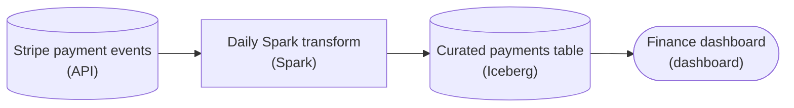

*Only the storage node changes: the curated table becomes an Iceberg table. The Spark job keeps appending, and a schema change is a commit to the table's metadata while the Parquet data files stay put.*

| Key insight: The commit costs kilobytes, not terabytes |
| --- |
| Adding Stripe's new field writes a new schema into a fresh `metadata.json` and atomically swaps the catalog's current-metadata pointer to it. That's a few kilobytes and one pointer swap, whether the table is 10 GB or 10 TB. Older snapshots still resolve the old field IDs, so readers that are mid-query never break. |

| ✕ Plain Parquet directory | ✓ Iceberg table |
| --- | --- |
| The schema is the union of the file footers, matched by name. A drop or a widen (`int` to `long`) makes the footers disagree, so every partition is rewritten. Cost scales with total data size. | The schema is one table-level definition keyed by stable field IDs. Add, drop, rename, reorder and widen are all metadata commits, and the data files stay put. Cost is constant. |

**Follow-up questions**

1. A downstream job pinned to last week's schema keeps running while you add the new column. What lets it keep reading the old shape?\
   *Connects schema changes to snapshot isolation: the old metadata snapshot resolves the old field IDs, so time-travel reads stay consistent.*
2. Finance renames `amount` to `gross_amount`. Why is that safe in Iceberg but a silent data-loss trap in plain Parquet?\
   *Ties the rename to field IDs: plain Parquet matches the new name against nothing and reads NULLs, while Iceberg only relabels the ID.*

</details>


<br>

### Exercise 4 of 12

**● TASK**

A streaming pipeline writes a Parquet file every 30 seconds per partition into an Iceberg table. After 4 months the table holds 11 million sub-megabyte files and query latency has drifted from 12 seconds to 8 minutes. Apply the section's small-files framing and add the named scheduled job that runs alongside the streaming writer to keep file size in the section's target range.

**Starting canvas** (already placed for you):

- Mobile clickstream Kafka (source, Kafka)
- Spark Structured Streaming 30-sec micro-batch (transform, Spark Structured Streaming)
- Iceberg fct_events (11M sub-MB files, 8min query latency) (storage, Iceberg)
- Live ops dashboard (consumer, Looker)
- Hourly analytics dashboard (consumer, Looker)

<details>
<summary><strong>Solution</strong></summary>

#### Compaction beside the writer

4 months of 30-second commits turned `fct_events` into a textbook case of the **small-files problem**. Each trigger lands one sub-MB Parquet file per partition, and a scan pays per file: a manifest entry to plan, a footer to open, a task to schedule. At 11 million files that overhead buries the actual bytes, which is how 12 seconds became 8 minutes.

| Pitfall: Slowing the writer trades away freshness |
| --- |
| A longer trigger interval does make bigger files, but the live ops dashboard loses the freshness it depends on, and the 11 million files already on disk stay put. Commit cadence serves writes and file layout serves reads. Keep the 30-second cadence and fix layout in a separate job. |

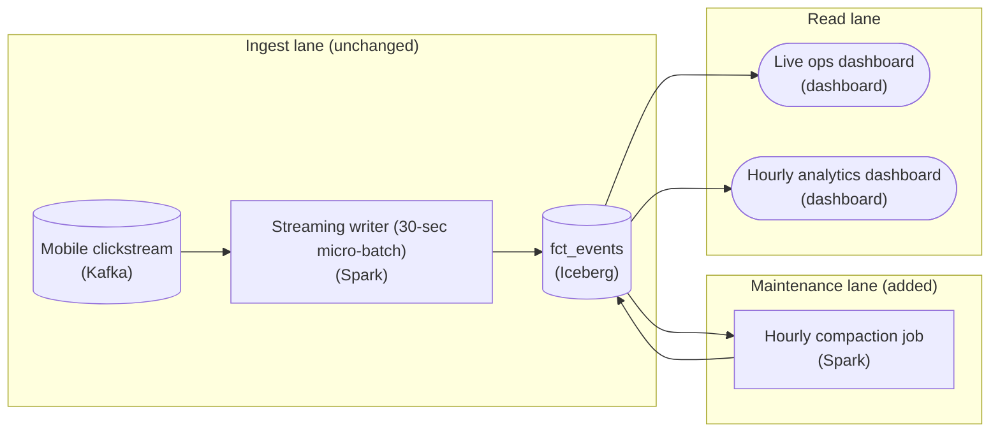

*The writer keeps its 30-second cadence; a separate scheduled Spark job reads the small files in `fct_events` and rewrites them into a few large ones.*

1. **Schedule `rewrite_data_files` as its own batch job**

   The compaction node is a second Spark transform on its own hourly schedule. It calls `rewrite_data_files` with the `binpack` strategy, packing each partition's small files up to the target size and committing a new snapshot. Iceberg commits are atomic and snapshot-isolated, so compaction runs concurrently with ingest and neither dashboard ever sees a half-rewritten table.

**Hourly compaction job**

```sql
/* Runs hourly, independent of the 30-second streaming writer */
CALL catalog.system.rewrite_data_files(
  table    => 'analytics.fct_events',
  strategy => 'binpack',
  options  => map(
    'target-file-size-bytes',   '536870912',  /* 512 MB, the upper target */
    'min-input-files',          '5',
    'partial-progress.enabled', 'true'
  )
);

/* Reclaim the small files the rewrite made obsolete */
CALL catalog.system.expire_snapshots(
  table      => 'analytics.fct_events',
  older_than => TIMESTAMP '2026-09-16 00:00:00'
);
```

*Targets the 128 MB to 512 MB range via `target-file-size-bytes`.*

| Key insight: Compaction and `expire_snapshots` are a pair |
| --- |
| `rewrite_data_files` writes the new large files, but older snapshots still reference the small ones, so storage does not shrink until `expire_snapshots` runs past your time-travel window. The same compact-then-expire pair maintains Delta and Hudi tables under a streaming writer. |

**Follow-up questions**

1. What target file size fits a partition that only receives a few MB a day?\
   *The 128 MB to 512 MB range assumes partitions hold enough data to fill files that large.*
2. How would `partial-progress.enabled` help if the writer commits to a partition mid-rewrite?\
   *Commit conflicts between the maintenance job and ingest.*

</details>


<br>

### Exercise 5 of 12

**● TASK**

A financial-services platform runs three workloads on one Snowflake warehouse: a customer account history view needing sub-50ms reads, a BI revenue dashboard, and a compliance audit scanning quarterly history. Split them across an operational store for the point lookups, a lakehouse archive on object storage that keeps 7 years and serves the audit via time travel, and a warehouse mart fed daily from that lakehouse for the dashboard.

**Starting canvas** (already placed for you):

- Transaction app writes (source, API)
- Snowflake all_transactions (7yr, all workloads) (storage, Snowflake)
- Customer account history view (sub-50ms ask, 800ms today) (consumer, API)
- BI revenue dashboard (consumer, Looker)
- Compliance audit consumer (quarterly historical reads) (consumer, API)

<details>
<summary><strong>Solution</strong></summary>

#### One ledger, three access patterns

The move you just made is workload isolation: one Snowflake warehouse was serving three read patterns that each want a different physical shape, so 2 of them were always going to be wrong. A sub-50ms point lookup wants a row store indexed on the account key; a seven-year audit wants cheap columnar files on object storage; a daily dashboard wants a small pre-aggregated mart. Forcing all three onto `all_transactions` means the account view scans far more than a key lookup should (the 800ms you saw), and quarterly audits burn warehouse credits scanning cold history.

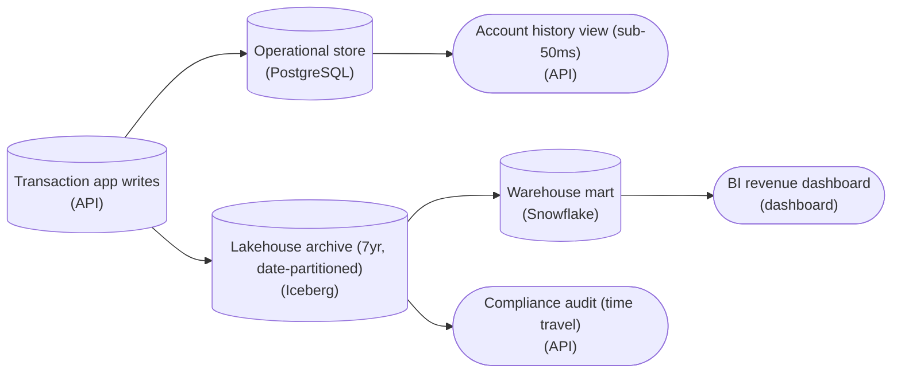

*Each store matches one read pattern; the mart is a daily-batch rollup of the Iceberg lakehouse on object storage, not a fourth copy of the ledger.*

| Pitfall: A bigger warehouse can't fix a shape mismatch |
| --- |
| The tempting non-answer is to scale the warehouse up or bolt a clustering key onto `all_transactions`. That hides the symptom and multiplies the bill: the point lookup is still a scan, and you now pay premium compute to keep 7 years of cold audit data hot. Match each pattern to a store; don't overpower one store into doing all three. |

| Key insight: Partitioning makes the mart incremental |
| --- |
| Feed the mart daily and incrementally. Because the lakehouse is partitioned by date, the batch job reads only yesterday's partition and appends, instead of rescanning 7 years that never change. A full refresh would reprocess frozen history every night for a dashboard that only cares about recent trend. |

| Real world: The table format is the archive |
| --- |
| Compliance reads history through the table format's time travel: Iceberg (or Delta) snapshots let the audit query 'as of' any past quarter with no separate archive copy to keep in sync. The lakehouse is the system of record for history; the warehouse mart is a derived, disposable rollup you can rebuild from it. |

**Follow-up questions**

1. The mart job fails one night. What breaks, and why is that acceptable here?\
   *Tests that the learner sees the mart as derived and rebuildable, not a source of truth.*
2. Audit now wants results in seconds, not minutes. Do you touch the lakehouse or add a store?\
   *Probes when a fourth purpose-built store is justified versus over-splitting.*

</details>


<br>

### Exercise 6 of 12

**● TASK**

A health-tech company has kept a 1.4 PB warehouse beside a 6 PB raw S3 lake for 4 years, so every metric has two conflicting answers. The chief data officer wants one canonical lakehouse archive that feeds the executive dashboard, full-history ML training, and regulator audits that read the table as it stood years ago, while the clinician-facing sub-50ms app keeps its own operational store. Row changes in that operational store must reach the archive through change data capture. Because a streaming source writes constantly, a job has to keep merging the many small files the archive accumulates into target-size files.

**Starting canvas** (already placed for you):

- Operational app DB (source, PostgreSQL)
- Clinical event firehose (source, Kafka)
- Genomic file uploads (source, S3)
- Clinician-facing API (sub-50ms) (consumer, API)
- Executive analytics dashboard (consumer, Looker)
- Spark ML training (full history) (consumer, Jupyter)
- Regulator audit query (historical via time travel) (consumer, API)

<details>
<summary><strong>Solution</strong></summary>

#### One table, one answer

An open table format is what lets a single copy of the data replace both the old warehouse and the raw lake. Iceberg (or Delta Lake, or Hudi) leaves Parquet files on object storage and adds a metadata layer of snapshots on top. Every reader then sees a committed, consistent table, and each metric has **one answer** instead of two. The three analytical readers all hang off that one table. The clinician app does not, because no file-based table answers a single-row lookup in 50 ms.

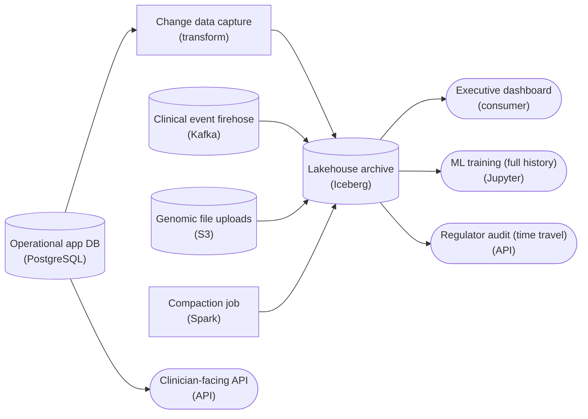

*The app database's changes arrive through change data capture, and the firehose and genomic uploads commit directly, all into one Iceberg archive that a compaction job keeps at target file size. The dashboard, ML training and regulator audit read that archive, while the clinician API stays on its PostgreSQL store.*

1. **Commit every source into the one archive**

   The firehose and the genomic uploads append to the same table, and the app database's row changes arrive through change data capture instead of nightly dumps, so updates and deletes land as commits too. Each write is an atomic commit that creates a new snapshot. That means the dashboard and the ML job never read a half-written batch, even while the stream commits every 30 seconds.

2. **Answer the regulator from an old snapshot**

   The audit reads the same table as of a past snapshot ID or timestamp, so no frozen copy is maintained. The one setting that matters is snapshot expiration: it has to outlast the audit lookback, or the files behind an old snapshot are deleted and time travel fails.

3. **Compact behind the stream**

   A writer committing every 30 seconds leaves 2,880 small files per partition per day. The compaction job rewrites them into files of a few hundred MB (`rewrite_data_files` on Iceberg, `OPTIMIZE` on Delta) as a new snapshot. Readers switch over atomically, so compaction never breaks a query in flight.

| Pitfall: One archive is not one database for every workload |
| --- |
| Wiring the clinician API to the lakehouse in the name of a single source of truth trades millisecond lookups for multi-second scans. The archive is the analytical and audit plane. The bedside app keeps its own row store and sends its changes to the archive, not the other way round. |

**Follow-up questions**

1. The clinical event schema gains a new field mid-year. What changes in the archive, and are any data files rewritten?\
   *Schema evolution at the metadata level.*
2. A genomic batch arrives three days late for a date the dashboard already shows. How does the archive absorb it?\
   *Late data landing as a new snapshot.*
3. How would you partition the archive so both the regulator's year-old read and the dashboard's latest-day read stay cheap?\
   *Partitioning against two read patterns.*

</details>


<br>

### Exercise 7 of 12

**● TASK**

Design a pipeline that applies a PostgreSQL orders database's change feed (about 2 million updates and deletes a day) to the orders table in object storage every hour. Today each run rewrites Parquet in place, so a failed run leaves half-applied changes and the finance dashboard can read a half-written table. Store the table in an open table format so each hourly merge commits atomically and the dashboard reads only committed snapshots.

<details>
<summary><strong>Solution</strong></summary>

#### Atomic commits live in the metadata, not the files

An open table format such as Iceberg is what turns an hourly merge into object storage into an all-or-nothing operation. The Parquet data files stay where they are; what changes is a small set of metadata files on top of them. Readers never list the folder: they read the current `metadata.json`, follow it to a snapshot, then to its manifests, then to exactly the data files that snapshot names. A write becomes visible only at the moment that pointer moves.

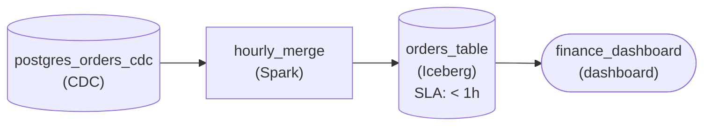

*Change events feed an hourly Spark merge that commits into an Iceberg table; the dashboard reads only committed snapshots.*

1. **Write the new files beside the old ones**

   The merge job reads the hour's inserts, updates and deletes and writes fresh Parquet files for every row it touches. Nothing references those files yet, so the dashboard keeps reading the previous snapshot as if the job were not running.

2. **Commit by moving one pointer**

   Once the files are written, the job adds a new snapshot and its manifests, then swaps the table's current metadata to point at it in a single atomic step. Either the swap lands and the whole hour is visible, or it never lands and the hour does not exist. A run that dies earlier leaves files nobody points at, and the next run simply retries.

| Pitfall: Rewriting partitions in place is the race |
| --- |
| On a plain lake, the table is whatever files sit in the folder right now. Overwriting a partition means deleting old files and writing new ones as separate steps, so a reader in between sees a gap, a mix of old and new rows, or a crashed run's leftovers. Careful scheduling never closes that window; only a commit point does. |

| Real world: Delta Lake and Hudi make the same move |
| --- |
| Delta Lake records each commit as a numbered JSON file in `_delta_log`, and Hudi keeps a timeline of completed actions. The file names differ, but each format turns a directory of Parquet into a transactional table by deciding visibility in metadata rather than in the file listing. |

**Follow-up questions**

1. The merge job crashes after writing half its Parquet files but before committing. What does the dashboard show, and what becomes of those files?\
   *Checks that visibility is a metadata decision, not a file one.*
2. 2 hours of changes arrive late and one run applies both. Can the dashboard ever see only the first hour?\
   *Checks that one commit is the unit of visibility, however much it contains.*

</details>


<br>

### Exercise 8 of 12

**● TASK**

An hourly Spark job appends about 50 GB of clickstream events to a curated table while a second job appends late events, so their commits can race; the writer that loses a race must retry its commit rather than fail. A nightly partner export scans the table for 40 minutes and must read one consistent snapshot while commits land mid-scan. An operator must also be able to read the table as it stood before a bad load, up to 7 days back.

<details>
<summary><strong>Solution</strong></summary>

#### One snapshot chain, 3 jobs

Optimistic commits, snapshot isolation and time travel all come from one structure. An Iceberg or Delta table is an immutable chain of snapshots plus a pointer naming the current one. Writers race to move that pointer, a reader pins one snapshot at query start, and an operator asks for an older one. Put the curated table on that chain and let each writer retry a lost race, and all 3 guarantees follow.

1. **Retry the commit that loses the race**

   Both jobs read the current snapshot, write their data files, then try to swap the pointer from the snapshot they read to their own. When the late-events job swaps first, the hourly swap fails. The two appends add disjoint new files, so the hourly job rereads the winning snapshot, writes one small metadata file and swaps again, reusing its 50 GB of data files. Setting the error action to retry on both writers is what turns a lost race into a cheap second attempt instead of a failed run.

2. **Let the export pin its snapshot**

   When the export starts, its planner resolves the current snapshot and reads only the files listed in that snapshot's manifests. Either writer can commit the next snapshot 20 minutes into the scan, but those files are not in the pinned manifest, so the export ships one moment in time with no half-loaded hour.

3. **Read back the state before a bad load**

   A bad load is just one more commit. Reading the snapshot before it (an older `metadata.json` in Iceberg, an earlier log version in Delta) shows the table exactly as it was. That only works while the old data files still exist, so snapshot expiry must keep at least 7 days.

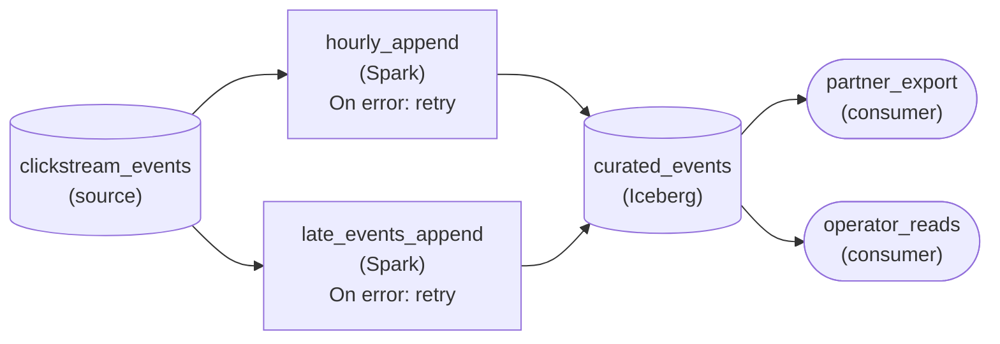

*Two Spark writers commit snapshots to an Iceberg table and retry a lost commit. The export reads a pinned snapshot and the operator reads older ones, which are kept for at least 7 days.*

| Pitfall: A directory listing is not a snapshot |
| --- |
| With plain Parquet the export lists the directory and reads files as it goes. Files a writer lands mid-scan may or may not be picked up, so one night can ship part of an hour. There is also no pointer for two writers to race on, so a conflict cannot even be detected. |

| Real world: Retention decides how far back you can travel |
| --- |
| Expiring snapshots deletes older snapshots and the data files that only they reference. Set expiry to 3 days to save storage and the 7-day lookback quietly shrinks to 3, even though nothing in the pipeline looks broken. |

**Follow-up questions**

1. The partner wants any night in the last 30 days rerun with the exact rows it shipped. What changes?\
   *Ties the length of retention to recording which snapshot each export read.*
2. If the late-events job rewrote rows the hourly job had just read, could the hourly job still retry by swapping again?\
   *Probes when a retry is not enough: the loser's output was computed from data the winner changed.*

</details>


<br>

### Exercise 9 of 12

**● TASK**

Mobile app click events arrive in Kafka, about 400 million a day, and an hourly job lands them in a 9 TB curated table that analysts query from a dashboard. Every few weeks a release adds new fields, and the next one renames the `screen` column to `screen_name`. Design the pipeline so both changes apply without rewriting any existing data files, and rows written before the rename still read under the new name.

<details>
<summary><strong>Solution</strong></summary>

#### Renames live in metadata, not in files

Schema evolution in a table format works because the table never trusts the column names stored inside its files. Iceberg gives every column a permanent field id, and the table schema maps each name to an id. Renaming `screen` to `screen_name` writes that one new mapping into a new metadata file; the year of Parquet files underneath is untouched, and a reader resolving by id finds the old values under the new name. Swapping the plain Parquet target for an Iceberg table is the whole change: Kafka and the hourly Spark load stay as they were.

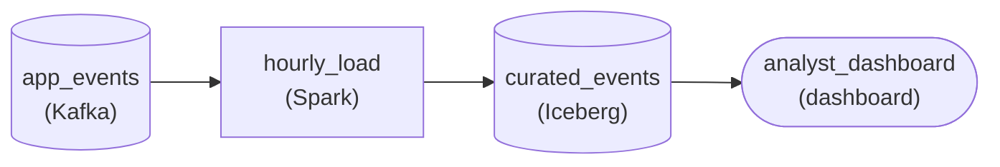

*Kafka feeds an hourly Spark load into an Iceberg table that the dashboard reads; adds and renames touch only Iceberg metadata.*

| Pitfall: A plain Parquet rename splits one column in two |
| --- |
| In a plain Parquet lake each file footer carries the name it was written with. After the release, older files say `screen` and newer files say `screen_name`, so a reader resolving by name returns nulls for one half of history. The only repair is rewriting all 9 TB so every footer agrees, close to a full day of compute for every rename. |

| Key insight: A new field is a new id with no bytes behind it |
| --- |
| When a release adds a field, the schema gains a fresh id. Older files have no column for that id, so readers return null for those rows: nothing is backfilled and nothing is rewritten. Dropping a field runs the same way in reverse: the id leaves the current schema and the old bytes are simply ignored. |

| Performance: Kilobytes of metadata instead of terabytes of data |
| --- |
| Each add or rename commits one small metadata file, so the cost stays flat whether the table holds 9 TB or 90 TB. The hourly load keeps appending about 1 GB of compressed files per run, and the next commit simply writes them under the newest schema. |

**Follow-up questions**

1. What happens if a later release reuses the old name `screen` for a different field?\
   *Tests whether reads resolve by id, so the new field never picks up the renamed column's history.*
2. How would you read the table exactly as it looked before the rename?\
   *Connects schema history to snapshots and time travel from the earlier section.*

</details>


<br>

### Exercise 10 of 12

**● TASK**

Vehicle telemetry arrives on Kafka at about 120 GB a day and must be queryable in a lakehouse table within a minute, so a streaming job commits every 60 seconds into each of 12 device-type partitions, writing files of roughly 7 MB. Design the pipeline so that freshness holds while a compaction job rewrites each finished day toward 256 MB files, and a fleet dashboard reads the table.

<details>
<summary><strong>Solution</strong></summary>

#### Compaction keeps a one-minute writer cheap to read

This is the small files problem in its most common form: a fast writer. One commit a minute into 12 partitions is 17,280 files a day, each around 7 MB, so every query over a day has to open 1,440 files per partition. Compaction fixes the read side and leaves the write side alone. A separate job rewrites a finished day into about 40 files near 256 MB, and the table's contents do not change.

1. **Leave the streaming writer alone**

   The one-minute freshness is the requirement, so slowing the micro-batch to grow the files gives up the thing the stream exists for. The writer keeps committing small files into today's partition, and you accept that cost on purpose.

2. **Compact finished days back into the same table**

   The compaction job reads a day that no longer receives commits and writes the rewritten files into the same lakehouse table as one atomic commit. Queries already running on the old snapshot finish undisturbed, and queries after the commit see 40 files instead of 1,440. Choosing a day the stream has finished means compaction never competes with the writer for the same files.

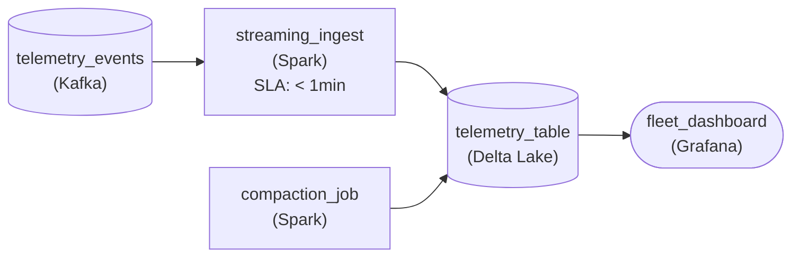

*The stream commits every minute; once a day the compaction job rewrites the finished day inside the same `telemetry_table` that the dashboard reads.*

| Performance: From 1,440 file opens to about 40 per partition-day |
| --- |
| At 120 GB a day across 12 partitions, each partition holds about 10 GB. Left alone, that is 1,440 files of roughly 7 MB, which sits below the 16 MB line where opening files costs more than reading them. Rewritten to 256 MB it becomes about 40 files, and per-file metadata drops to a small fraction of the scan. The compaction job costs one read and rewrite of 120 GB a day. |

| Pitfall: Compaction writes back into the table, not into a copy |
| --- |
| A tempting design sends the stream to one table and has a batch job copy each day into a second, tidier table. That doubles storage, and the dashboard has to choose between the fresh table and the fast one. Compaction rewrites files inside the one table, so that single table is both fresh and fast. |

**Follow-up questions**

1. Late telemetry can still land in a day up to 3 days after it ends. What has to change about when compaction runs?\
   *Whether compaction re-runs on partitions that picked up new small files, or waits until a day really stops changing.*
2. The dashboard mostly reads today's partition, which is still all small files. How would you compact it without waiting for the day to end?\
   *Compacting finished hours inside an open partition without conflicting with the streaming writer.*

</details>


<br>

### Exercise 11 of 12

**● TASK**

Parcel scan events arrive on Kafka, about 300 million a day, for three readers: a tracking page fetching one parcel's latest status in under 50 ms, a daily operations dashboard aggregating delivery times over all history, and claims staff replaying five years of raw scans. Give each reader the storage layer that matches its access pattern, and keep the raw history as a lake table on object storage that the daily aggregation reads from.

<details>
<summary><strong>Solution</strong></summary>

#### Each reader gets the shape it reads best

Choosing storage across workloads starts from how each reader touches the data, not from the data itself. The same 300 million daily scans are read three ways: one key at a time in under 50 ms, as daily scans over all history, and as an untouched replay of five years. The lake on object storage is the one copy that holds everything cheaply, so it becomes the system of record, and the faster shapes are derived beside it.

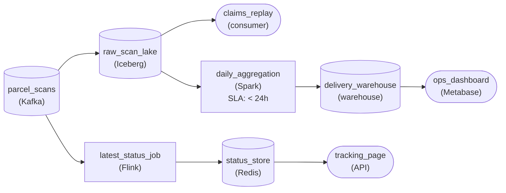

*Scans land in `raw_scan_lake`; a stream job keeps `status_store` current for lookups, and a daily Spark job builds the warehouse marts from the lake.*

1. **Make the lake the system of record**

   Land every scan in an Iceberg table on object storage before anything reshapes it: raw, append-only, partitioned by scan date. Claims replay reads it directly, and if a derived layer ever carries a bug, you rebuild it from here.

2. **Derive the narrow shape and the wide shape**

   The tracking page wants one row per parcel, so a stream job upserts the latest status into Redis keyed by parcel ID. The dashboard wants columnar scans over aggregates, so a daily Spark job reads the lake and writes marts into the warehouse.

| Pitfall: One store for three readers fails 2 of them |
| --- |
| Serving the tracking page from the warehouse turns a 50 ms lookup into a query on an engine built for scans. Keeping only aggregates in the warehouse discards the raw scans claims depend on. And the lake alone cannot answer a single-key lookup fast enough. Each shape wins exactly one workload. |

| Performance: Only the lake has to be big |
| --- |
| At about 150 GB a day, five years of raw scans is roughly 270 TB, which sits on the cheapest tier as object storage. The serving store holds just the latest row per active parcel and the warehouse holds aggregates, so the expensive layers stay small. |

**Follow-up questions**

1. A data science team wants to retrain a delay model weekly on three years of raw scans. Which layer should it read?\
   *Whether a new full-history scan workload goes to the lake instead of bloating the warehouse.*
2. What changes if the dashboard must show today's on-time rate within 15 minutes?\
   *Adding a fresher path into the analytical layer while the lake stays the source of record.*

</details>


<br>

### Exercise 12 of 12

**● TASK**

Retail checkout events, about 24 GB a day, stream from Kafka into an Iceberg table partitioned by day and 40 regions, committing every minute so a sales dashboard stays within 15 minutes of the registers. Each partition now gains 1,440 files of about 400 KB a day, and dashboard scans have slowed badly. Design the pipeline with compaction that rewrites closed partitions into large files while the dashboard keeps reading, never seeing a half-rewritten partition. New checkout fields arrive every few weeks and must land without rewriting existing files.

<details>
<summary><strong>Solution</strong></summary>

#### Compaction is a commit, not a cleanup

The small files problem is what a minute-level writer does to any table: one commit adds one file per region partition, so this table gains 40 x 1,440 = 57,600 files a day at about 400 KB each. A dashboard scanning 30 days opens around 1.7 million files, and at that size opening each file and reading its footer costs more than the rows inside. Iceberg puts the repair and the safety net in the same place: compaction is just another commit, and **snapshot isolation** makes that commit invisible to anyone already mid-query.

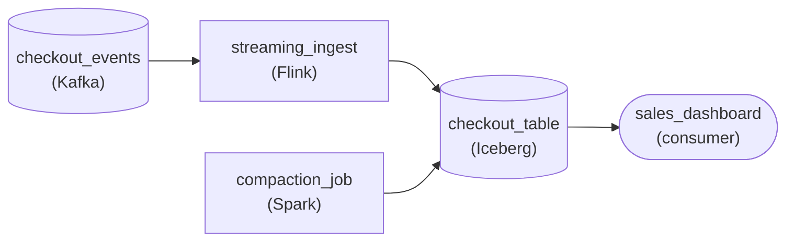

*`streaming_ingest` commits every minute; a nightly `compaction_job` rewrites yesterday's partitions and commits them back into `checkout_table`, which the dashboard reads.*

1. **Leave the minute writer alone**

   The 15-minute promise is why `streaming_ingest` commits every minute. Hourly commits would cut files 60x and break the dashboard. Keep the writer as it is and repair the layout behind it.

2. **Compact only closed partitions**

   Today's partitions still take a commit every minute, so rewriting them races the writer. Yesterday's are closed: each holds about 600 MB, which at a 512 MB target file size becomes 2 files. That is 1,440 files down to 2 per region per day, a small nightly Spark job across 40 regions.

3. **Let the rewrite land as one snapshot**

   `compaction_job` writes the large files first, then commits a new snapshot that swaps them for the small ones in a single atomic step. A query that started earlier keeps reading its own snapshot; the next query sees the compacted layout. Same rows, same totals, never a half-rewritten partition.

| Pitfall: Expiring snapshots too early pulls files from under readers |
| --- |
| The replaced small files stay in object storage until every snapshot referencing them expires. Expire right after compaction and a ten-minute dashboard query still on the old snapshot fails mid-scan. Keep snapshot retention longer than your longest query. |

| Key insight: A new field is a metadata write, not a rewrite |
| --- |
| When checkout adds a field, Iceberg records the column in table metadata with its own ID. Old files simply lack it and read back as null, and the next compaction writes files that include it at no extra cost. |

**Follow-up questions**

1. Holiday traffic triples volume to 72 GB a day. Does nightly compaction still keep up, or should it compact each finished hour instead?\
   *Compaction cadence against partition size and contention with the writer.*
2. Finance wants a query rerun exactly as `checkout_table` stood before last night's compaction. What makes that possible, and for how long?\
   *Linking time travel to snapshot retention.*

</details>
