# Storage Layers: Beginner - Exercises

Lesson: [pa_storage_layers_beginner.md](../pa_storage_layers_beginner.md)

### Exercise 1 of 11

**● TASK**

A startup runs every storage job on one Postgres: the app writes orders, analysts scan the full order history, and a Looker dashboard refreshes off it. The scans lock tables and evict the app's hot pages, and the team wants cheap raw copies of each daily order extract kept for replay. Split the storage so the app keeps Postgres, raw extracts land in a cheap store built for bulk, and the analyst scans and dashboard read from a store built for large scans.

**Starting canvas** (already placed for you):

- Postgres app (source, PostgreSQL)
- Analyst SQL scans (against Postgres) (transform, SQL)
- Looker dashboard (consumer, Looker)

<strong>Solution</strong>

#### One database was doing three jobs

Storage is plural. This single Postgres was being asked to be an operational database, a lake and a warehouse at once, and those are **three shapes built for opposite access patterns**. Your `Postgres app` is a row store tuned for tiny, frequent reads and writes of single orders. The analyst scans read millions of rows across the whole history. On one box, the big scans hold locks and evict the app's hot pages from cache. The fix is not a bigger Postgres. It is three destinations, each built for one job.

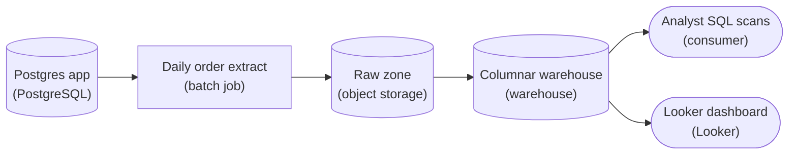

*The app keeps Postgres, a daily batch extract lands cheap raw copies in the lake, and the warehouse serves every large scan.*

1. **Extract each day's orders as a batch**

   The dashboard refreshes daily and analysts study history, so nobody needs orders the instant they are written. That makes this a **batch** job: one scheduled `Daily order extract` per day. Ideally it is incremental, reading only rows past the last `created_at` or id watermark instead of re-dumping the whole table every night.

2. **Land the raw copy in the lake first**

   The extract writes files to a `Raw zone` in object storage, partitioned by date (for example `dt=2026-09-17/`). This is the lake: cheap, built for bulk, and your **replay tape**. Because the untouched extract is kept, you can reprocess history whenever downstream logic changes, without touching production again.

3. **Serve every large scan from the warehouse**

   The `Columnar warehouse` loads from the raw zone and is what the analysts and the `Looker dashboard` query. A columnar engine stores each column together, so `SUM(total_amount)` over all history reads only that column. The scan that blocked Postgres runs cheaply here, on hardware fully isolated from the app.

| Pitfall: A read replica is still a row store |
| --- |
| The tempting shortcut is a Postgres read replica for Looker. It moves read load off the primary, but a full-history scan still drags every column of every row through cache, and it still gives you no cheap raw copy to replay. Isolation is necessary but not sufficient: the scans need a shape built for large reads. |

| ✕ Row store (operational database) | ✓ Columnar warehouse |
| --- | --- |
| Rows stored together on a page. Fetching one order by `order_id` reads one page. Great for `INSERT` and point lookups; a scan of one column drags every other column through cache. | Each column stored together and compressed. A scan of `total_amount` across all orders reads only that column's blocks. Great for aggregates over history; a single-row write is comparatively expensive. |

| Real world: The lake earns its keep on reprocessing day |
| --- |
| The raw zone feels like duplicate storage until a metric definition changes. Because the untouched daily extracts sit in cheap object storage, you rebuild the warehouse tables by reloading history from the lake, with no re-export from the live `Postgres app`. |

**Follow-up questions**

1. The team now wants the dashboard fresh within minutes instead of once a day. What in this design changes, and what stays?\
   *Whether freshness is a cadence change on the ingest side while the three storage shapes stay put.*
2. Orders can be updated after creation (status changes). How does an incremental extract keyed only on `created_at` miss those, and how would you catch them?\
   *Incremental watermarks versus full reloads.*

 

### Exercise 2 of 11

**● TASK**

Marketing's dashboard reads revenue totals each morning, scanning only the order date and amount columns of hundreds of millions of orders. Today a Pandas job scans raw Parquet in S3 on every refresh: 18 minutes, no schema enforced. Pick the row-oriented or columnar store this read calls for and place it with a declared schema between the lake and the dashboard. Load it with a nightly batch transform that runs inside that store instead of Pandas.

**Starting canvas** (already placed for you):

- S3 raw orders files (Parquet, no schema) (source, S3)
- Marketing aggregation SQL (Pandas, 18 min/query) (transform, Pandas)
- Marketing dashboard (consumer, Looker)

<strong>Solution</strong>

#### A columnar layer between the lake and the dashboard

Columnar versus row layout is the heart of this fix. A revenue question reads an order date and an amount: 2 columns out of dozens, across hundreds of millions of orders. When Pandas pulls lake files into one process, no engine skips the other columns and no schema rejects a bad file. Every dashboard refresh pays the full 18-minute scan. A **data warehouse** stores each column contiguously and declares its schema before rows land. It also runs the scan on compute that scales apart from the storage.

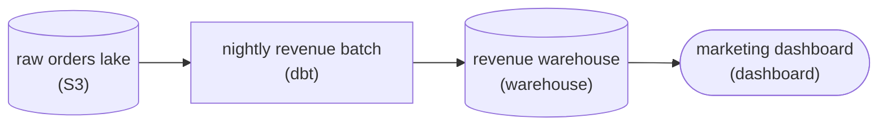

*The lake keeps the raw orders. A nightly dbt batch rebuilds the revenue table inside a columnar warehouse with a declared schema, and the dashboard reads only the warehouse.*

The load is a batch because of who reads it. Marketing looks at the totals once a morning, so one run overnight that rebuilds the revenue table gives the reader everything they need. A streaming job would keep that table fresh to the second for a reader who never checks it before the morning, and you would pay for it all day.

| Pitfall: Parquet on the lake is not yet a warehouse |
| --- |
| Parquet already stores values by column, so the problem can look solved. It is not. Pandas loads each file into memory in one process and aggregates there. Nothing pushes the two-column read down into the scan, nothing enforces types, and nothing adds compute. Tuning the `groupby` or adding RAM keeps the same shape of work. |

| ✕ Row-oriented scan | ✓ Columnar scan |
| --- | --- |
| Every order is read whole, all 20 columns, to reach the date and the amount. Bytes read grow with the width of the table. | Only the date and amount columns are read, roughly a tenth of the bytes on a twenty-column table. The declared schema guarantees both columns are typed, and the batch runs on warehouse compute sized to the query. |

**Follow-up questions**

1. The nightly batch now takes too long because it rebuilds all history. How would it process only the orders that landed since the last run?\
   *Applies a full versus incremental batch load to the warehouse table.*
2. Marketing wants revenue by campaign, a field that only half of the historical files carry. What happens when those rows meet a schema enforced at write time?\
   *Tests what declaring the schema before the write actually buys.*

 

### Exercise 3 of 11

**● TASK**

A mobile app's clickstream arrives through Kafka and lands as raw JSON in Snowflake at $23/TB/month, nearing petabyte scale. Move the storage to a data lake on object storage: a raw zone kept unchanged, a cleaned zone with duplicates removed stored as Parquet, and a curated zone, so Snowflake loads only the daily clicks mart. The dashboard refreshes once a day, so a daily batch job builds each zone from the one before it.

**Starting canvas** (already placed for you):

- Mobile app clickstream Kafka (source, Kafka)
- Snowflake clickstream_raw (storing raw JSON, expensive) (storage, Snowflake)
- Snowflake daily_clicks_mart (storage, Snowflake)
- Click analytics dashboard (consumer, Looker)

<strong>Solution</strong>

#### Files in object storage, in 3 zones

A data lake is just files in object storage, and that plainness is why it wins here. Object storage writes each file whole, never edits it in place, and costs a **small fraction of warehouse storage** per terabyte. So the petabytes of raw JSON that sat in `clickstream_raw` move to the lake, and Snowflake keeps only what the dashboard actually reads.

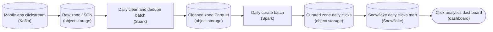

*Raw JSON, cleaned Parquet and curated totals live in object storage; only the curated mart loads into Snowflake.*

1. **Land the raw events untouched**

   Kafka writes the JSON into the raw zone exactly as it arrived, and nothing ever rewrites it. Every later hop leaves the zone before it intact, so a wrong cleaning rule costs one rerun, not lost data.

2. **Clean into Parquet**

   The daily batch job applies types, sets broken records aside, drops duplicates and writes Parquet. Because Parquet is columnar, a later read pulls only the few fields it needs instead of parsing every full JSON record.

3. **Curate, then load only the mart**

   A second batch step shapes the daily click totals in the curated zone, and only that small set loads into the Snowflake mart. The dashboard refreshes once a day, so a scheduled batch run gives it all the freshness it needs.

| Pitfall: A warehouse is not an archive |
| --- |
| Leaving the raw JSON in `clickstream_raw` 'just in case' means paying warehouse rates around the clock for bytes no query reads. The original belongs in the raw zone; the warehouse holds the shaped answer. |

**Follow-up questions**

1. A cleaning rule shipped a bug last week. Which zones do you rebuild, and from where?\
   *Applies the rule that each zone rebuilds from the one before it.*
2. A second team wants hourly totals instead of daily ones. What changes in the curated zone and the batch schedule?\
   *Tests that a curated zone is shaped for one consumer.*

 

### Exercise 4 of 11

**● TASK**

A retailer's checkout app, analyst dashboards and raw order events share one Snowflake account, so key lookups at checkout take seconds and dashboard scans slow the live app. Redesign the storage: checkout reads and writes go to a store where a lookup by key is one seek and a purchase commits atomically, and raw order events land in cheap object storage kept for replay. A nightly batch job loads Snowflake from that storage for the dashboards.

**Starting canvas** (already placed for you):

- Checkout API (source, API)
- Snowflake checkout_db (warehouse-as-OLTP, wrong shape) (storage, Snowflake)
- Mobile checkout app (consumer, API)

<strong>Solution</strong>

Row storage and columnar storage are two physical layouts for the same order, and each is fast at a different job. A row store keeps every field of an order side by side on disk, which suits the app's small, frequent reads and writes. A columnar warehouse keeps each field separately, which suits scans of a few columns across millions of orders. One account cannot be both, so the redesign keeps a copy of each order in the layout its reader needs. A nightly **batch load** carries the history to the warehouse, so analytical work never touches the store the app writes to.

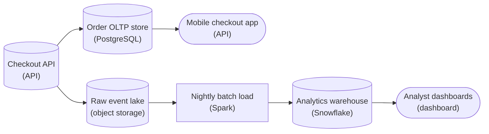

*Each order lands three ways: a row store the app reads and writes, object storage kept for replay, and a columnar warehouse that a nightly batch job fills for the dashboards.*

#### Match each copy to its access pattern

1. **Put checkout on a row-oriented PostgreSQL store**

   Checkout reads one order by `order_id` and writes a cart of several rows at once. Because all of an order's columns sit in one block, the lookup is a single seek, and a transaction makes the whole cart commit or roll back together. No dashboard query runs against this copy, so the app keeps its compute.

2. **Land raw events in object storage**

   Raw order events are written as files and never edited, so the lake keeps the complete history at the cheapest price per byte. Replaying a past day means reading those files again, without touching checkout or the warehouse.

3. **Load the warehouse with a nightly batch job**

   Analysts read the dashboards each morning, so one run a night over the day's lake files is fresh enough. The job reads files, not the checkout store, so the app never pays for the load, and a failed run simply reruns over the same files.

4. **Keep Snowflake for the dashboards**

   The warehouse stores each column on its own. A dashboard summing `total_amount` by day reads two columns and skips the other eighteen. A row store does that scan badly, because it must read every column of every row to get those two.

| Pitfall: The layout that speeds scans slows key lookups |
| --- |
| To rebuild one order, a columnar store opens a separate chunk for every field and still scans more rows than the one it needs. That is why checkout lookups took seconds. Each layout is excellent at one job, and the fix is giving each job its own copy, not tuning the warehouse. |

**Follow-up questions**

1. A new screen lists a customer's last 20 orders. Which copy should serve it?\
   *It is still a small keyed read for the app, so it belongs in the row store with an index on `customer_id`.*
2. Finance wants revenue by region for the last three years. Which copy answers it?\
   *It is a scan of a few columns over many rows, which is the columnar warehouse's job.*
3. Operations wants orders placed in the last minute on a wall screen. Does the nightly batch still fit?\
   *No: a one-minute view needs a streaming path from the order events, and checkout stays on the row store either way.*

 

### Exercise 5 of 11

**● TASK**

A growth-stage company serves three readers from one Postgres: a mobile inventory display that must show stock the moment it changes, a revenue dashboard opened each morning and compared with yesterday, and an analyst exploring three years of raw mobile event JSON. Give each reader the storage shape its access pattern needs, and for every copy you add, choose whether a nightly batch or a stream carries it, from how fresh its reader needs the data.

**Starting canvas** (already placed for you):

- Postgres app db (one-store-fits-all) (storage, PostgreSQL)
- Mobile app inventory display (sub-ms point lookups) (consumer, API)
- Daily revenue dashboard (analytical SQL) (consumer, Looker)
- Ad-hoc mobile event analyst (3yr JSON) (consumer, Jupyter)

<strong>Solution</strong>

#### Read pattern first, then freshness

Choosing a storage shape runs three questions in order: how is the data read, how fresh must it be, and how much of it is there. The first question sorts these readers. The inventory display looks up one item by key, the revenue dashboard scans a few columns across many rows, and the analyst explores years of semi-structured JSON. The second question decides what carries each copy. A reader who cannot tell 10 seconds from 10 hours gets a nightly batch, and a reader who can tell gets no copy at all.

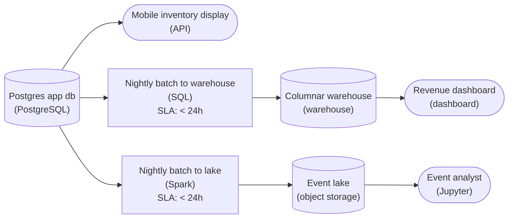

*Postgres keeps the live lookups; 2 nightly batches copy rightward into the warehouse and the lake, the shapes their readers scan.*

1. **Keep the inventory display on Postgres**

   The display reads one row by key and must reflect stock the moment it changes. Postgres is the freshest copy by definition, so any batch or stream in front of it only adds lag. Here, no pipeline is the right pipeline.

2. **Feed the warehouse with a nightly batch**

   The dashboard is opened each morning and compared with yesterday, so it cannot tell whether last night's orders are seconds or hours old. A nightly batch copies the day into a columnar warehouse once, and the dashboard's scans never touch the compute serving live lookups. A stream here would pay all day for freshness nobody reads.

3. **Copy the event history to a lake**

   Three years of JSON belongs on cheap object storage, where scale stops being a cost problem. The analyst explores history, not the last minute, so a nightly batch carries this copy too.

| Pitfall: Freshest is not the same as needed |
| --- |
| Pointing the dashboard at Postgres because it is freshest puts long scans beside the inventory lookups. Streaming into the warehouse buys seconds the 9 am reader never notices. Ask whether the reader can tell the difference, and pick the slowest carrier that passes. |

**Follow-up questions**

1. The revenue dashboard becomes a wall screen refreshed every minute. What carries its copy now?\
   *Freshness flips from a nightly batch to a stream while the warehouse shape stays the same.*
2. Event volume grows tenfold. Which of the three questions changes its answer?\
   *Scale moves cost and sizing, not the access pattern or the freshness the analyst needs.*

 

### Exercise 6 of 11

**● TASK**

A regional grocery chain has three storage needs side by side: POS terminals writing thousands of transactions per second, a supply-chain forecasting dashboard joining 18 months of sales, and a legal team archiving every register receipt for 7 years. The forecasters read the dashboard once each morning and only need sales through the previous day. Design the storage so every sale flows through all three foundational storage shapes, with each consumer reading from the shape its access pattern needs.

**Starting canvas** (already placed for you):

- POS terminals (source, API)
- Supply-chain forecasting dashboard (consumer, Metabase)
- Tax-audit receipt archive (7yr retention) (consumer, API)

<strong>Solution</strong>

#### One sale, three storage shapes

Picking a storage layer comes down to how the data is read, how fresh it must be, and how much of it there is. Here a single register sale answers those questions three ways. It lands as one row in a row-oriented operational database, the store the registers write to. It is copied as an immutable file into the data lake, where 7 years of receipts sit cheaply. Then **a nightly batch job** loads it into a columnar warehouse, where 18 months of sales can be scanned and joined without touching the registers.

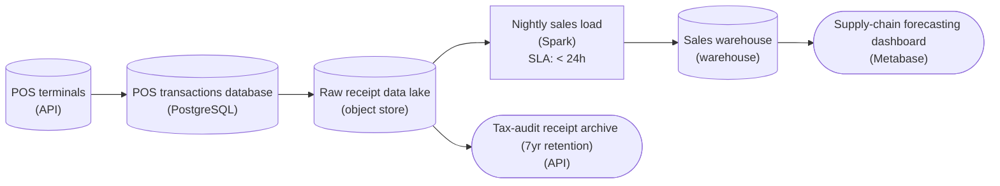

*One sale is written as a row in PostgreSQL, kept verbatim in the lake, and loaded once a night by a Spark batch job into the columnar warehouse the dashboard reads.*

| ✕ Row layout (the POS database) | ✓ Column layout (the warehouse) |
| --- | --- |
| Each sale is one small insert, and looking up a sale reads one row. Keeping a row's fields together makes that cheap, and transactions keep the payment and inventory writes consistent. | The forecast reads a few columns (store, product, quantity, date) across 18 months of rows. Storing each column together lets the scan skip every column the query never names. |

| Key insight: A morning dashboard needs a daily batch, not a stream |
| --- |
| The forecasters read the dashboard once each morning, so sales through yesterday are fresh enough. A scheduled batch job that reads the previous day's files from the lake and loads the warehouse once a night meets that with one run a day. A streaming load would keep a job running around the clock to deliver freshness nobody reads. |

| Pitfall: The forecast query does not belong on the POS database |
| --- |
| If the dashboard reads straight from the operational database, an 18-month join competes with thousands of writes per second at the registers. Copy the data out and let the warehouse take the scan. |

| Real world: 7 years of receipts is a lake job |
| --- |
| Raw receipts are written once and read almost never, until an auditor asks. Immutable files on object storage, partitioned by date in a raw zone, keep them verbatim at a fraction of warehouse cost. |

**Follow-up questions**

1. If the forecasters wanted sales within 15 minutes of the register, what changes about the warehouse load?\
   *This moves the warehouse feed from a nightly batch to a continuously running streaming load.*
2. If the warehouse should hold cleaned, deduplicated sales instead of raw receipts, where does that cleanup sit?\
   *This adds a clean zone between the lake's raw files and the warehouse load.*
3. How would you serve an auditor one receipt from 7 years ago?\
   *Date partitioning in the lake narrows the read to one day's files, with no index lookup.*

 

### Exercise 7 of 11

**● TASK**

A subscription billing app writes invoices to a row-oriented MySQL table that now holds 600 million rows across 30 columns. Finance's revenue dashboard sums only two of them, invoice amount and billing month, and each refresh reads every column for 25 minutes. Design a pipeline that copies invoices nightly into a storage layer built for that access pattern and serves the dashboard from it, leaving MySQL to the app.

<strong>Solution</strong>

#### Read two columns, not thirty

This is the job **columnar storage** exists for. A row-oriented MySQL table keeps all 30 fields of an invoice side by side on disk, which suits the app fetching or updating one invoice. Finance asks the opposite question: two fields from all 600 million invoices. A column-oriented warehouse stores each column on its own, so summing invoice amount by billing month reads those two columns and skips the other 28, roughly a fifteenth of the bytes. That is where the 25 minutes go away.

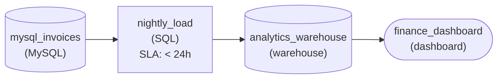

*MySQL stays the app's row store; a nightly load copies invoices into a columnar warehouse that the finance dashboard reads.*

| Pitfall: An index does not shrink a full scan |
| --- |
| The tempting fix is an index on billing month or a bigger MySQL server. Finance sums every month, though, so the query still walks every row and drags all 30 columns through memory. More hardware trims minutes; the row layout is what costs the 25. |

| Key insight: The access pattern picks the layout |
| --- |
| Same invoices, two shapes. Single-invoice reads and writes want whole rows together, so the app keeps its row store. Wide sums over a few fields want columns apart, so analysts get a column store. Neither is wrong; each fits one way of reading. |

**Follow-up questions**

1. Finance adds plan tier as a third column in the report. What changes in the design?\
   *Whether you see that a column store reads only the columns a query names, so three of thirty is still cheap.*
2. An analyst wants one customer's full invoice history with all 30 fields. Which store fits that read better, and why?\
   *Noticing when the access pattern swings back toward whole rows.*

 

### Exercise 8 of 11

**● TASK**

Delivery trucks send about 300 GB of raw GPS pings a day as JSON, and the fields change whenever new firmware ships. Land every file unchanged in a data lake on object storage, partitioned by ingestion date. A daily Spark job should read only the previous day's partition and write cleaned Parquet to a separate curated zone of the same lake.

<strong>Solution</strong>

#### Files, folders, and an engine that reads them

A data lake is just files in object storage, and this whole design rides on that. The raw zone keeps every ping exactly as it arrived, in whatever shape the firmware produced that day, because files are immutable and nothing enforces a schema on write. The folder layout does the organizing: one prefix per ingestion date. Spark is the external engine that turns those files into something queryable, and it writes its result back to the lake instead of over its input.

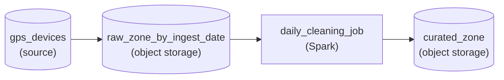

*Raw pings land unchanged under a per-day prefix; Spark reads one day and writes Parquet to the curated zone.*

1. **Route by ingestion date, not by content**

   A path like `raw/gps/ingest_date=2026-10-10/` is a routing scheme, not a schema. The daily job lists one prefix and opens about 300 GB, never the years of history beside it. Partitioning by a field inside the JSON would force a parse before you could even pick the folder.

2. **Write derived data to its own zone**

   Cleaned Parquet goes under a separate curated prefix. Raw stays the source of truth: when a parsing bug turns up, you rerun Spark over the affected date prefixes and replace only that curated output, while the raw files never change.

| Pitfall: Cleaning in place destroys the replay |
| --- |
| Rewriting the raw JSON as Parquet in the same folder, or deleting the originals once cleaned, looks tidy. It throws away the only copy of what the devices actually sent, so a cleaning bug or a firmware field you dropped can never be recovered. |

| Performance: Cheap to keep, cheap to read one day |
| --- |
| At 300 GB a day the lake grows about 9 TB a month. Near 2 cents per GB-month, each month of raw pings adds roughly $180 to the bill, and older dates can move to a cold tier for a fraction of that. The daily read stays flat because the job touches one date prefix however many years pile up. |

**Follow-up questions**

1. Pings from trucks that were offline for three days arrive today. Which date prefix do they land in, and what does the daily job see?\
   *Ingestion date versus event date in a lake layout.*
2. Analysts filter the cleaned data by truck region in every query. Would you lay out the curated zone the same way as the raw one?\
   *Choosing each zone's folder layout by who reads it.*

 

### Exercise 9 of 11

**● TASK**

A ticketing app's checkout makes thousands of seat holds a second: each updates one 25-column seat row and inserts one payment row, and both must commit together or not at all. The seat page reads one whole seat row by seat_id per view. Finance needs nightly revenue per tour from two payment columns, via a nightly batch copy of payments into a columnar store. Choose the seat database's storage shape and draw checkout, the seat page and finance's report.

<strong>Solution</strong>

#### Row storage fits one-row reads and writes

A row-oriented operational database stores all the columns of a seat side by side in one block. Reading a seat by `seat_id` takes one seek, and updating it is one block write. Checkout traffic has exactly that shape: thousands of tiny requests a second, each touching one whole row. PostgreSQL fits this workload, and its ACID transaction lets the seat update and the payment insert commit as one unit. Finance's revenue scan has the opposite shape, so it reads somewhere else.

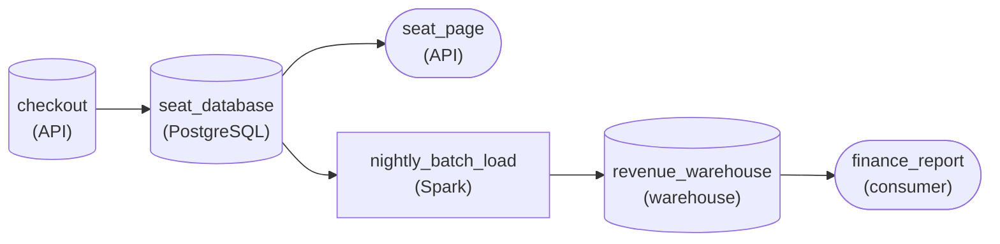

*Checkout and the seat page share the row-oriented `seat_database`; `nightly_batch_load` copies payments into `revenue_warehouse`, which `finance_report` scans.*

| Pitfall: Columnar storage splits the row you need |
| --- |
| A columnar warehouse or Parquet in a lake keeps each of the 25 columns in its own chunk. Fetching one seat means stitching 25 pieces back together, and updating it rewrites column chunks. That layout wins when a scan wants 2 columns across millions of rows. Here every checkout and seat page request wants all 25 columns of one row, so it loses. |

| Key insight: The transaction matters as much as the layout |
| --- |
| Fast reads cover only half of the requirement. If the seat update lands and the payment insert fails, a seat is held and nobody has paid for it. Putting both writes in one transaction means the database commits both or rolls both back. That is why the seat page can trust whatever it reads. |

| Performance: A nightly batch copy keeps the scan off checkout |
| --- |
| Revenue per tour reads two columns of every payment row, the columnar case from the warehouse section. Run against `seat_database`, that full scan competes with checkout for disk and locks at on-sale. A `nightly_batch_load` copies the day's payments into `revenue_warehouse` once, and `finance_report` scans the columnar copy while checkout keeps the row store to itself. |

| Real world: The same shape sits behind every login |
| --- |
| Reading one user by `user_id` at login, adding an item to a cart, and decrementing one inventory count are all the same kind of work. Wherever an app does small, frequent work on whole rows, a row store such as PostgreSQL or MySQL is usually underneath, with a batch copy feeding the reports. |

**Follow-up questions**

1. Finance now wants revenue refreshed every hour during an on-sale. What changes in the copy, and what stays on `seat_database`?\
   *Checks whether a tighter freshness need changes the copy's cadence while the scan still stays off the row store.*
2. The seat page now also shows how many seats are left in one section. Does that change the storage shape?\
   *Checks whether you can tell a small, indexed lookup apart from a full analytical scan.*

 

### Exercise 10 of 11

**● TASK**

A helpdesk app writes support tickets to Postgres while agents work them. Every raw ticket must also be kept untouched in a lake for replay, and support leads check average resolution time per team on a dashboard each morning. Lay the pipeline out in bronze, silver and gold layers, putting each copy of the tickets in the storage shape its job needs. Load the gold mart by batch or streaming, whichever those morning readers actually need.

<strong>Solution</strong>

#### Each layer owns one job

Medallion layering is the storage selection rule applied three times to the same tickets. Bronze is the lake copy exactly as the app wrote it, cheap to keep forever so anything later can be rebuilt. Silver is the cleaned copy: one row per ticket, team names fixed. Gold is the warehouse mart shaped for the question people read, average resolution time per team. Postgres stays where it was, holding the live tickets agents are working.

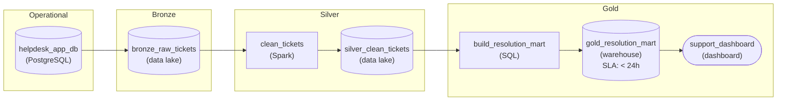

*Postgres keeps the live tickets, the lake holds the bronze and silver copies, and a nightly batch loads the warehouse gold mart that feeds the morning dashboard.*

1. **Let bronze own replay**

   Land raw tickets in the lake before touching them. When the cleaning rules change, and they will, you rerun silver from bronze instead of asking the app for history it may no longer keep.

2. **Let silver own cleaning, once**

   Collapse reopened tickets and fix team names in one place. Every gold mart then starts from the same cleaned tickets, so 2 reports never disagree about what a resolved ticket is.

3. **Let gold own the question people read, loaded nightly**

   Build the resolution mart in the warehouse, where columnar scans over three years of tickets are cheap, and load it with a nightly batch. Leads compare this morning with yesterday and could never tell tickets 10 seconds old from tickets 10 hours old, so a stream would buy freshness nobody can see. The dashboard never touches Postgres or the raw files.

| Pitfall: A dashboard on the app database slows the agents |
| --- |
| The tempting shortcut is pointing the dashboard straight at Postgres or at the bronze files. Postgres is row-oriented and busy serving agents, so a multi-year aggregation competes with every ticket update. Bronze is raw, so the dashboard would redo the cleaning on each query, slightly differently each time. |

**Follow-up questions**

1. The app wants to show a customer their own ticket history on the help page. Which storage shape serves it?\
   *Applies the rule to a new reader: an application lookup belongs in an operational store, not the gold mart.*
2. A shift supervisor wants to see the open-ticket queue per team update within a minute. What changes for that copy?\
   *Applies the freshness question to a reader who can tell the difference, which moves that copy from a nightly batch to a stream.*

 

### Exercise 11 of 11

**● TASK**

Trace one online furniture order through 3 storage shapes. The checkout app writes each order as a single row into PostgreSQL, the operational store. Copy every order into a data lake as raw files under order-date prefixes, then have a nightly batch job load them into a columnar warehouse that enforces the schema on write. Analysts read daily revenue from a dashboard on that warehouse, scanning two columns across 400 million orders.

<strong>Solution</strong>

#### One order, 3 copies, 3 shapes

Every storage shape in this lesson is a bet on an access pattern, and following a single furniture order makes those bets visible. Checkout touches the order as one row, a few milliseconds at a time. The lake keeps it inside an immutable daily file, raw, so nothing is lost. The warehouse stores it as values spread across columns, so a revenue sum over 400 million orders reads two columns instead of forty. Same order, 3 copies, each shaped for whoever reads it.

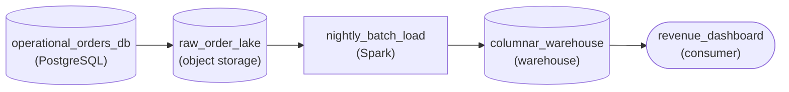

*The order is written once as a row in `operational_orders_db`, copied raw into `raw_order_lake` under its order date, and loaded nightly into `columnar_warehouse`, which `revenue_dashboard` reads.*

1. **Keep the app on a row store**

   Checkout inserts one order and reads it back by its id. A row layout puts all 40 fields of that order together on disk, so each write and lookup touches one small place. That is the operational job, and PostgreSQL does it well.

2. **Land raw files by date in the lake**

   The lake is just files in object storage, organized by convention. Writing each day's orders under an order-date prefix means a reader asking for one day opens one folder, and because files are never edited, yesterday's raw copy stays exactly as checkout wrote it.

3. **Load a columnar warehouse for the scan**

   The nightly batch job reads the day's files and writes them into the warehouse, where the schema is checked before anything lands. Stored column by column, a daily revenue query reads only the date and amount columns, about 5 percent of each order, across all 400 million rows.

| Pitfall: The dashboard does not belong on the checkout database |
| --- |
| Pointing the revenue dashboard straight at PostgreSQL works on day one. Then every query reads every field of every row to sum one, and that scan competes with checkout writes for the same disks. The row layout that makes inserting an order cheap is exactly what makes a 400-million-row sum slow. |

**Follow-up questions**

1. Data science wants the raw order history, including fields the warehouse drops. Which copy should they read?\
   *Whether the lake is recognized as the home for raw and bulk reads.*
2. The nightly warehouse load fails for one day. How do you rebuild just that day?\
   *Whether immutable date-prefixed lake files let you reload one day without touching the checkout database.*

