# Storage Layers: Intermediate - Exercises

Lesson: [pa_storage_layers_intermediate.md](../pa_storage_layers_intermediate.md)

### Exercise 1 of 11

**● TASK**

A 2-billion-row, 24-column orders fact in PostgreSQL feeds a quarterly report whose queries each aggregate two or three columns, and the dashboard takes 18 minutes because the row store reads every column of every row. Redesign the pipeline so the report's aggregations run on a columnar warehouse loaded from that fact, with the dashboard reading from the warehouse and the row-stored fact off the report's path.

**Starting canvas** (already placed for you):

- Postgres orders fact (2B rows, 24 cols, row-stored) (storage, PostgreSQL)
- Analytical SQL transform (transform, SQL)
- Postgres analytics_mart (storage, PostgreSQL)
- Quarterly report dashboard (consumer, dashboard)

<details>
<summary><strong>Solution</strong></summary>

#### Columnar storage: pay for the columns you read

Choosing columnar storage here comes down to the access pattern. The report touches two or three columns, but a row store keeps every column of an order glued together on the same page. So aggregating `total_amount` still drags all 24 columns of every one of the 2B rows through I/O. Columnar storage flips the physical layout: each column lives in its own contiguous run, so a query reads only the columns it names and leaves the rest on disk.

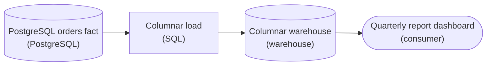

*The row store stays the source of record; the dashboard reads a columnar copy in the warehouse.*

| ✕ Row store | ✓ Columnar store |
| --- | --- |
| The 2B `orders` rows sit page by page with all 24 columns interleaved. `SUM(total_amount)` still pulls `customer_notes`, `shipping_json` and the other 21 columns off disk. The read is sized by the widest row, not by the query. | Each column is a separate contiguous run. `SUM(total_amount)` reads one run, and the other 23 never leave disk. Runs of like-typed values compress hard (dictionary, RLE), so even that one column is smaller, and the engine sums it in vectorized batches. |

| Pitfall: An index doesn't fix a full-column aggregate |
| --- |
| The reflex is a b-tree on `order_date` or a read replica. But a quarterly `GROUP BY` visits most of the 2B rows, so the planner sequential-scans anyway, and a replica just copies the same row layout. The bottleneck is the storage layout, not the query plan or the hardware. |

| Performance: I/O scales with columns touched, not rows stored |
| --- |
| Reading 3 of 24 columns is roughly an 8x cut before compression. Dictionary and run-length encoding on like-typed values often stack another 3-10x on top. That is how an 18-minute scan collapses to seconds: fewer bytes off disk, then vectorized aggregation over those bytes. |

**Follow-up questions**

1. A support tool now needs to fetch one complete order by `order_id`. Which store should it read, and why?\
   *Fetching a whole order by key is the access pattern a row store wins, so the PostgreSQL fact keeps serving that path.*
2. If the report later aggregates 20 of the 24 columns, how much of the columnar win is left?\
   *The I/O cut shrinks toward 24/20, so compression and vectorized execution carry most of what remains.*

</details>


<br>

### Exercise 2 of 11

**● TASK**

A daily revenue dashboard reads an orders fact in the data lake that is partitioned by user_id, which left 10 million tiny per-user directories. The dashboard filters on a single day, so its queries cannot prune any of them. Redesign the lake table so it is partitioned by the date the dashboard filters on, in Hive-style folders, and have the dashboard read from it.

**Starting canvas** (already placed for you):

- Postgres orders source (source, PostgreSQL)
- Daily Spark transform (transform, Spark)
- Lake fct_orders/user_id=... (10M tiny dirs) (storage, object storage)
- Daily revenue dashboard (consumer, dashboard)

<details>
<summary><strong>Solution</strong></summary>

#### Partition on the column you filter

**Partition pruning** only works when the folder path carries the column a query filters on. An engine sees `fct_orders/event_date=2026-09-16/` and skips every other date folder before it opens a single file. The old layout put `user_id` in the path, so the dashboard's one-day filter had nothing to match, and the engine listed and read all 10 million directories.

| Pitfall: A high-cardinality key is a small-files factory |
| --- |
| Each distinct partition value becomes a directory. Partitioning by `user_id` produced 10 million of them, each holding a few kilobytes of one person's orders. The planner spends its time listing paths and opening tiny files, which is slower than no partitioning at all, and the date filter still prunes nothing. |

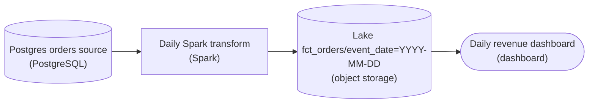

*The Spark job writes the orders fact into Hive-style `event_date=` folders, and the dashboard reads that table.*

1. **Partition the fact by the date the dashboard filters on**

   In the Spark transform the write becomes `partitionBy('event_date')`, which lays the fact out as one folder per day. A year of data is about 365 folders, each holding a full day of orders in files big enough to read efficiently. A query with `WHERE event_date = '2026-09-16'` touches one folder, and a week-long range touches seven.

| ✕ Partitioned by `user_id` | ✓ Partitioned by `event_date` |
| --- | --- |
| 10 million directories of kilobyte files. A one-day filter matches no folder name, so every directory is listed and read. | About 365 folders per year. A one-day filter reads one folder, and the other 364 are never opened. `user_id` stays an ordinary column inside the files. |

| Key insight: Pick the key from the filter, then check its cardinality |
| --- |
| A good partition key is the column most queries filter on, with few enough distinct values that each partition still holds a healthy amount of data. `event_date` passes both tests for a daily dashboard. `user_id` fails the second test by a factor of tens of thousands. |

**Follow-up questions**

1. Most dashboard queries also filter on `region`. Do you add `region` as a second partition column?\
   *Weighs the extra pruning against multiplying the folder count (`event_date` x `region`) and drifting back toward small files.*
2. A finance report scans 5 years of orders by month. Is a daily `event_date` partition still the right granularity for it?\
   *Matching partition granularity to the ranges the queries actually filter on.*

</details>


<br>

### Exercise 3 of 11

**● TASK**

An IoT pipeline writes its hourly batch output as GZIP-compressed CSV in a partitioned curated zone, and because each 5GB file cannot be split Spark collapses to one task per file so the dashboard takes 40 minutes to refresh. Replace the curated GZIP-CSV layout with an open columnar lake table format that splits across executors and reads only the columns a query touches, so the work fans out instead of bottlenecking on a single task per file.

**Starting canvas** (already placed for you):

- IoT device telemetry stream (source, Kafka)
- Hourly batch transform (writes GZIP CSV) (transform, Spark)
- Lake fct_telemetry GZIP CSV (5GB/partition, not splittable) (storage, S3)
- Telemetry analytics dashboard (consumer, Looker)

<details>
<summary><strong>Solution</strong></summary>

#### Why one file became one task

The 40 minutes comes from the shape of the file, not the amount of data. GZIP is not a splittable codec, so Spark cannot hand the middle of a `.csv.gz` to a second reader. Spark cuts each input into **splits**, and every split becomes one task on one executor core. A 5GB file that cannot be split is exactly one split, so it is exactly one task. A hundred idle executors cannot help decode a stream that only one core may touch.

| Pitfall: More executors do not divide an indivisible file |
| --- |
| The reflex is to add executors or repartition the read. That does nothing, because the bottleneck is one task per file: the extra cores sit idle while a single core inflates 5GB. Writing smaller CSVs gives you more tasks, but you stay row-oriented and still scan every column to read three. The layout is the problem, not the cluster. |

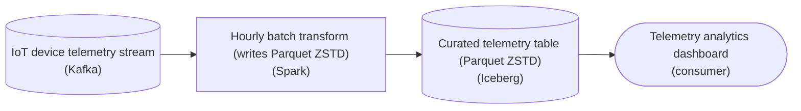

*Same source and dashboard. The curated zone becomes an Iceberg table of ZSTD Parquet, so the read fans out across row groups.*

The fix is a columnar file (Parquet) under an open table format. Parquet compresses each column chunk inside independent **row groups**, and every row group is its own split. One 5GB file now yields dozens of tasks spread across every executor. The codec no longer decides splittability, so it returns to its real job: trading bytes for CPU. For a read-heavy dashboard table, set ZSTD, which gives a near-GZIP ratio at near-Snappy decompression speed. Because values sit column by column, long runs of repeated device and region values compress far better than the interleaved CSV rows did, and a query reads only the columns it touches.

| Key insight: Parquet splits the file; the table format governs it |
| --- |
| Bare Parquet already gives splittable, columnar reads. The table format layer (`Iceberg` / `Delta`) adds the manifest of which files belong to the table, snapshot isolation and partition pruning. The hourly write lands as one atomic commit, so the dashboard never reads a half-written partition. This is the gold tier of a medallion lake: the serving layer uses the query-optimized format. |

**Follow-up questions**

1. The dashboard filters heavily by `event_hour` and `region`. How would you partition the curated table so the engine skips whole days without opening them?\
   *Partitioning as a coarse prune, plus the small-file risk of over-partitioning.*
2. If the format had to stay CSV, what codec would at least give you splits?\
   *Block-splittable codecs like `bzip2` exist; `gzip` is not splittable.*

</details>


<br>

### Exercise 4 of 11

**● TASK**

fct_transactions is an Iceberg table partitioned by transaction_date and clustered by customer_id, holding 600 days of history. Add a pushdown-capable query engine between the table and its two consumers, a fraud audit filtering by date and a customer-statement query filtering by customer_id, so both read through the engine and prune by partition and file statistics instead of scanning the full history.

**Starting canvas** (already placed for you):

- fct_transactions (Iceberg, partitioned by transaction_date, clustered by customer_id) (storage, Iceberg)
- Fraud audit query (filter on transaction_date) (consumer, Jupyter)
- Customer statement query (filter on customer_id) (consumer, Metabase)

<details>
<summary><strong>Solution</strong></summary>

#### Two filters, one storage layer

**Predicate pushdown** sends the `WHERE` clause down to storage, so storage decides which bytes get read at all. The engine no longer streams every row in and filters afterwards. `fct_transactions` already carries what that decision needs: Iceberg keeps partition membership and per-file min/max column stats next to the data. The missing piece was something that reads that metadata, which is a pushdown-capable engine between the table and both consumers.

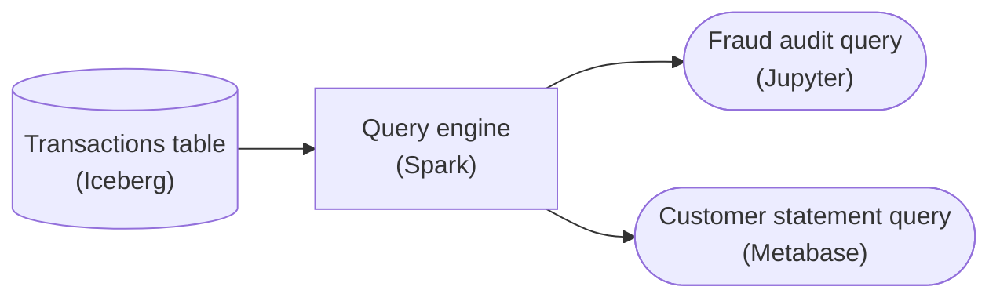

*Both consumers read through the engine. It prunes `fct_transactions` by partition on `transaction_date` and by file stats on `customer_id`, then reads only the files that survive.*

Each consumer uses a different pruning path. The audit filters on `transaction_date`, which is the partition column, so the engine drops whole days from metadata alone and never opens those files. The statement query filters on `customer_id`, and partitioning gives that column nothing. Clustering does help it: each file holds a narrow range of customers, so the engine skips every file whose min/max range cannot contain the target.

| Key insight: Clustering gives the stats something to skip |
| --- |
| Without clustering by `customer_id`, every file would span the whole customer range, and min/max pruning could never rule a file out. Partitioning serves the date filter. Clustering is what makes the second filter cheap. |

| Pitfall: Pushdown belongs to the engine, not the table |
| --- |
| A partitioned, clustered table does not prune itself. Suppose a notebook loads the files and filters in memory. The metadata goes unused and you get the full 600-day scan, with the filter applied only after every byte has been read. |

**Follow-up questions**

1. The statement query adds a date range to its `customer_id` filter. Which pruning runs first, and how does that change the file stats the engine has to check?\
   *Partition pruning and file-stats pruning compose.*
2. A new dashboard filters on `merchant_id`, which is neither partitioned nor clustered. Why does it still scan almost everything?\
   *Pushdown only helps columns that the physical layout supports.*

</details>


<br>

### Exercise 5 of 11

**● TASK**

The DAU dashboard's daily-unique-users SQL scans all 10TB of unpartitioned GZIP CSV clickstream in S3 on every refresh. Rewrite the curated lake as a columnar table format (Delta Lake, Iceberg, or a columnar warehouse), partitioned on event_date and compressed with a splittable codec like ZSTD. Put a pushdown-capable engine such as Spark or Snowflake between that table and the dashboard so the same SQL scans about 100GB.

**Starting canvas** (already placed for you):

- Mobile clickstream Kafka (source, Kafka)
- Daily Spark transform (writes GZIP CSV) (transform, Spark)
- Lake mobile_clickstream GZIP CSV unpartitioned (10TB) (storage, S3)
- DAU dashboard (full 10TB scan today) (consumer, Looker)

<details>
<summary><strong>Solution</strong></summary>

#### 4 storage levers that multiply

Storage levers pay off by **compounding, not adding**. A columnar format reads only the columns a query names. Partitioning on `event_date` reads only the days it asks for. A splittable codec lets many workers share the read. A pushdown engine skips the row groups whose min/max statistics cannot match. A rough 10x from columns and another 10x from partition and stats pruning is how 10TB becomes about 100GB.

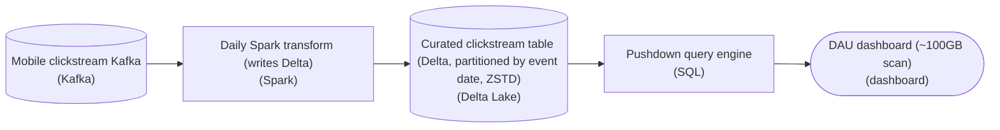

*2 levers are boxes on the canvas: the Delta Lake table and the pushdown engine. Partitioning on `event_date` and ZSTD live in how the transform writes.*

1. **Make the curated table columnar**

   A CSV row stores every attribute of an event side by side, so counting `user_id` per day still drags the whole payload off disk. Delta Lake writes Parquet underneath, and the reader touches only `user_id` and `event_date` while the dozens of other columns stay on disk.

2. **Seat a pushdown engine in front of the dashboard**

   Layout alone saves nothing until something applies the predicate before reading. The engine pushes the `event_date` filter down to skip whole partitions and reads row-group statistics to skip blocks. Without it, the dashboard full-scans the same well-built table.

**The write that encodes partitioning and the codec**

```python
(events_df
    .write
    .format("delta")
    .partitionBy("event_date")
    .option("compression", "zstd")
    .mode("overwrite")
    .save("s3://lake/curated/mobile_clickstream"))
```

*`partitionBy("event_date")` gives one directory per day; ZSTD compresses per Parquet block, unlike whole-file GZIP.*

| Pitfall: One lever caps the others |
| --- |
| Partitioning CSV still reads every column of the chosen days. A pushdown engine pointed at whole-file GZIP still cannot split the read or prune columns. Each missing lever limits what the rest can save, so the 100x appears only when all 4 compose. |

**Follow-up questions**

1. The dashboard moves to a rolling 30-day window. How much of the saving survives?\
   *Partition pruning scales with the date range rather than being all or nothing.*
2. Should you also partition by `event_hour` for hourly DAU?\
   *Over-partitioning creates many small files, which slows every reader.*

</details>


<br>

### Exercise 6 of 11

**● TASK**

An ad-tech platform lands every bid event through an 80,000 writes-per-second bidding service and a Kafka firehose, and three teams each need that same data in a different shape. The bidding service answers 12ms point lookups by bid id, the advertiser dashboard scans 365 days of history (2 PB raw) while filtering on date and a handful of columns, and the data science team trains on the full raw bid history. Design the storage so each team reads from a store matched to its access pattern, with the dashboard served from columnar files an engine can prune by date before it scans.

**Starting canvas** (already placed for you):

- Bidding service writes (80K txn/sec) (source, API)
- Bid event firehose (source, Kafka)
- Bid lookup API (12ms primary-key lookups) (consumer, API)
- Advertiser reporting dashboard (365d, 2PB) (consumer, Looker)
- ML model training (consumer, Jupyter)

<details>
<summary><strong>Solution</strong></summary>

Storage layout should follow the read. A 12ms point lookup, a 365-day filtered scan and a full-history read each want a different layout on disk, so no single store serves all three well. The answer is to land the bid events once, then write **one copy per access pattern**: a row-oriented key-value store, columnar files partitioned by date, and a raw lake.

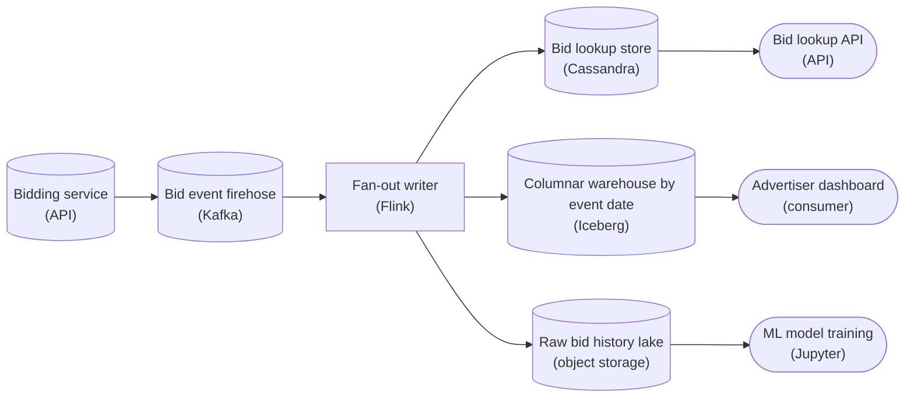

*One firehose fans out into three layouts: a key-value row store for lookups, date-partitioned columnar files for the dashboard, and the raw lake for training.*

1. **Point lookups get a row store keyed on `bid_id`**

   The lookup fetches one whole bid by `bid_id` in 12ms. A row-oriented key-value store like Cassandra keeps that record together under its key, so a single read returns it. A columnar file would have to stitch the row back together from every column, which blows the latency budget.

2. **The dashboard scan gets columnar files partitioned by `event_date`**

   The dashboard touches a date range and a few columns. Columnar files prune columns: a query that needs 5 of 40 columns reads only those 5. Partitioning by `event_date` prunes files: `WHERE event_date BETWEEN ...` skips whole days before any file is opened. Together that is **predicate pushdown**, and it is why a query over 2 PB scans only a small fraction of it. Each column also holds runs of similar values, so it compresses well and the bytes that remain are fewer still. Partition daily on the column queries actually filter on, not by minute, or the engine drowns in tiny files.

3. **ML training reads raw history from the lake**

   The data science team wants every field of every bid, so land the raw history untouched in cheap object storage. The columnar copy can always be rebuilt from this raw one, so a new model or a reworked dashboard table needs no re-ingest.

| Pitfall: One store cannot win all three reads |
| --- |
| It is tempting to point all three teams at the row store the bidding service already writes to. But a 365-day scan over a row store reads every column of every row and competes with 80K writes/sec for IO. The dashboard crawls and the 12ms lookups degrade. When access patterns diverge this far, give each one its own store. |

**Follow-up questions**

1. The firehose can deliver the same bid event twice. How do you keep the `bid_id` store and the lake from double-counting?\
   *Idempotent writes: upsert by `bid_id`, dedupe on a lake key.*
2. What breaks if you partition the columnar copy by `advertiser_id` instead of `event_date`?\
   *The partition key must match the dashboard's real filter, not a high-cardinality column.*

</details>


<br>

### Exercise 7 of 11

**● TASK**

A support platform keeps 600 million tickets, 40 columns wide, in MySQL, a row store the agent console reads by ticket id to open one whole ticket. A new dashboard of weekly average resolution time by team scans just 3 of those 40 columns across every ticket, and data up to a day old is fine. Design the pipeline so each access pattern reads from the storage layout that suits it.

<details>
<summary><strong>Solution</strong></summary>

#### Two reads, two layouts

Row versus columnar storage is a question of which bytes sit next to each other on disk. MySQL writes each ticket's 40 fields together, so opening one ticket by id is a single short read that returns everything the console shows. The dashboard asks the opposite question: 3 fields, every ticket. Against the row layout, that scan drags all 40 columns of 600 million rows off disk and throws away 37 of every 40.

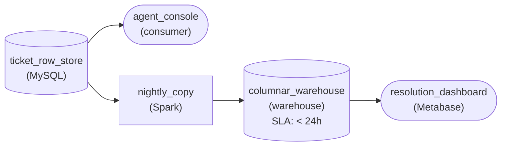

*The `ticket_row_store` keeps serving whole-ticket lookups to the `agent_console`; a nightly Spark copy refreshes the `columnar_warehouse` at least daily for the dashboard to scan.*

| Performance: 3 columns out of 40 is a 13x cut |
| --- |
| At roughly 2KB per ticket row, a full scan of MySQL reads about 1.2TB to answer the weekly question. The columnar copy reads only team, opened time and resolved time, about 3/40 of that, near 90GB. Wall clock time drops by a similar factor because the scan is bound by bytes read, not CPU. |

| Pitfall: Columnar everywhere slows the console |
| --- |
| The tempting fix is to move every ticket read to the warehouse. A column store keeps each field in its own chunk, so rebuilding one whole ticket means touching 40 separate places, and the console's single-ticket lookups get slower. Keep the row store for the read it was built for and give the scan its own columnar copy. |

| Real world: Two copies is the normal shape |
| --- |
| Most teams run exactly this split: the application database stays row-oriented for key lookups, and a daily batch job copies the data into a columnar warehouse or a Parquet-based lake for analytics. |

**Follow-up questions**

1. Support wants to export 50 sample tickets with all 40 columns. Which store should serve it?\
   *Checks that whole-row reads by key still point at the row store.*
2. The dashboard grows to read 30 of the 40 columns. Does the columnar copy still pay off?\
   *Checks that the win scales with the fraction of columns a scan touches.*

</details>


<br>

### Exercise 8 of 11

**● TASK**

Parcel scanners emit 2 TB of scan events a day into a stream, and a nightly batch job loads them into a lake table kept for three years. Analysts query it from notebooks, always filtering on scan date and usually the last 7 days, while about 400 million distinct shipment IDs appear each day. Draw the stream, the nightly load, the lake table and the notebooks, naming the lake table for the partition key you choose.

<details>
<summary><strong>Solution</strong></summary>

#### Partition on the column every query filters

Partitioning is a bet on the filter: the table is split into folders by a column's value, and any query that filters on that column skips every other folder before a byte is read. Every notebook query here filters on scan date, so `scan_date` is the key. Three years of daily data becomes 1,095 Hive-style folders like `scan_date=2026-10-04/`, and a 7-day query lists and opens 7 of them.

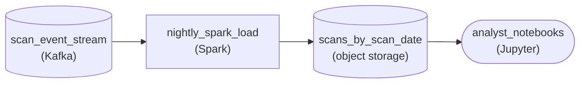

*The nightly `Spark` load writes Hive-style `scan_date=` folders that notebook queries prune to a week.*

| Performance: A week reads 7 of 1,095 folders |
| --- |
| Each daily partition holds about 2 TB, plenty to split into healthy file sizes. A 7-day query touches roughly 14 TB instead of the 2.2 PB the full three years hold, a cut of more than 99 percent that happens while the engine plans the query, not while it scans. |

| Pitfall: A key with 400 million values is a file factory |
| --- |
| Putting `shipment_id` in the partition path, alone or under `scan_date`, writes about 400 million directories a day of roughly 5 KB each. The engine spends its time listing and opening tiny files, and since no notebook query filters on shipment, nothing is pruned in return. A good key has a bounded number of values and matches the common filter. |

| Key insight: Partition no finer than anyone filters |
| --- |
| Hourly partitions would give 26,280 folders of about 83 GB each. Analysts slice whole days, so every query would open 24 folders to get what one daily folder already holds: more metadata, no extra pruning. |

**Follow-up questions**

1. Analysts start filtering on one of 12 regions as well. Should `region` join `scan_date` in the partition path?\
   *Checks the cardinality math for a second key: 12 x 1,095 partitions of roughly 170 GB each stays bounded.*
2. Some scans arrive up to three days late. Which `scan_date` partitions does the nightly load have to write?\
   *Connects the partition key to late-arriving data: the load rewrites a small window of recent folders, not the whole table.*

</details>


<br>

### Exercise 9 of 11

**● TASK**

A nightly Spark batch rewrites 4 TB a day of raw JSON payment logs from a raw landing zone into a Parquet curated table that a reporting dashboard scans dozens of times a day. The table uses Snappy today, and dashboard reads are bound by bytes pulled from storage. Design the pipeline from raw landing to the dashboard, and choose the curated table's codec to shrink bytes read without slowing decompression, naming it on that stage.

<details>
<summary><strong>Solution</strong></summary>

#### Pick the codec, not whether to compress

Compression trades CPU for bytes, and on this table the trade is lopsided. The curated table is written once a night and scanned dozens of times a day. Every byte the codec removes is saved on every scan, while the extra compression work is paid once. With storage reads as the bottleneck, the only real question is which codec. **ZSTD** answers it: GZIP-like ratios at near-Snappy decompression speed, so the 4 TB nightly rewrite lands as fewer bytes without making any dashboard query slower.

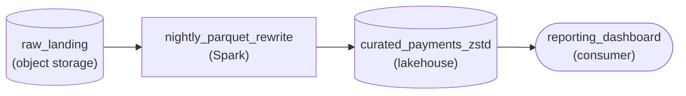

*Raw JSON lands in object storage, the nightly Spark batch rewrites it as ZSTD Parquet in `curated_payments_zstd`, and the dashboard scans that table.*

| Key insight: Pay to compress once, save on every scan |
| --- |
| ZSTD compresses more slowly than Snappy, but that cost lands in the nightly Spark job, which has room in its window. Decompression is what the dashboard pays on every scan, and ZSTD keeps it close to Snappy. Set the codec explicitly on the table, because Parquet writers still default to Snappy. |

| Pitfall: GZIP shrinks bytes but taxes every read |
| --- |
| Switching to GZIP gets a similar ratio, but its slow decompression is paid on each of those dozens of daily scans, which swaps an I/O bottleneck for a CPU one. Leaving Snappy in place is the other miss: it is the default because of history, not because it suits a read-heavy table. |

| Real world: New analytical tables can start on ZSTD |
| --- |
| Spark, Iceberg, Delta and Trino all read ZSTD natively, so a new read-heavy table can pick it from day one. The math changes only when reads are rare: a cold archive cares about ratio far more than decompression speed. |

**Follow-up questions**

1. What changes if the raw JSON must be archived for seven years and read about once a year?\
   *Whether ratio or decompression speed matters when reads almost never happen.*
2. Why does the curated Parquet table compress far better than the raw JSON under the same codec?\
   *How a columnar layout puts runs of similar values next to each other.*

</details>


<br>

### Exercise 10 of 11

**● TASK**

An API gateway lands 3 TB a day of raw JSON access logs in object storage, and analysts query one day of logs for one of 200,000 tenants at a time. Design a nightly batch job that rewrites the logs into a Parquet table, laid out so this query prunes by partition first and then skips row groups by their min/max statistics. Label the table's storage stage with its partition key and in-file sort order. Analysts read the table from a dashboard.

<details>
<summary><strong>Solution</strong></summary>

#### Coarse partition, fine statistics

Predicate pushdown works in levels, and this layout lets 2 of them fire on the same query. The day partition prunes whole days before any file is opened. Inside the surviving day, each Parquet footer records a min and max `tenant_id` per row group, and the engine skips every row group whose range cannot hold the tenant asked for. Of a day's data, a single-tenant lookup ends up touching one or two row groups.

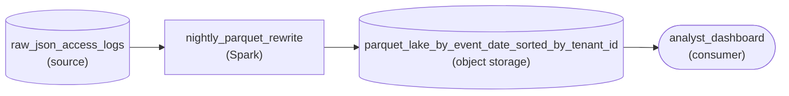

*Raw JSON is rewritten nightly into Parquet partitioned by day and sorted by tenant, so pruning works at both levels.*

1. **Partition on `event_date` at day grain**

   Every query names one day, so the day is the coarse filter. Four hundred days of history become four hundred partitions, and a lookup opens one of them. Hourly partitions would multiply file counts without any pruning these queries can use.

2. **Sort each day's files by `tenant_id`**

   Min/max statistics only skip a row group when its range is narrow. Written in arrival order, every row group holds hundreds of tenants and spans nearly the whole key range, so nothing is skipped. Sorting by `tenant_id` during the nightly rewrite gives each row group a tight, non-overlapping slice.

| Pitfall: Tenant is a sort key, not a partition key |
| --- |
| Partitioning by `tenant_id` looks like the most direct pushdown, but 200,000 tenants means 200,000 directories a day, most holding a few kilobytes. The engine spends its time listing and opening tiny files. A high-cardinality filter belongs in row-group statistics inside a coarse partition. |

| Key insight: Pushdown is designed at write time |
| --- |
| The footer statistics exist only because the nightly job writes Parquet; the raw JSON carries none, so a query against it reads every byte. The sort order is fixed at that same moment, which makes the rewrite the place where pushdown is won or lost. |

**Follow-up questions**

1. Security needs every log line for one `request_id` on a given day, and the IDs are random. Why do min/max statistics skip nothing here, and which finer level helps?\
   *Bloom filters for high-cardinality equality lookups.*
2. A few queries filter on `status_code` instead of tenant. What does the current sort order do for them?\
   *Only the sort column gets narrow row-group ranges.*

</details>


<br>

### Exercise 11 of 11

**● TASK**

Video players emit 6 billion playback heartbeats a day, 2 TB of raw JSON with 30 fields from 40 million devices in 8 regions, into a raw landing zone kept 18 months. A nightly batch job rewrites each day into a curated table that a dashboard reads for buffering ratio by region over the last 7 days and that support engineers query for one device on one day. Design the pipeline and put the curated table's file format, codec and partition key in its stage name, picking a key that lets both queries skip files without producing tiny ones.

<details>
<summary><strong>Solution</strong></summary>

#### Partition on the filter every reader shares

A partition key is a promise about how the table will be read: every query that filters on it skips whole folders, and every query that does not pays for all of them. 2 readers share this table, so the key has to be the filter they have in common, the day, and it has to stay coarse enough that each partition still holds large **columnar files**. Parquet and ZSTD then cut the bytes inside each surviving partition, and the device lookup gets its narrowing from file statistics rather than from the key.

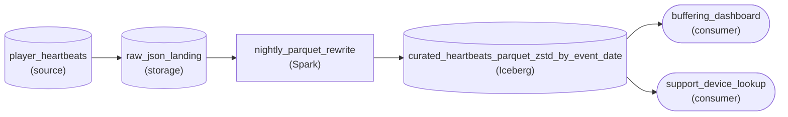

*Raw JSON lands in the lake, a nightly Spark rewrite writes ZSTD Parquet partitioned by `event_date`, and both readers prune to their own days.*

1. **Start from the filters both readers share**

   The dashboard filters a 7-day range and a region; the support lookup filters one day and one `device_id`. The day appears in both, so `event_date` prunes for both: 7 of about 540 date folders for the dashboard, 1 for support. A `device_id` key would help only support and make the dashboard open every folder.

2. **Check cardinality against file size**

   Divide a compressed day by the number of key values. About 250 GB a day over 8 regions is roughly 31 GB per region-day, so adding `region` still leaves files of hundreds of MB. Over 40 million devices it is about 6 KB each: millions of tiny files and a listing slower than the read.

3. **Let format and codec shrink what survives**

   Rewriting JSON as Parquet lets the dashboard read 3 of 30 columns instead of whole rows, and ZSTD shrinks those column chunks further while Parquet stays splittable. Sorting each day by `device_id` before writing gives every row group a tight min/max range, so the support lookup skips nearly all row groups in its one partition.

| Performance: From a petabyte of JSON to tens of gigabytes |
| --- |
| 18 months of raw JSON is about 1 PB. The dashboard's query opens 7 date partitions (about 1.75 TB compressed), reads 3 of 30 columns (about 175 GB), and with `region` in the key only one region's folders (roughly 20 GB). The cost concentrates in the nightly rewrite, which reads 2 TB once so later queries never have to. |

| Pitfall: A near-unique key makes file listing the bottleneck |
| --- |
| Partitioning by `device_id` feels right because support looks devices up, but 40 million values a day means about 6 KB per file and over 20 billion files across 18 months. Listing them costs more than reading the data, and the dashboard prunes nothing. High-cardinality filters belong to row-group statistics, not to the folder layout. |

**Follow-up questions**

1. Support now needs a `session_id` lookup across 30 days without knowing the day. Does the key change?\
   *Whether you reach for row-group statistics or bloom filters instead of a high-cardinality partition key.*
2. Raw volume grows to 40 TB a day. Is a daily partition still the right grain?\
   *Re-checking partition size against file size: day plus region, or hourly, may now fit.*

</details>
