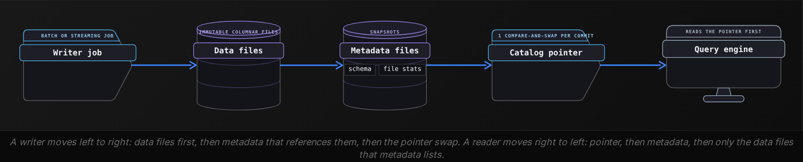
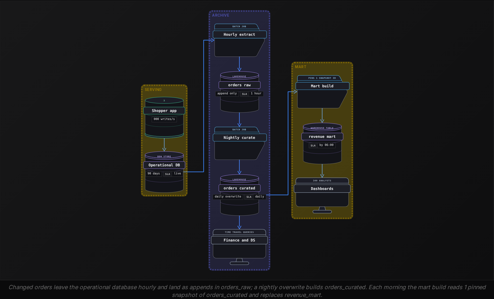

Advanced·Pipeline Architecture · 38 min · 12 challenges

# Storage Layers: Advanced

At Netflix, an analyst refreshes a viewing-hours dashboard at the exact second a nightly job rewrites yesterday's partition. On a plain directory of files, the chart can count some old files alongside some new ones. Netflix engineers built an open table format to make that moment impossible, and the fix lives entirely in metadata.


<br>

---

## The Lakehouse: ACID on Object

Object storage offers 4 operations that matter here: put an object, get it, list keys under a prefix, delete it. Each put is atomic, but nothing groups 2 puts into 1 change, and most object stores implement a prefix 'rename' as a copy plus a delete for every key, so moving 500 files reaches readers as 1,000 separate changes.

A plain data lake defines a table as every file under a directory. That definition fails in 4 ways once some jobs write while others read:

- Torn reads: a query that lists the directory mid-write counts some new files beside some old ones.
- Orphaned output: a job that dies after writing 30 of its 50 files leaves 30 files that every later query counts.
- Lost history: an overwrite deletes the old files, so nothing records what the table held yesterday at 09:00.
- Slow planning: listings commonly return at most 1,000 keys per request, so a table of 1 million files costs 1,000 round trips before any data is read.


<br>

### The metadata layer

A lakehouse keeps the same columnar data files and adds a second kind of file: metadata naming exactly which data files form the table. A root metadata file holds the schema and the partition spec, and it also lists the table's snapshots. Each snapshot points to manifests, and each manifest lists data files. For every file the manifest records its row count and partition values, along with a min and max per column. A catalog stores 1 thing per table: the location of the current root metadata file.




<br>

### One commit, traced

The `orders` table is partitioned by `order_date` and sits at snapshot 41, made of 3 files, f1 to f3, where f3 holds 2026-10-23. A nightly job recomputes that date and must replace f3 with 2 corrected files. The catalog accepts a new pointer only if it still holds the value the writer last read: a compare-and-swap.

| Step | What the job writes | Snapshot a reader gets |
| --- | --- | --- |
| 1 | data files f4, f5 | 41: f1, f2, f3 |
| 2 | metadata m42 listing f1, f2, f4, f5 | 41: f1, f2, f3 |
| 3 | pointer swapped from m41 to m42 | 42: f1, f2, f4, f5 |
| Crash before 3 | f4, f5 and m42, referenced by nothing | 41, unchanged |

Atomicity comes from the single swap: every reader sees snapshot 41 or snapshot 42, with no state between them. Isolation comes from immutability, since no commit edits a file another query might be reading. Durability belongs to the object store. The job never deleted f3: snapshot 41 still lists it, and a cleanup step removes it only after 41 expires.

**A job writes 40 of its 50 new data files into the orders location, then its machine dies before step 2. A dashboard queries orders a minute later. What does the dashboard read?**

- **A.** The 40 new files plus the old ones, because the files already sit inside the table's location
- **B.** Nothing until cleanup runs, because the crashed job left the table locked against readers
- **C.** Exactly the previous snapshot, while the 40 files sit unreferenced until a cleanup removes them
- **D.** The previous snapshot, but only after the engine finds and deletes the 40 partial files

<details>
<summary>Solution</summary>

**C.** Exactly the previous snapshot, while the 40 files sit unreferenced until a cleanup removes them

Without the pointer swap the commit never happened. The 40 files are orphans: they cost storage, and no query can see them.

**Why the others are wrong**

- **A.** Location no longer defines the table. The engine reads only the files the current snapshot lists, and no metadata names these 40.
- **B.** Writers take no lock on a lakehouse table. Readers keep resolving the pointer, which still names the last committed metadata.
- **D.** The previous snapshot is right, but no query inspects orphans. The engine ignores them because no manifest lists them, and deletion is a separate cleanup.

</details>


<br>

### Why the metadata is the product

| ✓ Directory of files | ✗ Lakehouse table |
| --- | --- |
| • The table is whatever a listing returns right now<br><br>• A half-finished write is visible to readers<br><br>• Schema is inferred from whichever files get opened<br><br>• Pruning needs a listing, then every file's footer | • The table is the file list in the current snapshot<br><br>• A commit appears all at once or not at all<br><br>• Schema is stored once, with a permanent id per column<br><br>• Pruning reads min and max values from manifests |

Copy every data file of a lakehouse table into a fresh bucket and leave the metadata behind: what you hold is a pile of files that has lost its schema and its version history, and nothing says which files were ever committed. Every capability in the rest of this lesson is a change to metadata. The data files are open columnar files any engine can read; the metadata turns them into a table many jobs can share.

**The orders table holds 2,000 data files across 3 years. A query filters order_date = DATE '2026-10-23'. How does the engine choose which files to open?**

- **A.** It reads partition values and min/max stats per file from the manifests, then opens only matching files
- **B.** It lists every prefix under the table location, then opens each file footer to compare min/max values
- **C.** It opens all 2,000 files and relies on predicate pushdown to discard row groups for other dates
- **D.** It asks the catalog, which keeps a per-date index of the files committed to each table

<details>
<summary>Solution</summary>

**A.** It reads partition values and min/max stats per file from the manifests, then opens only matching files

Manifests carry partition values and column bounds for every file, so planning needs no listing and no footer reads.

**Why the others are wrong**

- **B.** That is directory-of-files planning. A lakehouse engine skips listing, since a listing can include files that were never committed.
- **C.** Pushdown still runs inside every opened file, but the manifests already exclude files whose bounds miss the date, so most are never opened.
- **D.** The catalog stores 1 pointer per table. File-level detail, including per-file stats, lives in the manifests that pointer leads to.

</details>


<br>

---

## Snapshot Isolation and Time Travel

A snapshot is an immutable list of data files. A query resolves the catalog pointer once when it is planned, then reads that snapshot to the end. Suppose a revenue query starts at 10:02:30 on snapshot 42 and runs for 90 seconds. A commit at 10:03 creates snapshot 43, and the running query never notices: its files stay in place, because nothing deletes a file that a retained snapshot lists.


<br>

### Concurrent writers share 1 pointer

Writers take no locks. Each one reads the current snapshot, writes its data files, then tries to swap the pointer from the snapshot it read to its own. This is optimistic concurrency: assume nobody else committed, and check at the swap. When the swap fails, the writer reads the snapshot that beat it and asks whether that commit touched anything its own commit depends on.

| Time | Writer A: web orders | Writer B: app orders | Pointer |
| --- | --- | --- | --- |
| 10:00 | reads 42 | reads 42 | 42 |
| 10:02 | writes 3 files | writes 2 files | 42 |
| 10:03 | swap 42 to 43 succeeds |  | 43 |
| 10:03 |  | swap 42 to 43 fails | 43 |
| 10:03 |  | 43 only added files: rebuild metadata on 43 | 43 |
| 10:04 |  | swap 43 to 44 succeeds | 44 |

Writer B rewrote 1 small metadata file and reused its 2 data files untouched. The retry stays cheap while the 2 commits are independent. When they overlap, the loser cannot rebase, because its output was computed from data that has since changed:

| Winner committed | Loser attempted | Outcome |
| --- | --- | --- |
| append to 2026-10-24 | append to 2026-10-24 | rebase metadata and commit |
| append to 2026-10-23 | overwrite 2026-10-23 | conflict: the overwrite missed new rows, recompute |
| overwrite 2026-10-23 | overwrite 2026-10-23 | conflict: the file to replace is gone, recompute |
| compaction of 2026-10-22 | append to 2026-10-22 | rebase: the append removes no files |

**Writers A and B both read snapshot 50 of orders and append new files to the 2026-10-24 partition. A swaps first. What happens to B?**

- **A.** B fails and must recompute its rows, since both commits touched the same partition
- **B.** B's swap succeeds anyway and replaces A's snapshot, so A's appended rows disappear
- **C.** B blocks on a partition lock until A's swap completes, then commits normally
- **D.** B's swap fails, then B rebuilds its metadata on snapshot 51 and reuses its data files

<details>
<summary>Solution</summary>

**D.** B's swap fails, then B rebuilds its metadata on snapshot 51 and reuses its data files

Appends only add files, so B rebases cheaply: new metadata, the same data files, and a second swap that commits snapshot 52.

**Why the others are wrong**

- **A.** Sharing a partition is harmless for appends. Neither commit removes a file, so B's files remain valid on top of A's.
- **B.** The compare-and-swap rejects B because the pointer no longer holds 50. Silently losing a commit is what the swap exists to prevent.
- **C.** This protocol has no locks. B learns about A only when its own swap fails.

</details>


<br>

### Time travel

Retained snapshots stay queryable. The history is in the snapshots metadata table. Adding a version or timestamp clause to a query pins it to an older state.

```sql
SELECT
  snapshot_id,
  committed_at,
  operation
FROM "orders$snapshots"
ORDER BY committed_at DESC
LIMIT 4
```

| snapshot_id | committed_at | operation |
| --- | --- | --- |
| 44 | 2026-10-24 10:04 | append |
| 43 | 2026-10-24 10:03 | append |
| 42 | 2026-10-24 02:15 | overwrite |
| 41 | 2026-10-23 23:50 | append |

```sql
SELECT
  order_date,
  SUM(amount) AS revenue
FROM orders FOR VERSION AS OF 41
GROUP BY order_date
```

```sql
SELECT
  COUNT(*) AS order_count
FROM orders FOR TIMESTAMP AS OF TIMESTAMP '2026-10-24 09:00:00 UTC'
```

Store the snapshot id beside every published report, and the report can be regenerated exactly while that snapshot is retained. Compare 2 snapshots to see which rows a job changed. Roll back a bad commit by pointing the table at an earlier snapshot, a metadata commit that copies no data.


<br>

### Retention sets the horizon

Snapshot expiry deletes snapshots older than the retention window, then deletes data files that no surviving snapshot lists. Retention is therefore a cost knob. If the nightly job overwrites a 50GB partition and retention is 7 days, the table keeps up to 7 replaced copies, about 350GB beyond its live size. A query pinned to an expired snapshot fails with an error.

> Setting retention
>
> - Reproduction: if month-end reports are rebuilt 10 days later, retention under 10 days breaks them.
> - Cost: daily replaced volume times retention days is the extra storage you pay for.
> - Ceiling: snapshots cover days or weeks; years of history belong in the table's rows.

**Retention on orders is 7 days. On 2026-11-05 an analyst runs a query pinned to snapshot 41, committed on 2026-10-23. What happens?**

- **A.** It returns current data, because the engine falls back to the nearest snapshot it still holds
- **B.** It fails, because snapshot 41 expired and files only it listed may already be deleted
- **C.** It succeeds, because data files are immutable and nothing deletes them once written
- **D.** It succeeds slowly, because the engine rebuilds snapshot 41 by replaying later commits

<details>
<summary>Solution</summary>

**B.** It fails, because snapshot 41 expired and files only it listed may already be deleted

The commit and the query are 13 days apart, past the 7-day window, so the snapshot entry is gone and f3 is eligible for deletion.

**Why the others are wrong**

- **A.** Silent fallback would make reproduced reports wrong without warning, so engines refuse a version they cannot resolve.
- **C.** Immutable means never edited. Expiry deletes files that no retained snapshot lists, which includes f3 from the nightly overwrite.
- **D.** Expiry removes the metadata along with the files only that snapshot listed, so the engine has no file list to rebuild the snapshot from.

</details>


<br>

---

## Schema Evolution Without Rewrites

Columnar files record each column's name inside the file. Older lake engines matched file columns to the table schema by that name or by position, and both break. Rename `amt` to `amount` on a name-matching table and every file written before the rename lacks an `amount` column, so 3 years of orders read back as NULL. On a position-matching table, dropping the second column shifts every later column one slot. The traditional fix was to rewrite every file.


<br>

### Field ids name the column

A table format assigns each column a numeric field id when the column is created and never reuses it. Writers store the id beside each column in every data file, and readers resolve columns by id, so the name becomes a label in metadata that can change freely. Here is the schema history in the root metadata of `orders`:

```sql
{
  "current_schema_id": 2,
  "schemas": [
    {
      "schema_id": 1,
      "fields": [
        {
          "id": 1,
          "name": "order_id",
          "type": "bigint"
        },
        {
          "id": 2,
          "name": "order_date",
          "type": "date"
        },
        {
          "id": 3,
          "name": "amt",
          "type": "integer"
        },
        {
          "id": 4,
          "name": "legacy_flag",
          "type": "boolean"
        }
      ]
    },
    {
      "schema_id": 2,
      "fields": [
        {
          "id": 1,
          "name": "order_id",
          "type": "bigint"
        },
        {
          "id": 2,
          "name": "order_date",
          "type": "date"
        },
        {
          "id": 3,
          "name": "amount",
          "type": "bigint"
        },
        {
          "id": 5,
          "name": "currency",
          "type": "varchar"
        }
      ]
    }
  ]
}
```

Schema 2 renamed id 3 and widened it from integer to bigint. It also dropped id 4 and added id 5, and not one data file was rewritten. A reader on schema 2 handles a file written under schema 1 like this:

File written under schema 1

| field id | name in file | value |
| --- | --- | --- |
| 1 | order_id | 1007 |
| 2 | order_date | 2023-04-02 |
| 3 | amt | 2500 |
| 4 | legacy_flag | true |

Row returned under schema 2

| field id | column | value |
| --- | --- | --- |
| 1 | order_id | 1007 |
| 2 | order_date | 2023-04-02 |
| 3 | amount | 2500, as bigint |
| 5 | currency | NULL |

| Change | Statement | Data files rewritten |
| --- | --- | --- |
| Add | ALTER TABLE orders ADD COLUMN currency varchar | 0: old files read NULL for id 5 |
| Rename | ALTER TABLE orders RENAME COLUMN amt TO amount | 0: id 3 keeps its bytes |
| Drop | ALTER TABLE orders DROP COLUMN legacy_flag | 0: id 4 bytes stay, unread |
| Widen | integer to bigint on id 3 | 0: values upcast on read |

**Table L is a directory of files whose engine matches columns by name; table T is a table format with field ids. Both hold 3 years of orders. You rename amt to amount in each. What does SUM(amount) return?**

- **A.** T returns the full total; L sums only rows written after the rename, because older files have no amount
- **B.** Both return the full total, because a rename changes nothing stored in the data files
- **C.** Both sum only rows written after the rename until old files are rewritten with the new name
- **D.** L returns the full total, while T returns NULL for old rows until their files are rewritten

<details>
<summary>Solution</summary>

**A.** T returns the full total; L sums only rows written after the rename, because older files have no amount

L looks up the name amount in each old file, but the column there is still called amt, so L reads NULL. T resolves id 3 and finds the bytes in every file.

**Why the others are wrong**

- **B.** The files are untouched in both tables, which is L's problem: its old files still call the column amt, and L matches by name.
- **C.** That describes L alone. T never needs the name stored in a file to match the schema, because it maps columns by id.
- **D.** The behaviours are reversed: name matching is what fails, and id matching is what survives a rename.

</details>


<br>

### Which type changes stay metadata-only

A widening is safe when every value the old type can hold is exactly representable in the new one, so readers upcast while decoding. Any change that could lose or reinterpret a value needs new files: add a new column, fill it by rewriting, move readers over, then drop the old one.

| ✓ Metadata-only | ✗ Not metadata-only |
| --- | --- |
| • integer to bigint<br><br>• real to double<br><br>• decimal(10,2) to decimal(12,2)<br><br>• required column to optional | • bigint to integer<br><br>• varchar to integer<br><br>• decimal(10,2) to decimal(10,4)<br><br>• optional column to required |

**Which change to orders cannot commit as a metadata-only schema update?**

- **A.** Adding a nullable promo_code column that older files will read as NULL
- **B.** Renaming currency to currency_code while dashboards still query the old name
- **C.** Narrowing amount from bigint to integer when some stored values exceed the integer range
- **D.** Widening a quantity column from integer to bigint so it can hold larger counts

<details>
<summary>Solution</summary>

**C.** Narrowing amount from bigint to integer when some stored values exceed the integer range

Readers have no safe conversion for values an integer cannot hold, so this needs a new column filled by rewriting files.

**Why the others are wrong**

- **A.** The new column takes a fresh id, and files that lack the id read NULL without any rewrite.
- **B.** The rename commits in metadata alone. The broken dashboards are a downstream cost, and no data file changes.
- **D.** Every integer fits in a bigint, so readers upcast while decoding and the files stay as written.

</details>


<br>

### The drop and re-add trap

Ids also make a mistake expensive. Drop `legacy_flag` (id 4), regret it a week later and add `legacy_flag boolean` again: the new column gets id 6. Old files hold their values under id 4, readers ask for id 6, and every historical row reads NULL. The bytes still sit in the old files, but no schema maps a column to them, so recovery means a rewrite that copies id 4 values into id 6.


<br>

---

## The Small Files Problem

A file is small when its fixed costs outweigh its bytes. Every file read from object storage costs requests to open it and read its footer, plus a fetch for every column chunk, and each request pays network latency whatever its size. Writers create small files: each writer task produces its own file for every partition it touches on every commit. Take a clickstream table `events` that is partitioned by hour with a 256MB file target. A micro-batch job commits to it every minute, and each batch brings 30MB of new data spread across 20 writer tasks.

- **28,800** — files written per day
- **1.5MB** — average file size
- **2.6M** — files in manifests after 90 days

A query over 1 day reads 43.2GB in any layout, but this layout pays the per-file overhead once for each file the day produced, against 169 times for the same 43.2GB compacted to 256MB files. Planning slows as well, because manifests hold an entry with column stats for every file, so planning time grows with table age even for a query that scans 1 hour. Tiny files also compress less well, since each one restarts its dictionaries and encodings.


<br>

### Reading the symptoms from metadata

The files metadata table lists every data file in the current snapshot with its size and row count, so diagnosis is a query:

```sql
SELECT
  COUNT(*) AS file_count,
  ROUND(AVG(file_size_in_bytes) / 1048576.0, 1) AS avg_file_mb,
  COUNT_IF(file_size_in_bytes < 16777216) AS files_under_16mb
FROM "events$files"
```

| Signal | events now | At 256MB |
| --- | --- | --- |
| Files per hour partition | 1,200 | about 7 |
| Average file size | 1.5MB | about 256MB |
| Files in manifests after 90 days | 2.6M | about 15,000 |
| Planning time as the table ages | grows | grows about 170x slower |

Read the signals together. An average far below target with thousands of files per partition means writer fan-out, and planning time that climbs month over month while bytes scanned stay flat points at file count rather than data volume.

**clicks has 400 files averaging 300MB. sessions has 90,000 files averaging 2MB, and its planning time doubled in 3 months while bytes scanned stayed flat. Which table needs compaction first?**

- **A.** clicks, because 300MB files are past the target and force each task to read too much
- **B.** Neither, because bytes scanned are unchanged and scanned bytes drive query cost
- **C.** sessions, but expire its old snapshots first so the metadata shrinks before compacting
- **D.** sessions, since 2MB files and planning growth with flat bytes point to file count

<details>
<summary>Solution</summary>

**D.** sessions, since 2MB files and planning growth with flat bytes point to file count

Rewriting its roughly 180GB at 256MB per file leaves about 700 files and removes most of the per-file overhead.

**Why the others are wrong**

- **A.** A 300MB file sits close to a 256MB target and well inside the usual 128MB to 1GB range.
- **B.** Planning doubled while bytes stayed flat, which is per-file cost appearing. Fixed costs scale with file count.
- **C.** Expiry trims history, yet the current snapshot still lists 90,000 files. Only rewriting them cuts the count.

</details>


<br>

### Compaction

Compaction reads the small files of a partition, writes them back as target-size files, and commits a replace snapshot that removes the old files and adds the new ones. For 1 hour of `events` it swaps 1,200 files of 1.5MB for 7 files of about 256MB. The rows are identical, so no answer changes; queries already running keep their pinned snapshot, and the 1,200 files are deleted only when that snapshot expires. Table formats ship this as a built-in procedure, often exposed as an `OPTIMIZE` command. It takes a table and a target size, and a partition filter narrows it to the partitions you want rewritten.

Two choices decide whether compaction helps or fights the writers. First, compact closed partitions, such as the 09:00 hour once the clock is safely past 10:00. Appends only add files, so they rarely conflict with compaction. If a delete or update touches a file that compaction is replacing, though, whichever commits later has to redo its work. Second, sort while rewriting: sorting each hour by `user_id` gives every output file a narrow `user_id` range, so a filter on 1 user skips most files using their min/max stats.

> **TIP**
>
> Fix the writer as well. Routing rows by partition key before the write lets 1 task write each hour's data per batch, which yields 60 files of 30MB an hour. That is still below target, so compaction stays, with 20 times fewer files to merge.

**A dashboard query on events starts at 11:00:00 on snapshot 900 and runs 40 seconds. At 11:00:15, compaction of the 09:00 hour commits snapshot 901. What does the query return?**

- **A.** A mix of small and compacted 09:00 files, since the file list changed during the scan
- **B.** The complete result of snapshot 900, read from the small files that compaction replaced
- **C.** An error, because compaction deleted files the query had already planned to read
- **D.** The result of snapshot 901, since the engine re-plans when a newer snapshot commits

<details>
<summary>Solution</summary>

**B.** The complete result of snapshot 900, read from the small files that compaction replaced

The query pinned 900 at planning, and those 1,200 files stay in storage until 900 expires.

**Why the others are wrong**

- **A.** Compaction edited nothing: it wrote new files and committed a new snapshot that this query never sees.
- **C.** Compaction drops files from the new snapshot's list. Physical deletion waits for expiry.
- **D.** Engines plan each query once against 1 snapshot; re-planning mid-scan would break isolation.

</details>


<br>

---

## Choosing Storage Across Workloads

Most real datasets serve several access patterns at once. Take a grocery delivery marketplace with 1 `orders` dataset and 3 groups of users. The shopper app reads and updates single orders at up to 3,000 writes per second and needs answers in under 20ms. Finance and data science need 4 years of history and must reproduce month-end numbers and training sets exactly. A group of 300 analysts refresh revenue dashboards by store and category and expect charts in under a second.

| Access pattern | Query shape | Latency | Store |
| --- | --- | --- | --- |
| Shopper app | 1 row by order_id, read and update | under 20ms | Operational database |
| Finance, data science | full scans of history, pinned to a snapshot | minutes | Lakehouse archive |
| Analyst dashboards | aggregates by store and category, 300 users | under 1s | Warehouse mart |

No single store meets all 3. The operational database is a row store with indexes, fast for single-row reads and writes and slow for scans. The lakehouse is versioned and built for scans, but each query spends seconds reading manifests and opening files, while 300 analysts expect charts in under 1 second. The warehouse mart answers those charts because it holds a small, pre-aggregated table shaped for 1 query pattern.


<br>

### How data moves between the 3 stores



Each store owns a different part of the data. The operational database owns the present and keeps 90 days, so its indexes stay small. The lakehouse owns history: every order ever placed, plus each recent version within retention. The mart owns nothing: it is a derived copy that can be dropped and rebuilt from `orders_curated`, which is what makes it safe to tune hard for the dashboards.

**The September revenue report was published on 2026-10-01 with its snapshot id recorded. On 2026-11-03 finance rebuilds it from orders_curated and gets a total 0.4% higher, because October corrections changed September rows. Retention is 45 days. What reproduces the published number?**

- **A.** Query orders_curated pinned to the recorded snapshot id, which is 33 days old and still retained
- **B.** Query September in the operational database, since it still holds those original order rows
- **C.** Rebuild from orders_raw with today's code, since raw appends are never corrected afterwards
- **D.** Compact orders_curated first so the September partition returns to its original files

<details>
<summary>Solution</summary>

**A.** Query orders_curated pinned to the recorded snapshot id, which is 33 days old and still retained

Time travel returns the exact rows the report used, because 33 days sits inside the 45-day window.

**Why the others are wrong**

- **B.** It keeps 90 days of current state, and current state already includes the October corrections.
- **C.** The correction rows were appended to orders_raw in October too, so a rebuild today includes them.
- **D.** Compaction rewrites files without changing rows, so it cannot undo a correction.

</details>


<br>

### Where it breaks, and what prevents it

| Stress | What breaks | Property that prevents it |
| --- | --- | --- |
| Mart build runs while the nightly job commits | revenue mixes 2 versions of a day | snapshot isolation: the build pins 1 snapshot id |
| Mart build rerun after a failure | rows appended twice, revenue doubled | the build replaces the mart from 1 pinned snapshot |
| Operational database adds tip_amount | the extract drops the new field | ADD COLUMN in lakehouse metadata, old rows read NULL |
| Upstream renames store to store_id | a rename looks like a drop plus an add | extract maps names; lakehouse renames by field id |
| 24 hourly extracts a day into orders_raw | small files slow every history scan | nightly compaction of yesterday's partition |
| 300 analysts query orders_curated directly | per-file costs on every chart refresh | the mart, shaped for the dashboard query |


<br>

### When to drop a layer

Every store is another copy to keep in sync and another place to fail. With 10 analysts happy with 10-second charts, querying `orders_curated` directly beats building a mart. With 30 days of history and no reproduction need, the operational database plus a warehouse could cover everything. Add a store only when an access pattern needs lower latency or more concurrency than the existing stores give, or more history than they keep, and record which pattern justified it.

**A new design replaces the hourly extract with a streaming job that commits to orders_raw every 30 seconds using 40 writer tasks, and the mart build switches to reading orders_raw at 06:00. Which 2 problems does this create?**

- **A.** Commit conflicts among the 40 tasks, and orders lost from the mart when a swap fails
- **B.** Columns going missing in the mart, and snapshots expiring partway through the 06:00 build
- **C.** Over 100,000 small files a day, and a mart built from raw rows that skip the nightly corrections
- **D.** Torn reads in the dashboards, and extra load on the operational database at 06:00

<details>
<summary>Solution</summary>

**C.** Over 100,000 small files a day, and a mart built from raw rows that skip the nightly corrections

At 40 files every 30 seconds, orders_raw gains 115,200 files a day, and reading orders_raw bypasses the curated layer where corrections are applied.

**Why the others are wrong**

- **A.** The 40 tasks write files inside 1 commit, so they never compete for the pointer, and colliding appends rebase without losing rows.
- **B.** Nothing in the change touches the schema, and a build that runs for minutes sits far inside a retention window of days.
- **D.** The build replaces the mart in 1 commit, so dashboards see old or new totals, and nothing upstream of the extract changes.

</details>


<br>

---

## Putting It All Together

A ride-hailing company keeps live trips in an operational database for the rider and driver apps, archives every trip in a lakehouse table partitioned by hour, and builds a city-level earnings mart each morning for operations dashboards. Trips stream into the archive every minute, finance restates last month after fare disputes settle, and the pricing team adds a surge_reason column mid-month.

- Minute-level commits from many writer tasks fill each hourly partition with small files, so the archive needs compaction on closed hours and fewer writer tasks per hour.
- Compaction and streaming appends commit side by side because appends remove no files; a dispute correction that rewrites trip files is the commit that can conflict.
- The morning mart build pins 1 archive snapshot and stores its id, so finance can reproduce a published number for as long as retention covers the gap.
- The new surge_reason column lands as an ADD COLUMN with a fresh field id: older trips read NULL and no file is rewritten.
- The mart stays a disposable copy rebuilt from the archive, while the operational database keeps only the trips the apps still touch.


<br>

---

## Key Takeaways

- A lakehouse table is the file list in its current snapshot; the catalog pointer swap is the single atomic step that makes every commit all or nothing.
- Each query pins 1 snapshot, and writers commit optimistically: appends rebase cheaply, while overlapping overwrites must recompute.
- Time travel reaches back only as far as retention, and retention costs the storage of every replaced file.
- With field ids, adding or dropping a column is a metadata-only change, and so is renaming or widening one; narrowing a type and re-adding a dropped name are not.
- File count drives the small files problem. Diagnose it from the files metadata table, then compact closed partitions and cut writer fan-out at the source.
- Give each access pattern a store that meets its latency and concurrency needs and keeps the history it requires, and keep derived stores rebuildable from the lakehouse.

Exercises for this lesson: [_exercises/pa_storage_layers_advanced.md](_exercises/pa_storage_layers_advanced.md)
